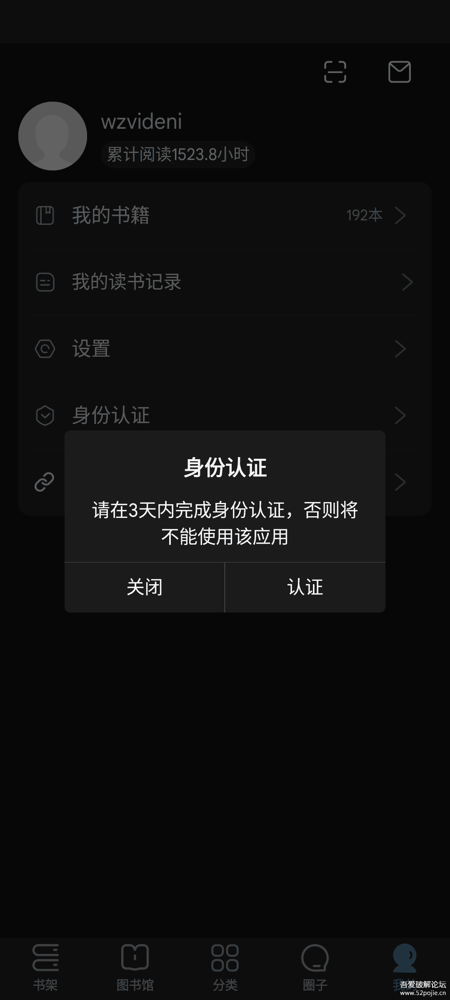
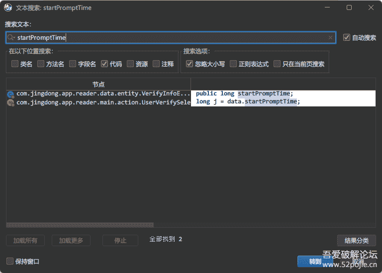
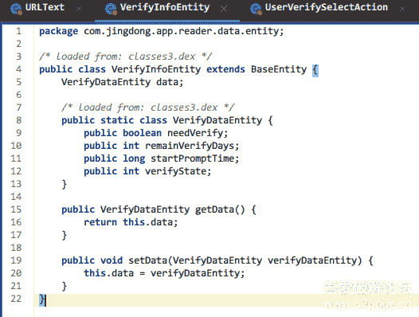
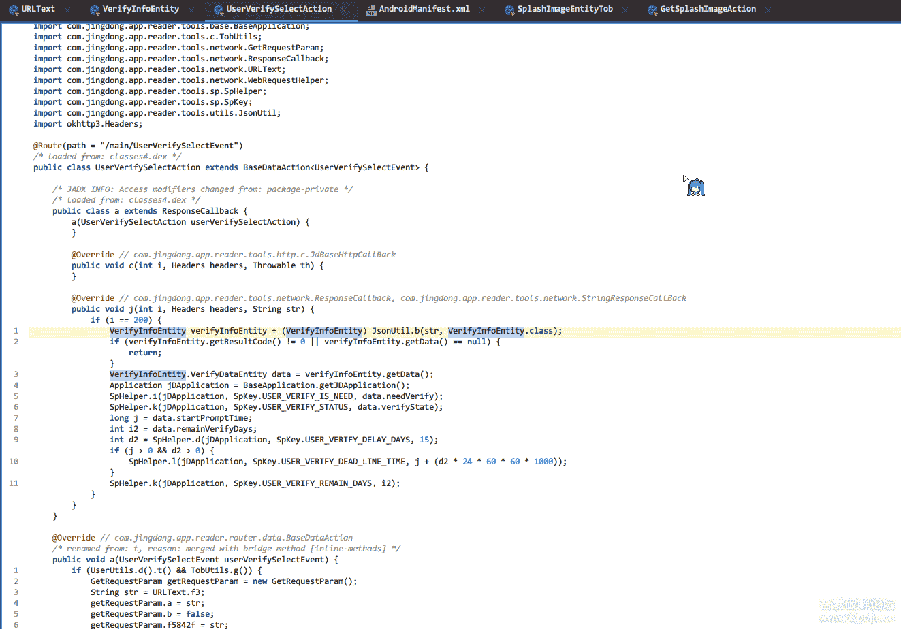

# [Android 原创] 某Dong读书专业版校园ip身份认证Hook

- 原帖: https://www.52pojie.cn/forum.php?mod=viewthread&tid=1975885
- 抓取时间: 2026-11-01T16:22:03.532Z

## 前言
不知道怎么回事，用了几年的看书软件突然要验证了，要正常的过验证得在相应校园的ip才行，我是几年前用测试码注册了一个绑定了手机号一直用到现在，自然是没法正常验证了，不知道有没有其他人遇到这种情况。

说实话这个软件的确很良心，突然不能用了有点难受，我在搜索了一番也没有找到解决方案，目前唯一的解决办法就是用`HttpCanary`重写相应验证的网络请求响应，但是得每次启动都把`HttpCanary`打开才行，麻烦但是能行。

看着剩余时间从15天到了现在的3天，每次打开都能看见这个验证，怎么彻底解决这个问题一直困扰着我，今天闲着的时候顿悟，我学了安卓开发，又学了安卓逆向，解决这个问题不是手到擒来，只可惜学逆向看的教程用的Hook方法和我想用的不一样就没上手练过，这次算是有机会给我练练了，就这么有了这篇记录。

## 验证提示截图


## 分析
由于之前用`HttpCanary`抓包分析了相应验证，就打算Hook相应验证的网络请求的方法，在验证前改写网络请求回调传入的参数。

首先身份验证请求的链接是：https://tob-api.jd.com/tob/api/college/user/verify/info……

返回的参数是json数据：`{"data":{"need_verify":true,"verify_state":0,"start_prompt_time":1728884471000,"remain_verify_days":3},"result_code":0,"message":"SUCCESS"}`

没有加密，意思也很明确了，改写`need_verify`和`verify_state`就可以了

现在就是怎么Hook相应的网络请求验证方法了

首先要先找到验证的方法，我通过搜索相应的数据类属性来查找的调用处，由于开发的时候通常都是这么写的，我想这个App应该也是这样，那么就用`Jadx`打开`apk`文件反编译代码，尽量搜索唯一的关键字，我选择的是`start_prompt_time`，直接搜`start_prompt_time`或者`startPromptTime`，直接搜`start_prompt_time`没有找到，搜`startPromptTime`就有了，如下图所示：



跳转过去后就看到数据类实体了，和网络请求返回的一样，如下图所示：



然后右键`VerifyInfoEntity`点击查找用例，找到这个实体类在哪被使用了，跳转后的截图如下：



很明显`UserVerifySelectAction`类中的内部类`a`的`j`方法就是身份验证的的网络请求回调，里面还有计算时间的代码，100%确定了。

## 实现
代码位置找到了，现在就是编写`lsposed`模块来持久化Hook了，由于我学的Hook是跟着论坛里的教程学了，用的是`java`，但是我不想写`java`，又因为很久没写`java`不会写了，只会`kotlin`。

正好有大佬编写了一套`Kotlin`的Hook：`YukiHookAPI`，首先用`YukiHookAPI`构建工具创建了一个`lsposed`项目模板，再用`Android Studio`打开，边看文档和示例代码就开始写了，期间不会的就问`chatgpt`了，想不到`chatgpt`连安卓逆向也会，`Ai`真的太强大了

顺带用同样的方法把启动页给关掉了，每次启动都要等3秒，虽然显示的不是广告，但是和广告达到了同样的效果，让用户点跳过或者等3秒……，不过现在清爽了

最终核心代码20行不到，我之前还一直以为Hook会比开发要难，结果出乎我的意料，不过仔细想想，也是因为有各个大佬开发的框架，才可以这么便利的Hook，感谢大佬！

论坛的代码插入居然没有`Kotlin`，那就选`java`吧，实际上是`Kotlin`，核心代码如下：

```
@InjectYukiHookWithXposed
class HookEntry : IYukiHookXposedInit {

    override fun onInit() = configs {
        configs {
            debugLog {
                tag = "JingDongReaderCampus"
                isEnable = true
                isRecord = false
                elements(TAG, PRIORITY, PACKAGE_NAME, USER_ID)
            }
            isDebug = true
            isEnableModuleAppResourcesCache = true
            isEnableHookSharedPreferences = false
            isEnableDataChannel = true
        }
    }

    override fun onHook() = encase {

        loadApp(name = "com.jingdong.app.reader.campus") {

            // 注册模块 Activity 代{过}{滤}理
            onAppLifecycle {
                onCreate { registerModuleAppActivities() }
            }

            val headersClass by lazyClass("okhttp3.Headers")
            
            // Hook验证
            "com.jingdong.app.reader.main.action.UserVerifySelectAction\$a".toClass().apply {
                method {
                    name = "j"
                    param(IntType, headersClass, StringClass)
                }.hook {
                    before {
                        // 修改传入的参数 `str`
                        args[2] =
                            "{\"data\":{\"need_verify\":false,\"verify_state\":1,\"start_prompt_time\":1728884471000,\"remain_verify_days\":365},\"result_code\":0,\"message\":\"SUCCESS\"}"
                    }
                }
            }

            // Hook启动页
            "com.jingdong.app.reader.logo.action.GetSplashImageAction\$a".toClass().apply {
                method {
                    name = "j"
                    param(IntType, headersClass, StringClass)
                }.hook {
                    before {
                        // 修改传入的参数 `str`
                        args[2] =
                            "{\"data\":{\"has_adv\":false,\"name\":\"浙江大学的启动图\",\"pic_address\":\"https://img10.360buyimg.com/ebookadmin/jfs/t1/194181/34/42246/108158/655abb8cF1a52e14c/e9fe15f9f3072098.png.dpg\",\"jump_type\":0},\"result_code\":0,\"message\":\"SUCCESS\"}"
                    }
                }
            }
        }
    }
}
```

## 下载地址
蓝奏云：https://wwur.lanzout.com/b0pm3gdza

密码：jdds
