# [Android 原创] 某闹钟APP解锁高级版分析

- 原帖: https://www.52pojie.cn/forum.php?mod=viewthread&tid=1976684
- 抓取时间: 2026-11-01T16:21:55.930Z

新人，第一次搞安卓逆向，没想到意外的顺利。

该软件为google商店下载的，安装包有google加固、签名验证，本人新手不会搞，只能算法助手hook了。

原始安装包： [//lxgz.lanzouo.com/i539o2dvrxda](https://lxgz.lanzouo.com/i539o2dvrxda:https)

软件：某闹钟APP

软件介绍：“在97个国家中排行第一的闹钟APP”（原文）

工具：MT管理器，算法助手Pro

1、尝试搜索`isVip`，搜索无结果后寻找一下关键词，找到关键词`premium`，译为高级版

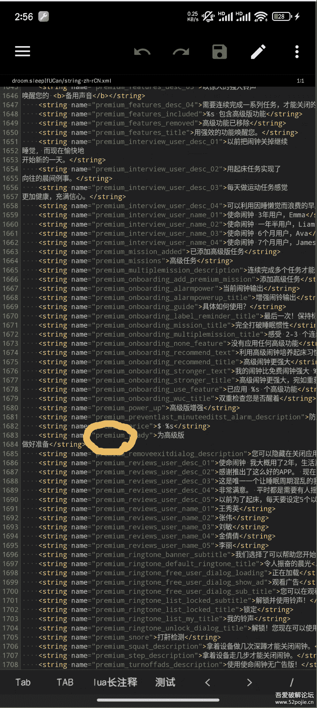

2、搜索一下关键词，点一个看看

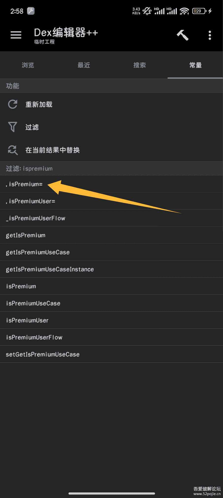
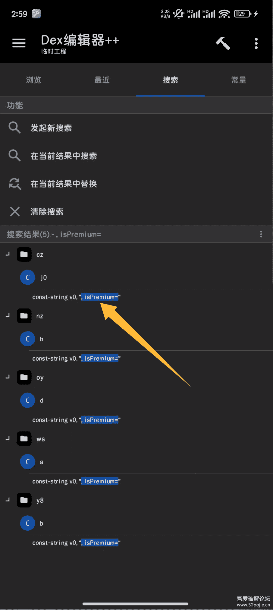

3、发现可疑变量`this.f`，看一下哪里修改了，原来是函数传参，接下来跟踪一下哪里创建了变量

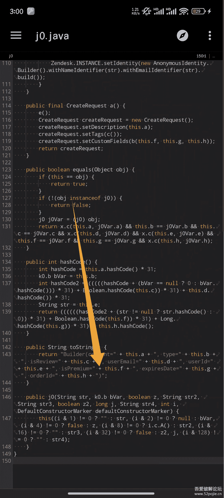
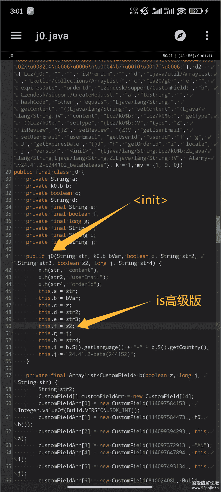

4、继续跟踪，`k0`创建了`j0`。继续跟踪，`r0`创建了`k0`。接着跟踪传参的`.a()`方法，发现此方法非常适合hook！

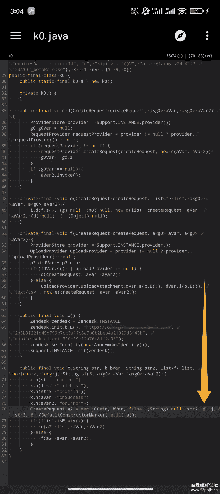
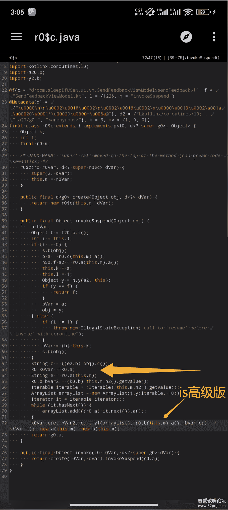
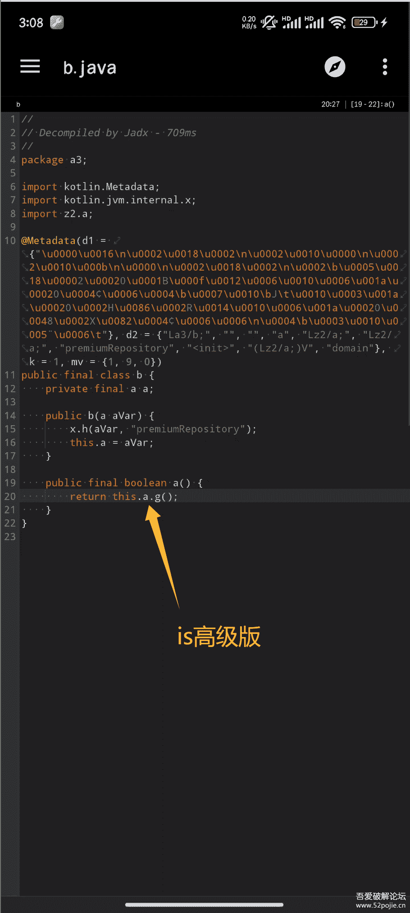

5、算法助手hook一下看看

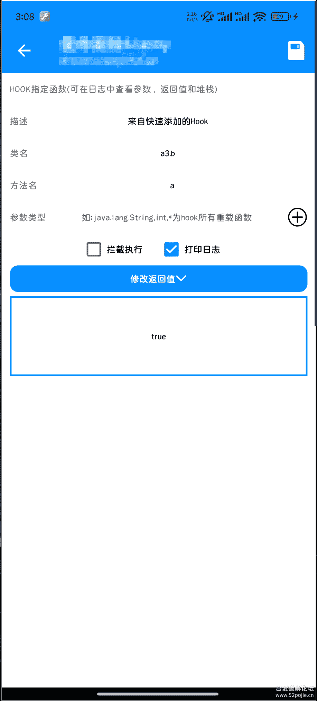

6、成果展示

修改前：

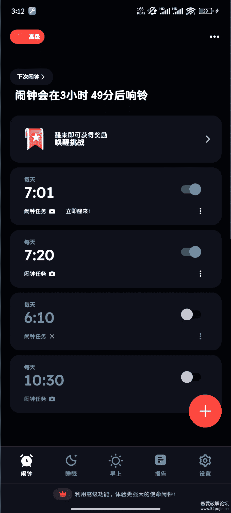
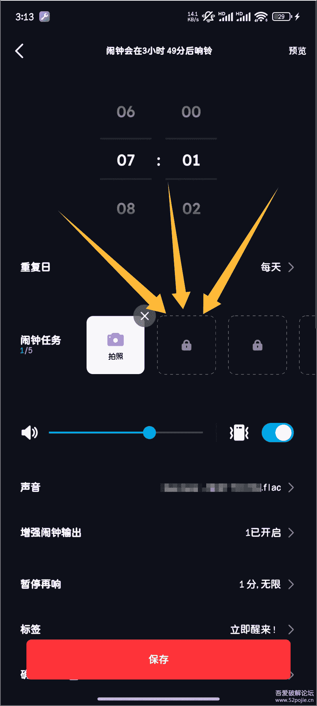

修改后：

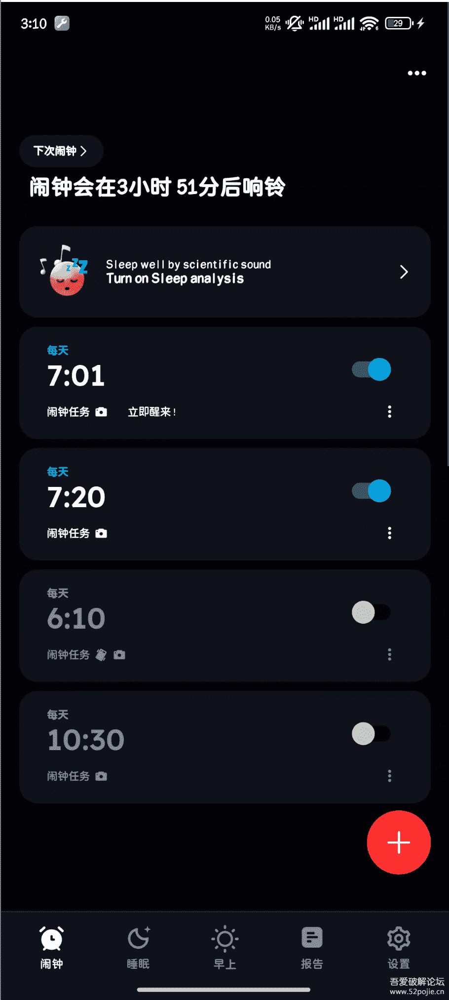
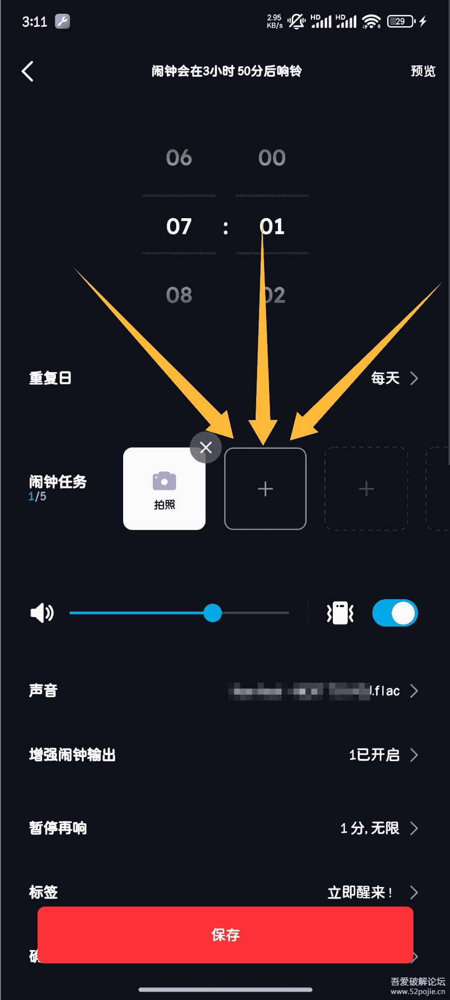

居然就这么成功了，功能使用正常，真没想到如此简单

，睡觉
