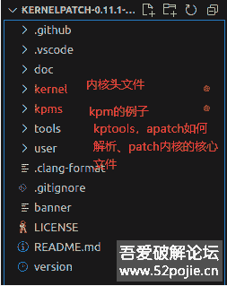
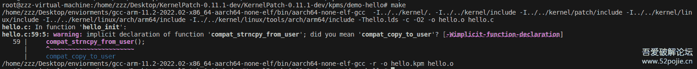
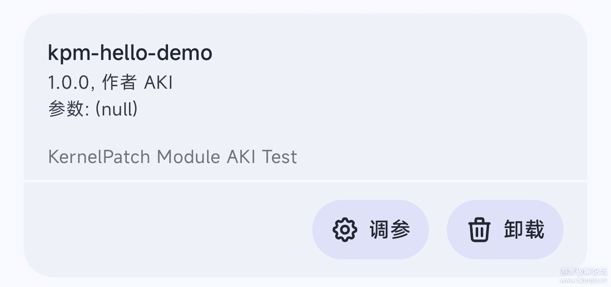
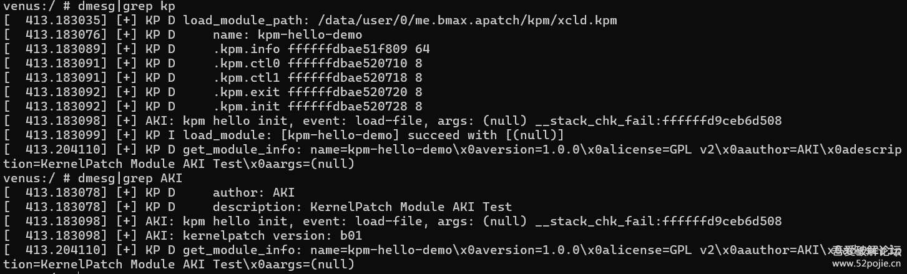

# [Android 原创] KernelPatchModule开发学习-编译kpm、如何进行内核hook

- 原帖: https://www.52pojie.cn/forum.php?mod=viewthread&tid=1977664
- 抓取时间: 2026-11-01T16:21:43.375Z

## 0x0 前言

随着安卓逆向研究已经开始进入内核时代，现在内核相关的开发软件和资料也是越来越多。最近发现apatch的kpm挺好用的，不依赖内核源码，编译也很方便，还有现成的几种内核hook方式。但是在学习的过程中发现目前相关资料还是比较少，于是想用文章记录一下自己的学习过程。

## 0x1 简介、环境

### 什么是KernelPatchModule？

官网的简介：一些代码在内核空间运行，类似于Loadable Kernel Modules（LKM）。此外，KPM提供在内核空间进行内联hook、系统调用表hook的能力。KPM 是一个 ELF 文件，可由 KernelPatch 在内核空间内加载和运行。

官方GitHub地址：

> https://github.com/bmax121/KernelPatch/tree/dev

环境、工具版本：

- `Ubuntu 22.04.2 LTS`
- `gcc-arm-11.2-2022.02-x86_64-aarch64-none-elf.tar`
- `GNU Make 4.3`

## 0x2 编译

首先在官网下一份源码。



我们这里只需要关心`kpms`里的例子是怎么写的。

然后是在这下载GNU tools，建议使用`aarch64-none-elf`，我之前使用linux自带的`aarch64-linux-gnu`编译出来无法正常使用。

https://developer.arm.com/downloads/-/arm-gnu-toolchain-downloads/11-2-2022-02

进入`/kpms/demo-hello`这个目录下：

```shell
export TARGET_COMPILE=$(yourPath)/aarch64-none-elf-
make
```



输出的`.kpm`就是编译出来的模块。

在`apatch`里内核模块->右下角图标->加载->选择`hello.kpm`，加载成功后会显示：



使用`demsg|grep kp`就能看到模块加载的信息：



## 0x3 kpm代码的基本结构

需要关注的是这些地方。

## 0x4 根据内核符号地址hook内核函数

以hook `process_vm_rw`为例子，这个函数在`/ mm / process_vm_access.c`。

首先需要找到函数原型，可以结合我上一篇还原内核符号的文章和那个查看内核符号的网站使用。

函数原型：

```cpp
static ssize_t process_vm_rw(pid_t pid,
                             const struct iovec __user *lvec,
                             unsigned long liovcnt,
                             const struct iovec __user *rvec,
                             unsigned long riovcnt,
                             unsigned long flags, int vm_write) //5.4.210内核源码的函数原型
```

想要hook这个函数，首先在文件中按照原来的代码构建一个原型：

```cpp
ssize_t (*process_vm_rw)(pid_t pid, const struct iovec __user *lvec, unsigned long liovcnt,
                       const struct iovec __user *rvec, unsigned long riovcnt, unsigned long flags, int vm_write) = 0;
```

使用`kallsyms_lookup_name`，在`/kernel/include/kallsyms.h`中，作用是寻找返回所查找的内核函数地址，找不到返回0。具体详见 https://blog.csdn.net/weixin_45030965/article/details/132497956

查找内核符号地址：

```cpp
process_vm_rw = (typeof(process_vm_rw))kallsyms_lookup_name("process_vm_rw");
```

进行inline hook，`hook_wrapX`，这个`X`代表的是需要几个参数，里面调用的是`hook_wrap()`。`before`是调用前执行的函数，`after`是调用后执行的函数：

```cpp
hook_wrap8((void *)process_vm_rw, before, after, 0);
```

## 0x5 syscallHook

根据系统调用号hook内核函数，以例子中的`__task_pid_nr_ns`这个函数为例，这个内核函数在`/kernel/pid.c`。

根据系统调用号进行hook，分两种`function_pointer_hook`和`inline_hook`，它们调用的方式都是类似的：

```cpp
#define __NR_openat 56
err = inline_hook_syscalln(__NR_openat, 4, before_openat_0, 0, 0);
err = fp_hook_syscalln(__NR_openat, 4, before_openat_0, 0, 0);
```

关于这个工具hook syscall的具体原理流程后续随缘更新，这里就只讲使用。

## 0x6 小结

如果想知道具体`kpm`是如何加载运行的话，需要先了解`APatch`是如何运行的，这个现在还在看`kptools`的源码，还是后续随缘更新，感兴趣的可以先看看 https://bbs.kanxue.com/homepage-935696.htm 这个大佬的文章。
