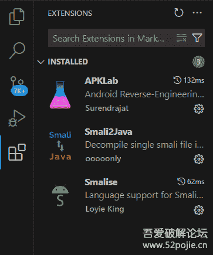
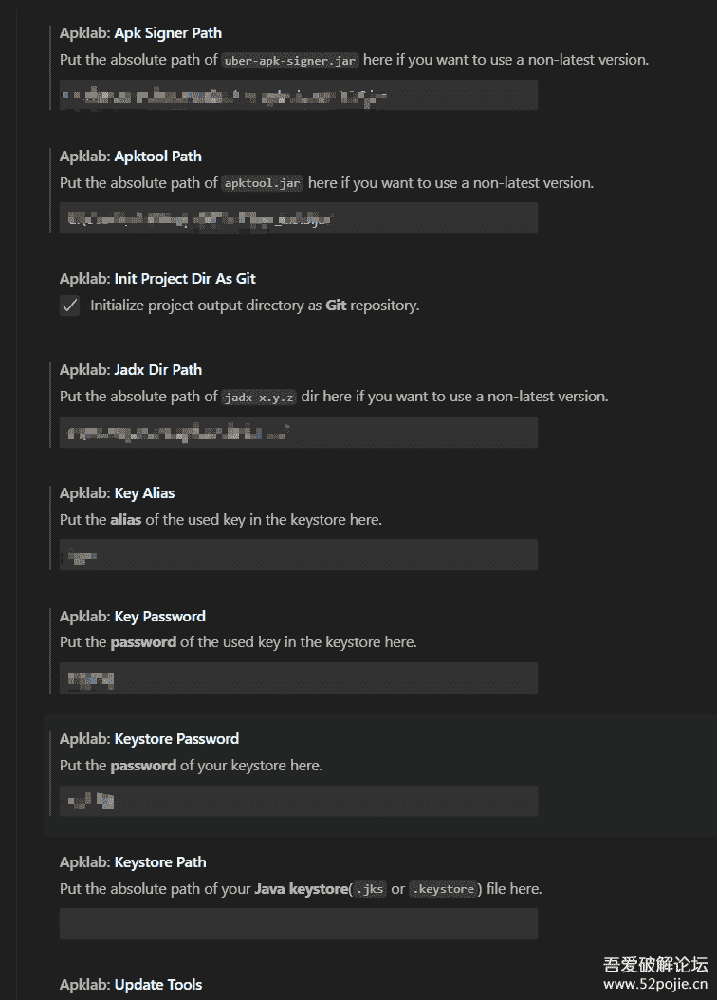
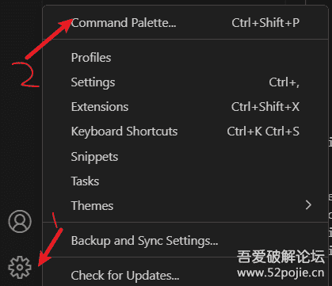
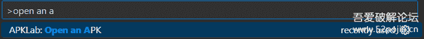

# [Android 原创] VScode + APKlab 进行逆向分析补充

- 原帖: https://www.52pojie.cn/forum.php?mod=viewthread&tid=1977977
- 抓取时间: 2026-11-01T16:21:38.369Z

## vscode + android逆向分析并重新打包

引用链接：

[//www.52pojie.cn/thread-1828789-1-1.html](https://www.52pojie.cn/thread-1828789-1-1.html:https)

### 前置条件:

- 下载 `vscode`
- [Visual Studio Code 官网](https://code.visualstudio.com/)
- 下载雷电模拟器

### VScode 安装扩展插件

#### 1.1 插件安装列表

- Smail2java
- smalise
- APKLab

#### 1.2 VSCODE 插件安装完成后，如图



#### 1.3 APKLab 安装完后操作

##### 1.3.1 提示: 如果安装完后, 图中马赛克部分是全空的



##### 1.3.2 接下来操作




点击左下角小齿轮 -> 点击 `Command Palette` -> 输入 `Open an APK` -> 任意打开一个 APK -> 此时会自动下载 1.3.1 图中空缺的部分 -> `jadx dir path` (此时还是空的) -> 手动搜索 `jadx` -> 填入框内即可

##### 1.3.3 补充 ADB 路径

控制面板 -> 系统和安全 -> 系统 -> 高级系统设置 -> 高级 -> 环境变量 -> `path` -> 新建 -> 输入 `F:\Software\leidian\LDPlayer9\` (此处应该换成你的雷电模拟器安装路径) -> `cmd` -> `adb version`

```
adb version
Android Debug Bridge version 1.0.41
Version 34.0.4-10411341
Installed as F:\Software\leidian\LDPlayer9\adb.exe
Running on Windows 10.0.17763

> 
```

注意事项

如果不补充 ADB 路径, 那么在 `vscode` 里对 `apktool.yml` 进行打包并安装是会失败的
