# [Android 原创] 沪江开心词场APP词书接口和数据破解

- 原帖: `https://www.52pojie.cn/forum.php?mod=viewthread&tid=1978828`
- 抓取时间: `2026-11-01T16:21:22.948Z`

## 说明

接[上一篇沪江小D（现APP已不能使用）的破解](https://www.52pojie.cn/thread-1977278-1-1.html)，主要思路也是Fiddler抓接口，然后`jadx`反编译`apk`包，根据接口定位反编译代码，分析代码得到数据解密方式，最后使用`python`实现解密算法得到解密秘钥和文本。

检查了一下，之前是爬取了沪江开心词场所有的日语单词书，`json`格式，包括读音例句释义等详细信息，还有沪江小D上爬取的`13000`多个日语单词，另外还爬了其他两个APP上的日语N5-N1语法和N5-N1真题，同时存了`json`文件和数据库`db`，看下如果有兄弟要学日语需要的话可以在百度盘下载，压缩后`100M`左右：`https://pan.baidu.com/s/1NS5ApZykRn7WoBRLXTuAaA&pwd=uuuu`，不过建议自己上手试试看。

另外两个APP（羊驼日语和芥末日语，不确定是否还活着）的破解也是类似的思路，有个还涉及到接口VIP校验。

哈哈，为了过个N1找资料我也是爱上了逆向。:lol

## 准备工具

- Android模拟器：[逍遥模拟器](https://www.xyaz.cn/)
- Anroid抓包代.理软件： [Drony 1.3.154](https://www.52pojie.cn/[Drony](https%3A//drony.cn.uptodown.com/android))
- PC抓包软件： [Fiddler](https://www.telerik.com/download/fiddler)
- apk反编译工具： [jadx 1.3.0](https://github.com/skylot/jadx/releases)
- Android so库反编译工具：IDA Pro，站内有，这儿就不放链接了

相关工具以及破解的`apk`包可以通过百度云获取： `https://pan.baidu.com/s/1CjdDkXgVGJpMToXuc_8SRQ`，提取码`uurr`。

实现的整个源码可以参考`github`，其中实现了沪江词书的解密和爬虫。： `https://github.com/youyouzh/PythonPractice/blob/master/spider/word/crawler/hujiang_crawler.py`

## 词书查询下载接口

打开沪江开心词场，注册登录后，添加词书，这儿选择日语词书 -> 查看更多，可以筛选，然后点击其中一本词书添加。抓包接口如下：

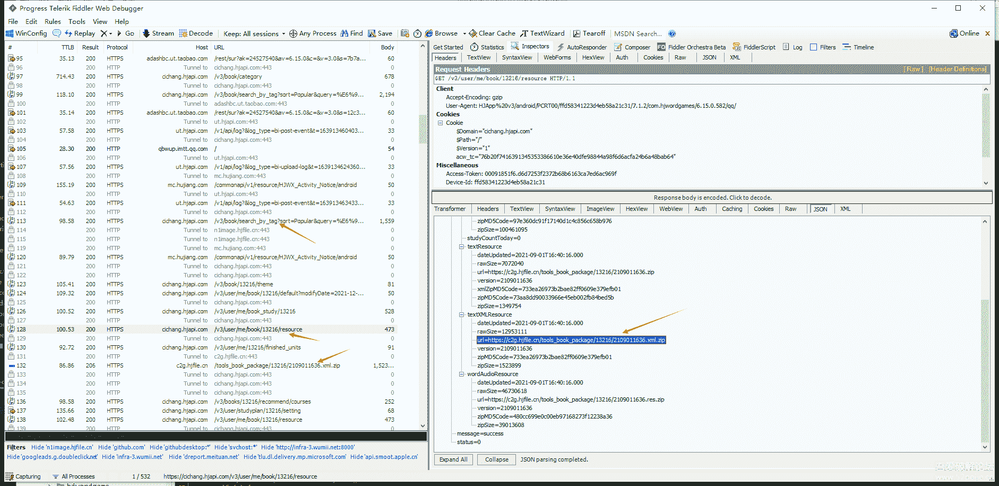

其中第一个接口`GET /v3/book/search_by_tag`根据`tag`来搜索，尝试在`postman`中构造这个请求，连登录态都不需要，没有任何校验，直接可以查寻词书，返回值也没有做任何加密，其中就有词书`id`。

看第二个接口`GET /v3/user/me/book/13216/resource`用于获取词书文件下载地址，同样在`postman`中构造这个请求，这个请求需要`token`登录态才可以，没有其他限制。

注意到返回值`json`中显然有词书文件压缩包的地址，而且看接下来的请求是下载`2109011636.xml.zip`后缀的词书，其他的词书估计没用到先不管。

访问词书压缩包下载地址`https://c2g.hjfile.cn/tools_book_package/13216/2109011636.xml.zip`，可以直接下载`zip`文件，没有登录态和其他安全检查。

压缩包下载以后，解压，可以看到其中的文件列表，但是提取文件的时候显示需要密码。

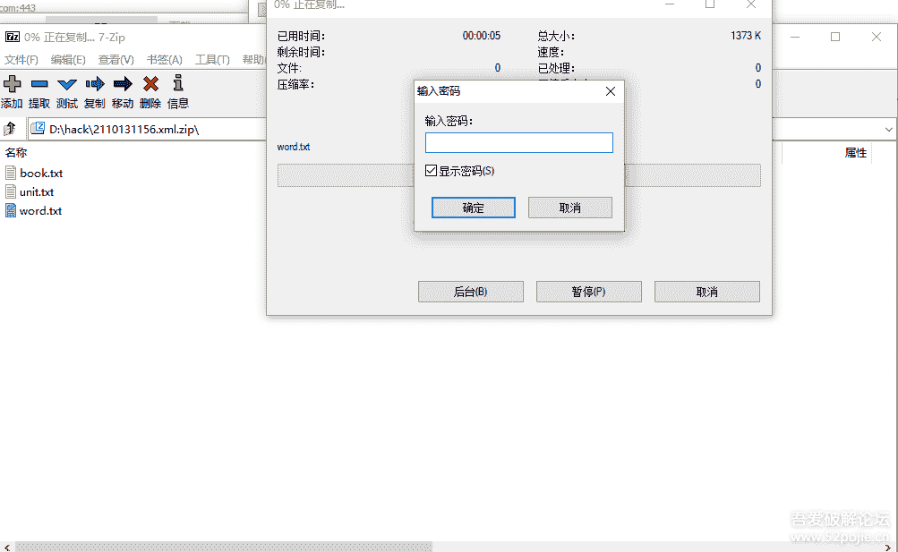

## 词书压缩文件密码算法破解

压缩包加密码正常操作，要不然别人也太容易爬取它的词书了。别想着暴力破解压缩密码啥的，那太慢了，直接反编译`apk`，看代码里面怎么解压缩的。

打开`jadx`，然后反编译沪江开心词场的`apk`包。

这儿的搜索就很有技巧了，我们的目的是要找出压缩包的解压密码，可以通过压缩包下载路径搜索，但是压缩包下载路径是从接口`GET /v3/user/me/book/13216/resource`动态获取的，然而搜索`/v3/user/me/book/`没有结果，试着搜索`/user/me/book/`也不行，搜索`user/me/book/`终于有结果了。搜索的时候要多试一试，找一些区分度大的字符串搜索，这样找到目标代码的概率会比较大。

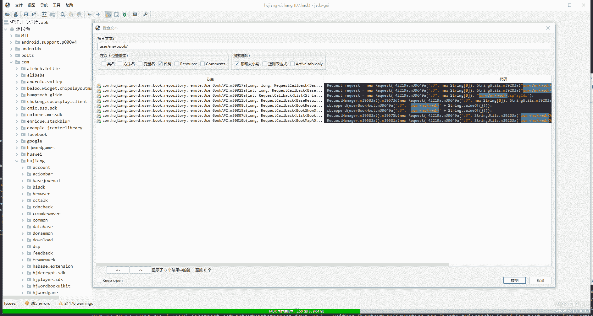

看搜索结果，使用都是在`UserBookAPI`的类中，猜测这个类就是词书下载处理类。

在`UserBookAPI`类中搜索`resource`很容易定位到接口处理的代码：

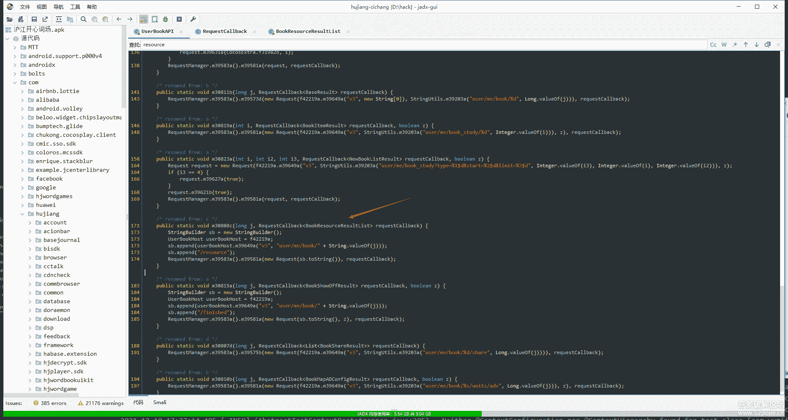

其中`BookResourceResultList`结构很明显了，就是词书资源接口的返回结果，这个方法就是一个`http request`的简单实现，返回值的处理在`requestCallback`回调中，但是此处的类型`RequestCallback`是一个抽象处理类，其中没有解压缩包的具体实现，为了弄清楚`requestCallback`具体是什么，我们搜索这个方法的调用，看这个参数是怎么传进来的。

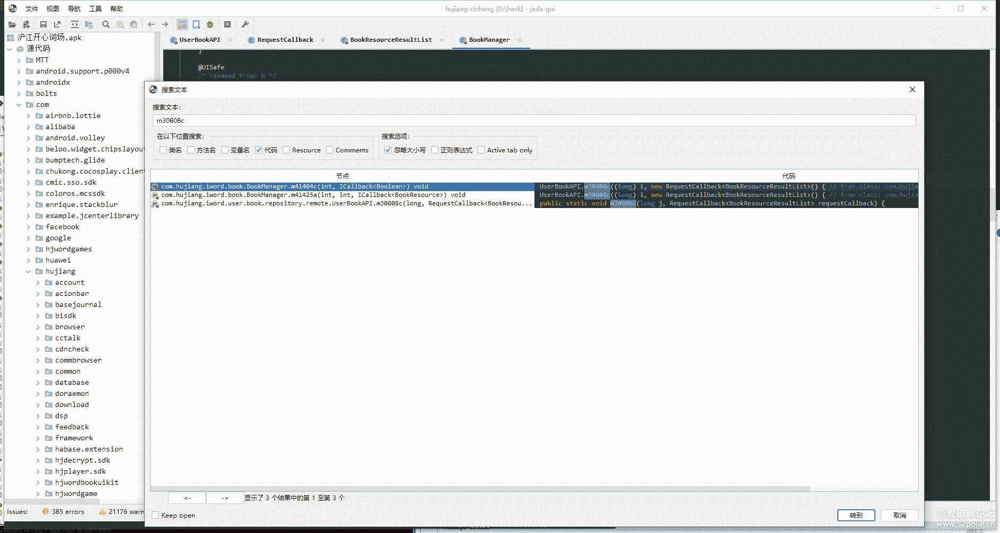

直接搜索方法名`m30808c`，可以看到结果有`3`个，点击第一个进入可以看到创建了一个`RequestCallback`的匿名实现类，分析其中的实现并没有找到解压的处理。

这就是我为什么说搜索很有技巧了，上面的步骤其实是在搜索查询词书资源并处理的代码，一般认为下载完之后应该会立即解压缩，所以分析下载后的代码应该很容找到解压缩才对，然而实际上却很费劲，因为程序的解压缩可以放在异步线程里面，或者加一个观察者来实现，解压缩的代码有可能和下载的代码不在一个地方。

那么换一个思路，一般解压缩我们想到的英文单词是`unzip`，而且在实际开发过程中，对于解压操作容易出错，我们一般会在解压缩前后打印日志，而日志字符串是没有混淆的。那么我们不妨直接搜索`unzip`，很少人打印日志用中文，应为写代码是英文，如果打印日志用中文要频繁切换输入法。

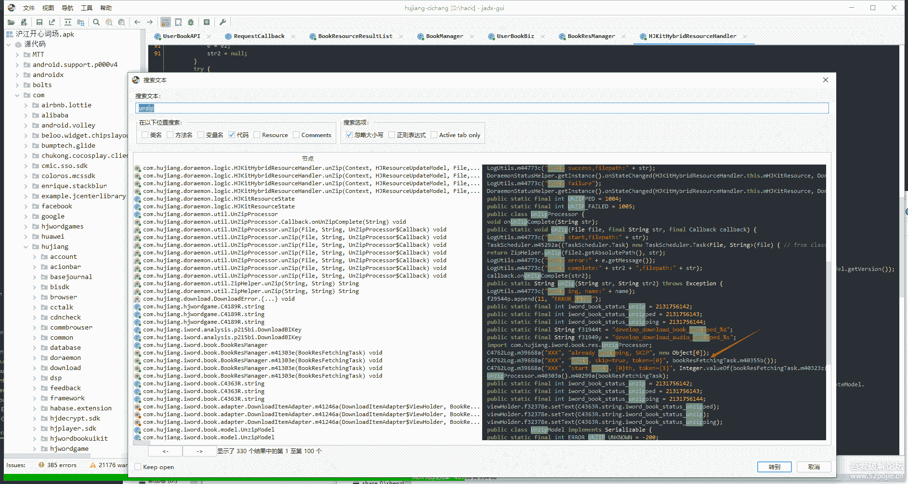

搜索结果很多，可以大概浏览一下，很多类名都没有混淆，其中词书相关的类比如`BookResManager`，点进去一眼就可以发现是调用`UnzipProcessor`的静态方法实现解压缩。看类名就知道是专门处理解压缩的。

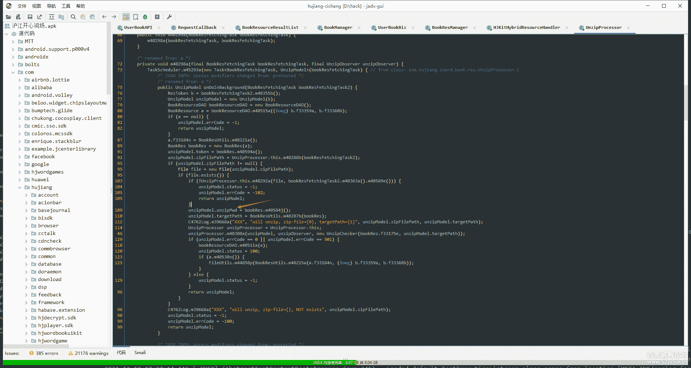

`UnzipProcessor`这个类其中解压的实现逻辑，很容易看到密码的赋值`unzipModel.unzipPwd = bookRes.m40584j();`语句，接下来研究`bookRes.m40584j();`的实现即可知道密码是怎么得到的，点进这个方法，可以看到密码的构造过程。

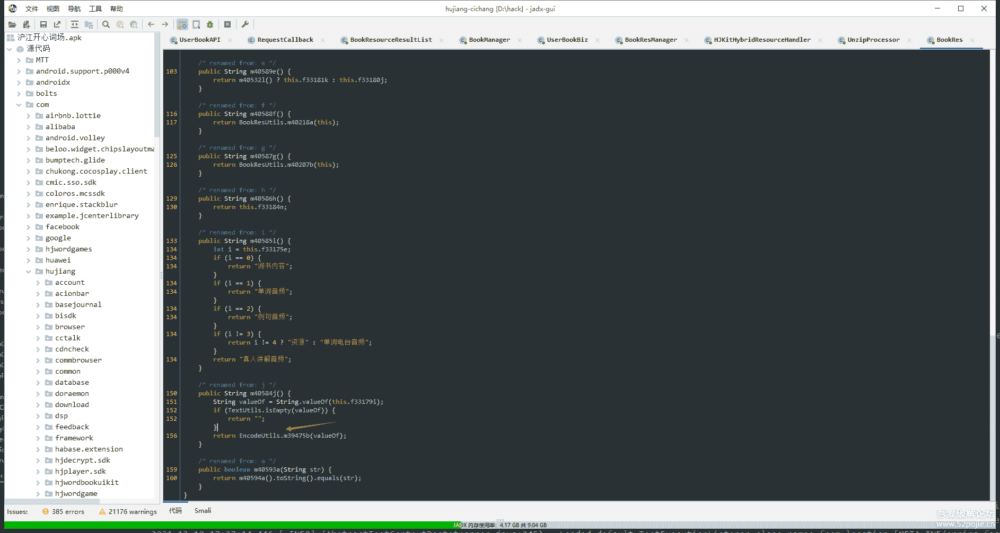

其中逻辑很简单，首先判断`this.f33179i`是否为空，为空直接返回空字符串也就是没有密码，否则调用一个加密工具类中的方法`EncodeUtils.m39475b(valueOf)`，在进入这个加密工具类之前，先弄清楚输入参数是什么，也就是`this.f33179i`的值。

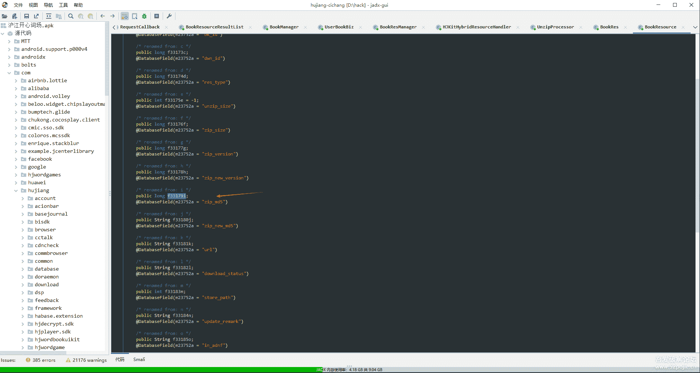

可以看到`this.f33179i`是在父类`BookResource`中定义，注意在其上面的注解`@DatabaseField(m23752a = "zip_new_version")`，这个字段应该是版本号，千万不要看错看成下面的注解`@DatabaseField(m23752a = "zip_md5")`！！！查询词书资源那个接口`GET /v3/user/me/book/13216/resource`返回值中有一个`version`字段，这儿还不能直接确定（虽然就是），可以继续看代码。

注意`this.f33179i`所在类型`BookRes`只有一个构造函数`public BookRes(BookResource bookResource)`，并且`this.f33179i`的值是直接从输入参数参数父类成员赋值过来。

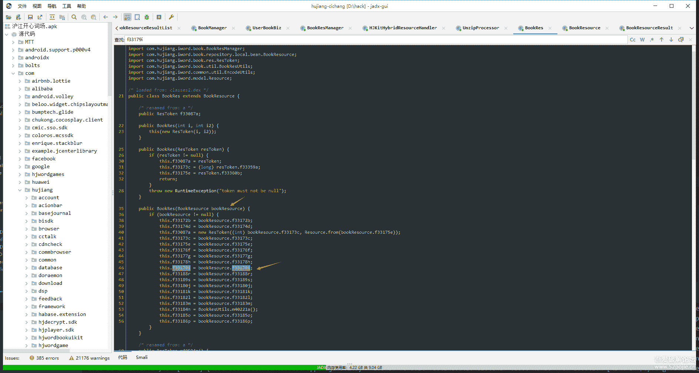

可以搜索构造函数的调用`BookRes(`，也可以直接搜索这个成员变量`f33179i`的赋值，得到这个值是怎么取的。此处搜索这个成员变量赋值的地方。

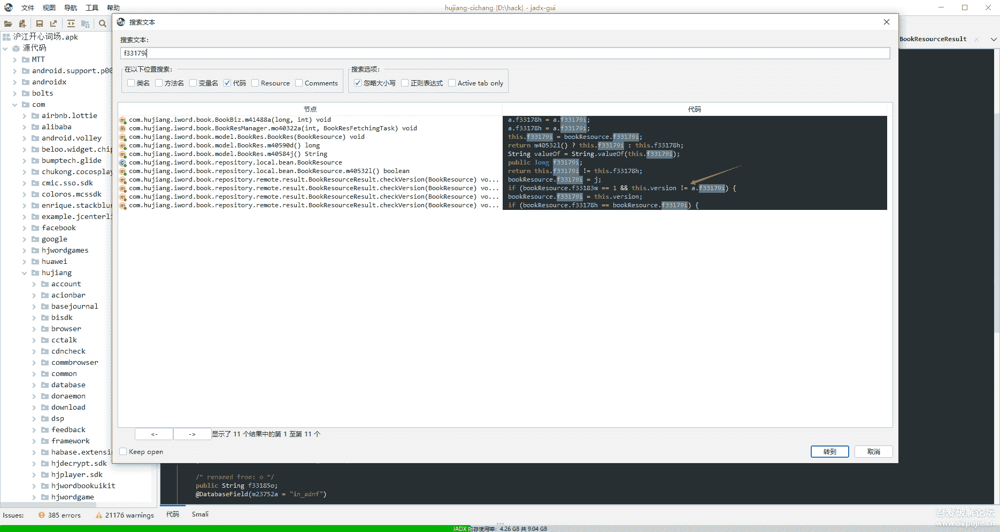

搜索结果主要注意左值表达式，前面几个是`BookRes`的构造函数赋值，只是简单的类型转换不用理会，而其中有一个比较`this.version != a.f33179i`，居然和`version`版本号比较，点进去。

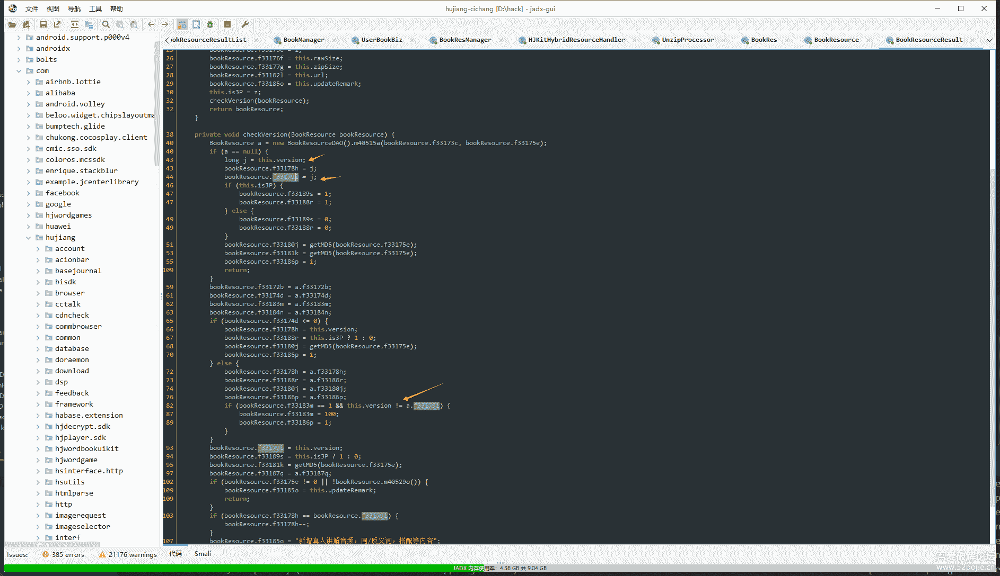

可以看到`a.f33179i`的值就是`this.version`，而当前类为`BookResourceResult`看其中的字段就是词书资源接口返回的结果，而这个`f33179i`显然就是`version`字段的内容了，这个函数名称`checkVersion`更加确认了这一点。

弄清楚参数的名称以后，我们就可以看那个解密工具类的方法了。

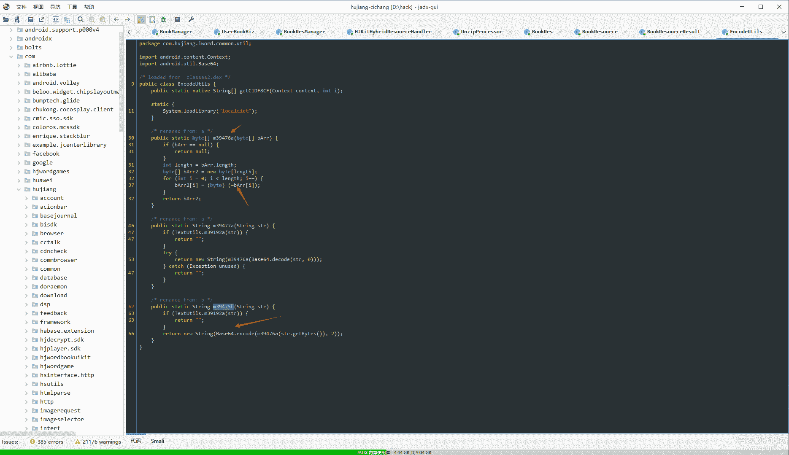

其实现逻辑很简单，就是把输入参数`str`转成字节码，然后每个字节取反，再作为参数进行`Base64`编码。

到此，终于确定了解压密码的生成方式了，接下来写一个`python`快速实现这个算法：

```
import base64

def generate_zip_file_password(version: int) -> str:
    version = str(version).encode('UTF-8')
    not_md5 = []
    # 按位取反，注意不能直接使用 ~ ，python中的byte不能为负，此处和 0xFF 取异或，最后得到的结果是一致的
    for byte in version:
        not_md5.append(byte ^ 0xFF)
    not_md5 = bytes(not_md5)
    password = base64.standard_b64encode(not_md5)
    return password.decode("UTF-8")

generate_zip_file_password(2110131156)
```

注意`python`中`byte`类型不能为负，所以不能直接取反，而是和`0xFF`取异或，为了验证最后的结果一致，可以输入相同的参数和`Java`版本比对。

```
// java版本的密码生成函数
public String generateZipPassword(String version) {
    byte[] bArr = version.getBytes(StandardCharsets.UTF_8);
    int length = bArr.length;
    byte[] bArr2 = new byte[length];
    for (int i = 0; i 
```

两边运行结果是一致的。而且将生成的密码填入，能够成功解压。

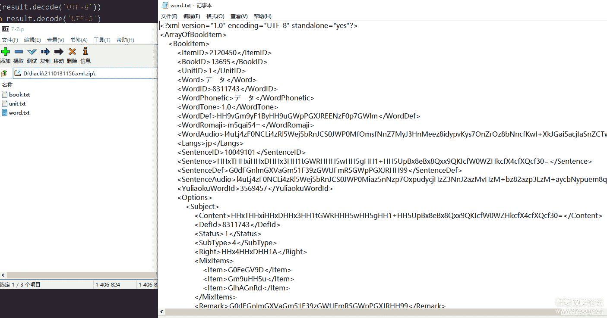

## 词书内容解密

打开其中的`word.txt`显然就是词书的具体内容了，而且是`xml`格式，`python`中可以用`xmltodict`库把`xml`转成`dict`格式，然而事情并没有结束，仔细看里面的字段，很多都是加密过的。

好家伙，压缩包有密码，里面的内容还是加密的！双重加密！很安全。

不过并不用慌，回到`jadx`，看看能不能找到解密方式的线索。用刚才解压缩的`word.txt`里面的几个字段名称搜索可以看到这些字段怎么读取和操作的。

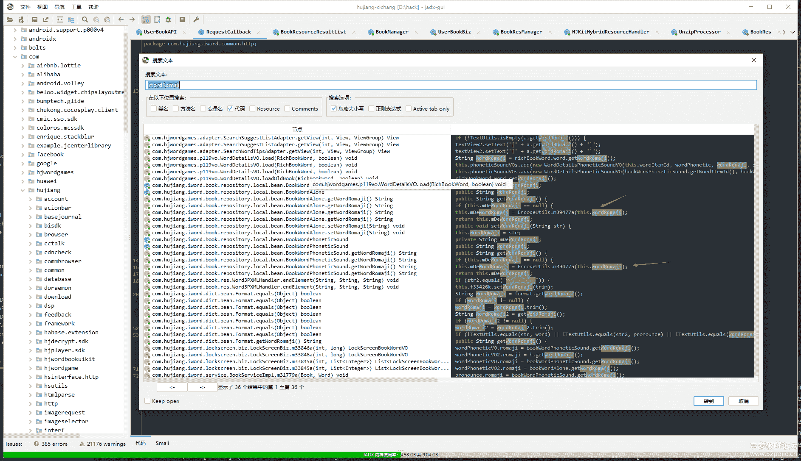

很容易发现其中调用了`EncodeUtils.m39477a`方法，就是之前分析的那个加密工具类，其实现也很简单，刚好和压缩密码生成反过来，先把加密字符串`Base64.decode`，然后对每个`byte`取反。

保险起见，搜索一下`m39477a`这个方法的调用。

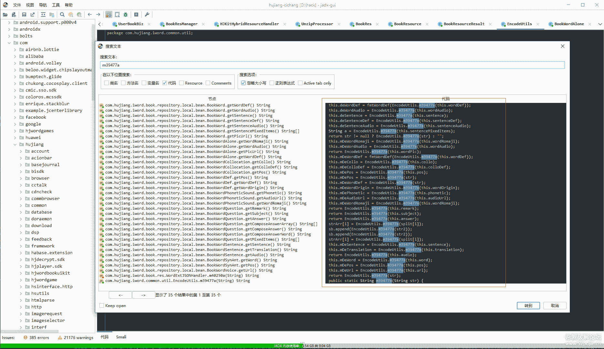

这些调用，不就是解密字段吗，而且这些字段不就是刚才`word.txt`里面的字段名称吗，基本`100%`肯定这个方法就是解密方法了。

用`python`快速实现，然后解密试一下：

```
import base64

def decode_book_field(encode_content: str) -> str:
    encode_content = encode_content.encode('UTF-8')
    decode_content = base64.standard_b64decode(encode_content)
    result = []
    for byte in decode_content:
        result.append(byte ^ 0xFF)
    result = bytes(result)
    print(result.decode('UTF-8'))
    return result.decode('UTF-8')

decode_book_field('HHxTHHxiHHxDHHx3HH1tGWRHHH5wHH5gHH1+HH5UpBx8eBx8Qxx9QKIcfW0WZHkcfX4cfXQcf30=')
```

可以顺利得到解密文本。

至此，完成了对沪江开心词场词书的破解，并且用`python`实现了整个加密解密算法。

补充最后爬取和解密后的`json`数据样例子

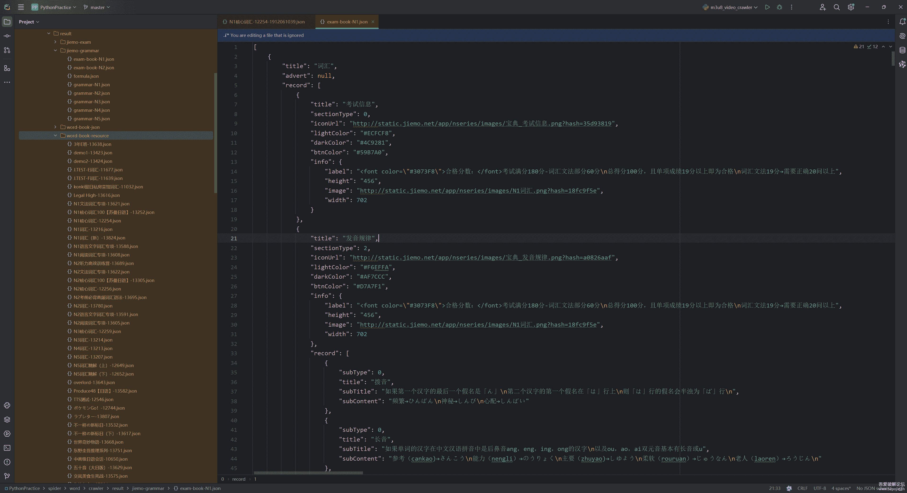

下面是爬的真题数据。

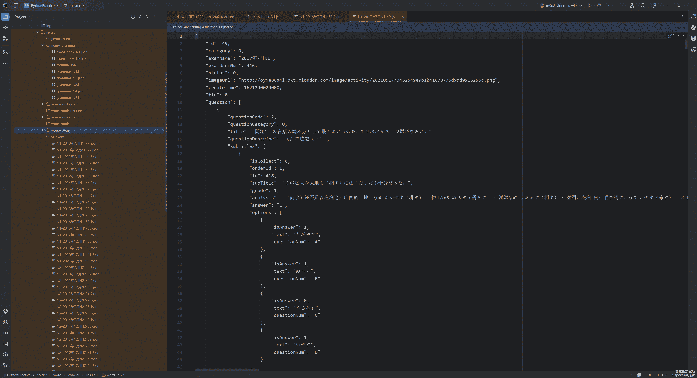
