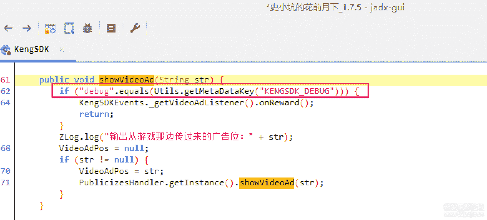
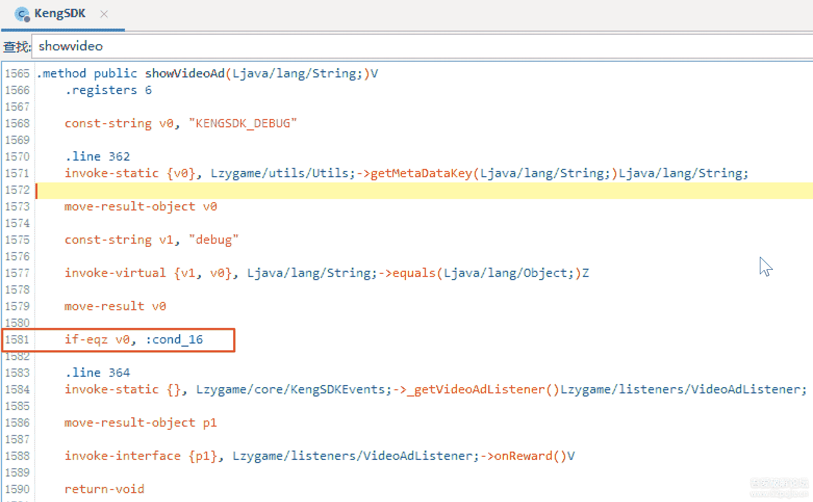

# [Android 原创] 某游戏免广告获得奖励

- 原帖: https://www.52pojie.cn/forum.php?mod=viewthread&tid=1979894
- 抓取时间: 2026-11-01T16:21:14.968Z

游戏名是史小坑的花前月下，每天奖励有30*30+50钻石，10分钟的祈雨。

分析过程非常简单，就不写了，直接写修改的位置。

需要修改的位置在`zygame.core.KengSDK`中的`showVideoAd()`方法中，java代码

把红框中的注释掉就ok了

对应smali代码是注释第1581行

另外游戏的`assets`目录下有个`xlsData.zip`的加密文件，有没有高手有兴趣挑战下解密过程？
