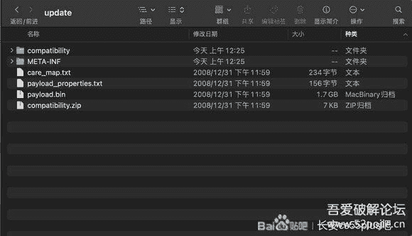
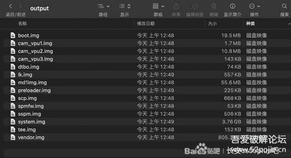

# [Android 原创] 长安 OTA 解包工具

- 原帖: https://www.52pojie.cn/forum.php?mod=viewthread&tid=1980301
- 抓取时间: 2026-11-01T23:58:10

https://github.com/w-a-n-g-s-h-u-n/changan-ota/blob/master/src/main/java/com/changan/ota/decrypt/Decrypt.java

长安 OTA文件 使用AES 进行了一次加密，升级时先在车机端解密，这个解密极其耗时，主要在于缓冲区大小设得极小

也就是代码里的`CACHE_SIZE`，设置成10M 之后解密速度提升巨大

有认识长安工程师的，赶紧叫他们改了吧

OTA文件 解密之后可以提取出`payload.bin`

1731332863524.jpg (28.28 KB, 下载次数: 0)

[href="forum.php?mod=attachment&aid=MjczNDQ2NnxhNTgxMzUxMnwxNzkzNTc3NDg4fDE2ODA4NnwxOTgwMzAx&nothumb=yes" target="_blank"](https://www.52pojie.cn/forum.php?mod=attachment&aid=MjczNDQ2NnxhNTgxMzUxMnwxNzkzNTc3NDg4fDE2ODA4NnwxOTgwMzAx&nothumb=yes)

2024-11-11 21:47 上传

继续解`payload.bin`可以得到 img，怎么解`payload.bin`应该搜得到

1731332914438.jpg (38.63 KB, 下载次数: 0)

[href="forum.php?mod=attachment&aid=MjczNDQ2N3wwNjhjYmM1MnwxNzkzNTc3NDg4fDE2ODA4NnwxOTgwMzAx&nothumb=yes" target="_blank"](https://www.52pojie.cn/forum.php?mod=attachment&aid=MjczNDQ2N3wwNjhjYmM1MnwxNzkzNTc3NDg4fDE2ODA4NnwxOTgwMzAx&nothumb=yes)

2024-11-11 21:48 上传

`boot.img`、`system.img`、`vendor.img`这几个比较重要

有兴趣研究的应该能懂我在说什么
