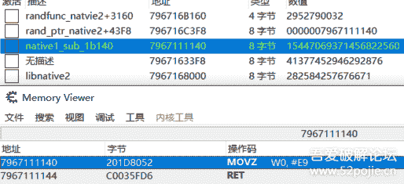
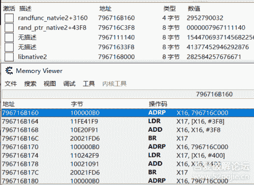

# [Android CTF] N1CTF-reverse-ezapk wp

- 原帖：`https://www.52pojie.cn/forum.php?mod=viewthread&tid=1980334`
- 抓取时间：2026-11-01T16:21:09.459Z

## 0x0 前言

前几天忙别的去了，完全忘了 N1CTF，今天想着看看题学习一下，先只下了个最简单的 ezapk，结果晚上网站直接关服务器，下不了其他题了。。

这个是入门题，无混淆，反调和检测，flag 格式为 `n1ctf{xxxxxxxxxxxxxxxxxxxxx}`

## 0x1 `frida`+`jadx`、`ida`静态分析

我这台手机 `ida` 动调不知道为啥一直用不了，所以这里只用 `frida`。

首先安装 apk，打开就是一个输入框和确认按钮，先拖进 `jadx` 里看一眼，入口就是 `MainActivity`

```java
public class MainActivity extends AppCompatActivity {
    private ActivityMainBinding binding;
    public native String enc(String str);
    public native String stringFromJNI();
    @Override // androidx.fragment.app.FragmentActivity, androidx.activity.ComponentActivity, androidx.core.app.ComponentActivity, android.app.Activity
    public void onCreate(Bundle bundle) {
        super.onCreate(bundle);
        ActivityMainBinding inflate = ActivityMainBinding.inflate(getLayoutInflater());
        this.binding = inflate;
        setContentView(inflate.getRoot());
        this.binding.CheckButton.setOnClickListener(new View.OnClickListener() { // from class: com.n1ctf2024.ezapk.MainActivity$$ExternalSyntheticLambda0
            @Override // android.view.View.OnClickListener
            public final void onClick(View view) {
                MainActivity.this.m157lambda$onCreate$0$comn1ctf2024ezapkMainActivity(view);
            }
        });
    }
    public /* synthetic */ void m157lambda$onCreate$0$comn1ctf2024ezapkMainActivity(View view) {
        String obj = this.binding.flagText.getText().toString();
        if (obj.startsWith("n1ctf{") && obj.endsWith("}")) {
            if (enc(obj.substring(6, obj.length() - 1)).equals("iRrL63tve+H72wjr/HHiwlVu5RZU9XDcI7A=")) {
                Toast.makeText(this, "Congratulations!", 1).show();
                return;
            } else {
                Toast.makeText(this, "Try again.", 0).show();
                return;
            }
        }
        Toast.makeText(this, "Try again.", 0).show();
    }
    static {
        System.loadLibrary("native2");
        System.loadLibrary("native1");
    }
}
```

很容易得出，他是加载了 `libnative1.so` 和 `libnative2.so`，然后这个 `enc` 应该就是加密的函数，是在加载的 so 里实现的，输入是把 `n1ctf{}` 去掉，取括号中间的字串，处理完返回跟 `"iRrL63tve+H72wjr/HHiwlVu5RZU9XDcI7A= "` 这个字串做对比，Java 层就没啥好看的了，主要看看 `native` 里 `enc` 是怎么实现的。

但是在导出里面并没有看到 `enc` 这个函数，首先想到的是一般 JNI 传输字串会用 `GetStringUTFChars`，hook `libart` 的这个调用，hook 脚本：

```javascript
const lib_art = Process.findModuleByName('libart.so');
const symbols = lib_art.enumerateSymbols();
for (let symbol of symbols) {
    var name = symbol.name;
    if (name.indexOf("art") >= 0) {
        if ((name.indexOf("CheckJNI") == -1) && (name.indexOf("JNI") >= 0)) {
            if (name.indexOf("GetStringUTFChars") >= 0) {
                console.log('start hook', symbol.name);
                Interceptor.attach(symbol.address, {
                    onEnter: function (arg) {
                        console.log('GetStringUTFChars called from:\n' + Thread.backtrace(this.context, Backtracer.ACCURATE).map(DebugSymbol.fromAddress).join('\n') + '\n');
                    },
                    onLeave: function (retval) {
                        console.log('onLeave GetStringUTFChars:', ptr(retval).readCString())
                    }
                })
            }
        }
    }
}
```

果然给我逮到了，我的输入是 `n1ctf{testinput}`

```asm
GetStringUTFChars called from:
0x796711117c libnative1.so!0x1b17c
0x796711117c libnative1.so!0x1b17c
0x7967eb9084 base.odex!0x1e084
0x7967eb9084 base.odex!0x1e084
onLeave GetStringUTFChars: testinput
```

于是能定位到 `native1` 的 `sub_1B148` 这个函数就是 `enc`，然后大概看了一眼 `native2`，发现里面都是一些加密算法，以下是函数名

```asm
iusp9aVAyoMI_XOR        .text        000000000000106C        000000B4        00000050                R        .        .        .        .        B        T        .
eeg0QuqIZtRO        .text        0000000000001120        000000D0        00000050                R        .        .        .        .        B        T        .
zWfl19ATrZaj        .text        00000000000011F0        000000D0        00000050                R        .        .        .        .        B        T        .
SZ3pMtlDTA7Q_RC4_0        .text        00000000000012C0        000002BC        000001A0                R        .        .        .        .        B        T        .
H4AQFGSOe2Df_RC4_1        .text        000000000000157C        00000284        00000190                R        .        .        .        .        B        T        .
MaR0Ssaa7zE9_RC4_2        .text        0000000000001800        000002B0        000001A0                R        .        .        .        .        B        T        .
UqhYy0F049n5_Base64_0        .text        0000000000001AB0        000002FC        000000A0                R        .        .        .        .        B        T        .
T6AAHJ6ZpxWI_Base64_1        .text        0000000000001DAC        000002FC        000000A0                R        .        .        .        .        B        T        .
.
```

对这些函数批量 `frida-trace` hook，发现调用的是 `iusp9aVAyoMI->0x106c` 和 `SZ3pMtlDTA7Q->0x12c0`，分别对应 `EOR` 和 `RC4` 加密

```asm
Started tracing 15 functions. Web UI available at http://localhost:12651/
           /* TID 0x3874 */
  1056 ms  sub_106c()
  1056 ms  Backtrace:
0x796711127c libnative1.so!0x1b27c
0x7967eb9084 base.odex!0x1e084
0x7967eb9084 base.odex!0x1e084
  1246 ms  sub_12c0()
  1246 ms  Backtrace:
0x796711136c libnative1.so!0x1b36c
0x7fece42cf80x7fece42cf8
```

但是其中有个地方很奇怪，他加密用的 `key` 是 `rand()` 返回的随机数

```asm
_BYTE *__fastcall iusp9aVAyoMI_XOR(__int64 a1, size_t a2)
{
  size_t i; // [xsp+0h] [xbp-40h]
  _BYTE *v4; // [xsp+8h] [xbp-38h]

  v4 = malloc(a2);
  __memcpy_chk(v4, a1, a2, -1LL);

  for ( i = 0LL; i 
```





最后附一个 `enc` 的修复吧

```asm
```


```
targetString = (const char *)(*(__int64 (__fastcall **)(__int64, __int64, _QWORD))(*(_QWORD *)a1 + 0x548LL))(
                                 a1,
                                 a3,
                                 0LL);          // GetStringUTFChars
  targetString_1 = targetString;
  if ( (((1LL > unk_40FA4)) | 0x200000) & ~*(_QWORD *)(qword_40FA8 + 8LL * (0x2E7D442u % unk_40FA0))) == 0 )
  {
    v7 = *(_DWORD *)(qword_40FB0 + 4LL * (0xB9F51095 % dword_40F98));// v7 = 14
    if ( v7 )
    {
      v8 = *(_DWORD *)(qword_40FB8 + 4LL * (unsigned int)(v7 - dword_40F9C));// v7=14 40F9C=11
      if ( (v8 ^ 0xB9F51094) >= 2 )
      {
        v5 = 1LL;
        while ( (v8 & 1) == 0 )
        {
          v9 = 1 - dword_40F9C + v7;            // v9 = 4
          v5 = (unsigned int)++v7;
          v8 = *(_DWORD *)(qword_40FB8 + 4LL * v9);
          if ( (v8 ^ 0xB9F51094) > unk_40FA4)) | 0x800000000LL) & ~*(_QWORD *)(qword_40FA8
                                                                             + 8LL * (0x34325FBu % unk_40FA0))) == 0 )
  {
    v15 = *(_DWORD *)(qword_40FB0 + 4LL * (0xD0C97EE3 % dword_40F98));
    if ( v15 )
    {
      v16 = *(_DWORD *)(qword_40FB8 + 4LL * (unsigned int)(v15 - dword_40F9C));
      if ( (v16 ^ 0xD0C97EE2) >= 2 )
      {
        v13 = 1LL;
        while ( (v16 & 1) == 0 )
        {
          v17 = 1 - dword_40F9C + v15;
          v13 = (unsigned int)++v15;
          v16 = *(_DWORD *)(qword_40FB8 + 4LL * v17);
          if ( (v16 ^ 0xD0C97EE2) > unk_40FA4)) | 0x800000000000000LL) & ~*(_QWORD *)(qword_40FA8
                                                                                   + 8LL * (0x16EFD05u % unk_40FA0))) == 0 )
  {
    v23 = *(_DWORD *)(qword_40FB0 + 4LL * (0x5BBF417Bu % dword_40F98));
    if ( v23 )
    {
      v24 = *(_DWORD *)(qword_40FB8 + 4LL * (unsigned int)(v23 - dword_40F9C));
      if ( (v24 ^ 0x5BBF417Au) >= 2 )
      {
        v21 = 1LL;
        while ( (v24 & 1) == 0 )
        {
          v25 = 1 - dword_40F9C + v23;
          v21 = (unsigned int)++v23;
          v24 = *(_DWORD *)(qword_40FB8 + 4LL * v25);
          if ( (v24 ^ 0x5BBF417Au)
```

### 0x3 小结

<https://wwuz.lanzouv.com/iXmd02euer8b>

这是修复过的`so`和`apk`本体，有兴趣的可以看看，总体来说还是比较简单的。不过这个`rand()`被修改让我想起来之前看到过的一个`wg`样本，有人为了过代码段的校验，也是替换`tp`那个`tersafe` `got`表的`memcpy_ptr`，通过检查`src`和长度是否覆盖到已修改的代码，如果修改了的话就把`src`替换成自己备份的原版代码的地址，这样他在调用的时候就检测不到代码被修改了，不过这种方式现在已和谐。
