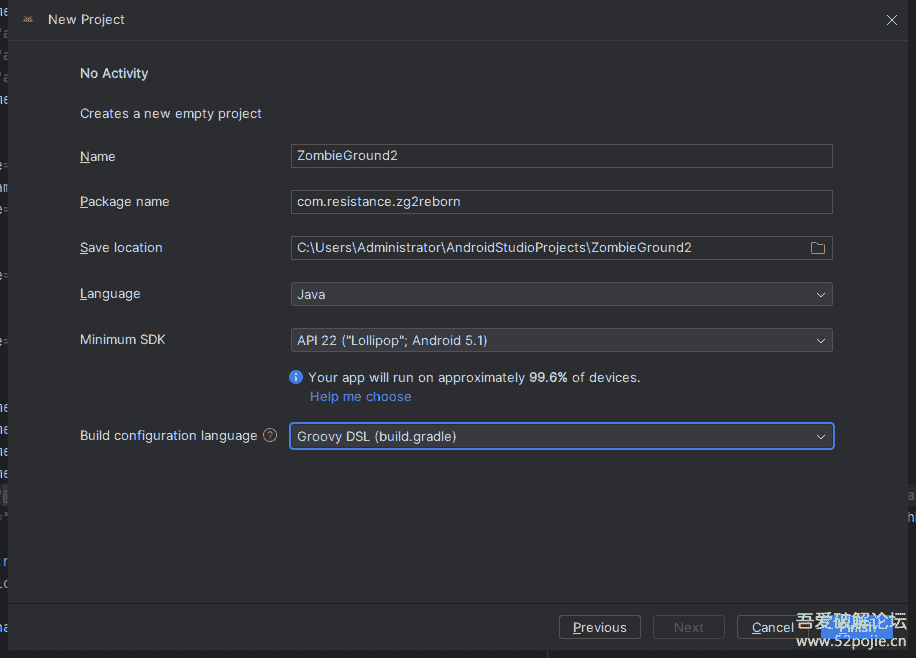
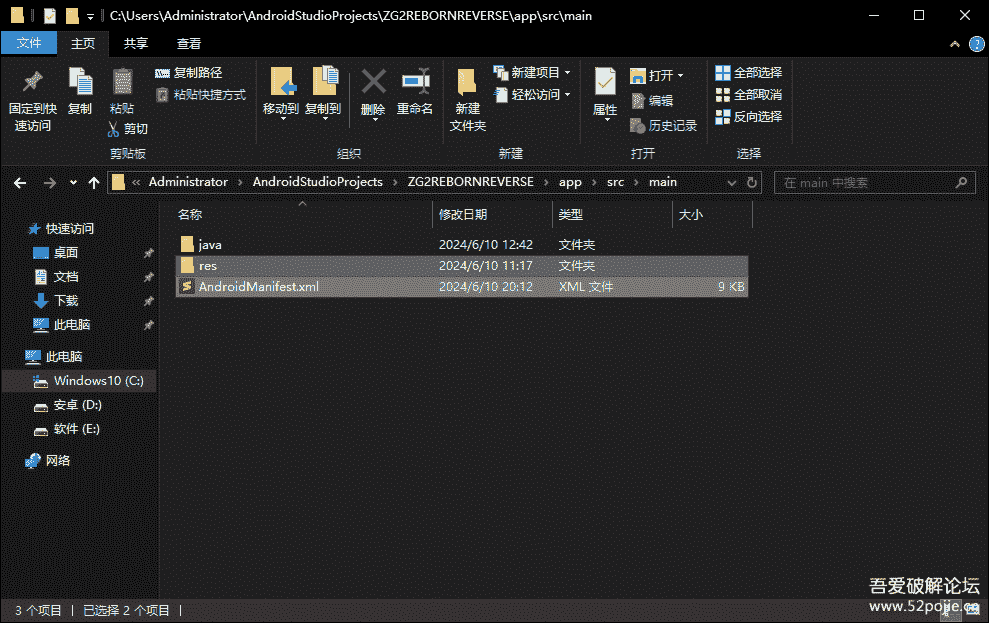
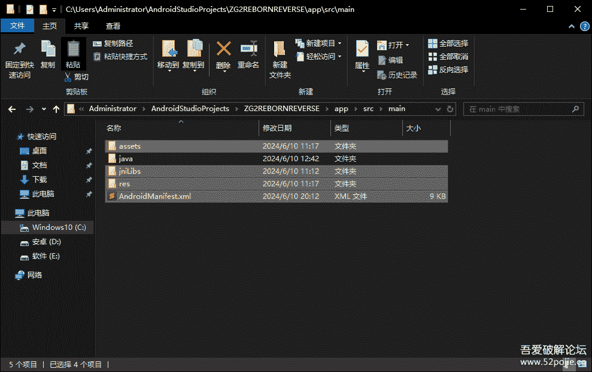
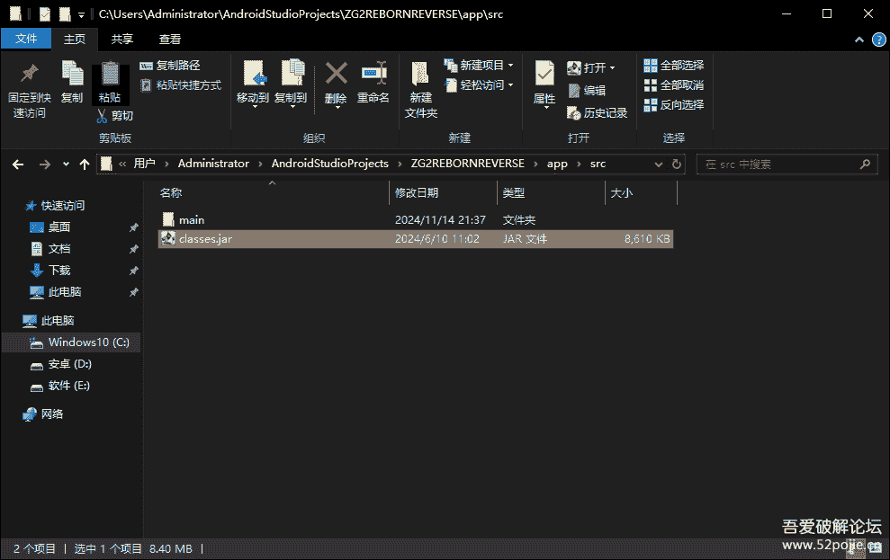
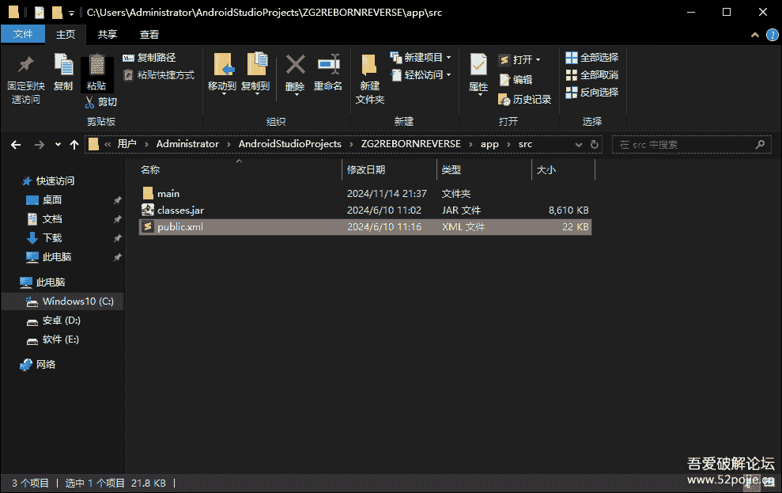
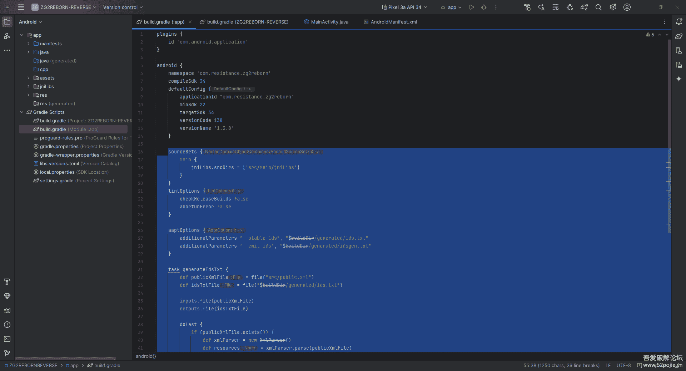
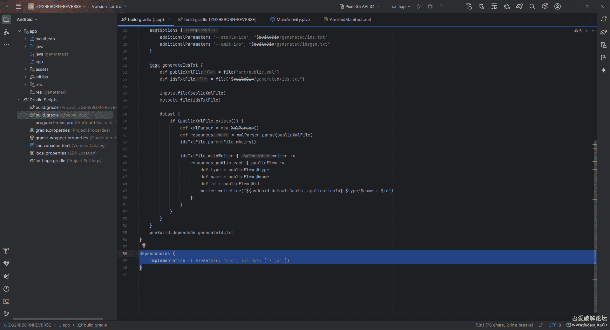
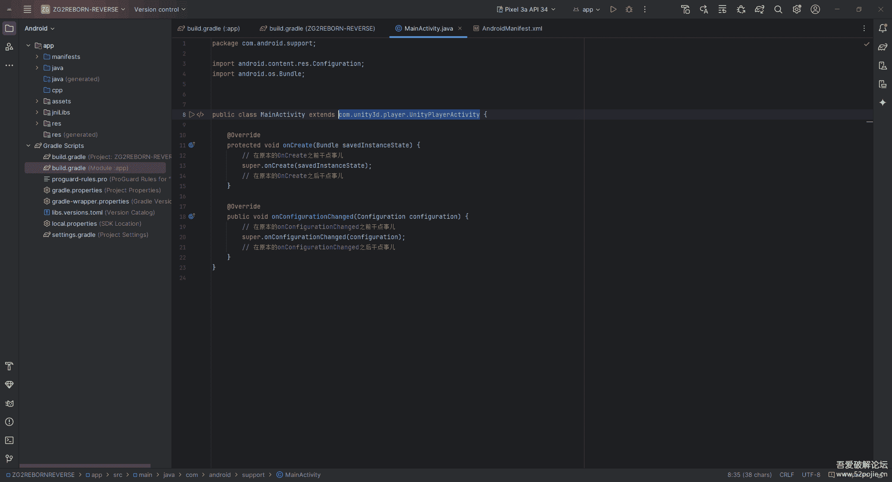

# [Android 原创] 将APK转换为Android Studio项目-APK二次开发

- 原帖: https://www.52pojie.cn/forum.php?mod=viewthread&tid=1981911
- 抓取时间: 2026-11-01T16:21:02.008Z

本文教大家将APK转换为Android Studio项目，后续可用Java、C++高级语言进行二次开发，从此告别低效的改smali、改so字节码。适用于需要对同一个APK进行长期、大量修改的同学。

需求：未加壳、无签名校验的APK，一台有Android Studio的电脑

Tips：Github上的一个工具”FakerAndroid”会自动化地实现本文中的一些步骤。本文教大家的是手动操作，有兴趣的同学也可以去试试这个自动化工具。

## 正文开始！

### 1. 新建空白项目

在Android Studio新建空白项目，把包名、最低SDK设置为和目标APK一致。然后把项目语言设置为Java，把Build Configuration Language设置为Groovy DSL。



新建空白项目

最后进入项目目录，删除`res`文件夹和`AndroidManifest.xml`文件。



要删除的文件

### 2. 反编译并放置文件

使用电脑端的Apktool、Jadx或手机端的ApktoolM等工具反编译目标APK，将得到的`assets`、`libs`、`res`文件夹和`AndroidManifest.xml`放置在第一步新建的项目目录中，如下图。注意`libs`文件夹需要重命名为`JniLibs`（当然，没有`libs`文件夹的话就不用管）。



要放置的文件（`libs`文件夹需要重命名为`JniLibs`）

### 3. 转换dex为jar并放置

使用电脑端的`dex2jar`或手机端的MT管理器将APK中的`classes.dex`转换为`classes.jar`（多个dex文件就转换为多个同名的jar），然后将得到的jar文件放置在项目目录的`src`文件夹中，也就是之前步骤用到的目录的上一级目录。具体位置如下图。



放置jar文件

### 4. 剪切public.xml

将项目文件夹内的`src/main/res/values/public.xml`剪切到`src`文件夹。具体位置如下图。



剪切`public.xml`文件

### 5. 修改build.gradle

修改`build.gradle(Module: app)`，在`android{}`内添加以下内容：

```groovy
sourceSets {

main {

jniLibs.srcDirs = ['src/main/jniLibs']

}

}

lintOptions {

checkReleaseBuilds false

abortOnError false

}

aaptOptions {

additionalParameters "--stable-ids", "$buildDir/generated/ids.txt"

additionalParameters "--emit-ids", "$buildDir/generated/idsgen.txt"

}

task generateIdsTxt {

def publicXmlFile = file("src/public.xml")

def idsTxtFile = file("$buildDir/generated/ids.txt")

inputs.file(publicXmlFile)

outputs.file(idsTxtFile)

doLast {

if (publicXmlFile.exists()) {

def xmlParser = new XmlParser()

def resources = xmlParser.parse(publicXmlFile)

idsTxtFile.parentFile.mkdirs()

idsTxtFile.withWriter { writer ->

resources.public.each { publicElem ->

def type = publicElem.@type

def name = publicElem.@name

def id = publicElem.@id

writer.writeLine("${android.defaultConfig.applicationId}:$type/$name = $id")

}

}

}

}

}

preBuild.dependsOn generateIdsTxt
```



修改内容1

然后将`dependencies {}`整个替换为

```groovy
dependencies {

implementation fileTree(dir: 'src', include: ['*.jar'])

}
```



修改内容2

### 6. 编译并修复小错误

到这一步已经可以编译出正常运行、未经修改的APK了。`AndroidManifest.xml`里可能会有一些鸡毛蒜皮的小错误，基本上右键错误并选择自动修复即可解决。后续就是修改Java层和Native层了。

### 7. 修改Java层的方法之1

假如要修改`Activity`，可以尝试新建一个`Activity`并继承自你要修改的`Activity`，如下图。



`extends`后面填你要修改的`Activity`

（记得在`AndroidManifest.xml`里声明你新建的`Activity`为Launcher Activity。）通过`Override`一些`Activity`生命周期函数，即可做到一定程度的`Activity`修改。

这种方法仅限修改`Activity`，虽然方便但局限性较大：无法修改父类中不能`Override`的函数(即非接口函数)、无法访问父类的私有变量。

### 8. 修改Java层的方法之2

假如要修改某个类，可以先使用电脑端的Apktool或手机端的MT管理器将该类从`classes.dex`中删去，然后在Android Studio新建该类，并重写该类的全部代码(可参照电脑端的Jadx或手机端的MT管理器给出的Java反编译代码来重写)。放心，非常好写，和正常开发完全没区别。Android Studio会读取`classes.jar`的信息，并和正常开发一样为你提供代码补全提示的。

这种修改方法更加通用，基本上可以做到任何修改需求。

### 9. 修改Native层的方法

用MSHook或其他Hook框架，配合IDA Pro来实现函数Hook、so Patch。
