# [Android 原创] 【某定位软件】高德地图KEY失效的修复

- 原帖：https://www.52pojie.cn/forum.php?mod=viewthread&tid=1982310
- 抓取时间：2026-11-01T16:20:52.087Z

## 前言

打卡一直在使用的某模拟定位软件（LSPosed 的模块），最近突然不能保存新的地址了，这两天得闲想着处理一下。

本来以为是作者更新了软件，结果看了一下 GitHub，没有更新，而且用最新版本的朋友也有同样的问题，奈何不知道作者什么时候会更新，只得自己动手。

## 上手解决

### 1. 分析错误信息

先看了一下这个错误信息，根据提示的连接去网页上看了一下，这个错误代码 7，意思是【KEY鉴权失败：检查 key 绑定的 `sha1` 值与 APK 签名 `sha1` 值是否对应】，感觉可能是作者修改了 key 绑定的 `sha1` 值，既然是 key 的问题那自己生成一个换到 app 里就行了！

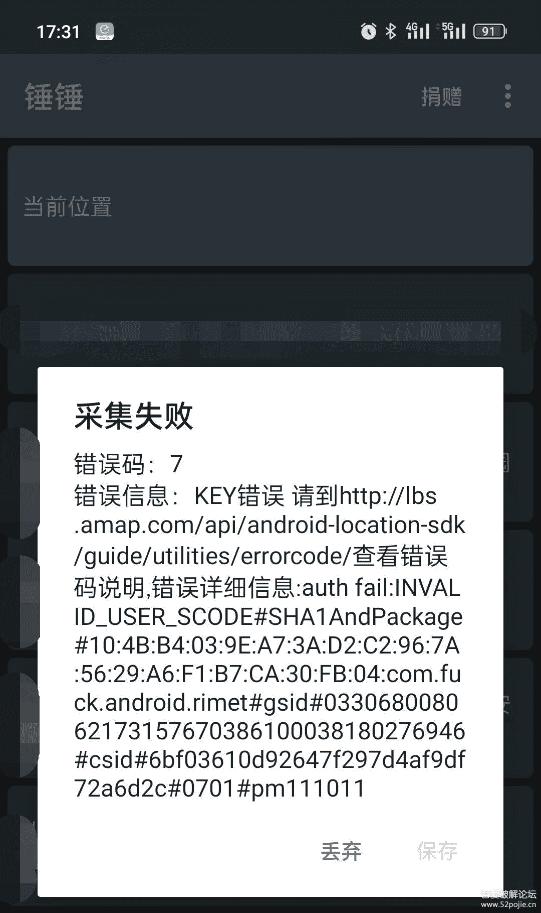

### 2. 创建自己的 KEY

到高德的开放平台里创建一个自己的 KEY：

a) 应用管理-》我的应用-》创建新应用，名称随便写，类型可以选工具。

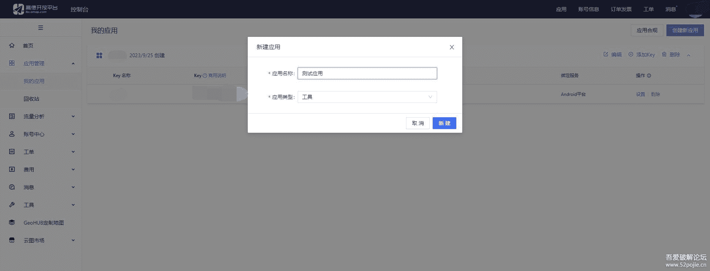

b) 添加 KEY，名称随便写，服务平台选择【Android平台】，`SHA1` 先随便写过会儿再改，包名用原来应用的包名可看下图，然后提交。

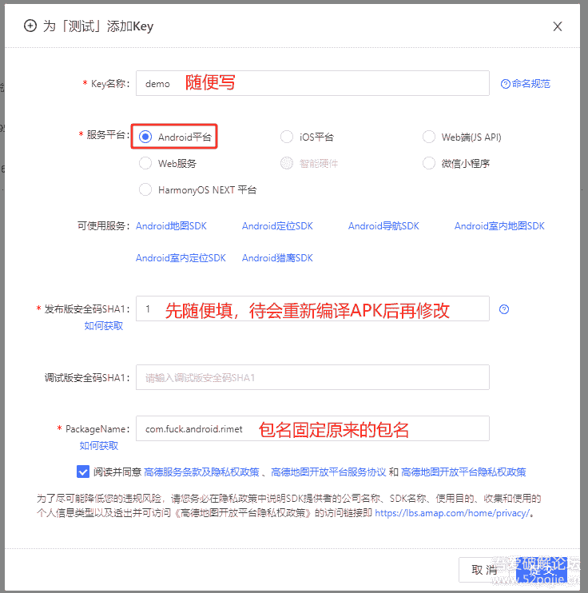

c) 把生成的 KEY 复制出来，待会方到 apk 的配置文件里。

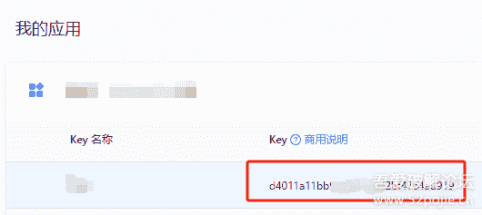

### 3. 反编译软件

先用 Apktool M 反编译软件，这里因为高德地图的 key 都是配置在 `AndroidManifest.xml` 文件里，所以这里只需要反编译资源就行了。

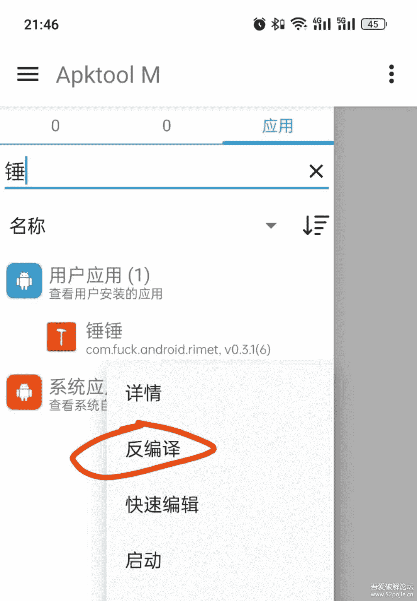

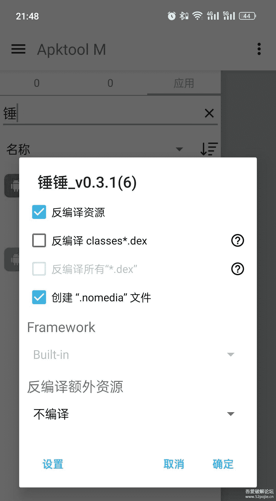

### 4. 编辑 `AndroidManifest.xml`

找到反编译后的目录，选择 `AndroidManifest.xml` 文件，进行编辑，在文件末尾处找到 `meta-data`【`com.amap.api.v2.apikey`】

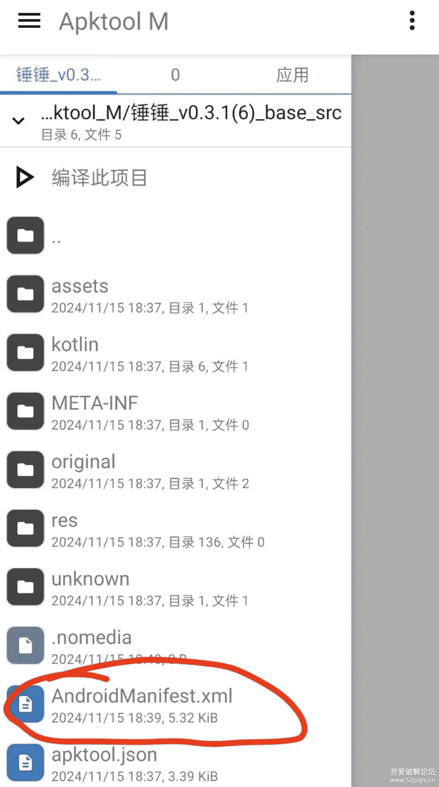

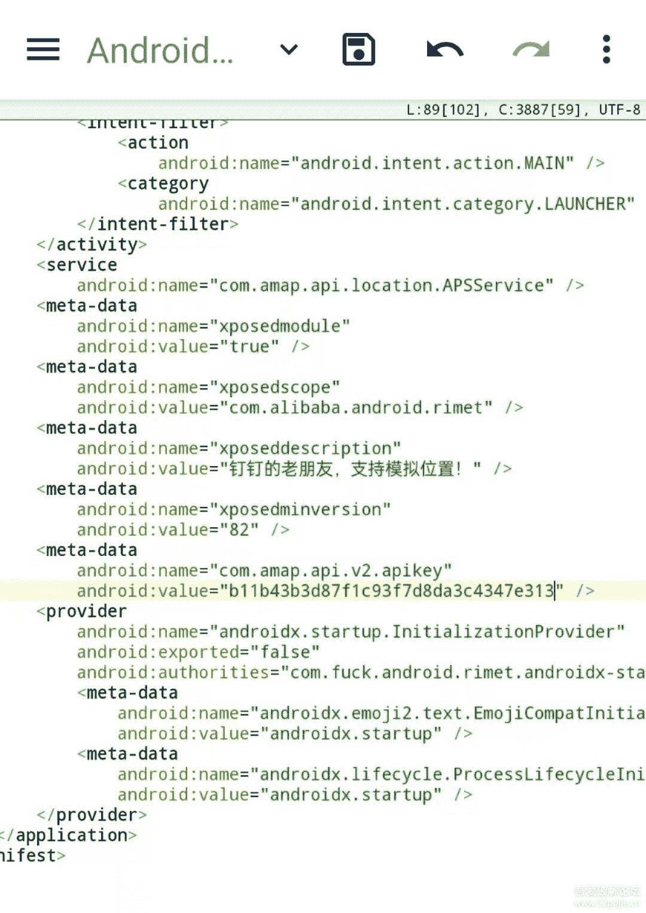

### 5. 修改 KEY 并重新安装

把【`com.amap.api.v2.apikey`】的 `value` 修改成刚才自己在高德平台创建的 key，然后保存，编译，覆盖安装。

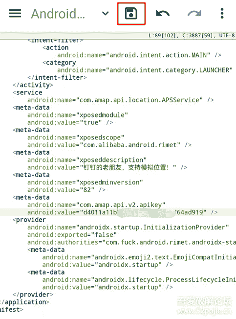

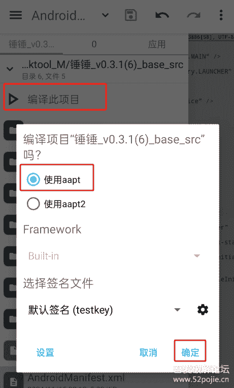

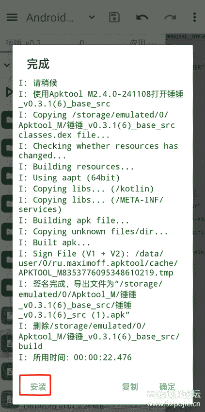

### 6. 配置新 APK 的 `SHA1`

重新安装后，进入 APP 你会发现还是不能保存地址，不要着急，还差最后一步。

a) 进入高德开放平台刚才创建 KEY 的地方，点【设置】。

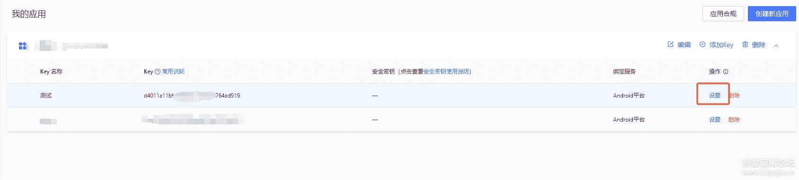

b) 图中【画红线】的部分，是新 APK 的 `sha1` 值，把这个值填写到高德的【安全码 `SHA1`】里，保存一下。

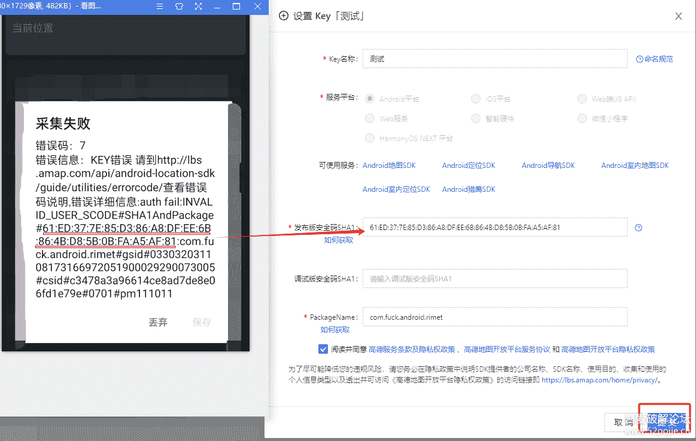

### 7. 验证保存地址

关闭 APP 重新进入一下，你就发现可以正常保存地址啦！

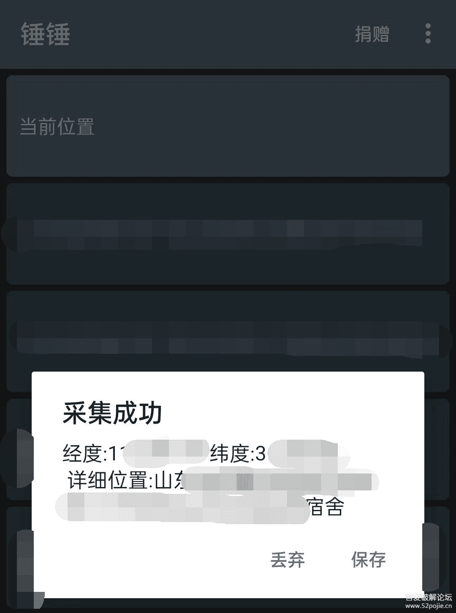

## 附

- 原应用地址：https://modules.lsposed.org/module/com.fuck.android.rimet
- 高德开发平台地址：https://console.amap.com
