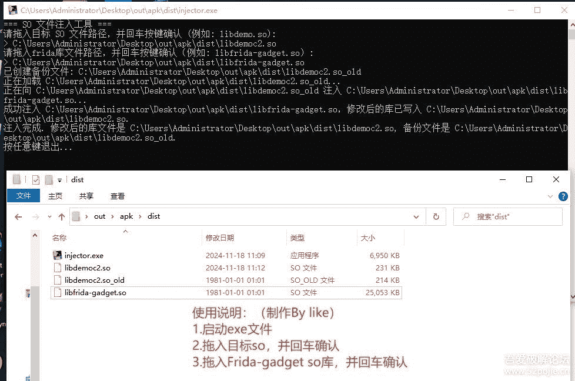
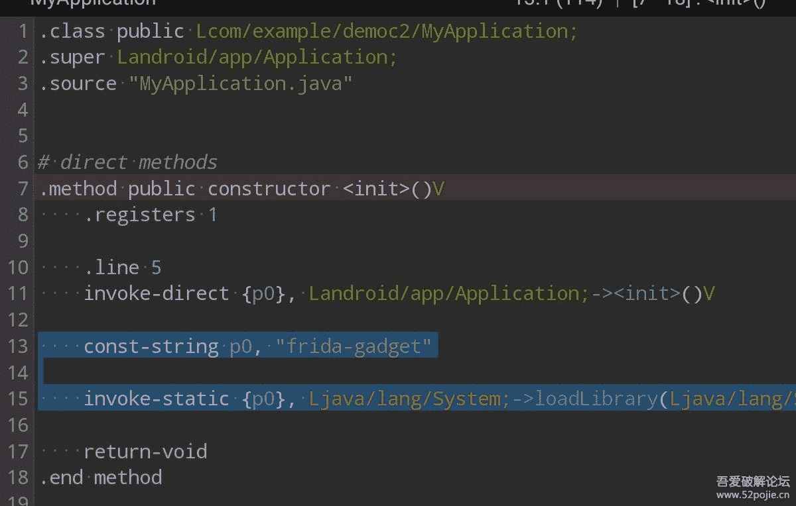
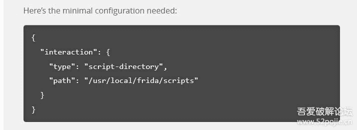
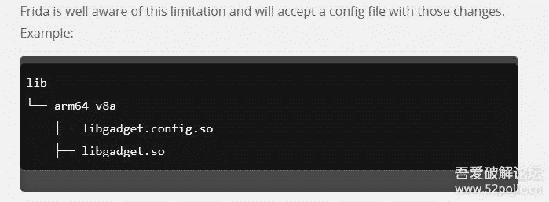
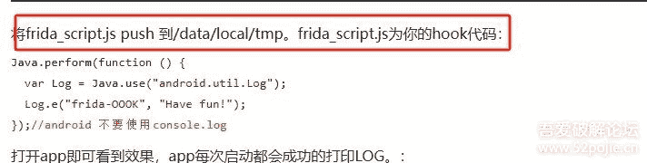
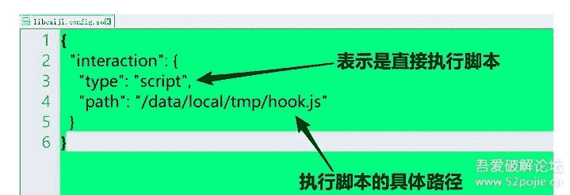
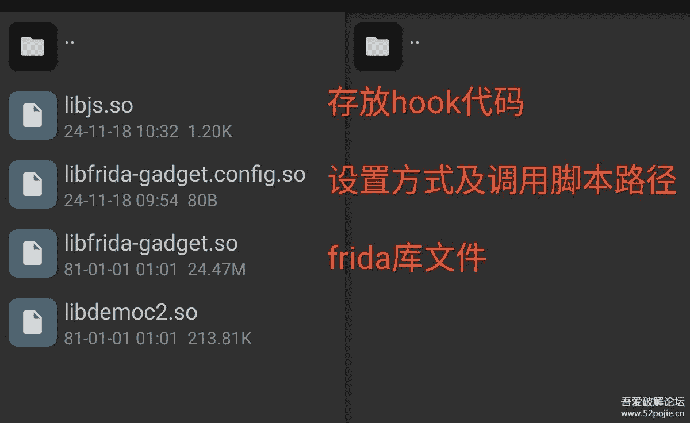
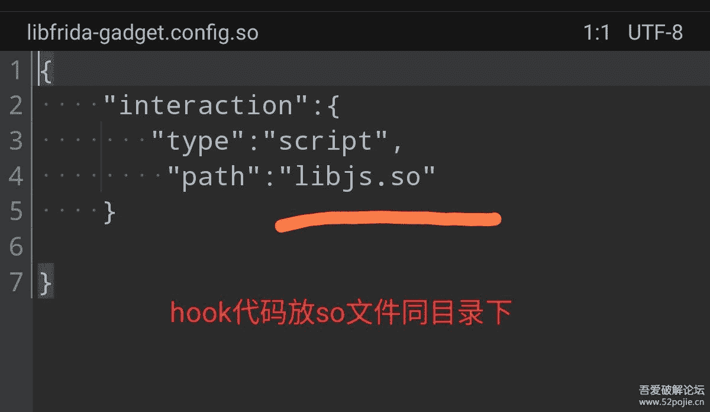

# [Android 原创] 非root环境下Frida完全内置apk打包方案及2种注入方式回顾

- 原帖: https://www.52pojie.cn/forum.php?mod=viewthread&tid=1983320
- 抓取时间: 2026-11-01T16:20:26.217Z

今天简单分享之前验证的一个免ROOT权限Frida完全内置APK方案！让Frida得到更广泛的使用！

（本来昨天就分享的因为内容链接问题今天修改重新提交）

关于`frida-gadget`使用官方及各论坛都有许多讲解及说明，但似乎都停留在把hook脚本代码存放本地SD目录或者`/data/local/tmp`。

对于分析来说完全够用了，但是对于想把实现hook的整体效果直接分享出来就存在局部限制。

那么能不能实现`LSPatch`类似效果？答案是完全没问题。

先看看效果，直接打开软件就执行内置hook。


## 回顾 `frida-gadget` 注入两种方式

首选我们回顾下`frida-gadget`注入两种方式，顺便补充完善部分细节，具体如下：

### 1. 基于 so 层通过添加依赖库方式调用 Frida 库

实现原理参考：Android平台感染ELF文件实现模块注入。

简单来说就是找个软件启动时候最开始调用so文件，t通过对其注入添加依赖库方式启用`frida-gadget`。

如果`apk`本身没有`so`这种方式是否可以？

也没问题，直接通过`dex2c`方案把部分`java`方法转换为`so`调用，再注入就好了！

比如开源的 https://github.com/codehasan/dex2c 或者某些一键工具。

为了让操作简单化，这里我把注入工具重新`py`写了下，为了普遍可以用特意找`win7`环境打包独立`exe`。

Windows环境下`so`注入工具下载见：[//gitee.com/xdvsrs/so-injection-tool-exe](https://gitee.com/xdvsrs/so-injection-tool-exe:https)

（论坛附件上传运行空间有限，只能借助`gitee`）

注入操作方式如下图：



### 2. 基于 JAVA 层 Smali 代码调用 Frida 库

`System.loadLibrary("frida")`。

这是比较常用的方案，通过首启`activity`或`application`在方法`()`或`()`或`onCreate`植入如下代码：

```
     const-string p0, "frida-gadget"     
     invoke-static {p0}, Ljava/lang/System;->loadLibrary(Ljava/lang/String;)V
```



接下来就是今天重点，如何把脚本也一并内置`apk`里面，直接安装打开就自动调用。

关于打包进`apk`后执行`js`官方文档及之前部分博主、网友是这样讲的：






这样并不能实现脚本内置，还得借助`ADB`或者本地文件夹读取权限才能完成加载`hook`的`js`代码，分享使用存在局限性！

重点！重点！

通过如下方式实现`js`跟随依赖库，配置文件处于同一路径，就可以直接加载，

原理：安装后的 `so` 文件通常会被存储在以下路径：`/data/app//lib//`。

（本身没有`so`的`APK`就手动创建文件夹或者`D2C`抽取产生）




`libjs.so`：`hook`的`js`代码文件（案例内容）

```
if (Java.available) {
Java.perform(function () {
console.log("Hooking any Activity...");
// 动态获取所有的 Activity 类，并 Hook 其 onCreate 方法
var Activity = Java.use("android.app.Activity");
Activity.onCreate.overload("android.os.Bundle").implementation = function (bundle) {
var activityClassName = this.getClass().getName(); // 获取当前 Activity 类名
console.log(activityClassName + " onCreate hooked!");
// 调用原始的 onCreate 方法
this.onCreate(bundle);
// 获取上下文并在主线程显示 Toast，提示当前 Activity 名称
var context = Java.use('android.app.ActivityThread').currentApplication().getApplicationContext();
Java.scheduleOnMainThread(function() {
var toast = Java.use("android.widget.Toast");
var message = "Frida Hook成功! 通过java层调用 \n当前Activity: " + activityClassName;
toast.makeText(context, Java.use("java.lang.String").$new(message), 1).show();
});
};
});
} else {
console.log("Java environment not available!");
}
```

`libfrida-gadget.config.so`： 调用配置内容改如下

```
{
    "interaction":{
       "type":"script",
        "path":"libjs.so"
    }
}
```

`libfrida-gadget.config.so`：`Frida`依赖库文件（可根据需要自行去下载 https://github.com/frida/frida/releases ）

为了进一步方便大家参考比较，以上2种方式分别做了`Demo`，可自行下载对比原版改动地方！

完成以上打包，接下来就是自由发挥的时候了！`hook`!`hook`!

测试`demo`及工具打包下载：

[//gitee.com/xdvsrs/so-injection-tool-exe/tree/master/apkdemo](https://gitee.com/xdvsrs/so-injection-tool-exe/tree/master/apkdemo:https)

有待改善优化空间：比如做手机端或者`PC`端一键注入打包，做魔改，自己二次编译`libfrida-gadget`定制个人需求功能。

补充：市场上部分应用目前都带加固或者防`Frida`，如何过检测等等.....就靠大家自己探索了！

文献主要参考：https://frida.re/docs/gadget/ 以及部分前辈、博主文档。
