# [Android 原创] 某游戏 打开 开发者面板

- 原帖: https://www.52pojie.cn/forum.php?mod=viewthread&tid=1985457
- 抓取时间: 2026-11-01T16:19:56.583Z

偶然得知有国服了，下载安装包后，打开`lib`目录：

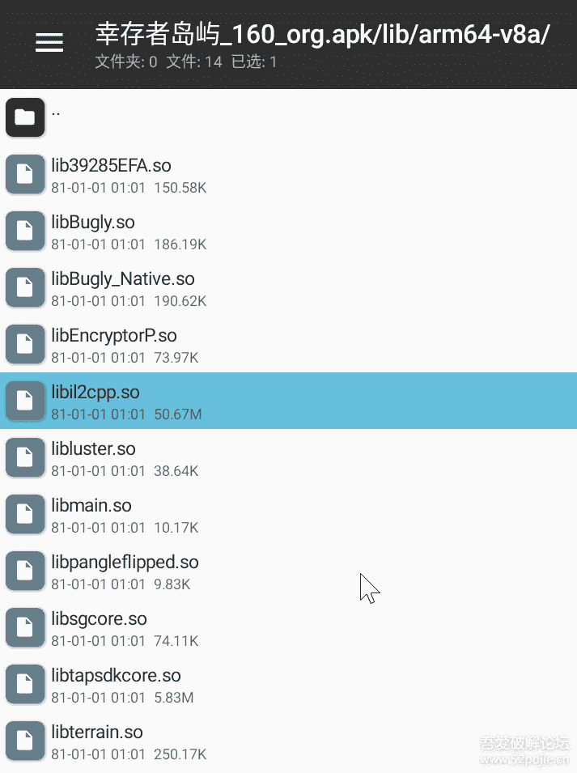

看到`libil2cpp.so`，于是到 GitHub 上下载最新的`il2cppdumper`，运行 exe 得到如下文件：

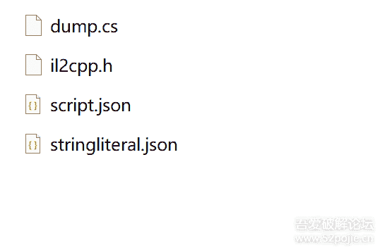

打开 IDA，载入`libil2cpp.so`，并且点击 File 菜单下的 Script file：

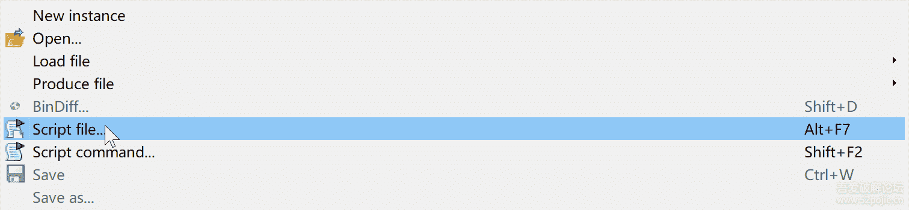

按对话框弹出的顺序，分别选择`il2cppdumper`目录下的`ida_with_struct_py3.py`、截图2中的`script.json`和`il2cpp.h`，之后静待 IDA 分析完成（左下角显示 idle）。

共有两个修改的地方，解析完成之后，用记事本打开`dump.cs`文件。

## 第一个修改点

在`dump.cs`里搜索`LoadDebugPanel`，得到函数的偏移地址`0xD210CC`。

在 IDA 里按`G`，输入`0xD210CC`后按确定跳转，然后按`F5`反编译，把光标放在函数名处按`X`，跳转到调用的地方：

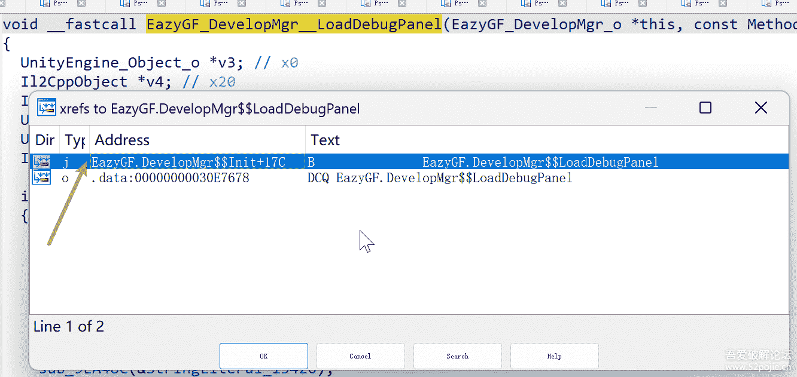

可以看到红框中的`if`就是我们要去掉的：

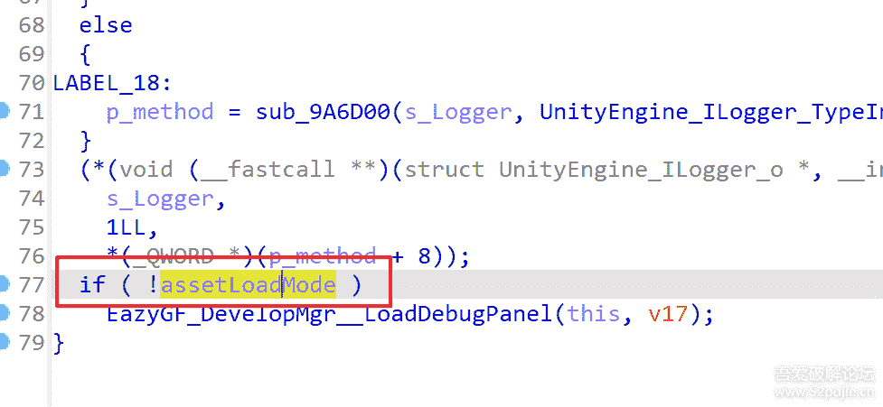

按`Tab`键，切换到汇编代码，修改很简单，把`CBZ`条件跳转改成`B`无条件跳转就行了，光标放在`CBZ`指令上，按`Ctrl+ALT+K`，把`CBZ W21`修改成`B`：

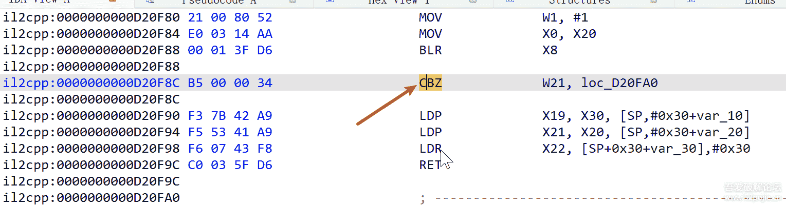

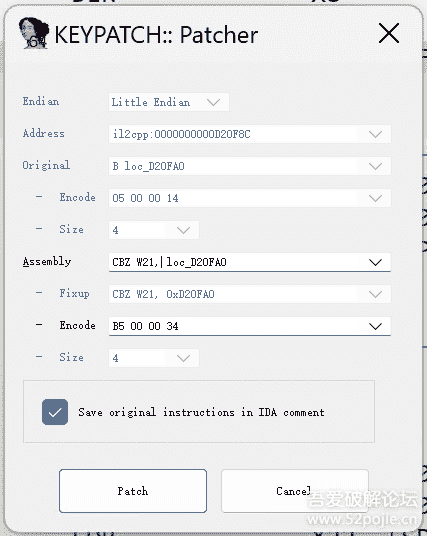

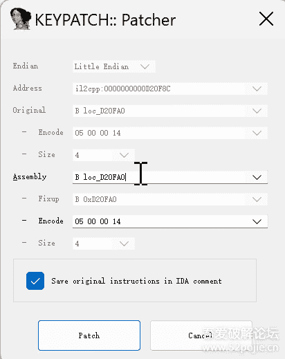

修改完后，再按`F5`，代码如下：

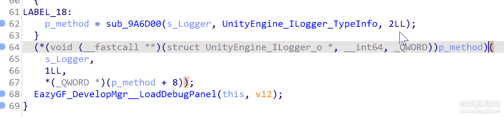

## 第二个修改点

在`dump.cs`里搜索`IsDebugModel`，得到函数的偏移地址`0xD210A8`，按`G`跳转后，按`F5`反编译：

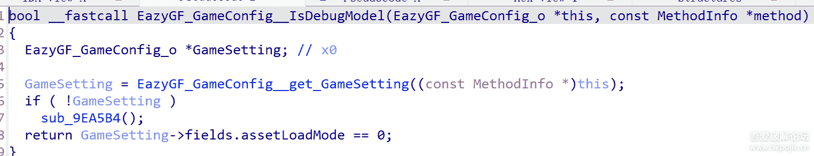

这里是要把`return`改成`return 1`。

修改依然很简单，只需要把：

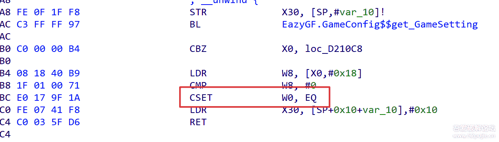

红框中的指令改成`mov W0`就行了，如下图：

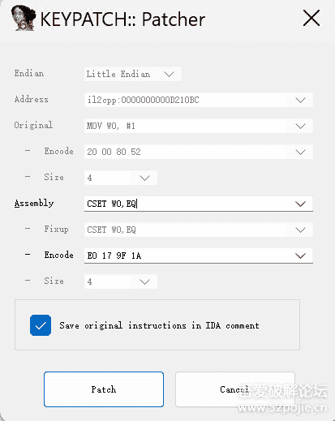

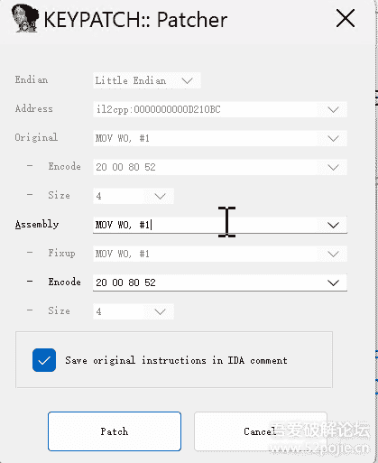

修改完之后，再按`F5`，代码如下：

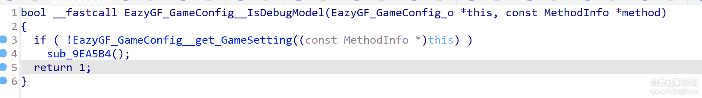

到这两个修改都修改完了，在 IDA 中点：

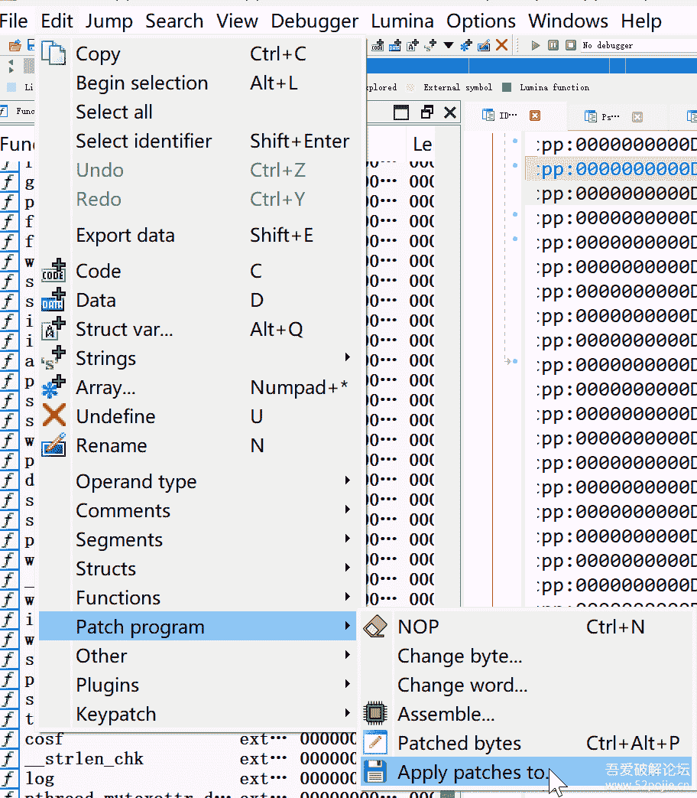

把修改应用到`so`中，`so`保存完后用 MT 把修改后的`so`加入到`apk`中，并且签名安装即可。

## 效果图

