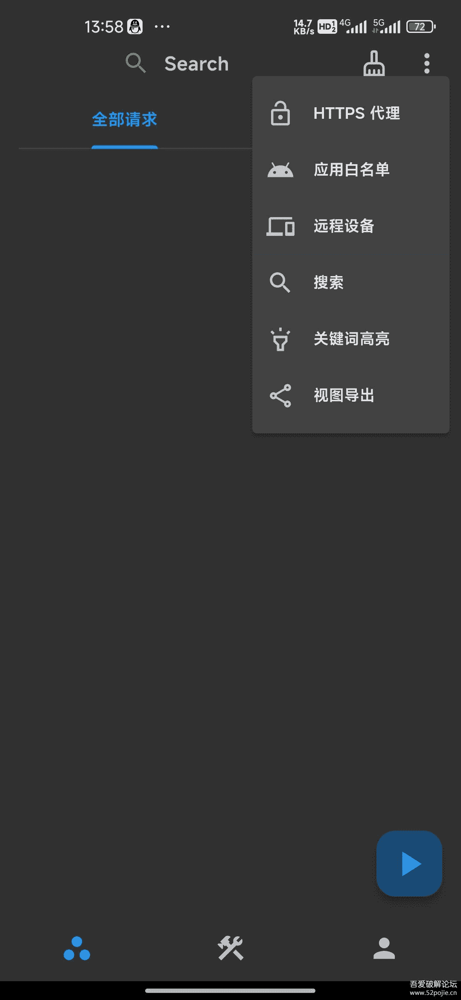
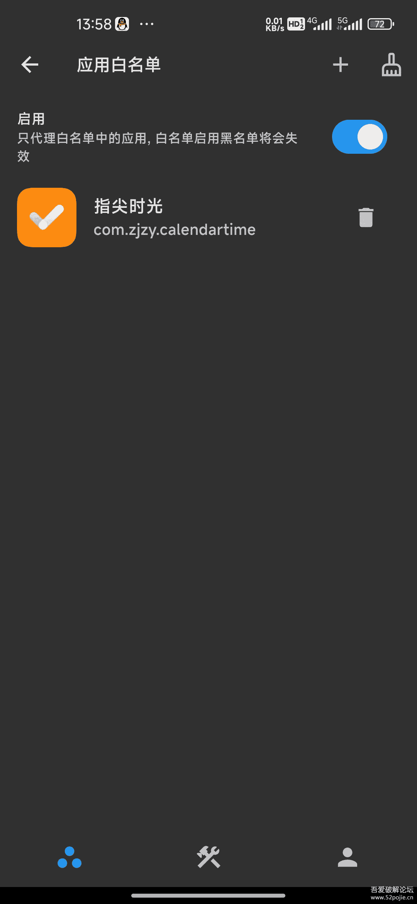
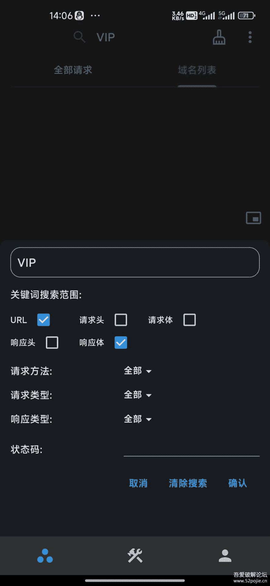
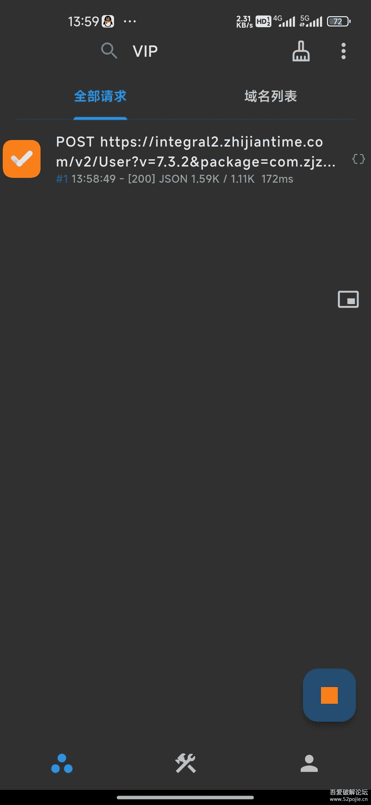
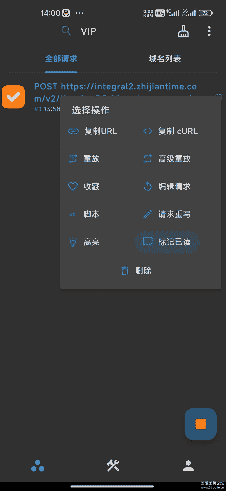
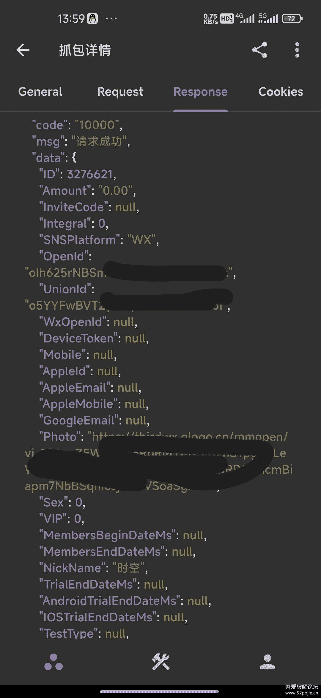
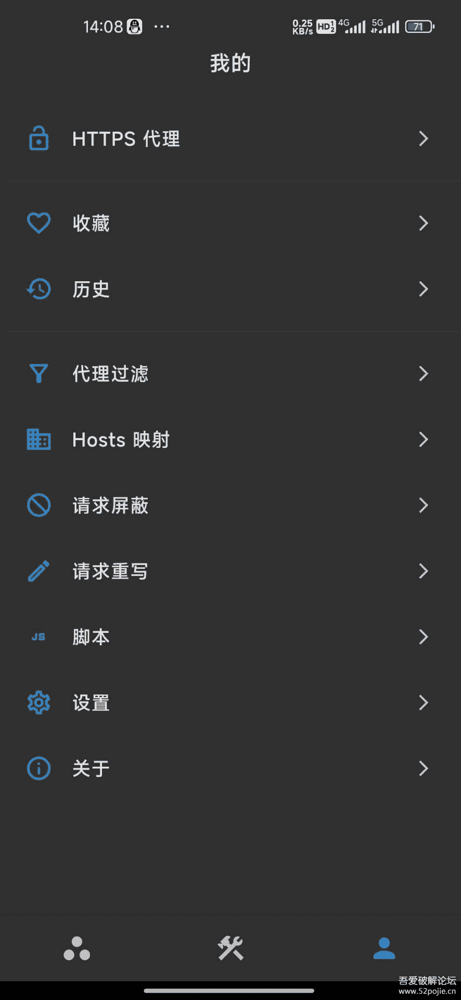
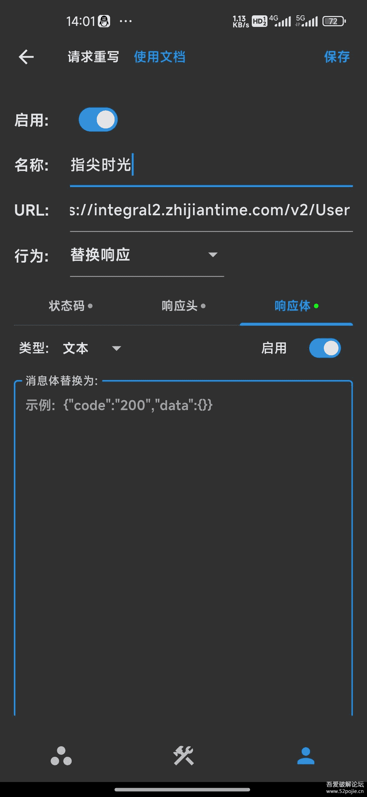
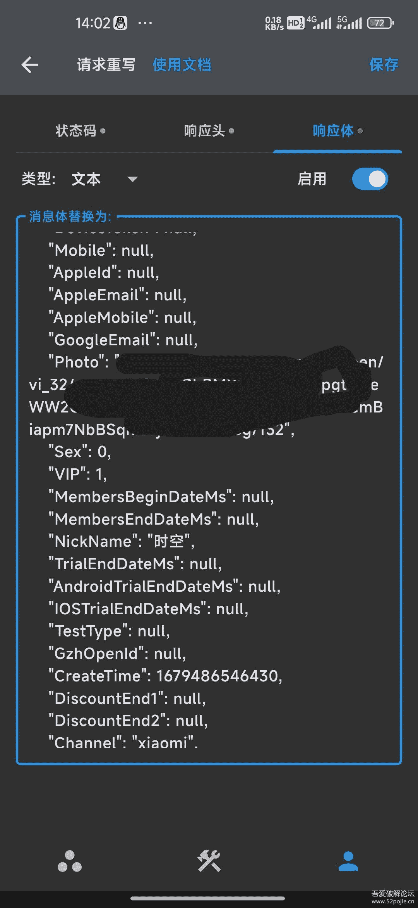
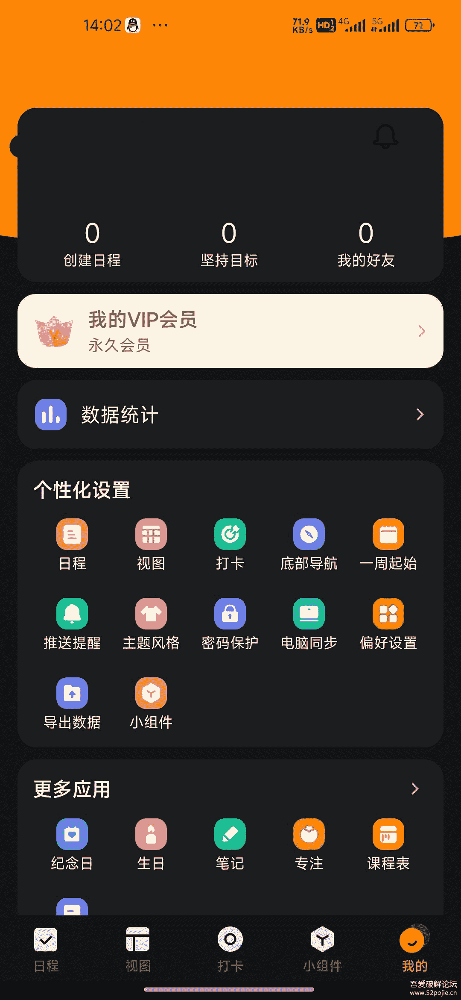

# [Android 原创] 指尖时光破解教程

- 原帖: https://www.52pojie.cn/forum.php?mod=viewthread&tid=1986722
- 抓取时间: 2026-11-01T16:19:52.610Z

最近很多朋友问我指尖时光的最新教程，原因是因为技术一直在发展，人家不可能软件什么防护也没有

我看了一下，发现软件使用了360加固，将壳脱完以后，判断`vip`的逻辑大致还是没有变化的

众所周知，对于我这样的新手360的壳属于[脱壳](https://www.52pojie.cn/forum-5-1.html)容易修复难

所以，如果手机已经`root`的朋友，可以使用`simple hook`对软件进行`hook`

下面给出具体配置文件

```json
{"packageName":"com.zjzy.calendartime","appName":"指尖时光","versionName":"6.4.7.2","description":"","configs":"[{\"className\":\"com.app.modelintegral.data.bean.UserInfoBean\",\"methodName\":\"getVIP\",\"params\":\"*\",\"resultValues\":\"1\",\"hookPoint\":\"after\"}]","enable":false,"id":11}
```

今天主要从另一个简单的角度出发获取`vip`-抓包

这里使用的是开源抓包工具[ProxyPin](https://gitee.com/wanghongenpin/proxypin)

首先基础的抓包软件配置完成后

首先打开应用白名单



然后将指尖时光应用添加进去



点击开始抓包，再打开指尖时光应用

过滤出响应体内含有`vip`的请求





复制该请求的`url`和响应





点击我的，请求重写



将刚复制的`url`和响应粘贴到对应的地方





修改`url`的值只保留`https://integral2.zhijiantime.com/v2/User`部分

修改响应的`VIP`值为`1`，删除`ActiveTime`和`RefreshTime`对应两项

点击保存

再次打开应用，如果不生效就退出重新打开


