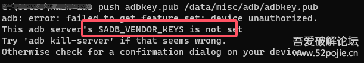
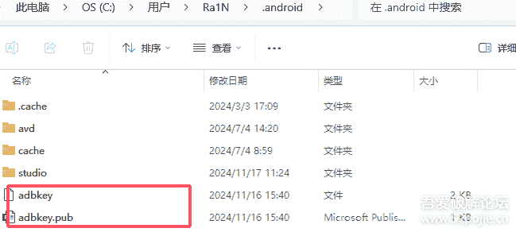
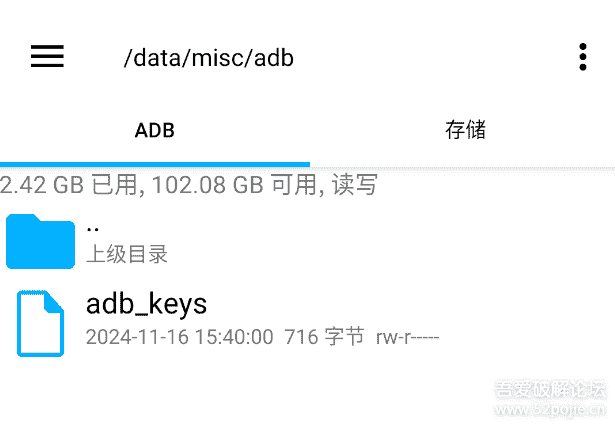
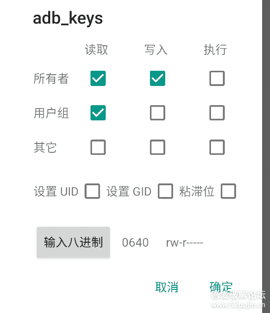
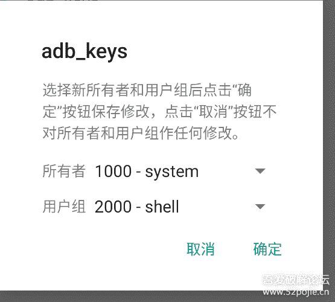

# [Android 分享] 解决ADB连接时报错`$ADB_VENDOR_KEYS` is not found

- 原帖: https://www.52pojie.cn/forum.php?mod=viewthread&tid=1987036
- 抓取时间: 2026-11-01T16:19:49.241Z

## 前言

笔者在做完JEB调试后重新启动调试，`adb`连不上了（一次性的ADB）

可以找到设备（此处为雷电9模拟器），但是此处提示缺少`adb`授权，`adb`调试没反应

工作原理是什么？

原来在我们的PC机（以windows为例）上启动了`adb.exe`进程时，`adb`会在本地生成一对密钥`adbkey`(私钥)与`adbkey.pub`(公钥);

根据弹框提示 `The computer's RSA key fingerprint is:xxxx`，可以看出是一对RSA算法的密钥，其中公钥是用来发送给手机的；

当你执行 `adb shell` 时，`adb.exe`会将当前PC的公钥(或者公钥的hash值)(`fingerprint`)发送给android设备；这时，如果android上已经保存了这台PC的公钥，则匹配出对应的公钥进行认证，建立`adb`连接；如果android上没有保存这台PC的公钥，则会弹出提示框，让你确认是否允许这台机器进行`adb`连接，当你点击了允许授权之后，android就会保存了这台PC的`adbkey.pub`(公钥)；

笔者此处无弹窗，所以需要手动解决一下

## 操作步骤

### 1、到PC端获取公钥

目录：`C盘->用户(user)->你的用户名（笔者此处为Ra1N)->.android`

我们把`adbkeys.pub`复制出来，重命名为`adb_keys`(不带文件后缀)

### 2、将公钥文件放入PE手机端

此处使用的文件管理器为RE管理器

进入 `/data/misc/adb` 目录，将刚才的`adb_keys`放进来（自行获取权限）

到这里先别急着开`adb`

把`adb_keys`的读写权限给到`640`

再修改所有者为 `1000-system` 用户组为 `2000-shell`

保存

### 3、成功

重新回`adb`看，已经上线了

## 总结

纯萌新，跟正己学习的时候遇到的小问题，网上搜了一下没有发现具体的解决方法，故总结一下发个帖子。
