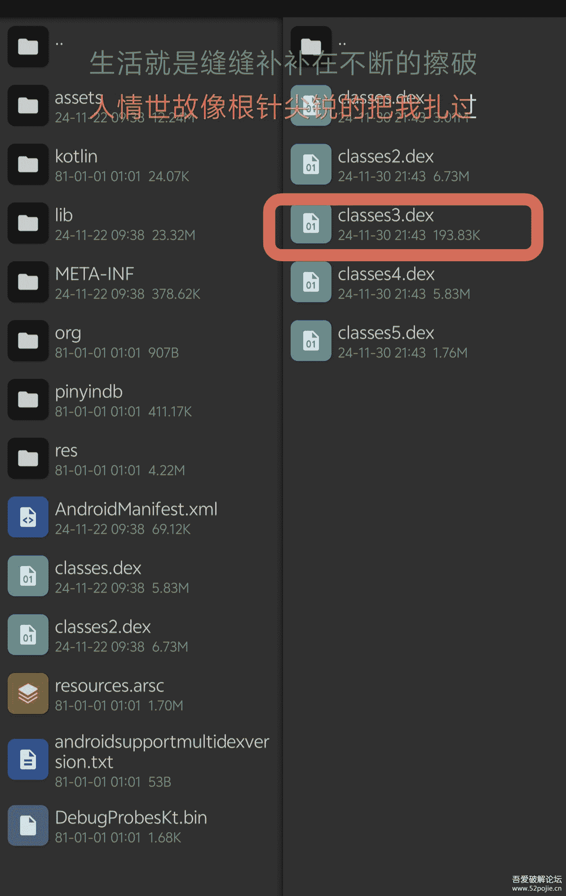
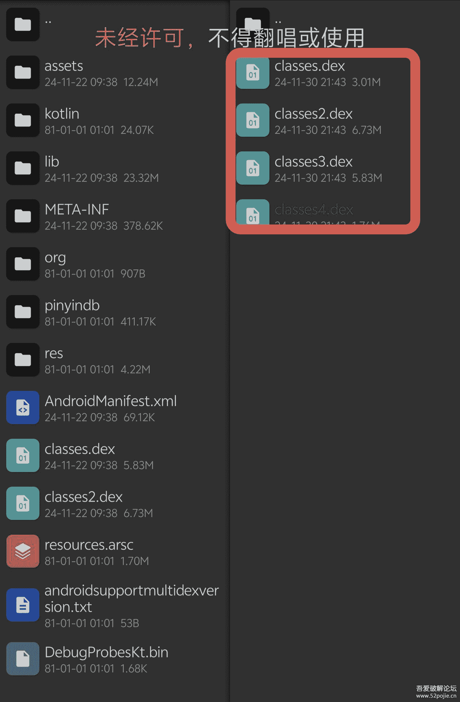
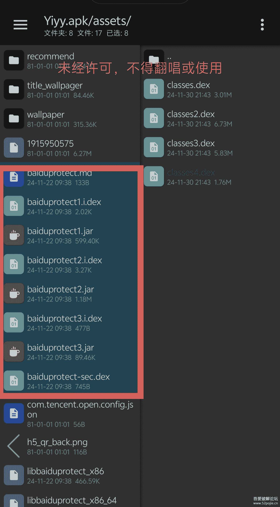
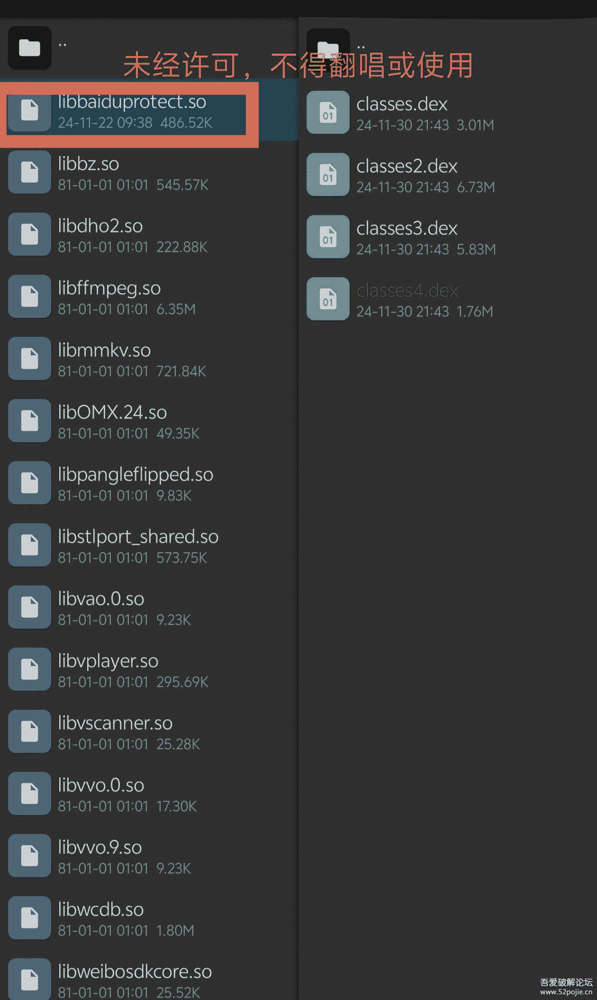
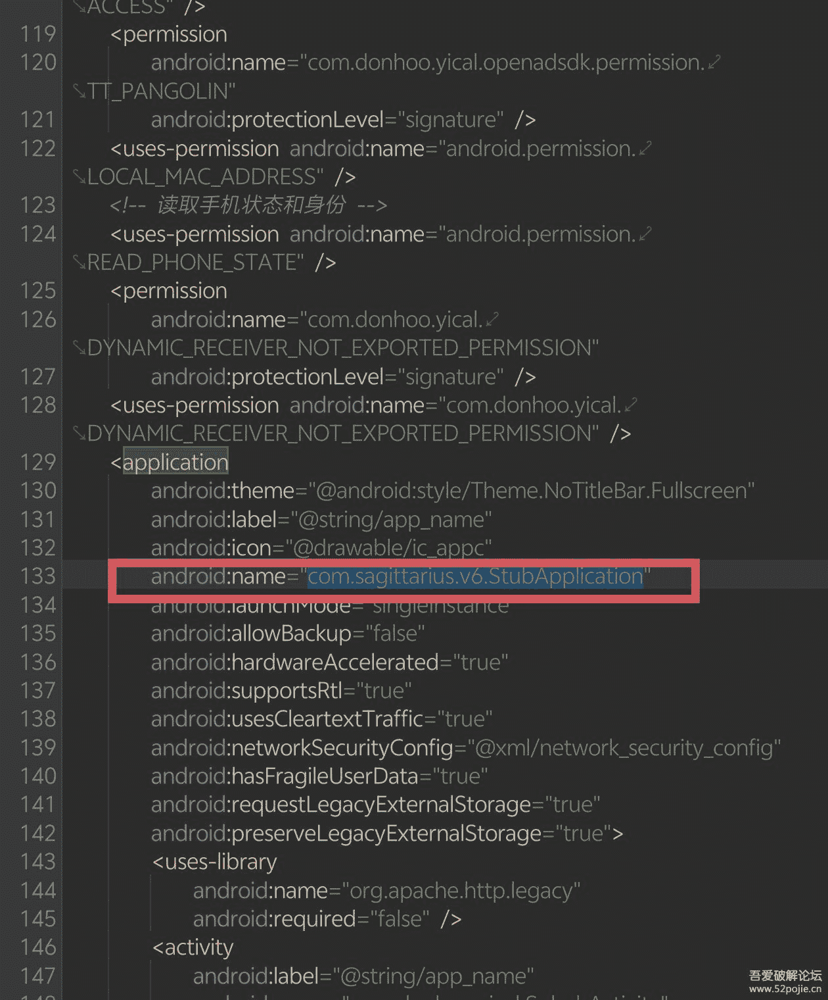
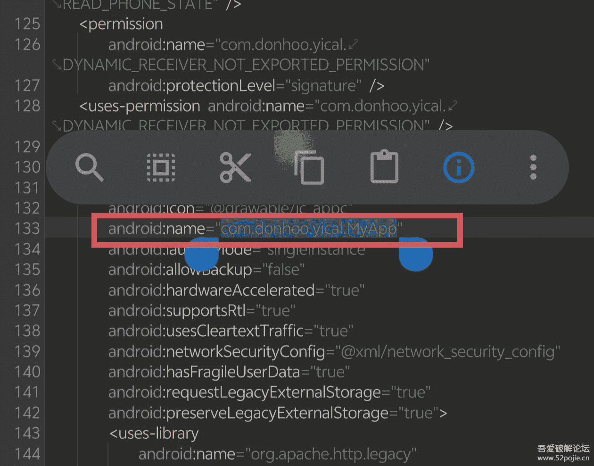

# [Android 脱壳] 记录 新百度加固 修复教程

- 原帖：https://www.52pojie.cn/forum.php?mod=viewthread&tid=1987110
- 抓取时间：2026-11-01T16:19:45.034Z

大家好，我又来了哦，很久没有更新了。在此期间对网络软件进行修改，近期出现了一个新百度加固的壳

看论坛没有人教学，那我就当仁不让啦

教学开始!

## 准备工具

逆向软件，[脱壳](https://www.52pojie.cn/forum-5-1.html)软件

## 教程说明

没有电脑这里我以mt管理器为例子，不喜勿喷，没有经济实力配电脑(ó﹏ò&#65377;)

① 软件脱壳（手脱，网站等）一定要保证脱干净!!!

② 修复dex文件，删除掉193.83kb的dex文件后重新给dex文件重命名

③ 正常替换dex文件并删除加固特征文件

④ 替换入口

⑤ 去签安装，完美运行

注意：193.83kb必须删除，里面是加固残余，不删除会闪退的哦
