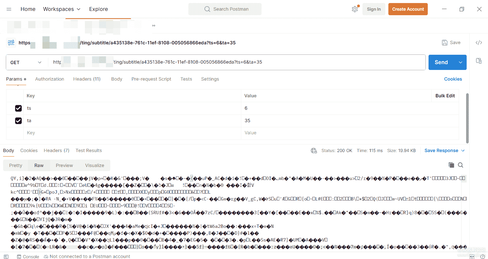
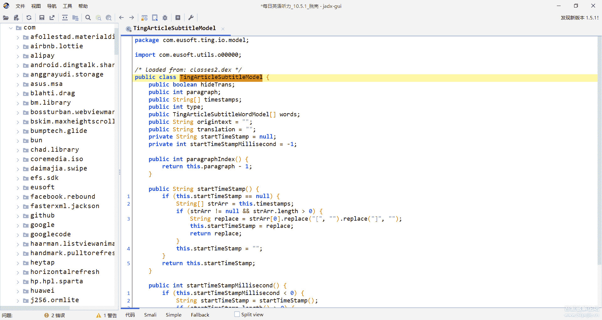
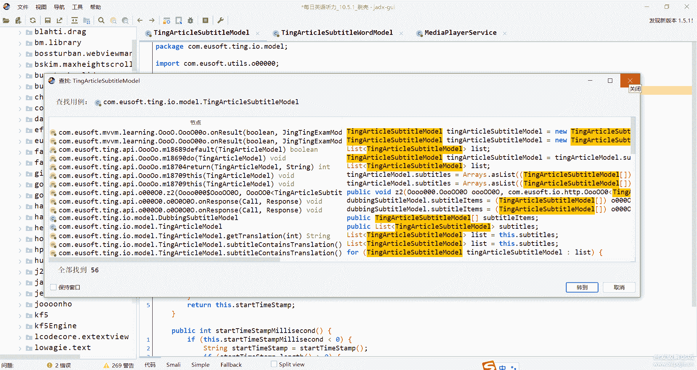
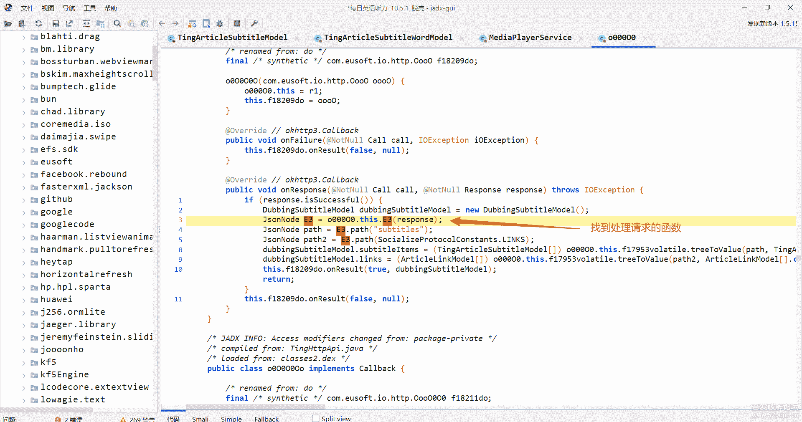
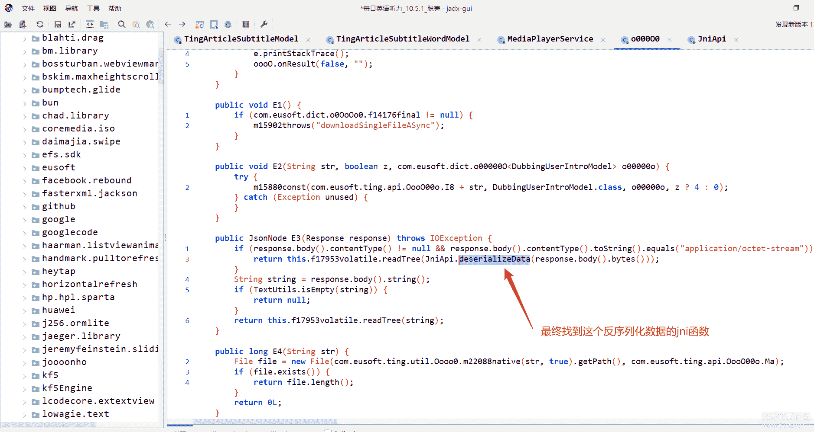
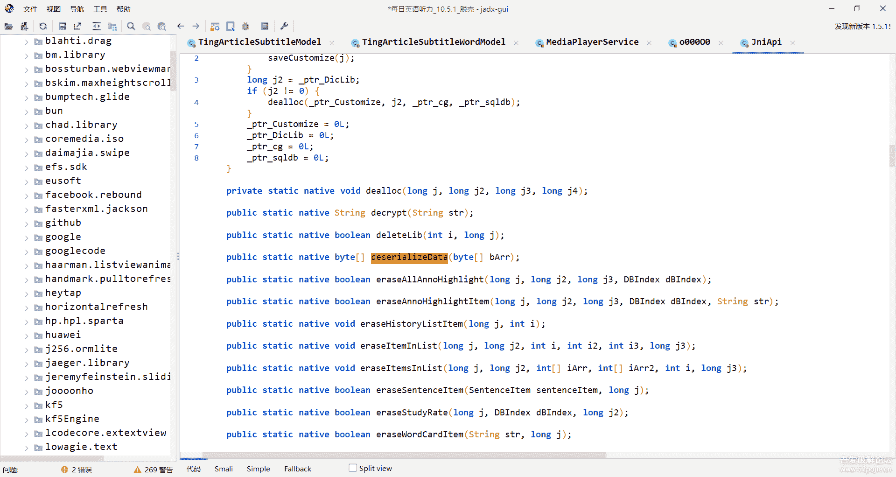
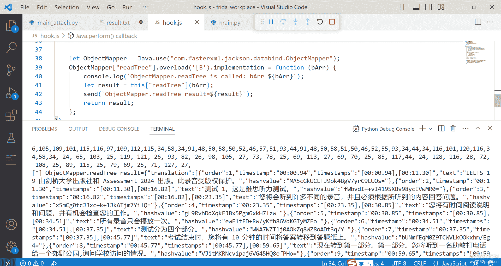
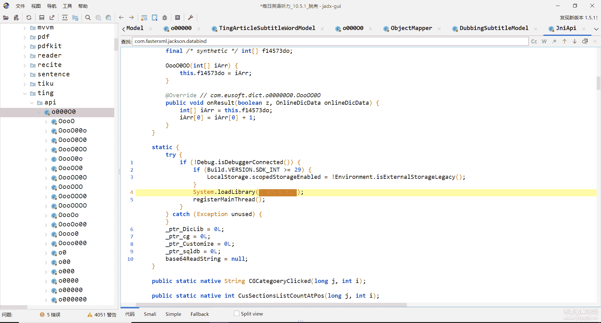
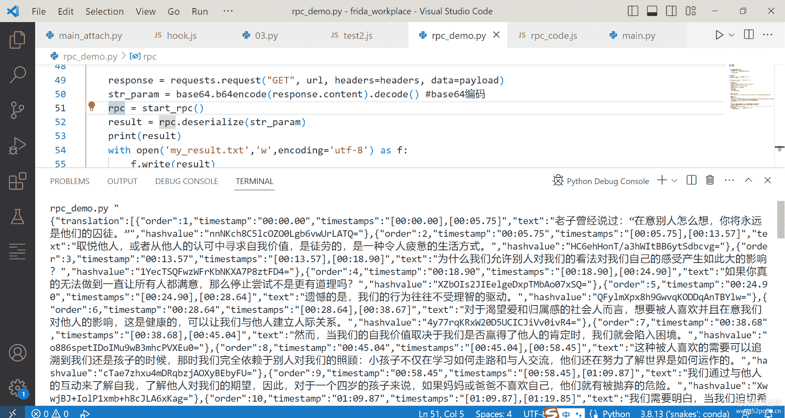

# [Android 原创] 某英语听力APP字幕编码方式逆向

- 原帖: https://www.52pojie.cn/forum.php?mod=viewthread&tid=1987254
- 抓取时间: 2026-11-01T16:19:40.122Z

## 某英语听力APP字幕编码方式逆向

### 声明

仅用于学习交流，禁止用于商业用途。

### 使用工具

- Nexus 6P 真机 Android 8.0
- 抓包工具 Charles 或 Fiddler
- hook 工具 `Frida` [//frida.re/](https://frida.re/:https)
- 反编译 `jadx` [//github.com/skylot/jadx](https://github.com/skylot/jadx:https)
- `ida`（可选）
- APP 原包 [//wwyh.lanzouw.com/iZ3Aa2gu515a](https://wwyh.lanzouw.com/iZ3Aa2gu515a:https)
- APP 脱壳包 [//wwyh.lanzouw.com/ijh4A2gu5bwh](https://wwyh.lanzouw.com/ijh4A2gu5bwh:https)

### 抓包前准备

安卓 7.0 以上，系统不再信任用户证书，因此需要将用户证书转系统证书。

用户证书存放目录：

```
/data/misc/user/0/cacerts-added
```

系统证书存放目录：

```
/system/etc/security/cacerts
```

使用 `mv` 命令或者 MT 管理器，将用户证书移动到系统证书目录下即可：

```
mv 87bc3517.0 /system/etc/security/cacerts
```

### 抓包

发现这个请求比较像我们需要找的字幕数据，因为其中有 `subtitle`。

```
curl --location 'https://脱敏/api/v5/ting/subtitle/a435138e-761c-11ef-8108-005056866eda?ts=6&ta=35' \
  --header 'Host: api.frdic.com' \
  --header 'authorization: QYN eyJ1c2脱敏joidHJhbnNBfCJ9' \
  --header 'user-agent: /脱敏_en_android/10.0.7/619a812010d90f6a///' \
  --header 'eudicuseragent: /脱敏_en_android/10.0.7/619a812010d90f6a///' \
  --header 'eudictimezone: 8'
```

可是响应的数据为 `byte` 类型，需要搞清楚编码方式。



### `frida` hook 前准备工作

这个 App 是有进行 `frida` 检测的，因此需要过掉他的检测，《安卓逆向这档事》十八、表哥，你也不想你的 `Frida` 被检测吧!(上)

[//www.52pojie.cn/thread-1921073-1-1.html](https://www.52pojie.cn/thread-1921073-1-1.html:https)

或者直接使用去特征的魔改 `frida` https://github.com/hzzheyang/strongR-frida-android

### java 层加密方式一把梭

不知道是什么加密解密方式，先用 java 层加密方式一把梭的 `frida` hook 脚本试一下。

```
https://blog.csdn.net/rni88/article/details/134364285
```


虽然确实 hook 到不少加密算法，但是经过一番尝试没有 hook 到处理字幕编码的算法。

### 静态分析

发现这个 App 是加壳的，需要先脱壳就可以分析了。

搜索 `subtitle` 找到以下类



这个类查找用例



找到处理请求结果的函数



找到这个反序列化数据的函数



不过可惜的是个 `jni` 函数，实现过程在 `so` 层



先用 `frida` hook 验证以下。

直接 hook `deserializeData` 这个函数也行，不过因为参数和返回值都是 `byte` 数组所以不方便看。

我就直接 hook 上一层的 `readTree` 方法，发现没有问题，可以得到解密的数据。

```
let ObjectMapper = Java.use("com.fasterxml.jackson.databind.ObjectMapper");
ObjectMapper["readTree"].overload('[B').implementation = function (bArr) {
    console.log(`ObjectMapper.readTree is called: bArr=${bArr}`);
    let result = this["readTree"](bArr);
    send(`ObjectMapper.readTree result=${result}`);
    return result;
};
```



### 去 SO 层看一眼



发现加载的是这个 `so` 文件

使用 `ida` 分析一下

- 静态注册，在导出函数里面搜一下，没有发现 `java_XX_deserializeData` 这个函数
- 动态注册，hook `jni` 函数动态注册，找到了这个函数

发现这个函数就叫 `deserializeData`

```
int __fastcall deserializeData(int a1, int a2, int a3)
{
  int v5; // r8
  unsigned int v6; // r0
  int v7; // r6
  int v8; // r1
  char v9; // r0
  int v10; // r1
  int v11; // r5
  _BYTE *v12; // r0
  int v13; // r3
  unsigned __int8 v15; // [sp+14h] [bp-3Ch] BYREF
  _BYTE v16[3]; // [sp+15h] [bp-3Bh] BYREF
  int v17; // [sp+18h] [bp-38h]
  void *v18; // [sp+1Ch] [bp-34h]
  int v19; // [sp+20h] [bp-30h] BYREF
  int v20; // [sp+24h] [bp-2Ch]
  void *v21; // [sp+28h] [bp-28h]
  char v22; // [sp+2Fh] [bp-21h] BYREF

  v22 = 0;
  v5 = (*(int (__fastcall **)(int, int, char *))(*(_DWORD *)a1 + 736))(a1, a3, &v22);
  v6 = (*(int (__fastcall **)(int, int))(*(_DWORD *)a1 + 684))(a1, a3);
  v7 = v6;
  v19 = 0;
  v20 = 0;
  v21 = 0;
  if ( v6 ::~obfuscated_data,
    &dword_58233C,
    &off_54F480);
  _cxa_guard_release((__guard *)&byte_5822A4);
  v9 = byte_582342;
  if ( byte_582342 )
  {
LABEL_10:
    byte_582342 = v9 ^ 0x2E;
    LOBYTE(dword_58233C) = dword_58233C ^ 0x2E;
    BYTE1(dword_58233C) ^= 0x2Eu;
    BYTE2(dword_58233C) ^= 0x2Eu;
    HIBYTE(dword_58233C) ^= 0x2Eu;
    LOBYTE(word_582340) = word_582340 ^ 0x2E;
    HIBYTE(word_582340) ^= 0x2Eu;
  }
LABEL_11:
  EuDataBase::StrOpt::decompress_string(&v15, &v19, &dword_58233C);
  (*(void (__fastcall **)(int, int, int, int))(*(_DWORD *)a1 + 768))(a1, a3, v5, 2);
  v10 = v17;
  if ( !(v15 > 1;
  v11 = (*(int (__fastcall **)(int, int))(*(_DWORD *)a1 + 704))(a1, v10);
  v13 = v17;
  v12 = v18;
  if ( (v15 & 1) == 0 )
    v12 = v16;
  if ( (v15 & 1) == 0 )
    v13 = v15 >> 1;
  (*(void (__fastcall **)(int, int, _DWORD, int, _BYTE *))(*(_DWORD *)a1 + 832))(a1, v11, 0, v13, v12);
  if ( v15 
```

尝试用 chatGPT 改写成 python 代码失败。

### RPC 调用

虽然不能还原算法，不过可以用 `frida` rpc 调用以下

```
rpc.exports = {

    deserialize: function (param_b) {

        var result = ''

        //工具相关函数

        var base64EncodeChars = 'ABCDEFGHIJKLMNOPQRSTUVWXYZabcdefghijklmnopqrstuvwxyz0123456789+/',

            base64DecodeChars = new Array((-1), (-1), (-1), (-1), (-1), (-1), (-1), (-1), (-1), (-1), (-1), (-1), (-1), (-1), (-1), (-1), (-1), (-1), (-1), (-1), (-1), (-1), (-1), (-1), (-1), (-1), (-1), (-1), (-1), (-1), (-1), (-1), (-1), (-1), (-1), (-1), (-1), (-1), (-1), (-1), (-1), (-1), (-1), 62, (-1), (-1), (-1), 63, 52, 53, 54, 55, 56, 57, 58, 59, 60, 61, (-1), (-1), (-1), (-1), (-1), (-1), (-1), 0, 1, 2, 3, 4, 5, 6, 7, 8, 9, 10, 11, 12, 13, 14, 15, 16, 17, 18, 19, 20, 21, 22, 23, 24, 25, (-1), (-1), (-1), (-1), (-1), (-1), 26, 27, 28, 29, 30, 31, 32, 33, 34, 35, 36, 37, 38, 39, 40, 41, 42, 43, 44, 45, 46, 47, 48, 49, 50, 51, (-1), (-1), (-1), (-1), (-1));

        function base64ToBytes(e) {

            var r, a, c, h, o, t, d;

            for (t = e.length, o = 0, d = []; o > 4);

                do {

                    if (c = 255 & e.charCodeAt(o++), 61 == c)

                        return d;

                    c = base64DecodeChars[c]

                } while (o > 2);

                do {

                    if (h = 255 & e.charCodeAt(o++), 61 == h)

                        return d;

                    h = base64DecodeChars[h]

                } while (o 
```

核心代码就

```
Java.perform(function () {
            var cls = Java.use('com.eusoft.dict.util.JniApi');
            var obj = cls.$new();
            var ObjectMapper = Java.use('com.fasterxml.jackson.databind.ObjectMapper');
            var my_objectMapper = ObjectMapper.$new();
            var javaBytes = Java.array('byte', base64ToBytes(param_b)); // 巨坑，转成javaBytes才可以传入jni函数，Java.array('byte', jsBytes) 创建了一个与 byte[] 类型匹配的 Java 数组。
            result = obj['deserializeData'](javaBytes)
            result = my_objectMapper.readTree(result)
            var JsonNode = Java.use('com.fasterxml.jackson.databind.JsonNode')
            result = Java.cast(result, JsonNode);
        });
```

有一个巨坑的点，因为参数是 `byte` 数组，所以需要用 `var javaBytes = Java.array('byte', base64ToBytes(param_b))` 转一下，否则就会报错 `argument types do not match any of: .overload('[B')`。

### 成功留念


