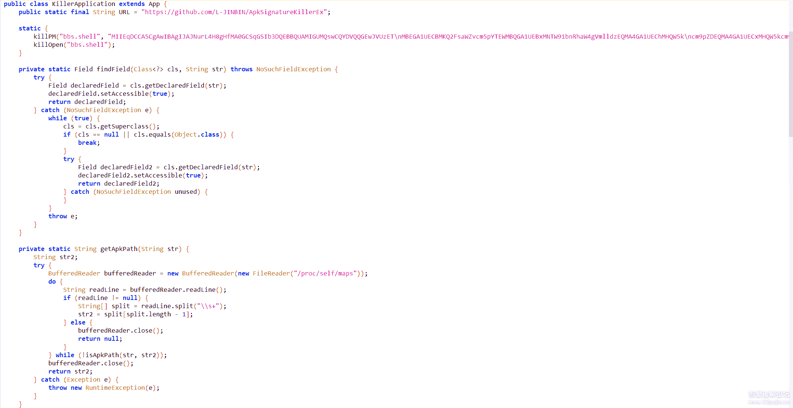
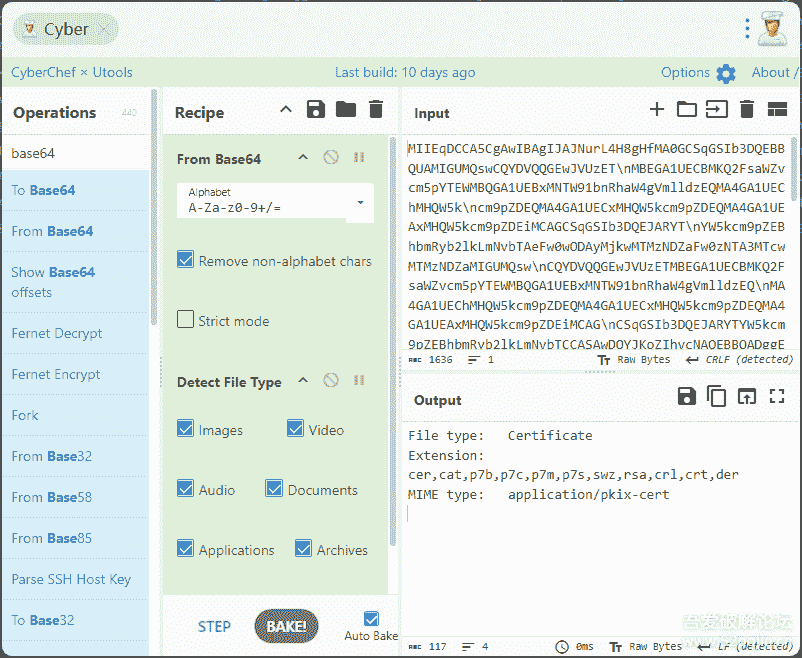
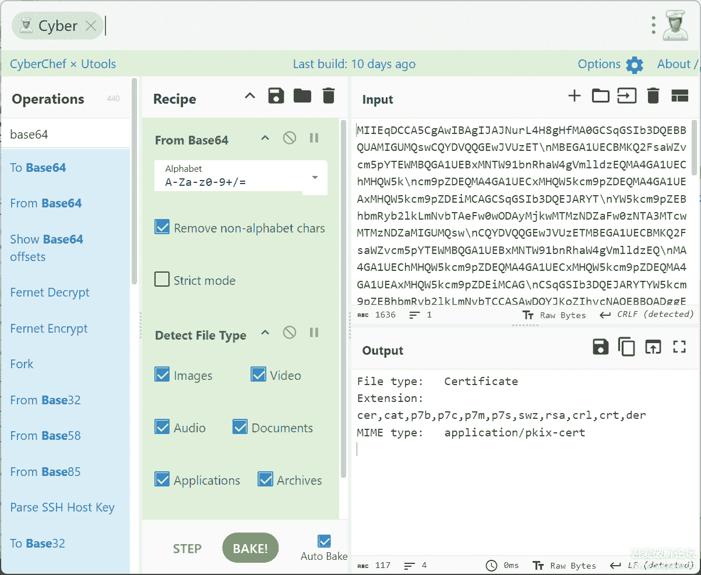

# [Android 分享] 云注入去签功能解析

- 原帖: `https://www.52pojie.cn/forum.php?mod=viewthread&tid=1987961`
- 抓取时间: `2026-11-01T16:14:01.004Z`

云注入去签功能解析之前用了一个app去去签，想改一些东西，顺便在去签的时候就把注入的dex的东西一起去解析看了，看看到达是怎么解析的，顺便之后把里面的抓包检测的功能也一并给解析了，增加一下代码功底顺便了解一下云注入的去签和抓包检测的原理这里多出来了`classes2.dex`，拿`jadx`来反编译看看



## KillerApplication

```java
public class KillerApplication extends App {
public static final String URL = "https://github.com/L-JINBIN/ApkSignatureKillerEx";
static {
killPM("bbs.shell", "MIIEqDCCA5CgAwIBAgIJAJNurL4H8gHfMA0GCSqGSIb3DQEBBQUAMIGUMQswCQYDVQQGEwJVUzET\nMBEGA1UECBMKQ2FsaWZvcm5pYTEWMBQGA1UEBxMNTW91bnRhaW4gVmlldzEQMA4GA1UEChMHQW5kcm9pZDEQMA4GA1UECxMHQW5kcm9pZDEQMA4GA1UEAxMHQW5kcm9pZDEiMCAGCSqGSIb3DQEJARYT\nYW5kcm9pZEBhbmRyb2lkLmNvbTAeFw0wODAyMjkwMTMzNDZaFw0zNTA3MTcwMTMzNDZaMIGUMQsw\nCQYDVQQGEwJVUzETMBEGA1UECBMKQ2FsaWZvcm5pYTEWMBQGA1UEBxMNTW91bnRhaW4gVmlldzEQ\nMA4GA1UEChMHQW5kcm9pZDEQMA4GA1UECxMHQW5kcm9pZDEQMA4GA1UEAxMHQW5kcm9pZDEiMCAG\nCSqGSIb3DQEJARYTYW5kcm9pZEBhbmRyb2lkLmNvbTCCASAwDQYJKoZIhvcNAQEBBQADggENADCC\nAQgCggEBANaTGQTexgskse3HYuDZ2CU+Ps1s6x3i/waMqOi8qM1r03hupwqnbOYOuw+ZNVn/2T53\nqUPn6D1LZLjk/qLT5lbx4meoG7+yMLV4wgRDvkxyGLhG9SEVhvA4oU6Jwr44f46+z4/Kw9oe4zDJ\n6pPQp8PcSvNQIg1QCAcy4ICXF+5qBTNZ5qaU7Cyz8oSgpGbIepTYOzEJOmc3Li9kEsBubULxWBjf\n/gOBzAzURNps3cO4JFgZSAGzJWQTT7/emMkod0jb9WdqVA2BVMi7yge54kdVMxHEa5r3b97szI5p\n58ii0I54JiCUP5lyfTwE/nKZHZnfm644oLIXf6MdW2r+6R8CAQOjgfwwgfkwHQYDVR0OBBYEFEhZ\nAFY9JyxGrhGGBaR0GawJyowRMIHJBgNVHSMEgcEwgb6AFEhZAFY9JyxGrhGGBaR0GawJyowRoYGa\npIGXMIGUMQswCQYDVQQGEwJVUzETMBEGA1UECBMKQ2FsaWZvcm5pYTEWMBQGA1UEBxMNTW91bnRh\naW4gVmlldzEQMA4GA1UEChMHQW5kcm9pZDEQMA4GA1UECxMHQW5kcm9pZDEQMA4GA1UEAxMHQW5k\ncm9pZDEiMCAGCSqGSIb3DQEJARYTYW5kcm9pZEBhbmRyb2lkLmNvbYIJAJNurL4H8gHfMAwGA1Ud\nEwQFMAMBAf8wDQYJKoZIhvcNAQEFBQADggEBAHqvlozrUMRBBVEY0NqrrwFbinZaJ6cVosK0TyIU\nFf/azgMJWr+kLfcHCHJsIGnlw27drgQAvilFLAhLwn62oX6snb4YLCBOsVMR9FXYJLZW2+TcIkCR\nLXWG/oiVHQGo/rWuWkJgU134NDEFJCJGjDbiLCpe+ZTWHdcwauTJ9pUbo8EvHRkU3cYfGmLaLfgn\n9gP+pWA7LFQNvXwBnDa6sppCccEX31I828XzgXpJ4O+mDL1/dBd+ek8ZPUP0IgdyZm5MTYPhvVqG\nCHzzTy3sIeJFymwrsBbmg2OAUNLEMO6nwmocSdN2ClirfxqCzJOLSDE4QyS9BAH6EhY6UFcOaE0=");
killOpen("bbs.shell");
}
}
```

主要执行的去签就是换签名。这里调用的两个函数，一个换签，一个是apk更新的先从`killOpen`来看看

## killOpen

```java
private static void killOpen(String str) {
try {
System.loadLibrary("SignatureKiller");
String apkPath = getApkPath(str); // /data/app/bbs.shell-Zxlv5blPzqvPR7OphdRWfg==/base.apk
if (apkPath == null) {
System.err.println("Get apk path failed");
return;
}
File file = new File(apkPath);
File file2 = new File(getDataFile(str), "origin.apk");
// /data/user/0/bbs.shell
try {
// 下面全是检查了，检查的是这个origin.apk的更新，要是和这里的/data/user/0/bbs.shell匹配不上就把/data/app/bbs.shell-Zxlv5blPzqvPR7OphdRWfg==/base.apk这里的apk里面的origin.apk搞过去
ZipFile zipFile = new ZipFile(file); // 下面全是检查了，检查的是这个origin.apk的更新，要是和这里的/data/user/0/bbs.shell匹配不上就把/data/app/bbs.shell-Zxlv5blPzqvPR7OphdRWfg==/base.apk这里的apk里面的origin.apk搞过去
ZipEntry entry = zipFile.getEntry("assets/SignatureKiller/origin.apk");
if (entry == null) {
PrintStream printStream = System.err;
printStream.println("Entry not found: assets/SignatureKiller/origin.apk");
zipFile.close();
return;
}
if (!file2.exists() || file2.length() != entry.getSize()) {
InputStream inputStream = zipFile.getInputStream(entry);
FileOutputStream fileOutputStream = new FileOutputStream(file2); //这里就是把更新的apk进行替换了
try {
byte[] bArr = new byte[102400];
while (true) {
int read = inputStream.read(bArr);
if (read == -1) {
break;
}
fileOutputStream.write(bArr, 0, read);
}
fileOutputStream.close();
if (inputStream != null) {
inputStream.close();
}
} catch (Throwable th) {
try {
fileOutputStream.close();
} catch (Throwable th2) {
th.addSuppressed(th2);
}
throw th;
}
}
zipFile.close();
hookApkPath(file.getAbsolutePath(), file2.getAbsolutePath()); //native函数
} catch (IOException e) {
throw new RuntimeException(e);
}
} catch (Throwable unused) {
System.err.println("Load SignatureKiller library failed");
}
}
```

## hookApkPath

```c
hookApkPath__int64 __fastcall Java_bin_mt_signature_KillerApplication_hookApkPath(
JNIEnv *a1,
jclass a2,
const char *str,
const char *str2)
{
::str = (*a1)->GetStringUTFChars(a1, str, 0LL);
::str2 = (*a1)->GetStringUTFChars(a1, str2, 0LL);
xhook_register(".*\\.so$"); // 这里是正则表达式：.*：表示任意字符（.）出现任意次数（*），反斜杠 \\ 是转义字符，用来匹配字面上的点号 '.' ，单个的.表示匹配任意单个字符，所以要加上\\转义字符
xhook_register(".*\\.so$");
xhook_register(".*\\.so$");
xhook_register(".*\\.so$");
return xhook_refresh(0LL);
}
```

这里还真全是去注册加载`so`了，就是不知道为什么要去注册四次，看起来这些也就是一个注册的`native`

## killPM

```java
private static void killPM(final String str, String str2) {
final Signature signature = new Signature(Base64.decode(str2, 0)); // 原始的packInfor
final Parcelable.Creator creator = PackageInfo.CREATOR;
try {
findField(PackageInfo.class, "CREATOR").set(null, new Parcelable.Creator() { // from class: bin.mt.signature.KillerApplication.1
/* JADX WARN: Can't rename method to resolve collision */
@Override // android.os.Parcelable.Creator
public PackageInfo createFromParcel(Parcel parcel) {
Signature[] apkContentsSigners;
PackageInfo packageInfo = (PackageInfo) creator.createFromParcel(parcel);
if (packageInfo.packageName.equals(str)) {
if (packageInfo.signatures != null && packageInfo.signatures.length > 0) {
packageInfo.signatures[0] = signature;
}
if (Build.VERSION.SDK_INT >= 28 && packageInfo.signingInfo != null && (apkContentsSigners = packageInfo.signingInfo.getApkContentsSigners()) != null && apkContentsSigners.length > 0) {
apkContentsSigners[0] = signature;
}
}
return packageInfo;
}
 /* JADX WARN: Can't rename method to resolve collision */
@Override // android.os.Parcelable.Creator
public PackageInfo[] newArray(int i) {
return (PackageInfo[]) creator.newArray(i);
}
});
if (Build.VERSION.SDK_INT >= 28) {
HiddenApiBypass.addHiddenApiExemptions("Landroid/os/Parcel;", "Landroid/content/pm", "Landroid/app");
}
try {
Object obj = findField(PackageManager.class, "sPackageInfoCache").get(null);
obj.getClass().getMethod("clear", new Class[0]).invoke(obj, new Object[0]);
} catch (Throwable unused) {
}
try {
((Map) findField(Parcel.class, "mCreators").get(null)).clear();
} catch (Throwable unused2) {
}
try {
((Map) findField(Parcel.class, "sPairedCreators").get(null)).clear();
} catch (Throwable unused3) {
}
} catch (Exception e) {
throw new RuntimeException(e);
}
}
```


}这里传入的`str2`是软件里面的证书签名

```text
MIIEqDCCA5CgAwIBAgIJAJNurL4H8gHfMA0GCSqGSIb3DQEBBQUAMIGUMQswCQYDVQQGEwJVUzET\nMBEGA1UECBMKQ2FsaWZvcm5pYTEWMBQGA1UEBxMNTW91bnRhaW4gVmlldzEQMA4GA1UEChMHQW5k\ncm9pZDEQMA4GA1UECxMHQW5kcm9pZDEQMA4GA1UEAxMHQW5kcm9pZDEiMCAGCSqGSIb3DQEJARYT\nYW5kcm9pZEBhbmRyb2lkLmNvbTAeFw0wODAyMjkwMTMzNDZaFw0zNTA3MTcwMTMzNDZaMIGUMQsw\nCQYDVQQGEwJVUzETMBEGA1UECBMKQ2FsaWZvcm5pYTEWMBQGA1UEBxMNTW91bnRhaW4gVmlldzEQ\nMA4GA1UEChMHQW5kcm9pZDEQMA4GA1UECxMHQW5kcm9pZDEQMA4GA1UEAxMHQW5kcm9pZDEiMCAG\nCSqGSIb3DQEJARYTYW5kcm9pZEBhbmRyb2lkLmNvbTCCASAwDQYJKoZIhvcNAQEBBQADggENADCC\nAQgCggEBANaTGQTexgskse3HYuDZ2CU+Ps1s6x3i/waMqOi8qM1r03hupwqnbOYOuw+ZNVn/2T53\nqUPn6D1LZLjk/qLT5lbx4meoG7+yMLV4wgRDvkxyGLhG9SEVhvA4oU6Jwr44f46+z4/Kw9oe4zDJ\n6pPQp8PcSvNQIg1QCAcy4ICXF+5qBTNZ5qaU7Cyz8oSgpGbIepTYOzEJOmc3Li9kEsBubULxWBjf\n/gOBzAzURNps3cO4JFgZSAGzJWQTT7/emMkod0jb9WdqVA2BVMi7yge54kdVMxHEa5r3b97szI5p\n58ii0I54JiCUP5lyfTwE/nKZHZnfm644oLIXf6MdW2r+6R8CAQOjgfwwgfkwHQYDVR0OBBYEFEhZ\nAFY9JyxGrhGGBaR0GawJyowRMIHJBgNVHSMEgcEwgb6AFEhZAFY9JyxGrhGGBaR0GawJyowRoYGa\npIGXMIGUMQswCQYDVQQGEwJVUzETMBEGA1UECBMKQ2FsaWZvcm5pYTEWMBQGA1UEBxMNTW91bnRh\naW4gVmlldzEQMA4GA1UEChMHQW5kcm9pZDEQMA4GA1UECxMHQW5kcm9pZDEQMA4GA1UEAxMHQW5k\ncm9pZDEiMCAGCSqGSIb3DQEJARYTYW5kcm9pZEBhbmRyb2lkLmNvbYIJAJNurL4H8gHfMAwGA1Ud\nEwQFMAMBAf8wDQYJKoZIhvcNAQEFBQADggEBAHqvlozrUMRBBVEY0NqrrwFbinZaJ6cVosK0TyIU\nFf/azgMJWr+kLfcHCHJsIGnlw27drgQAvilFLAhLwn62oX6snb4YLCBOsVMR9FXYJLZW2+TcIkCR\nLXWG/oiVHQGo/rWuWkJgU134NDEFJCJGjDbiLCpe+ZTWHdcwauTJ9pUbo8EvHRkU3cYfGmLaLfgn\n9gP+pWA7LFQNvXwBnDa6sppCccEX31I828XzgXpJ4O+mDL1/dBd+ek8ZPUP0IgdyZm5MTYPhvVqG\nCHzzTy3sIeJFymwrsBbmg2OAUNLEMO6nwmocSdN2ClirfxqCzJOLSDE4QyS9BAH6EhY6UFcOaE0=\n
```





对于这里的证书的内容：这些扩展名代表的是不同类型的证书文件格式，具体如下：

- `.cer` 或 `.crt`：这两种扩展名通常用于 X.509 证书文件，存储公钥、证书持有者信息、签名算法等。文件可以是 DER 编码 或 PEM 编码 格式，具体取决于编码方式。
  - `.cer`：可以包含公钥证书或整个证书链。
  - `.crt`：通常用于服务器端证书，或者包含 CA 签发的证书。
- `.p7b` 或 `.p7c`：这些文件扩展名表示 PKCS #7 文件格式，通常用于存储证书链、证书撤销列表（CRL）等。文件以 Base64 编码的形式存储。PKCS #7 格式用于签名和加密数据，常用于电子邮件、证书链等的传输。
- `.p7m`：这个扩展名用于 PKCS #7 格式的邮件签名文件。通常用于电子邮件的签名或加密邮件。
- `.p7s`：这个扩展名也是 PKCS #7 格式的一部分，主要用于邮件签名，包含签名数据。
- `.swz`：这是一个不太常见的扩展名，可能与某些特殊应用程序的证书有关。
- `.rsa`：这个扩展名通常与 RSA 密钥相关，但它也可能用于存储与 RSA 相关的证书或私钥。
- `.crl`：证书撤销列表（Certificate Revocation List，CRL）文件，用于列出已被撤销的证书。它用于确保没有被撤销的证书被接受。
- `.der`：DER（Distinguished Encoding Rules） 是一种二进制格式，通常用于存储证书、私钥或公钥。它不同于 PEM 格式，PEM 格式是 Base64 编码的文本格式。`.der` 文件通常用于存储证书链和证书本身。

**3. MIME 类型：**

MIME 类型：`application/pkix-cert`，是用于描述与 PKI（公钥基础设施）相关的文件的 MIME 类型。该 MIME 类型通常用于 HTTP 请求/响应中，表示文件包含数字证书。

```java
findField(PackageInfo.class, "CREATOR").set(null, new Parcelable.Creator() { // from class: bin.mt.signature.KillerApplication.1

/* JADX WARN: Can't rename method to resolve collision */

@Override // android.os.Parcelable.Creator

public PackageInfo createFromParcel(Parcel parcel) {

Signature[] apkContentsSigners;

PackageInfo packageInfo = (PackageInfo) creator.createFromParcel(parcel);

if (packageInfo.packageName.equals(str)) {

if (packageInfo.signatures != null && packageInfo.signatures.length > 0) {

packageInfo.signatures[0] = signature;

}

if (Build.VERSION.SDK_INT >= 28 && packageInfo.signingInfo != null && (apkContentsSigners = packageInfo.signingInfo.getApkContentsSigners()) != null && apkContentsSigners.length > 0) {

apkContentsSigners[0] = signature;

}

}

return packageInfo;

}
```

这里是证书替换的关键位置先看看这里在干嘛

```java
public static final @android.annotation.NonNull Parcelable.Creator CREATOR

= new Parcelable.Creator() {

@Override

public PackageInfo createFromParcel(Parcel source) {

return new PackageInfo(source);

}

@Override

public PackageInfo[] newArray(int size) {

return new PackageInfo[size];

}
```

这里是看着有点麻烦，去查了一下其实也就是 `object name = new object`。`Parcelable`是一个接口，用于将对象序列化和反序列化，以便能够通过 `Intent` 或 `Bundle` 在不同组件（如 `Activity` 或 `Service`）之间传递数据。`Parcelable.Creator` 是一个辅助接口，定义了如何通过 `Parcel` 对象来创建类型为 `T` 的对象。所以`Creator`是一个接口的接口，接受一个类来创建对应类的新实例。所以其实这里接受一个 `new` 一个 `PackageInfo`类的`Parcelable`接口类下的辅助接口`Creator`的`PackageInfo`实例 然后得到了对应的对象，然后进行了对应的部分接口的实现。每个实现了 `Parcelable` 接口的类（例如 `PackageInfo`）通常会自动生成一个静态的 `CREATOR` 字段，类型为 `Parcelable.Creator`，负责：

- 反序列化：从 `Parcel` 中读取数据，并创建该类的对象。
- 数组创建：创建对象数组。

对于`CREATOR`字段，它是`Parcelable.Creator`类型的字段，负责通过`Parcel`创建`PackageInfo`对象。通常，这个字段是由`PackageInfo`类自动生成的，但通过反射，可以将其替换为自定义实现，从而改变`PackageInfo`的创建逻辑。意思也就是在上面实例了自定义的`PackageInfo`类会自动生成`CREATOR`字段，所以实现了字段的替换。

```java
Signature[] apkContentsSigners;

PackageInfo packageInfo = (PackageInfo) creator.createFromParcel(parcel);//原始packageInfo

if (packageInfo.packageName.equals(str)) {

if (packageInfo.signatures != null && packageInfo.signatures.length > 0) {

packageInfo.signatures[0] = signature;//替换之后的代码就是去清理缓存之类的了
if (Build.VERSION.SDK_INT >= 28) {

HiddenApiBypass.addHiddenApiExemptions("Landroid/os/Parcel;", "Landroid/content/pm", "Landroid/app");

}
```

这里是`HiddenApiBypass.addHiddenApiExemptions`利用这个方法去获取了隐藏的API来使用。至于里面源码中的获取包名，类名之类的操作就放后面了，虽然大相径庭但是可以增加一下代码能力

```java
private static String getApkPath(String str) {

String str2;

try {

BufferedReader bufferedReader = new BufferedReader(new FileReader("/proc/self/maps"));

do {

String readLine = bufferedReader.readLine();// /proc/self/maps readLine

if (readLine != null) {

String[] split = readLine.split("\\s+"); //这里按照空格去分割开了

str2 = split[split.length - 1];//这里索引下就是对于的路径，其中是由apk的路径的

} else {

bufferedReader.close();

return null;

}

} while (!isApkPath(str, str2));

bufferedReader.close();

return str2;

} catch (Exception e) {

throw new RuntimeException(e);

}

} private static File getDataFile(String str) {

String name = Environment.getExternalStorageDirectory().getName(); // /storage/emulated/0

if (name.matches("\\d+")) {

File file = new File("/data/user/" + name + "/" + str); // /data/user/storage/emulated/0/bbs.shell 或者 /data/user/0/bbs.shell

if (file.canWrite()) {

return file;

}

}

return new File("/data/data/" + str);

} private static boolean isApkPath(String str, String str2) {

if (str2.startsWith("/") && str2.endsWith(".apk")) {

String[] split = str2.substring(1).split("/", 6);

int length = split.length;

if (length == 4 || length == 5) {

if (split[0].equals("data") && split[1].equals("app") && split[length - 1].equals("base.apk")) {

return split[length - 2].startsWith(str);

}

if (split[0].equals("mnt") && split[1].equals("asec") && split[length - 1].equals("pkg.apk")) {

return split[length - 2].startsWith(str);

}

} else if (length == 3) {

if (split[0].equals("data") && split[1].equals("app")) {

return split[2].startsWith(str);

}

} else if (length == 6 && split[0].equals("mnt") && split[1].equals("expand") && split[3].equals("app") && split[5].equals("base.apk")) {

return split[4].endsWith(str);

}

}

return false;

}

/*

检测的结果就是

/data/app/com.example.myapp-1/base.apk

/mnt/asec/com.example.myapp/pkg.apk

/mnt/expand/app/com.example.myapp/base.apk

*/ private static Field findField(Class cls, String str) throws NoSuchFieldException {

try {

Field declaredField = cls.getDeclaredField(str);

declaredField.setAccessible(true);

return declaredField;

} catch (NoSuchFieldException e) {

while (true) {

cls = cls.getSuperclass();

if (cls == null || cls.equals(Object.class)) {

break;

}

try {

Field declaredField2 = cls.getDeclaredField(str);

declaredField2.setAccessible(true);

return declaredField2;

} catch (NoSuchFieldException unused) {

}

}

throw e;

}

}
```

这里的反射调用字段就很正常了。同时，最后这里的 `URL` 还是一个 GitHub 上面的，不知道是作者写的软件还是借用上去的。

```java
public static final String URL = "https://github.com/L-JINBIN/ApkSignatureKillerEx";
```

这里面就是去签功能的软件，感觉证书是从这里来的=
