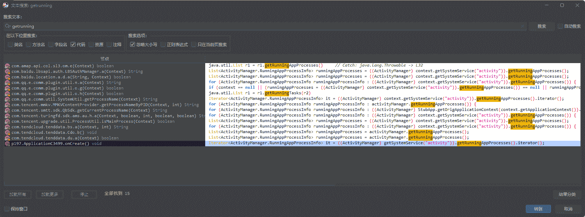
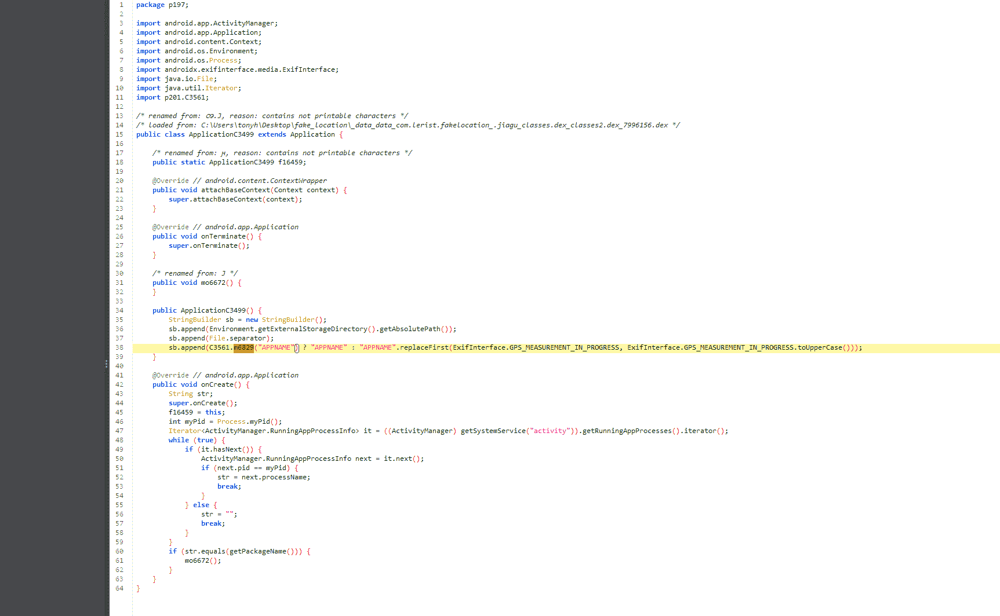
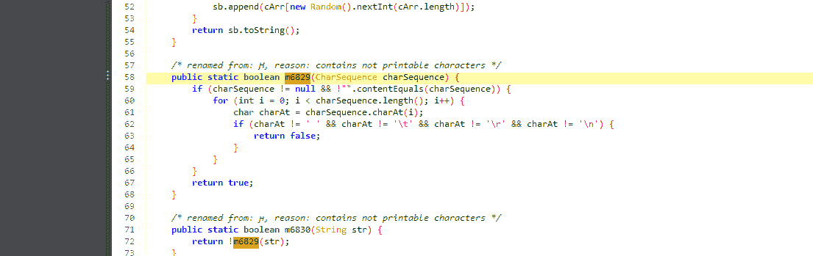
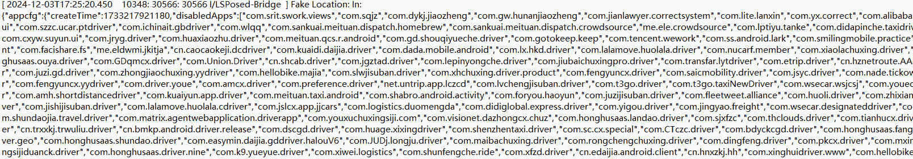
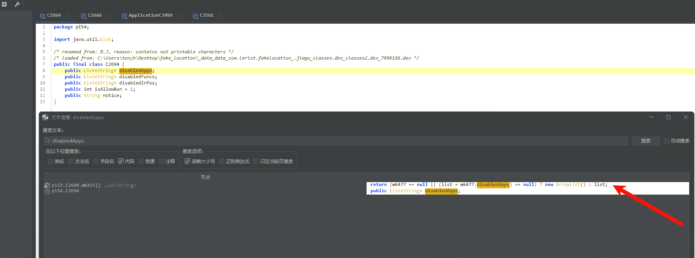
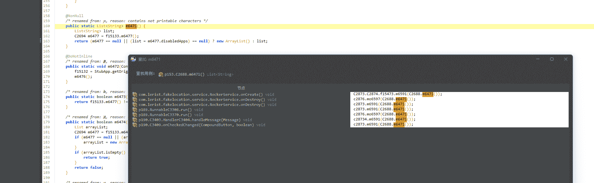
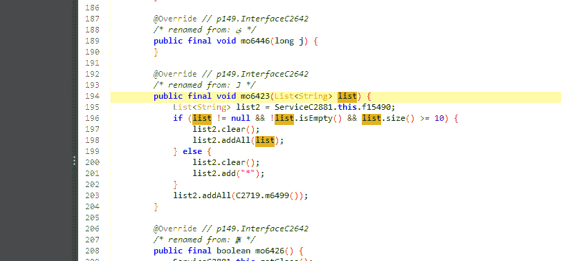
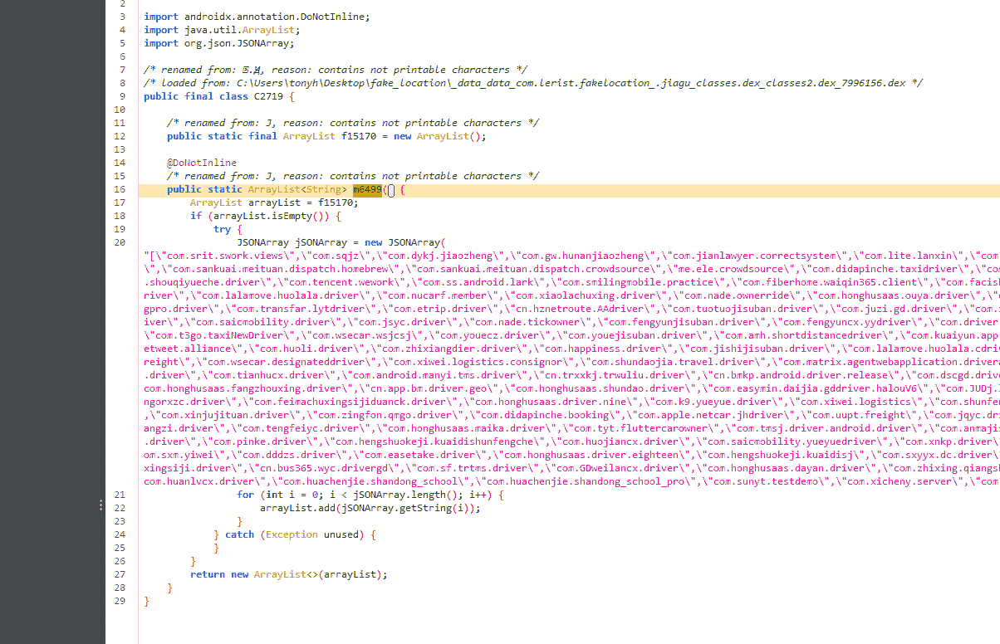

# [Android 原创] Fake Location跑不了校园跑？最简单粗暴的解决方案

- 原帖: https://www.52pojie.cn/forum.php?mod=viewthread&tid=1987977
- 抓取时间: 2026-11-01T23:58:04

> **仅供技术交流 禁止用于各类非法用途！！！**

## 思路

当处于校园跑APP时，模拟路线功能会停止工作。但是切换到其他APP时，功能又会恢复正常。所以推测是通过获取前台应用来判断是否在黑名单中。

## 过程

脱壳部分省略。

首先搜索关键字`getrunning`。

分析包名可知，这行代码嫌疑比较大。点进去看看。

这个`m6829`方法应该会出现相关的字样。Hook一下看看传进去了什么东西。

翻到了传入了如下内容。由此可知关键字为`disabledApps`。

搜索后可以定位到如下位置。

通过查找和分析调用，可知这个`m6471`返回的就是拉黑的APP名单。Hook后返回一个空列表即可，代码省略。

## 后续

发现光Hook这一个方法还是会触发黑名单。以下为还需要Hook的地方。

