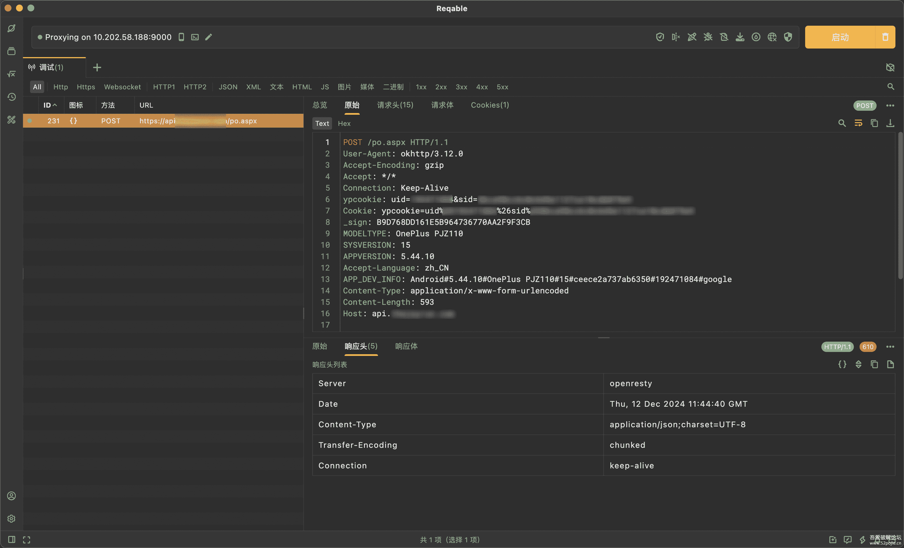
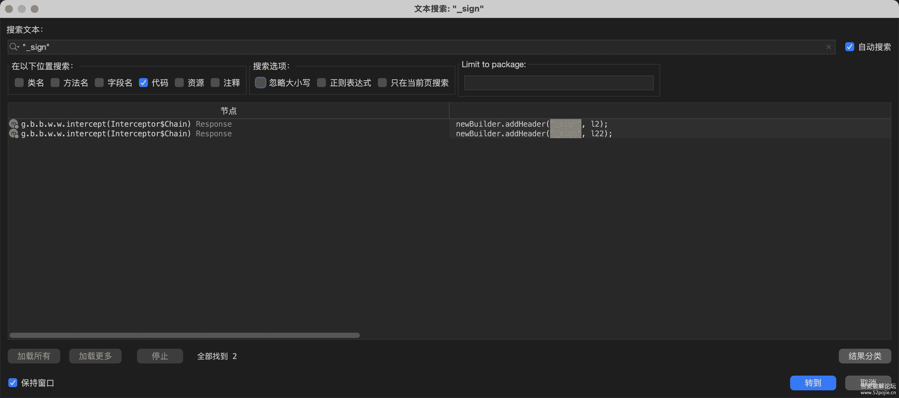
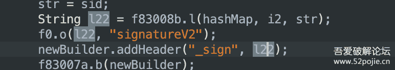
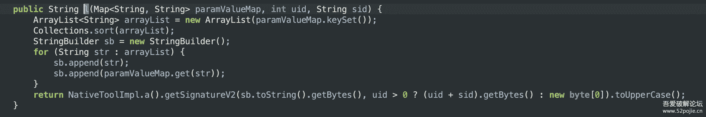
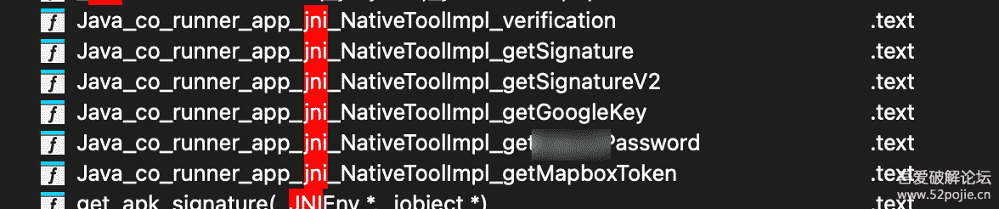
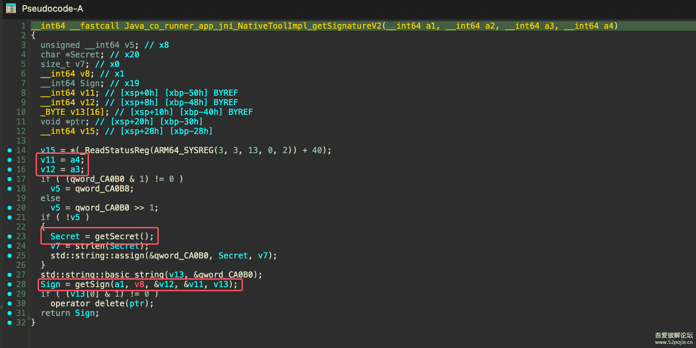
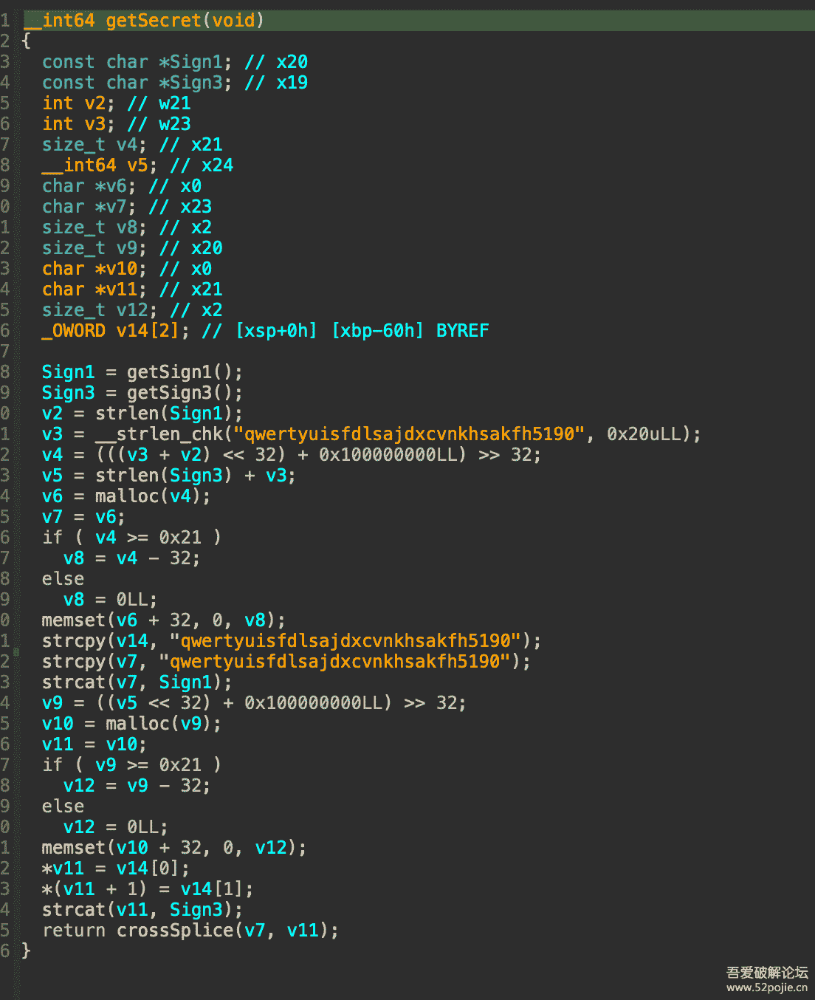
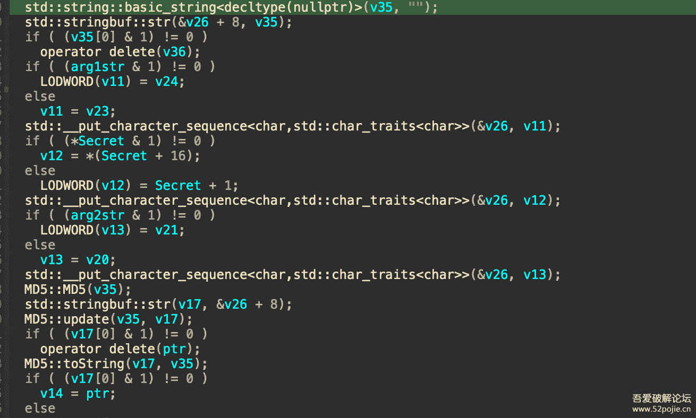

# [Android 原创] 逆向分析某红色跑步App的API

- 原帖: https://www.52pojie.cn/forum.php?mod=viewthread&tid=1990794
- 抓取时间: 2026-11-01T16:13:41.705Z

## 逆向分析某红色跑步App的API

### 前言
群友尝试破解自己学校的某红色校园跑App，来帮个忙

### 准备工具
- [IDA Pro](https://hex-rays.com/ida-pro)
- [Jadx](https://github.com/skylot/jadx)
- [Reqable](https://reqable.com/) 或使用[Fiddler](https://www.telerik.com/fiddler)代替
- [Frida](https://frida.re/)
- 一台Root的Android手机（Android 13或以下）或虚拟机

### 分析数据包
使用`Reqable`抓取上传跑步数据时的请求，内容如图：

一眼看到Header存在一个校验字段：`_sign`，内容是一个大写的的16字节HexString

### 分析dex
这里已经怀疑可能是MD5，将Apk拖入`jadx`搜索`_sign`找到如图请求位置：

继续往下跟踪:



### 分析libsign.so
至此找到调用生成`_sign`的函数`getSignatureV2` 这个函数是一个native实现，经过对目录`lib/arm64-v8a`的寻找，发现极为可疑的文件`libsign.so`
将`libsign.so`导入`IDA`分析，可见JNI函数：

直接点开`Java_co_runner_app_jni_NativeToolImpl_getSignatureV2`查看逻辑：

发现逻辑如下：
- Java层传入的第1, 2个参数（IDA中为`a3`, `a4`）作为内部函数`getSign`的第1, 2个参数使用
- 内部函数`getSecret()`获取了一个`Secret`值，作为内部函数`getSign`的第3个参数使用
先分析`Secret`是怎么来的：

全部是一些`memcpy`,`strcat`之类的操作，说明`Secret`的生成路径是固定的，没有依靠时间等`seed`对其进行随机处理（`getSign1`和`getSign3`以及其调用的函数也没有使用随机，这里就先不放图了），所以我们基本可以认为使用`frida`对函数`getSecret()`进行钩取，可以获得其固定返回值。
（假装这里有一张截图）
由于我手上暂时没有 Android 13 及以下的环境，所以让群友代抓了一下`getSecret()`函数的返回值，多次发送请求进行抓取，发现`Secret`确实为固定值20eca08916b92********2786e315dea
拿到了三个参数，我们就可以研究函数`getSign`的逻辑了。双击`getSign`，跳转到函数中查看逻辑，如图：

分析起来不难，使用了三个`std::__put_character_sequence`，基本可以看出来是把三个参数顺序连接了起来，而后面`MD5`函数的调用也印证了前面的猜想。
继续让群友代劳，抓了一些调用Java层调用`getSignatureV2`的参数和返回值，用来验证猜测是否正确。但是我在这一步卡了很久，因为我认为`Secret`在最后，最后多试了几种排列方法才发现`Secret`实际上在两个Java层传入参数的中间。

### 重新实现Java层参数
接下来看一下Java层传入的两个参数都是什么东西。

#### 第一个参数
见上图分析dex时的图片可知，第一个参数是一个`Map` `paramValueMap`经过`sort`得到的顺序，再以该顺序将其每个键与值从前到后拼接在一起得到的。就像这样：`contentheartrate[]lasttime1733995696meter196nodetimenomo...`
尝试在Python中还原该逻辑：
```
params = {}
for segment in dataStr.split("&"):
    if "=" in segment:
        k, v = segment.split("=", 1)
    else:
        k, v = segment, ""
    k = urllib.parse.unquote_plus(k)
    v = urllib.parse.unquote_plus(v)
    params[k] = v

sorted_keys = sorted(params.keys())

sb = []
for key in sorted_keys:
    sb.append(key)
    sb.append(params[key])

dataFinalStr = "".join(sb)
```
库自带的parse会导致没有值的键消失，比如解析`&content=&xxx=***`的时候，`content`就离奇失踪了。

#### 第二个参数
我们可以看到`uid > 0 ? (uid + sid).getBytes() : new byte[0]` 其实就是把`uid`和`sid`直接拼一起而已。

#### 王牌飞行员
接下来的事就是把`_sign`应用到脚本里了，效果如图：


#### 一些花絮
- 一些大模型反编译平台（MLM01等）会出现搜索不到函数，还会出现AI瞎编代码逻辑的情况
- 同时使用 Android 14、15 和 KernelSU 的 Zygisk 模块时，会出现`frida`无法`spawn`程序的情况，报错为等待`zygote`程序（的PID）超时，尝试了一些办法（例如`kill`掉`zygote`进程）均无法解决，希望有大佬支招
- 这个App的34个`dex`让我的18G小内存在`jadx`搜索时不堪重负
- `Secret`的位置是上Linux课的时候摸鱼试出来的

#### 尾声
谁写的`getSecret`，建议开除
