# [Android 原创] 某绿色图标读书app epub解密算法分析

- 原帖: https://www.52pojie.cn/forum.php?mod=viewthread&tid=1993046
- 抓取时间: 2026-11-01T16:13:29.947Z

本文章中所有内容仅供学习交流，不用于其他目的，抓包内容、敏感网址、数据接口等均已做脱敏处理。若有侵权，请联系作者删除。

## 一、前言

该`APP`难度中等，非常适合想要学习`Android`逆向进阶技巧的小伙伴练手，对如何快速定位关键函数以及如何调用`openssl`库还原算法都很有帮助。

## 二、准备

`Frida`

`IDA`

`UltraEdit`

`Fiddler`

## 三、分析

随便打开一本书阅读，可以看到`Fiddler`抓到了几个请求，粗略看一下发送内容和返回结果，说不定等下分析的时候寻找参数来源可以用到，如图所示：
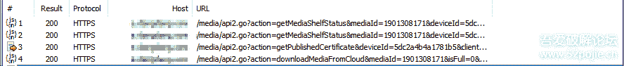

### 1. 定位 so

`hook` `fopen`并打印堆栈，得知在`libddlayoutkit.so`里对文件进行了操作，也定位到了`epub`存放路径和关键解密函数，如图所示：
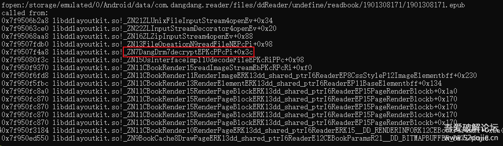

### 2. 流程分析

将`/storage/emulated/0/Android/data/com.dangdang.reader/files/ddReader/undefine/readbook/1901308171/1901308171.epub` `pull`出来，解压查看文件结构，`container.xml`记录了文件的加密信息，如图所示：
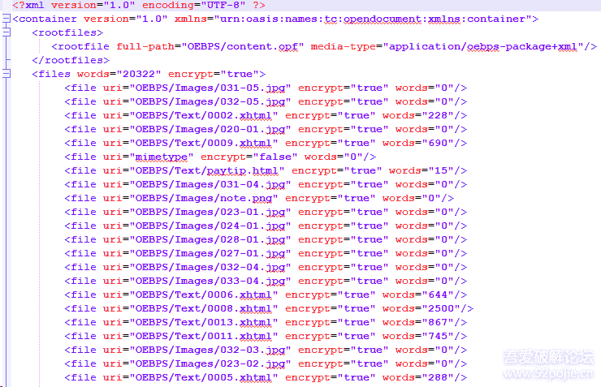

`IDA`打开`libddlayoutkit.so`，定位到`DangDrm::decrypt`看下伪代码
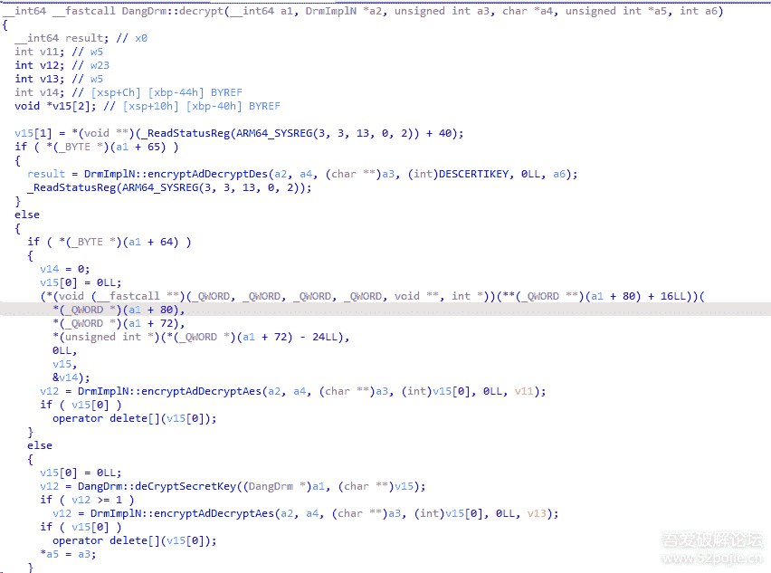

`hook` `DrmImplN::encryptAdDecryptDes`和`DrmImplN::encryptAdDecryptAes`，确认下这本书籍是走哪个分支。发现2个函数都调用了，这就很奇怪了，看伪代码要么执行`DrmImplN::encryptAdDecryptDes`要么执行`DrmImplN::encryptAdDecryptAes`，不会2个分支同时执行，得打印下堆栈进一步判断，发现`DangDrm::deCryptSecretKey`调用了`DrmImplN::encryptAdDecryptDes`，如图所示：
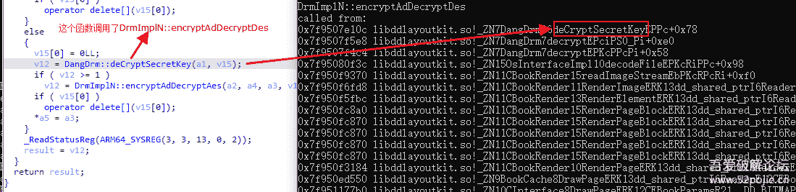

通过输出结果可以判断执行的是最后一个分支。

#### (1) 分析 `DangDrm::deCryptSecretKey`

跳转到`DangDrm::deCryptSecretKey`，发现可疑函数
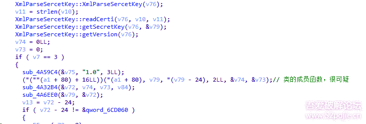

`IDA`切换到`Disassembly`视图
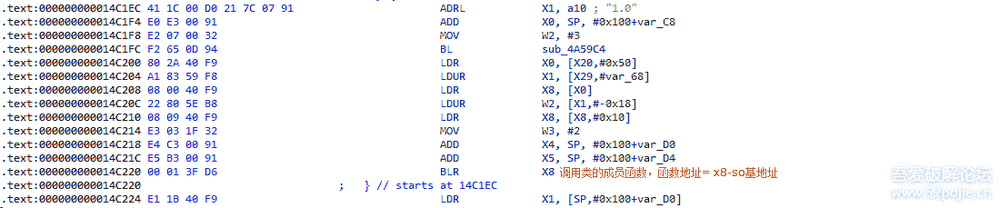

需要写`Frida`脚本计算类的成员函数地址，脚本如下：

```javascript
calcFuncAddr();
function calcFuncAddr() 
{
  var baseAddr = Module.findBaseAddress("libddlayoutkit.so");
  console.log("baseAddr:"+baseAddr);
  var addr=baseAddr.add(0x14C220);
  Interceptor.attach(addr,
  {     
        onEnter: function(args)
        {
           var x8=this.context.x8;
           var funcAddr=x8-baseAddr;
           console.log('target funcAddr:'+ptr(funcAddr));          
        },
        onLeave:function(retval)
        {
                                  
        }
  });
}
```

执行脚本后输出如图所示:
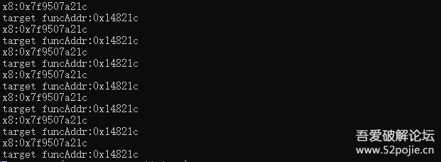

`IDA`跳转到`0x14821C`，发现是`Base64`解码函数
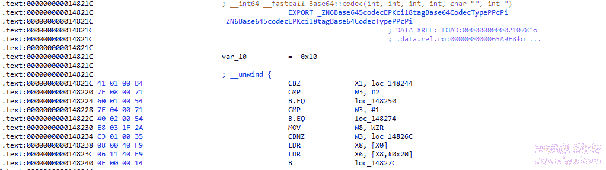

`IDA`伪代码，如图所示：
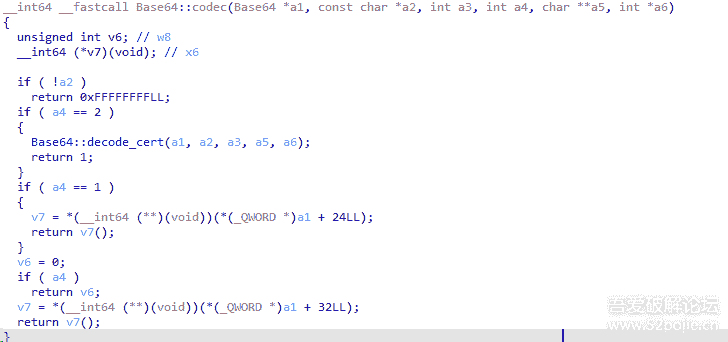

`hook` `Base64::decode_cert`，输出如图所示:
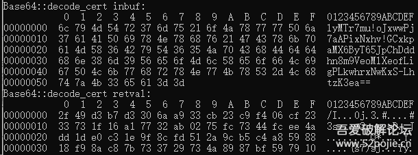

`lyMTr7mu!oJxwwPj7aAPixNxhv!GCxkpaMX6ByT65JpChDddhn8m9VeoMlXeofLigPLkwhrxNwKxS-LhtzK3ea==`似曾相识，经过查找，在`getPublishedCertificate`请求返回的结果里找到该字符串
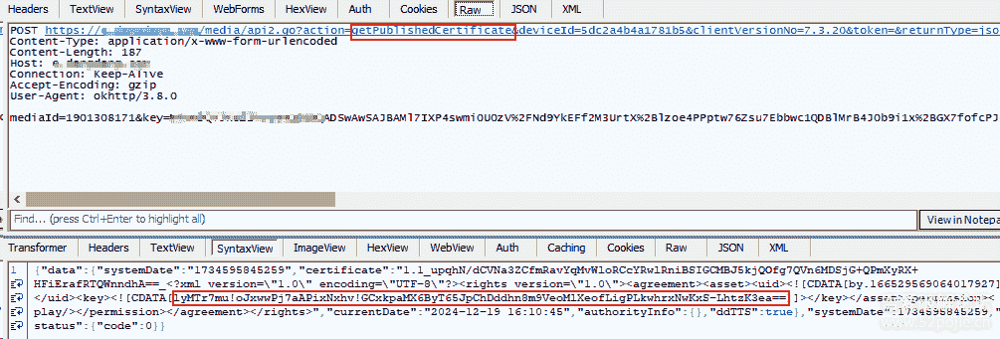

对该字符串解码，发现怎么解都解不开，匪夷所思，猜测是魔改`Base64`，得继续分析`Base64::decode_cert`，跳转到该函数查看内部逻辑，发现`Base64`码表被修改了
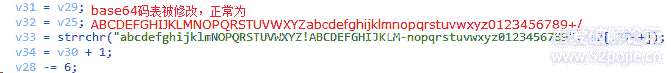

代码复现：
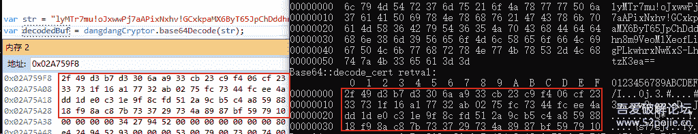

继续分析`DangDrm::deCryptSecretKey`内部逻辑，发现可疑函数`DrmImplN::decryptDataByEvpPriKey`
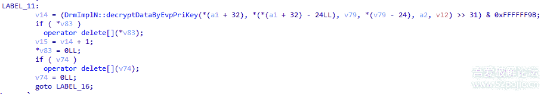

`DrmImplN::decryptDataByEvpPriKey`伪代码
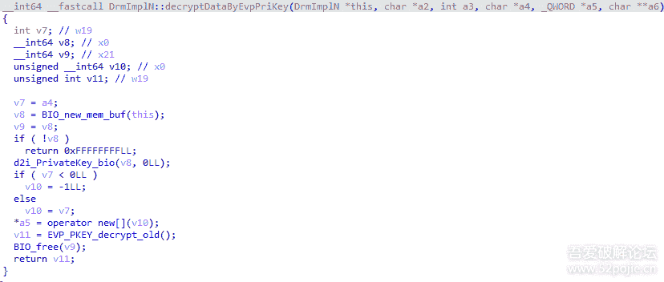

`hook` `BIO_new_mem_buf`
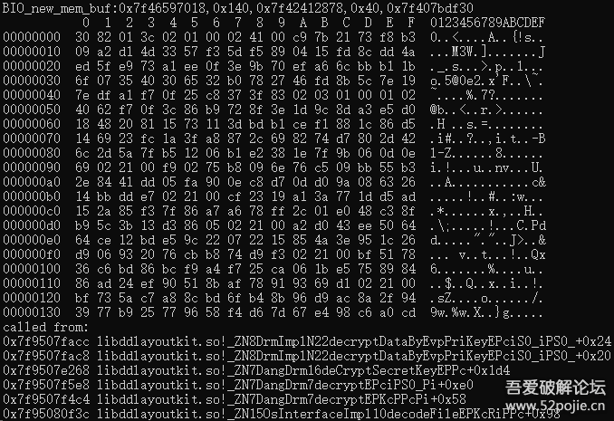

`hook` `EVP_PKEY_decrypt_old`
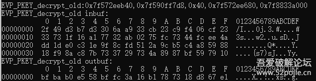

调用`openssl`库复现
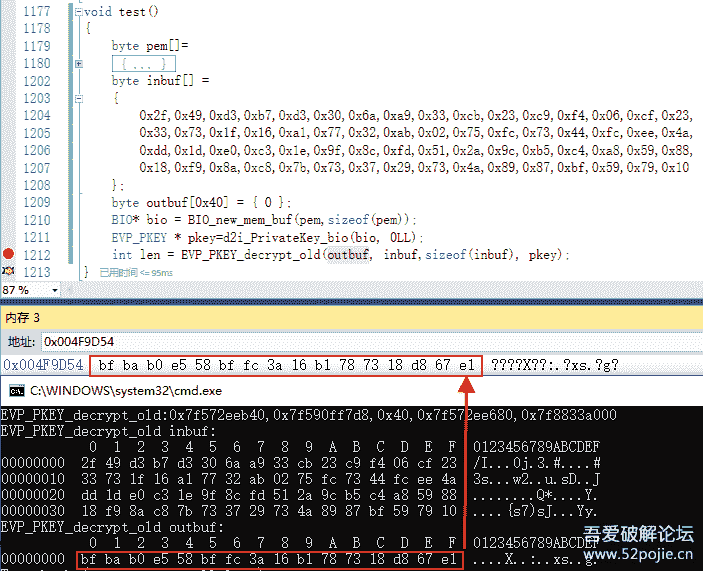

得到了16个字节`bf ba b0 e5 58 bf fc 3a 16 b1 78 73 18 d8 67 e1`，猜测可能是`AES`密钥。

#### (2) 分析 `DrmImplN::encryptAdDecryptAes`

`DrmImplN::encryptAdDecryptAes`逻辑很简单
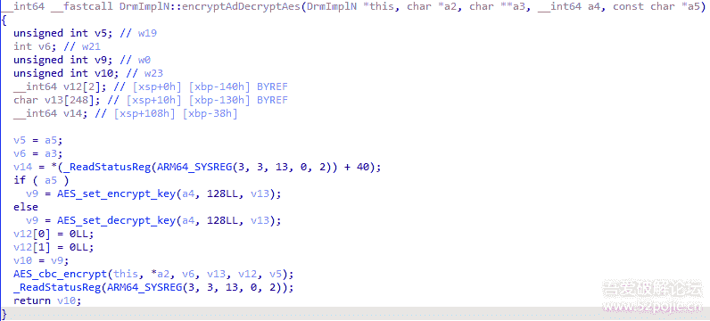

`hook` `AES_set_encrypt_key`和`AES_cbc_encrypt`，输出如图所示:
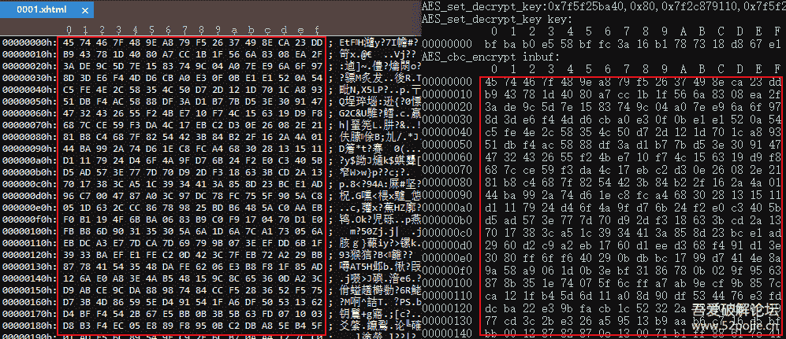
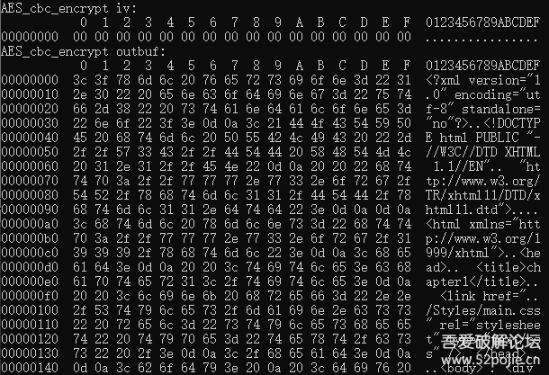

`AES`解密后得到明文，至此解密流程已经很清晰了。

### 3. 解密算法

首次打开书籍时，会发送`getPublishedCertificate`请求到服务器，读取返回结果中的`key`字段，如图所示:
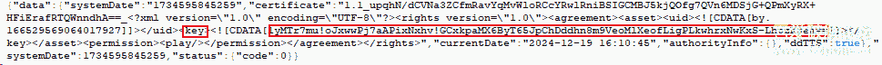

将该字符串`Base64`解码(`魔改 Base64`)，将解码后的`Base64`进行`RSA`解密得到`AESKEY`，`AESIV`为16个0，读取`OEBPS`目录下的加密文件进行`AES CBC`解密，就可以还原成正常`epub`，如图所示:
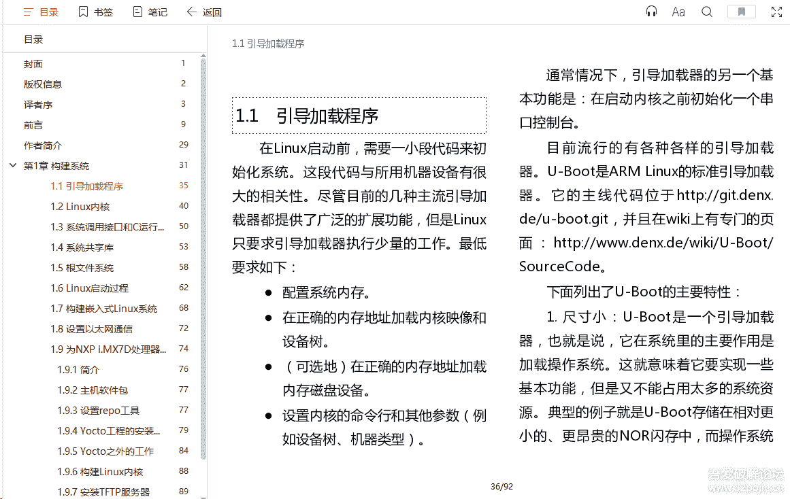
