# [iOS 原创] 某右ios端逆向分析

- 原帖: https://www.52pojie.cn/forum.php?mod=viewthread&tid=1998422
- 抓取时间: 2026-11-01T23:57:54

设备：`ios8`，iOS 版本：`14.7.1`，App：某右 `6.2.6`，Frida：`14.1.8`，IDA：`9.0`

## 抓包分析

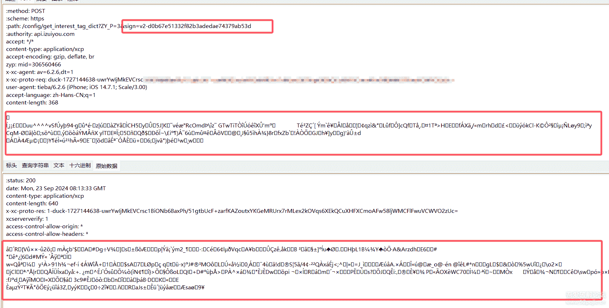

`image.png` (107.66 KB, 下载次数: 1)

由上图看出从协议层面看出，有 `sign` / `body` / `response body` 的这些防护。

## App脱壳

使用巨魔安装 `AppsDump2` 进行脱壳。

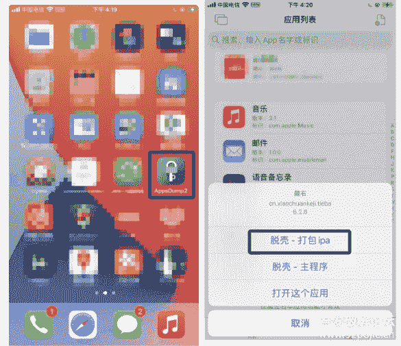

`96fca7baec72dc0a24b6f0d6a913c73.png` (240.78 KB, 下载次数: 1)

使用 Filza 打开文件目录，利用爱思助手导出到电脑。

## 协议分析

这块内容主要是使用 Frida + IDA 进行动静态分析。

### 3.1 使用 frida-trace 定位代码关键点

`frida-trace` 使用方法，参考 [frida-trace 使用方法](https://www.cnblogs.com/xiaoweigege/p/16924249.html)。

```
frida-trace -UF -m "+[NSURL URLWithString:]"
// +[NSURL URLWithString:] 是ios中构造URL的方法
// + 代表类方法
// NSURL 是类名
// URLWithString:  是方法名
```

使用该命令会在当前目录生成文件夹。

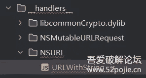

`7fc5c68b33f12f63499002366033744.png` (43.24 KB, 下载次数: 1)

修改 `URLWithString_.js`：

```
{
    onEnter(log, args, state)
    {
        // 为什么是第3个参数？在oc方法中, args[0] 是表示 self, 就是自身
        // args[1] 表示 _cmd，即当前方法的选择器（selector）
        var args2 = new ObjC.Object(args[2]);
        // 筛选相关URL, 避免输出过多内容
        if (args2.toString().indexOf('account/login') !== -1) {
            // 打印出请求url
            log(`+[NSURL URLWithString:${args2}]`);
            // 打印出调用堆栈，向上跟踪关键点
            log('NSURL URLWithString: called from:\n' +
                Thread.backtrace(this.context, Backtracer.ACCURATE)
                    .map(DebugSymbol.fromAddress).join('\n') + '\n');
        }
    }
,
    onLeave(log, retval, state)
    {
    }
}
```

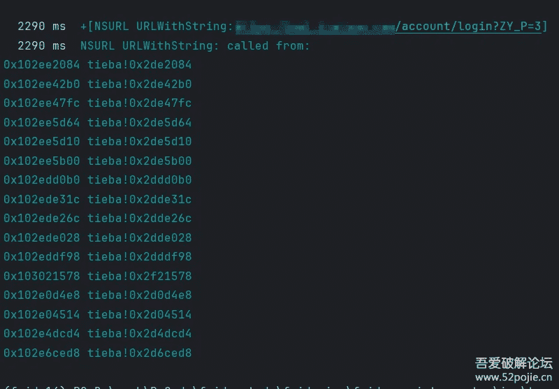

`8d8703a959a756f5fd1dc3401843982.png` (266.98 KB, 下载次数: 0)

以上就是 `frida-trace` 打印出来的调用堆栈，根据偏移地址来定位代码位置，每一行有两个地址，第一个是在内存中的实际地址，第二个则是偏移地址，可以使用偏移地址来定位的代码点。

打开 IDA 输入 `G` 来地址跳转，我们先定位一个地址 `0x2de2084`，IDA 中的基址是 `0x100000000`，即在 IDA 中输入的地址应该是 `0x102de2084`。

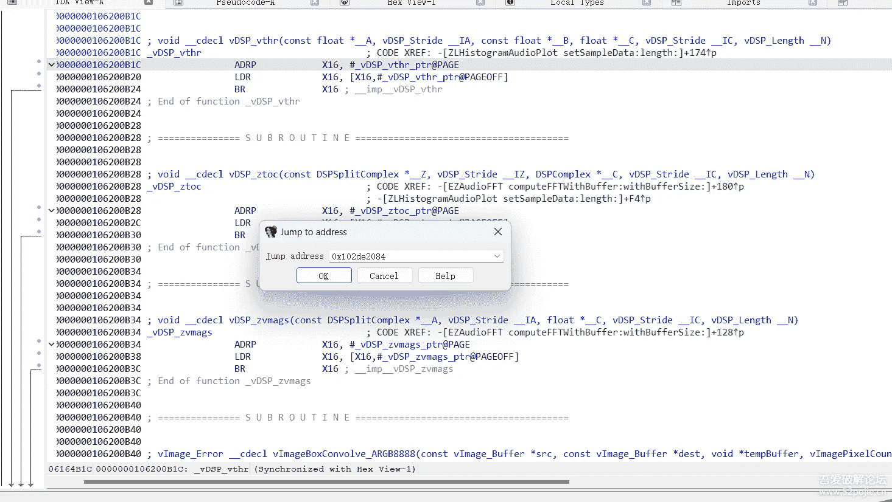

`370e20f7ff9e976ac6bfb94f78a46a8.png` (660.32 KB, 下载次数: 1)

跳转到堆栈点，进行 `F5` 反汇编进行查看。

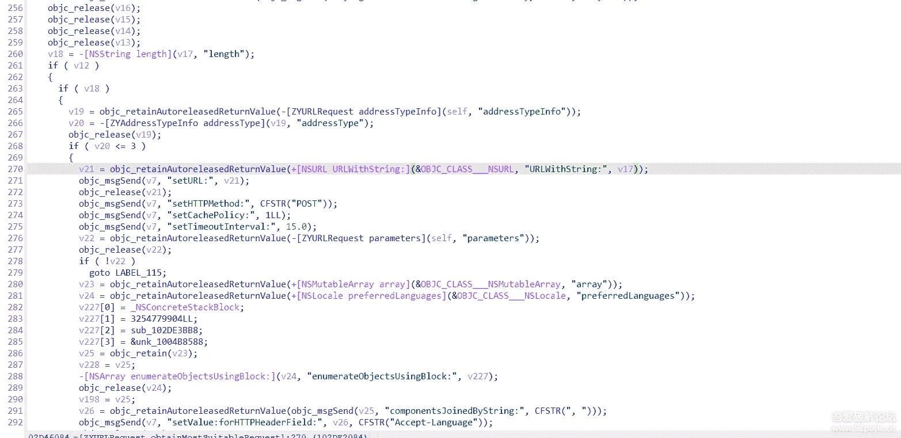

`3d847cc62a1bc56ab4783c7a13286b4.png` (561.19 KB, 下载次数: 1)

找到关键信息 `sign`。

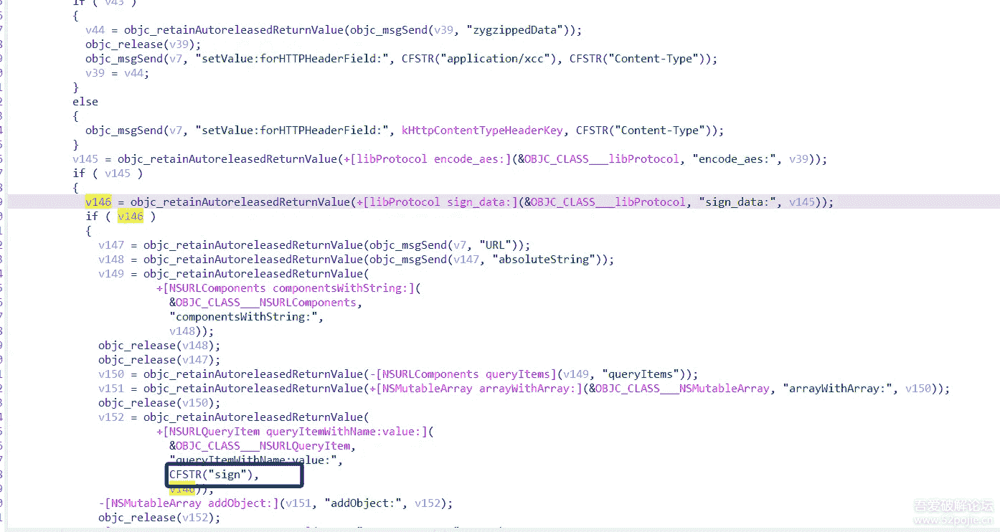

`7270715f563f05a06d3a57b038f45d9.png` (502.84 KB, 下载次数: 0)

使用 `frida-trace` 我们很快就找到了代码的关键点。

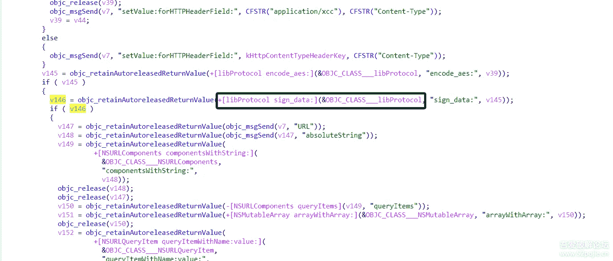

`31f24aedc904b94f11f43aafc1264b2.png` (412.41 KB, 下载次数: 1)

### 3.2 sign 代码分析

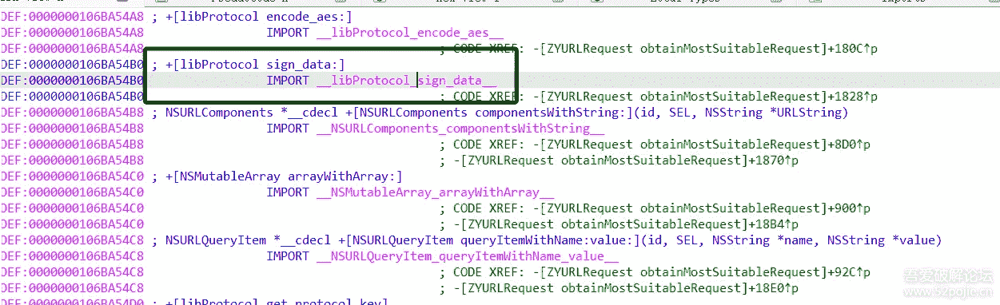

`50576206a28afea2320eb368e5f92ab.png` (495.04 KB, 下载次数: 1)

可以看到是导入的动态库，我们去 ipa 中打开看看。

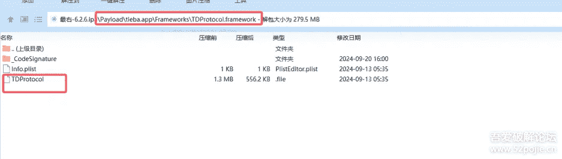

`7d17646f53ac5bca3fa1e0cf985dda3.png` (82.81 KB, 下载次数: 1)

使用 IDA 打开该动态库。

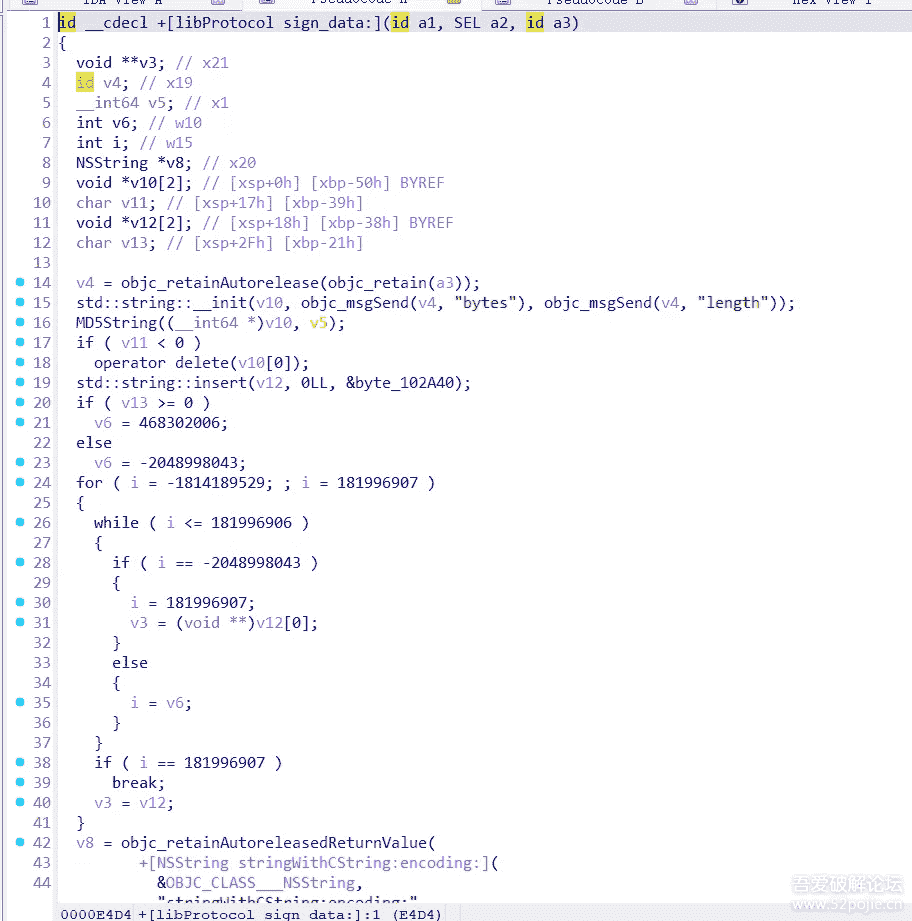

`1b1746efc0dead2b8638fb4c4a3c7aa.png` (347.32 KB, 下载次数: 1)

找到 `sign` 代码的实现，代码中有 `MD5String` 字眼，先盲猜 `md5`。

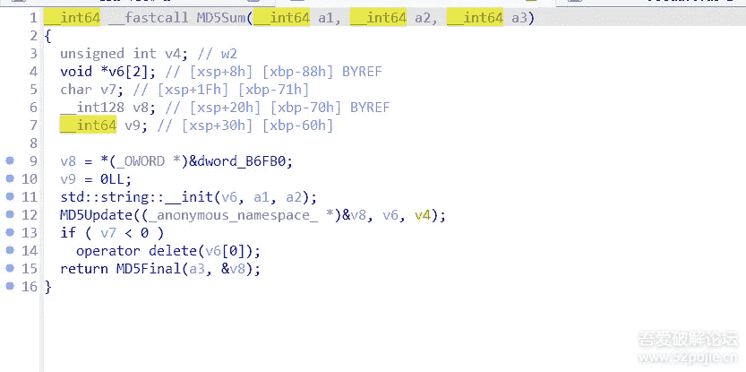

`0dc283269aaa2091cada31e9edbf367.png` (158.3 KB, 下载次数: 1)

进到函数去看看，看起来和普通的也没什么差别，我们看一下 MD5 的魔数。

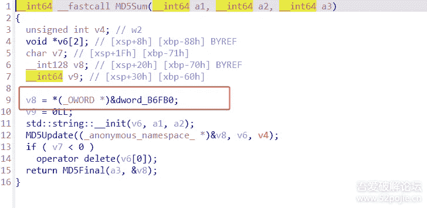

`ed3130d885e8e6b90c6c7c96287b863.png` (140.22 KB, 下载次数: 1)

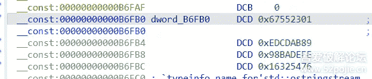

`64e4a67366bda0ca6e66bb1591a52f8.png` (103.11 KB, 下载次数: 1)

发现该魔数和常正常MD5不一样。

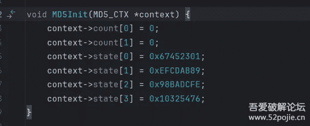

`52c4a783dd2f18a1b69d51e9af22f8b.png` (100.11 KB, 下载次数: 0)

正常的魔数是这样的。

替换魔数测试与 app 生成结果一致，签名算法分析完毕。


[//github.com/GengarSix2/MD5_py/blob/master/MD5%E7%AE%97%E6%B3%95.py" target="_blank" rel="noopener noreferrer nofollow"](https://github.com/GengarSix2/MD5_py/blob/master/MD5%E7%AE%97%E6%B3%95.py:rel="nofollow noopener" href="https)

### 3.3 body加密分析

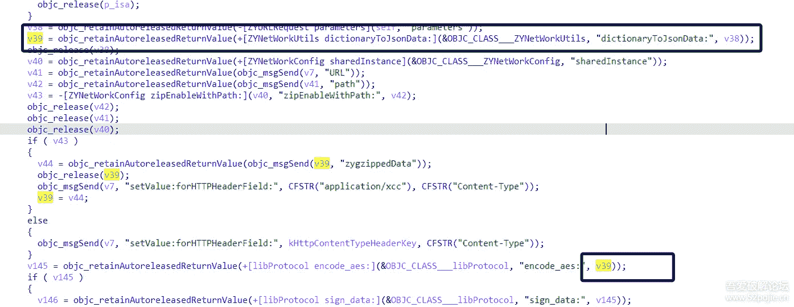

cef23ab65c90a0c830ecbd4f69d944a.png (424.95 KB, 下载次数: 1)

[href="forum.php?mod=attachment&aid=Mjc0ODc5MXxiYjc0OGM2YXwxNzkzNTc3NDcxfDE2ODA4NnwxOTk4NDIy&nothumb=yes" target="_blank"](https://www.52pojie.cn/forum.php?mod=attachment&aid=Mjc0ODc5MXxiYjc0OGM2YXwxNzkzNTc3NDcxfDE2ODA4NnwxOTk4NDIy&nothumb=yes)

2025-1-9 14:57 上传

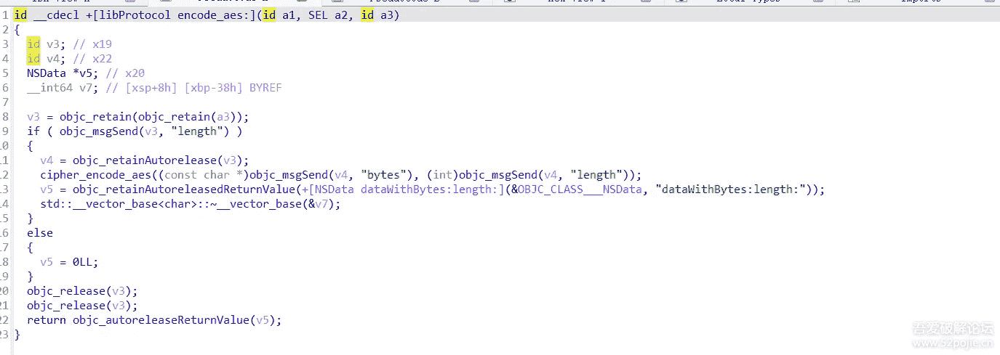

a9947023734aa655f6969bfa8004c09.png (236.35 KB, 下载次数: 1)

[href="forum.php?mod=attachment&aid=Mjc0ODc5MnwyMTUwYzFlOXwxNzkzNTc3NDcxfDE2ODA4NnwxOTk4NDIy&nothumb=yes" target="_blank"](https://www.52pojie.cn/forum.php?mod=attachment&aid=Mjc0ODc5MnwyMTUwYzFlOXwxNzkzNTc3NDcxfDE2ODA4NnwxOTk4NDIy&nothumb=yes)

2025-1-9 14:58 上传

可以看到这是请求体加密的关键代码，从函数名来看就是`aes`的加密，知道`aes`加密我们接下来需要确定 `key`, `iv`(`ecb`模式不需要`iv`)，加密模式

跟进 `cipher_encode_aes` 方法

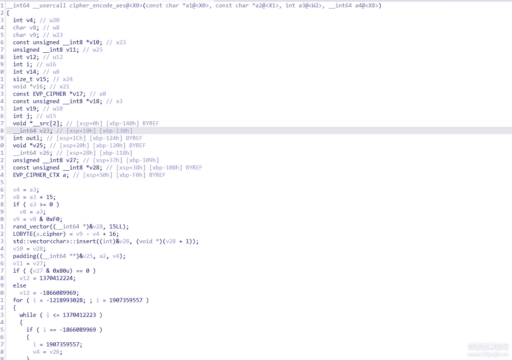

49c3d7c58f3655f6300b5fdbce8628e.png (373.33 KB, 下载次数: 1)

[href="forum.php?mod=attachment&aid=Mjc0ODc5M3xiMzJhNjc3M3wxNzkzNTc3NDcxfDE2ODA4NnwxOTk4NDIy&nothumb=yes" target="_blank"](https://www.52pojie.cn/forum.php?mod=attachment&aid=Mjc0ODc5M3xiMzJhNjc3M3wxNzkzNTc3NDcxfDE2ODA4NnwxOTk4NDIy&nothumb=yes)

2025-1-9 14:58 上传

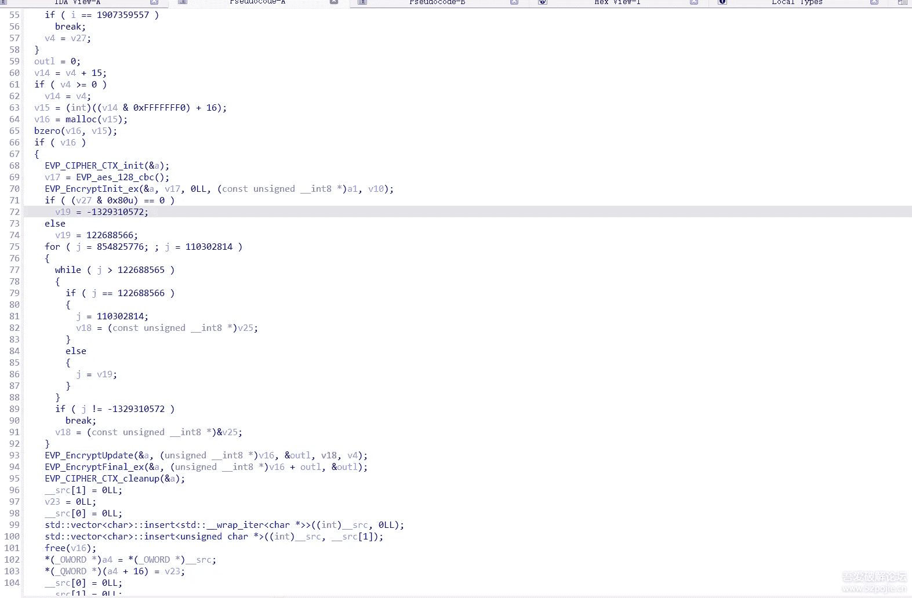

c25d4c18afe923346521ea5db2f3277.png (389.28 KB, 下载次数: 1)

[href="forum.php?mod=attachment&aid=Mjc0ODc5NHw5ZDgxMmU1YXwxNzkzNTc3NDcxfDE2ODA4NnwxOTk4NDIy&nothumb=yes" target="_blank"](https://www.52pojie.cn/forum.php?mod=attachment&aid=Mjc0ODc5NHw5ZDgxMmU1YXwxNzkzNTc3NDcxfDE2ODA4NnwxOTk4NDIy&nothumb=yes)

2025-1-9 14:58 上传

### 4

查看对应的逻辑

> 

Tips: `EVP_CIPHER_CTX_init`/`EVP_EncryptUpdate` 这种 EVP开头的都是`openssl`里面的函数

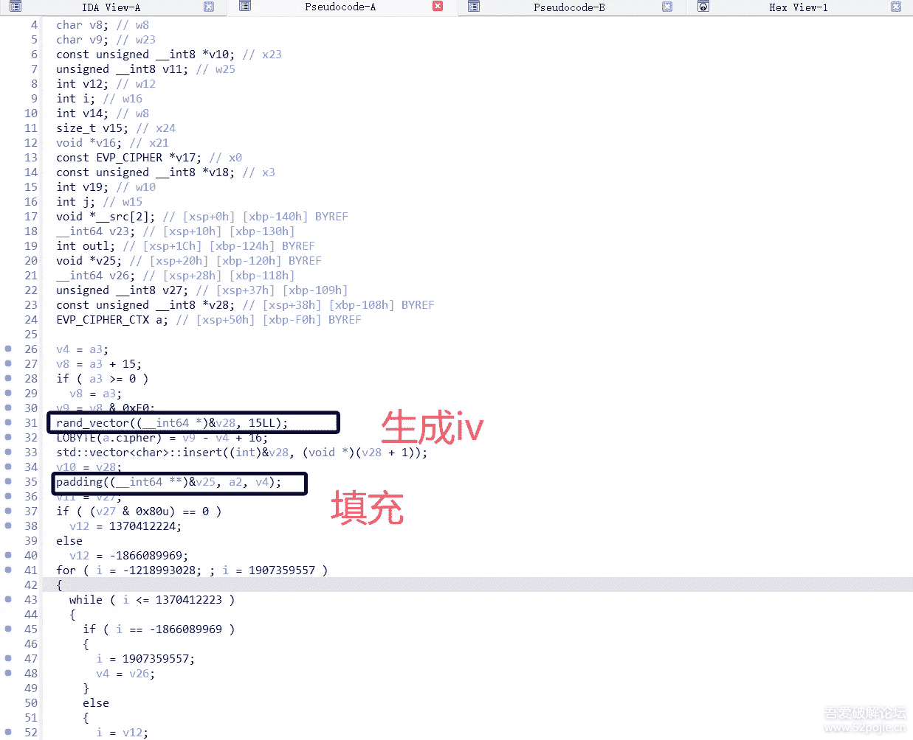

96172038dcaaa78d88cf96478897ebe.png (427.15 KB, 下载次数: 1)

[href="forum.php?mod=attachment&aid=Mjc0ODc5NXw0YWEwNzUxMXwxNzkzNTc3NDcxfDE2ODA4NnwxOTk4NDIy&nothumb=yes" target="_blank"](https://www.52pojie.cn/forum.php?mod=attachment&aid=Mjc0ODc5NXw0YWEwNzUxMXwxNzkzNTc3NDcxfDE2ODA4NnwxOTk4NDIy&nothumb=yes)

2025-1-9 14:59 上传

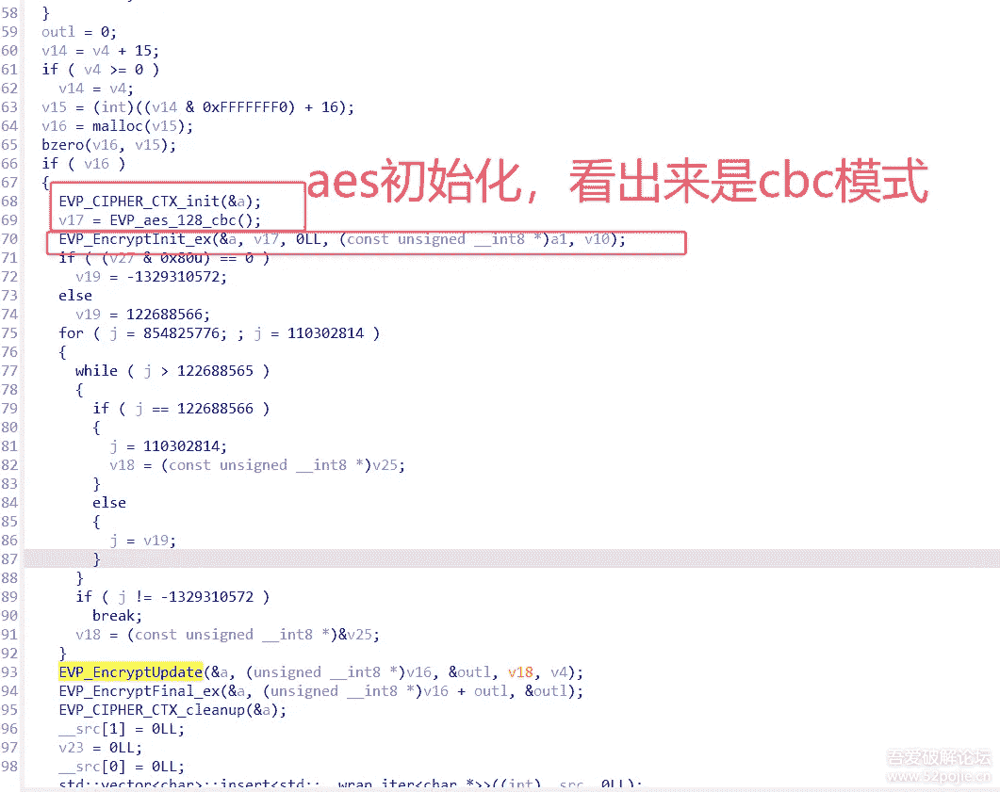

e0e481d8c81985fc587edbd7e947f23.png (364.66 KB, 下载次数: 1)

[href="forum.php?mod=attachment&aid=Mjc0ODc5NnxmMDgyNzUyYXwxNzkzNTc3NDcxfDE2ODA4NnwxOTk4NDIy&nothumb=yes" target="_blank"](https://www.52pojie.cn/forum.php?mod=attachment&aid=Mjc0ODc5NnxmMDgyNzUyYXwxNzkzNTc3NDcxfDE2ODA4NnwxOTk4NDIy&nothumb=yes)

2025-1-9 14:59 上传

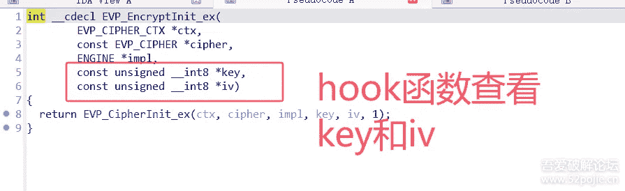

a72c69f6b98609b352a85857b9227fd.png (130.48 KB, 下载次数: 1)

[href="forum.php?mod=attachment&aid=Mjc0ODc5N3xjYTUyNTYwZHwxNzkzNTc3NDcxfDE2ODA4NnwxOTk4NDIy&nothumb=yes" target="_blank"](https://www.52pojie.cn/forum.php?mod=attachment&aid=Mjc0ODc5N3xjYTUyNTYwZHwxNzkzNTc3NDcxfDE2ODA4NnwxOTk4NDIy&nothumb=yes)

2025-1-9 15:00 上传

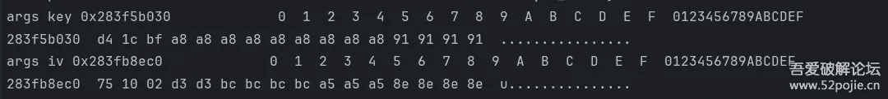

c16d1a92a26f64be2cab149603aa4e5.png (109.8 KB, 下载次数: 1)

[href="forum.php?mod=attachment&aid=Mjc0ODc5OHw3YWFhNThlNXwxNzkzNTc3NDcxfDE2ODA4NnwxOTk4NDIy&nothumb=yes" target="_blank"](https://www.52pojie.cn/forum.php?mod=attachment&aid=Mjc0ODc5OHw3YWFhNThlNXwxNzkzNTc3NDcxfDE2ODA4NnwxOTk4NDIy&nothumb=yes)

2025-1-9 15:00 上传

hook得到 `key` 和 `iv`

现在来查看加密前的明文是什么

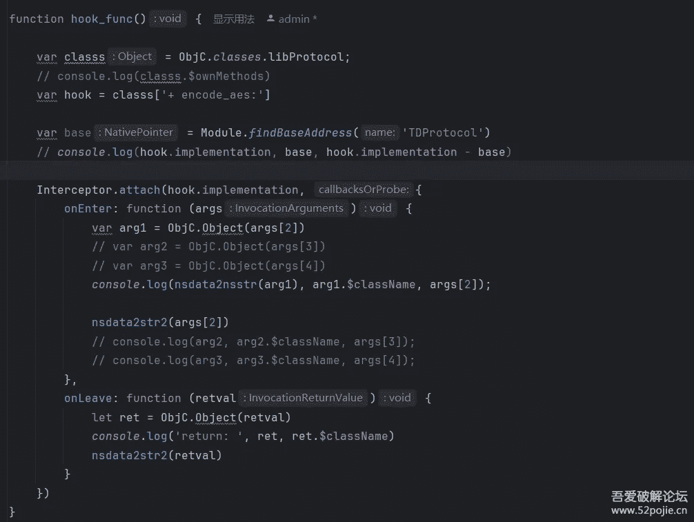

928547d5b47ad745c94d31336c608fc.png (348.75 KB, 下载次数: 1)

[href="forum.php?mod=attachment&aid=Mjc0ODc5OXxiZGE1Mjc1ZHwxNzkzNTc3NDcxfDE2ODA4NnwxOTk4NDIy&nothumb=yes" target="_blank"](https://www.52pojie.cn/forum.php?mod=attachment&aid=Mjc0ODc5OXxiZGE1Mjc1ZHwxNzkzNTc3NDcxfDE2ODA4NnwxOTk4NDIy&nothumb=yes)

2025-1-9 15:00 上传

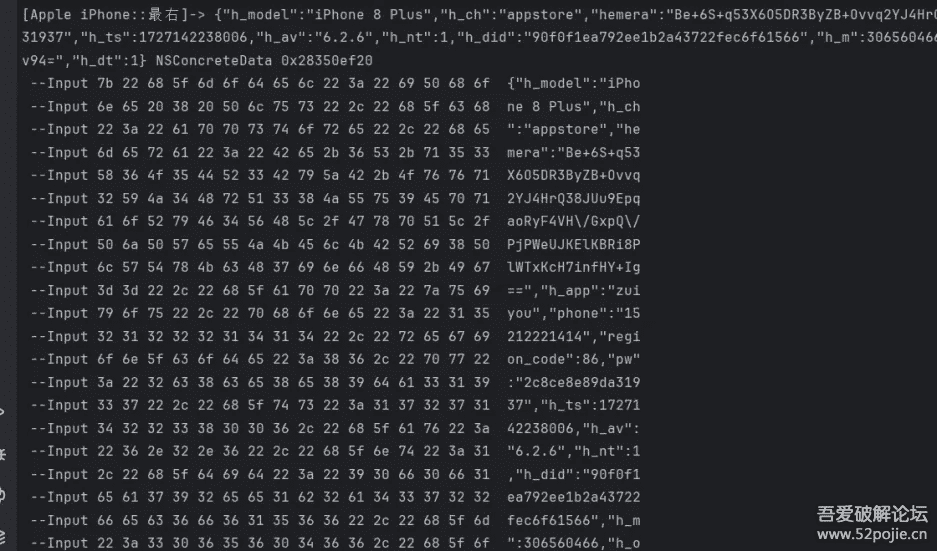

4c111ef2f2d3d0ba32a2d5e01337c86.png (521.73 KB, 下载次数: 1)

[href="forum.php?mod=attachment&aid=Mjc0ODgwMHw0ZjJhOGU0MXwxNzkzNTc3NDcxfDE2ODA4NnwxOTk4NDIy&nothumb=yes" target="_blank"](https://www.52pojie.cn/forum.php?mod=attachment&aid=Mjc0ODgwMHw0ZjJhOGU0MXwxNzkzNTc3NDcxfDE2ODA4NnwxOTk4NDIy&nothumb=yes)

2025-1-9 15:01 上传

加密前明文

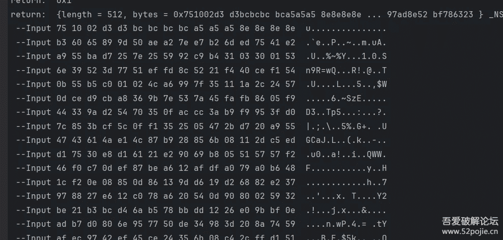

bce6e69366b2a653bd90964cd4674e8.png (425.03 KB, 下载次数: 1)

[href="forum.php?mod=attachment&aid=Mjc0ODgwMXxjZjhhY2EyMHwxNzkzNTc3NDcxfDE2ODA4NnwxOTk4NDIy&nothumb=yes" target="_blank"](https://www.52pojie.cn/forum.php?mod=attachment&aid=Mjc0ODgwMXxjZjhhY2EyMHwxNzkzNTc3NDcxfDE2ODA4NnwxOTk4NDIy&nothumb=yes)

2025-1-9 15:01 上传

加密后密文

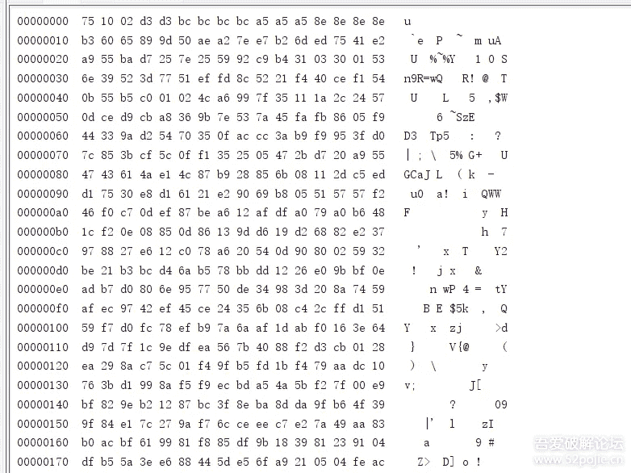

9ef3da01e7ad7710c4524dbaf89ae48.png (404.39 KB, 下载次数: 1)

[href="forum.php?mod=attachment&aid=Mjc0ODgwMnxlZWRhOWIwYnwxNzkzNTc3NDcxfDE2ODA4NnwxOTk4NDIy&nothumb=yes" target="_blank"](https://www.52pojie.cn/forum.php?mod=attachment&aid=Mjc0ODgwMnxlZWRhOWIwYnwxNzkzNTc3NDcxfDE2ODA4NnwxOTk4NDIy&nothumb=yes)

2025-1-9 15:01 上传

与抓包中的一致

这里发现密文的头部16位与 `iv` 值一致，怀疑是将`iv`加在头部，发送给服务端，服务端能顺利解密。

接下来我们去试一试能不能顺利解密

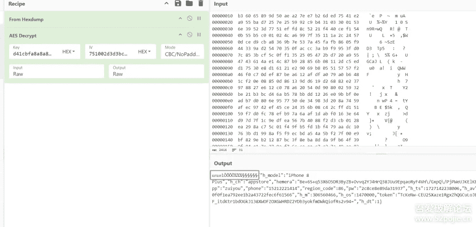

0cb5760c414dec11c6b63090c232a54.png (255.09 KB, 下载次数: 1)

[href="forum.php?mod=attachment&aid=Mjc0ODgwM3w0N2QzYzc0MXwxNzkzNTc3NDcxfDE2ODA4NnwxOTk4NDIy&nothumb=yes" target="_blank"](https://www.52pojie.cn/forum.php?mod=attachment&aid=Mjc0ODgwM3w0N2QzYzc0MXwxNzkzNTc3NDcxfDE2ODA4NnwxOTk4NDIy&nothumb=yes)

2025-1-9 15:01 上传

顺利解密成功，但发现前面部分有乱码，这大概率是内容填充，我们正常填充是填充在尾部的，他这里填充到了头部。

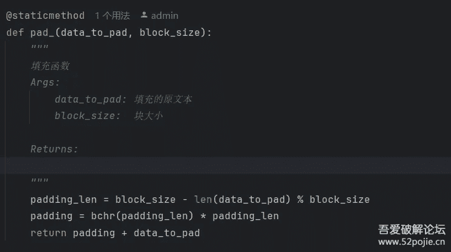

a9a48677acb3ba6e07d38afa269dae5.png (110.61 KB, 下载次数: 1)

[href="forum.php?mod=attachment&aid=Mjc0ODgwNHxjYTUzY2ZhY3wxNzkzNTc3NDcxfDE2ODA4NnwxOTk4NDIy&nothumb=yes" target="_blank"](https://www.52pojie.cn/forum.php?mod=attachment&aid=Mjc0ODgwNHxjYTUzY2ZhY3wxNzkzNTc3NDcxfDE2ODA4NnwxOTk4NDIy&nothumb=yes)

2025-1-9 15:01 上传

使用`python`复现该填充方法。

经过多次调试发现，`key`，和 `iv` 都是变动的，`key`是每次打开app会变，`iv`是每次加密都是随机的，所以说为什么要把`iv`加在密文前面。后续在分析`key`是怎么生成得来的。

### 3.4 返回体解密分析

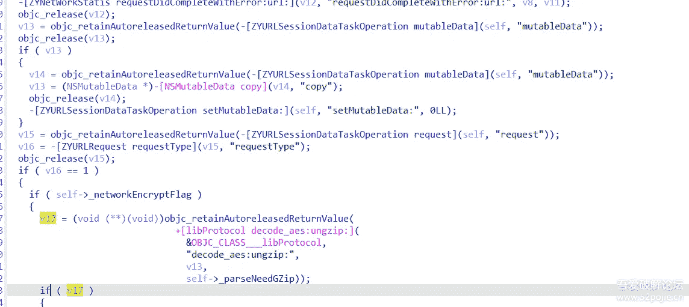

c676b37e2751512ffb73ffc2a00679c.png (326.41 KB, 下载次数: 1)

[href="forum.php?mod=attachment&aid=Mjc0ODgwNXw2Nzg4MDRlMHwxNzkzNTc3NDcxfDE2ODA4NnwxOTk4NDIy&nothumb=yes" target="_blank"](https://www.52pojie.cn/forum.php?mod=attachment&aid=Mjc0ODgwNXw2Nzg4MDRlMHwxNzkzNTc3NDcxfDE2ODA4NnwxOTk4NDIy&nothumb=yes)

2025-1-9 15:02 上传

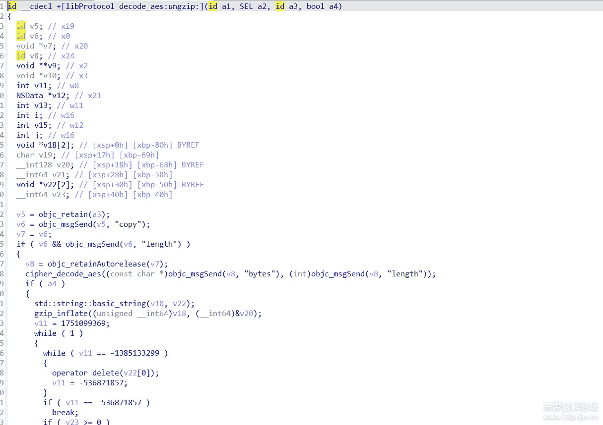

37992e3a2cf73731a7d3ee065def71e.png (346.53 KB, 下载次数: 0)

[href="forum.php?mod=attachment&aid=Mjc0ODgwNnxiZWYzN2UzMHwxNzkzNTc3NDcxfDE2ODA4NnwxOTk4NDIy&nothumb=yes" target="_blank"](https://www.52pojie.cn/forum.php?mod=attachment&aid=Mjc0ODgwNnxiZWYzN2UzMHwxNzkzNTc3NDcxfDE2ODA4NnwxOTk4NDIy&nothumb=yes)

2025-1-9 15:02 上传

从函数名来看 +[`libProtocol decode_aes:ungzip:`] 这是一个`aes` 的`gzip` 的算法

> 

Tips `gzip`压缩的特征开头为 `1f 8b`

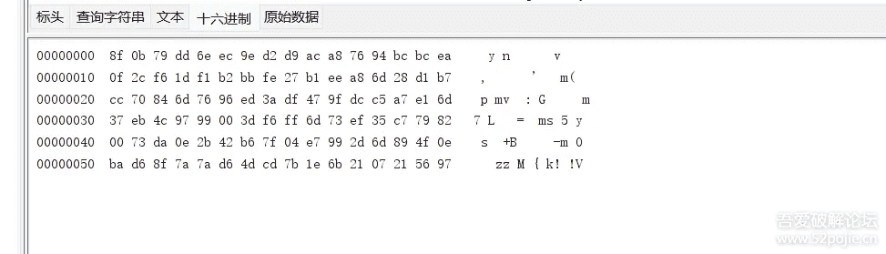

4d338fac8496c48bb00b01980ff6f95.png (127.04 KB, 下载次数: 1)

[href="forum.php?mod=attachment&aid=Mjc0ODgwN3xmODQ0ZDM5YXwxNzkzNTc3NDcxfDE2ODA4NnwxOTk4NDIy&nothumb=yes" target="_blank"](https://www.52pojie.cn/forum.php?mod=attachment&aid=Mjc0ODgwN3xmODQ0ZDM5YXwxNzkzNTc3NDcxfDE2ODA4NnwxOTk4NDIy&nothumb=yes)

2025-1-9 15:02 上传

这是返回的文本，我们接下来看如何把他解密成明文

进入 `cipher_decode_aes`

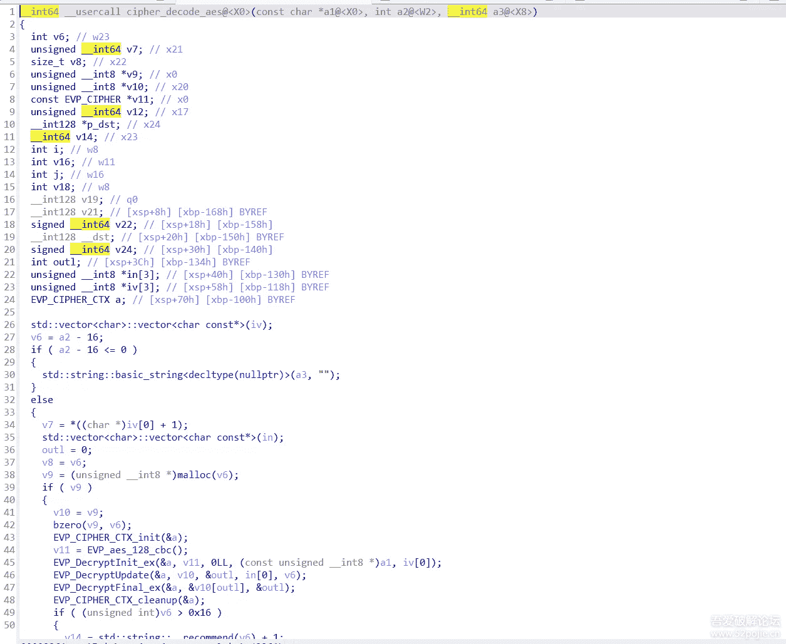

3c67aca081c0fe90722ddd2b5c75e23.png (446.01 KB, 下载次数: 1)


[href="forum.php?mod=attachment&aid=Mjc0ODgwOHxhNzA2ZDk3Y3wxNzkzNTc3NDcxfDE2ODA4NnwxOTk4NDIy&nothumb=yes" target="_blank"](https://www.52pojie.cn/forum.php?mod=attachment&aid=Mjc0ODgwOHxhNzA2ZDk3Y3wxNzkzNTc3NDcxfDE2ODA4NnwxOTk4NDIy&nothumb=yes)
2025-1-9 15:03 上传

可以看到解密的逻辑是正常的，hook `EVP_DecryptUpdate` 函数来看看 `key` 和 `iv`

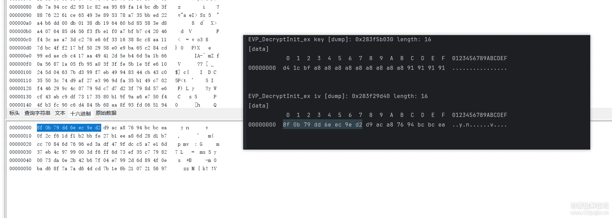
8c9570e2824578ed54ef43872a2e3cf.png (478.05 KB, 下载次数: 1)
[href="forum.php?mod=attachment&aid=Mjc0ODgwOXw4MjZhOWNmM3wxNzkzNTc3NDcxfDE2ODA4NnwxOTk4NDIy&nothumb=yes" target="_blank"](https://www.52pojie.cn/forum.php?mod=attachment&aid=Mjc0ODgwOXw4MjZhOWNmM3wxNzkzNTc3NDcxfDE2ODA4NnwxOTk4NDIy&nothumb=yes)
2025-1-9 15:03 上传

hook 到了 `key` 和 `iv` 了，通过仔细观察，返回的密文也是将 `iv` 放在了消息头部，那么我们现在有了 `key` 和 `iv` 就可以去解密试试

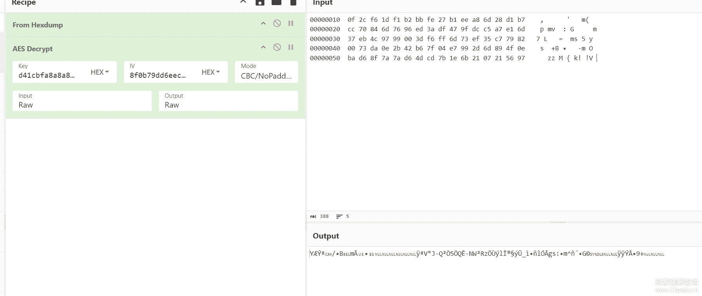
91c30b4ccfe992c2acf3f5a615991dd.png (237.53 KB, 下载次数: 1)
[href="forum.php?mod=attachment&aid=Mjc0ODgxMHxiZTZjZDMwNnwxNzkzNTc3NDcxfDE2ODA4NnwxOTk4NDIy&nothumb=yes" target="_blank"](https://www.52pojie.cn/forum.php?mod=attachment&aid=Mjc0ODgxMHxiZTZjZDMwNnwxNzkzNTc3NDcxfDE2ODA4NnwxOTk4NDIy&nothumb=yes)
2025-1-9 15:03 上传

解密成功，但是还是一段看不懂的内容，前面我们提到通过函数名来看，还有 `gzip` 压缩算法。

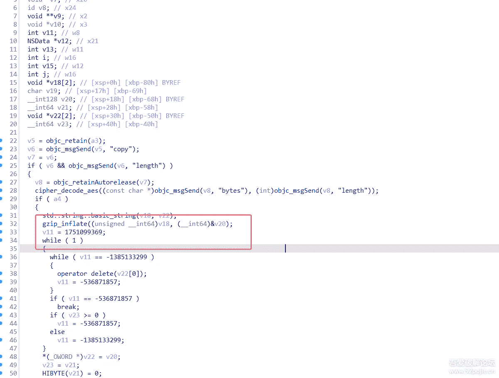
2c07616f2a4228264f4cc7d63baf355.png (339.15 KB, 下载次数: 1)
[href="forum.php?mod=attachment&aid=Mjc0ODgxMXxmNDkxNDIxNHwxNzkzNTc3NDcxfDE2ODA4NnwxOTk4NDIy&nothumb=yes" target="_blank"](https://www.52pojie.cn/forum.php?mod=attachment&aid=Mjc0ODgxMXxmNDkxNDIxNHwxNzkzNTc3NDcxfDE2ODA4NnwxOTk4NDIy&nothumb=yes)
2025-1-9 15:03 上传

代码里面也有体现，那我们现在去解压缩一下试试。

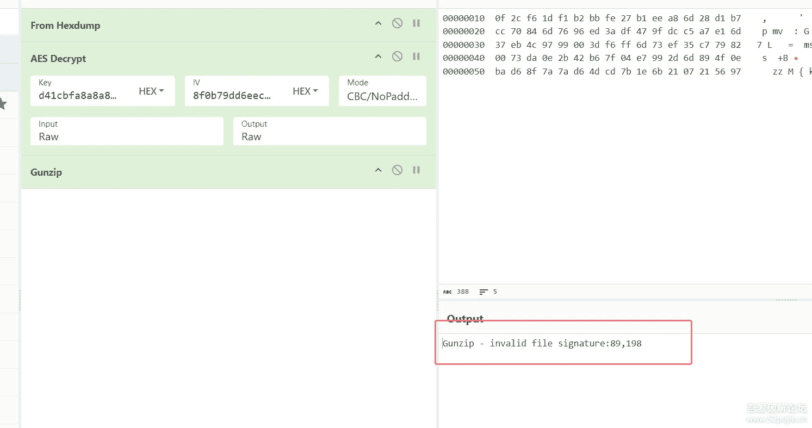
63faddeefa9c85ecb3855c1ca6a071a.png (213.12 KB, 下载次数: 1)
[href="forum.php?mod=attachment&aid=Mjc0ODgxMnwzMDA4NDBmN3wxNzkzNTc3NDcxfDE2ODA4NnwxOTk4NDIy&nothumb=yes" target="_blank"](https://www.52pojie.cn/forum.php?mod=attachment&aid=Mjc0ODgxMnwzMDA4NDBmN3wxNzkzNTc3NDcxfDE2ODA4NnwxOTk4NDIy&nothumb=yes)
2025-1-9 15:04 上传

发现压缩失败！！

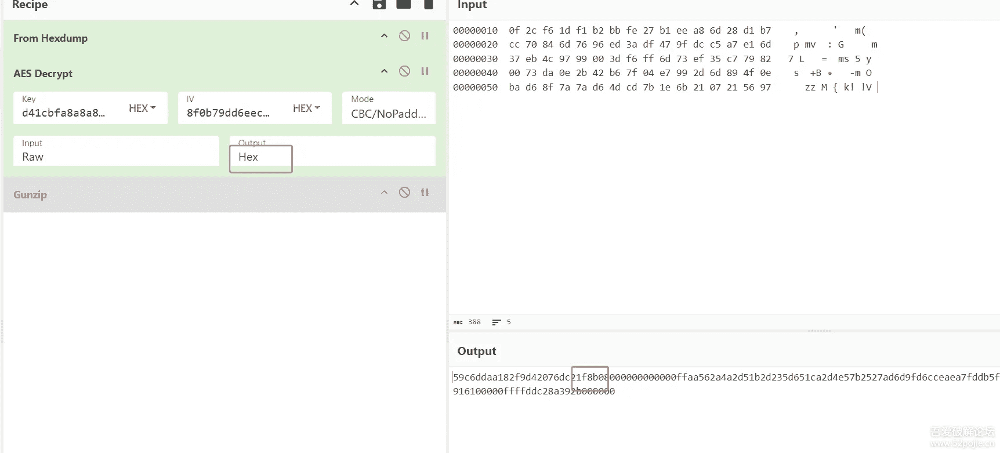
ab985453a72419eda670fce63e8e35c.png (260.08 KB, 下载次数: 1)
[href="forum.php?mod=attachment&aid=Mjc0ODgxM3xjMjRhMTY5NHwxNzkzNTc3NDcxfDE2ODA4NnwxOTk4NDIy&nothumb=yes" target="_blank"](https://www.52pojie.cn/forum.php?mod=attachment&aid=Mjc0ODgxM3xjMjRhMTY5NHwxNzkzNTc3NDcxfDE2ODA4NnwxOTk4NDIy&nothumb=yes)
2025-1-9 15:04 上传

看一下十六进制内容，发现 `1f 8b` 的关键信息，`1f 8b` 是 `gzip` 压缩的开头，我们从这开始解压缩试一试。

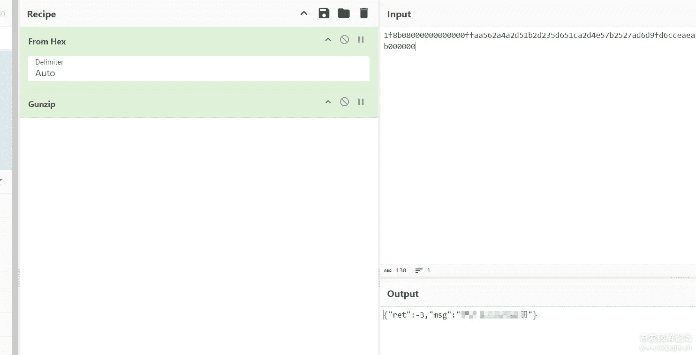
50221be0e90fdab4a08bd9473a8273f.png (104.63 KB, 下载次数: 1)
[href="forum.php?mod=attachment&aid=Mjc0ODgxNHxhYjI1MDMyY3wxNzkzNTc3NDcxfDE2ODA4NnwxOTk4NDIy&nothumb=yes" target="_blank"](https://www.52pojie.cn/forum.php?mod=attachment&aid=Mjc0ODgxNHxhYjI1MDMyY3wxNzkzNTc3NDcxfDE2ODA4NnwxOTk4NDIy&nothumb=yes)
2025-1-9 15:04 上传

咦！发现解压缩成功。到此返回体解密结束

### 3.5 `aes key` 分析

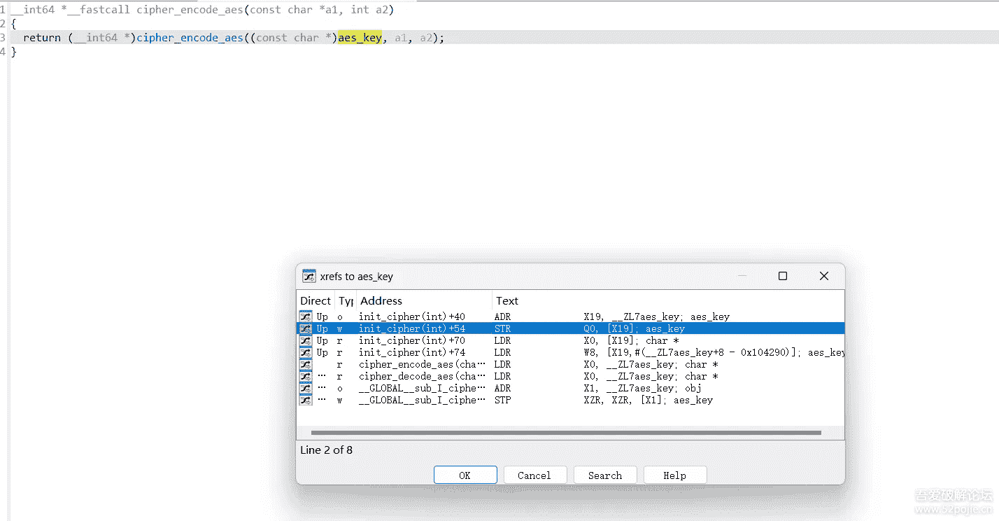
033be9657f7f3d4659388c320dcb66d.png (158.08 KB, 下载次数: 1)
[href="forum.php?mod=attachment&aid=Mjc0ODgxNXxhNWY0ODU5M3wxNzkzNTc3NDcxfDE2ODA4NnwxOTk4NDIy&nothumb=yes" target="_blank"](https://www.52pojie.cn/forum.php?mod=attachment&aid=Mjc0ODgxNXxhNWY0ODU5M3wxNzkzNTc3NDcxfDE2ODA4NnwxOTk4NDIy&nothumb=yes)
2025-1-9 15:04 上传

按 `x` 查找引用

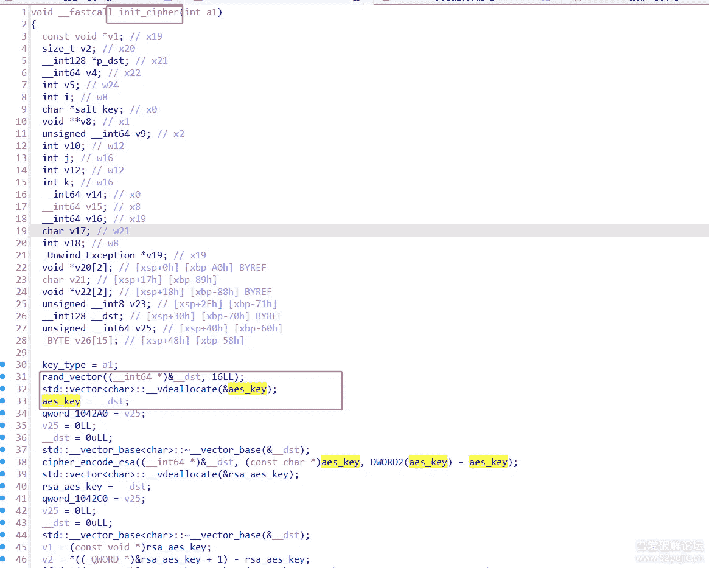
acb6dcb1010052dabf1195f4a3e8f63.png (436.88 KB, 下载次数: 1)
[href="forum.php?mod=attachment&aid=Mjc0ODgxNnwxZWZjNWIxMnwxNzkzNTc3NDcxfDE2ODA4NnwxOTk4NDIy&nothumb=yes" target="_blank"](https://www.52pojie.cn/forum.php?mod=attachment&aid=Mjc0ODgxNnwxZWZjNWIxMnwxNzkzNTc3NDcxfDE2ODA4NnwxOTk4NDIy&nothumb=yes)
2025-1-9 15:04 上传

发现是在 `init_cipher` 中初始化的。

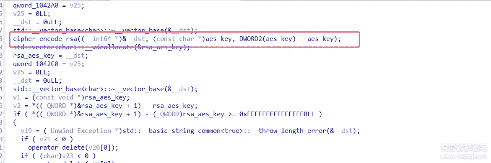
89677b9775cff42581cf5a6be964ced.png (230.5 KB, 下载次数: 1)
[href="forum.php?mod=attachment&aid=Mjc0ODgxN3xlODI5ZWFiZHwxNzkzNTc3NDcxfDE2ODA4NnwxOTk4NDIy&nothumb=yes" target="_blank"](https://www.52pojie.cn/forum.php?mod=attachment&aid=Mjc0ODgxN3xlODI5ZWFiZHwxNzkzNTc3NDcxfDE2ODA4NnwxOTk4NDIy&nothumb=yes)
2025-1-9 15:05 上传

然后将 `aes key` 进行 `rsa` 加密，经过调试发现，经过 `rsa` 加密的 `aes key` 是在请求头中带着的

`x-xc-proto-req`

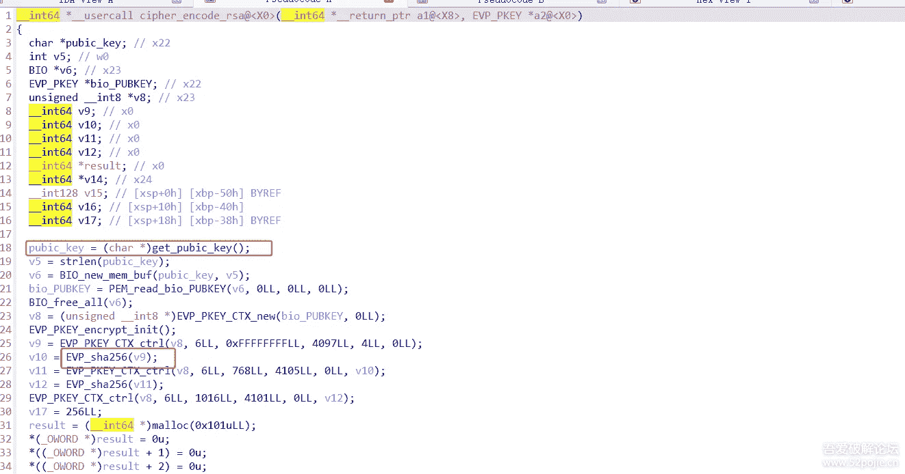
df5a933f73c8c766fb8a30620c75f96.png (347.84 KB, 下载次数: 1)
[href="forum.php?mod=attachment&aid=Mjc0ODgxOHxlMDI0ODVmZnwxNzkzNTc3NDcxfDE2ODA4NnwxOTk4NDIy&nothumb=yes" target="_blank"](https://www.52pojie.cn/forum.php?mod=attachment&aid=Mjc0ODgxOHxlMDI0ODVmZnwxNzkzNTc3NDcxfDE2ODA4NnwxOTk4NDIy&nothumb=yes)
2025-1-9 15:05 上传

`rsa` 加密逻辑可以看出是获取公钥，然后使用 `rsa sha256` 加密的。

分析完毕！
