# [Android 原创] 菜菜音乐盒7.4.1破解

- 原帖: https://www.52pojie.cn/forum.php?mod=viewthread&tid=1998868
- 抓取时间: 2026-11-01T16:12:48.394Z

## 前言:

- app ：菜菜音乐盒7.4.1([//caicaimusic.com/](https://caicaimusic.com/:https))
- 工具：`jadx`、`reqable`、`frida`、`pycharm`、`mumu`模拟器12、算法助手
- 方法：获取并解密服务端密钥
- 难点：加壳、代码混淆、字符串加密、封包数据加密

### app界面：

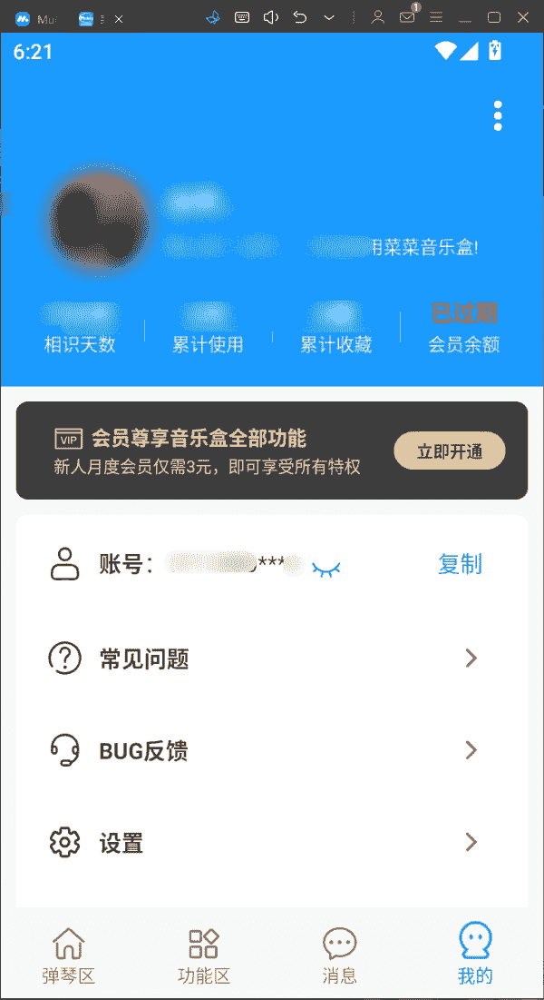

## 正文：

注：软件为360加固，需要先脱壳

### 一：突破运行游戏限制

#### 1.脱壳后将所有dex放入`jadx`中分析，老办法，第一步就是无脑搜各种vip、会员关键字等等，毫无疑问，颗粒无收，vip逆向高手就此陨落。哥们就一个弹琴软件，咱直接干他弹琴功能啊，还搜鸡毛啊

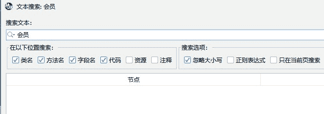

#### 2.直接开始弹琴，免费的就不看了，直接干付费歌曲，哥们就一破模拟器，还要我下个几十G的原神，这不要我命，盘它

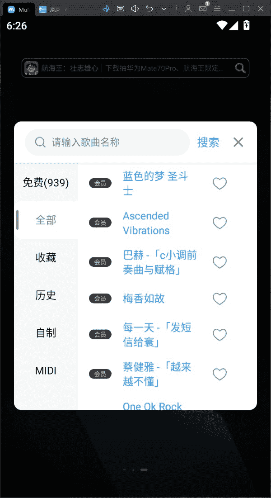

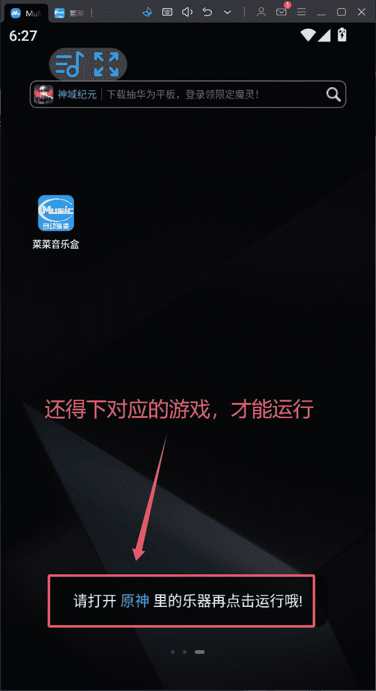

#### 3.直接启动算法助手，开启控件文本赋值，成功捕获相关信息，接下来跟踪堆栈，查看具体代码分析就行（这种就是软件检测进程，如果检测到“原神”的进程，那么就开始运行，只要定位到相关代码，hook它检测的地方，改成true就成功了）

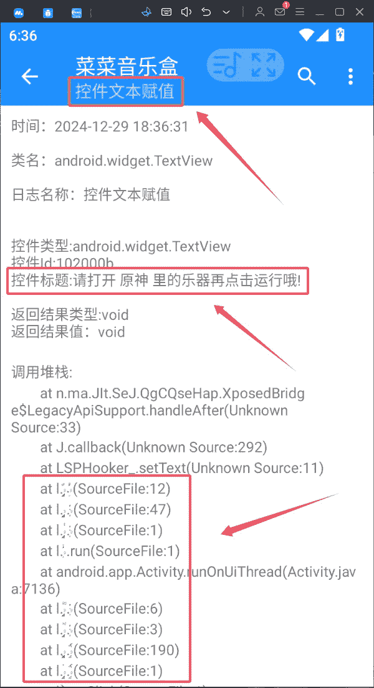

#### 4.咱直接hook堆栈最上面的方法，得出确实就是弹窗提示的代码，接下来就是枯燥的追寻之路，记住，代码不是异性，异性你可能追不到，但是代码它一定能追到

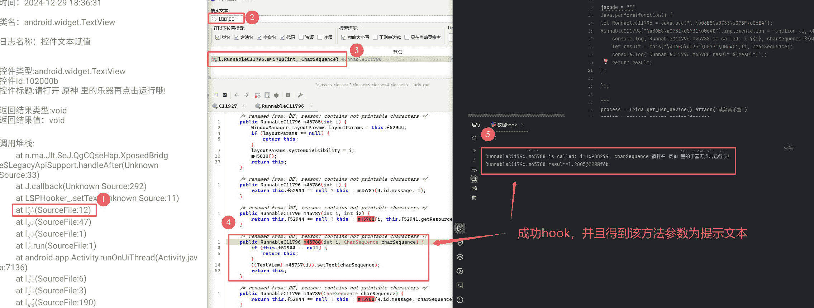

#### 5.Ok啊兄弟们，当我们追到`m8717`方法时，咱们就已经差不多成功了，仔细观察代码，`C7448.m31146`就是提示弹窗，而它上面刚好有个if判断，并且有return，那我们只要让上面的if判断成立，不就可以阻止弹窗，而if里面是个或，那只要其中一个条件为真，那就成功了

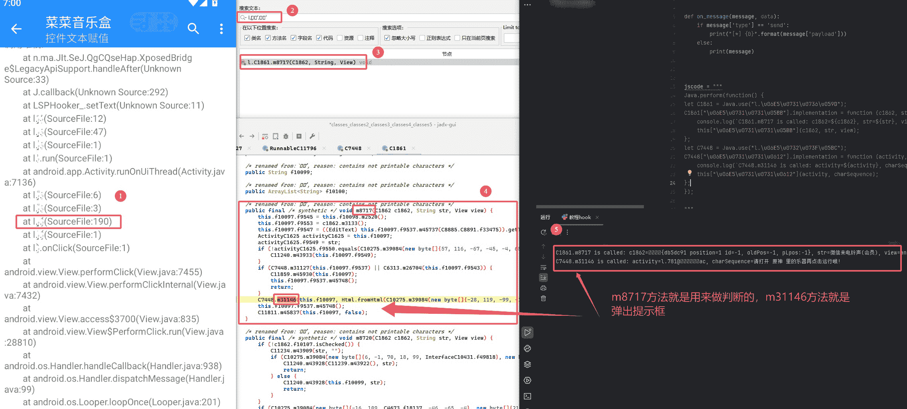

#### 6.直接进`C7448.m31127`探探路，二话不说，直接上hook让它返回true，找个免费的歌曲试试，直接成功运行，解决需要运行游戏才能使用的障碍，“原神！！！不用启动”（有时候，逆向不一定需要看懂所有代码，你甚至不需要研究代码，你只要清楚软件运行的大概步骤、逻辑，你就能完成一次简单的逆向）

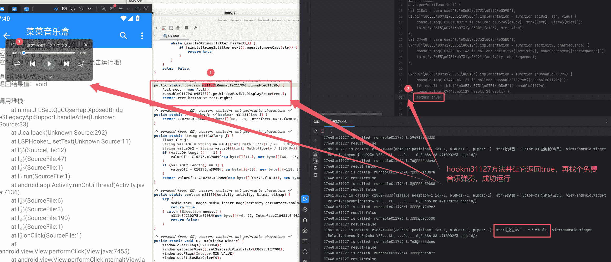

### 二：突破会员歌曲弹奏（卒）

#### 1.继续研究会员歌曲，当我们点击会员歌曲后，会提示“此弹琴曲谱仅会员可运行”，老办法，算法助手定位弹窗

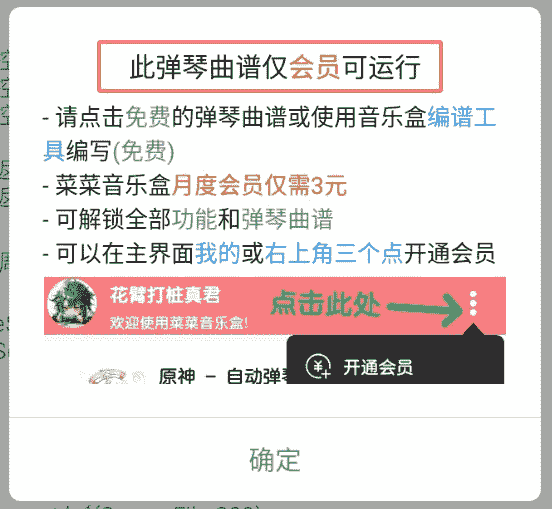

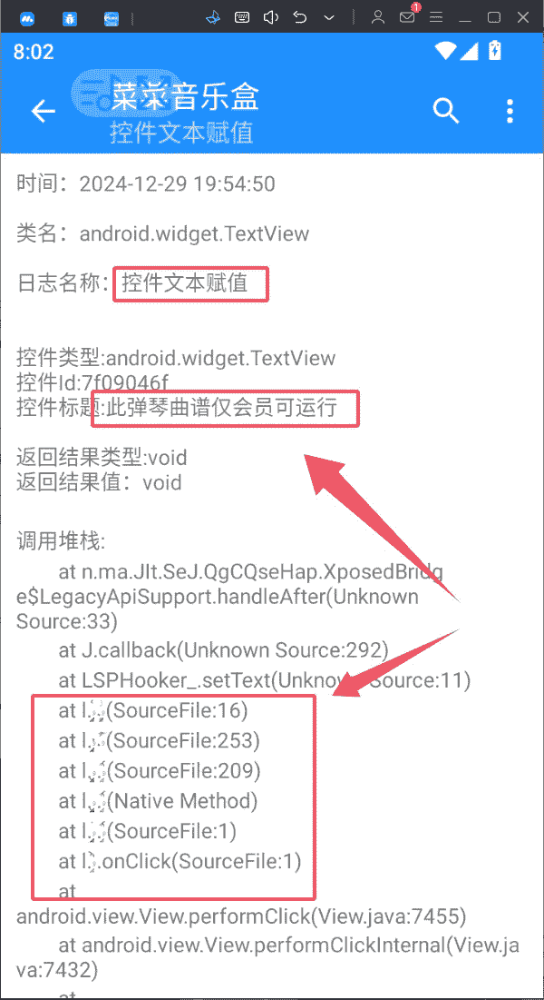

#### 2.直接hook堆栈最上面的方法，得出就是弹窗提示会员的代码，追异性你都会追个几次，更何况这种必有结果的代码，继续追吧，咱们当代码的舔狗，开舔！！！

#### 3.不是吧，阿sir，我这还没进入状态呢，你就给我追到了。观察代码，我们可以发现`m45930`方法中有`m16762`，而它的上面刚好又有个if并且里面有return。我们只要让上面的if成立就好了，开搞开搞！！！

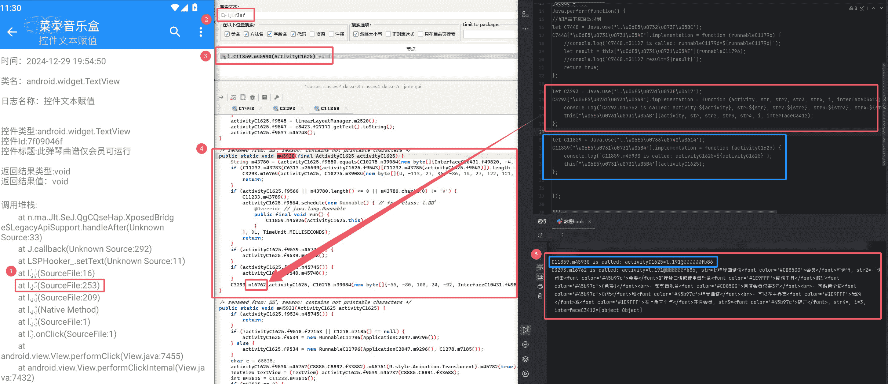

#### 4.卧槽，不对不对，有陷阱！一个光杆司令，两个无枪士兵，这搞个鸡毛啊，直接hook `f9560`是没啥用的，它是个变量。当然我们不可能就此退缩，有以下三种办法实现:

- hook `String m43780=(activityC1625.f9550.equals...)`，让它的长度大于0,或者第一个字符为“V”
- hook所有对`f9560`赋值的方法，让它永远为true
- 在`m45930`方法执行时改变`f9560`的值为true

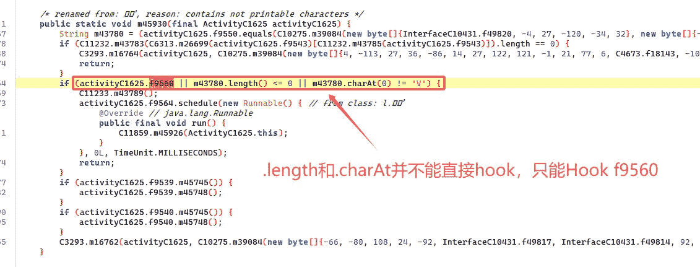

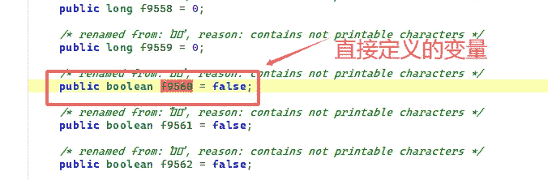

#### 5.我们直接采用第三种方法，在`m45930`中改变它的值，利用`Java.choose`查找运行中的指定类，对找到的实例修改其属性值为 true，最后直接运行见证奇迹！

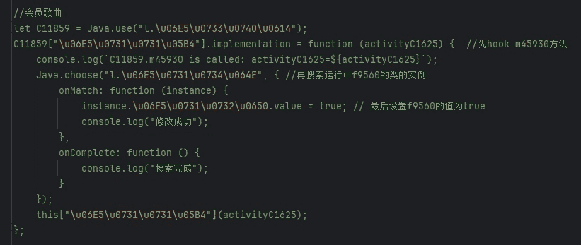

#### 6.欧耶欧耶，成功运行付费歌曲，兄弟们，简简单单轻轻松松这破解没压力啊；不对！有问题！！！咋回事啊，咋读取半天了啥动静都没有啊，切换到免费歌曲时正常运行，咋到了付费就一直读取中？？？gg了，逆向失败

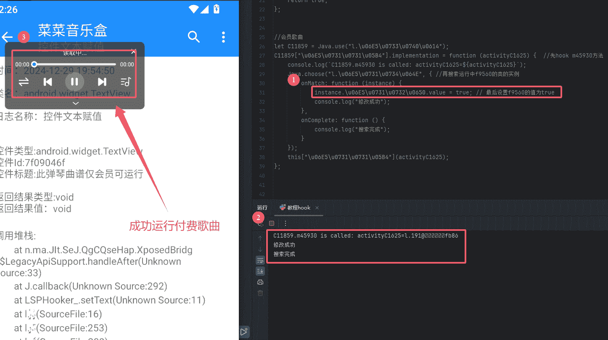

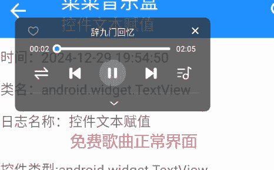

### 三：突破会员歌曲弹奏（再卒）

#### 1.我们继续深入研究，通过设置`f9560`我们能够进入到会员歌曲的弹奏界面，但是却一直加载，猜测肯定是会员歌曲缺了啥东西导致一直加载，因此我们深入研究`m45926`看看里面有啥奇妙之处

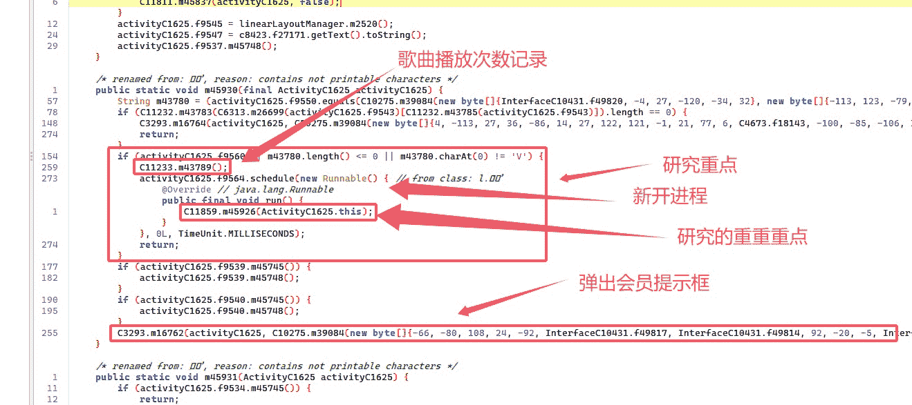

#### 2.进入`m45926`可以看到有个if判断，它是`m45926`的主体，就看代码会执行哪一段，因为`f27151`和`f9554`都是一个定义的变量，所有我们分别hook它们里面的`run()`方法，看看谁执行了

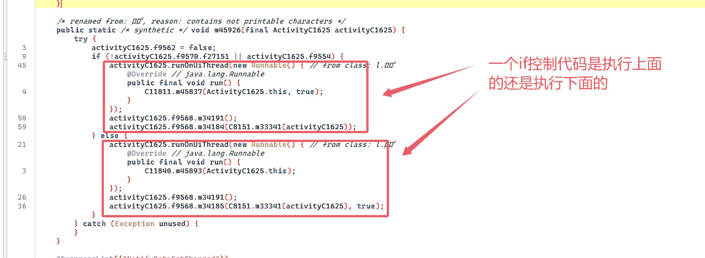

#### 3.当我hook两个`run`后，可以发现无论是会员还是免费歌曲，都会走下面这个`run`,那么我们的重点就转到了下面这段代码

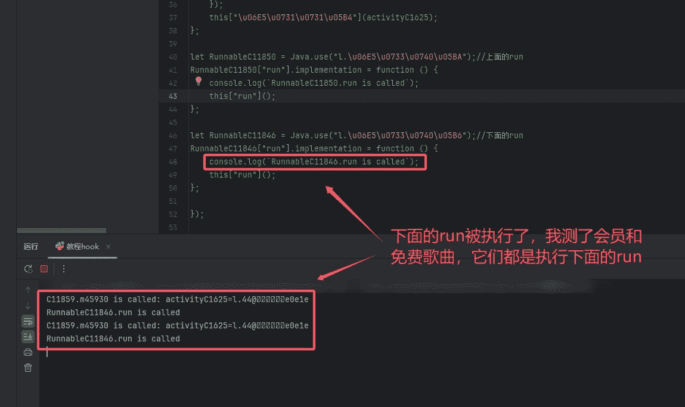

#### 4.经过我偷偷研究，`run`方法其实是更新ui之类的功能，俺就懒得展示了，咱直接讲重点，聪明的你肯定知道哪个是重点了，没错它就是—— `activityC1625.f9568.m34185(C8151.m33341(activityC1625), true)`;直接上图，看见没兄弟们，当我们运行会员歌曲时，`m33341`被调用了，但是它却一直没有返回值，就卡在这里了，但是当我们运行免费歌曲时，biu~的一下给我返回这么多东西（其实这就是弹琴的指令），会员歌曲因为没有这些，所以它不知道怎么弹啊，就一直卡在这里了，ok继续跟进

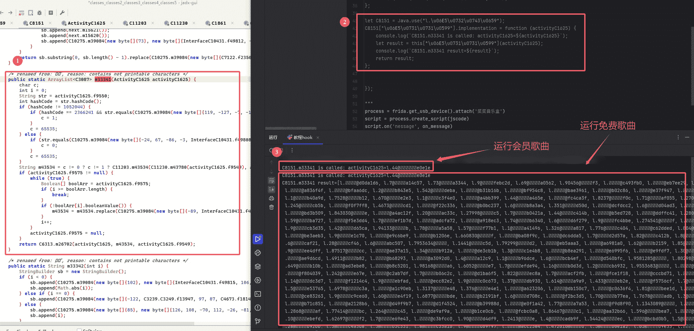

#### 5.仔细观察`m33341`方法，可以看到第一个if就是用来给c赋值的，重点就是看下面的`String m43534`，它根据c的值来执行不同的方法，不就三个方法嘛，咱直接全部给它hook上，有句话说的好“来都来了,hook吧”，三个都hook了，也不差`C11230.m43780`这一个，直接全部hook上

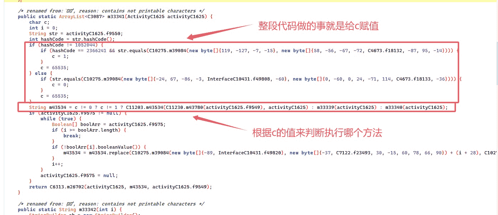

#### 6.哟吼，还有惊喜呢，没想到啊，歌曲名加密被逮出来了，`C11230.m43780`方法就是用来加密歌曲名的(后面有大用)，而`String m43534`无论是会员还是免费歌曲，最终执行的都是 `C11203.m43534`这个方法，这时有兄弟就问了，“不对啊，哥们，你这个会员歌曲也没执行`C11203.m43534`方法啊，就免费歌曲执行了”，哎，问得好啊，我直接上图！！！看见没兄弟，咱们的`str`被乱码给搞没了，ok扯远了

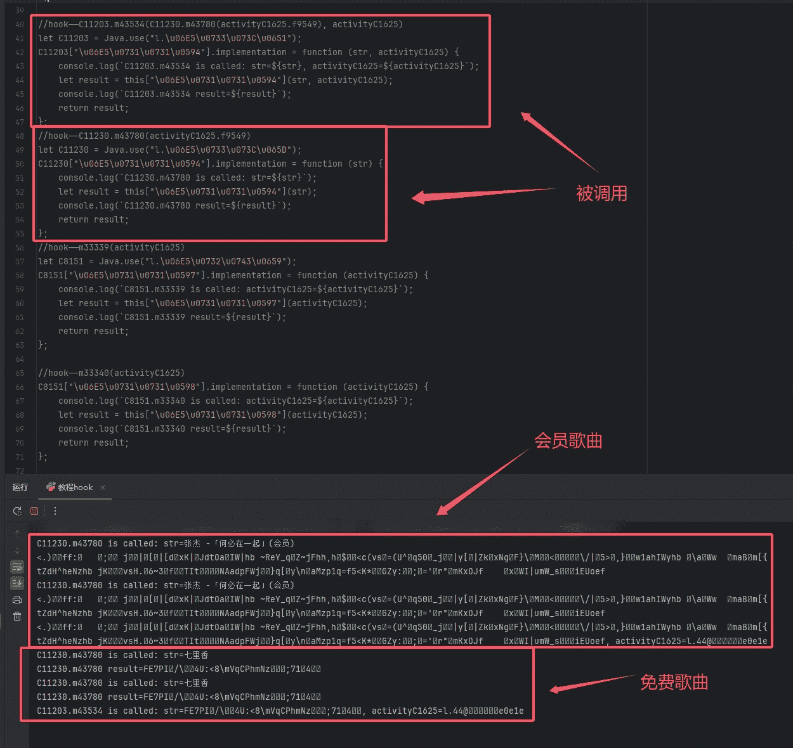

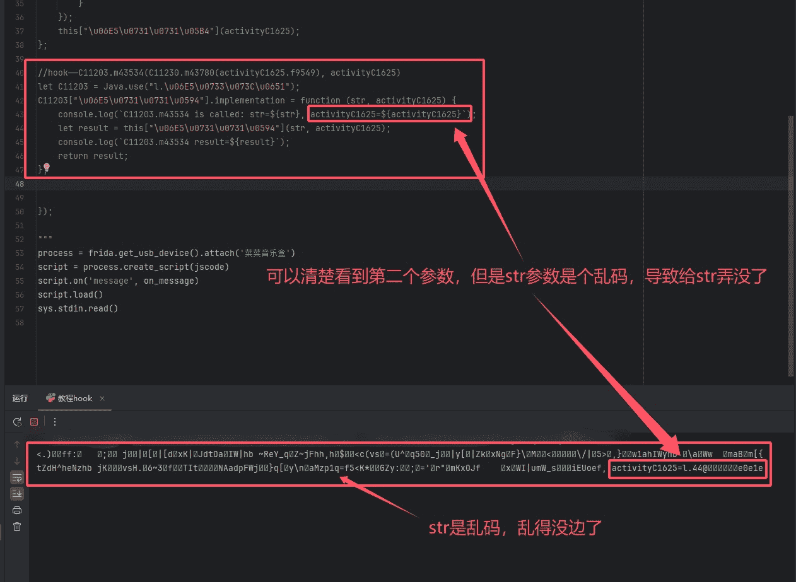

#### 7.进行深入，兄弟们，火速研究`m43534`，卧槽，一眼盯真啊，兄弟们，刚才我们知道`m43534`中的`str`参数就是歌曲名加密后的字符串，而免费歌曲名加密后的第一个字符就是F，再看代码if判断加密后歌曲名的第一个字符，是F执行这套加密，是V就执行另一套，并且判断V时如果不为V则返回空，这不就全对上了吗，就是因为加密后的会员歌曲第一个字符不为V所以返回空，导致一直卡在加载界面

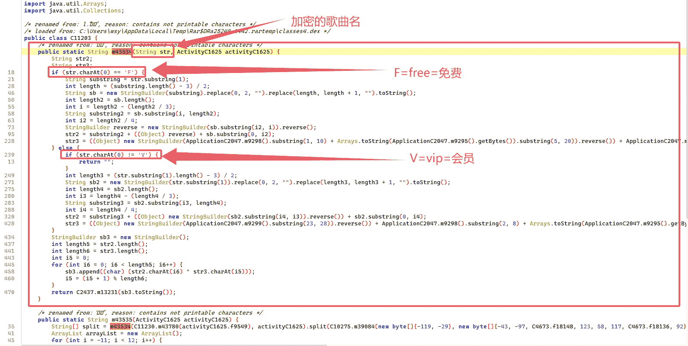

#### 8.聪明的你肯定想到了，哎对，跟我想的一样啊兄弟，咱直接给它返回个V不就行了吗，要V我就给你呗，要多少有多少，盘起来！！！哎，兄弟，又逆向失败了

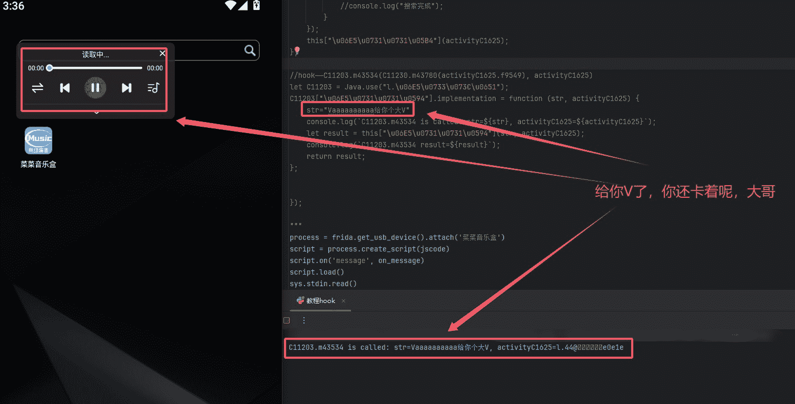

### 四：突破会员歌曲弹奏（续）

#### 1.不好意思，兄弟们上面讲错了，其实每个会员歌曲它加密后返回的第一个字符就是V，每个免费歌曲返回的第一个字符就是F，只是这个加密结果太唧拔乱了，所以我们重点还是继续分析下面的代码

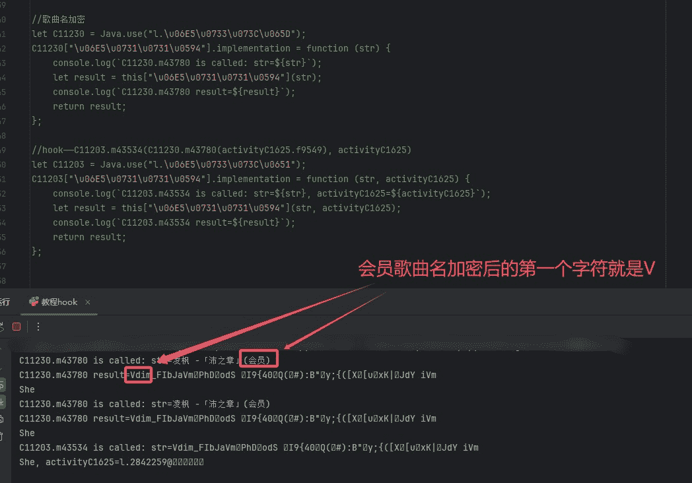

#### 2.我们继续详细认真得分析一下代码，它的整体步骤就是对加密后的歌曲名进行字符串截取与反转、拼接生成两个字符串，并通过异或运算合成最终结果。我们知道免费歌曲名加密后返回F，会员歌曲名加密后返回V，聪明的兄弟可能一下就反应了，直接给会员歌曲名加密后返回F不就行了，nonono，兄弟，这确实是个思路，但是还是不行，继续往下看就知道了

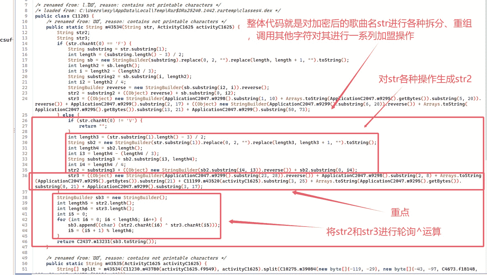

#### 3.我们重点分析`str3`的组成，可以看到它就是由各种不同的字符组合而成，并且其中`m9299`、`m9298`、`m9295`都是同属`ApplicationC2047`这个类中，我们直接跟进一探究竟

- `ApplicationC2047.m9299().substring(23, 28)).reverse()`

提取`m9299`索引23到28的字符然后再反转
- `ApplicationC2047.m9298().substring(2, 8)`

提取`m9298`索引2到8的字符
- `Arrays.toString(ApplicationC2047.m9295().getBytes()).substring(21)`

将`m9295`转换为字节数组再转为字符串，最后截取索引21到结尾的字符
- `C11199.m43520(activityC1625).substring(3, 25)`

调用`m43520`获取一个字符串并提取索引3到25的字符
- `Arrays.toString(ApplicationC2047.m9295().getBytes()).substring(0, 21)`

再将`m9295`转换为字节数组再转为字符串，最后截取索引0到21的字符
- `ApplicationC2047.m9299().substring(3, 17)`

提取`m9299`索引3到17的字符

#### 4.观察整个`ApplicationC2047`的代码，可以看到`m9299`、`m9298`、`m9295`都是由不同的方法得到的，我们直接分别跟进看看具体代码，不入码穴，焉得码子

#### 5.兄弟们，这里其实很简单，看一眼就大概知道代码的功能是啥，我就直接替你们分析了，`m9295`——获取应用包名、`m9298`——获取应用签名哈希、`m9299`——获取应用的签名，通过hook也证明确实如此，二改党狂喜，ok了，就差最后一个字符`m43520`了，拿下它我们就能知道`str3`的值，并最终得出`m43534`的返回值了

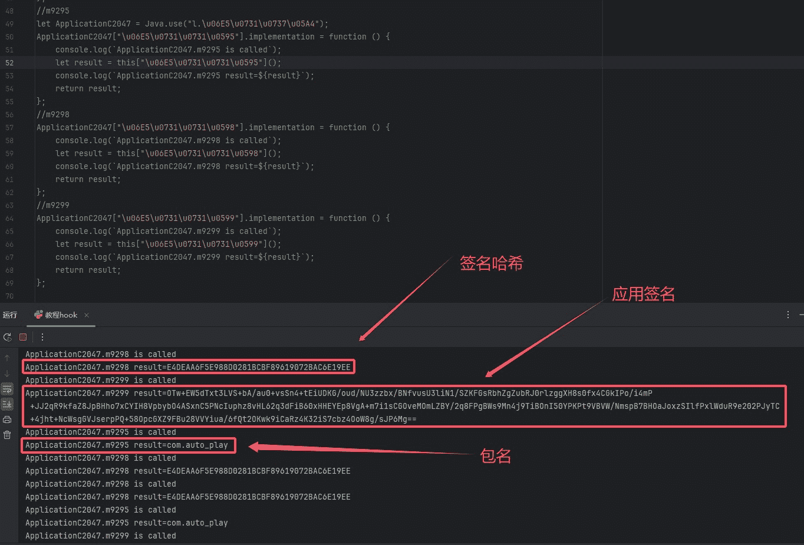

#### 6.仔细观察`m43520`，第一行就来一个与系统时间戳进行比较，而且它是V里面代码，那我们是不是就能猜测它有可能就是用来比较会员时间的，如果会员时间小于系统的时间戳，那么就将会员信息啥的全部置空，咱们干这一行一定要对时间戳异常敏感，怎么说出来感觉怪怪的；if之后又是刚才熟悉的字符串切割拼接，你说好好的字符串天天给它又是切又是拼，肯定有猫腻啊，管它是龙是虎，咱狠狠盘它

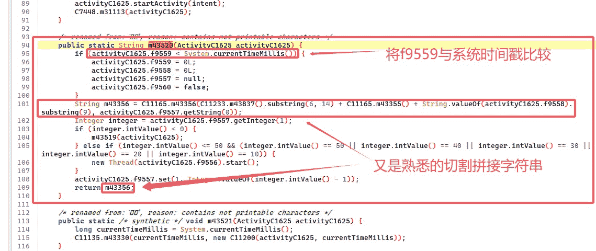

#### 7.其实当你准备去一个个盘 `m43356`中各个字符串时，你会发现有点困难，因为你会遇到`native`，我们暂时先不讲`native`，既然我们目前无法盘`m43356`中各个字符串，那我们改变思路，直接盘`m43356`这个方法，看看它得到字符串后会干嘛，万一有惊喜呢

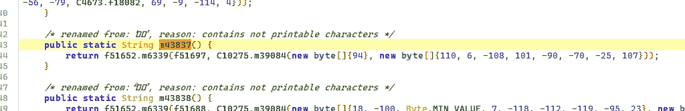

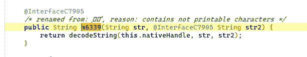

#### 8.仔细观察代码，可以发现它就是用来进行一个基于异或操作的加密/解密方法，并且下面的`m43357`跟它简直一模一样，这就更加确信它们就是用来加/解密的，一个是加密，一个是解密（正常来说，对于这种基本上就是加密和解密的代码是在一个类中，这样便于调用，所以一般你找到加密，就能找到解密，反之也是）

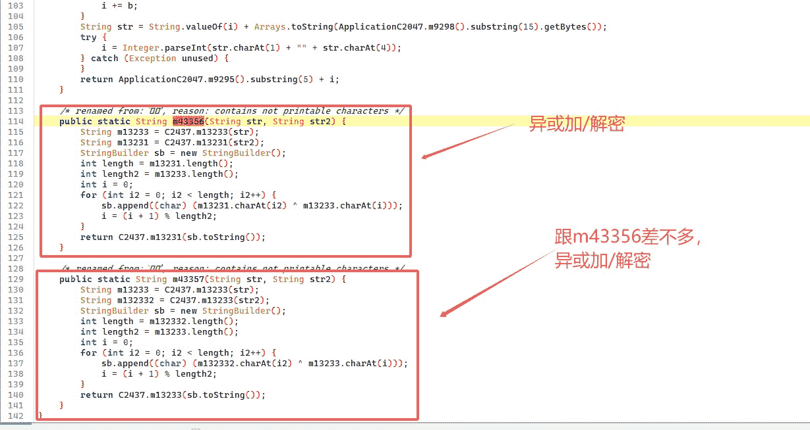

### 9. 我们直接 hook 它们，看看谁是加密，谁是解密，这个时候我们得重新开启自动演奏才能 Hook 到，这 hook 的结果，兄弟们一眼就能看出哪个是加密哪个是解密啊，很明显 `m43356` 就是解密，`m43357` 就是加密；兄弟们想想看，为啥要把设备信息加密，还有登录的账号信息又是从哪里解密来的，对啊，兄弟，这些东西肯定是服务器来的啊，而且必须要重新开启自动演奏才能 hook 到，说明当我们点击开启自动演奏后，app 就与服务器发包传递信息，之后进入演奏后，并没有触发任何加解密，说明能不能弹奏会员歌曲就已经在发包收包的时候确定了，并且在最后一次解密中，返回值为空，这绝对有鬼啊，肯定是因为你不是会员，所以少了点东西，让你没办法弹奏会员歌曲，ok 了兄弟，目标确认，抓包开始！！！

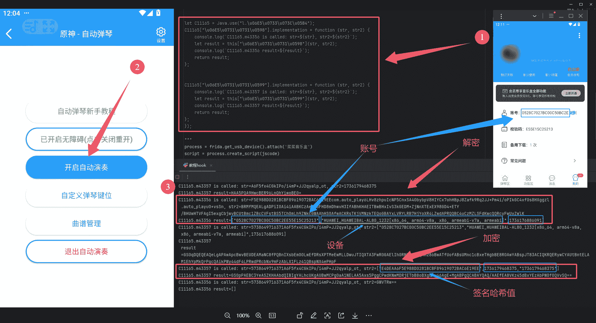

## 五：抓包分析

### 1. 该 app 用常规办法无法抓包，我最初尝试用 `burp` 进行抓包，一无所获，感兴趣的兄弟可以研究研究该 app 的网络协议，我们直接用 `reqable` 进行抓包（一定要开启增强模式，否则抓不到包），当我们再次点击开启自动演奏后，可以清楚的看到我们抓到的包中 `message`、`token_u` 和 `token_u` 的值就是由 `m43357` 加密而来的，并且该包的响应正是 `m43356` 最后一次解密中的 `str2`，就是因为此包的响应内容为“`GXVxDQ==`”，所以 `m43356` 最后解密为空，这里就是能否弹奏会员歌曲的关键

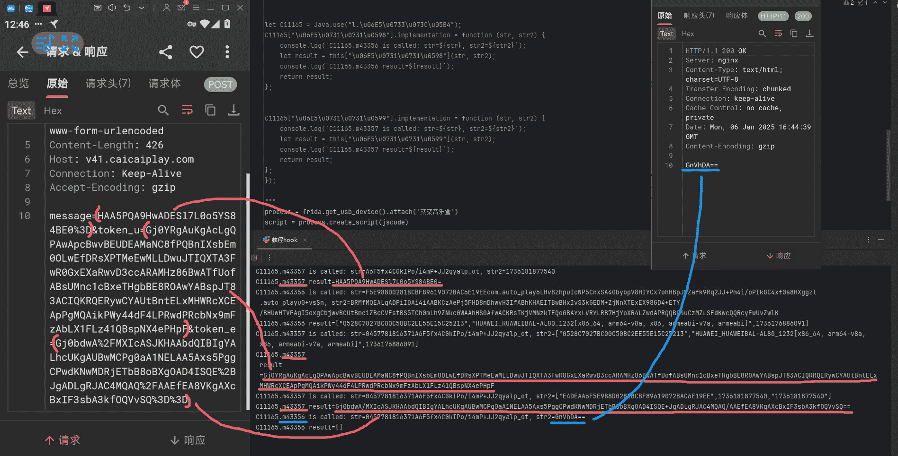

### 2. 抓都抓了，我们直接给它来个全体大宝剑，一次性给它抓到位看看有啥意外惊喜，用 `frida` 的 `spawn` 模式启动 app 来抓取它整个启动到完毕的包，因为我们 hook 的类会延迟运行，所以我们得持续监听，一套下来，我们一共抓了 5 个包，从最底下往上第一、二个包都是跟 qq 登录相关的，第三个是 app 更新相关的包，第四个就是用户登录包，最后一个是一些用户信息、设备信息等包；观察 hook 解密的信息，一下子就看到了一个包含时间戳以及一个详细的时间，1735680462423 经过时间戳转换结果为 2025-01-01 05:27:42，这个不就是我会员过期的日期吗，而且它就是 `user_login` 这个包返回的；并经过 `m43356` 解密出时间戳，哎~兄弟，我们又想到一起了，咱们直接修改从服务器返回的会员时间，不就成了吗？！！！

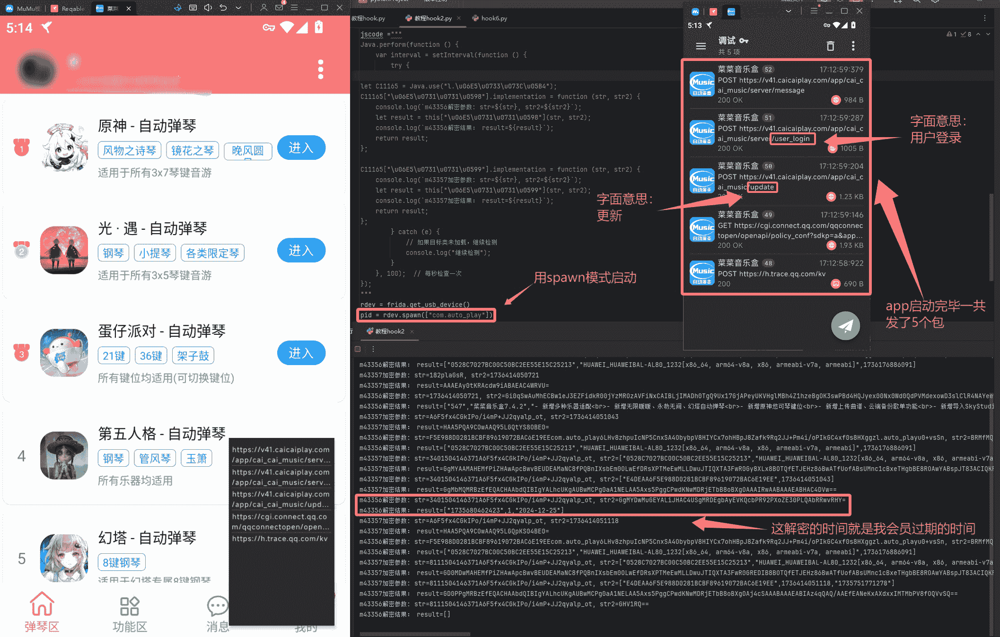
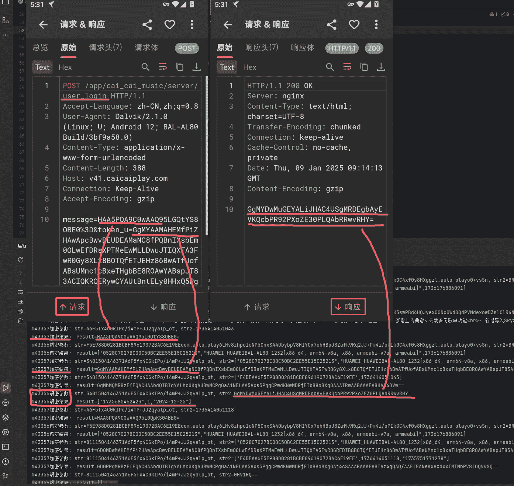

### 3. 直接开始编写相关 hook 代码，由于解密后为数组，所以我们也应该让其修改后的值也为数组，然后生成一个 2099 年的时间戳作为新的返回值，之后再用 `spawn` 模式启动 app，见证奇迹，直接会员余额 27028 天，哥们，这辈子都用不完啊；兄弟高兴得太早了，我们运行会员歌曲，结果还是那个叼样，这不纯纯紫薇吗，隔着耍兄弟们呢

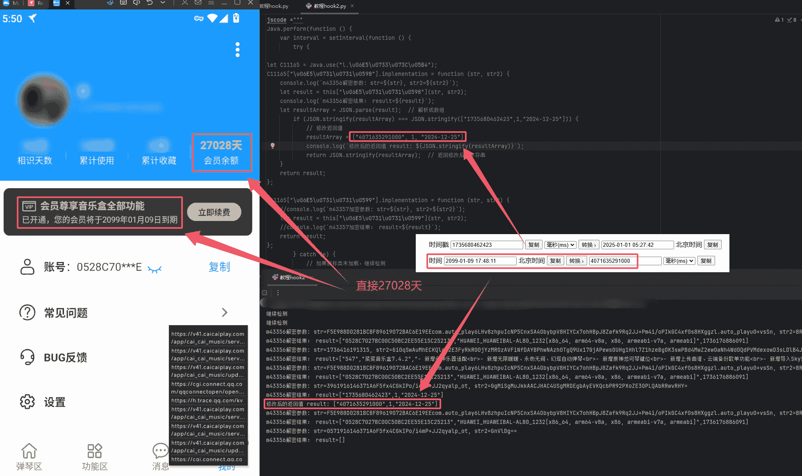

### 4. 兄弟们，虽然没成功，但是我们知道真正的会员歌曲功能并非是根据 `user_login` 这个包来传递的，上述我们知道，每次我们点击“开启自动弹奏”app 都会发送一个 `state_message` 的包，并且该包的返回值一直都是空，你说它这么做是为啥，不就是为了在每次弹奏前先向服务器检测你是不是会员吗，你都不是会员，还想服务器能给你返回啥，你要是会员，服务器肯定给你返回个有用的东西，然后 app 就能够进行会员歌曲的弹奏了，这也就是为啥我们即使改变了 `user_login` 包的值，仍然不能弹奏会员歌曲的原因，因为弹奏会员歌曲进行了额外的单独验证

### 5. 有兄弟肯定会问，那不寄寄了吗，我咋知道它服务器返回的是啥啊，除非我自己去开个会员；你别说，你还真别说，咱们还真得去开会员，但是咱肯定不能充钱开啊，哎正好这个 app 有活动，只要是新用户就免费送 7 天会员，爽了爽了！！！白嫖党万岁！！！(因为我已经嫖过了，我这边就直接充了个会员为大家讲解)，可以发现，当我们用会员号后可以清楚得看到 `state_message` 包终于有了返回值，并且解密后是一个加密的字符串和一个时间戳，而 1737718637925 转换结果为 2025-01-24 19:3717，正好就是我会员过期的时间，接下来就是研究这一串加密的字符串了

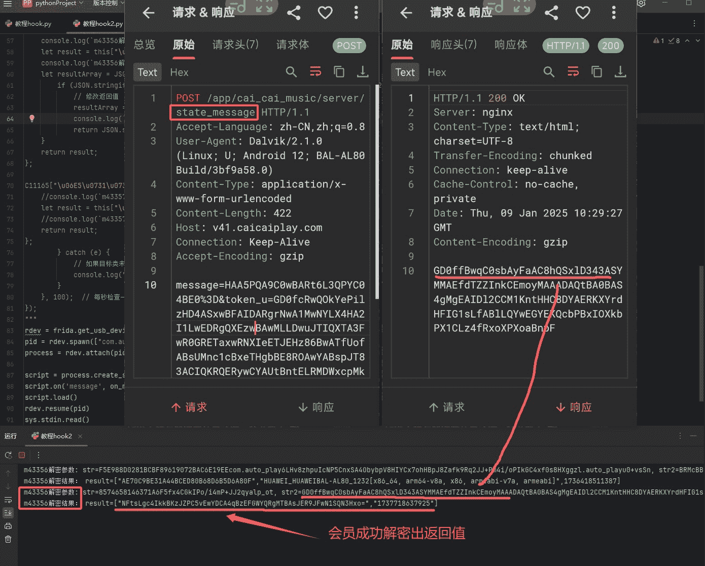

### 6. 我们直接选一首会员歌曲进行验证，结果发现从服务器返回的字符串再次被 `m43356` 进行解密，并且解密后的值为“{OS&h2:|a。。。”，这就是弹奏会员歌曲所需要的“密钥”

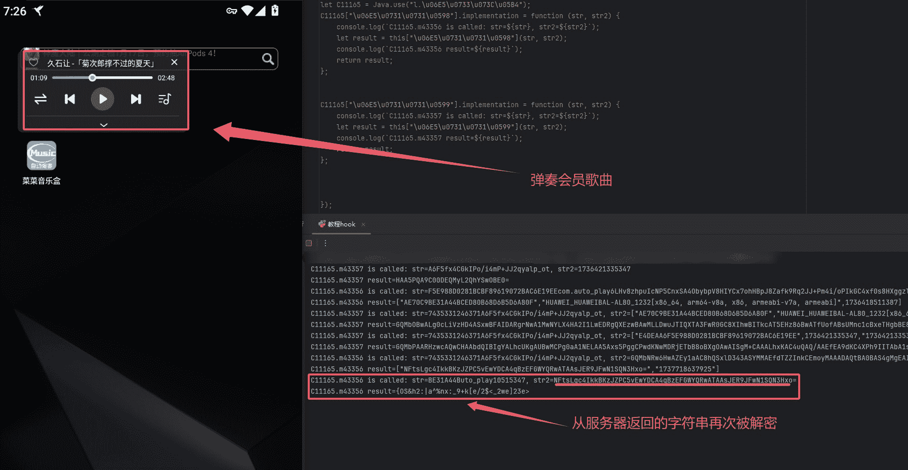

## 六：成功

### 1. 为何它就是所谓的密钥，看下面的图(画得并不标准，请大家见谅)，之前我们说过， `m43534` 里面判断了歌曲是否为会员歌曲，如果是会员歌曲，就会进行另一套加密，而它其中的关键就是 `str3`，而它是由六种方法生成的字符串切割拼接而来，其中 5 种是包名、应用签名、签名哈希的切割值，相对而言是固定的，只有 `C11199.m43520` 这个方法是通过其它方式生成的，而 `C11199.m43520` 方法中的关键就是 `m43356` 这个字符串，因为整个方法的返回值就是 `String` `m43356`，而 `String` `m43356` 是由 `C11165.m43356` 这个方法得来的，我们分析后得出 `C11165.m43356` 的值是由 `str=BE31A44Buto_play10515347`(感兴趣的兄弟可以研究一下它咋来的)和 `str2=NFtsLgc4IkkBKzJZPC5vEwYDCA4qBzEFGWYQRwATAAsJER9JFwN1SQN3Hxo`(服务器返回值解密后数组中的第一个)解密而来，最终返回解密后的会员歌曲密钥，并且经过切割拼接组成 `str3`，再经过异或生成 `sb3`，并调用 `C2437.m13231` 生成返回值，之后再不断返回直到“三：4”后成功弹奏会员歌曲

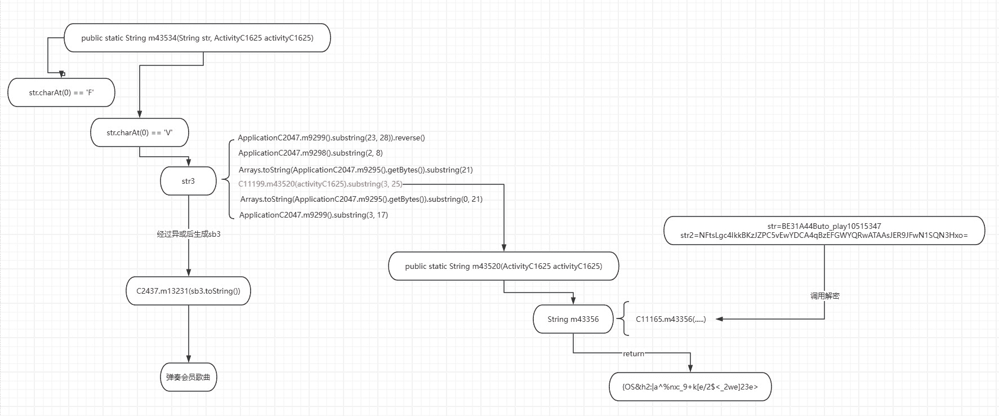

### 2. 分析了这么多，兄弟们肯定都已经饥渴难耐了，是牛是马还得拿出来溜溜，分析后我们知道最终的关键就是得出弹奏会员歌曲的密钥，而密钥是由 `C11199.m43520` 这个方法得来的，并且观察此方法，它的功能也就是用来得出密钥，于是我们直接 Hook 它，但是我们并不能只是单纯的修改它的返回值，而是要让它内容置空(感兴趣的兄弟可以研究研究)，直接返回密钥；激动的心，颤抖的手，咱们终于成功了！！！登上没有会员的号，即使没有会员，依旧能够弹奏会员歌曲

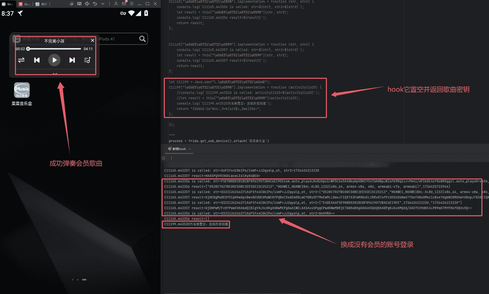

### 3. 虽然没有原神，但是有蛋仔，直接拿蛋仔派对试试手，非常完美，成功实现无会员弹奏会员歌曲，ok 啊兄弟们，也是能够去装弹琴高手了

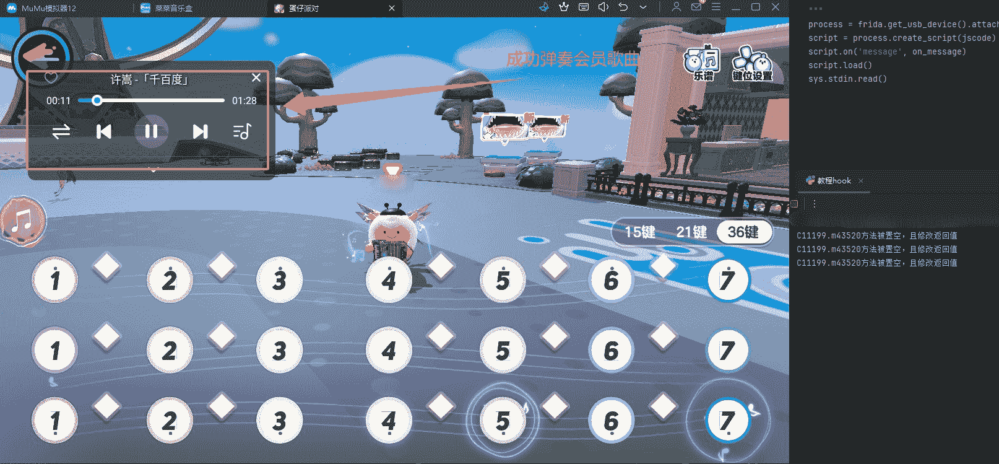

## 总结

说实话，这个 app 说难也不难，说简单也不简单，不过盘它也花了不少时间，这篇帖子也是断断续续写了快半个月了，这期间 app 还升到了 7.4.2 版本，把我白嫖的 7 天会员也耗光了，难点也差不多就是它的会员歌曲弹奏功能是由服务器单独返回的密钥实现，通过密钥完成对会员歌曲的解密从而实现弹奏，相对于一般的软件而言复杂了一丢丢，其实还可以从 so 层进行逆向，感兴趣的兄弟可以去试试，兄弟们可能在 hook 该 app 的时候会导致普通歌曲也无法弹奏，这些都是正常的，可能是该 app 的线程与 hook 产生了冲突，导致有些方法 hook 后软件卡住直接无法弹奏；该 app 在手游弹奏方面还是非常可以的，特别适合用来装 B，价格也不贵，低至 3r/月，支持正版，上述内容仅供学习交流，请勿用于任何非法途径；感谢大家支持，一起交流学习
