# [Android 分享] 基于《安卓逆向这档事》其三VIP破解的学习和总结

- 原帖：https://www.52pojie.cn/forum.php?mod=viewthread&tid=2000957
- 抓取时间：2026-11-01T16:12:35.189Z

## 描述

来源于吾爱破解论坛正己大佬的《安卓逆向这档事》三、初始 smali、vip 终结者课程，根据大佬的技术贴，个人的学习过程。

### 资源链接

相关软件：[//wwzc.lanzoub.com/b00efdpopi](https://wwzc.lanzoub.com/b00efdpopi:https) 密码：9y0w

视频链接：[//www.bilibili.com/video/BV1a8wKeeEzu/](https://www.bilibili.com/video/BV1a8wKeeEzu/:https)

正己《安卓逆向这档事》：[基于《安卓逆向这档事》其二APK双开、汉化、软件图标修改等问题的实现与总结 - 吾爱破解 - 52pojie.cn](https://www.52pojie.cn/forum.php?mod=viewthread&tid=2000479&page=1#pid52250745)

### 工具

- 教程 Demo
- 核心破解
- MT 管理器
- 界面分析
- 雷电模拟器

### 课程任务

- 完成关卡2
- 掌握修改判断、强制跳转、修改寄存器的值的基本原理

## 实现过程

### 前情提要

本次主要完成的任务，是正己大佬的教程 Dome 第二关 初试smail语法&快速定位之`id`与字符

#### 快速定位

教程中讲述的两种快速定位方法：`id` 和字符分别对应 `idHex` 和 `text`，使用类似于界面分析 APP 带有布局分析功能的软件，就可以查看控件信息，然后使用 MT 管理器搜索定位

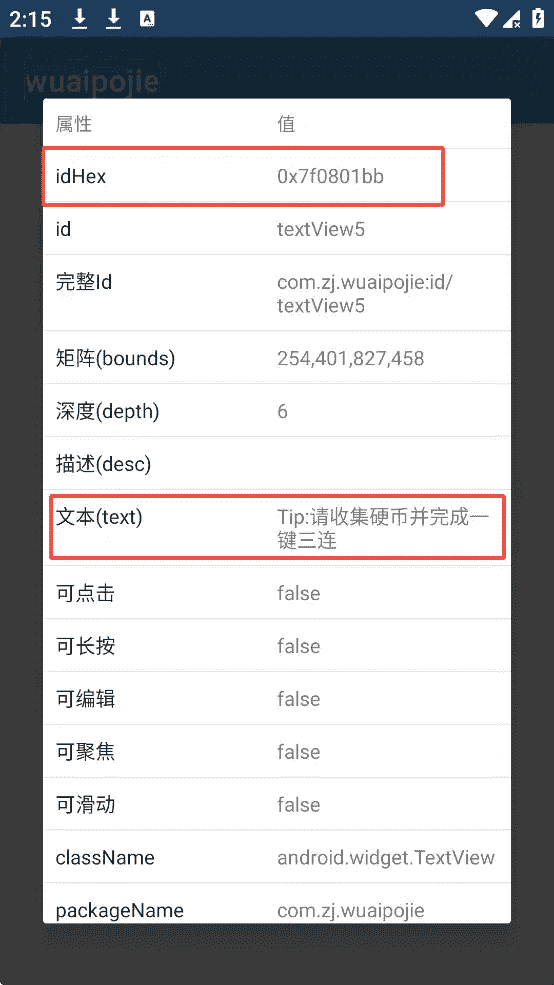

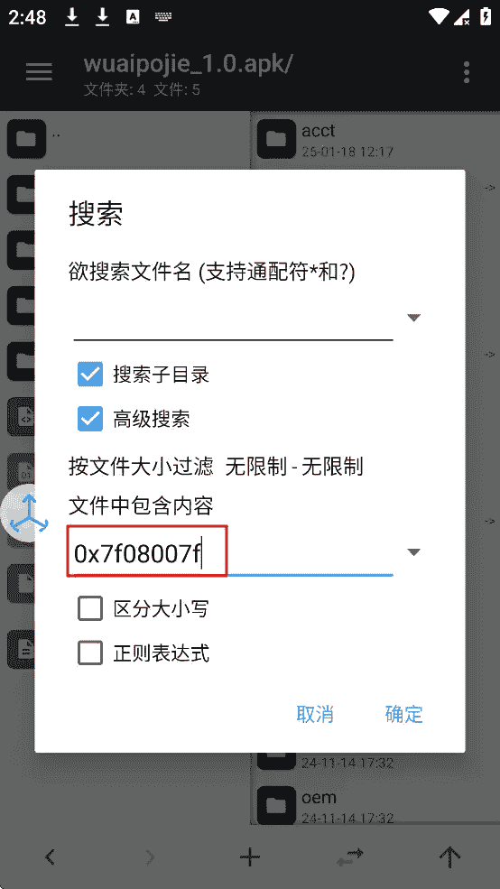

#### 初试 smali

不得不说，到了今天相比于17年18年，AI 对学习有了很大的便利

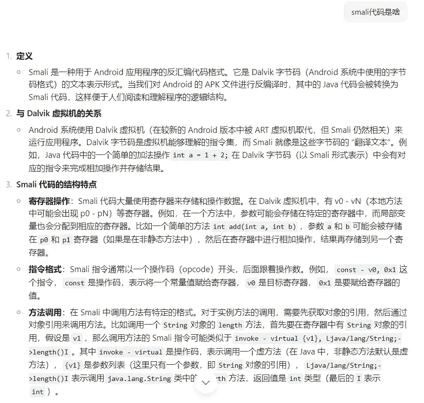

正己大佬在教程中对 smali 有解释学习，在这里就不过多阐述了，在 MT 管理器和 NP 管理器中都内置了 smail 指令查询

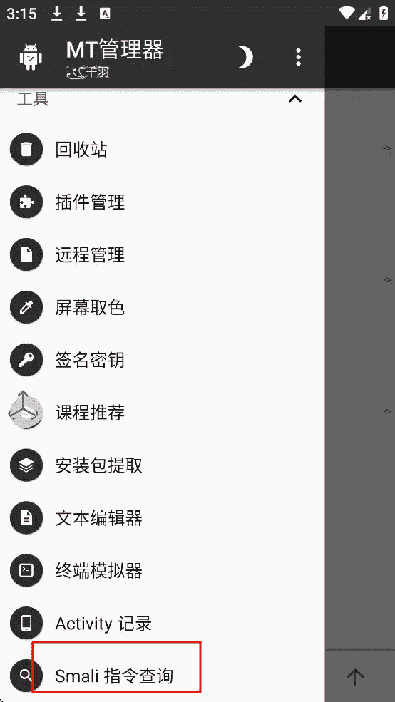

### 过程复现

首先会将两个定位方法复现一遍，然后进行三种修改方法

#### 快速定位

##### 其一 文本定位

首先，观察界面，查看文字，任务要求是获取硬币并一键三连。主要的两个分别是获取硬币和一键三连，回到 MT 管理器，搜索（PS：MT 管理器如何提取安装包定位位置就不细说了，具体可以看一下上期文章[基于《安卓逆向这档事》其二APK双开、汉化、软件图标修改等问题的实现与总结 - 吾爱破解 - 52pojie.cn](https://www.52pojie.cn/forum.php?mod=viewthread&tid=2000479&page=1#pid52250745)）

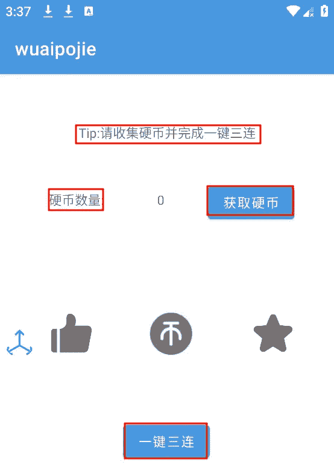

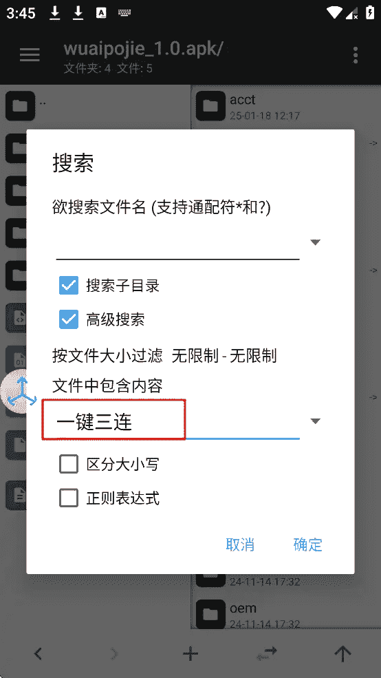

搜索出了两个文件，已知 `resource.arsc` 文件是一个资源 ID 映射表，那么把 `classes.dex` 用 dex 编辑器++，再搜索“一键三连”

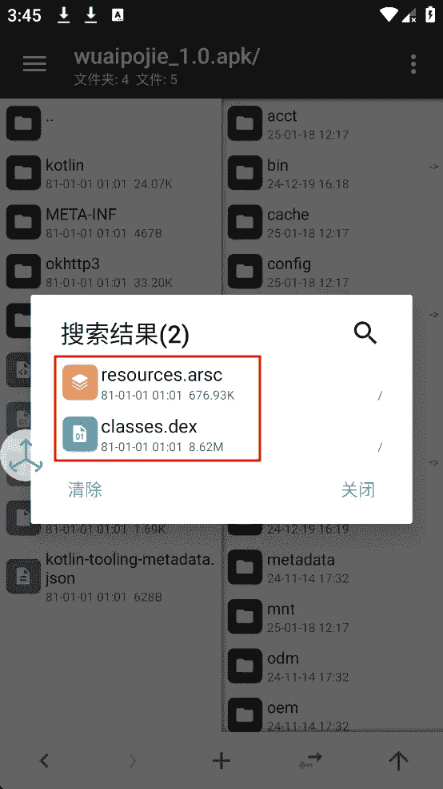

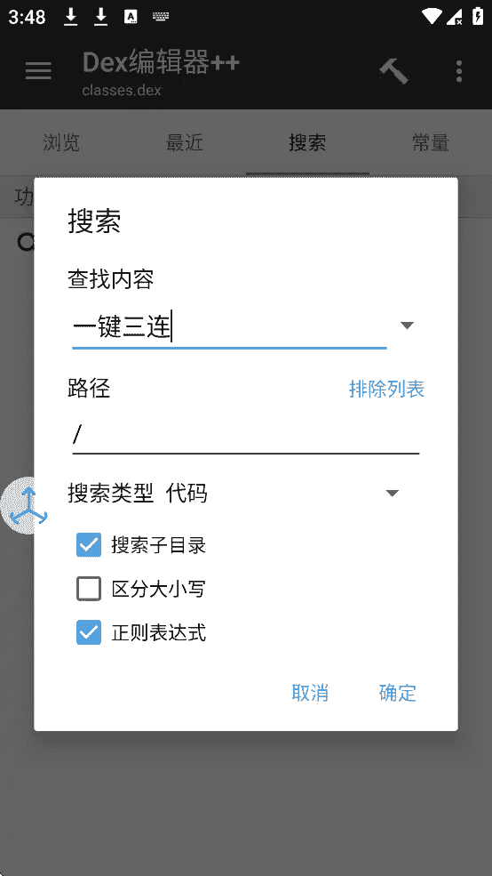

这样就定位到了位置

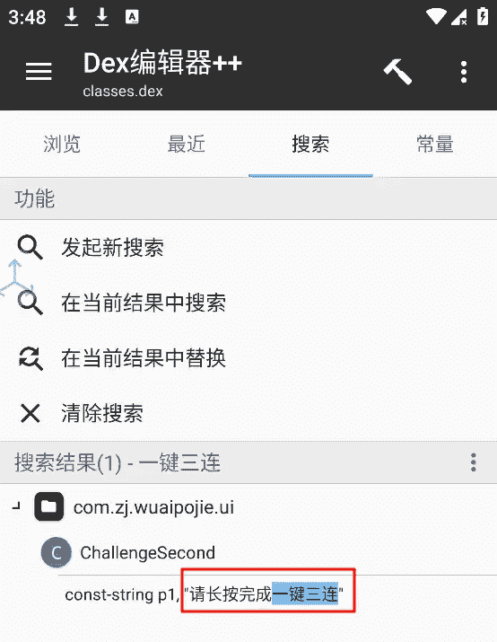

##### 其二 `id` 定位

通过界面分析 APP，查看当前界面可查看的控件，比如“一键三连”的控件信息

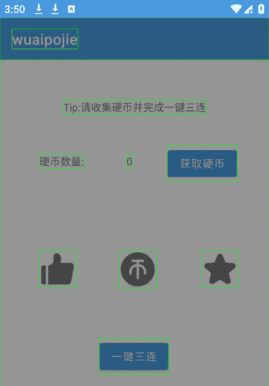

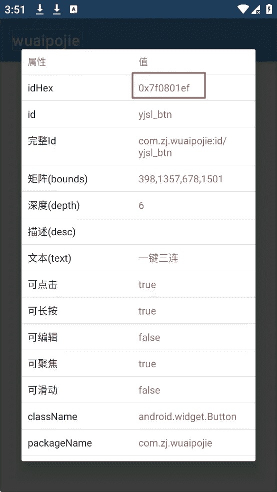

获得 `id` 以后，再回到 MT 管理器中，搜索

当提示搜索无结果的时候，可以根据需要进入 `dex` 文件或者 `arsc` 文件查询，比如查资源就去 `arsc`，查代码就去 `dex`

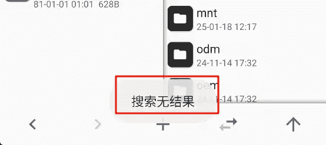

本次主要是查代码，所以进 `dex`，然后一个一个查看就可以了

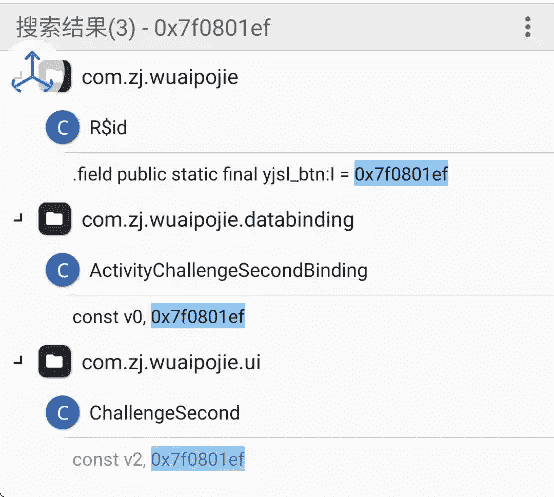

#### 修改方法

首先打开根据前面交的定位法，找到包含会员的文件

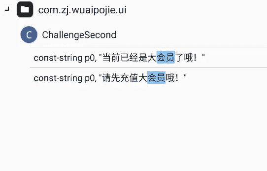

打开第一个文件，我们会看到下面这些代码，smali 就指的是下面这些，在这里就需要一些基础知识

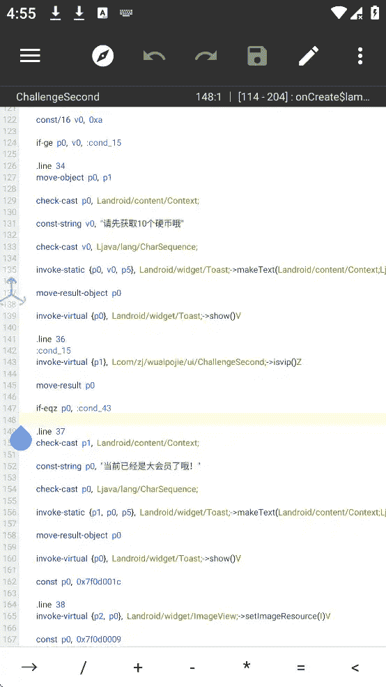

在这里，`.line {num}` 代表在源代码中的行数，也就是说可能7~8行在源代码中只有1行

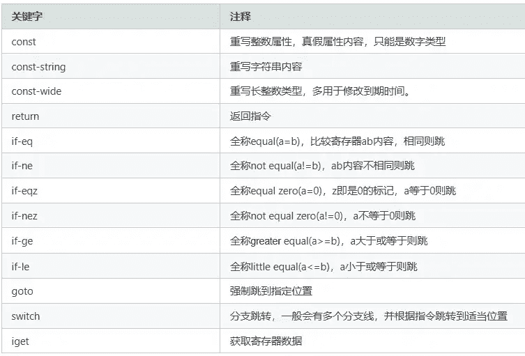

反正也可以用查询，MT 管理器/NP 管理器都自带 smali 指令查询，但是在编辑器中不能用，可以复制到另一个软件进行查询

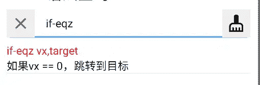

只不过，MT 管理器的会员可以安装插件，安装一个 smali 插件就可以了

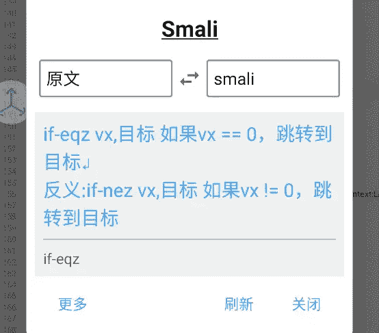

好，基本的认知结束，下面开始实操

##### 修改判断

可以看到，如果当代码进入 `line 37` 的时候就代表会员破解完成，但是在他上一步的 `if-eqz p0,:cond_43` 代表 `p0==0` 的时候，跳转到 `cond_43`

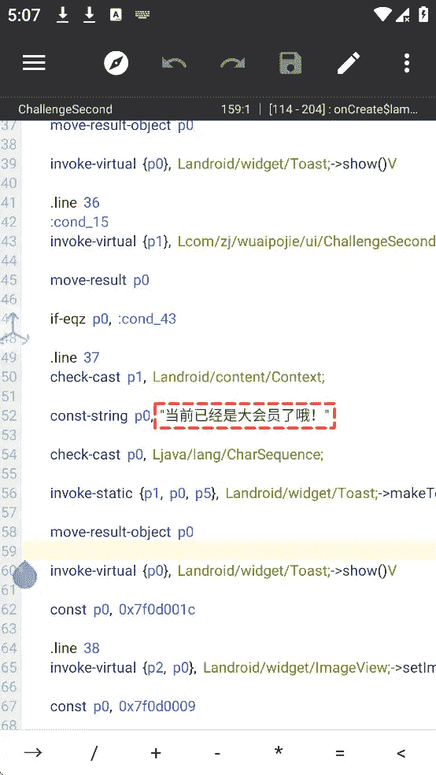

跳转过来，就会发现，提示充值大会员

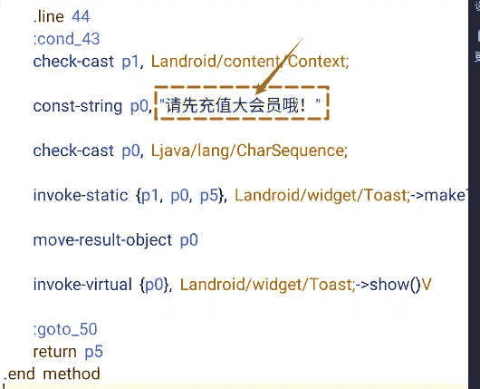

那么就可以修改 `if-eqz p0,:cond_43`，让 `p0` 只有在不等于 0 的时候才会跳转

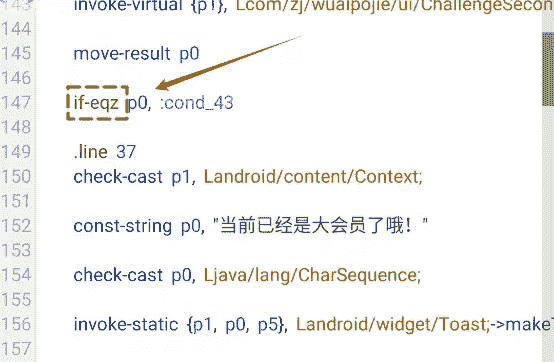

所以修改判断就可以把 `if-eqz` 改成下面任意一个就可以了

当然也可以直接注释掉

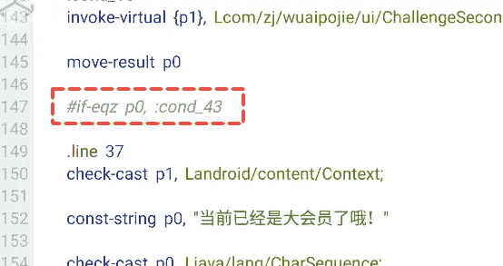

##### 强制跳转

强制跳转在这里需要用到一个命令 `goto`，代表无条件跳转

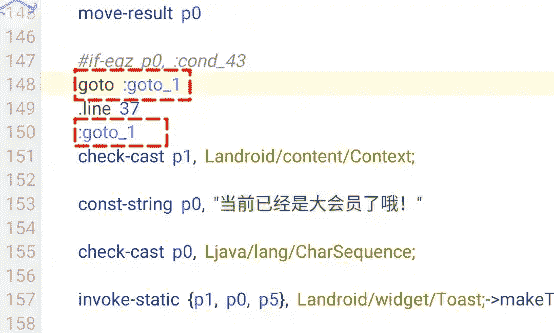

##### 修改寄存器

> [!在 smali 里的所有操作都必须经过寄存器来进行]

本地寄存器用 `v` 开头数字结尾的符号来表示，如 `v0`、`v1`、`v2`。

参数寄存器则使用 `p` 开头数字结尾的符号来表示，如 `p0`、`p1`、`p2`。

特别注意的是，`p0` 不一定是函数中的第一个参数，在非 `static` 函数中，`p0` 代指“`this`”，`p1` 表示函数的第一个参数，`p2` 代表函数中的第二个参数。而在 `static` 函数中 `p0` 才对应第一个参数（因为 Java 的 `static` 方法中没有 `this` 方法）。

首先我们可以看到，`isvip()` 这个函数反应大会员的情况，`Z` 表示返回布尔类型，放入代码中的逻辑就是，当 `isvip` 返回 0 的时候，跳转到 `cond_43`，返回 1 的时候，继续往下

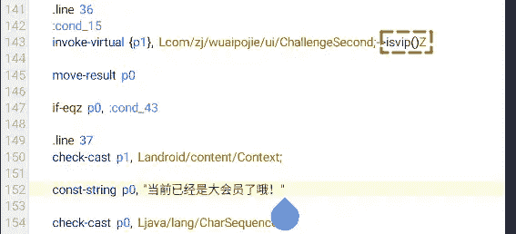

跳转到 `isvip()` 查看赋值，可以看到给 `v0` 赋了十六进制的 0，返回出的结果是 `v0`，所以在这里修改为十六进制的 1 就可以了

##### 破解大会员完成

## 总结

问题只有一个，如何实现的解决方法却又无数个。比如强制跳转也不是非用 `goto`，也可以直接修改跳转对象

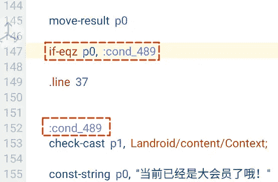

我也是个新手小白，接着放假在家的时候学习安卓逆向破解，希望能够给大家提供帮助，如果给您提供了帮助，希望能够给我一个赞或者评论一下，希望能够帮助更多人谢谢大家!!!!!
