# [Android 原创] 安卓逆向入门笔记（六）——JNI开发与so层逆向基础

- 原帖: https://www.52pojie.cn/forum.php?mod=viewthread&tid=2002272
- 抓取时间: 2026-11-01T16:12:11.133Z

## 零、前言

什么是`NDK`呢？什么是`JNI`呢？

`NDK`（Native Development Kit）是一个允许开发者使用`C`和`C++`编写Android应用程序的工具集。它提供了一系列的工具和库，可以帮助开发者将高性能的原生代码集成到Android应用中。

`NDK`的主要目标是提供一种方式，让开发者能够在需要更高性能或更底层控制的情况下使用`C`和`C++`编写部分应用程序，而不仅仅依赖于`Java`。

`JNI`（Java Native Interface）是一种编程框架，用于在`Java`代码和原生代码（如`C`和`C++`）之间进行交互。通过`JNI`，开发者可以在`Java`代码中调用原生代码的函数，并且可以将`Java`对象传递给原生代码进行处理。

`JNI`的主要作用是提供一种标准的接口，使得`Java`代码能够与原生代码进行通信。开发者可以使用`JNI`定义`Java`和原生代码之间的函数接口，并在`Java`代码中调用这些接口。同时，`JNI`还提供了一些函数来处理`Java`对象和原生数据类型之间的转换。简单来说就是`JNI`相当于`JAVA`和`C/C++`之间的翻译官，不管是`JAVA`转`C/C++`，还是`C/C++`转`JAVA`都需要依靠于`JNI`进行桥接、转换。

`Java`的保密性相对于`C/C++`来说并不算安全，有的开发者为了安全就也会去调用`C/C++`的代码来增加其项目的安全性，想要调用`C/C++`代码就需要通过`jni`接口调用，而要使用`jni`接口那就需要配置`NDK`。在配置`NDK`之前需要创建一个项目，调用`C/C++`代码建议创建`Native C++`项目类型。创建`Native C++`项目类型的项目可以参考以下方式创建：

一、在向导的 Choose your project 部分中，选择 `Native C++` 项目类型：

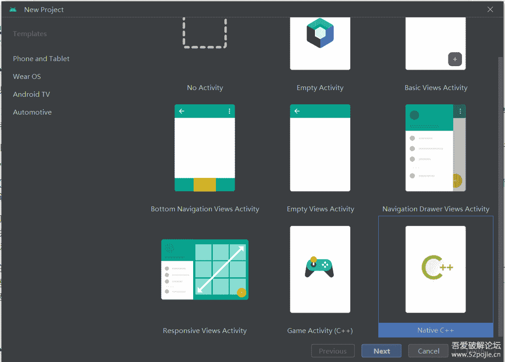

二、填写向导下一部分中的所有其他字段：

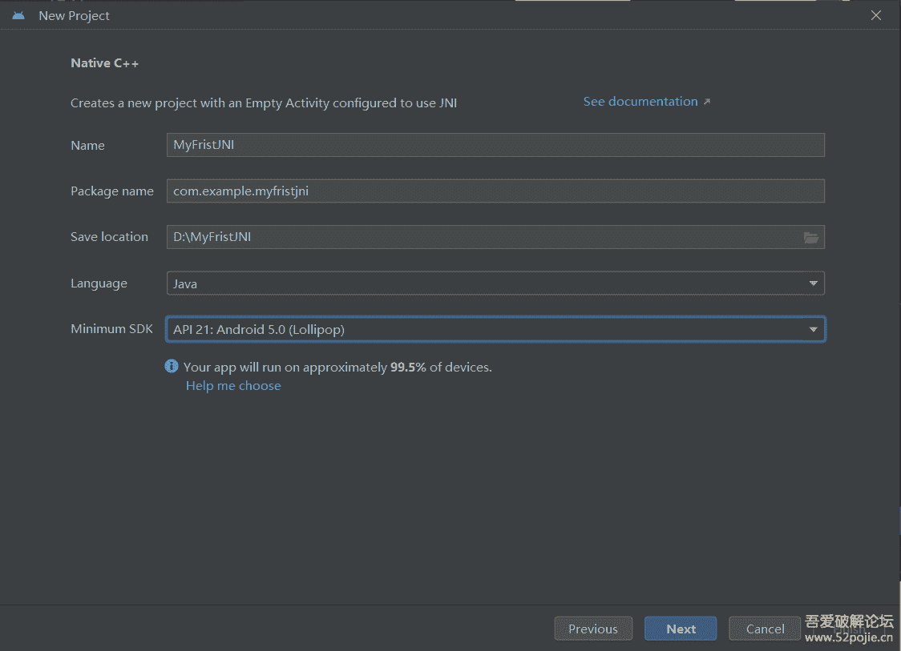

`Minimum SDK`选项选择您希望应用支持的最低 API 级别。当您选择较低的 API 级别时，您的应用可以使用的现代 Android API 会更少，但能够运行应用的 Android 设备的比例会更大。当选择较高的 API 级别时，情况正好相反。

三、自定义`C++`支持：

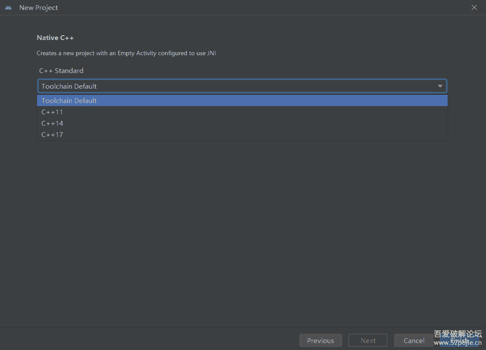

使用下拉列表选择您想要使用哪种 `C++` 标准化。选择 `Toolchain Default`，将使用默认的 `CMake` 设置。

最后点击`Finish`，项目创建成功。

## 一、Android Studio NDK的安装与配置

如需在 `Android Studio` 中安装 `CMake` 和默认 `NDK`，请执行以下操作：

- 打开项目后，依次点击 `Tools > SDK Manager`。
- 点击 `SDK Tools` 标签页。
- 选中 `NDK (Side by side)` 和 `CMake` 复选框。

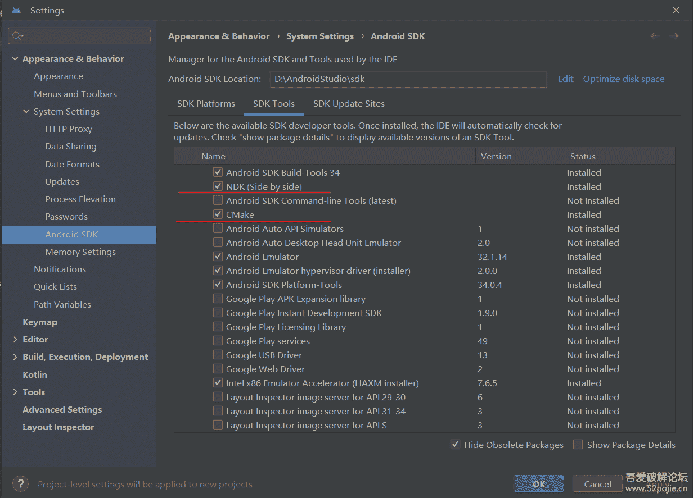

- 点击 `OK`。
- 此时系统会显示一个对话框，告诉您 `NDK` 软件包占用了多少磁盘空间。
- 点击 `OK`。
- 安装完成后，点击 `Finish`。
- 您的项目会自动同步 `build` 文件并执行构建。修正发生的所有错误。
- `Android Studio` 会将所有版本的 `NDK` 安装在 `android-sdk/ndk/` 目录中，我们需要将`NDK`安装目录添加到`PATH`环境变量中，`NDK`安装目录如：`D:\AndroidStudio\SDK\ndk\25.2.9519653\build`

## 二、Android Studio使用Native C++项目类型JNI开发

### 静态注册

我们安装好了`NDK`下面就开始体验`JNI`开发之静态注册：

刚开始的时候我不知道是不是`Android Studio`环境的问题，还是什么问题，每次创建好项目都会报错，如：“No matching variant of com.android.tools.build:gradle:7.4.0 was found. The consumer was configured to find a runtime of a library compatible with Java 8, packaged as a jar, and its dependencies declared externally, as well as attribute 'org.gradle.plugin.api-version' with value '7.5' but:......”像这样的报错信息，后面我才知道这个其实就是`jdk`的版本不符的问题，解决方法可以参考以下文章：

[7.4.0 was found.）_冯_诺伊曼的废柴Jason的博客-CSDN博客](https://blog.csdn.net/m0_66019257/article/details/130872226:(32条消息) 解决Android Studio-jdk版本不符问题（No matching variant of com.android.tools.build:gradle)

我去改变`JDK`的版本，准确来说并不是`JDK11`，而是需要`JDK17`及`JDK17`以上的版本才不会报这个错误。如果没有这个错误就可以继续使用擅长的`JDK`版本进行`jni`开发。

现在我们使用`Native C++`项目类型进行静态注册，在具体讲之前先讲一下静态注册的流程：

第一步：在`Java`层使用`native`修饰符声明一个`C/C++`的函数；
第二步：`Java`层调用`C/C++`的函数；
第三步：生成`.c/.cpp`文件，并在文件内编写`C/C++`函数；
第四步：在`java`代码中添加静态代码块加载指定名称的共享库。

接下来正式讲解`JNI`开发就需要使用支持`C/C++`类型的`Native C++`项目。

我们先在`Java`层使用`native`修饰符声明`C/C++`的函数，然后调用声明的`C/C++`层函数：

```java
package com.example.as_jni_project;

import androidx.appcompat.app.AppCompatActivity;

import android.annotation.SuppressLint;
import android.content.Context;
import android.os.Bundle;
import android.widget.TextView;
import android.widget.Toast;

import com.example.as_jni_project.databinding.ActivityMainBinding;

public class MainActivity extends AppCompatActivity {

    // 在应用程序启动时用于加载'as_jni_project'库。
    static {
        System.loadLibrary("as_jni_project");  // 加载模块名称
    }

    private ActivityMainBinding binding;
    public String str = "Hello JAVA!我是普通字段";
    public static String static_str = "Hello JAVA!我是静态字段";

    public static AppCompatActivity your_this = null;

    public void str_method() {
        Toast.makeText(this, "普通方法", Toast.LENGTH_LONG).show();
    }

    public static void static_method() {
        Toast.makeText(your_this, "静态方法", Toast.LENGTH_LONG).show();
    }

    @Override
    protected void onCreate(Bundle savedInstanceState) {
        super.onCreate(savedInstanceState);

        your_this = MainActivity.this;
        binding = ActivityMainBinding.inflate(getLayoutInflater());
        setContentView(binding.getRoot());

        // 调用本地方法的示例
        TextView tv = binding.sampleText;
        tv.setText(stringFromJNI());

        Toast.makeText(this, stringFromJAVA(), Toast.LENGTH_LONG).show();
        Toast.makeText(this, stringFromC(), Toast.LENGTH_LONG).show();
        Toast.makeText(this, staticFromC(), Toast.LENGTH_LONG).show();
        stringFromMethod();
        staticFromMethod();
    }

    /**
     * 由“as_jni_project”本地库实现的本地方法，该库已打包到该应用程序中。
     */
    public native String stringFromJNI();  // 这个是Native C++类型项目创建时自带的C/C++方法声明，我就没有删除
    public native String stringFromJAVA();
    public native String stringFromC();
    public native String staticFromC();
    public native String stringFromMethod();
    public native String staticFromMethod();
}
```

我的想法是来完整体验一下从`JAVA`层通过`jni`调用`C/C++`层函数，以及从`C/C++`层调用`JAVA`层函数，所以我打算做以下几件事：

1、从`JAVA`层通过`jni`调用`C/C++`层函数
2、从`JAVA`层通过`jni`调用`C/C++`层函数，然后从`C/C++`层修改`JAVA`层普通字段的值
3、从`JAVA`层通过`jni`调用`C/C++`层函数，然后从`C/C++`层修改`JAVA`层静态字段的值
4、从`JAVA`层通过`jni`调用`C/C++`层函数，然后从`C/C++`层调用`JAVA`层普通方法
5、从`JAVA`层通过`jni`调用`C/C++`层函数，然后从`C/C++`层调用`JAVA`层静态方法

在`MainActivity.java`文件中我添加了以下代码：

在`java`代码中添加静态代码块加载指定名称模块：

```java
static {
    System.loadLibrary("as_jni_project");  // 加载模块名称
}
```

那我们该怎么知道我们要加载的模块名称是什么呢？在`native-lib.cpp`文件的同一级文件夹下的`CMakeLists.txt`文件中有定义：

```cmake
# 有关将 CMake 与 Android Studio 配合使用的更多信息，请阅读文档：
# https://d.android.com/studio/projects/add-native-code.html

# 设置生成本地库所需的最低 CMake 版本。
cmake_minimum_required(VERSION 3.22.1)

# 声明并命名项目。
project("as_jni_project")

# 创建并命名库，将其设置为 STATIC 或 SHARED，并提供其源代码的相对路径。
# 您可以定义多个库，CMake 会为您构建它们。
# Gradle 会自动将共享库与您的 APK 打包。
add_library(
        # 设置库的名称。
        as_jni_project
        # 将库设置为共享库。
        SHARED
        # 提供源文件的相对路径。
        native-lib.cpp)

# 搜索指定的预生成库并将路径存储为变量。
# 由于 CMake 默认在搜索路径中包含系统库，因此您只需指定要添加的公有 NDK 库的名称。
# CMake 会在完成构建之前验证库是否存在。
find_library( # Sets the name of the path variable.
        log-lib
        # Specifies the name of the NDK library that
        # you want CMake to locate.
        log)

# 指定 CMake 应链接到目标库的库。
# 可以链接多个库，例如在此生成脚本中定义的库、预生成的第三方库或系统库。
target_link_libraries( # Specifies the target library.
        as_jni_project
        # Links the target library to the log library
        # included in the NDK.
        ${log-lib})
```

可以从`CMakeLists.txt`文件中的定义看出，将`native-lib.cpp`文件设置为共享库，库的名称为`as_jni_project`。所以我们在指定加载模块名称时需要设置为`as_jni_project`。

从`JAVA`层通过`jni`调用`C/C++`层函数：

```java
Toast.makeText(this, stringFromJAVA(), Toast.LENGTH_LONG).show();
// 通过使用消息框显示C/C++层函数stringFromJAVA()返回回来的值
```
`public native String stringFromJAVA();` // 在`Java`层使用`native`修饰符声明一个`C/C++`层函数`stringFromJAVA`

从`JAVA`层通过`jni`调用`C/C++`层函数，然后从`C/C++`层调用`JAVA`层普通字段：

```java
public String str = "Hello JAVA!我是普通字段";  // 声明一个Java层String类型的普通变量
```
`Toast.makeText(this, stringFromC(), Toast.LENGTH_LONG).show();`
// 通过使用消息框显示`C/C++`层函数`stringFromC()`返回回来的值，该值是在`C/C++`层函数从`Java`层调用普通字段的值

```java
public native String stringFromC();  // 在Java层使用native修饰符声明一个C/C++层函数stringFromC
```

从`JAVA`层通过`jni`调用`C/C++`层函数，然后从`C/C++`层调用`JAVA`层静态字段：

```java
public static String static_str = "Hello JAVA!我是静态字段";  // 声明一个Java层String类型的静态变量
```

`Toast.makeText(this, staticFromC(), Toast.LENGTH_LONG).show();`
// 通过使用消息框显示`C/C++`层函数`staticFromC()`返回回来的值，该值是在`C/C++`层函数从`Java`层调用静态字段的值

```java
public native String staticFromC();  // 在Java层使用native修饰符声明一个C/C++层函数staticFromC
```

从`JAVA`层通过`jni`调用`C/C++`层函数，然后从`C/C++`层调用`JAVA`层普通方法：

```java
// 声明一个Java层无返回值的普通方法，通过C/C++函数调用该方法会弹出消息框显示"普通方法"
public void str_method() {
    Toast.makeText(this, "普通方法", Toast.LENGTH_LONG).show();
}
```
`stringFromMethod();` // 在`Java`层调用`C/C++`层函数`stringFromMethod`

```java
public native String stringFromMethod();  // 在Java层使用native修饰符声明一个C/C++层函数stringFromMethod
```

从`JAVA`层通过`jni`调用`C/C++`层函数，然后从`C/C++`层调用`JAVA`层静态方法：

```java
// 声明一个AppCompatActivity类型(MainActivity的父类)的静态变量用来接收this，因为static_method方法是静态方法，而静态方法内部不可以出现this关键字。
public static AppCompatActivity your_this;
```

// 声明一个`Java`层无返回值的静态方法，通过`C/C++`函数调用该方法会弹出消息框显示"静态方法"

`public static void static_method() {`


# JNI 开发与逆向基础

## Java 层静态方法与 `this`

```java
// Toast.makeText()方法的第一个参数应该存放this，但是因为该方法是一个静态方法，所以该方法是属于类的，而非实例的。
// 因为静态方法是属于类的，所以静态方法会和类一同创建；而this只能代表当前对象，所以导致静态方法中不可以出现this关键字。
Toast.makeText(your_this, "静态方法", Toast.LENGTH_LONG).show();
}
```

```java
// 在Activity生命周期的onCreata()方法进行初始化时，将MainActivity.this赋值给AppCompatActivity类型的静态变量，这样就会优先创建this，这样做或许可以解决this关键字无法出现在静态方法中，让我们可以正常弹出消息框。
your_this = MainActivity.this;
```

```java
staticFromMethod();  // 在Java层调用C/C++层函数staticFromMethod
```

```java
public native String staticFromMethod();  // 在Java层使用native修饰符声明一个C/C++层函数staticFromMethod
```

除去我添加的这些代码，其余代码都是Native C++类型项目创建时自带的代码。

写完了Java层的代码，我们接下来去详细介绍`.cpp`文件：

```cpp
#include  // jni.h是Java Native Interface（JNI）的头文件，用于提供JNI函数和数据类型的定义

#include  // string是C++中的标准库头文件，用于操作字符串

extern "C" JNIEXPORT jstring JNICALL

Java_com_example_as_1jni_1project_MainActivity_stringFromJNI(

        JNIEnv* env,

        jobject /* this */) {

    std::string hello = "Hello from C++";

    return env->NewStringUTF(hello.c_str());

}

// extern "C"表示下面的代码使用的是C的编译方式，如果是文件后缀名为.c的C环境，那是不需要加的，因为那已经是C的编译方式了。

extern "C"

// JNIEXPORT是JNI重要标记关键字，主要作用是标记该方法让其可以被外部调用

// JNICALL 修饰符的作用就是告诉编译器使用JNI规范定义的调用约定来处理函数

JNIEXPORT jstring JNICALL

// Java_com_example_as_1jni_1project_MainActivity_stringFromJAVA表示该JNI函数的命名规则

// Java_包名_类名_方法名，如果包名、类名、方法名中自带_(下划线)，那么在JNI函数的命名规则中会用_1表示该下划线是Java的下划线

Java_com_example_as_1jni_1project_MainActivity_stringFromJAVA(JNIEnv *env, jobject thiz) {

    // JNIEnv *env 是一个指向JNI环境的指针，它提供了一系列的函数，用于在Java代码和C代码之间进行交互。

    // jobject thiz 是一个表示当前对象的引用，在JNI中，jobject thiz 通常用于表示调用当前JNI函数的Java对象。

    // 举个例子：stringFromJAVA函数是在MainActivity.onCreate方法中被调用，那么jobject类型thiz参数则表示MainActivity.this。

    // TODO: implement stringFromJAVA()

}

extern "C"

JNIEXPORT jstring JNICALL

Java_com_example_as_1jni_1project_MainActivity_stringFromC(JNIEnv *env, jobject thiz) {

    // TODO: implement stringFromC()

}

extern "C"

JNIEXPORT jstring JNICALL

Java_com_example_as_1jni_1project_MainActivity_staticFromC(JNIEnv *env, jobject thiz) {

    // TODO: implement staticFromC()

}

extern "C"

JNIEXPORT jstring JNICALL

Java_com_example_as_1jni_1project_MainActivity_stringFromMethod(JNIEnv *env, jobject thiz) {

    // TODO: implement stringFromMethod()

}

extern "C"

JNIEXPORT jstring JNICALL

Java_com_example_as_1jni_1project_MainActivity_staticFromMethod(JNIEnv *env, jobject thiz) {

    // TODO: implement staticFromMethod()

}
```

定义了两个C/C++层函数，其中的一些关键字、修饰符、函数的命名规则我都用注释简单说明了一下，但在这些代码中，我认为有一行代码需要详细讲解：

```cpp
// extern "C"表示下面的代码使用的是C的编译方式，如果是文件后缀名为.c的C环境，那是不需要加的，因为那已经是C的编译方式了。
extern "C"
```

可能有的朋友会很好奇，这一行代码有啥必要详细讲解的？这一行代码为什么要详细讲解这还得从JNI的核心`JNIEnv`开始讲起：

因为JNI的核心就是`JNIEnv`，而`JNIEnv`的核心则是在`jni.h`文件中使用C语言结构体定义的三百多个C语言函数。在Android Studio可以按住`CTRL`键点击要跳转的类、方法可以跳转到目标位置，按住`CTRL`键点击`JNIEnv`后跳转到以下位置：

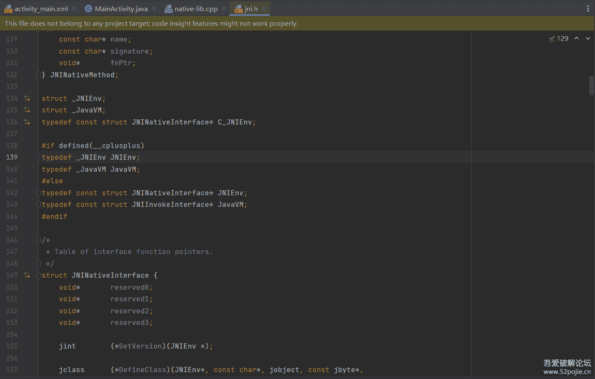

主要看这段代码：

```cpp
#if defined(__cplusplus)

typedef _JNIEnv JNIEnv;

typedef _JavaVM JavaVM;

#else

typedef const struct JNINativeInterface* JNIEnv;

typedef const struct JNIInvokeInterface* JavaVM;

#endif
```

这里进行了一个判断，判断是使用C还是C++，有人可能好奇怎么进行判断，很简单，看写C/C++层代码的文件是`.c`（C语言源文件）还是`.cpp`（C++源文件），如果是`.cpp`那就走这段代码：

```cpp
typedef _JNIEnv JNIEnv;
typedef _JavaVM JavaVM;
```

如果是`.c`那就走另一段代码：

```c
typedef const struct JNINativeInterface* JNIEnv;

typedef const struct JNIInvokeInterface* JavaVM;
```

因为我们写C/C++层代码的文件是以`.cpp`为后缀的代码文件，所以我们讲解以下后缀名为`.cpp`时执行的代码：

`typedef _JNIEnv JNIEnv;` 将 `_JNIEnv` 类型定义一个别名，该别名为 `JNIEnv` 类型。

`typedef _JavaVM JavaVM;` 将 `_JavaVM` 类型定义一个别名，该别名为 `JavaVM` 类型。

但是我们的主角是`JNIEnv`，而`JNIEnv`类型是`_JNIEnv`类型的别名，那我们去看看`_JNIEnv`类型到底是何方神圣：

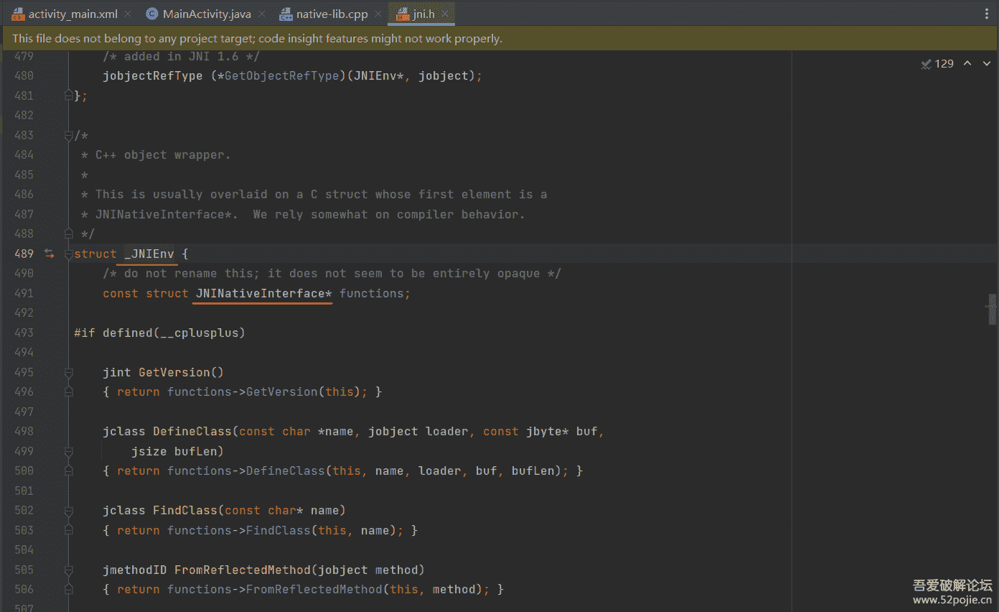

可以看到`_JNIEnv`类型是一个结构体，而这个结构体当中有一个比较眼熟的身影，`JNINativeInterface`是不是在哪里见过，没错就是前面判断是C还是C++的时候，如果写C/C++层代码的文件是`.c`的时候会去执行的代码：

```c
typedef const struct JNINativeInterface* JNIEnv;
```

我们点进去看看：

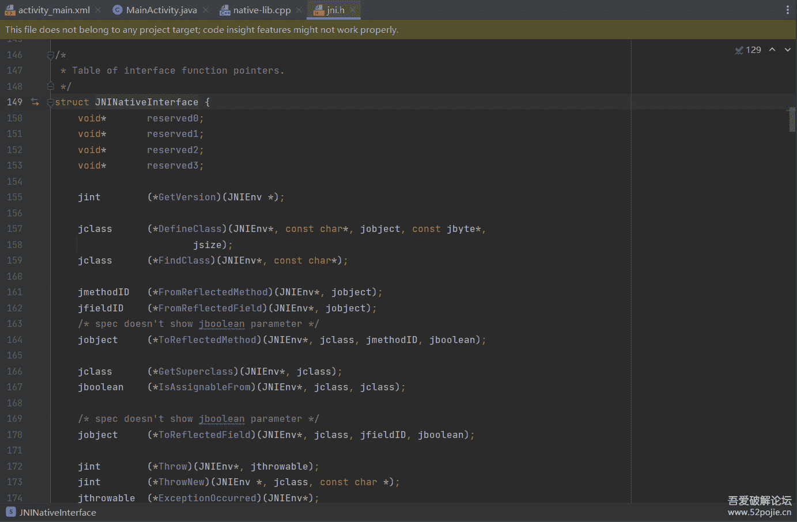

这个是什么呢？这个就是`jni.h`文件中使用C语言结构体定义的三百多个C语言函数，不管是Java调用C/C++函数，还是C/C++调用Java函数，都需要通过调用`jni.h`文件中的这三百多个C语言函数去调用。

但是要注意一个点，C++结构体`_JNIEnv`是一个对象的包装器，通常覆盖在C结构体`JNINativeInterface`上。这意味着`_JNIEnv`结构体中的第一个成员变量将是指向`JNINativeInterface`结构体的指针。这种关系表明`_JNIEnv`结构体是对`JNINativeInterface`结构体的封装。

看到这里你会发现无论是C还是C++都会访问`JNINativeInterface`结构体，而这个结构体是C语言的结构体，这个结构体有三百多个C语言函数，而这三百多个C语言函数必须采用C的编译方式。结构流程图大致是这样的：

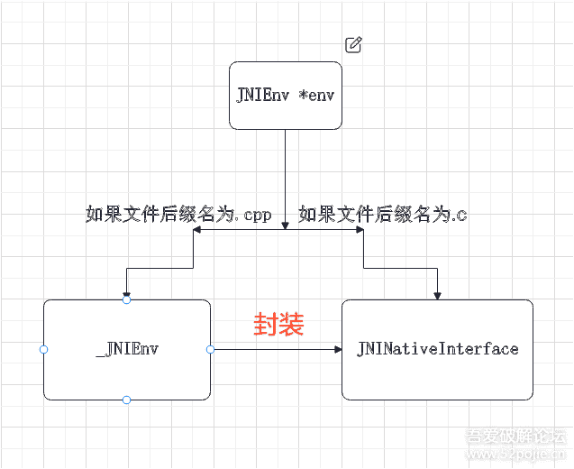

现在再来看看`extern "C"`这行代码，是不是就明白为什么表示下面的代码使用的是C的编译方式了。

讲完了`extern "C"`这行代码，我们继续讲解`.cpp`文件：

我们先从`stringFromJAVA`函数写起，我们要在这个函数中实现在C/C++层返回一个字符串给Java层，那需要在`stringFromJAVA`函数中添加以下代码：

```cpp
return env->NewStringUTF("第一个native层返回的字符串！！！");
```

聪明的你应该发现这行`.cpp`文件中的代码和之前简单体验JNI开发时在`.c`文件中写的有点不一样，这是之前写的：

```c
return (*env)-> NewStringUTF(env, "Hello From JNITest Function(getJNIString)");
```

那为什么会出现这种差别呢？这还得从`jni.h`文件说起了，可能有的朋友因为没有安装Android Studio没法查看`jni.h`文件，这种情况可以去访问以下网址：

[jdk/src/java.base/share/native/include/jni.h at master · openjdk/jdk · GitHub](https://github.com/openjdk/jdk/blob/master/src/java.base/share/native/include/jni.h)

首先先说结论：导致这个差别的原因是因为如果是`.c`文件，那么`JNIEnv env`是二级指针，如果是`.cpp`文件，那么`JNIEnv env`是一级指针。有些朋友可能看完结论还是一脸懵逼，但是没关系，我们慢慢道来：

还记得在讲解`extern "C"`时出现的这个条件判断语句吗？没错，这次还是跟它有关系：

```cpp
#if defined(__cplusplus)

typedef _JNIEnv JNIEnv;

typedef _JavaVM JavaVM;

#else

typedef const struct JNINativeInterface* JNIEnv;

typedef const struct JNIInvokeInterface* JavaVM;

#endif
```

之前我们追过去看了，无论是C还是C++实际都定义在 `JNINativeInterface` 结构体中，最终都会指向`JNINativeInterface`结构体。而在这个过程中就产生了差别，要明白为什么需要先简单了解一下C中的指针是什么，如果你有兴趣去了解C语言的指针，可以去阅读以下这篇文章：

[c语言指针用法及实际应用详解，通俗易懂超详细！ - 知乎 (zhihu.com)](https://zhuanlan.zhihu.com/p/388456835)

如果没兴趣了解C语言的指针，那我在这个简单的说一下指针和指针变量。

指针是一种概念，所谓的指针其实就是数据的存储地址，指针可以方便CPU访问数据。

而指针变量它是指针这个概念的具体应用之一，指针变量和普通变量不同，指针变量它只能存储数据地址。

之前我们在C/C++层经常可以看到`*`出现，而`*`在C语言中可以用来获取指针变量指向那个内存地址的数据，比如：

```c
result = *ptr;
```

也可以用来定义一个指针变量，比如：

```c
int *ptr;
```

现在应该对指针有一点了解了吧！那好我们看如果`native-lib`文件的后缀名为`.cpp`时`JNIEnv`是怎么样的：

```cpp
typedef _JNIEnv JNIEnv;
```

之前讲过这行代码将 `_JNIEnv` 类型定义一个别名，该别名为 `JNIEnv` 类型，`_JNIEnv` 结构体是对 `JNINativeInterface` 结构体的封装，通过这种方式可以访问 `JNINativeInterface` 结构体中的函数指针(`JNINativeInterface` 结构体中定义的C语言函数)，只需要调用`_JNIEnv`结构体中的方法即可。当后缀名为`.cpp`时，可以通过 `_JNIEnv` 类型的对象来执行 `_JNIEnv` 结构体中的函数，这些函数提供了与 Java Native Interface (JNI) 相关的功能，用于在 C++ 代码中与 Java 代码进行交互。

我们再看看文件后缀名为`.cpp`时的C++环境中`JNIEnv env` 参数，可以发现，C++环境中所谓的`JNIEnv env` 参数就是先给`_JNIEnv`结构体定义了一个别名为`JNIEnv`类型，然后再使用`JNIEnv`类型定义一个指针变量`env`，最后我们使用`env`可以直接调用 `_JNIEnv` 结构体中的函数，将`_JNIEnv` 结构体当做一个对象使用。回顾整个过程可以发现只有在`JNIEnv *env` 参数这定义了一个指针变量，所以文件后缀名为`.cpp`时，`JNIEnv *env`参数是一级指针。

想要调用一级指针下的函数，那需要使用到`->`。在 C++ 中，`->` 是一个成员访问运算符，用于通过指针访问对象的成员函数。所以这就是如果文件后缀名为`.cpp`时为什么是`env->函数名称` , 即可完成调用的原因。

那如果是C环境，为什么是二级指针呢？我们看`else`分支下的 `JNIEnv` 类型：

```c
typedef const struct JNINativeInterface* JNIEnv;
```

这里`JNINativeInterface*`是 `JNINativeInterface` 结构体指针类型。可以看到将 `JNINativeInterface` 结构体指针类型定义了一个别名，该别名为`JNIEnv`类型。那么这里的`JNIEnv`类型已经是一级指针了，然后又在`JNIEnv *env` 参数这定义了一个指针变量，那这里的`env`参数就已经是二级指针了。

在 C 语言中，`->` 运算符用于访问结构体指针的成员。当我们有一个指向结构体的指针时，可以使用 `->` 运算符来访问该结构体的成员变量或成员函数。所以我们想要使用`->`访问`JNINativeInterface` 结构体下的成员变量或成员函数时，那么C环境下的`JNIEnv env` 参数就必须是一级指针，要将二级指针变为一级指针就需要解引用。在 C 语言中，`(*)` 是解引用运算符的语法。解引用运算符用于访问指针所指向的对象。当我们有一个指针时，可以使用 `(*)` 运算符来获取该指针所指向的对象。

那么在C环境中我们需要使用 `(*env)` 的形式来解引用 `env` 指针，然后再使用 `->` 运算符来访问 `JNIEnv` 结构体中的成员函数。所以这就是如果文件后缀名为`.c`时为什么是`(*env)->函数指针` , 即可完成调用的原因。

对比C环境中访问 `JNIEnv` 结构体中的成员函数和C++环境中访问 `JNIEnv` 结构体中的成员函数你可以发现它们之间还有一个差别，那就是C环境中访问 `JNIEnv` 结构体中的成员函数比C++环境中访问 `JNIEnv` 结构体中的成员函数多一个参数`env`。出现这个差别的原因也很简单，这是因为C是没有对象的，想要持有`env`环境，那就必须将`JNIEnv *env` 参数传递进去。而C++不需要将`JNIEnv *env` 参数传递进去是因为C++是有对象的本来就会持有`env`环境，所以不需要传。

为什么要详细讲这些呢？详细讲这些感觉作用不大。我这里详细讲这些是因为我们主要是要搞逆向，如果想在逆向途中如鱼得水，那就需要对开发有一些基础了解，但对开发的了解又不能在于表面，需要知道一些机制的具体原因，这样才能帮我们减轻阻碍。

写完了`stringFromJAVA`函数，接下来我们写`stringFromC`函数，我们要在这个函数中实现从C/C++层获取到JAVA层普通字段后修改该字段的值。既然我们要修改JAVA层字段的值，那么我们需要用到这个函数：


# JNI 字段与方法操作

## 修改普通字段

```
void SetObjectField(jobject obj, jfieldID fieldID, jobject value)
```

看函数名就很直白的告诉我们这个函数是用来修改`Object`类型字段用的，我们要传入三个参数：

`SetObjectField`函数的`jobject` `obj`参数：Java对象的引用。这里想要`SetObjectField`函数修改字段的值，那你就得告诉它这个字段所属的实例对象是谁。之前讲过JNI函数的`jobject` `thiz`参数是表示当前对象的引用，用于表示调用当前JNI函数的Java对象。那当前JNI函数的Java对象是谁呢？是`MainActivity.this`，而我们要修改字段的所属的实例对象是谁呢？也是`MainActivity.this`，所以`jobject` `obj`参数传入中传入`jobject` `thiz`参数。

`SetObjectField`函数的`jfieldID` `fieldID`参数：要修改的字段的ID。字段的ID是一个`jfieldID`类型的变量，它是用于表示一个Java字段在JNI环境中的唯一标识符。

我们现在是缺少`jfieldID`类型的变量，所以我们需要去创建一个`jfieldID`类型的变量去获取要修改的字段的ID。那么我们需要用到这个函数：

```
jfieldID GetFieldID(jclass clazz, const char* name, const char* sig)
```

其实这些函数名都很直白的把函数的作用告诉了我们，这个函数就很直白的告诉我们这是用来获取字段的ID用的，但是这里也要传入三个参数：

`GetFieldID`函数的`jclass` `clazz`参数：Java类的Class对象。Java类的Class对象是一个`jclass`类型的变量，它是用于表示一个Java类在JNI环境中的引用。

`jclass` `clazz`参数我们是缺少的，因为我们没有一个`jclass`类型的变量，所以我们又需要去创建一个`jclass`类型的变量。那么我们需要用到这个函数：

```
jclass FindClass(const char* name)
```

这个函数是第一种获取Java类的Class对象的方式，之后会讲第二种。我们来看这个函数唯一的参数`const char*` `name`要传入什么值：

`FindClass`函数的`const char*` `name`参数：要查找的Java类的名称，是一个字符串。

这次总算不要再为了这个参数去创建一些其他的变量了，这个参数我们需要将Java类的名称以字符串类型传递进去，格式是`包名/类名`，并且要注意包名的`.`要换成`/`才行，比如：`com/example/as_jni_project/MainActivity`。我们再使用一个`jclass`类型的变量去接收`FindClass`函数返回的`jclass`类型的值：

```
jclass clazz = env->FindClass("com/example/as_jni_project/MainActivity");
```

这样我们就创建了一个`jclass`类型的变量，我们再将这个`jclass`类型的变量传递给`GetFieldID`函数的`jclass` `clazz`参数。

`GetFieldID`函数的`const char*` `name`参数：字段的名称。字段的名称是一个字符串，它表示要获取的字段的名称。我们要修改的字段的名称是`str`，那直接填写`"str"`就可以了。

`GetFieldID`函数的`const char*` `sig`参数：字段的签名。字段的签名是一个字符串，它表示要获取的字段的类型。我们要修改的字段的类型是`String`类型，是一个引用类型，所以需要填写`"Ljava/lang/String;"`。

通过观察字段的签名可以发现这里的签名规则和`smali`的签名规则是一样的：

`JNI类型` | `java类型` | `注释` | 
`V` | `void` | `无返回值` | 
`Z` | `boolean` | `布尔值类型，返回0或1` | 
`B` | `byte` | `字节类型，返回字节` | 
`S` | `short` | `短整数类型，返回数字` | 
`C` | `char` | `字符类型，返回字符` | 
`I` | `int` | `整数类型，返回数字` | 
`J` | `long` （64位 需要2个寄存器存储） | `长整数类型，返回数字` | 
`F` | `float` | `单浮点类型，返回数字` | 
`D` | `double` （64位 需要2个寄存器存储） | `双浮点类型，返回数字` | 
`string` | `String` | `文本类型，返回字符串` | 
`Lxxx/xxx/xxx` | `object` | `对象类型，返回对象` | 

填写好这些参数我们就创建了一个`jfieldID`类型的变量，我们接下来将这个`jfieldID`类型的变量传递给`SetObjectField`函数的`jfieldID` `fieldID`参数。

`SetObjectField`函数的`jobject` `value`参数：设置要修改的字段的值。这里虽然是把要修改的字段的修改值传递进去，但是不能直接把字符串给传递进去，不然肯定会报错。因为想要让`C/C++`层的字符串可以在Java层使用，那必须使用JNI进行转换工作。所以想要让`C/C++`层的字符串可以在Java层使用，那么就必须将字符串转成`jstring`类型，这样才不会报错。那么我们需要`New`一个`jstring`类型的字符串：

```
jstring str = env->NewStringUTF("Hello JAVA!我是修改后的普通字段");
```

这样我们就创建了一个`jstring`类型的变量，我们再将这个`jstring`类型的变量传递给`SetObjectField`函数的`jobject` `value`参数。

最后一步添加上以下代码：

```
return nullptr;
```

你可能疑惑这返回了个什么玩意，其实我们写的这个函数是没有返回值的，但是你不`return`个什么东西那这个程序可是会崩的，所以这里我返回了一个空指针。空指针是指不指向任何有效对象或函数的指针。在`C++`中，空指针可以用于表示一个无效的指针或表示一个指针变量尚未被初始化。

就这样`stringFromC`函数就写完了，我们实现了从`C/C++`层获取到`JAVA`层普通字段后修改该字段的值。

最后的成品是这样的：

```
extern "C"
JNIEXPORT jstring JNICALL
Java_com_example_as_1jni_1project_MainActivity_stringFromC(JNIEnv *env, jobject thiz) {
    // TODO: implement stringFromC()
     // 第一种获取Java类的Class对象的方式
    jclass clazz = env->FindClass("com/example/as_jni_project/MainActivity");
    jfieldID strField = env->GetFieldID(clazz, "str", "Ljava/lang/String;");
    jstring str = env->NewStringUTF("Hello JAVA!我是修改后的普通字段");
    env->SetObjectField(thiz, strField, str);
    return nullptr;
}
```

## 修改静态字段

我们实现了修改普通字段的值，那我们下一步就实现从`C/C++`层获取到`JAVA`层静态字段后修改该字段的值。获取Java层静态字段的值和获取普通字段的值区别不大，修改静态字段的值无非在获取字段的ID、修改`Object`类型字段时加个`Static`，比如这样：

```
extern "C"
JNIEXPORT jstring JNICALL
Java_com_example_as_1jni_1project_MainActivity_staticFromC(JNIEnv *env, jobject thiz) {
    // TODO: implement staticFromC()
    jclass clazz = env->GetObjectClass(thiz); // 第二种获取Java类的Class对象的方式
    jfieldID staticField = env->GetStaticFieldID(clazz, "static_str", "Ljava/lang/String;");
    jstring staticStr = env->NewStringUTF("Hello JAVA!我是修改后的静态字段");
    env->SetStaticObjectField(clazz, staticField, staticStr);
    return nullptr;
}
```

之前讲过`jobject` `thiz`参数是表示调用当前JNI函数的Java对象的引用。而我们是修改静态字段的值，众所周知被`static`修饰符修饰后的都是属于Java类的，而不是Java对象的。所以按道理来说`thiz`参数不应该是`jobject`类型，而应该是`jclass`类型的，但是实际操作你会发现将`thiz`参数换成`jclass`类型后会报错：

```
Incorrect type for parameter 'thiz', which should have type 'jobject'.
```

这什么意思呢？它是说参数`thiz`的类型不正确，该参数的类型应为`jobject`。这里报错了，但是静态字段又不是属于Java对象的，那要怎么解决这个问题呢？你看上方`staticFromC`函数代码你会发现使用了一个名为`GetObjectClass`的函数去获取Java类的Class对象的方式，我们来看一下这个函数：

```
jclass GetObjectClass(jobject obj)
```

可以发现这个函数不像`FindClass`函数一样接收要查找的Java类的名称，而是接收一个`jobject`类型的对象，即一个Java对象的引用。所以这就是为什么这个函数会接收`jobject` `thiz`参数的原因。而这个函数会接收Java对象的引用，然后返回一个`jclass`类型的对象，即一个Java类的引用。

`GetObjectClass`函数和`FindClass`函数都是JNI中用于获取Java类的Class对象的函数，至于用哪个，喜欢用哪个就用哪个。

然后我们将`SetObjectField`函数的`jobject` `obj`参数原本接收的`jobject` `thiz`参数替换为`GetObjectClass`函数返回回来的Java类的Class对象，这样就实现了从`C/C++`层获取到`JAVA`层静态字段后修改该字段的值。

最后需要返回一个空指针，不然运行程序会崩的。

## 调用 Java 方法

我们下一步就应该准备实现从`C/C++`层调用`JAVA`层普通方法，其实实现这个和前两个区别不大，无非是换几个函数，先看成品：

```
extern "C"
JNIEXPORT jstring JNICALL
Java_com_example_as_1jni_1project_MainActivity_stringFromMethod(JNIEnv *env, jobject thiz) {
    // TODO: implement stringFromMethod()
    jclass clazz = env->GetObjectClass(thiz);
    jmethodID VoidMethod = env->GetMethodID(clazz, "str_method", "()V");
    env->CallVoidMethod(thiz, VoidMethod);
    return nullptr;
}
```

```
extern "C"
JNIEXPORT jstring JNICALL
Java_com_example_as_1jni_1project_MainActivity_staticFromMethod(JNIEnv *env, jobject thiz) {
    // TODO: implement staticFromMethod()
    jclass clazz = env->GetObjectClass(thiz);
    jmethodID StaticMethod = env->GetStaticMethodID(clazz, "static_method", "()V");
    env->CallStaticVoidMethod(clazz, StaticMethod);
    return nullptr;
}
```

这次两个一起讲，这些函数还是那么的直白，你看函数名就告诉你这是用来调用Java层无返回值的普通方法，那是用来调用Java层无返回值的静态方法。而这连个调用方法区别不大，不信你看：

`CallVoidMethod`函数：

```
void CallVoidMethod(jobject obj, jmethodID methodID, ...)
{
    va_list args;
    va_start(args, methodID);
    functions->CallVoidMethodV(this, obj, methodID, args);
    va_end(args);
}
```

`CallStaticVoidMethod`函数：

```
void CallStaticVoidMethod(jclass clazz, jmethodID methodID, ...)
{
    va_list args;
    va_start(args, methodID);
    functions->CallStaticVoidMethodV(this, clazz, methodID, args);
    va_end(args);
}
```

区别很小吧？所以才一起讲，直接看参数：

`jclass` `clazz`参数：表示要调用方法的Java对象/Java类的引用。

`jmethodID` `methodID`参数：表示要调用的方法的ID。可以使用`JNIEnv`的`GetMethodID`函数/`GetStaticMethodID`函数获取方法ID。

`...`：表示可变参数列表，用于传递方法的参数。

然后就是获取要调用的方法的ID，也一起看、一起讲：

`GetMethodID`函数：

```
jmethodID GetMethodID(jclass clazz, const char* name, const char* sig)
{ return functions->GetMethodID(this, clazz, name, sig); }
```

`GetStaticMethodID`函数：

```
jmethodID GetStaticMethodID(jclass clazz, const char* name, const char* sig)
{ return functions->GetStaticMethodID(this, clazz, name, sig); }
```

直接看参数：

`jclass` `clazz`参数：表示要获取方法的Java类的引用。

`const char*` `name`参数：表示要获取的方法的名称。

`const char*` `sig`参数：表示要获取的方法的签名。

你知道在`Get`方法的ID时，为什么需要提供方法的签名给它吗？很简单，是因为需要通过签名解决Java层函数重载带来的问题。你想想，如果`C/C++`层去Java层找一个名为`XXX`的函数，却发现了多个方法名字相同，而参数、返回值不同的函数，你觉得它知道要找哪个吗？这不就得需要用到方法的签名了。而且Java是有函数重载的，而`C`没有，所以如果不提供方法的签名给它，那能不报错吗？

下一步我们在`GetObjectClass`函数和`FindClass`函数之间挑一个自己喜欢的用来获取Java类的Class对象。然后因为静态方法是属于类的而非对象的，`CallStaticVoidMethod`函数需要把传递进`jclass` `clazz`参数的值从`thiz`替换成前面获取的Java类的Class对象。最后返回一个空指针就大功告成了！

到此，`Android Studio`使用`Native C++`项目类型`JNI`开发就讲完了！下一步我们该讲讲动态注册了。

# 动态注册

## 动态注册概述

如何去动态注册呢？动态注册相比起静态注册更加的麻烦，但开发者进行JNI开发时使用动态注册的情况挺多的，它不像静态注册那般容易被跟踪到，毕竟静态注册可以通过`Java_`这类关键字去定位到。而动态注册是通过JNI重载`JNI_OnLoad()`来实现本地方法，然后直接在Java中调用本地方法。动态注册总的来说，JNI 需要我们提供一个函数映射表，并将其注册至 Java 虚拟机。如此一来，`JVM` 便能借助该函数映射表来调用对应的函数，进而无需再通过函数名去查找所需调用的函数了。

接下来我们就进行动态注册，首先我们在Java层定义一个`native`修饰的方法：

```
public native int intNum(int num);
```

而在`so`层所做的事情和静态注册时有些不一样，首先我们得定义`JNI_OnLoad()`方法，前面说过这是一个特殊的 JNI 函数，当包含本地方法的动态链接库（`.so` 文件）被加载到 Java 虚拟机时，会自动调用这个函数。

```
extern "C"
JNIEXPORT jint JNICALL
JNI_OnLoad(JavaVM* vm, void* reserved){
    ......
}
```

在该函数中我们需要先声明一个 `JNIEnv` 指针，并初始化为 `nullptr`，`nullptr`表示空指针。

```
JNIEnv *env = nullptr;
```

接下来通过 `JavaVM` 指针的 `GetEnv` 方法获取 JNI 环境指针，`JNI_VERSION_1_6` 表示期望的 JNI 版本。

```
jint result = vm->GetEnv((void**)&env, JNI_VERSION_1_6);
```

`GetEnv`函数的第一个传入的参数`(void**)&env`为什么这样传呢？我们去看看`jni.h`中的`GetEnv`函数就明白了：

```
jint GetEnv(void** env, jint version)
{ return functions->GetEnv(this, env, version); }
```

可以看到第一个参数是需要接收一个二级指针，而我们定义的`env`只是一个一级指针，所以就需要通过`&`来获取到`env`指针变量的地址，这样`&env`就是一个二级指针了。


## JNI 动态注册

### 获取 JNI 环境指针

第二个参数其实就是因为现在用到的最高版本就是 1.6，所以便传入 `JNI_VERSION_1_6` 作为传参的值。

接下来的代码检查获取 JNI 环境指针的操作是否成功。如果 `result` 不等于 `JNI_OK`，表示获取失败。如果获取 JNI 环境指针失败，返回 `-1` 告知 Java 虚拟机加载本地库失败。

```
if (result != JNI_OK) {
    return -1;
}
```

在 JNI 开发中如果返回值是 `JNI_OK` 表示无异常，也就是最好的状态，只不过 `JNI_OK` 也可以说是 `0`，为什么呢？我们可以去 `jni.h` 里头去看看：

```
#define JNI_OK          (0)         /* no error */
```

可以看到定义一个名为 `JNI_OK` 的宏，其值为 `0`。`JNI_OK` 通常被用作函数返回值的一种状态标识，表示操作成功，没有发生错误。许多 JNI 函数在执行成功时会返回 `JNI_OK`，而在遇到错误时会返回其他值。

### 注册本地方法

当完成以上步骤我们就需要来写动态注册最重要的 `RegisterNatives` 方法。需要通过 `JNIEnv` 指针的 `RegisterNatives` 方法，将本地方法（用 C 或 C++ 实现）注册到指定的 Java 类中，这样在 Java 代码中就可以调用这些本地方法。

```
env->RegisterNatives(clazz, methods, 1);
```

参数分别为找到的 Java 类 `clazz`、本地方法信息数组 `methods` 和数组中元素的个数 `1`。`clazz` 是一个 `jclass` 类型的对象，表示要注册本地方法的 Java 类。通常通过 `env->FindClass` 方法来查找指定的 Java 类，如此便可这么来获取这个 `jclass` 类型的对象：

```
jclass clazz = env->FindClass("com/example/as_jni_project/MainActivity");
```

这里的 `"com/example/as_jni_project/MainActivity"` 是要注册本地方法的 Java 类的全限定名。

第二个参数 `methods` 是一个 `JNINativeMethod` 类型的数组，用于描述要注册的本地方法的信息。`JNINativeMethod` 是一个结构体，定义如下：

```
typedef struct {
    const char* name;        // 本地方法在Java中的名称
    const char* signature;   // 本地方法的签名，描述参数和返回类型
    void*       fnPtr;       // 指向本地方法实现的函数指针
} JNINativeMethod;
```

那么我们该如何定义一个 `JNINativeMethod` 数组来注册一个本地方法呢？可以像这样：

```
JNINativeMethod methods[] = {
    {"intNum", "(I)I", (void*) intNum},
};
```

`JNINativeMethod methods[] = {... };` 定义了一个 `JNINativeMethod` 类型的数组 `methods`。数组的元素个数由初始化列表中的元素个数决定，这里数组 `methods` 只有一个元素，因为初始化列表中只包含了一组本地方法的描述。

`intNum` 是本地方法在 Java 代码中对应的方法名。我们前面在 Java 类中声明了一个该方法，而在 `.cpp` 文件中也需要声明一个与这个名字相同的本地方法。

`"(I)I"` 表示本地方法的签名。签名用于描述方法的参数类型和返回类型。在这里，`(I)` 表示方法接受一个 `int` 类型的参数，而最后的 `I` 表示方法返回一个 `int` 类型的值。

`(void*) intNum` 是指向本地方法实现的函数指针。`intNum` 是在 C 或 C++ 中实现的本地方法的函数名。例如我这么写了一个名为 `intNum` 的本地方法：

```
jint intNum(JNIEnv *env, jobject thiz, jint num) {
    return num + 1024;
}
```

可以看到这里通过 `(void*)` 将 `intNum` 函数的指针转换为 `void*` 类型，以匹配 `JNINativeMethod` 结构体中 `fnPtr` 的类型要求。

最后便可将 `JNINativeMethod` 类型的数组传递给 `JNIEnv` 的 `RegisterNatives` 方法，以便将本地方法注册到对应的 Java 类中。

相信细心的朋友发现 `JNI_OnLoad` 也有一个返回值，一个 `jint` 类型的返回值，而这个返回值其实就是返回期望的 JNI 版本号，告知 Java 虚拟机本地库使用的 JNI 版本。这一步很重要，Java 虚拟机需要根据这个版本号来正确地与本地库进行交互。

### 完整动态注册代码

完整的动态注册代码就如下所示了：

```
jint intNum(JNIEnv *env, jobject thiz, jint num) {
    return num + 1024;
}

extern "C"
JNIEXPORT jint JNICALL
JNI_OnLoad(JavaVM* vm, void* reserved) {
    JNIEnv *env = nullptr;
    jint result = vm->GetEnv((void**)&env, JNI_VERSION_1_6);
    if (result != JNI_OK) {
        return -1;
    }

    jclass clazz = env->FindClass("com/example/as_jni_project/MainActivity");
    JNINativeMethod methods[] = {
        {"intNum", "(I)I", (void*) intNum},
    };
    env->RegisterNatives(clazz, methods, 1);
    return JNI_VERSION_1_6;
}
```

### Java 层调用

接下来我们该写 Java 层的代码来调用 so 层的本地方法了，代码如下：

```
String strNum = String.valueOf(intNum(666));
Log.d("hhh111", strNum);
```

接下来让我们来看看代码是否运行成功吧！

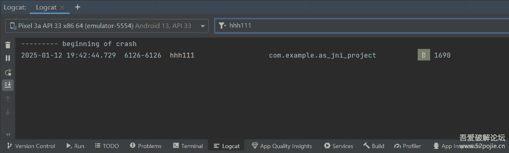

如上图所示我们运行成功了，那就代表我们写的代码没有问题，至此关于安卓的 JNI 开发就结束了。

## 三、通过使用 IDA Pro 修改 so 层函数

了解 JNI 开发的基础，这是为了更好的帮助我们进行 so 层的逆向，既然要逆向，那么就用刚才开发的 app 来做示例。为了方便讲解，我们逆向的目标就是去修改通过动态注册所注册的 so 层函数返回的值。

在做示例之前，先要对源代码进行一点小小的修改，因为我们写的 Java 层代码调用 so 层的本地方法时是通过打印日志来印证我们的代码是否运行成功的，但打包成 `apk` 后就不好通过 `log` 打印日志信息来印证是否修改成功，所以需要把原本的打印日志信息修改为更加直观的显示方式，所以我对以下代码进行了修改：

```
TextView tv = binding.sampleText;
String strNum = String.valueOf(intNum(666));
tv.setText(strNum);
```

没有什么比直接把内容打印在大屏上更加直观的方式了！修改好后直接把该项目打包成 `apk` 安装在模拟器上，这是我们修改前的模样：


### 定位目标 so 文件

可以看到中间有一个数字 1690，我们要去修改它要如何下手呢？假设我们不知道源代码的情况下，像这种我们可以通过 MT 管理器来获取到当前的 `activity`，当然也可以尝试去搜索其他特征，比如通过 `Toast.makeText` 方法显示的消息提示框等特征。我们先来看看通过 MT 管理获取到当前的 `activity` 来定位的结果如何：

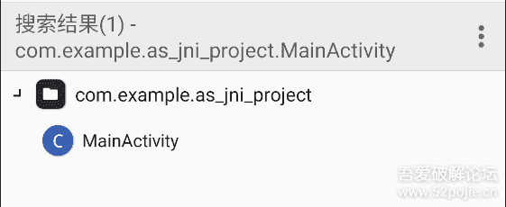

然后我们就可以看到我们要找的文本在哪个 so 文件里了，直接找到该类中的静态代码块：

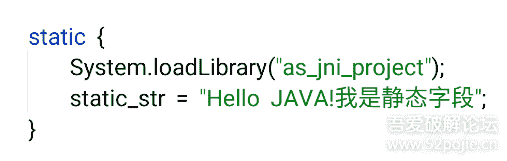

这样我们就可以得知是哪个 so 文件，但是因为 Linux 系统的规则，Linux 的动态链接库通常在编译之后会在前面加上 lib，所以我们应该去找的 so 文件是 `libas_jni_project.so`。既然知道了要找哪个 so 文件，那下一步便是把该 so 文件取出来丢到 IDA Pro 里去玩，前面在开发的时候我们知道了有静态注册和动态注册两种方式，静态注册就比较简单，因为如果方法是静态注册，那就可以直接搜索 `java_` 来定位静态注册的方法。

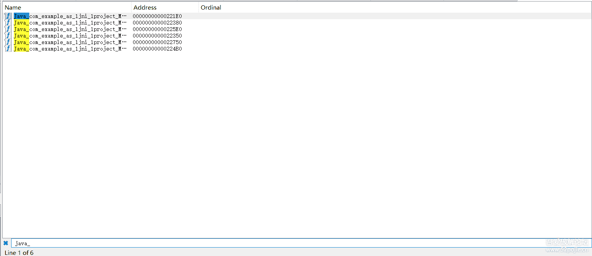

### 搜索 JNI_OnLoad

而如果我们要定位到动态注册的方法，那就需要尝试搜索 `JNI_OnLoad` 方法。这里提一嘴，`.so` 文件在执行 `JNI_OnLoad` 方法之前，还会执行两个构造函数，分别是 `init` 和 `init_array`。这两个构造函数会在 `JNI_OnLoad` 方法之前加载，在 `.so` 文件加载时大致的加载流程如下：

`.init -> .init_array -> JNI_Onload`

好了，先了解这个，之后脱壳才需要用到，现在继续往下走，我们直接搜索 `JNI_OnLoad`，可以看到直接就搜索到了：

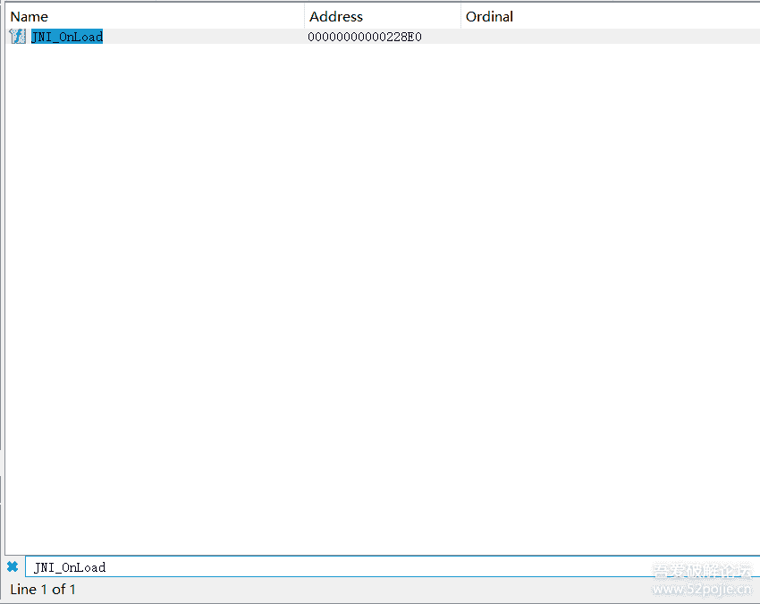

我们双击点进去看一看，就能看到汇编代码，这时可以通过 IDA Pro 自带的 `F5` 插件将它变为伪 C 代码：

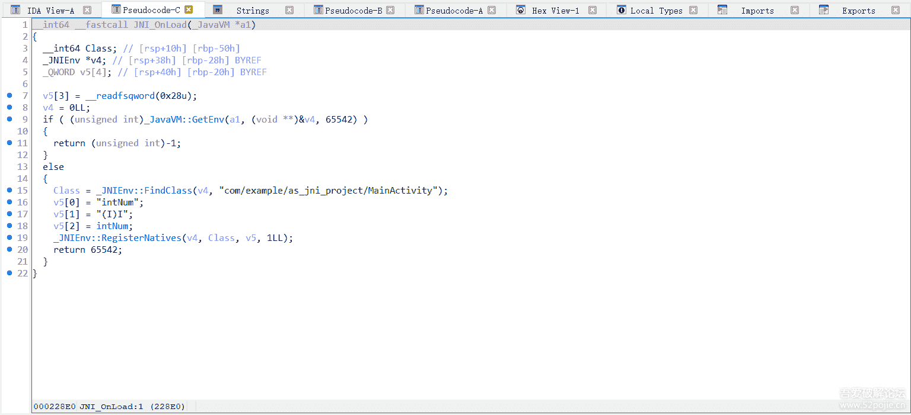

可以从图中看到 `JNI_OnLoad` 方法最重要的方法，`env` 里面的 `RegisterNatives` 方法，该方法用来进行注册函数。前面我们了解了动态注册，加上上面的伪 C 代码大概可以看出 `RegisterNatives` 方法的第一个参数是 `JNIEnv *env` 指针，第二个参数就是加载的 Java 类对象，第三个参数就是我们要寻找的 `JNINativeMethod` 数组，可以看到第三个参数是 `v5`，在调用 `RegisterNatives` 方法之前给 `v5` 这个数组赋了三个值，第一个值是 Java 层的方法名称，但是第一个和第二个值都不重要，重要的是第三个，第三个值是 so 层中对应的函数指针，我们可以直接双击 `intNum` 跳过去，这样我们便找到了对应的 `intNum` 函数：

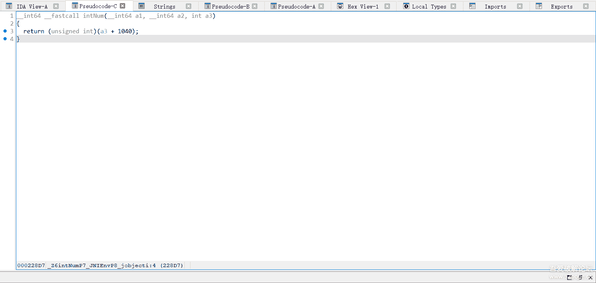

找到后我们可以右击鼠标，依次点击 `Synchronize with -> IDA View - A, Hex View - 1`，如此便可与 IDA 视图以及十六进制视图同步。返回到汇编代码：

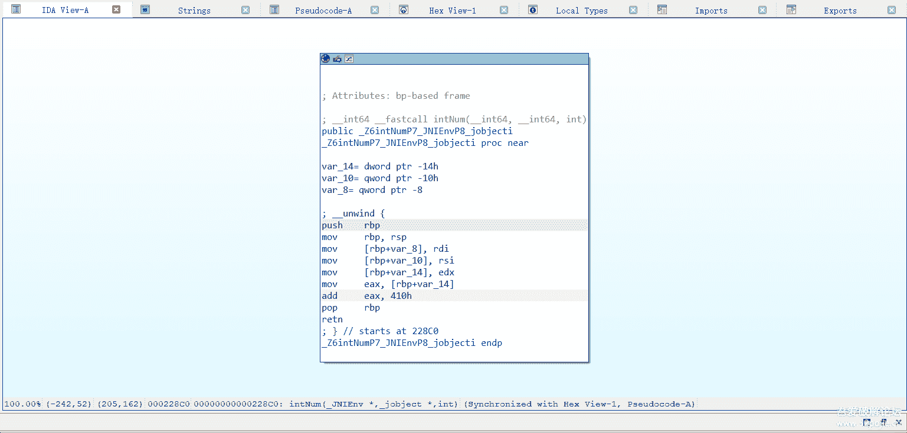

### 修改汇编代码

因为这个代码比较简单，所以我们可以很快很轻松的看到我们要修改的汇编代码为 `add eax, 410h`，接下来就出现了一个问题，我们要如何修改呢？有朋友可能会想说直接改，但很抱歉，没有办法直接改，要想修改只能通过修改十六进制或者下载插件来帮助我们修改汇编代码。

使用插件大家可以考虑以下两个插件：

- `patching`：[An Interactive Binary Patching Plugin for IDA Pro](https://github.com/gaasedelen/patching:gaasedelen/patching)
- `keypatch`：[keystone-engine/keypatch at e87f0f90e149aa0d16851c9d919dba214f239e7c](https://github.com/keystone-engine/keypatch/tree/e87f0f90e149aa0d16851c9d919dba214f239e7c)

接下来我将使用 `patching` 来进行修改汇编代码，首先我们点击要修改的代码行，然后右击就可以看到 `Assemble`，点击它就会弹出以下这个弹窗：

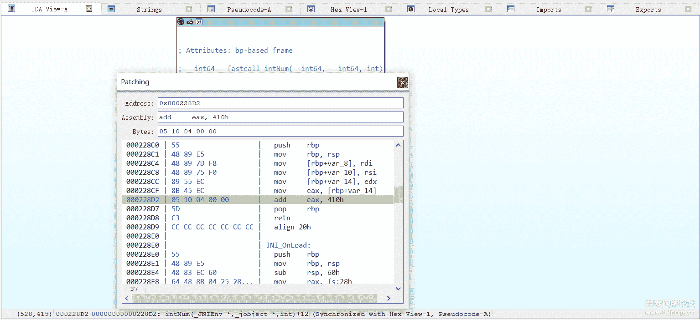

`Address` 是地址，`Bytes` 是十六进制字节，而我们要修改的内容就是 `Assembly` 当中的汇编代码。我将 `410h` 改为了 `520h`，回车后看看是否修改成功：

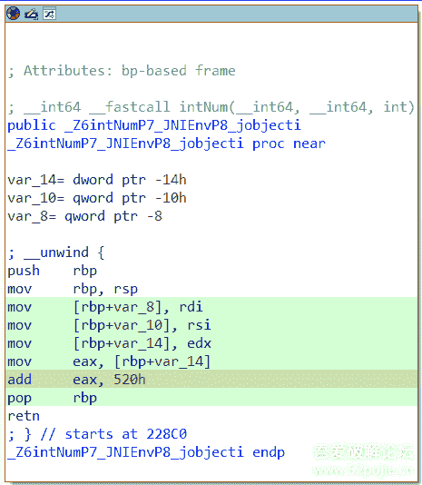

### 应用补丁并验证

修改成功后依次点击 `Edit -> Patch program -> Apply patches to...`，随后便会弹出弹窗：

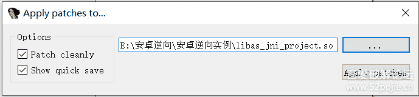

点击 `Apply patches` 便可应用补丁，这样我们便把 `patch` 的部分保存成了文件，接下来就是把修改成功后的 `.so` 文件替换掉原本的 `.so` 文件，然后用 MT 管理器等工具重新进行签名，现在再来看看修改后的结果如何：

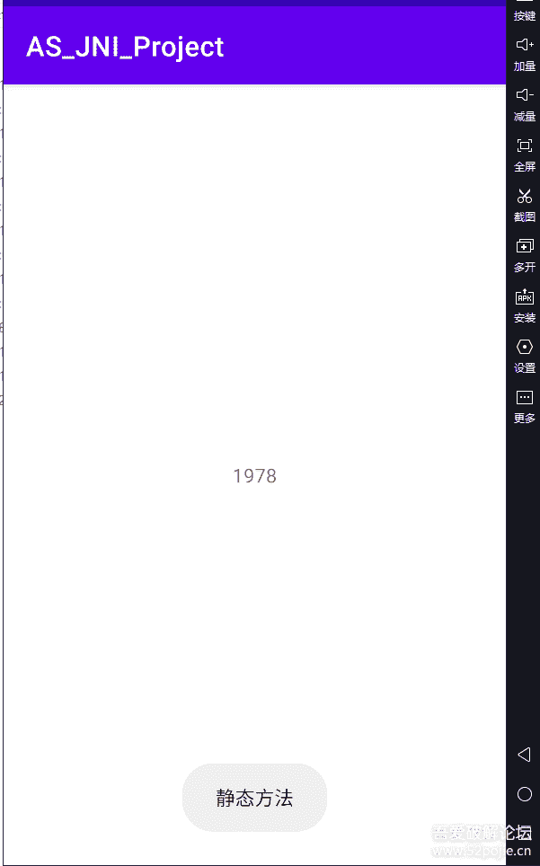

可以看到确实修改成功了，从原先的 1690 变为了现在的 1978，到此为止也简单了解了一下 so 层和 IDA，这一次主要是带大家简单了解，大家应当将理论与实践相结合，理论辅佐实践，实践印证理论是否正确，毕竟实践出真知。
