# [Android 分享] 记【某小剧场】永久会员过程

- 原帖: https://www.52pojie.cn/forum.php?mod=viewthread&tid=2003196
- 抓取时间: 2026-11-01T16:11:50.483Z

最近开始学习逆向，在移动区看到有位师傅发的一篇某小剧场的永久会员记录，自己也试着操作一遍，成功了，但是师傅的文章大都记录了操作，没有说明为什么要这么做；我看下面有些小伙伴不明白，所以有了这篇文章，仅作为技术分析。

新人第一次发文章，如有不对的地方，希望各位师傅多多见谅

。

测试软件在 https://www.52pojie.cn/thread-1827836-1-1.html，这位师傅已经放了链接

## 正式开始

### 第一步

使用np管理器提取安装包，然后定位到安装包的位置，点查看，随便点击一个`classes`文件，点击Dex编辑器Plus，选择全选

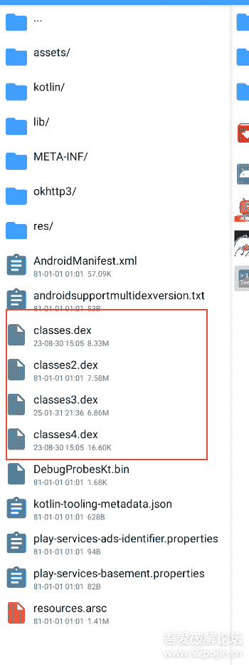

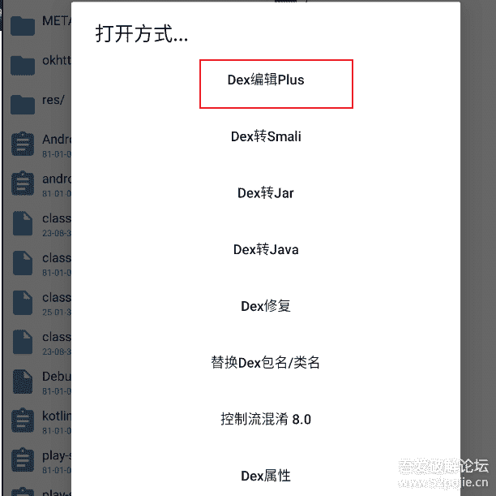

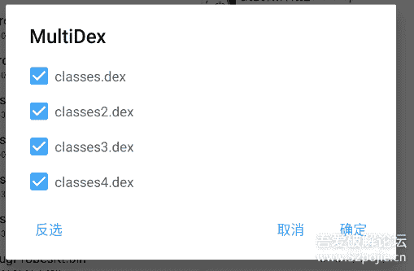

### 第二步

搜索`pay_sdk_whole_life_vip`关键字

为啥我们要费劲巴拉地搜索`pay_sdk_whole_life_vip`这么长一串字，而不是简单点的`pay_sdk_whole_vip`呢？

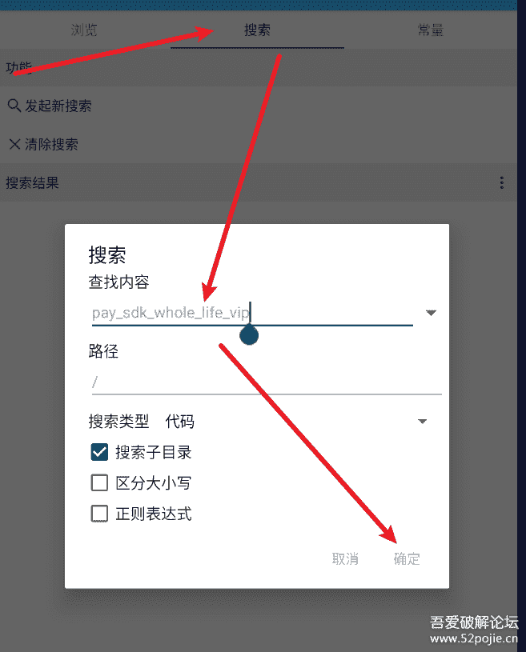

其实这里正常流程是搜索`vip`, 会员，高级会员等关键字

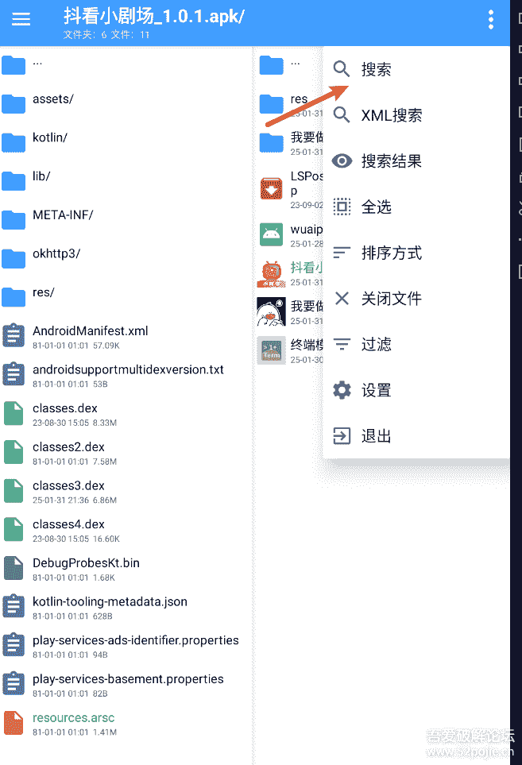

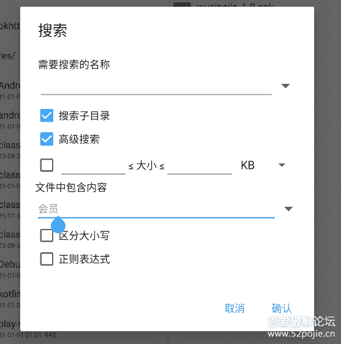

然后搜索结果有3个，然后打开第一个文件，选择ARSC编辑模式（我用的np，所以选择ARSC编辑需要登录）

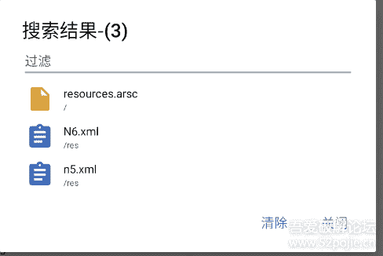

再搜索 会员

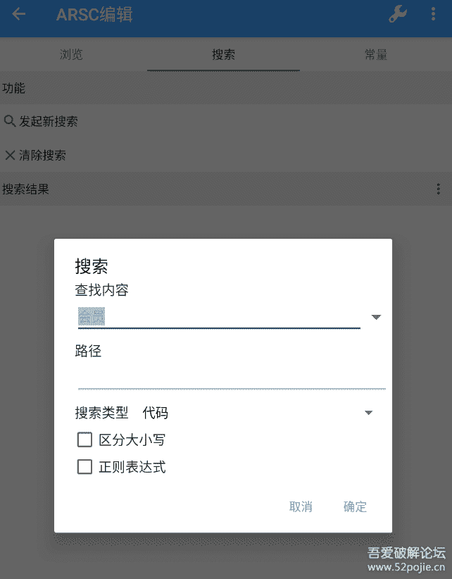

到这里，你就能明白，为什么要搜索`pay_sdk_whole_life_vip`这个关键字。

那位师傅没有把搜索步骤写出来，才会有小伙伴不明白为什么要搜索这个。

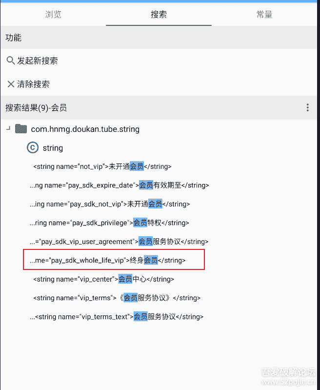

### 第三步

接着第二步，选择所有`class`文件，进入编辑模式，搜索这个`pay_sdk_whole_life_vip`关键字

然后点击第三个结果

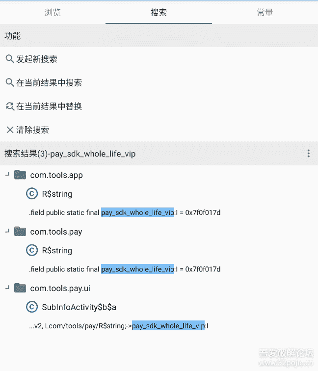

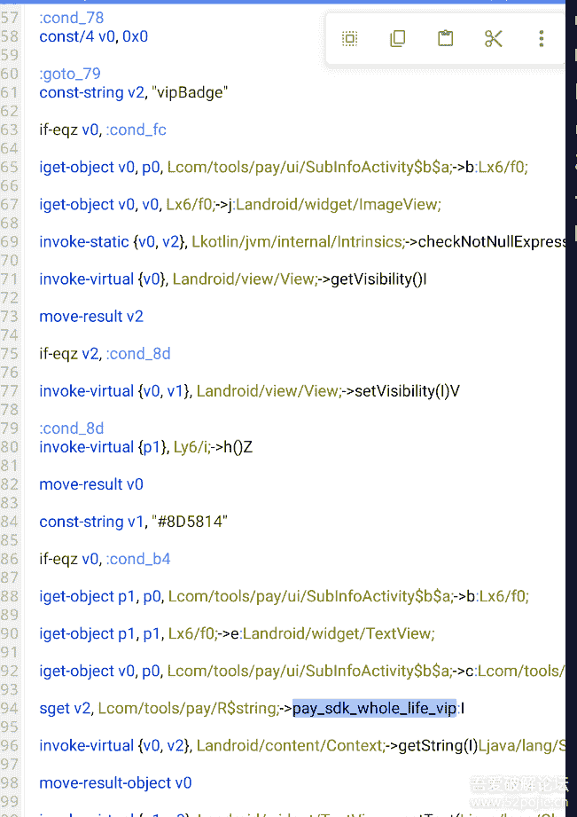

这里做修改有2处

分别进入框框里面的函数，把返回值置为`1`即可

这里np没法跳的，可以用mt

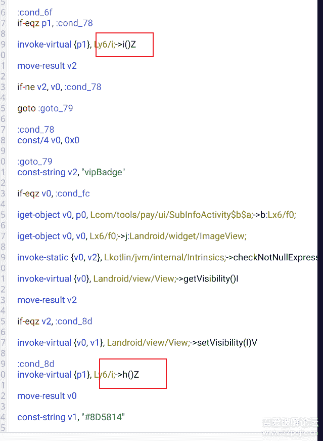

比如这个`h`，把框框的 `const/4 v1. 0x0` 改成 `const/4 v1, 0x1`

另外一个`i`一样的做法

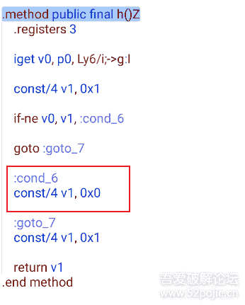

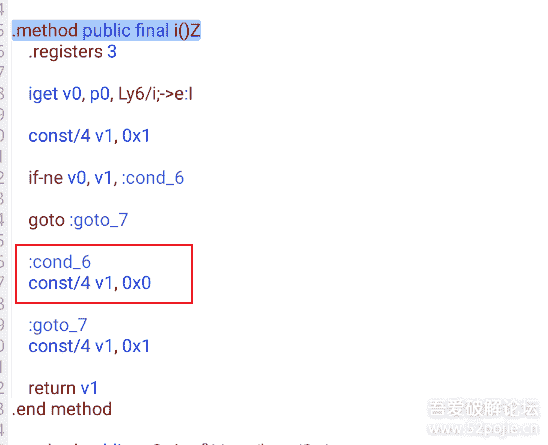

为什么改这2个函数，就永久了呢?

其实，你可以看看这2个函数都是在拿字段`g`和`e`和`1`判断是否相等，相等返回`true`，不相等返回`false`

而这2个字段就是`isVip`和`isForeverVip`的标识，分别表示是VIP和是永久VIP的意思，也就是说他们都要是`1`

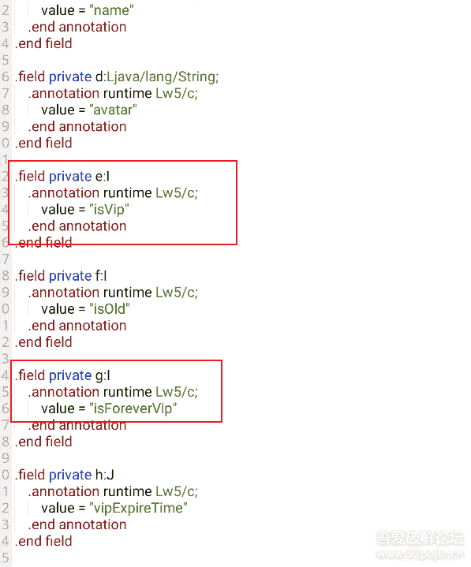

改完之后一路返回保存，把手机里的原软件删掉，把修改好的软件安装就行。

有不理解的地方，小伙伴都可以放在评论区，我都会一一解答

由于经验有限，文中可能会存在不足之处。因此，非常欢迎各位大佬提出宝贵的意见和建议。

