# [Android CTF] 2025吾愛解題領紅包活動(Android題解)

- 原帖: https://www.52pojie.cn/forum.php?mod=viewthread&tid=2005850
- 抓取时间: 2026-11-01T16:11:35.189Z

## 前言

簡單寫一下Android部份的解題思路。

## 第三題：Android初級題

明顯的xxtea特徵。

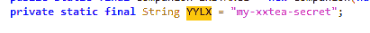

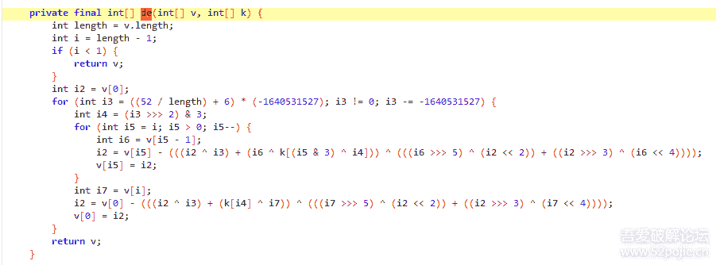

解密後直接得到`flag`

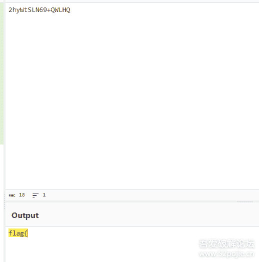

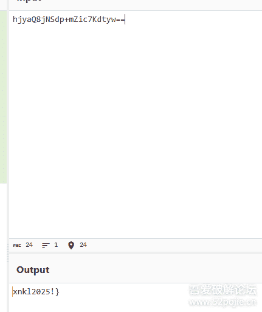

## 第四題：Android中級題

目標是找到秘鑰。


Java層關鍵邏輯如下，調用了`Check`函數來檢查密鑰。

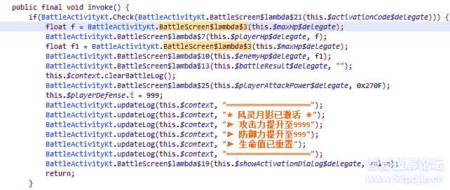

是個native函數。

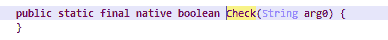

嘗試直接hook `RegisterNatives`，發現`Check`果然是動態注冊的，在0xe8c54。

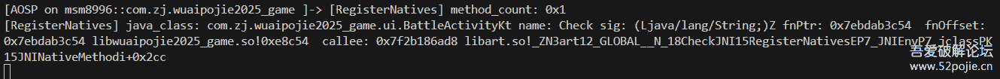

`Check`一開始是一些反調試邏輯。

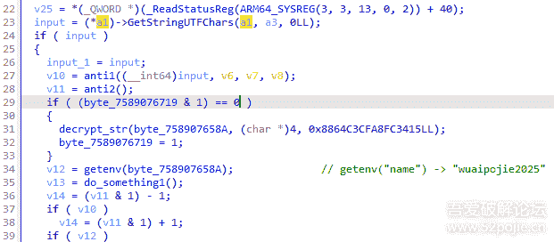

先看`anti1`，它調用`decrypt_str`解密字符串，但奇怪的是解密出來的字符串不是以`\x00`結尾，導致`opendir`直接失敗，使得後面的反調試邏輯形同虛設？( 不知是故意的還是不小心的 )

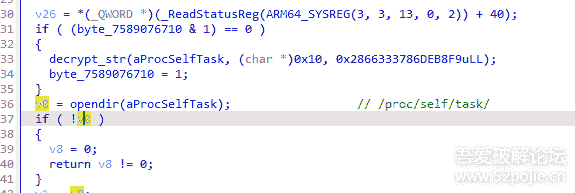

`anti2`、`do_something1`也同理，皆因為`decrypt_str`的問題導致後續的邏輯失效。

繼續向下跟，看到它動態計算出一個函數地址，大概率就是加密函數，最後與密文進行對比。

一開始以為動態計算的那個函數地址是固定的，後來才發現有兩個不同的地址，會隨著上面`anti1`、`anti2`、`do_something1`、`getenv`等函數返回的結果而改變。

類似蜜罐的概念，當觸發anti邏輯後，不主動殺死APP，而是改變程序的執行流，導向錯誤的分支。

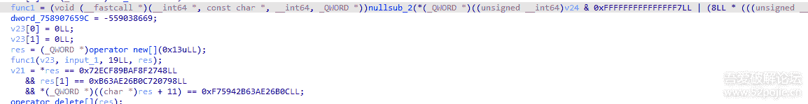

`func1`、`func2`如下，前者是錯誤的分支，後者是正確的，我的環境默認會走`func1`。

可以看到兩者的加密方式都是相同的異或加密，不同的只有異或的值。

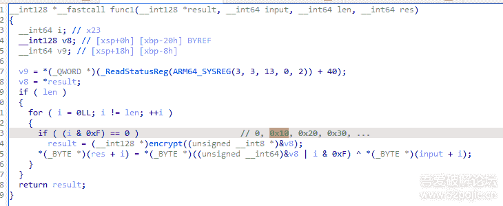

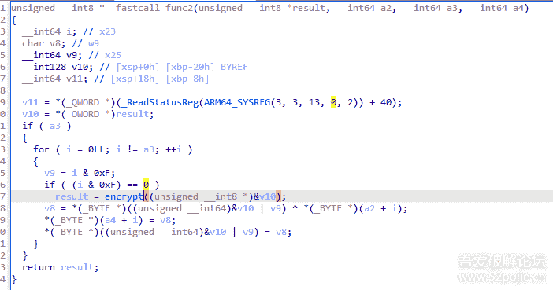

經測試發現，手動hook `getenv`、`do_something1`修改其參數、返回值後，程序才會走向`func2`。這時再hook `encrypt`，將正確的異或值dump下來。

```javascript
function hook_dlopen(soName) {
    Interceptor.attach(Module.findExportByName(null, "dlopen"),
        {
            onEnter: function (args) {
                var pathptr = args[0];
                if (pathptr !== undefined && pathptr != null) {
                    var path = ptr(pathptr).readCString();
                    if (path.indexOf(soName) >= 0) {
                        this.is_can_hook = true;
                    }
                }
            },
            onLeave: function (retval) {
                if (this.is_can_hook) {
                    console.log("hook start...");
                    hook_func(soName)
                }
            }
        }
    );

    Interceptor.attach(Module.findExportByName(null, "android_dlopen_ext"),
        {
            onEnter: function (args) {
                var pathptr = args[0];
                if (pathptr !== undefined && pathptr != null) {
                    var path = ptr(pathptr).readCString();
                    if (path.indexOf(soName) >= 0) {
                        this.is_can_hook = true;
                    }
                }
            },
            onLeave: function (retval) {
                if (this.is_can_hook) {
                    console.log("hook start...");
                    hook_func(soName)
                }
            }
        }
    );
}

function hook_func(soName) {
    function hook_xorkey(base) {
        Interceptor.attach(base.add(0xE9954), {
            onLeave: function(retval) {
                console.log("[xor_key] ", hexdump(retval))
            }
        })
    }

    function hook_test2(base) {
        Interceptor.attach(base.add(0xE98A0), {
            onEnter: function(args) {
                console.log("[call func2] ")
            }
        })

        // do_something1
        Interceptor.attach(base.add(0xE74E8), {
            onEnter: function(args) {
                console.log("[call dosomething1] ")
            },
            onLeave: function(retval) {
                console.log("[dosomething1] retval: ", retval)
                retval.replace(0);
                console.log("[dosomething1] retval: ", retval)
            }
        })

        Interceptor.attach(Module.findExportByName(null, "getenv"), {
            onEnter: function(args) {
                let a0 = args[0].readCString();
                if (a0.indexOf("name") != -1) {
                    Memory.writeUtf8String(args[0], "name");
                    this.flag = true
                    console.log("[getenv] a0: ", args[0].readCString())
                }
            },
            onLeave: function(retval) {
                if (this.flag) {
                    console.log("retval: ", retval.readCString())
                }
            }
        })
    }

    var base = Module.findBaseAddress(soName);

    hook_xorkey(base);
    hook_test2(base);
}

function main() {
    hook_dlopen("libwuaipojie2025_game.so")
}

setImmediate(main)
```

最終解密腳本：

```python
xor_key1 = [0x2E, 0x4B, 0xEE, 0xC8, 0xE0, 0x95, 0x88, 0x47, 0xB0, 0x72, 0x1B, 0x68, 0x40, 0xD0, 0x0A, 0x84]

# xor_key2 = [0x27, 0xAF, 0xF3, 0xA7, 0xA1, 0x64, 0x51, 0xC3, 0x67, 0x6D, 0x19, 0x04, 0xE9, 0x58, 0xE9, 0x6F]

xor_key2 = [0x77, 0x70, 0x8a]

xor_key_list = [xor_key1, xor_key2]

data1 = 0x72ECF89BAF8F2748

data2 = 0xB63AE26B0C720798

data3 = 0xF75942

enc = data1.to_bytes(8, 'little') + data2.to_bytes(8, 'little') + data3.to_bytes(3, 'little')

enc = bytearray(enc)

xor_keylist_idx = 0

xor_key_idx = 0

flag = ""

for i in range(len(enc)):

    if (i & 0xf) == 0:

        xor_key = xor_key_list[xor_keylist_idx]

        xor_keylist_idx += 1

        xor_key_idx = 0

    flag += chr(xor_key[xor_key_idx] ^ enc[i])

    xor_key_idx += 1

print("flag: ", flag)
```

輸出：`flag:  flag{md5(uid+2025)}`

## 第六題：Windows & Android高級題

### Java層分析

先看看題目描述，要幾個重點：

- `flag`格式為`flag{XXXXX-XXXXX-XXXXX-XXXXX}`，其中`X`要麼是大寫字母，要麼是數字。
- 不同UID對應不同的Flag，可能有多個解。
- SISC中的S意為堆棧。

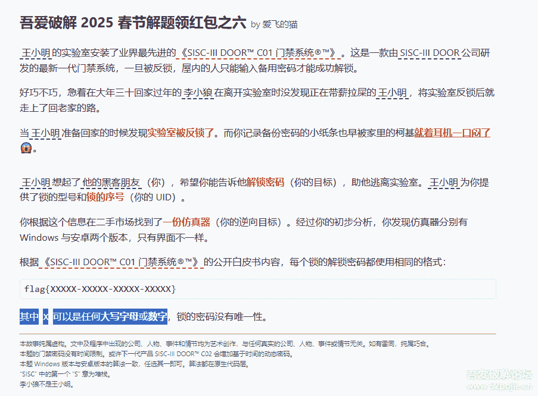

再看看APP，要求輸入`UID`和`Flag`。

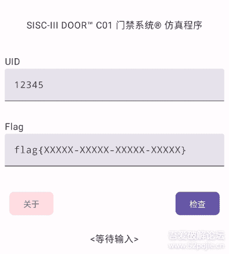

用新版`jeb`查看Java層邏輯( Java層有混淆，`jeb`能忽略部份混淆，方便分析 )，發現調用`check`函數來檢查，參考分別是`UID`和`Flag`。

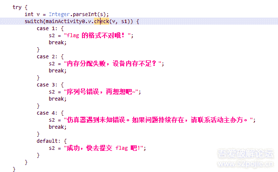

`check`是Native函數。

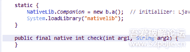

### vm初始化

native層的`check`是靜態注冊的，能直接搜到。

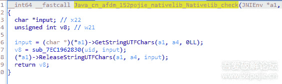

繼續深入分析( 配合動調來遂一分析每個函數的作用 )。

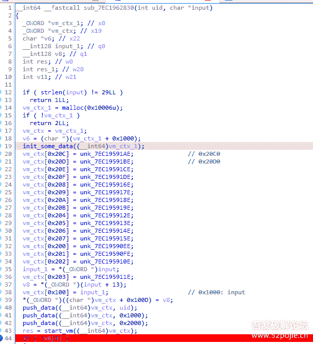

`init_some_data`函數如下，結合後面的分析可以知道，這裡是在初始化vm虛擬機的`opcodes`，存放在`a1[0xC000 ~ 0xC200]`。

將`a1`記為`vm_ctx`，意指vm虛擬機的上下文空間。

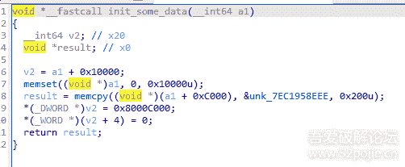

### start_vm

初始化完成後便會調用`start_vm`正式啟動虛擬機進行計算。

一开始会通过一些运算获取`_opcode`和`arg`，前者是操作碼、後者是一些固定的參數( 在不同的操作碼中都有不同的含義 )。

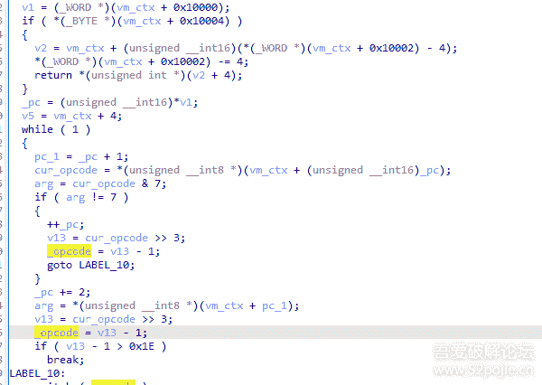

接著就是vm最經典的一大段switch，每個case對應不同的handler，實現了不同的功能。

每個handler裡基本上都會用到`vm_ctx[0x10002]`，一些參數、中間值、計算結果都會存放在`vm_ctx[0x10002]`指向的位置。

而且可以看到`vm_ctx[0x10002] + 4`、`vm_ctx[0x10002] - 4`等等的运算，再结合題目的描述，可以猜測`vm_ctx[0x10002]`相當於`sp`( 棧指針 )，該虛擬機的运算操作都会在它自己维护的栈中进行( 沒有寄存器的概念 )。

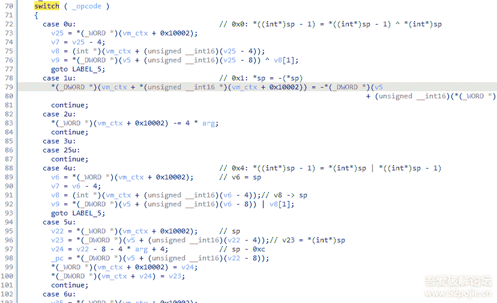

### vm handler分析與還原

大部份handler的實現都比較簡單，配合動調很容易就可以分析出來。

記錄幾個沒那麼容易看出來的handler。

`handler7`：`&v26[-arg]`相當於`&v26 - arg`，這裡是在將棧頂元素與棧頂後`arg`個元素交換。

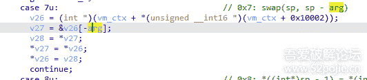

`handler22`：注意`_pc += (char)arg`，對應匯編是`ADD W11, W11, W12,SXTB`，其中`SXTB`是對`W12`的修飾符，表示將`W12`的最低8位進行符號擴展，在還原handler時要特別留意這一點。

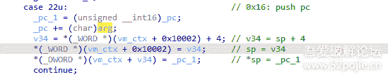

花億點時間，還原所有handler，實現一個簡單的vm解釋器：


```
def write_mem_str(addr, content):
    global vm_ctx
    if type(content) == str:
        for i in range(len(content)):
            vm_ctx[addr + i] = ord(content[i])
    else:
        raise Exception("TODO")
    return addr

def write_mem_word(addr, content):
    global vm_ctx
    for i in range(2):
        vm_ctx[addr + i] = content & 0xFF
        content >>= 8

def write_mem_arr(addr, arr):
    global vm_ctx
    for i in range(len(arr)):
        vm_ctx[addr + i] = arr[i]

def write_mem_dword(addr, content):
    global vm_ctx
    for i in range(4):
        vm_ctx[addr + i] = content & 0xFF
        content >>= 8

def read_mem_dword(addr):
    global vm_ctx
    return vm_ctx[addr] | (vm_ctx[addr + 1]  swap({hex(n1), hex(n2)})")

    def handler_8_and():
        n1 = pop_data()     # *sp
        n2 = read_sp_data() # *(sp - 1)
        res = n1 & n2
        set_sp_data(res)
        print(f"[h8_and]\t pop, *sp = {hex(n2)} & {hex(n1)} = {hex(res)}")

    def handler_9_lsl():
        sp_data = read_sp_data()
        set_sp_data(sp_data > arg)
        print(f"[h17_lsr]\t *sp = *sp >> arg = {hex(sp_data)} >> {arg} = {hex(sp_data >> arg)}")

    def handler_18_mod():
        n1 = pop_data()     # *sp
        n2 = read_sp_data() # *(sp - 1)
        res = n2 % n1
        set_sp_data(res)
        print(f"[h18_mod]\t pop, *sp = {hex(n2)} % {hex(n1)} = {hex(res)}")

    def handler_20_dword2byte():
        sp = read_mem_word(0x10002)
        sp_data = read_mem_byte(sp)
        set_sp_data(sp_data)
        print(f"[h20_dword2byte]\t *(dword*)sp = *(byte*)sp = {hex(sp_data)}")

    def handler_21_mul():
        n1 = pop_data()     # *sp
        n2 = read_sp_data() # *(sp - 1)
        res = n1 * n2
        set_sp_data(res)
        print(f"[h21_mul]\t pop, *sp = {hex(n2)} * {hex(n1)} = {hex(res)}")

    def handler_22_pushpc(): # nglog
        global pc
        sp = read_mem_word(0x10002)
        pc_ = pc
        pc += hex_to_negative(arg)
        v34 = sp + 4
        write_mem_word(0x10002, v34)
        write_mem_dword(v34, pc_)
        print(f"[h22_pushpc]\t push(pc) -> push({hex(pc_)}), pc += {hex_to_negative(arg)}")

    def handler_23_eq(): # nglog
        global pc
        sp = read_mem_word(0x10002)
        v16 = sp - 4
        v15 = sp - 8
        n1 = read_mem_dword(sp)
        n2 = read_mem_dword(sp - 4)
        write_mem_word(0x10002, v15)
        if (v13 == 25) == (n1 == n2):
            print(f"[h23_eq]\t sp = sp - 8")
            return

        if arg & 0xFFFFFF00 != 0:
            raise Exception("TODO")

        pc += hex_to_negative(arg)
        print(f"[h23_eq]\t sp = sp - 8, pc += {hex_to_negative(arg)} ({hex(arg)})")

    def handler_26_getinput():
        n1 = pop_data()     # *sp
        n2 = read_sp_data() # *(sp - 1)
        res = read_mem_byte(n1 + n2)
        set_sp_data(res)
        print(f"[h26_getinput]\t pop, *sp = vm_ctx[{hex(n2)} + {hex(n1)}] = {hex(res)}")

    def handler_27_pusharg():
        global arg
        sp = read_mem_word(0x10002)
        orig_arg = arg
        arg = read_mem_dword(sp - 4 * arg)
        push_data(arg)
        print(f"[h27_pusharg]\t push({hex(arg)})  arg == [sp - 4 * {orig_arg}]")

    def handler_29_pusharg2(): # nglog
        push_data(arg)
        print(f"[h29_pusharg2]\t push({hex(arg)})")

    def handler_30_sub1():
        sp_data = read_sp_data()
        set_sp_data(sp_data - 1)
        print(f"[h30_sub1]\t *sp = *sp - 1 = {hex(sp_data)} - 1 = {hex(sp_data - 1)}")

    pc = read_mem_word(0x10000)

    while True:
        pc_1 = pc + 1
        cur_opcode = read_mem_byte(pc)
        arg = cur_opcode & 7
        if arg != 7:
            pc += 1
            v13 = cur_opcode >> 3
            _opcode = v13 - 1
        else:
            pc += 2
            arg = read_mem_byte(pc_1)
            v13 = cur_opcode >> 3
            _opcode = v13 - 1
            if v13 - 1 > 0x1E:
                raise Exception("TODO")
                break
        if _opcode == 0:
            handler_0_xor()
        elif _opcode == 1:
            handler_1_opposite()
        elif _opcode == 2:
            handler_2_subsp()
        elif _opcode == 3 or _opcode == 25:
            continue
        elif _opcode == 4:
            handler_4_orr()
        elif _opcode == 5:
            handler_5_()
        elif _opcode == 6:
            handler_6_noeq()
        elif _opcode == 7:
            handler_7_swap()
        elif _opcode == 8:
            handler_8_and()
        elif _opcode == 9:
            handler_9_lsl()
        elif _opcode == 10:
            handler_10_not()
        elif _opcode == 12:
            handler_12_add()
        elif _opcode == 14:
            handler_14_()
        elif _opcode == 15:
            handler_15_()
            break
        elif _opcode == 17:
            handler_17_lsr()
        elif _opcode == 18:
            handler_18_mod()
        elif _opcode == 20:
            handler_20_dword2byte()
        elif _opcode == 21:
            handler_21_mul()
        elif _opcode == 22:
            handler_22_pushpc()
        elif _opcode == 23 or _opcode == 24:
            handler_23_eq()
        elif _opcode == 26:
            handler_26_getinput()
        elif _opcode == 27:
            handler_27_pusharg()
        elif _opcode == 29:
            handler_29_pusharg2()
        elif _opcode == 30:
            handler_30_sub1()
        else:
            print("else _opcode: ", _opcode)
            raise Exception("TODO")
            break

    write_mem_word(0x10000, pc)
    res = read_sp_data()
    return res

# init vm_ctx
vm_ctx = [0] * 0x10006

load_opcodes()

write_mem_dword(0x10000, 0x8000C000)
write_mem_word(0x10004, 0)

write_mem_arr(0x204 * 0x10, [0x00, 0x03, 0x0F, 0x20, 0x0D, 0x02, 0x23, 0x06, 0x1B, 0x14,0x0E, 0x01, 0x16, 0x19, 0x08, 0x12])
write_mem_arr(0x205 * 0x10, [0x1F, 0x17, 0x24, 0x0B, 0x1E, 0x07, 0x1A, 0x05, 0x18, 0x1D, 0x22, 0x00, 0x00, 0x00, 0x00, 0x00])
write_mem_arr(0x203 * 0x10, [0x09, 0x0A, 0x10, 0x15, 0x21, 0x13, 0x0C, 0x04, 0x11, 0x1C, 0x00, 0x00, 0x00, 0x00, 0x00, 0x00])

write_mem_str(0x1000, "flag{44444-44444-44444-44444}") # input flag

push_data(1898208) # uid
push_data(0x1000)
push_data(0x2000)

res = start_vm()
print("[res]: ", hex(res))
```

提醒：`flag`格式為`flag{XXXXX-XXXXX-XXXXX-XXXXX}`，其中`X`要麼是大寫字母，要麼是數字。

腳本中的測試`flag`要記得符合這個格式，腳本的輸出日志記為`vm.log`。

## 4. 加密邏輯分析

### 前置

在動調的過程中發現`handler26`會獲取輸入的`Flag`，加密邏輯大概會在那附近。

在`vm.log`中搜`h26_getinput`定位到相關位置，首先判斷了`input`是否`flag{ }`的格式。

```
[h26_getinput]         pop, *sp = vm_ctx[0x1000 + 0x0] = 0x66  # 'f'

[h0_xor]         pop, *sp = 0x66 ^ 0x66 = 0x0

[h4_orr]         pop, *sp = 0x0 | 0x0 = 0x0

[h29_pusharg2]         push(0x6c)

[h27_pusharg]         push(0x1000)  arg == [sp - 4 * 3]

[h29_pusharg2]         push(0x1)

[h26_getinput]         pop, *sp = vm_ctx[0x1000 + 0x1] = 0x6c  # 'l'

[h0_xor]         pop, *sp = 0x6c ^ 0x6c = 0x0

[h4_orr]         pop, *sp = 0x0 | 0x0 = 0x0

[h29_pusharg2]         push(0x61)

[h27_pusharg]         push(0x1000)  arg == [sp - 4 * 3]

[h29_pusharg2]         push(0x2)

[h26_getinput]         pop, *sp = vm_ctx[0x1000 + 0x2] = 0x61  # 'a'

[h0_xor]         pop, *sp = 0x61 ^ 0x61 = 0x0

[h4_orr]         pop, *sp = 0x0 | 0x0 = 0x0

[h29_pusharg2]         push(0x67)

[h27_pusharg]         push(0x1000)  arg == [sp - 4 * 3]

[h29_pusharg2]         push(0x3)

[h26_getinput]         pop, *sp = vm_ctx[0x1000 + 0x3] = 0x67   # 'g'

[h0_xor]         pop, *sp = 0x67 ^ 0x67 = 0x0

[h4_orr]         pop, *sp = 0x0 | 0x0 = 0x0

[h29_pusharg2]         push(0x7b)

[h27_pusharg]         push(0x1000)  arg == [sp - 4 * 3]

[h29_pusharg2]         push(0x4)

[h26_getinput]         pop, *sp = vm_ctx[0x1000 + 0x4] = 0x7b   # '{'

[h0_xor]         pop, *sp = 0x7b ^ 0x7b = 0x0

[h4_orr]         pop, *sp = 0x0 | 0x0 = 0x0

[h29_pusharg2]         push(0x7d)

[h27_pusharg]         push(0x1000)  arg == [sp - 4 * 3]

[h29_pusharg2]         push(0x1c)

[h26_getinput]         pop, *sp = vm_ctx[0x1000 + 0x1c] = 0x7d  # '}'
```


# 虛擬機指令分析

```
[h0_xor]         pop, *sp = 0x7d ^ 0x7d = 0x0
```

從`input[5]`開始才是真正的內容，對`input[5~8]`的运算可以總結為：查表、自減、乘`0x24`。

```
# 處理input[5]
[h26_getinput]         pop, *sp = vm_ctx[0x1005 + 0x0] = 0x34     
[h26_getinput]         pop, *sp = vm_ctx[0x2000 + 0x34] = 0x21  # table[input[5]] == 0x21
[h27_pusharg]         push(0x21)  arg == [sp - 4 * 0]
[h29_pusharg2]         push(0x0)
[h23_eq]         sp = sp - 8
[h12_add]         pop, *sp = 0x0 + 0x21 = 0x21                   # tmp = 0 + table[input[5]]
[h30_sub1]         *sp = *sp - 1 = 0x21 - 1 = 0x20              # tmp -= 1
[h7_swap]         swap(sp, sp - 1) -> swap(('0x20', '0x0'))
[h29_pusharg2]         push(0x1)
[h12_add]         pop, *sp = 0x0 + 0x1 = 0x1
[h14_]         pc += -24
[h27_pusharg]         push(0x1)  arg == [sp - 4 * 0]
[h27_pusharg]         push(0x5)  arg == [sp - 4 * 6]
[h23_eq]         sp = sp - 8
[h7_swap]         swap(sp, sp - 1) -> swap(('0x1', '0x20'))
[h29_pusharg2]         push(0x24)
[h21_mul]         pop, *sp = 0x20 * 0x24 = 0x480                # tmp *= 0x24

# 處理input[6]
[h26_getinput]         pop, *sp = vm_ctx[0x1005 + 0x1] = 0x34
[h26_getinput]         pop, *sp = vm_ctx[0x2000 + 0x34] = 0x21
[h27_pusharg]         push(0x21)  arg == [sp - 4 * 0]
[h29_pusharg2]         push(0x0)
[h23_eq]         sp = sp - 8
[h12_add]         pop, *sp = 0x480 + 0x21 = 0x4a1                # tmp += table[input[6]]
[h30_sub1]         *sp = *sp - 1 = 0x4a1 - 1 = 0x4a0            # tmp -= 1
# same...
```

對`input[9]`有特別的處理，查表、自減操作仍舊保留，不同的是後面會判斷`tmp >> 25`是否不為0，若是則進行自加、取餘操作。

取餘操作中的模數，會根據輸入的UID不同而變化，即固定UID對應固定的模數。

（注：以`-`分隔的每組字串的最個一個元素都是這樣處理的）

## 以下日志不是連續的，為了好看將其放在一起

```
[h26_getinput]         pop, *sp = vm_ctx[0x1005 + 0x4] = 0x34

[h26_getinput]         pop, *sp = vm_ctx[0x2000 + 0x34] = 0x21 # 查表

[h12_add]         pop, *sp = 0x34b8e80 + 0x21 = 0x34b8ea1

[h30_sub1]         *sp = *sp - 1 = 0x34b8ea1 - 1 = 0x34b8ea0   # 自減

[h17_lsr]         *sp = *sp >> arg = 0x34b8ea0 >> 25 = 0x1      # 判斷tmp >> 25是否不為0

[h12_add]         pop, *sp = 0x34b8ea0 + 0x1 = 0x34b8ea1        # 自加

[h18_mod]         pop, *sp = 0x34b8ea1 % 0xb05f17 = 0x8a1245    # 取餘
```

以`-`作為分隔符，每組處理完後會以`|`來融合。

```
[h4_orr]         pop, *sp = 0x1fc3d5 | 0x8a1245 = 0x9fd3d5
```

最後會自減、異或`0xc15303fb`，這個值是固定的。

```
[h30_sub1]         *sp = *sp - 1 = 0x19fffff - 1 = 0x19ffffe

# ...

[h0_xor]         pop, *sp = 0x19ffffe ^ 0xc15303fb = 0xc0ccfc05

[h5_]         sp = 0x8014, [0x8014] = 0xc0ccfc05, pc = 0xc088

[h15_]         write_mem_word(0x10004, 257)

[res]:  0xc0ccfc05
```

綜合上述分析，可以大概用Python還原出加密邏輯：

```
tables = [0x09, 0x0A, 0x10, 0x15, 0x21, 0x13, 0x0C, 0x04, 0x11, 0x1C, 0x00, 0x00, 0x00, 0x00, 0x00, 0x00, 0x00, 0x03, 0x0F, 0x20, 0x0D, 0x02, 0x23, 0x06, 0x1B, 0x14,0x0E, 0x01, 0x16, 0x19, 0x08, 0x12, 0x1F, 0x17, 0x24, 0x0B, 0x1E, 0x07, 0x1A, 0x05, 0x18, 0x1D, 0x22, 0x00, 0x00, 0x00, 0x00, 0x00]
mod_arr = [0xa91f91, 0xb66962, 0xf19ad9, 0xef305d]  # 我的UID對應的模數

def encrypt(input):

    length = len(input)
    res = 0
    tmp = 0
    i = 0
    mi = 0
    while True:
        if i >= length:
            res |= tmp
            print("tmp res: ", hex(res))
            break

        if input[i] == '-':
            res |= tmp
            print("tmp res: ", hex(res))
            tmp = 0
            i += 1
            continue
        table_idx = ord(input[i]) - 0x30
        if table_idx = 0x30:
            sep = input.find("-", i)
            if sep == -1:
                break
            i = sep
            tmp |= 1
            continue

        tmp += tables[table_idx]
        tmp -= 1
        if i + 1 > 25) != 0:
                tmp += 1
                tmp %= mod_arr[mi]
                mi += 1
        print("tmp: ", hex(tmp))
        i += 1

    res -= 1
    res ^= 0xc15303fb
    print(res)
    print("res: ", hex(res))

encrypt("44444-RRRRR-RRRRR-RRRRR")
```

## 4> 最終解密

基於上述加密腳本，似乎無法直接反推出對應的解密邏輯，而且題目描述中提到有多個解也認證了這一點。

密文是`0x3EACFC04`，`(0x3EACFC04 ^ 0xc15303fb) == 0xFFFFFFFF`，而`-1`的16進制正是該值，因此只要在最終的自減前，`res`的值為`0`，即可滿足等式。

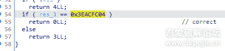

上面提到，以`-`分隔的每個字串的最個一個元素都會進行取餘的操作（前提是`>>25`不為0），這一步就可以很方便讓`tmp`歸0。

以`-`分隔的每組數據計算過程如下，現在的目標是讓`tmp`等於`0`，因此`d + input_[4]`必須是`target`的整數倍。

此時問題轉化為如何讓`d + input_[4] == n * target`，其中`n`、`target`都是已知的。

（注：`input_[i]`指`input[i]`查表後的結果、`target`是每組的模數）

```
a = (input_[0] - 1) * 0x24

b = (a + input_[1] - 1) * 0x24

c = (b + input_[2] - 1) * 0x24

d = (c + input_[3] - 1) * 0x24

tmp = (d + input_[4]) % target
```

以下腳本用來求`input_[0 ~ 4]`這幾個未知量（初始為`0`），原理如下：

- 先爆破`input_[0]`，若`input_[0]`為`i`會使`func()`函數返回值`>0`且`input_[0]`為`i+1`會使`func()`函數返回值，則代表`i`就是`input_[0]`的最大值，也是`input_[0]`其中一個可能的值。
- 確定了`input_[0]`後，用同樣方法確定`input_[1 ~ 4]`。
- 最終可以確定`input_[0 ~ 4]`，由此反查`tables`來確定`input[0 ~ 4]`字符串。

注：當`input_[j]`被確定為`0`時，是不合理的，要將`input_[j - 1] -= 1`，然後再重新計算`input_[j]`的最大值。

```
# tables的範圍為 (0x0, 0x24]
tables = [0x09, 0x0A, 0x10, 0x15, 0x21, 0x13, 0x0C, 0x04, 0x11, 0x1C, 0x00, 0x00, 0x00, 0x00, 0x00, 0x00, 0x00, 0x03, 0x0F, 0x20, 0x0D, 0x02, 0x23, 0x06, 0x1B, 0x14,0x0E, 0x01, 0x16, 0x19, 0x08, 0x12, 0x1F, 0x17, 0x24, 0x0B, 0x1E, 0x07, 0x1A, 0x05, 0x18, 0x1D, 0x22, 0x00, 0x00, 0x00, 0x00, 0x00]

def func(target, input_):
    a = (input_[0] - 1) * 0x24
    b = (a + input_[1] - 1) * 0x24
    c = (b + input_[2] - 1) * 0x24
    d = (c + input_[3] - 1) * 0x24
    res = target - d
    return res

def func2(target):
    input_ = [0] * 4
    res = []
    for j in range(4):
        for i in range(0x25):
            input_[j] = i
            a = func(target, input_)
            input_[j] = i + 1
            b = func(target, input_)
            if a > 0 and b 
```

得到一個可行的Flag為`HB0P6-Y84V7-YSWDH-9RZPB`：

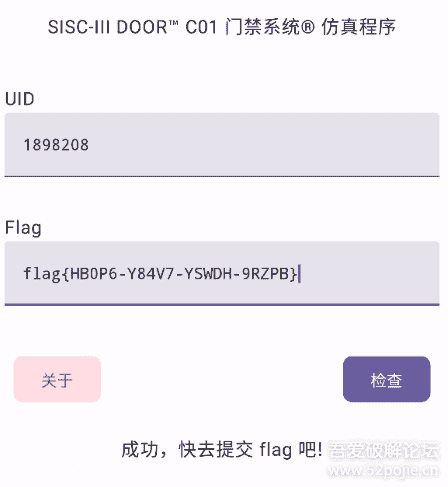

# 3> 第八題：Android高級題

直接hook `RegisterNatives`，看到flag驗證邏輯在`lib52pojie.so!0x134d4`。

```
[RegisterNatives] java_class: com.wuaipojie.crackme2025.MainActivity name: checkSn sig: (Ljava/lang/String;)Z 

                                                                        fnPtr: 0x7ebed554d4  fnOffset: 0x7ebed554d4 lib52pojie.so!0x134d4  callee: 0x7ebed553d8 lib52pojie.so!0x133d8
```

看到一堆`~`、`^`、`|`操作，但其實它們並非加密邏輯，而是類似ollvm裡的「指令替換」混淆，也叫MBA表達式。

簡單來說就是將一段很簡單的指令（如`a + b`），通過疊加`~`、`^`、`|`等操作符轉換成完全等價的複雜指令。

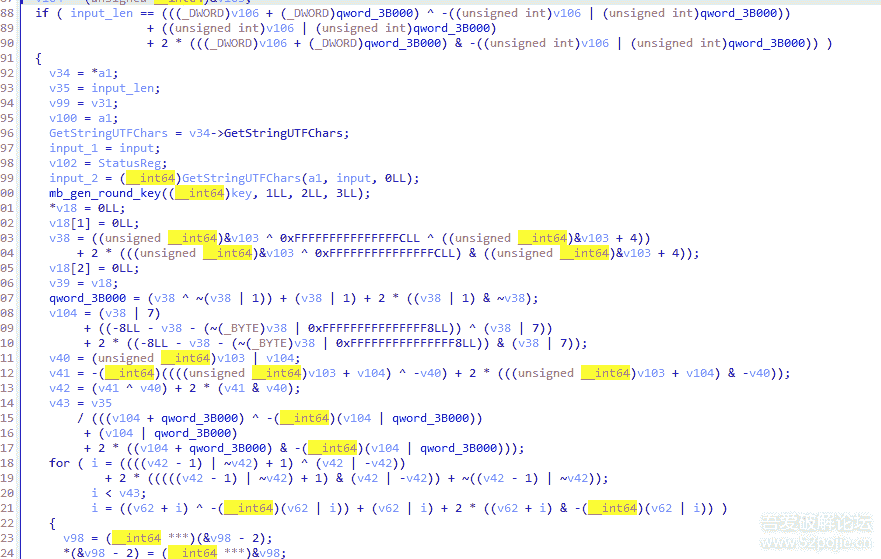

由於沒有解混淆的思路，因此只能直接動調慢慢看邏輯。

調用`get_input_8()`取了`input`的一部份，然後傳入`encrypt()`。

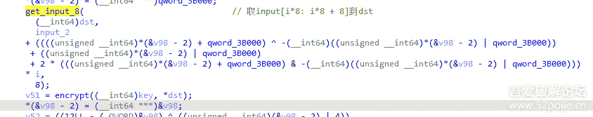

`encrypt()`中主要分成3部份，先看`encrypt_part1()`。

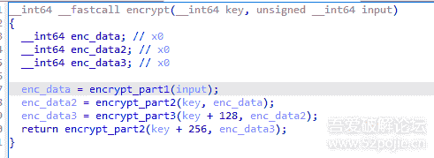

## 4> `encrypt_part1`

`input.n128_u64[0]`是低64位，代表傳入的`flag`，`input.n128_u64[1]`是高64位，用來存放結果。

只看與`input`有關的，hook發現`input.n128_u64[0]`每輪固定左移`-1`，即右移`1`。

由此得出`input.n128_u64[0]`的迭代方式：`input = (input >> 1) & (2 ** 64 - 1)`

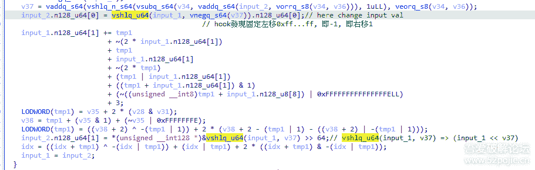

`input.n128_u64[1]`只與`tmp1`有關。

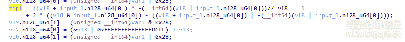

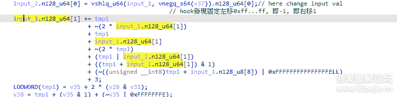

frida stalker打印`tmp1`、`input_1.n128_u64[1]+=`的那個值，發現要將`tmp1`看成2進制位，每輪都會拼到`input_1.n128_u64[1]`的低位。

即`input1 = (input1`，而`tmp1`其實就是取`input.n128_u64[0]`的最低位。

```
[2] x26: 0x1  x27: 0x3332317b67616c66
[3] x8(tmp1): 0x0
[5] x8: 0x0    // 0
0 0 0 0 0 0 0 0
33 b6 b0 b3 bd 18 99 19

[2] x26: 0x1  x27: 0x199918bdb3b0b633
[3] x8(tmp1): 0x1
[5] x8: 0x1    // 01
0 0 0 0 0 0 0 0
19 5b d8 d9 5e 8c cc c

[2] x26: 0x1  x27: 0xccc8c5ed9d85b19
[3] x8(tmp1): 0x1
[5] x8: 0x3    // 011
1 0 0 0 0 0 0 0
8c 2d ec 6c 2f 46 66 6

[2] x26: 0x1  x27: 0x666462f6cec2d8c
[3] x8(tmp1): 0x0
[5] x8: 0x6     // 0110
3 0 0 0 0 0 0 0
c6 16 76 b6 17 23 33 3
```

最終`encrypt_part1()`可以簡化為：

```
def encrypt_part1(input):

    input1 = 0

    v18 = 1

    for i in range(0x40):

        # tmp1 = ((v18 + input) ^ -(v18 | input)) + 2 * ((v18 & input) - ((v18 + input) | -(v18 | input)))
        tmp1 = input & v18

        input = (input >> 1) & (2 ** 64 - 1)

        input1 = (input1 
```

## 4> `encrypt_part2`

`encrypt_part2()`的邏輯比`encrypt_part1()`複雜得多，繼續像上面那樣分析實在不太理智（有心無力），本來都打算放棄了，結果當天晚上吾愛放出了提示：


# 2025.02.10 16:45 【春节】解题领红包之八 {Android 高级题}

对称算法，需要识别出算法类型，找出初始化后的密钥后反推即可，对应获取奖励也减半。

對稱算法，結合分析過程中看到的一些表，嘗試直接搜看看表中的數據。

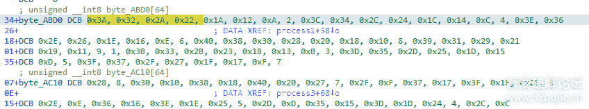

發現其實是 DES 算法。

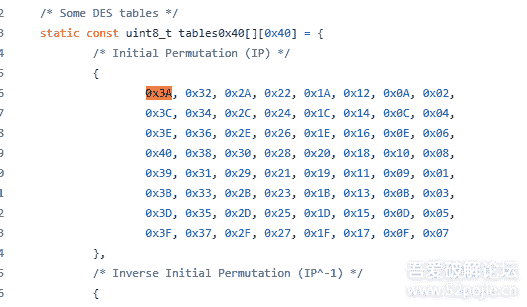

而且根據提示，密鑰是初始化過的。

`hook encrypt`，打印 `args[0]`，發現每個 `QWORD` 剛好都是 6 字節大小的數據，而 DES 算法的 round key 也是 48 位，因此這大概率就是提示所述的初始化過的密鑰。

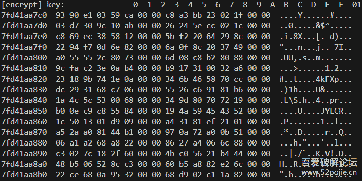

## 4. 算法分析

DES 算法：[//blog.csdn.net/nicai_hualuo/article/details/123135670](https://blog.csdn.net/nicai_hualuo/article/details/123135670:https)

基於原版 DES，遂步分析，還原到最後發現其實是 3DES。完整腳本如下：( 腳本是基於於上述文章改的 )

```python
IP =  [0x3A, 0x32, 0x2A, 0x22, 0x1A, 0x12, 0x0A, 0x02, 0x3C, 0x34, 
  0x2C, 0x24, 0x1C, 0x14, 0x0C, 0x04, 0x3E, 0x36, 0x2E, 0x26, 
  0x1E, 0x16, 0x0E, 0x06, 0x40, 0x38, 0x30, 0x28, 0x20, 0x18, 
  0x10, 0x08, 0x39, 0x31, 0x29, 0x21, 0x19, 0x11, 0x09, 0x01, 
  0x3B, 0x33, 0x2B, 0x23, 0x1B, 0x13, 0x0B, 0x03, 0x3D, 0x35, 
  0x2D, 0x25, 0x1D, 0x15, 0x0D, 0x05, 0x3F, 0x37, 0x2F, 0x27, 
  0x1F, 0x17, 0x0F, 0x07]

E = [32,  1,  2,  3,  4,  5,
        4,  5,  6,  7,  8,  9,
        8,  9, 10, 11, 12, 13,
        12, 13, 14, 15, 16, 17,
        16, 17, 18, 19, 20, 21,
        20, 21, 22, 23, 24, 25,
        24, 25, 26, 27, 28, 29,
        28, 29, 30, 31, 32,  1]

P = [16,  7, 20, 21,
                        29, 12, 28, 17,
                        1, 15, 23, 26,
                        5, 18, 31, 10,
                        2,  8, 24, 14,
                        32, 27, 3,  9,
                        19, 13, 30, 6,
                        22, 11,  4, 25]

IPR = [40, 8, 48, 16, 56, 24, 64, 32,
                          39, 7, 47, 15, 55, 23, 63, 31,
                          38, 6, 46, 14, 54, 22, 62, 30,
                          37, 5, 45, 13, 53, 21, 61, 29,
                          36, 4, 44, 12, 52, 20, 60, 28,
                          35, 3, 43, 11, 51, 19, 59, 27,
                          34, 2, 42, 10, 50, 18, 58, 26,
                          33, 1, 41,  9, 49, 17, 57, 25]

SBOX = [
    [
        [14, 4, 13, 1, 2, 15, 11, 8, 3, 10, 6, 12, 5, 9, 0, 7],
        [0, 15, 7, 4, 14, 2, 13, 1, 10, 6, 12, 11, 9, 5, 3, 8],
        [4, 1, 14, 8, 13, 6, 2, 11, 15, 12, 9, 7, 3, 10, 5, 0],
        [15, 12, 8, 2, 4, 9, 1, 7, 5, 11, 3, 14, 10, 0, 6, 13]
    ],
    [
        [15, 1, 8, 14, 6, 11, 3, 4, 9, 7, 2, 13, 12, 0, 5, 10],
        [3, 13, 4, 7, 15, 2, 8, 14, 12, 0, 1, 10, 6, 9, 11, 5],
        [0, 14, 7, 11, 10, 4, 13, 1, 5, 8, 12, 6, 9, 3, 2, 15],
        [13, 8, 10, 1, 3, 15, 4, 2, 11, 6, 7, 12, 0, 5, 14, 9]
    ],
    [
        [10, 0, 9, 14, 6, 3, 15, 5, 1, 13, 12, 7, 11, 4, 2, 8],
        [13, 7, 0, 9, 3, 4, 6, 10, 2, 8, 5, 14, 12, 11, 15, 1],
        [13, 6, 4, 9, 8, 15, 3, 0, 11, 1, 2, 12, 5, 10, 14, 7],
        [1, 10, 13, 0, 6, 9, 8, 7, 4, 15, 14, 3, 11, 5, 2, 12]
    ],
    [
        [7, 13, 14, 3, 0, 6, 9, 10, 1, 2, 8, 5, 11, 12, 4, 15],
        [13, 8, 11, 5, 6, 15, 0, 3, 4, 7, 2, 12, 1, 10, 14, 9],
        [10, 6, 9, 0, 12, 11, 7, 13, 15, 1, 3, 14, 5, 2, 8, 4],
        [3, 15, 0, 6, 10, 1, 13, 8, 9, 4, 5, 11, 12, 7, 2, 14]
    ],
    [
        [2, 12, 4, 1, 7, 10, 11, 6, 8, 5, 3, 15, 13, 0, 14, 9],
        [14, 11, 2, 12, 4, 7, 13, 1, 5, 0, 15, 10, 3, 9, 8, 6],
        [4, 2, 1, 11, 10, 13, 7, 8, 15, 9, 12, 5, 6, 3, 0, 14],
        [11, 8, 12, 7, 1, 14, 2, 13, 6, 15, 0, 9, 10, 4, 5, 3]
    ],
    [
        [12, 1, 10, 15, 9, 2, 6, 8, 0, 13, 3, 4, 14, 7, 5, 11],
        [10, 15, 4, 2, 7, 12, 9, 5, 6, 1, 13, 14, 0, 11, 3, 8],
        [9, 14, 15, 5, 2, 8, 12, 3, 7, 0, 4, 10, 1, 13, 11, 6],
        [4, 3, 2, 12, 9, 5, 15, 10, 11, 14, 1, 7, 6, 0, 8, 13]
    ],
    [
        [4, 11, 2, 14, 15, 0, 8, 13, 3, 12, 9, 7, 5, 10, 6, 1],
        [13, 0, 11, 7, 4, 9, 1, 10, 14, 3, 5, 12, 2, 15, 8, 6],
        [1, 4, 11, 13, 12, 3, 7, 14, 10, 15, 6, 8, 0, 5, 9, 2],
        [6, 11, 13, 8, 1, 4, 10, 7, 9, 5, 0, 15, 14, 2, 3, 12]
    ],
    [
        [13, 2, 8, 4, 6, 15, 11, 1, 10, 9, 3, 14, 5, 0, 12, 7],
        [1, 15, 13, 8, 10, 3, 7, 4, 12, 5, 6, 11, 0, 14, 9, 2],
        [7, 11, 4, 1, 9, 12, 14, 2, 0, 6, 10, 13, 15, 3, 5, 8],
        [2, 1, 14, 7, 4, 10, 8, 13, 15, 12, 9, 0, 3, 5, 6, 11]
    ]
]

round_keys = [222483666014355, 34094049895368, 188087828272899, 30798344234022, 20170121439688, 154109401428571, 143409192342562, 80501118078826, 126994336798112, 150086336645229, 197956095638172, 182733681792953, 11125921617955, 224782889413428, 7453516311004, 200667612718677, 114350607846426, 27979304443188, 145503975706288, 90448879766041, 10827630596124, 1245263770020, 194907790650021, 89110378318487, 38106705338630, 149997549266822, 105755390509763, 75540444135499, 215007439009096, 119720110503264, 55615706156578, 143051418949992, 222483666014355, 34094049895368, 188087828272899, 30798344234022, 20170121439688, 154109401428571, 143409192342562, 80501118078826, 126994336798112, 150086336645229, 197956095638172, 182733681792953, 11125921617955, 224782889413428, 7453516311004, 200667612718677]

def dec2binary(dec):
    res = bin(dec)[2:]
    length = len(res)
    if length  enc,  1 -> dec
    tmp = IPExchange(input)
    left = tmp[0:32]
    right = tmp[32:]
    for i in range(16):
        middle = right
        if mode == 0:
            right = XOR(left, F(right, round_keys[key_start + i]))
        else:
            right = XOR(left, F(right, round_keys[key_start + 0xf - i]))
        left = middle
    cipher = right + left
    res = IPRExchange(cipher)
    return res

def convert(input):
    # input: hex val
    # dsc: 將hex val轉換成binary str, 左 -> 右 , 低 -> 高
    res = ""
    for i in range(0x40):
        res += str((input & 1))
        input >>= 1
    return res

def convert_re(input):
    res = ""
    for i in range(0x40):
        res = input[i] + res
    return res

def convert2(input, bit):
    # input: hex val
    # dsc: 將hex val轉換成binary str, 左 -> 右 , 高 -> 低
    res = ""
    for i in range(bit):
        res = str((input & 1)) + res
        input >>= 1
    return res

def convert_round_keys():
    for i in range(len(round_keys)):
        round_keys[i] = convert2(round_keys[i], 48)

def encrypt(input):
    input = convert(input)
    # print("convert input: ", binary_str_to_hex(input))
    enc = des_encrypt(input, 0, 0)
    enc = des_encrypt(enc, 16, 1)
    enc = des_encrypt(enc, 32, 0)
    print("enc: ", binary_str_to_hex(enc))
    return enc

def decrypt(input):
    input = convert2(input, 64)
    enc = des_encrypt(input, 0, 1)
    enc = des_encrypt(enc, 16, 0)
    enc = des_encrypt(enc, 32, 1)
    res = convert_re(enc)
    return binary_str_to_hex(res)

def to_flag(input):
    res = ""
    for i in range(0, len(input), 2):
        ch = chr(int(input[i: i + 2], 16))
        res = ch + res
    return res

if __name__ == "__main__":
    convert_round_keys()
    # input = 0x3332317b67616c66 # input1
    # input = 0x3231393837363534 # input2
    # input = 0x7d39383736353433 # input3
    # enc = encrypt(input)
    enc_data = [0x7C1A8B2E957A3115, 0x4B43E13562FC5DE6, 0x8346103AE93F945D]
    flag = ""
    for e in enc_data:
        t = decrypt(e)
        flag += to_flag(t)
    print("flag: ", flag)
```

輸出 `flag`：

```
flag:  52PojiEHaPpynEwY3ar2025!
```
