# [Android 分享] 学破解第212天，《初识APK文件结构、双开、汉化、基础修改》学习

- 原帖: https://www.52pojie.cn/forum.php?mod=viewthread&tid=2006537
- 抓取时间: 2026-11-01T16:07:16.662Z

## 前言

坛友们，年轻就是资本，和我一起逆天改命吧，我的学习过程全部记录及学习资源：[//www.52pojie.cn/thread-2006536-1-1.html](https://www.52pojie.cn/thread-2006536-1-1.html:https)

立帖为证！--------记录学习的点点滴滴

## 0x1 初识APK文件结构、双开、汉化、基础修改

1. 前面装环境那些我就省略了，打开mt管理器，点击左上角三道横线，出现提取安装包，找到刚刚安装的应用

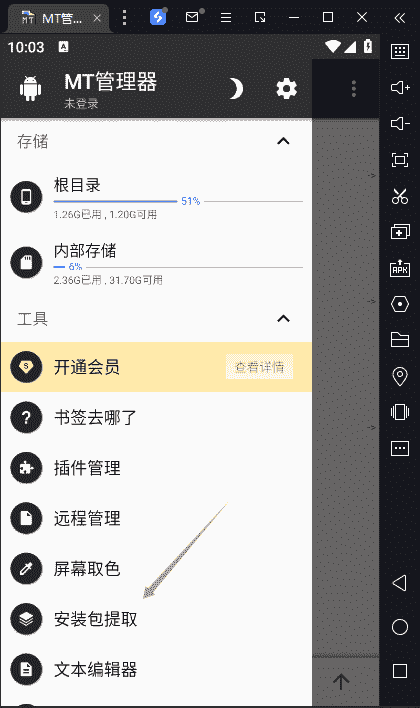

2. 可以看到包名：`com.zj.wuaipojie`，点击提取安装包，然后点定位到安装包。

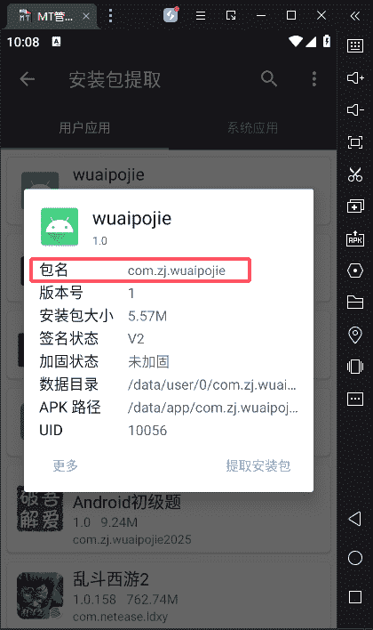

3. 点开，左下角有个功能，点击后可以看到有个`apk`共存，通过修改包名可以共存，勾上自动签名，因为这是会员功能，所以我们得换和mt管理器功能类似的另一个np管理器了。

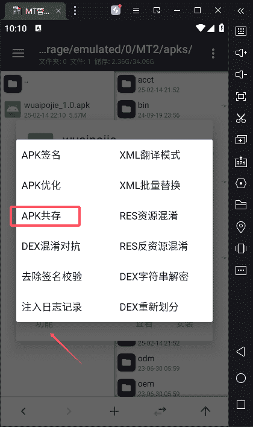

4. 点开练习的程序，点击挑战第一关

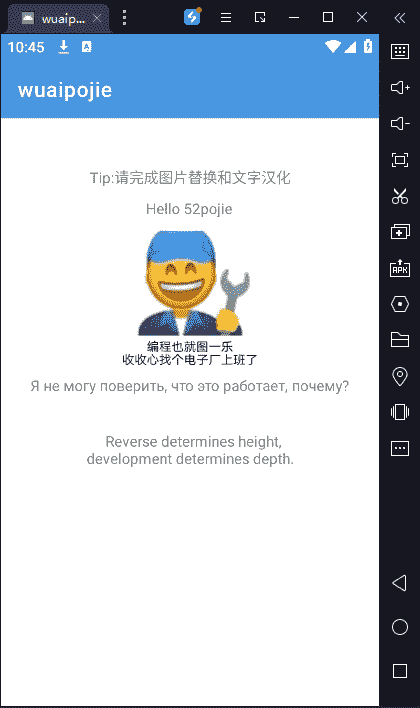

5. 使用np管理器，点击`apk`，再点击查看，进去后点击右上角三个点，点击搜索，勾选高级搜索，文件中包含`Hello 52pojie`。

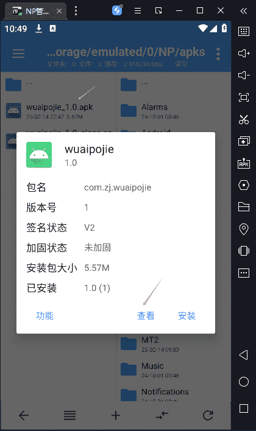

6. 搜索到之后点击文件进入，进入之后点击文件，再点击编辑，进入反编译模式，进去搜索`Hello 52pojie`，成功定位到字符串，将它改成`小菜鸟一枚`，点击保存。

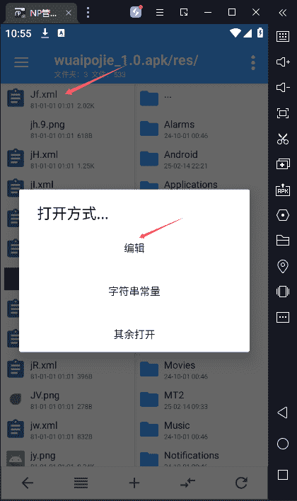

7. 接下来安装会出现签名不一致的情况，把原来的应用卸载掉，重新安装修改后的应用，可以看到这里已经被我修改成`小菜鸟一枚`了。

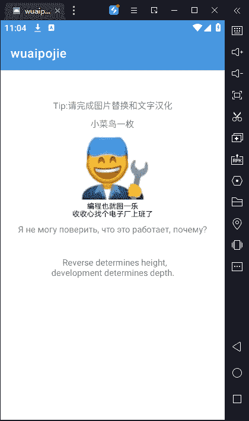

8. 像第二句我们不认识是什么语言，打开安装好的开发者助手，回到练习`apk`页面，点击开发者助手的小图标，再点击开始分析。

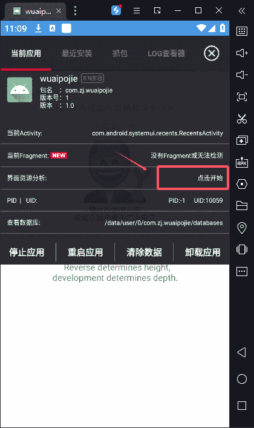

9. 再点击查看，然后选择第二句，出现控件属性，点击`TEXT`右侧的文本，就可以复制，然后再去np管理器搜索，重复前面的步骤，定位到`arsc`文件，点击翻译，选择`default`默认模式。

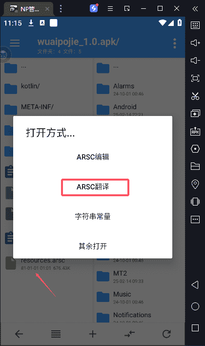

10. 找到刚刚那个字符串，然后点击，输入翻译后的文字“`小菜鸟？`”，保存就修改成功了。再看最后一句用同样的方法定位到`dex`文件，点击后选择`dex编辑plus`，进来之后点中间搜索菜单，点新搜索，选择字符串继续搜索。

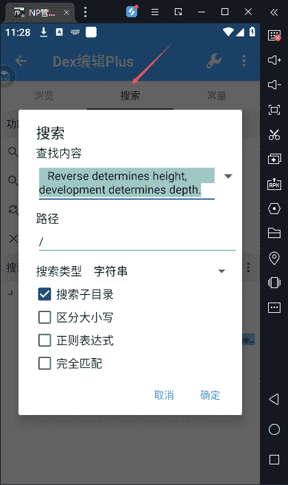

11. 双击进去，手动修改为：`吾爱破解，小菜鸟`，保存然后退出，再来看看修改应用名称和图标，还是使用np管理器，点击`apk`文件，点功能，点通用编辑。

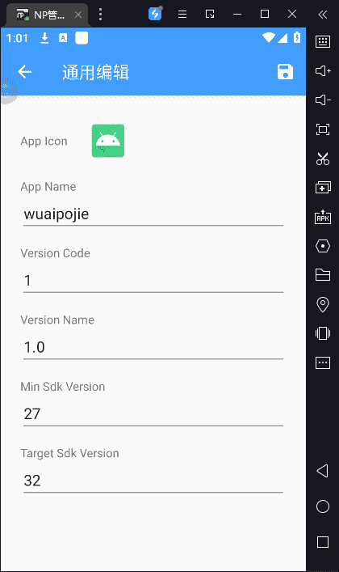

12. 把图片放在共享文件夹下，再点击图标，选择系统图库，找到图片，选择就能替换成功，再修改`app name`为`吾爱破解`，就完成了图标和名称的修改。

## 0x2 替换第一关挑战中的图片

1. 根据前面的学习，可以知道`res`目录下存放图片文件。

| 文件 | 注释 |
|---|---|
| `assets`目录 | 存放APK的静态资源文件，比如视频，音频，图片等 |
| `lib` 目录 | `armeabi-v7a`基本通用所有android设备，`arm64-v8a`只适用于64位的android设备，`x86`常见用于android模拟器，其目录下的`.so`文件是c或c++编译的动态链接库文件 |
| `META-INF`目录 | 保存应用的签名信息，签名信息可以验证APK文件的完整性，相当于APK的身份证(验证文件是否又被修改) |
| `res`目录 | `res`目录存放资源文件，包括图片，字符串等等，APK的脸蛋由他的`layout`文件设计 |
| `AndroidManifest.xml`文件 | APK的应用清单信息，它描述了应用的名字，版本，权限，引用的库文件等等信息 |
| `classes.dex`文件 | `classes.dex`是java源码编译后生成的java字节码文件，APK运行的主要逻辑 |
| `resources.arsc`文件 | `resources.arsc`是编译后的二进制资源文件，它是一个映射表，映射着资源和id，通过`R`文件中的id就可以找到对应的资源 |

2. 我们用np管理器查看`res`目录下的图片找到第一关的图片（看左边）：

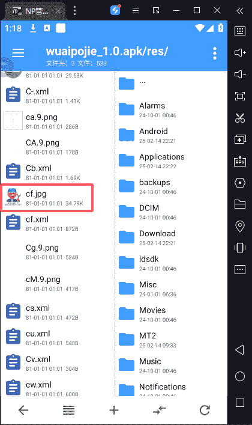

3. 右边是我们安卓的文件目录，找到我们要替换的图片，长按图片，点击添加，就可以将图片添加到左边了，把原来的图片改个名字，再将新的图片名字改成这个，退出，重新安装`apk`。

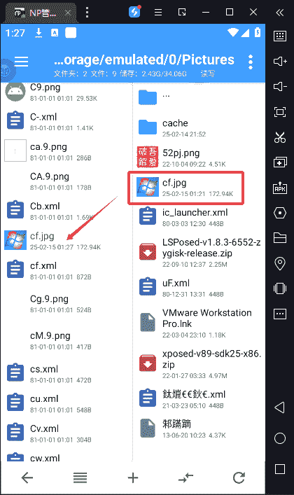

4. 再来运行看一下结果，成功替换图片了。

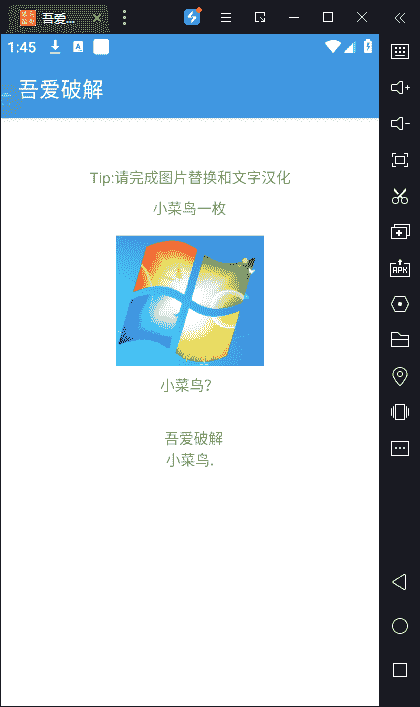

## 0x3 参考文档

1. [《安卓逆向这档事》二、初识APK文件结构、双开、汉化、基础修改](https://www.52pojie.cn/thread-1695796-1-1.html)
