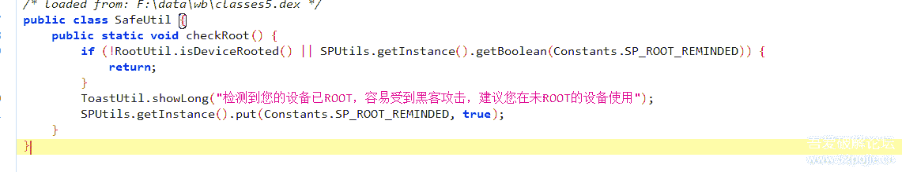
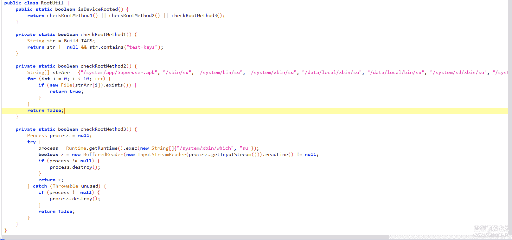
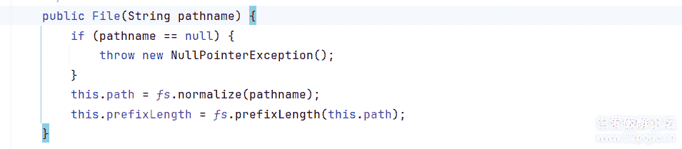

# [Android 原创] 天津地铁app环境检测

- 原帖: https://www.52pojie.cn/forum.php?mod=viewthread&tid=2006738
- 抓取时间: 2026-11-01T16:07:09.831Z

该帖子仅供学习

用root设备进入app会提示下图


这个软件的提示词过于简单了，没有进行加密什么的

直接在dex里搜关键词即可



我们进入判断具体分析一下



一共三个函数，每个函数判断不同

### 第一个函数
第一个函数是通过判断获取的手机信息(`System/build.prop`文件)

一般root后的设备其他root特征便是`ro.system.build.tags`=`text-keys`

### 第二个函数
第二个函数是通过判断文件是否存在

其中判断的文件都有：`/system/app/Superuser.apk`，`/sbin/su`，`/system/bin/su`，`/system/xbin/su`，`/data/local/xbin/su`，`/data/local/bin/su`，`/system/sd/xbin/su`，`/system/bin/failsafe/su`，`/data/local/su`，`/su/bin/su`这些文件

如果设备进行Root，会存在

### 第三个函数
第三个函数则是通过执行shell命令

检查设备上是否存在 `su` 可执行文件，判断是否是Root设备

那么知道这些了我们很好去隐藏，但是也可以进行hook处理

我们先hook第一个函数的检测，他是获取的 `Build.TAGS`

通过查看 `android.os.Build` 类 `TAGS` 字段是通过

`public static final String TAGS = getString("ro.build.tags");`

那么只要去 hook `getString` 即可，正常的 `TAGS` 是 `release-keys`，所以我们可以这样hook（mumu模拟器和我自己的root设备都是 `release-keys` 无法进行测试，请各位佬自行测试）

```
XposedHelpers.findAndHookMethod(Build.class, "getString", String.class, new XC_MethodHook() {
            @Override
            protected void afterHookedMethod(MethodHookParam param) throws Throwable {
                super.afterHookedMethod(param);
                String str=(String) param.args[0];
                XposedBridge.log("输出str:"+str);
                if (str.equals("ro.build.tags")){
                    XposedBridge.log("输出key:"+param.getResult());
                    param.setResult("release-keys");
                }
            }
        });
```

第二个函数，我们可以去 hook `File` 构造类，当传入的路径是上面那些文件路径，则替换成一个不存在的文件路径即可，或者是 hook `exists` 函数，那么怎么判断当前传入的路径我们可以查看 `File` 类代码，通过构造参数看出



这个类的 `path` 字段储存的路径，所以我们可以直接获取 `exists` 函数当前实例的 `path`，然后判断是否是想 hook 的实例，然后返回一个 `false`，不存在文件

```
XposedHelpers.findAndHookMethod(File.class, "exists", new XC_MethodHook() {

            @Override

            protected void afterHookedMethod(MethodHookParam param) throws Throwable {

                super.afterHookedMethod(param);

                String path=(String) XposedHelpers.getObjectField(param.thisObject,"path");

                if (path.equals("/system/app/Superuser.apk")||path.equals("/sbin/su")||path.equals("/system/bin/su")||path.equals("/system/xbin/su")||path.equals("/data/local/xbin/su")||path.equals("/data/local/bin/su")||path.equals("/system/sd/xbin/su")||path.equals("/system/bin/failsafe/su")||path.equals("/data/local/su")||path.equals("/su/bin/su")) {

                param.setResult(false);

                }

            }

        });
```

下面看第三个函数我们要怎么 hook 呢，直接 hook `Runtime` 类的 `exec` 函数

```
XposedHelpers.findAndHookMethod(Runtime.class, "exec", String[].class, new XC_MethodHook() {
            @Override
            protected void beforeHookedMethod(MethodHookParam param) throws Throwable {
                super.beforeHookedMethod(param);
                String[] str=(String[]) param.args[0];
                if (Arrays.asList(str).contains("su")){
                    param.args[0]=new String[]{"echo", "-n"};
                }
            }
        });
```

替换他的执行命令，新的指令返回的 `InputStream` 是空的，然后我们在打开软件发现 root 提示已经没有了
