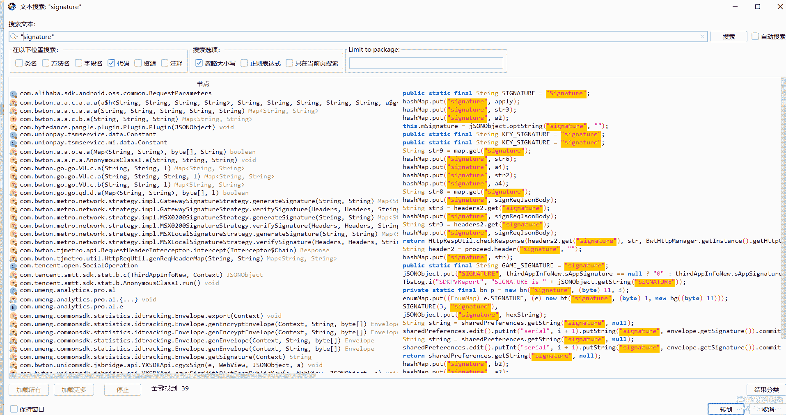
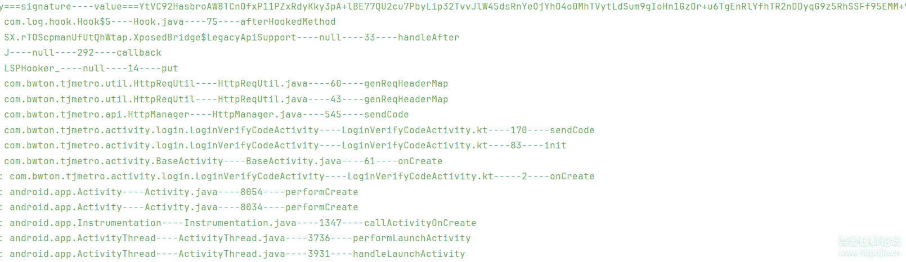
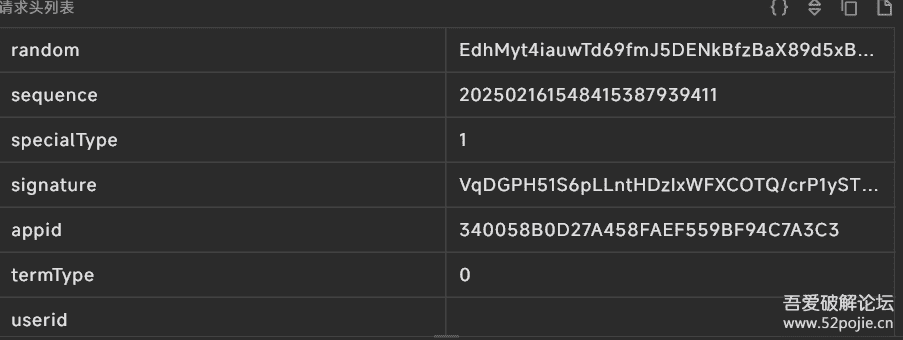
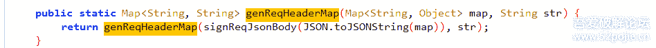
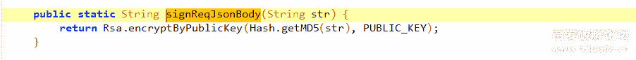
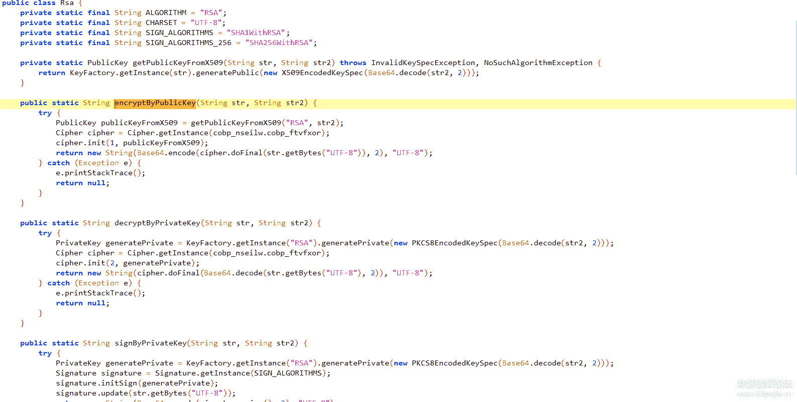

# [Android 原创] 天津地铁App分析

- 原帖: https://www.52pojie.cn/forum.php?mod=viewthread&tid=2006795

- 抓取时间: 2026-11-01T16:07:04.752Z

上篇对天津地铁APP环境检测进行了分析

这篇是进行对`signature`参数进行分析

简单看了一下代码因为`signature`比较大众，搜出来的结果比较多，看了几个跟包名相关的类



请求的时候大部分都是用的`HashMap`

所以直接hook `HashMap`去寻找真正的调用类

```java
XposedHelpers.findAndHookMethod(HashMap.class, "put", Object.class, Object.class, new XC_MethodHook() {
            @Override
            protected void afterHookedMethod(MethodHookParam param) throws Throwable {
                super.afterHookedMethod(param);
                if (param.args[0] instanceof String) {
                    String str = (String) param.args[0];
                    if (str.equals("signature")) {
                        XposedBridge.log("key==="+str+"----value==="+param.args[1]);
                        Throwable ex = new Throwable();
                        StackTraceElement[] stackElements = ex.getStackTrace();
                        if (stackElements != null) {
                            for (int i = 0; i 
```



可以看到`com.bwton.tjmetro.util.HttpReqUtil`类的`genReqHeaderMap`函数

但是在调用的时候发现有两处，但是两处不同的地方是第二个传入的参数，一个默认是空，一个是传入

那么怎么判断知道是哪个地方调用


在进行抓包的时候，是有个`random`参数的，我这里抓出来是存在的



直接看这个地方传入



看到他是传入了`Map`转成`Json`然后进行了处理



可以看到是这个地方进行了`md5`加密

然后转成了`Hex`

直接看`encryptByPublicKey`函数



`str`是传入的数据，`str2`是`key`

`str2`先进行`Base64`解密进行`RSA`加密上传的数据

那么数据中有什么内容，其实也不用我说了，都在`java`层了[手动狗头]
