# [Android CTF] 52pj-25.6W&A题分析

- 原帖: https://www.52pojie.cn/forum.php?mod=viewthread&tid=2007041
- 抓取时间: 2026-11-01T16:06:59.775Z

## 前言

答题结束后，看了相关题解，尝试使用`unidbg`来打印`trace`并分析。

## 0x1 还原 vmcode

初始化`ss`，放入`vmcode`

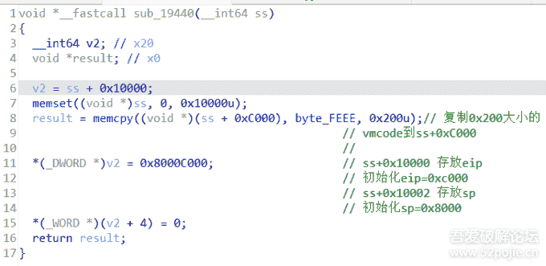

注：双击`byte_FEEE`，`shif+e`拿出`vmcode`，待还原时用

分析`vmcode`使用逻辑

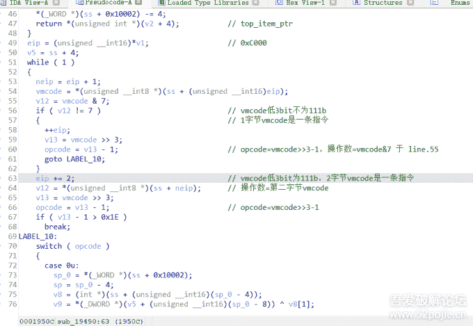

分析每个`case`操作

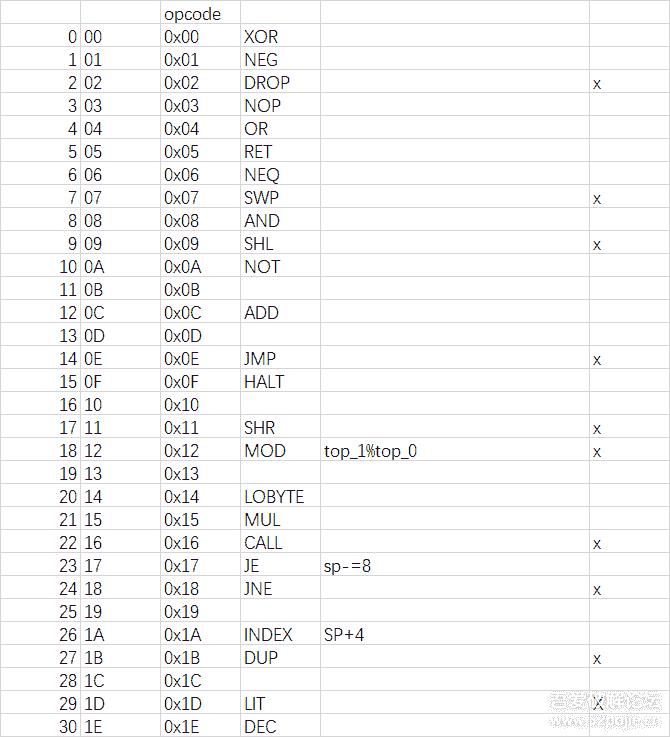

理清了每个`opcode`操作，还原`vmcode`为伪码。

## 0x2 分析 trace 还原意图

前言：虚拟机执行前分别`lit`了`uid`，`0x1000`，`0x2000`，还入栈了`flag`和一个字典，见下图。

注：这个字典在`ida` 32位`so`比较容易导出。

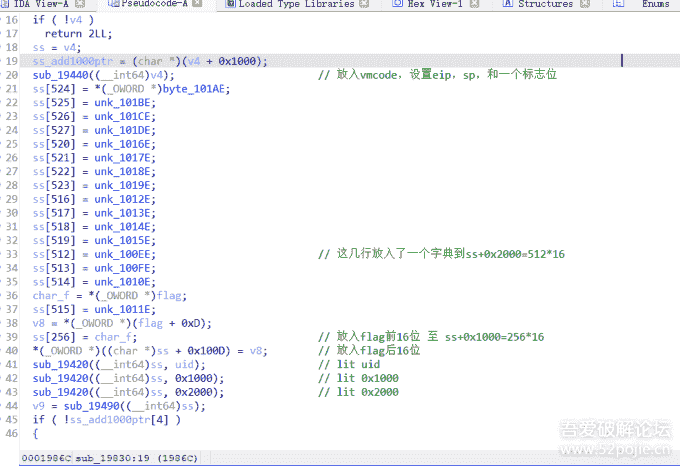

使用`unidbg` hook 虚拟机 `switch(opcode)` 打印`trace`，代码见附录1，以下为部分打印的`trace`

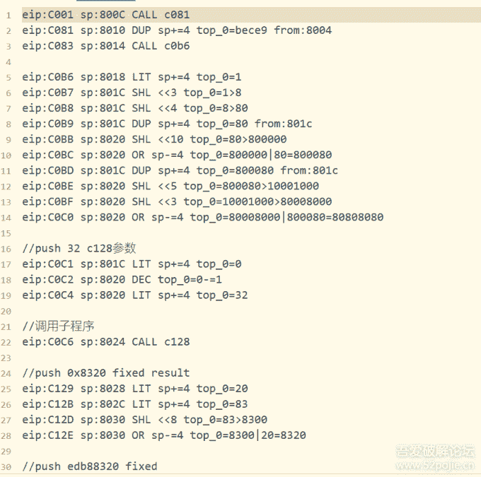

根据`trace`逐条分析静态伪码，记录下意图，完整版见附录2

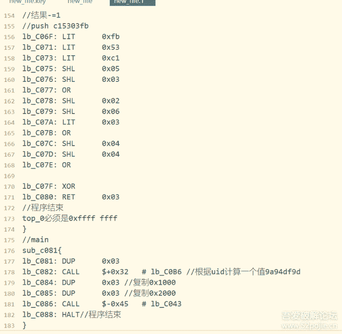

## 0x3 反推 flag

虚拟机运行完返回栈顶`top_0`

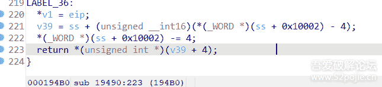

这个值必须=`0x3EACFC04`，`check`函数才返回0，`flag`正确

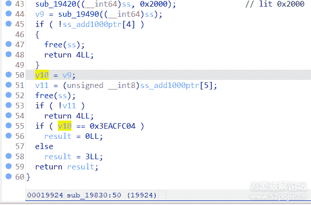

虚拟机在结束前执行了`res -= 1` `res ^= 0xc15303fb`，由以上分析，`res`在`-=`1前必须为0

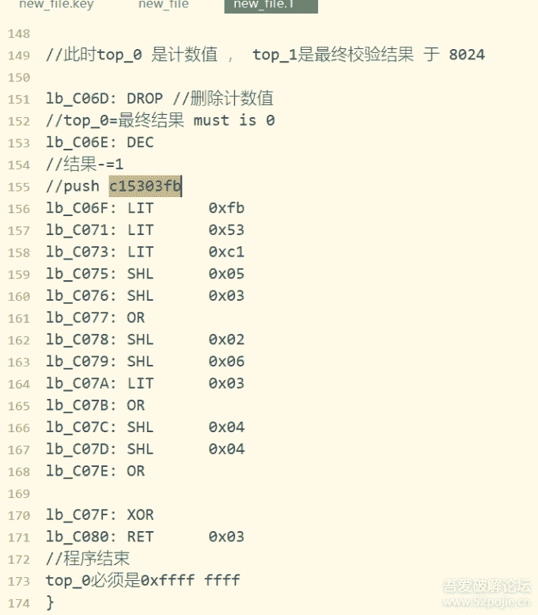

由附录2完整伪码，`res`初始值为0，程序会对输入的`flag`进行格式校验，格式正确`res |= 0`，然后用`uid`生成的这个数对5个字符为一块的四个块进行校验，`res |=`校验结果，也就是说对每个块的校验结果必须也都是0，对每个块的校验见附录2->`sub_c003`，分析得出爆破时间复杂度 $O(10^8)$，根据`sub_c003`写代码进行爆破，爆破代码见附录3。

## s前言

下文为上文分析引发的新的分析。

## 0x1s 朴素算法的优化

通过`afdm`大佬"`base36`"提示，发现暴破代码`line.24-34`，实际上是在进行`base36` `decode`。

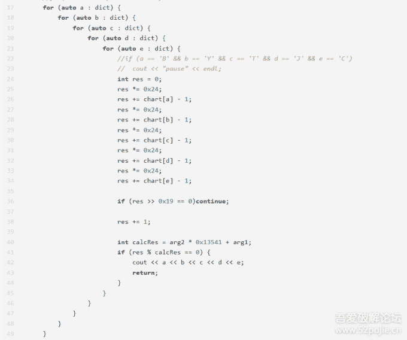

即要找出一个正确的`flag`，实际上是找出来一个合适的5位36进制数`a`，使得`a % b == 0`。

分析暴破代码可得，`a ∈ [ 1`如果题目对于每个`uid`都至少存在一个`flag`，易得最大的`a`应为`36^5 // b * b`，这意味着我们可以直接算出这个`a`，`O(n^5)` -> `O(1)`。

优化完成，优化后`flag`计算代码见附录1s（同时实现了`sub_c128`，`sub_c0b6`，输入`uid`可立得`flag`）。

## 0x2s 证明 flag 存在性

因为题放出前一定经过验证，每个`uid`至少存在一个`flag`是肯定的。

只是不太明白如何证明，我自己想了很长时间没想出来，于是让豆包给出了证明，分享如下：

由`0x1s`分析，`flag`存在即对于任意`b`，存在一个正整数`k`，使得`a = k b`。

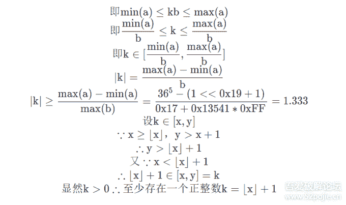

## 附录1、unidbg代码


```
package com.kanxue.test2;
...
public class MainActivity {

    public static void main(String[] args) {
        long start = System.currentTimeMillis();
        MainActivity mainActivity = new MainActivity();
        System.out.println("load offset=" + (System.currentTimeMillis() - start) + "ms");
        mainActivity.crack();
    }

    private final AndroidEmulator emulator;
    private final VM vm;
    private final DalvikModule dm;
    private final Module module;

    private MainActivity() {
        emulator = AndroidEmulatorBuilder
                .for64Bit()
                .addBackendFactory(new Unicorn2Factory(true))
                .build();
        Memory memory = emulator.getMemory();
        LibraryResolver resolver = new AndroidResolver(23);
        memory.setLibraryResolver(resolver);

        vm = emulator.createDalvikVM();
        vm.setVerbose(true);
        dm = vm.loadLibrary(new File("unidbg-android/src/test/java/com/kanxue/test2/libnativelib.so"), false);
        dm.callJNI_OnLoad(emulator);
        module = dm.getModule();
    }

    private void crack() {
        // 加载 Java 类
        DvmClass nativeLibClass = vm.resolveClass("cn/afdm/152pojie/nativelib/NativeLib");
        // 创建 Java 对象实例
        DvmObject obj = nativeLibClass.newObject(null);
        logIns();
        // 调用本地方法
        String signature = "check(ILjava/lang/String;)I";
        int res = obj.callJniMethodInt(emulator, signature, 781545, vm.addLocalObject(new StringObject(vm, "flag{BYTJC-CINDT-3ZB9A-B5Q4E}")));
        System.out.println(res);
    }

    public void logIns() {
        emulator.getBackend().hook_add_new(new CodeHook() {
            @Override
            public void onAttach(UnHook unHook) {}
            @Override
            public void detach() {}
            @Override
            public void hook(Backend backend, long address, int size, Object user) {
                if (address == module.base + 0x19548) {
                    long ss = (long) backend.reg_read(Arm64Const.UC_ARM64_REG_X0);
                    long sp = mem_read_word(backend, ss + 0x10002);
                    long eip = eip = (int) (long) backend.reg_read(Arm64Const.UC_ARM64_REG_W11)-1;
                    long top_0 = mem_read_dword(backend, ss + sp);
                    long top_1 = mem_read_dword(backend, ss + sp - 4);
                    long opcode = (int) (long) backend.reg_read(Arm64Const.UC_ARM64_REG_W14);
                    long x = (int) (long) backend.reg_read(Arm64Const.UC_ARM64_REG_W12);

                    System.out.printf("eip:%04X sp:%04X ", eip, sp);
                    if (opcode == 0x00) {
                        System.out.printf("XOR sp-=4 top_0=%x^%x=%x ", top_0, top_1, top_0 ^ top_1);
                    } else if (opcode == 0x01) {
                        System.out.printf("NEG top_0=-top_0=%x ", -top_0);
                    } else if (opcode == 0x02) {
                        System.out.printf("DROP sp-=%x ", x * 4);
                    } else if (opcode == 0x03) {
                        System.out.printf("NOP");
                    } else if (opcode == 0x04) {
                        System.out.printf("OR sp-=4 top_0=%x|%x=%x ", top_0, top_1, top_0 | top_1);
                    } else if (opcode == 0x05) {
                        System.out.printf("RET top_0=%x ", top_0);
                    } else if (opcode == 0x06) {
                        System.out.printf("NEQ sp-=4 top_0=%x!=%x=%x ", top_0, top_1, top_0 != top_1);
                    } else if (opcode == 0x07) {
                        long target = mem_read_dword(backend, ss + sp - 4L * x);
                        ;
                        System.out.printf("SWP swap(top_0,sp-4*%x) top_0=%x target=%x", x, top_0, target);
                    } else if (opcode == 0x08) {
                        System.out.printf("AND sp-=4 top_0=%x&%x=%x ", top_0, top_1, top_0 & top_1);
                    } else if (opcode == 0x09) {
                        System.out.printf("SHL %x", x, top_0, top_0 %x", top_0, ~top_0);
                    } else if (opcode == 0x0B) {
                        System.out.printf("-1");
                    } else if (opcode == 0x0C) {
                        System.out.printf("ADD sp-=4 top_0=%x+%x=%x ", top_0, top_1, top_0 + top_1);
                    } else if (opcode == 0x0D) {
                        System.out.printf("-1");
                    } else if (opcode == 0x0E) {
                        System.out.printf("JMP %x ", eip + x);
                    } else if (opcode == 0x0F) {
                        System.out.printf("HALT");
                    } else if (opcode == 0x10) {
                        System.out.printf("-1");
                    } else if (opcode == 0x11) {
                        System.out.printf("SHR >>%x top_0=%x>%x", x, top_0, top_0 >> x);
                    } else if (opcode == 0x12) {
                        System.out.printf("MOD sp-=4 top_0=%x mod %x=%x ", top_1, top_0, top_1 % top_0);
                    } else if (opcode == 0x13) {
                        System.out.printf("-1");
                    } else if (opcode == 0x14) {
                        System.out.printf("LOBYTE top_0=%x ", top_0 & 0xff);
                    } else if (opcode == 0x15) {
                        System.out.printf("MUL sp-=4 top_0=%x*%x=%x ", top_0, top_1, top_0 * top_1);
                    } else if (opcode == 0x16) {
                        System.out.printf("CALL %x", eip + 1 + x);
                    } else if (opcode == 0x17) {
                        System.out.printf("JE %x==%x=%x ", top_0, top_1, top_0 == top_1);
                    } else if (opcode == 0x18) {
                        System.out.printf("JNE %x!=%x=%x ", top_0, top_1, top_0 != top_1);
                    } else if (opcode == 0x19) {
                        System.out.printf("-1");
                    } else if (opcode == 0x1A) {
                        long target = mem_read_byte(backend, ss + top_0 + top_1);
                        System.out.printf("INDEX sp-=4 top_0=*(%x+%x)=%x ", top_0, top_1, target);
                    } else if (opcode == 0x1B) {
                        long target = mem_read_dword(backend, ss + sp - 4L * x);
                        System.out.printf("DUP sp+=4 top_0=%x from:%x ", target, sp - 4L * x);
                    } else if (opcode == 0x1C) {
                        System.out.printf("-1");
                    } else if (opcode == 0x1D) {
                        System.out.printf("LIT sp+=4 top_0=%x ", x);
                    } else if (opcode == 0x1E) {
                        System.out.printf("DEC top_0=%x-=1 ", top_0);
                    }
                    System.out.println();
                }
            }
        }, module.base + 19490, module.base + 0x1982C, null);
    }

    public long mem_read_byte(Backend backend, long address) {
        return mem_read_number(backend, address, 1);
    }

    public long mem_read_word(Backend backend, long address) {
        return mem_read_number(backend, address, 2);
    }

    public long mem_read_dword(Backend backend, long address) {
        return mem_read_number(backend, address, 4);
    }

    public long mem_read_number(Backend backend, long address, long size) {
        byte[] mem = backend.mem_read(address, size);
        long res = 0;
        for (int i = 0; i 
```

### 3> 附录2、伪码分析结果

```
# 吾爱破解 2025 春节解题领红包之六 - 提示

#
# 王小明在网上找到一份通用固件反编译工具，
#   但它只能反编译前 0x200 字节。
#
# 以下为反编译的结果：

lb_C000: CALL     $+0x7f   # lb_C081

lb_C002: HALT

sub_c003{

//top_0=0x2000(参数三) top_1=0x1005(参数二) top_2=0x5,b,11,17(参数1) 

lb_C003: LIT      0x00 //res(局部变量)

lb_C004: LIT      0x00 //计数(局部变量)

//while(计数!=参数1){

lb_C005: DUP //复制计数（局部变量）

lb_C006: DUP      0x06 //复制参数1 循环多少次 C056 sp:802C LIT sp+=4 top_0=5  复制这两个是为了接下来判断

lb_C007: JE       $+0x14   # lb_C01D //跳出循环

}

lb_C009: SWP //交换top_01

// top_0=res top_1=计数

lb_C00A: LIT      0x24

lb_C00C: MUL //res*=24

取出base36值{

lb_C00D: DUP      0x03 //参数三 0x2000
```


## 附录3、flag爆破代码

```assembly
lb_C00E: DUP      0x05 //复制参数二 0x1005
lb_C00F: DUP      0x03 //复制计数 0x0
lb_C010: INDEX //根据flag指针 获取(char)*(flag+指针)字符
lb_C011: INDEX //根据字符获取base36表的值 char_code+0x2000
}

//判断是否为0 ， 0-9 A-Z不为0{
lb_C012: DUP //复制top_0
lb_C013: LIT      0x00 //如果索引结果等于0 退出
lb_C014: JE       $+0x25   # lb_C03B 走第二个ret
}

lb_C016: ADD //res+=当前base36值
lb_C017: DEC //res-=1
lb_C018: SWP //交换两个状态量 res和计数
//top_0=计数 top_1=res
lb_C019: LIT      0x01
lb_C01A: ADD //计数+=1
lb_C01B: JMP      $-0x18   # lb_C005 //向上跳转
//循环体结束
lb_C01D: DROP //res置顶
//top_0=res 8040
错误路径{
lb_C01E: DUP //复制res右移19位，如果为0跳转
lb_C01F: SHR      0x19
lb_C021: LIT      0x00 //入栈0用作判断
lb_C022: JE       $+0x1c   # lb_C040 //走第三个ret
}

lb_C024: LIT      0x01
lb_C025: ADD //res+=1
{lb_C026: DUP      0x05 //复制uid计算值低位byte 于lb_C055: LOBYTE 取低位byte 9d,df,94,9a
//push 0x13541 固定值
{{
lb_C027: LIT      0x35
lb_C029: LIT      0xda
lb_C02B: SHR      0x03
lb_C02C: SHR      0x04
lb_C02D: SHL      0x02
lb_C02E: SHL      0x06
lb_C02F: OR
}
lb_C030: SHL      0x02
lb_C031: SHL      0x06
lb_C032: LIT      0x41
lb_C034: OR
}
lb_C035: MUL //相乘
}
//top_0=计算数 top_1=res
lb_C036: DUP      0x04 //复制flag指针  lb_C059: ADD //相加0x10005
lb_C037: LOBYTE //取低位，实际上是05,0b,11,17
lb_C038: ADD
//top_0=计算数
lb_C039: MOD //res mod 计算数  must is 0
lb_C03A: RET      0x04
//以下两个ret都不能让res=0
lb_C03B: OR
lb_C03C: LIT      0x01
lb_C03D: OR
lb_C03E: OR
lb_C03F: RET      0x04
//top_0=res
lb_C040: LIT      0x01
lb_C041: OR
lb_C042: RET      0x04
}

sub_c043{
lb_C043: DUP      0x02 //复制0x1000
lb_C044: CALL     $+0x43   # lb_C089   //判断"flag{}"格式 ，符合返回0 0x8024
lb_C046: LIT      0x05
lb_C047: JMP      $+0x0b   # lb_C054
//此时top_0 是计数值 ， top_1是校验结果
lb_C049: SWP //交换top01 将最终校验结果拿到栈顶
判断连接符，若正确结果不变{
//取出flag[cur]
lb_C04A: DUP      0x04 //复制0x1000
lb_C04B: DUP      0x02 //复制计数值
lb_C04C: INDEX
lb_C04D: LIT      0x2d
lb_C04F: NEQ //判断是不是'-'
lb_C050: OR //与最终结果or result or 0，其实就是不变
lb_C051: SWP //将计数值拿到栈顶
lb_C052: LIT      0x01
lb_C053: ADD //计数值+=1
}
//top_0=计数值，top_1=最终校验值
lb_C054: DUP      0x05 //复制根据uid生成的值 9a94df 注：lb_C064后边改变了这个值
lb_C055: LOBYTE //取低位byte df,94,9a,00
lb_C056: LIT      0x05 //下面call的参数
lb_C057: DUP      0x06 //复制0x1000
lb_C058: DUP      0x03 //复制计数值
lb_C059: ADD //相加 拿到flag字符指针
lb_C05A: DUP      0x06 //复制0x2000
//top_0=0x2000 top_1=0x1005 top_2=0x5
lb_C05B: CALL     $-0x5a   # lb_C003
lb_C05D: DUP      0x02 //复制校验格式返回值lb_C044: CALL0x8024 -》 复制最终结果
lb_C05E: OR //本轮call结果or
lb_C05F: SWP      0x02 //将最终结果存回0x8024
lb_C060: DROP
lb_C061: DUP      0x05 //复制lb_C082: CALL     $+0x32   # lb_C0B6 //根据uid计算一个值9a94df9d 0x8014
lb_C062: SHR      0x08 //右移八位
lb_C064: SWP      0x06 //结果存回0x8014
lb_C065: DROP
//top_0=计数值5,b,11,17
lb_C066: LIT      0x05
lb_C067: ADD //eip:C046 sp:8024 LIT sp+=4 top_0=5 //计数值+=5
//循环判断条件
lb_C068: DUP //复制栈顶
lb_C069: LIT      0x1c
lb_C06B: JNE      $-0x24   # lb_C049 //不相等向上跳转1c!=a 循环直到指针到28
//此时top_0 是计数值 ， top_1是最终校验结果 于 8024
lb_C06D: DROP //删除计数值
//top_0=最终结果 must is 0
lb_C06E: DEC
//结果-=1
//push c15303fb
lb_C06F: LIT      0xfb
lb_C071: LIT      0x53
lb_C073: LIT      0xc1
lb_C075: SHL      0x05
lb_C076: SHL      0x03
lb_C077: OR
lb_C078: SHL      0x02
lb_C079: SHL      0x06
lb_C07A: LIT      0x03
lb_C07B: OR
lb_C07C: SHL      0x04
lb_C07D: SHL      0x04
lb_C07E: OR
lb_C07F: XOR
lb_C080: RET      0x03
//程序结束
top_0必须是0xffff ffff
}

//main
sub_c081{
lb_C081: DUP      0x03
lb_C082: CALL     $+0x32   # lb_C0B6 //根据uid计算一个值9a94df9d
lb_C084: DUP      0x03 //复制0x1000
lb_C085: DUP      0x03 //复制0x2000
lb_C086: CALL     $-0x45   # lb_C043
lb_C088: HALT//程序结束
}

lb_C089: LIT      0x00
lb_C08A: LIT      0x66
lb_C08C: DUP      0x03
lb_C08D: LIT      0x00
lb_C08E: INDEX
lb_C08F: XOR
lb_C090: OR
lb_C091: LIT      0x6c
lb_C093: DUP      0x03
lb_C094: LIT      0x01
lb_C095: INDEX
lb_C096: XOR
lb_C097: OR
lb_C098: LIT      0x61
lb_C09A: DUP      0x03
lb_C09B: LIT      0x02
lb_C09C: INDEX
lb_C09D: XOR
lb_C09E: OR
lb_C09F: LIT      0x67
lb_C0A1: DUP      0x03
lb_C0A2: LIT      0x03
lb_C0A3: INDEX
lb_C0A4: XOR
lb_C0A5: OR
lb_C0A6: LIT      0x7b
lb_C0A8: DUP      0x03
lb_C0A9: LIT      0x04
lb_C0AA: INDEX
lb_C0AB: XOR
lb_C0AC: OR
lb_C0AD: LIT      0x7d
lb_C0AF: DUP      0x03
lb_C0B0: LIT      0x1c
lb_C0B2: INDEX
lb_C0B3: XOR
lb_C0B4: OR
lb_C0B5: RET      0x01
//push 80808080 {
lb_C0B6: LIT      0x01
lb_C0B7: SHL      0x03
lb_C0B8: SHL      0x04
lb_C0B9: DUP
lb_C0BA: SHL      0x10
lb_C0BC: OR
lb_C0BD: DUP
lb_C0BE: SHL      0x05
lb_C0BF: SHL      0x03
lb_C0C0: OR
}
//push ffffffff 这个地址存放子函数返回值{
lb_C0C1: LIT      0x00
lb_C0C2: DEC
}
//push 0x32
lb_C0C3: LIT      0x32
lb_C0C5: CALL     $+0x61   # lb_C128
lb_C0C7: LIT      0x30
lb_C0C9: CALL     $+0x5d   # lb_C128
lb_C0CB: LIT      0x32
lb_C0CD: CALL     $+0x59   # lb_C128
lb_C0CF: LIT      0x35
lb_C0D1: CALL     $+0x55   # lb_C128
lb_C0D3: DUP      0x03 //复制uid
lb_C0D4: SHR      0x05
lb_C0D5: SHR      0x06
lb_C0D6: SHR      0x04
lb_C0D7: SHR      0x05
lb_C0D8: SHR      0x04 //top_item = 0 >>0x18
lb_C0D9: CALL     $+0x4d   # lb_C128
lb_C0DB: LIT      0x35
lb_C0DD: CALL     $+0x49   # lb_C128
lb_C0DF: LIT      0x32
lb_C0E1: CALL     $+0x45   # lb_C128
lb_C0E3: LIT      0x70
lb_C0E5: CALL     $+0x41   # lb_C128
lb_C0E7: LIT      0x6f
lb_C0E9: CALL     $+0x3d   # lb_C128
lb_C0EB: LIT      0x6a
lb_C0ED: CALL     $+0x39   # lb_C128
lb_C0EF: LIT      0x69
lb_C0F1: CALL     $+0x35   # lb_C128
lb_C0F3: LIT      0x65
lb_C0F5: CALL     $+0x31   # lb_C128
lb_C0F7: DUP      0x03 //复制uid
lb_C0F8: SHR      0x06
lb_C0F9: SHR      0x04
lb_C0FA: SHR      0x06 //top_item=b  >>0x10
lb_C0FB: CALL     $+0x2b   # lb_C128
lb_C0FD: LIT      0x61
lb_C0FF: CALL     $+0x27   # lb_C128
lb_C101: LIT      0x66
lb_C103: CALL     $+0x23   # lb_C128
lb_C105: LIT      0x64
lb_C107: CALL     $+0x1f   # lb_C128
lb_C109: LIT      0x6d
lb_C10B: CALL     $+0x1b   # lb_C128
lb_C10D: DUP      0x03 //复制uid
lb_C10E: SHR      0x02
lb_C10F: SHR      0x06 //top_item=bec >>0x8
lb_C110: CALL     $+0x16   # lb_C128
lb_C112: LIT      0x32
lb_C114: CALL     $+0x12   # lb_C128
lb_C116: LIT      0x30
lb_C118: CALL     $+0x0e   # lb_C128
lb_C11A: LIT      0x32
lb_C11C: CALL     $+0x0a   # lb_C128
lb_C11E: LIT      0x35
lb_C120: CALL     $+0x06   # lb_C128
lb_C122: DUP      0x03
lb_C123: CALL     $+0x03   # lb_C128
lb_C125: NOT
lb_C126: OR
lb_C127: RET      0x01 //RET top_0=9a94df9d

sub_c128{
//push edb88320{ //poly
lb_C128: LIT      0x20
lb_C12A: LIT      0x83
lb_C12C: SHL      0x08
lb_C12E: OR
lb_C12F: LIT      0xb8
lb_C131: LIT      0xed
lb_C133: SHL      0x08
lb_C135: OR
lb_C136: SHL      0x10
lb_C138: OR
}
//push 0x07 i{
lb_C139: LIT      0x04
lb_C13A: LIT      0x03
lb_C13B: ADD
}
lb_C13C: DUP      0x04 //获取参数1，sp[8020],ffffffff
lb_C13D: DUP      0x04 //获取参数2, 32
lb_C13E: LOBYTE //30
lb_C13F: XOR //res（局部变量） e52a41c2 8034
//循环7次{{
lb_C140: DUP //res（局部变量）
lb_C141: LIT      0x01
lb_C142: AND // &  取低位
lb_C143: NEG //加负号
lb_C144: DUP      0x03  //复制poly
lb_C145: AND // &
}
lb_C146: SWP //交换top01，结果存回res（局部变量）
lb_C147: SHR      //0x01
lb_C148: XOR //
//取i，循环减一
lb_C149: DUP      0x01
lb_C14A: DEC
lb_C14B: SWP      0x02
//i不等于0向上跳转
lb_C14C: LIT      0x00
lb_C14D: JNE      $-0x0f   # lb_C140
}
lb_C14F: SWP      0x02  //结果存回poly
lb_C150: DROP     0x02
lb_C151: RET      0x02
}
...
```


```cpp
#include 
#include 
using namespace std;

unsigned char chart[] =
{
  0x00, 0x00, 0x00, 0x00, 0x00, 0x00, 0x00, 0x00, 0x00, 0x00,...//0x2000的256字节
};

vectordict;

unsigned int data1[4] = { 0x05,0x0b,0x11,0x17 };
unsigned int data2 = 0x9a94df9d; //根据uid生成的数，动调从trace中拿，因为是固定的，没另外写程序生成

void crake(unsigned int arg1, unsigned int arg2) {
        //for(auto c:dict)cout> 0x19 == 0)continue;

                                                res += 1;

                                                int calcRes = arg2 * 0x13541 + arg1;
                                                if (res % calcRes == 0) {
                                                        cout > (8 * i)) & 0xff);
                if (i != 3)cout 
```

### 附录1、flag计算代码

```cpp
#include 

#include 

#include 

using namespace std;

const int N = 36 * 36 * 36 * 36 * 36;

unsigned char chart[] =

{

  0x00, 0x00, 0x00, 0x00, 0x00, 0x00, 0x00, 0x00, 0x00, 0x00,  0x00, 0x00, 0x00, 0x00, 0x00, 0x00, 0x00, 0x00, 0x00, 0x00,  0x00, 0x00, 0x00, 0x00, 0x00, 0x00, 0x00, 0x00, 0x00, 0x00,  0x00, 0x00, 0x00, 0x00, 0x00, 0x00, 0x00, 0x00, 0x00, 0x00,  0x00, 0x00, 0x00, 0x00, 0x00, 0x00, 0x00, 0x00, 0x09, 0x0A,  0x10, 0x15, 0x21, 0x13, 0x0C, 0x04, 0x11, 0x1C, 0x00, 0x00,  0x00, 0x00, 0x00, 0x00, 0x00, 0x03, 0x0F, 0x20, 0x0D, 0x02,  0x23, 0x06, 0x1B, 0x14, 0x0E, 0x01, 0x16, 0x19, 0x08, 0x12,  0x1F, 0x17, 0x24, 0x0B, 0x1E, 0x07, 0x1A, 0x05, 0x18, 0x1D,  0x22, 0x00, 0x00, 0x00, 0x00, 0x00, 0x00, 0x00, 0x00, 0x00,  0x00, 0x00, 0x00, 0x00, 0x00, 0x00, 0x00, 0x00, 0x00, 0x00,  0x00, 0x00, 0x00, 0x00, 0x00, 0x00, 0x00, 0x00, 0x00, 0x00,  0x00, 0x00, 0x00, 0x00, 0x00, 0x00, 0x00, 0x00, 0x00, 0x00,  0x00, 0x00, 0x00, 0x00, 0x00, 0x00, 0x00, 0x00, 0x00, 0x00,  0x00, 0x00, 0x00, 0x00, 0x00, 0x00, 0x00, 0x00, 0x00, 0x00,  0x00, 0x00, 0x00, 0x00, 0x00, 0x00, 0x00, 0x00, 0x00, 0x00,  0x00, 0x00, 0x00, 0x00, 0x00, 0x00, 0x00, 0x00, 0x00, 0x00,  0x00, 0x00, 0x00, 0x00, 0x00, 0x00, 0x00, 0x00, 0x00, 0x00,  0x00, 0x00, 0x00, 0x00, 0x00, 0x00, 0x00, 0x00, 0x00, 0x00,  0x00, 0x00, 0x00, 0x00, 0x00, 0x00, 0x00, 0x00, 0x00, 0x00,  0x00, 0x00, 0x00, 0x00, 0x00, 0x00, 0x00, 0x00, 0x00, 0x00,  0x00, 0x00, 0x00, 0x00, 0x00, 0x00, 0x00, 0x00, 0x00, 0x00,  0x00, 0x00, 0x00, 0x00, 0x00, 0x00, 0x00, 0x00, 0x00, 0x00,  0x00, 0x00, 0x00, 0x00, 0x00, 0x00, 0x00, 0x00, 0x00, 0x00,  0x00, 0x00, 0x00, 0x00, 0x00, 0x00, 0x00, 0x00, 0x00,  0x00, 0x00, 0x00, 0x00, 0x00, 0x00

};

vectordict;

vector> reChart;

void sub_c128(unsigned int& arg1, unsigned int arg2) {

        unsigned int poly = 0xedb88320;

        unsigned int res = (arg2 & 0xff) ^ arg1;

        for (int i = 0; i > 1);

        }

        arg1 = res;

}

unsigned int sub_c0b6(unsigned int uid) {

        unsigned int res = 0xffffffff;

        sub_c128(res, 0x32), sub_c128(res, 0x30), sub_c128(res, 0x32), sub_c128(res, 0x35);

        sub_c128(res, uid >> 0x18);

        sub_c128(res, 0x35), sub_c128(res, 0x32), sub_c128(res, 0x70), sub_c128(res, 0x6f), sub_c128(res, 0x6a), sub_c128(res, 0x69), sub_c128(res, 0x65);

        sub_c128(res, uid >> 0x10);

        sub_c128(res, 0x61), sub_c128(res, 0x66), sub_c128(res, 0x64), sub_c128(res, 0x6d);

        sub_c128(res, uid >> 0x8);

        sub_c128(res, 0x32), sub_c128(res, 0x30), sub_c128(res, 0x32), sub_c128(res, 0x35);

        sub_c128(res, uid);

        res = ~res | 0x80808080;

        return res;

}

void crake(unsigned int arg1, unsigned int arg2) {

        unsigned int calcRes = arg2 * 0x13541 + arg1;

        string res;

        for (unsigned int n = N / calcRes * calcRes - 1; n; n /= 36)res.push_back(reChart[n % 36].second);

        reverse(res.begin(), res.end()), cout > uid;

        unsigned int calcRes_uid = sub_c0b6(uid);

        for (int i = '0'; i > (8 * i)) & 0xff);

                if (i != 3)cout 
```
