# [Android 原创] 某手游cocos2djs逆向分享之分析思路及切入方法

- 原帖: https://www.52pojie.cn/forum.php?mod=viewthread&tid=2007094
- 抓取时间: 2026-11-01T16:06:52.785Z

## 某手游cocos2djs逆向分享之分析思路及切入方法

### 一、初探

目标 APP：`0bC1wLTzx6c=`

拿到 APP，先解压查看下加固情况，因为游戏类 app 一般都是使用 cocos2d 或者 unity 框架开发，先初步确定 app 开发框架，方便后续寻找大佬的成功经验，可以使用关键词做相关搜索。

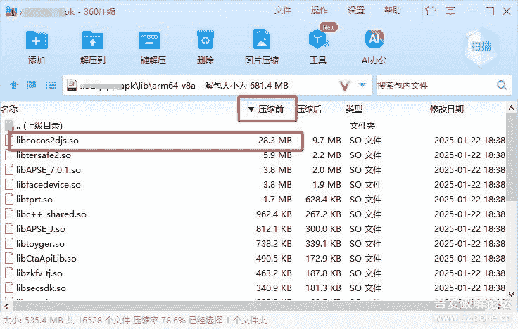

可以在 `./lib/arm64-v8a/` 路径下，看到最大的 so 文件为 `libcocos2djs.so`，可以初步确定本样本为 cocos2djs 开发。

### 二、需求

某个接口有个 `sign` 算法需要确定其计算的方式，先抓包看看

### 三、抓包

直接使用 root 真机，安装样本 app，尝试使用 postern 全局代理，发现 app 会出现断网的情况。改用 proxydroid，还是断网。最后使用 WIFI 代理，成功抓取到对应的数据包。

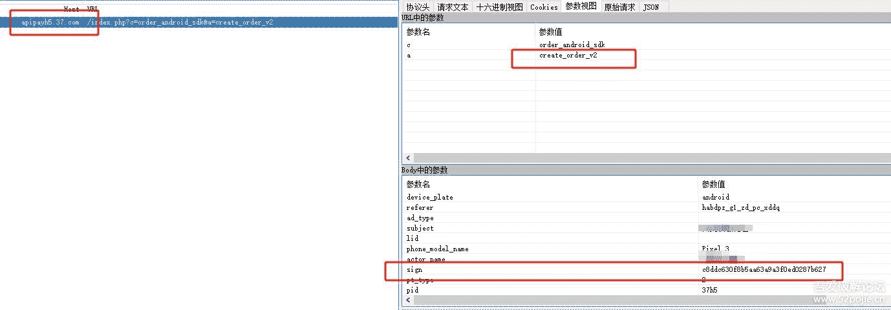

可以看到 `sign` 的位置，以及其他一些线索关键词：`create_order_v2`、`apipayh5`

### 四、分析

解压 app 到文件夹，直接 `cmd` 命令通过 `grep` 工具搜索关键词

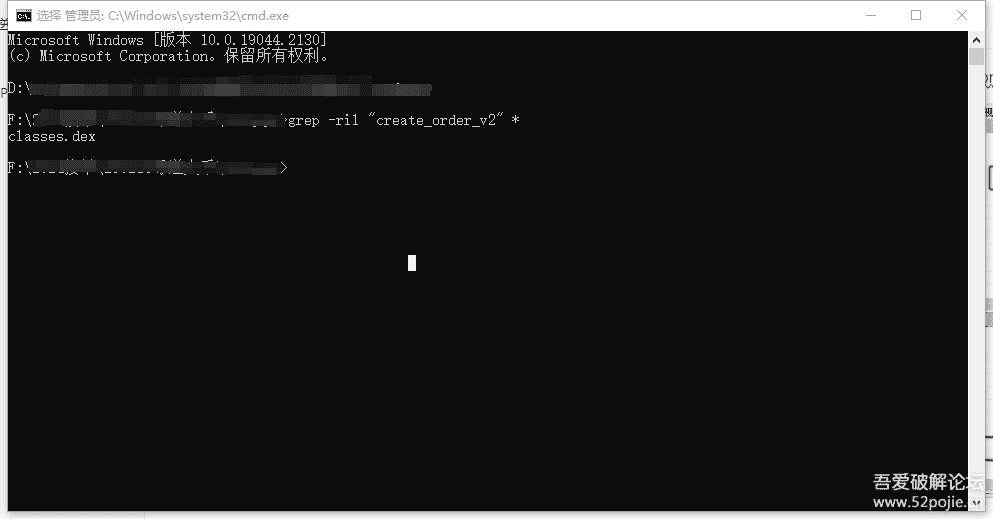

可以看到在 `classes.dex` 里面有线索，`jadx-gui` 直接拖入 dex 文件进行搜索

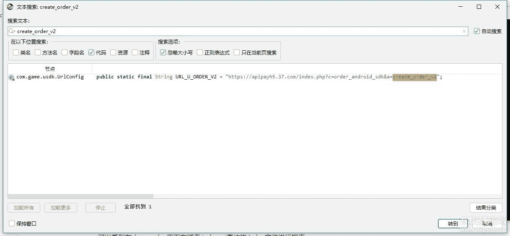

通过交叉引用一直往上找，最终定位到

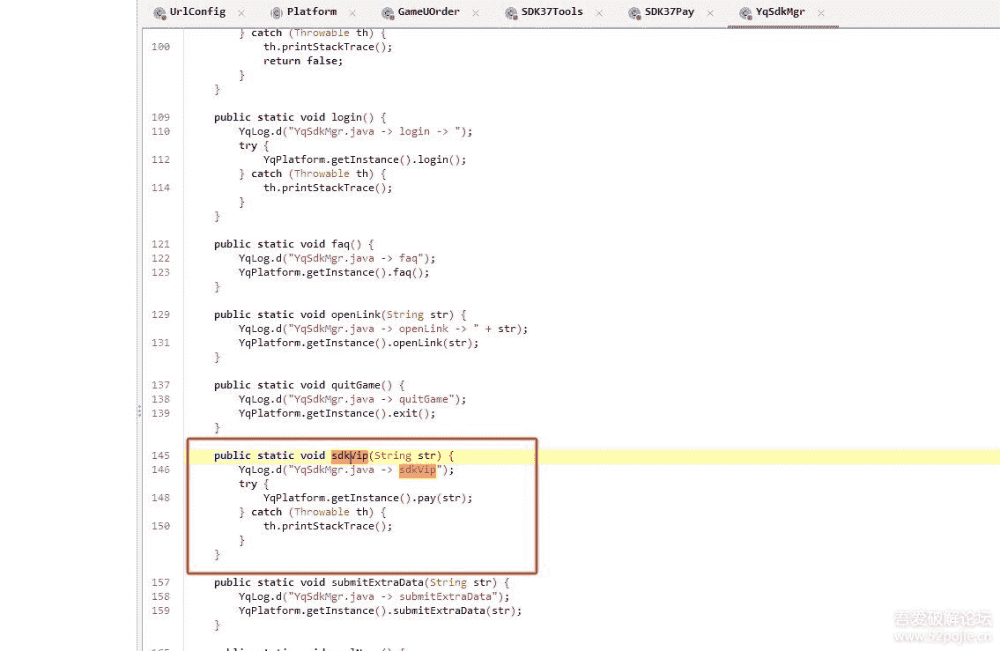

尝试 hook，查看一下调用堆栈。

```
let YqSdkMgr = Java.use("org.cocos2dx.javascript.plugin.YqSdkMgr");
YqSdkMgr["sdkVip"].implementation = function (str) {
    console.log(`YqSdkMgr.sdkVip is called: str=${str}`);
    this["sdkVip"](str);
};
```

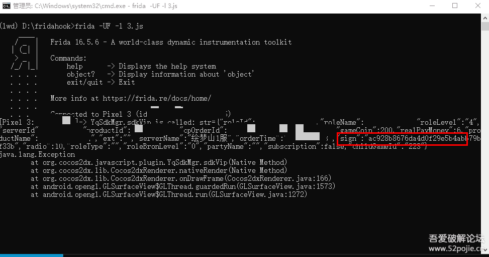

可以看到 `sign` 是作为参数传入的，咨询 AI 可知在 cocos2djs 框架开发的 app 中 jsc 文件里面才有对应的线索。在 `/assets` 里面随便找一个后缀 jsc 的文件打开看看先

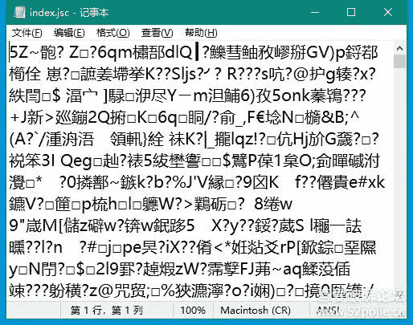

不出意外，核心代码做了加密，那么接下来就是寻找 jsc 的解密方法。

### 五、尝试

1. 根据经验，先将 `libcocos2djs.so` 拖入到 `winhex` 中搜索 `main.js`，结果如下

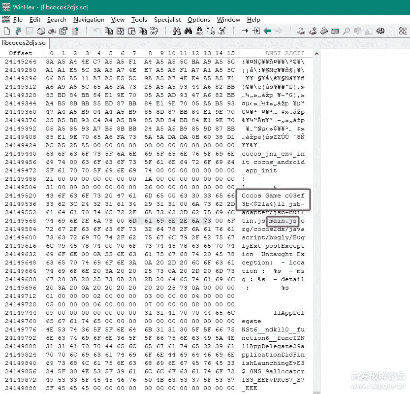

附近找到一个目测有点奇怪的字符串：`c03ef3b`

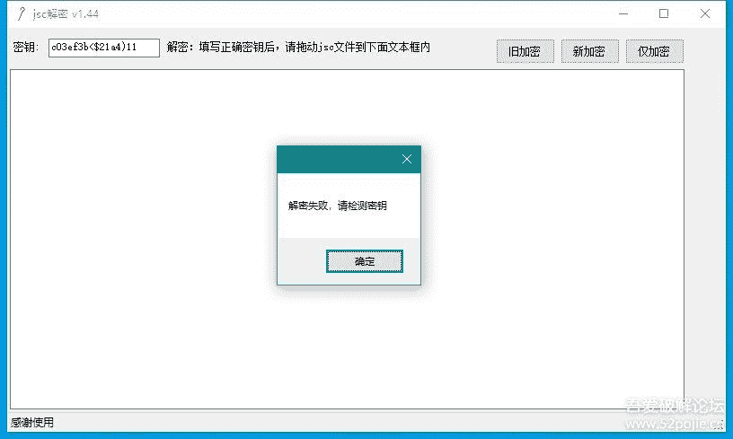

解密失败。看来得上强度了。

### 六、动手

根据大佬的分享可知 jsc 文件一般是使用 xxtea 算法进行加解密。以下是 frida 脚本

```
var so_name = "libcocos2djs.so";

var fun_name = "xxtea_decrypt";

function do_hook() {  

  var addr = Module.findExportByName(so_name, fun_name);

  console.log(addr); 

  Interceptor.attach(addr, {

      onEnter: function (args) {

                console.log('key: ' + Memory.readCString (args[2]));

      },

      onLeave: function (retval) {

      }

  })

}

function load_so_and_hook() {

  var dlopen = Module.findExportByName(null, "dlopen");

  var android_dlopen_ext = Module.findExportByName(null, "android_dlopen_ext");

  Interceptor.attach(dlopen, {

      onEnter: function (args) {

          var path_ptr = args[0];

          var path = ptr(path_ptr).readCString();

          console.log("[dlopen:]", path);

          this.path = path;

      }, onLeave: function (retval) {

          if (this.path.indexOf(so_name) !== -1) { // 如果包含我想要的so文件

              console.log("[dlopen:]", this.path);

              do_hook();

          }

      }

  });

  Interceptor.attach(android_dlopen_ext, {

      onEnter: function (args) {

          var path_ptr = args[0];

          var path = ptr(path_ptr).readCString();

          this.path = path;

      }, onLeave: function (retval) {

          if (this.path.indexOf(so_name) !== -1) {

              console.log("\nandroid_dlopen_ext加载：", this.path);

              do_hook();

          }

      }

  });

}

load_so_and_hook();
```

通过 `spwan` 方式启动 app，并且在加载对应的 so 后执行 `xxtea_decrypt` 的解密，可以 hook 到对应的秘钥

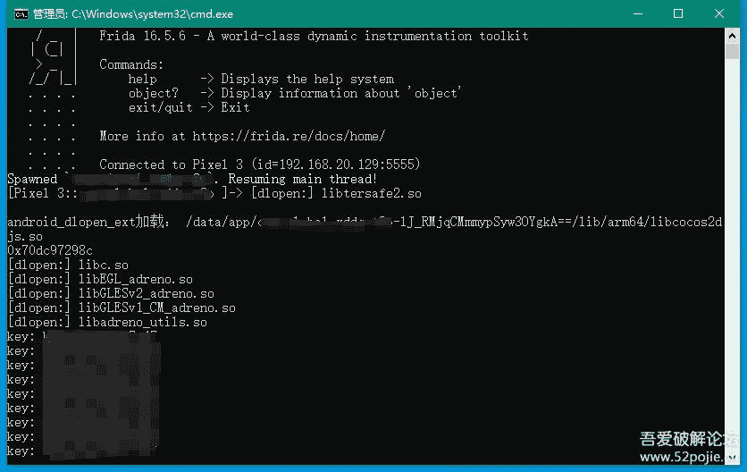

可以看到已经 hook 到对应的秘钥，再次尝试拖入 `JscDecodeCsharp` 进行解密：

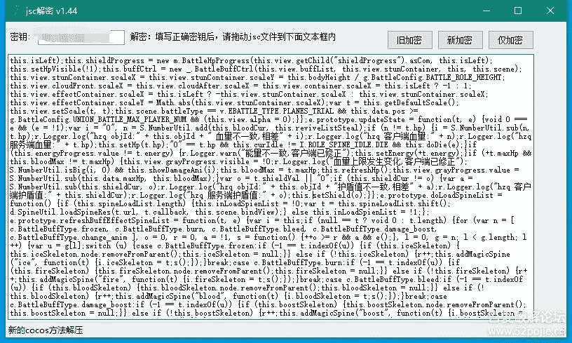

可以看到，已经解密得到核心 js 代码。但是还有一个问题，`assets` 里面的 jsc 文件很多，一个一个解密定位很浪费时间。尝试寻找有没有批量解密的工具或者代码

最终在万能的 github 找到：

`https://github.com/MikaCybertron/Tool-Encryption-Decryption-JSC-Files-for-Cocos2djs-Games`

里面有两份工具，一份是 exe 格式的，经测试，无法解密。还有一份是 python 代码，尝试在 window10 上面根据流程安装依赖库并执行，提示缺少 C++14，无法运行。

于是更换使用 ubuntu 系统，成功批量解密所有 jsc 文件。

然后使用 `grep` 最终定位到核心代码位置如下

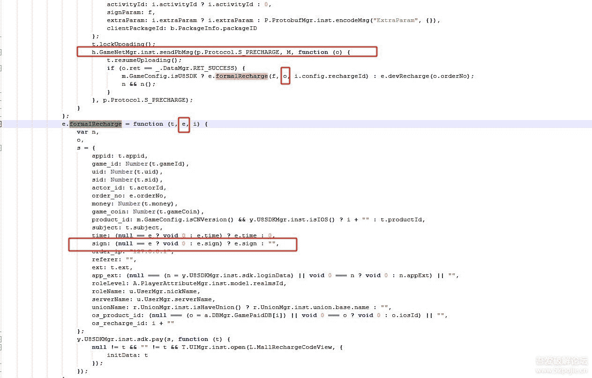

可以看到 `sign` 是通过 protobuf，服务器下发的，`signParam` 应该就是用来签名的原始文本，但是具体算法在服务器执行，无法本地还原。

至于分析 protobuf 协议，看着头大，直接拖回收站去吧 -_-

### 七、后记

分析到此结束，侵权请联系我删贴。

记得之前分析过一个 LuaJIT 的样本，所有核心代码，都是字节码的形式，感觉安全系数要高得多。

最后，如果你看到了这里，麻烦伸出你发财的右手，帮我转评赞来一套，也欢迎小伙伴一起学习交流，完结，撒花！

ps:不接单,谢谢.
