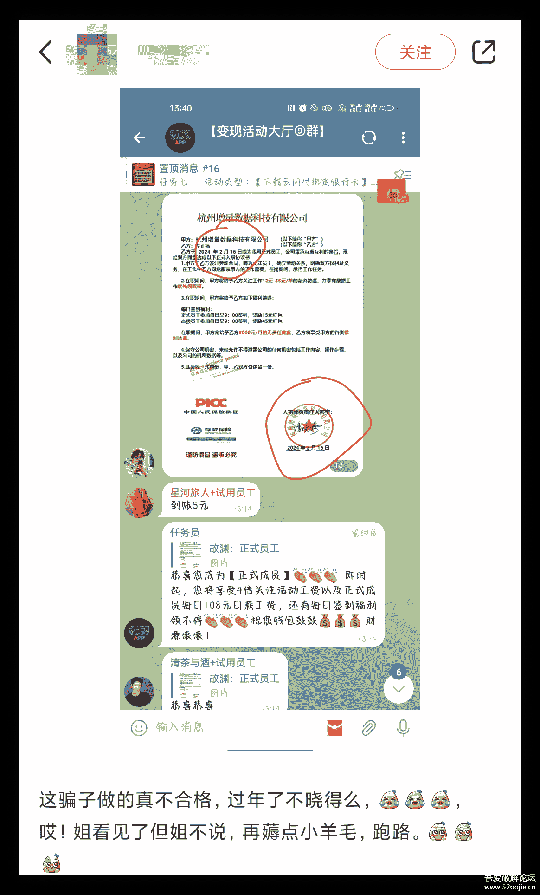
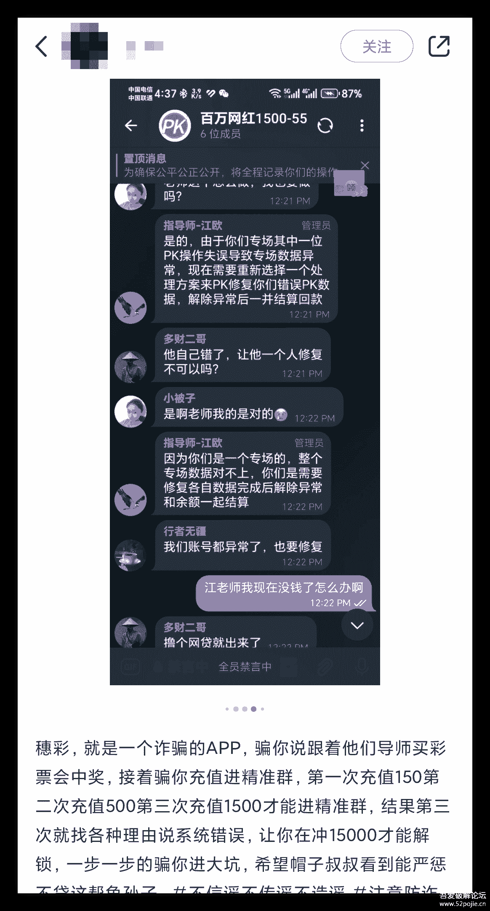
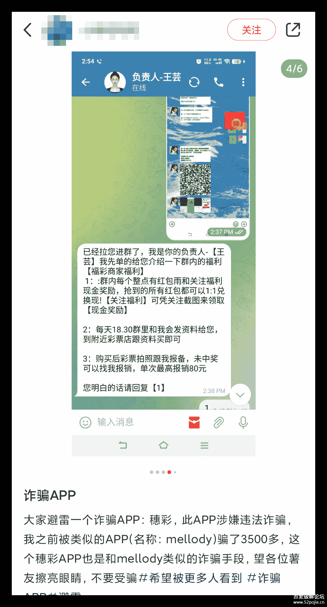
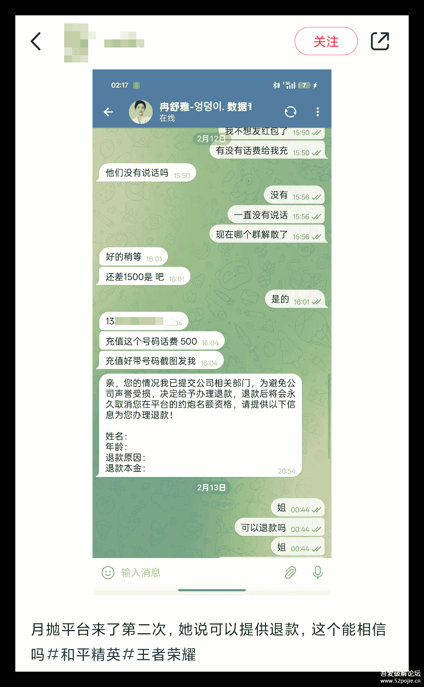
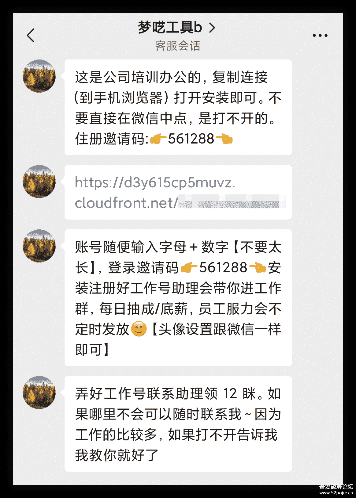
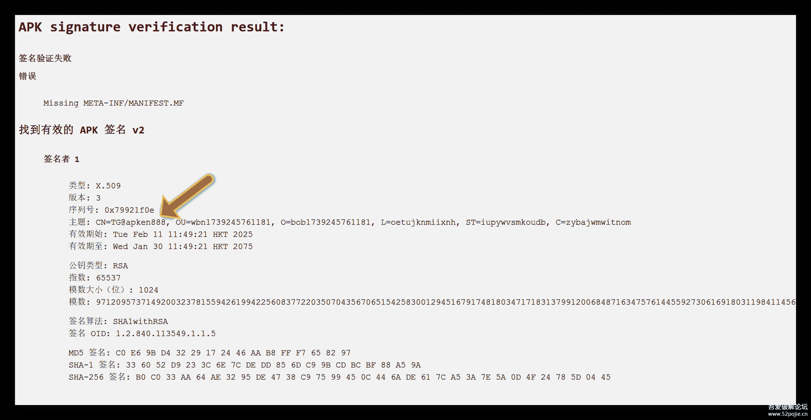
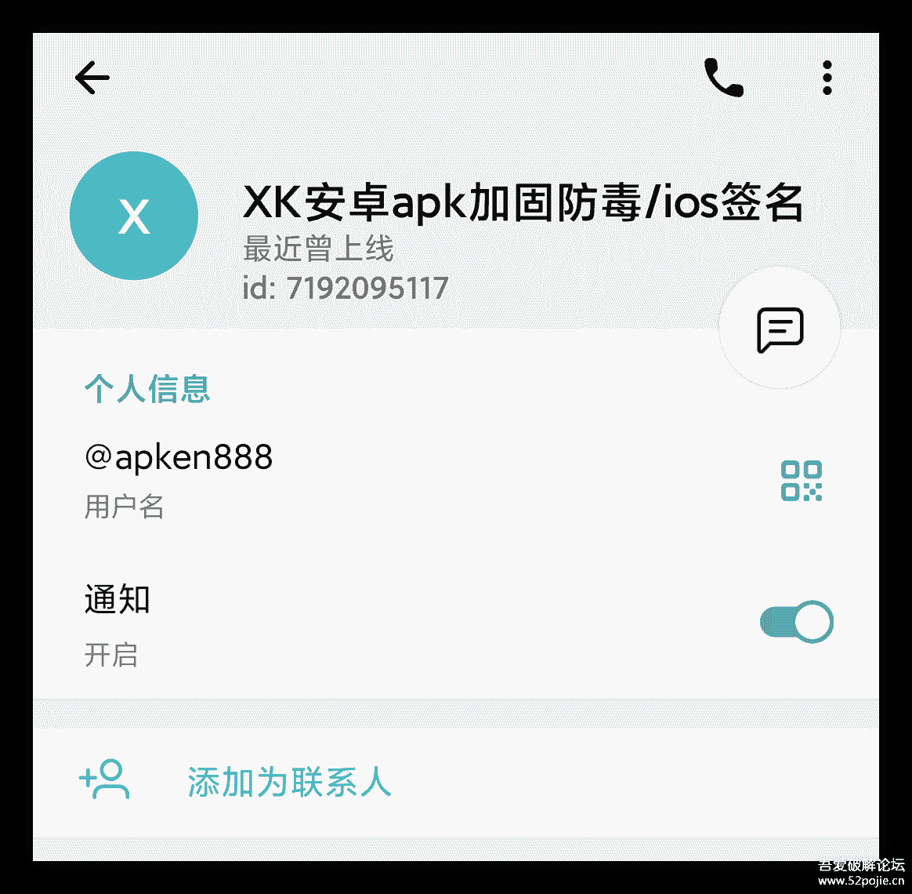
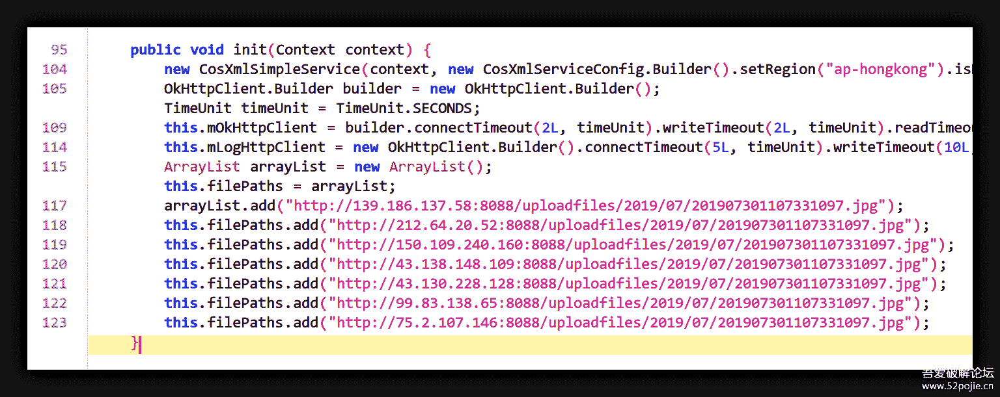

# [Android 原创] 深度揭秘：全仿 Telegram 诈骗软件的幕后技术链条

- 原帖: https://www.52pojie.cn/forum.php?mod=viewthread&tid=2007380
- 抓取时间: 2026-11-01T23:57:46

## 背景
在一次偶然的网络浏览中，我遇到了一系列令人起疑的诈骗软件。这些软件虽然图标与名称各异，但其内部界面却如同 Telegram 的孪生兄弟，惊人的相似。更令人费解的是，它们涉及的诈骗场景广泛，从刷单、返现到彩票、菠菜、招女票，无所不包，仿佛是为满足各种诈骗需求而量身定制的全场景工具。

`Screenshot_2025-02-17-11-59-53-296_com.xingin.xhs.png` (851.91 KB, 下载次数: 0)
[href="forum.php?mod=attachment&aid=Mjc1NTcyNHw5Yzg3ZGE3OHwxNzkzNTc3NDYzfDE2ODA4NnwyMDA3Mzgw&nothumb=yes" target="_blank"](https://www.52pojie.cn/forum.php?mod=attachment&aid=Mjc1NTcyNHw5Yzg3ZGE3OHwxNzkzNTc3NDYzfDE2ODA4NnwyMDA3Mzgw&nothumb=yes)
2025-2-18 15:17 上传

`Screenshot_2025-02-17-12-02-48-567_com.xingin.xhs.png` (752.17 KB, 下载次数: 0)
[href="forum.php?mod=attachment&aid=Mjc1NTcyNXxiYWJmMTI1MXwxNzkzNTc3NDYzfDE2ODA4NnwyMDA3Mzgw&nothumb=yes" target="_blank"](https://www.52pojie.cn/forum.php?mod=attachment&aid=Mjc1NTcyNXxiYWJmMTI1MXwxNzkzNTc3NDYzfDE2ODA4NnwyMDA3Mzgw&nothumb=yes)
2025-2-18 15:17 上传

`Screenshot_2025-02-17-12-03-24-439_com.xingin.xhs.png` (888.15 KB, 下载次数: 0)
[href="forum.php?mod=attachment&aid=Mjc1NTcyNnxmOGIwZWQwZXwxNzkzNTc3NDYzfDE2ODA4NnwyMDA3Mzgw&nothumb=yes" target="_blank"](https://www.52pojie.cn/forum.php?mod=attachment&aid=Mjc1NTcyNnxmOGIwZWQwZXwxNzkzNTc3NDYzfDE2ODA4NnwyMDA3Mzgw&nothumb=yes)
2025-2-18 15:18 上传

`Screenshot_2025-02-17-11-59-46-836_com.xingin.xhs.png` (737.33 KB, 下载次数: 0)
[href="forum.php?mod=attachment&aid=Mjc1NTcyN3w4MDVmMWQwM3wxNzkzNTc3NDYzfDE2ODA4NnwyMDA3Mzgw&nothumb=yes" target="_blank"](https://www.52pojie.cn/forum.php?mod=attachment&aid=Mjc1NTcyN3w4MDVmMWQwM3wxNzkzNTc3NDYzfDE2ODA4NnwyMDA3Mzgw&nothumb=yes)
2025-2-18 15:18 上传

面对如此精妙的设计，我不禁好奇：这些软件究竟是直接修改了官方版，还是完全从零开始打造的呢？

## 诈骗软件的 “精细化” 运营
如今的诈骗分子，在筛选目标客户群体时，已经展现出了极高的精细化程度。他们不再满足于广撒网式的诈骗手段，而是更加注重精准定位，利用专业的套路和软件实施诈骗。为了获取诈骗样本，我前前后后套路了小半个月，往抖音、快手直播间投了一堆简历（女 / 25-30 岁 / 打字员），终于有 2 个骗子上钩了。

`Screenshot_2025-02-17-09-41-00-023_com.tencent.mm-edit.png` (348.61 KB, 下载次数: 0)
[href="forum.php?mod=attachment&aid=Mjc1NTcyOHw4NTJhODEwY3wxNzkzNTc3NDYzfDE2ODA4NnwyMDA3Mzgw&nothumb=yes" target="_blank"](https://www.52pojie.cn/forum.php?mod=attachment&aid=Mjc1NTcyOHw4NTJhODEwY3wxNzkzNTc3NDYzfDE2ODA4NnwyMDA3Mzgw&nothumb=yes)
2025-2-18 15:18 上传

`64ba5797dba42315fb3c42256c066bb5.gif` (951.73 KB, 下载次数: 0)
[href="forum.php?mod=attachment&aid=Mjc1NTcyOXw5ZDA3NTMzM3wxNzkzNTc3NDYzfDE2ODA4NnwyMDA3Mzgw&nothumb=yes" target="_blank"](https://www.52pojie.cn/forum.php?mod=attachment&aid=Mjc1NTcyOXw5ZDA3NTMzM3wxNzkzNTc3NDYzfDE2ODA4NnwyMDA3Mzgw&nothumb=yes)
2025-2-18 15:18 上传

## 逆向分析

### 签名分析
在通过精心设计的钓鱼策略后，我成功获取了两个诈骗软件的样本，其面对的场景不同，一个是刷单返利诈骗，还有一个是彩票包中奖诈骗。但是他们的版本是一致的，都是 9.6.6，而且界面也几乎完全一致。首先，我查看了软件的签名信息，虽然签名中无法直接获取具体信息，但发现了一个明显的联系方式，指向一个 `APK` 防毒服务提供商。（PS: 这里提一嘴，下载安装包的时候可以发现，即使是用同一个链接下载的，下载回来的安装包包名也没有一致的，似乎是自动随机生成的）。

`sshot-18.png` (197 KB, 下载次数: 0)
[href="forum.php?mod=attachment&aid=Mjc1NTczMHw5ZjMxNzYxYnwxNzkzNTc3NDYzfDE2ODA4NnwyMDA3Mzgw&nothumb=yes" target="_blank"](https://www.52pojie.cn/forum.php?mod=attachment&aid=Mjc1NTczMHw5ZjMxNzYxYnwxNzkzNTc3NDYzfDE2ODA4NnwyMDA3Mzgw&nothumb=yes)
2025-2-18 15:19 上传

`Screenshot_2025-02-17-14-34-42.png` (98.12 KB, 下载次数: 0)
[href="forum.php?mod=attachment&aid=Mjc1NTczMXxiYzk3MGZlZnwxNzkzNTc3NDYzfDE2ODA4NnwyMDA3Mzgw&nothumb=yes" target="_blank"](https://www.52pojie.cn/forum.php?mod=attachment&aid=Mjc1NTczMXxiYzk3MGZlZnwxNzkzNTc3NDYzfDE2ODA4NnwyMDA3Mzgw&nothumb=yes)
2025-2-18 15:19 上传

然而，深入分析后发现，该防毒服务似乎只是随机更改了安装包名，而未进行任何实质性的加壳处理。（那多少有点黑吃黑了，连壳都不加，就改个包名也算防毒？）这让我怀疑，该服务提供商可能并不具备开发诈骗软件的能力，真正的开发者另有其人。（PS: 能傻到去 Telegram 买防毒的，估计作者也不是很懂，毕竟这种一看就是纯骗钱。找个白手套用免费的 360 加固都比这玩意好使多了）。

### 初见端倪
由于没有加壳，直接拖进 `JADX` 就可以反编译了，反编译的包名连混淆都没得，一眼就能发现 `org.telegram` 包，其内容结构和 Telegram 的官方安装包基本一致。因此可以初步断定，这个应用和 Telegram 有密不可分的关联。

分析一个聊天软件，最重要的就是逆向其通信协议。对于仿 Telegram 的软件来说，由于 Telegram 早就在国内被屏蔽，因此首要分析的是这款软件是如何连接到后端服务器的。

通过 URL 筛选，不难找到在 `cos.MyCOSService` 中存在大量相似 URL，初步怀疑是远程配置文件。（PS: 这里的服务器大部分都部署在腾讯云上，多少也有点胆子太大了，怕蜀黍请不到人？）

`sshot-16.png` (189.3 KB, 下载次数: 0)
[href="forum.php?mod=attachment&aid=Mjc1NTczMnw0NmEwNTUwYXwxNzkzNTc3NDYzfDE2ODA4NnwyMDA3Mzgw&nothumb=yes" target="_blank"](https://www.52pojie.cn/forum.php?mod=attachment&aid=Mjc1NTczMnw0NmEwNTUwYXwxNzkzNTc3NDYzfDE2ODA4NnwyMDA3Mzgw&nothumb=yes)
2025-2-18 15:20 上传

IP |
归属地 |
139.186.137.58
