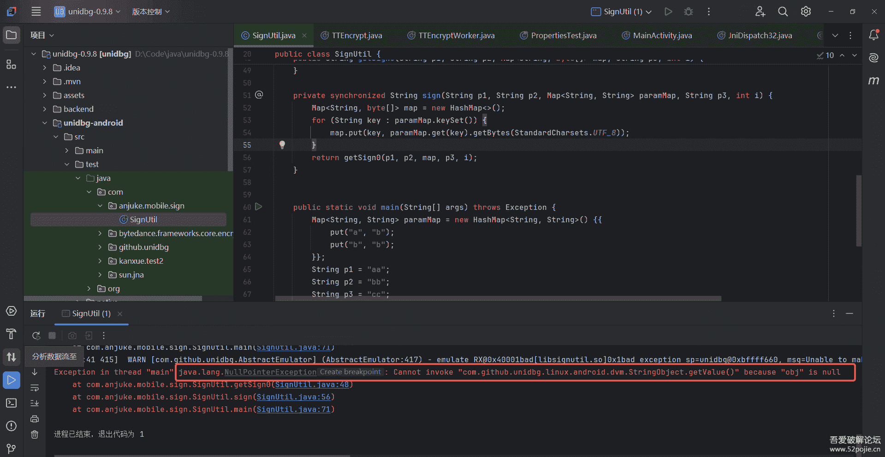
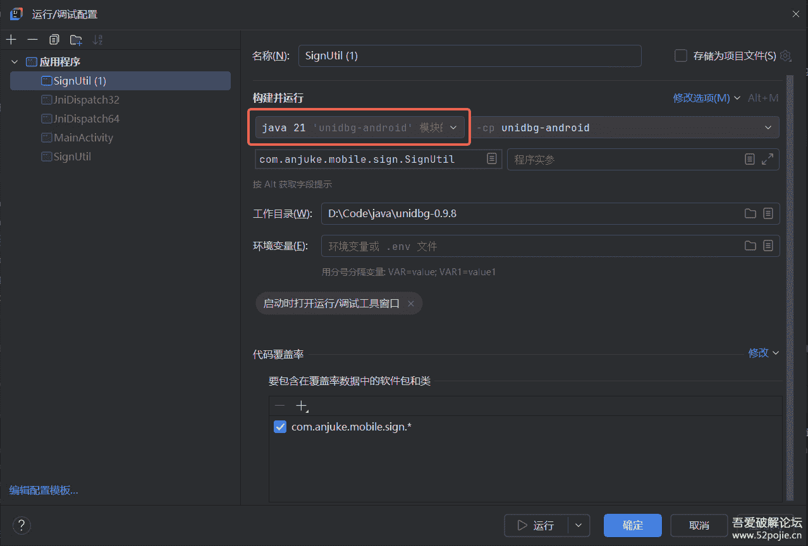
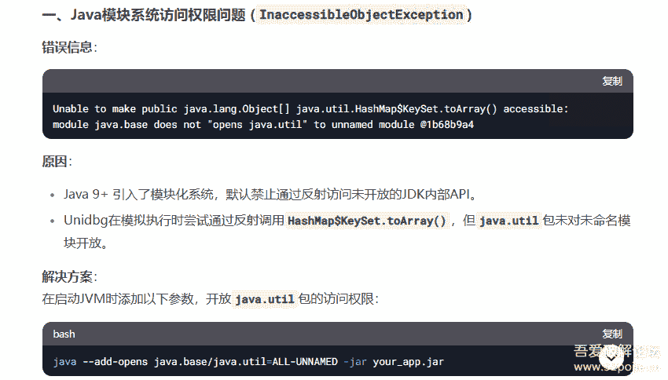
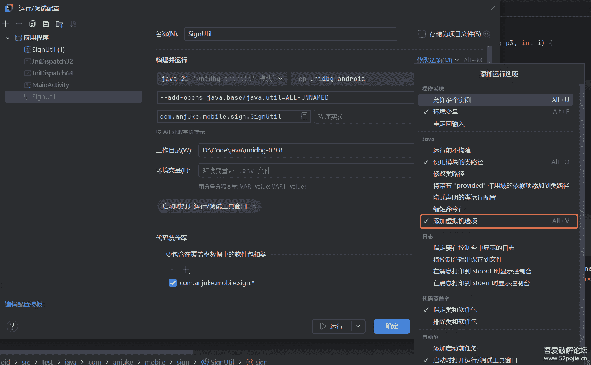
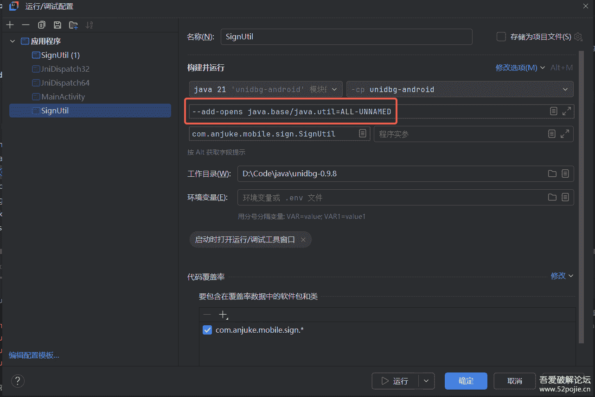
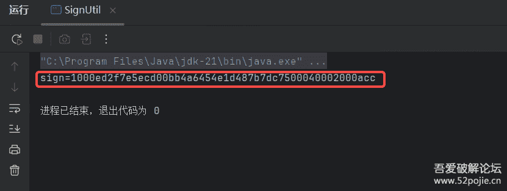

# [Android 分享] unidbg 0.9.8 解决java高版本anjuke示例代码空指针异常问题

- 原帖: https://www.52pojie.cn/forum.php?mod=viewthread&tid=2007624
- 抓取时间: 2026-11-01T16:06:36.228Z

看了很多大佬的`unidbg`教程，想自己也来试试，随即下载`idea` `unidbg0.9.8`版本，由于电脑已经安装了高版本的`java`，直接启动，然后就报错了

上截图：

如图所示，这是`unidbg`中的示例代码

使用的是`java21`版本运行，报了空指针异常

## 解决办法

现在AI这么发达，直接问AI吧，AI真好用

现在我们已经知道了是`java`高版本中的权限问题，需要添加参数

`--add-opens java.base/java.util=ALL-UNNAMED`

## 操作步骤

1. 修改运行配置，在构建并运行中右边的修改选项中添加[虚拟机](https://www.52pojie.cn/thread-661779-1-1.html)选项

2. 添加之前的参数，确保权限正确

3. 测试运行，这次我们就得到了想要的结果

