# [Android 脱壳] 记录一次加固逆向分析以及加固步骤详解

- 原帖: https://www.52pojie.cn/forum.php?mod=viewthread&tid=2008061
- 抓取时间: 2026-11-01T16:06:33.057Z

## 前言

最近想要重点学习一下类抽取这种类型的加固是如何实现的，故在网上搜寻。最终看到了luoyesiqiu大佬的dpt-shell这个项目。对这个项目研究后发现这一款开源加固已经可以说很成熟了。故先对其逆向分析后再从代码层面研究如何实现的。

项目地址：[//github.com/luoyesiqiu/dpt-shell](https://github.com/luoyesiqiu/dpt-shell:https)

分析版本：V1.12.2

## 准备阶段

欸嘿，是时候请出来之前的老朋友了（在之前分析某加固时用到的demo），然后采用dptshell进行加固

非常的方便，只需要现在编译好了的 `dpt.jar`，然后在命令框念出如下咒语：

（吾爱破解传不了大附件，又不太像搞网盘，附件就放一个脚本吧）

```
java -jar dpt.jar -f /path/to/apk
```

等待程序吟唱：

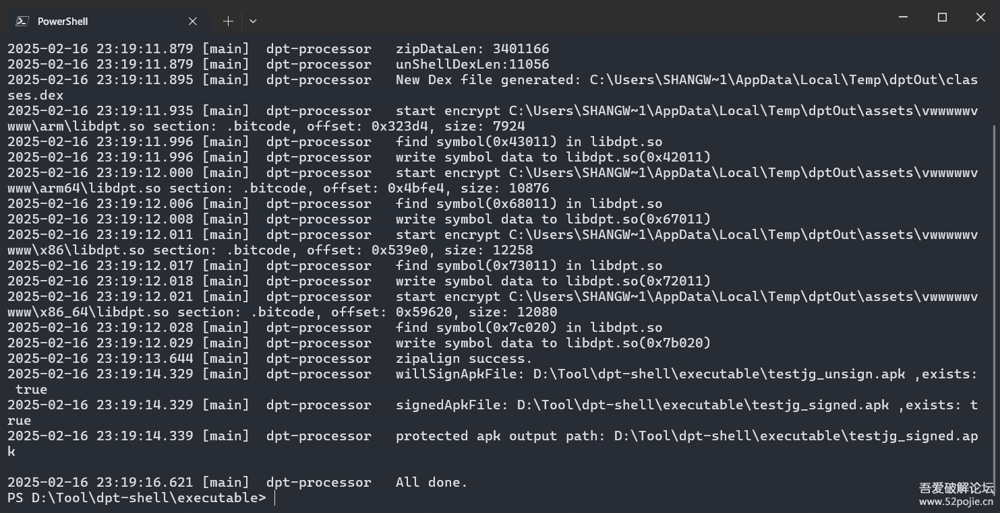

吟唱结束我们就得到了：

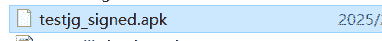

（wow，太贴心了，还帮我们进行了签名）

另外如果不想签名可以看如下帮助：

```
usage: java -jar dpt.jar [option] -f 

 -c,--disable-acf      Disable app component factory(just use for debug).

 -d,--dump-code        Dump the code item of DEX and save it to .json

                       files.

 -D,--debug            Make apk debuggable.

 -f,--apk-file    Need to protect apk file.

 -l,--noisy-log        Open noisy log.

 -x,--no-sign          Do not sign apk.
```

## 3> 逆向分析

### 4> 壳处理逻辑初步分析

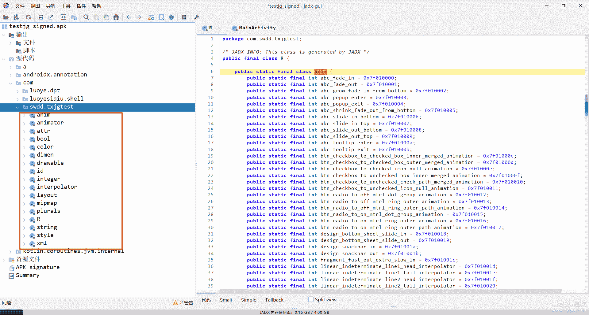

这里可以发现类都已经被抽取了。

首先我们可以看到工厂类已经被替换成了壳的代理工厂类

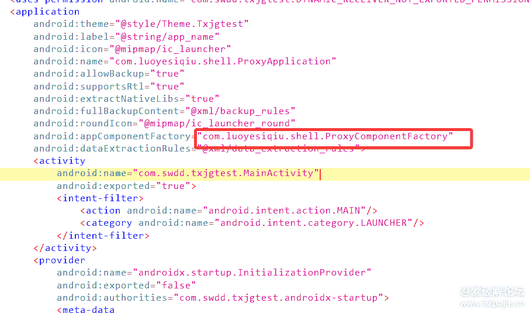

那么这里其实就涉及到了一个知识点：

这个 `androidx.core.app.AppComponentFactory` 是用来动态控制组件示例话的，允许在 `Activity`、`Service`、`BroadcastReceiver`、`ContentProvider` 等组件被系统创建时拦截并替换其实例。dptshell 在此处进行壳 `so` 的加载，以及对一些系统函数的 Hook。

详细的我们可以继续往下面看

`ActivityThread.handleBindApplication()` 是按照什么顺序加载 APK 并加载应用程序组件的呢，我们可以看下图：

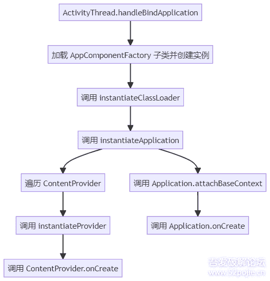

这里我们着重要看的就是 `instantiateClassLoader` 这个方法了。

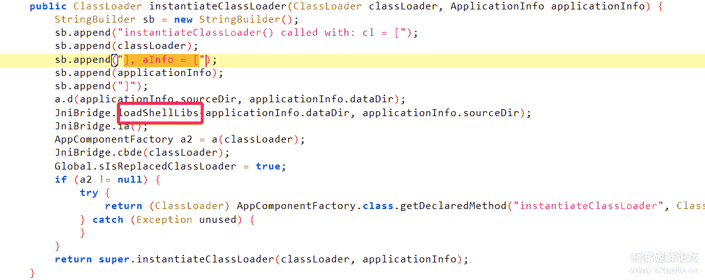

这里主要载入了壳 `so`，然后到达代理 `Application`，完成了源 dex 的 `Application` 的替换了生命周期函数的调用，开始运行源 dex 的程序代码，并且为了其能够被正常加载做处理，后续会在源码分析中，详细来分析。

### 4> 壳 `so` 解密分析

那么对于此类抽取壳的分析，当然是要从 Native 层入手了。

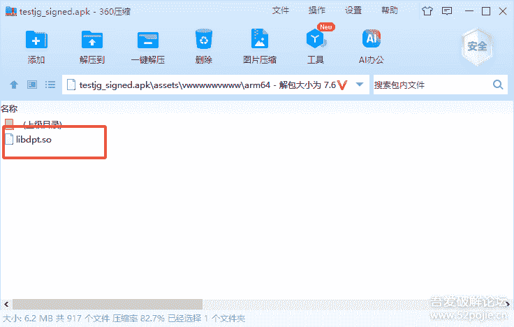

这里我们选择分析 arm64 架构下的 `dpt.so`

这里我们直接 IDA 打开会发现 ELF 文件中 `bitcode` 段都被加密了

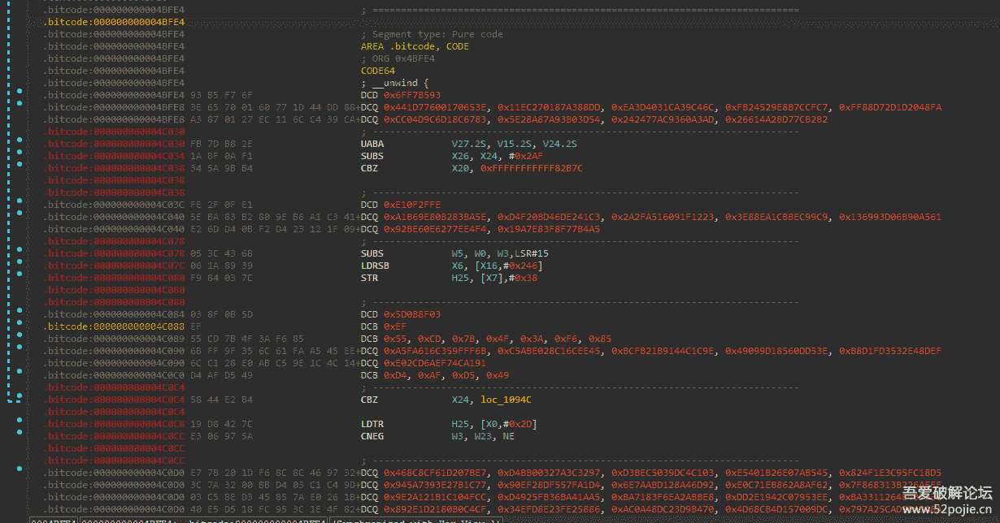

#### 5> 静态解密 `bitcode` 段

一般出现这种情况我们就需要在从 `initArray` 段入手分析了，应为 `initArray` 段执行的是构造函数，在 `loadlibray` 之后就会立马被 `linker` 所执行。

正好我们在 `initArray` 段的 `sub_C67C` 函数中发现了如下函数：

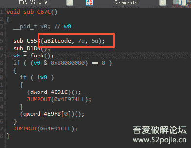

函数直接就以 `bitCode` 作为参数了，实属可疑

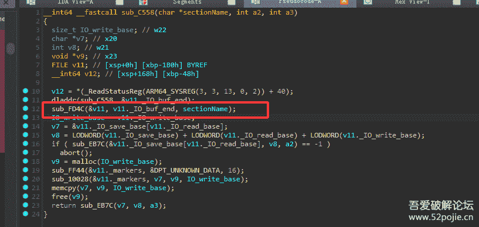

`sectionName` 被传入了 `sub_FD4C`，这里就是在寻找 `bitcode` 段的地址，好对其进行后续的处理

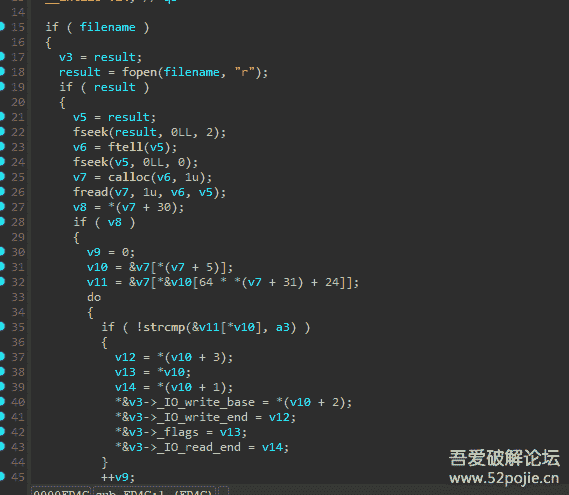

在 `sub_EB7C` 对内存页的权限进行修改，我们可以在 `segment` 窗口中看到 `bitcode` 段的权限是不可写的，所以要通过 `mprotect` 来修改内存页的权限，方便对代码进行动态解密。

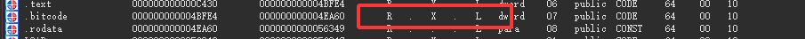

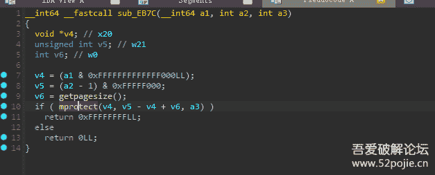

那么上面分析完了，内存页权限修改完了，接下来要做的就是对内存中被加密的字节进行解密了，

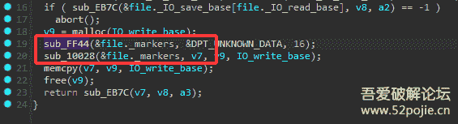

流程上来看肯定就是这两个了。

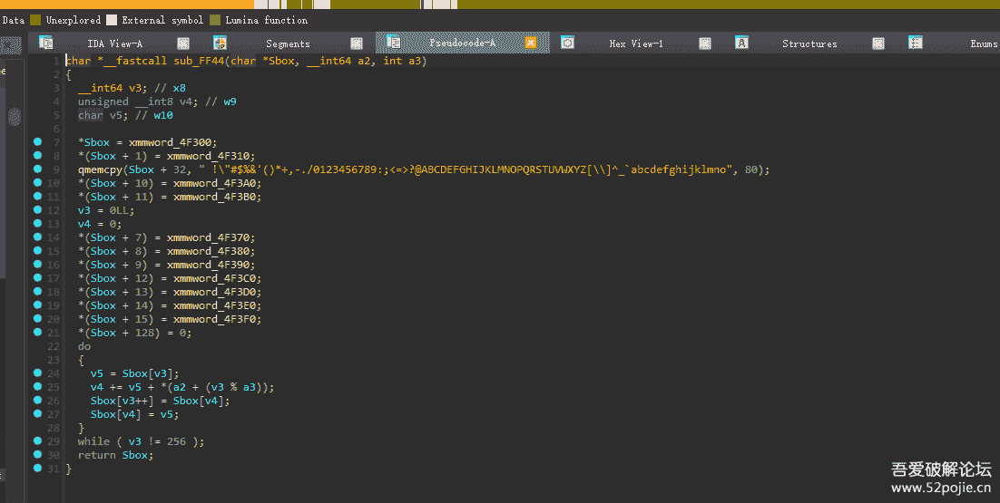

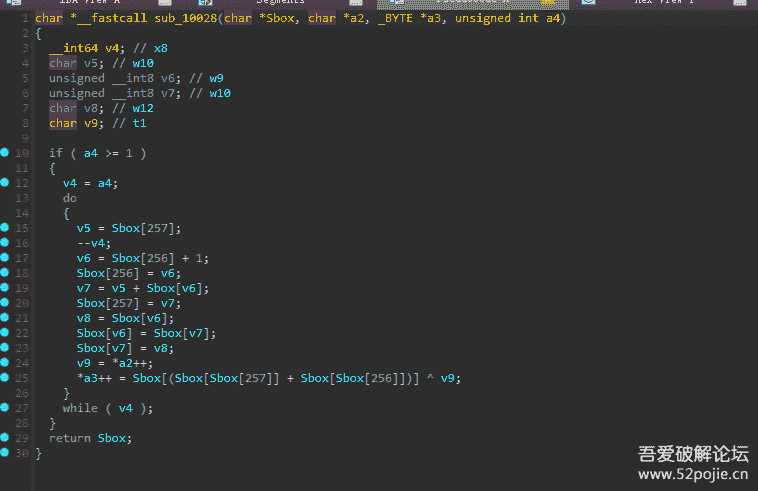

相信大家都能一眼看出来这个是一个 RC4 吧。

根据下面的参数可以找到 `key`

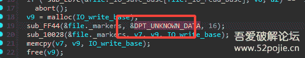

这里需要注意的是，`key` 的长度被限定到了 16，我们在写代码的时候不能用 `lenkey`，因为 `key` 后面很多 0。

使用 `idapython` 解密 `bitcode` 段：

```
import idc
import ida_segment
import idautils

def rc4_decrypt(key, data):
    """RC4解密实现"""
    S = list(range(256))
    j = 0
    out = []

    # KSA初始化
    for i in range(256):
        j = (j + S[i] + key[i % 16]) % 256
        S[i], S[j] = S[j], S[i]

    # PRGA生成密钥流并解密
    i = j = 0
    for byte in data:
        i = (i + 1) % 256
        j = (j + S[i]) % 256
        S[i], S[j] = S[j], S[i]
        k = S[(S[i] + S[j]) % 256]
        out.append(byte ^ k)
    return bytes(out)

def decrypt_bitcode():
    # 配置目标段名（根据步骤1结果修改）
    target_segment = ".bitcode"  # 修改为你的段名

    # 获取段对象
    seg = ida_segment.get_segm_by_name(target_segment)
    if not seg:
        print(f"[!] 错误：未找到段 '{target_segment}'")
        return

    start_ea = seg.start_ea
    end_ea = seg.end_ea
    print(f" 找到段 {target_segment}: 0x{start_ea:X}-0x{end_ea:X}")

    # 读取加密数据
    encrypted_data = idc.get_bytes(start_ea, end_ea - start_ea)
    if not encrypted_data:
        print("[!] 错误：无法读取段数据")
        return

    # 定义RC4密钥
    rc4_key = bytes([
        0xE5, 0x5E, 0x5A, 0x20, 0x2C, 0x25, 0xD9, 0x1C, 0x72, 0x74,
        0x2E, 0x36, 0x99, 0x02, 0x80, 0x06, 0x00, 0x00, 0x00, 0x00,
        0x00, 0x00, 0x00
    ])

    # 执行解密
    decrypted_data = rc4_decrypt(rc4_key, encrypted_data)
    print("[+] 解密完成，正在写回IDA数据库...")

    # 临时修改段权限为可写
    original_perms = idc.get_segm_attr(start_ea, idc.SEGATTR_PERM)
    idc.set_segm_attr(start_ea, idc.SEGATTR_PERM, 0x7)  # RWX

    # 逐字节修补数据
    for offset, byte in enumerate(decrypted_data):
        idc.patch_byte(start_ea + offset, byte)

    # 恢复段权限
    idc.set_segm_attr(start_ea, idc.SEGATTR_PERM, original_perms)

    print("[+] 解密数据已成功写入，建议重新分析代码区域！")
    print("    操作完成！")

# 执行解密函数
decrypt_bitcode()
```

执行完后保存再重载文件会看到 `bitcode` 段代码被成功识别了：

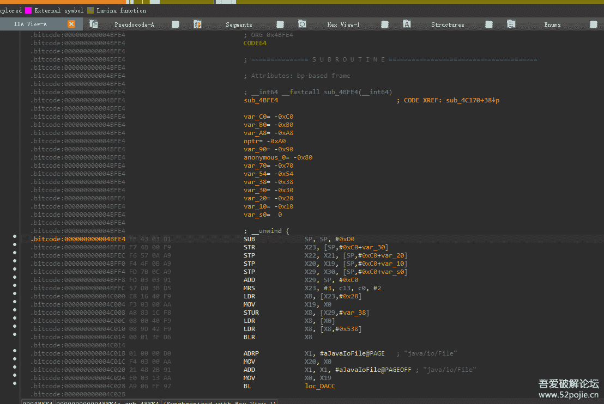

#### 5> 内存中 `dump` 解密了的 `bitcode`

Dump SO 的话，不管你用 GDA 也好，还是什么小工具都可以，我这里展示 frida 的。

frida 的话首先还是得 hook `dlopen` 找到 `dlopen` 打开我们需要 dump 的 `so` 的时机，然后就可以开始获取 `so` 的 `Base` 和 `Size` 了，具体实现如下：

```
function my_hook_dlopen(soName,index) {
    //mapsRedirect();
    //hook_memcmp_addr();
    Interceptor.attach(Module.findExportByName(null, "android_dlopen_ext"),
        {
            onEnter: function (args) {
                var pathptr = args[0];
                if (pathptr !== undefined && pathptr != null) {
                    var path = ptr(pathptr).readCString();
                    if (path.indexOf(soName) >= 0) {
                        this.is_can_hook = true;
                    }
                }
            },
            onLeave: function (retval) {
                if (this.is_can_hook) {
                    if (index == 1) {
                        NativeFunc();
                        dump_so(soName);
                    } else {
                        dump_so2(soName);
                    }
                }
            }
        }
    );
}

function dump_so2(so_name) {
    var libso = Process.getModuleByName(so_name);
    console.log("[name]:", libso.name);
    console.log("[base]:", libso.base);
    console.log("[size]:", ptr(libso.size));
    console.log("[path]:", libso.path);
    var file_path = "/sdcard/Download/" + libso.name + "_" + libso.base + "_" + ptr(libso.size) + ".so";
    var file_handle = new File(file_path, "wb");
    if (file_handle && file_handle != null) {
        Memory.protect(ptr(libso.base), libso.size, 'rwx');
        var libso_buffer = ptr(libso.base).readByteArray(libso.size);
        file_handle.write(libso_buffer);
        file_handle.flush();
        file_handle.close();
        console.log("[dump]:", file_path);
    }
}

function dump_so(so_name) {
    var libso = Process.getModuleByName(so_name);
    console.log("[name]:", libso.name);
    console.log("[base]:", libso.base);
    console.log("[size]:", ptr(libso.size));
    console.log("[path]:", libso.path);
    var file_path = "/data/data/cn.pbcdci.fincryptography.appetizer/" + libso.name + "_" + libso.base + "_" + ptr(libso.size) + ".so";
    var file_handle = new File(file_path, "wb");
    if (file_handle && file_handle != null) {
        Memory.protect(ptr(libso.base), libso.size, 'rwx');
        var libso_buffer = ptr(libso.base).readByteArray(libso.size);
        file_handle.write(libso_buffer);
        file_handle.flush();
        file_handle.close();
        console.log("[dump]:", file_path);
    }
}

setImmediate(my_hook_dlopen("libdpt.so",2));
```

这里 `dump_so` 1 和 2 的区别在于一个是 `dump` 到私有目录，另一个是 `sdcard`，到 `sdcard` 是为了方便我们 `pull`，所以我默认使用 2。

启动！

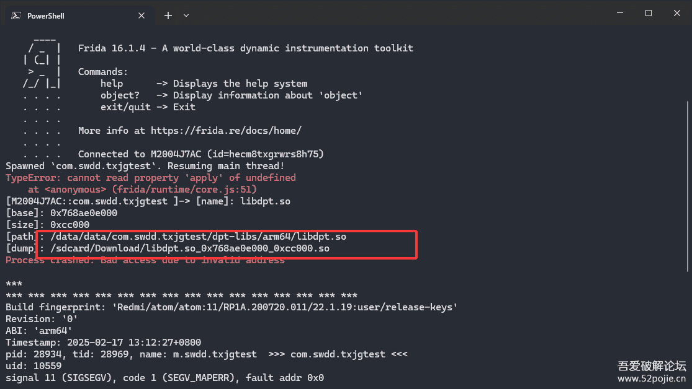


欸嘿，虽然sodump下来了但是居然崩溃了，显然是frida被检测了，但是问题不大我们稍后分析。

先看看dump下来的so，dump的内存中的SO通常IDA是没有办法识别出导入导出表和一些字符的，需要用SOFixer来修正：

注意`-m`的参数是我们so在内存中的基地址。

``` 
D:\Tool\SoFixer\SoFixer-Windows-64.exe -s E:\文章\dpt-shell分析\动态\libdpt.so_0x768ae0e000_0xcc000.so  -o libdpt.so -m 0x768ae0e000 -d
```

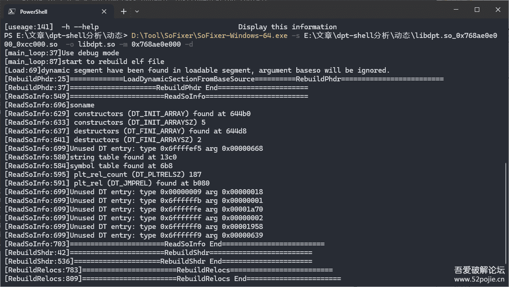

这样就是修复好了，打开IDA检查一下：

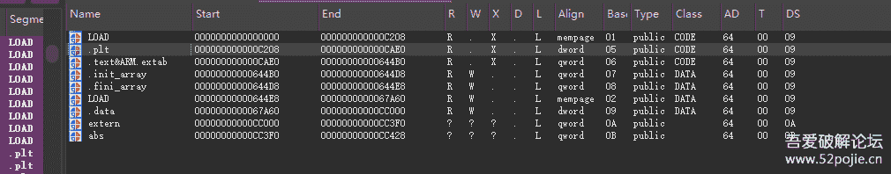

发现已经没有bitcode段了，可能是由于section节不完整，但是对应的代码肯定是被解密的：

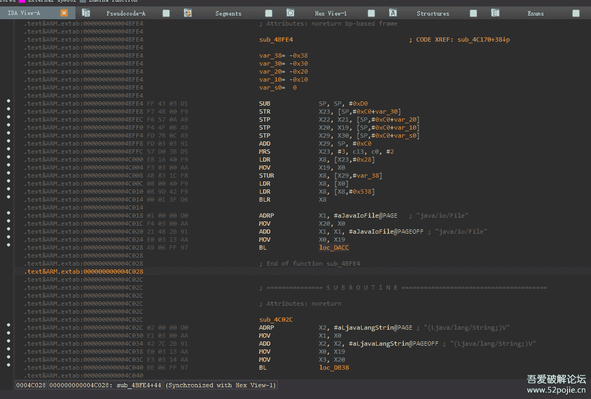

但是依旧出现了一些IDA识别失误的问题，但这都不是影响，能够正常的查看代码。

### FRIDA检测绕过

之前在DumpSO的时候就发现了存在Frida，检测。

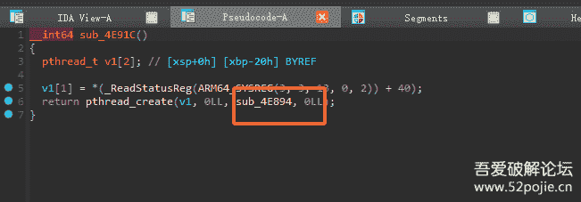

在`initArray`的调用中可以看到此处创建了一个线程，我们看看线程函数是什么：

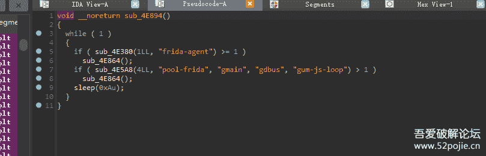

检测frida的关键字，这就好说了。

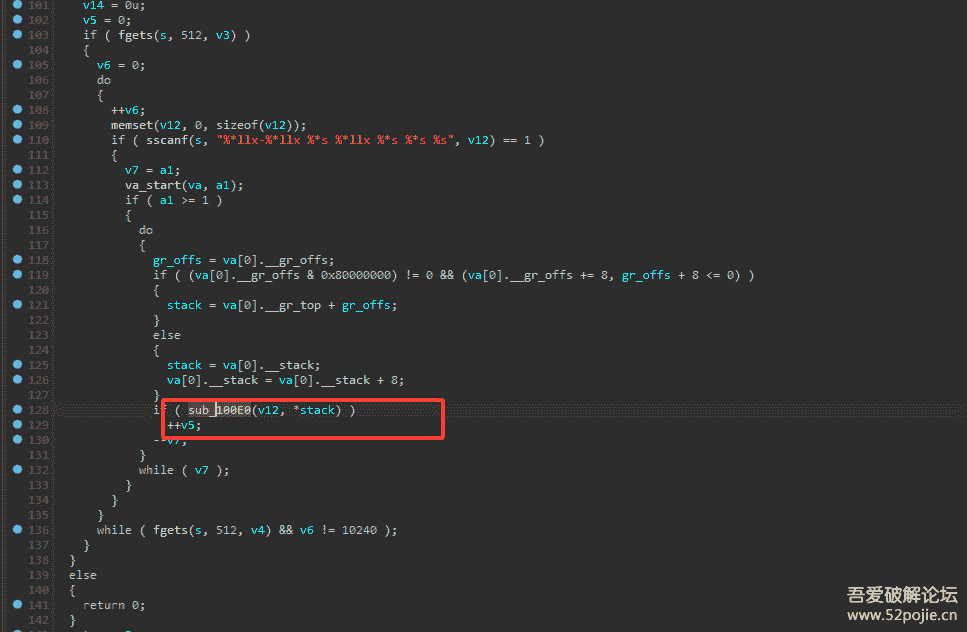

逻辑中检测可以发现就是遍历字符串扫描

`sub_100E0`是自实现的一个`strstr`

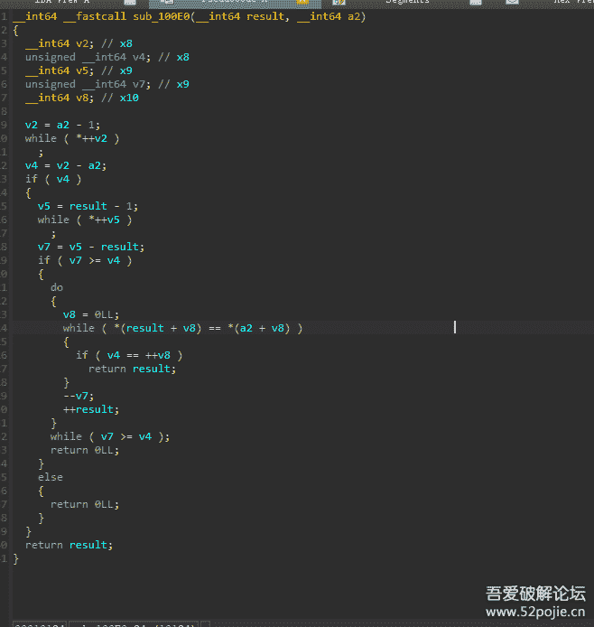

可以看到很经典的逐字节匹配算法。在长串中寻找字串

所以这个检测函数的功能就是通过遍历`maps`，寻找是否出现了`frida-agent`的特招，如果存在特征就直接进行崩溃，这里做的好的地方就是通过自己实现的`strstr`来遍历`maps`，可以防止直接通过hook `strstr`来防止检测，但是`frida-agent`这个特征串居然是明文存储在内存中，实属不该。

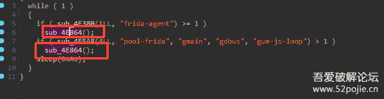

他们检测到之后都调用了同一个函数，这个函数就是处理检测到frida之后的崩溃逻辑的。

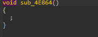

点开发现没有东西，需要查看汇编代码：

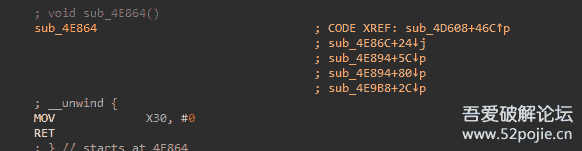

`X30`寄存器在ARM64中相当于`rsp`，在`ret`之前储存的是返回地址，这里函数将`X30`赋值为0之后就会产生一个`Process crashed: Bad access due to invalid address`的报错，导致程序崩溃。

那么既然这样，我们直接用一个空函数将其替换掉就好了。

``` 
function antiDetectFrida(Base) {

    var crashAddr = Base.add("0x4E864");

    var originalFunc = new NativeFunction(crashAddr, 'void', []);

    Interceptor.replace(originalFunc, new NativeCallback(function () {

    //    console.log("[Replaced] - Empty function executed");

        console.log('sub_4E894 called from:\n' + Thread.backtrace(this.context, Backtracer.FUZZY).map(DebugSymbol.fromAddress).join('\n') + '\n');

    }, 'void', []));

}
```

完整：

``` 
function antiDetectFrida(Base) {
    var crashAddr = Base.add("0x4E864");

    var originalFunc = new NativeFunction(crashAddr, 'void', []);
    Interceptor.replace(originalFunc, new NativeCallback(function () {
    //    console.log("[Replaced] - Empty function executed");
        console.log('sub_4E894 called from:\n' + Thread.backtrace(this.context, Backtracer.FUZZY).map(DebugSymbol.fromAddress).join('\n') + '\n');

    }, 'void', []));
}

function NativeFunc() {
    console.info("[Hook Beging]");
    var Base = Module.getBaseAddress("libdpt.so");
    console.warn("[Base]->", Base);
    antiDetectFrida(Base);
}

function hook_android_dlopen_ext() {
    var isHook = false;
    Interceptor.attach(Module.findExportByName(null, "android_dlopen_ext"), {
        onEnter: function (args) {
            this.name = args[0].readCString();
            if (this.name.indexOf("libdpt.so") > 0) {
                console.log(this.name);
                var symbols = Process.getModuleByName("linker64").enumerateSymbols();
                var callConstructorAdd = null;
                for (var index = 0; index  " + callConstructorAdd);
                Interceptor.attach(callConstructorAdd, {
                    onEnter: function (args) {
                        if (!isHook) {
                            NativeFunc();
                            isHook = true;
                        }
                    },
                    onLeave: function () { }
                });

            }
        }, onLeave: function () { }
    });
}

setImmediate(hook_android_dlopen_ext);
```

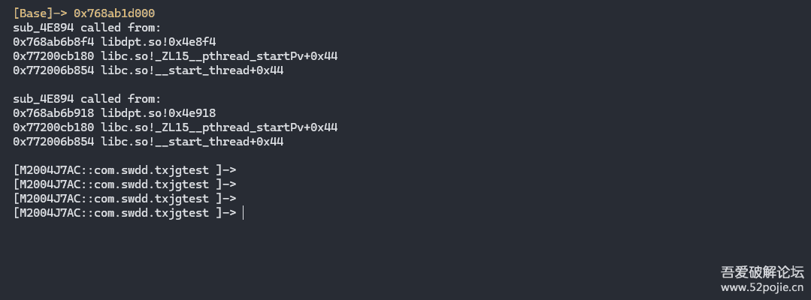

这样我们就成功hook上程序了。

### DEX填充分析

首先我们需要知道抽取壳，肯定是要对dex处理并且回填`CodeItem`的，那么程序肯定是要对`DefineClass`或者`loadMEthod`来在执行方法之前回填正确的字节码，那么让我们看一下在执行一个Java方法时的调用链（复制自luoyesiqiu博客）：

``` 
ClassLoader.java::loadClass -> DexPathList.java::findClass -> DexFile.java::defineClass -> class_linker.cc::LoadClass -> class_linker.cc::LoadClassMembers -> class_linker.cc::LoadMethod
```

那么既然这样，我们思路就很明确了，看看程序在哪里注册的hook就好了。

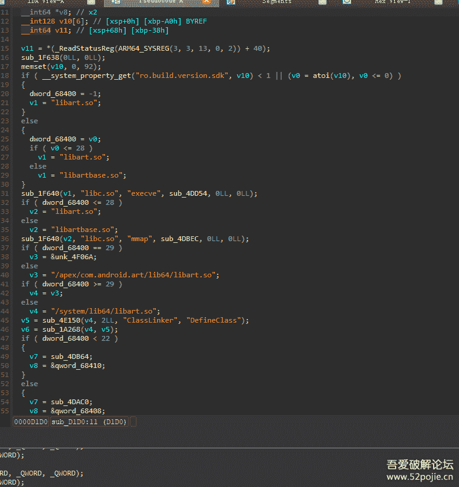

这个函数就非常的像了，这里大家凭借经验应该是可以猜测出在进行hook了，但是这里似乎是使用了两个hook框架，可以尝试恢复一下符号

首先我们还是先注意一下如下格式

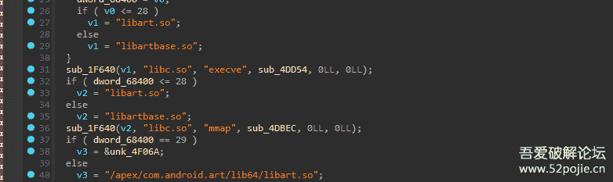

是否想起

[//github.com/bytedance/android-inline-hook](https://github.com/bytedance/android-inline-hook)

`shadowhook`的注册hook格式呢

``` 
#include "shadowhook.h"

void *shadowhook_hook_func_addr(
    void *func_addr,
    void *new_addr,
    void **orig_addr);

void *shadowhook_hook_sym_addr(
    void *sym_addr,
    void *new_addr,
    void **orig_addr);

void *shadowhook_hook_sym_name(
    const char *lib_name,
    const char *sym_name,
    void *new_addr,
    void **orig_addr);

typedef void (*shadowhook_hooked_t)(
    int error_number,
    const char *lib_name,
    const char *sym_name,
    void *sym_addr,
    void *new_addr,
    void *orig_addr,
    void *arg);

void *shadowhook_hook_sym_name_callback(
    const char *lib_name,
    const char *sym_name,
    void *new_addr,
    void **orig_addr,
    shadowhook_hooked_t hooked,
    void *hooke_arg);

int shadowhook_unhook(void *stub);
```

那就可以大胆猜测`shadowhook`，或者利用`shadowhook`的模板了。

我们直接搞一个`libshadowhook.so`，自己编译或者去现成的app里面搞都是可以的，我们只需要利用`bindiff`来载入符号就好了，类似的操作可以在

[//bbs.kanxue.com/thread-285152.htm#msg_header_h2_4](https://bbs.kanxue.com/thread-285152.htm#msg_header_h2_4)

中详细查阅，我这里就简单的概述一下：

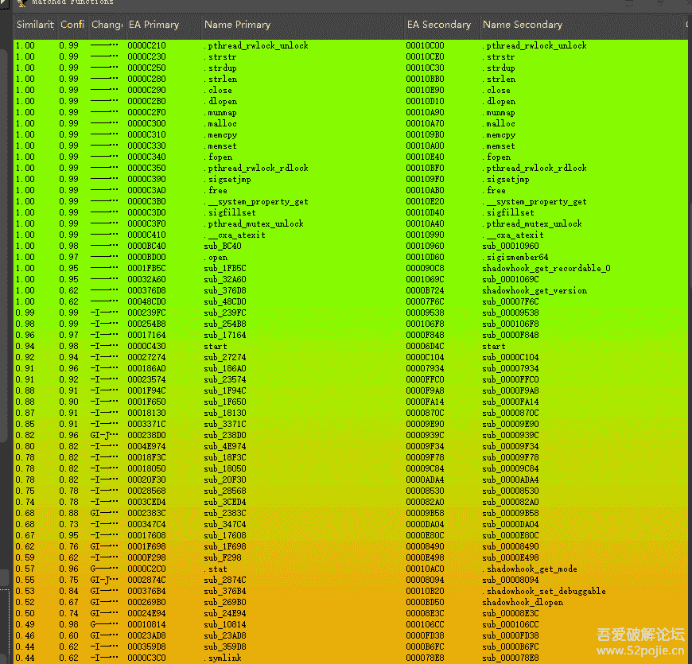

这里直接就能看出来壳用的基本还是`shadowhook`的框架，但是是存在改动的，其实到这里恢复符号的意义以及不大了。

`sub_1F640`的那个参数肯定就是注册的hook，但是这个时候我们又该发现问题了：

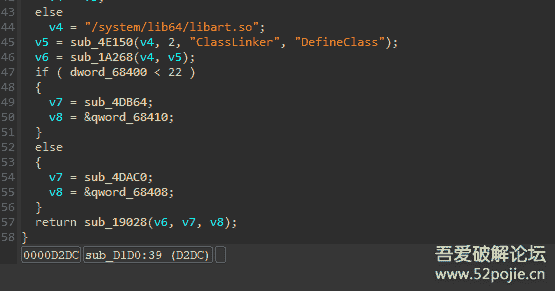

怎么hook `DefineClass`不是这个板子了，看起来也不像是`ShadowHook`了

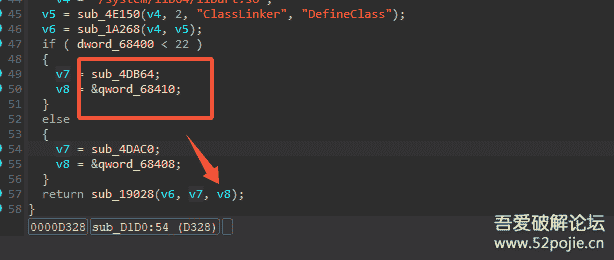

但是我们看这个写法，显然还是在做hook。那么我们就应该知道

`sub_4DAC0`

这个就是在`DefineClass`之前通过hook执行的函数了，这里大概率也就是对Dex进行填充了。

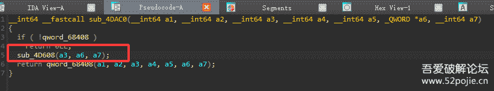

这个操作也是非常模板的操作了，在我们执行完hook之后还是需要还原现场的，所以return回了原本记录的`originMethod`。那么`sub_4D608(a3, a6, a7);`肯定有一个参数是`DexFile`了，我们只需要在这个函数之后利用frida介入就好了。

另外指的注意的是，我们要分析这个sdk的版本，他这里sdk版本大于22走的是下面的hook小于22走的是上面的hook，不要hook错了。

后面就是`sub_4D608`的逻辑了

逻辑中可以翻找到

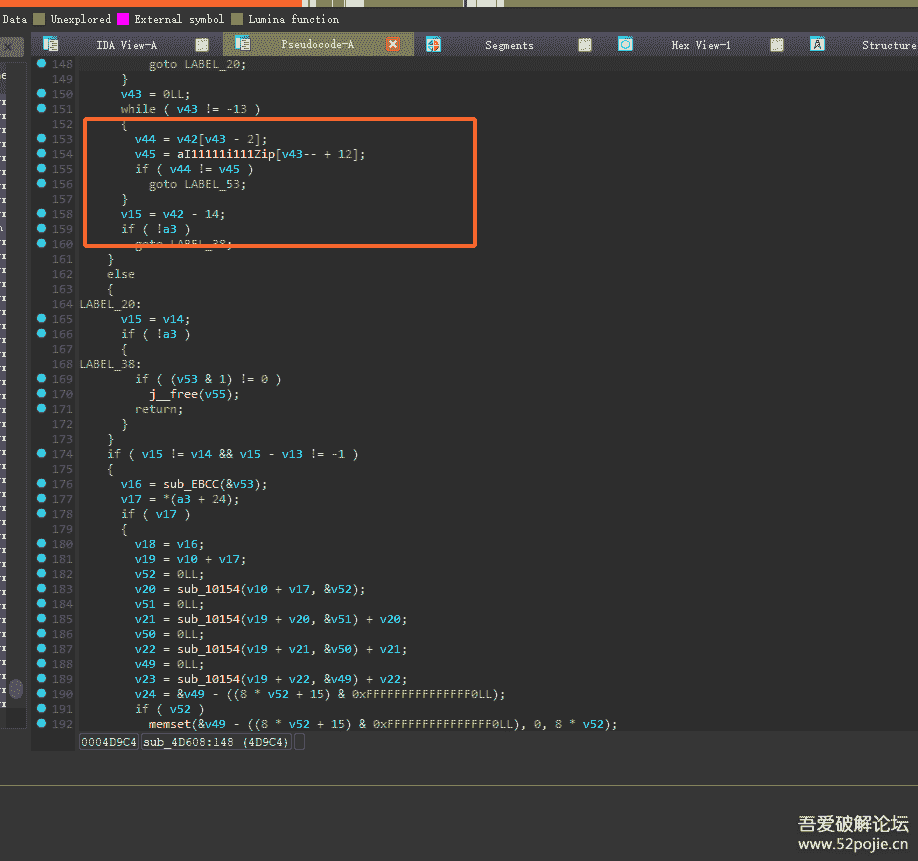

读取了静态资源，那么既然是抽取壳肯定是要从`Assets`中去读的。所以基本可以猜测这里是有对`DexFile`处理的逻辑了。

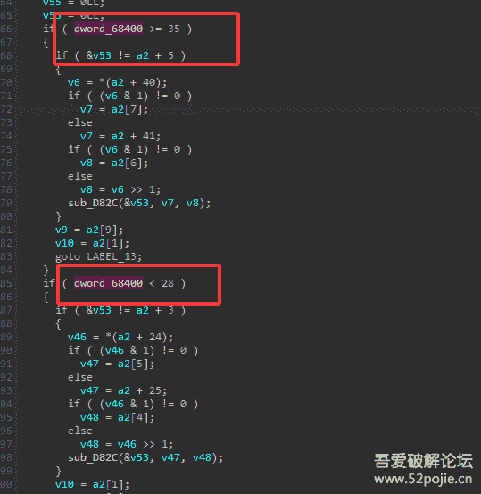

这里在对不同版本的SDK版本做不同的处理。

另外有一个非常指的注意的地方，就是处理文件传入的时候，首先我们肯定是要进行空指针判断的，这里对应的地方则是：

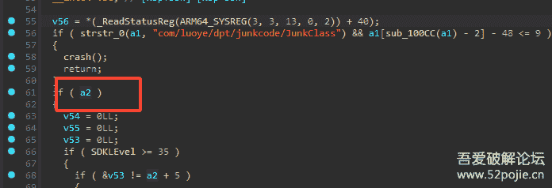

那么这里我们就可以发现，`a2`其实就是`Dexfile`的指针了。

那么这里我们只需要在`sub_4D608`执行完之后解析传入时的`a4`即可：

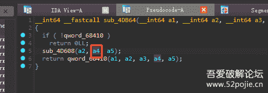

既然要解析这个`DexFile`，那么我们不妨看看这个`DexFile`对象的结构

``` 
DexFile::DexFile(

        const uint8_t* base,             //dex文件基址

        size_t size,                             //  dex文件长度

        const uint8_t* data_begin,

        size_t data_size,

        const std::string& location,

        uint32_t location_checksum,

        const OatDexFile* oat_dex_file,

        std::unique_ptr container,

        bool is_compact_dex

)
```

第一个是基地址，第二个是长度，那么只需要这两个我们就可以dump下来完整的`dexfile`了，那么这个时候我们，使用如下（`frida`代码`spwn`启动，注意`dlopen`时机，我这里就只是粘贴部分代码了）


``` 
function analysisDex(Base) {

    var originalDefineClass = Base.add("0x4DB44");
    console.log("originalDefineClassAddr->", originalDefineClass)
    Interceptor.attach(originalDefineClass, {
        onEnter: function (args) {
            this.dex_file = this.context.x5;
            console.log(hexdump(this.context.x5))
        },
        onLeave: function (args) {
            var dex_file = this.dex_file;
        }
    })

}
```

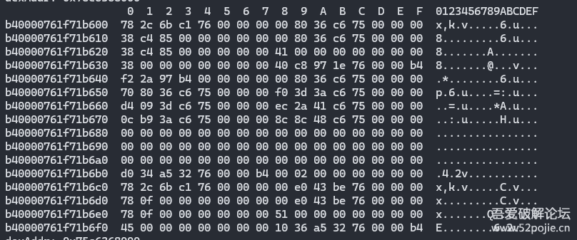

阅读这里我们发现，前面8个bytes好像并不是dex的基地址，应为第2组8bytes 显然是一个地址，而不是`size`，而第三组8bytes才是`size`的样子，这是为何呢。其实是应为C++的调用约定里面第一个参数实际上是`this`指针，我们如果要解析的话是需要跳过这个指针的，接下来我们再看这一段内存就可以和之前`DexFile`对应的参数呼应了。

获取`Dexfile`基地址代码如下：

``` 
function analysisDex(Base) {

    var originalDefineClass = Base.add("0x4DB44");

    console.log("originalDefineClassAddr->", originalDefineClass)

    Interceptor.attach(originalDefineClass, {

        onEnter: function (args) {

            this.dex_file = this.context.x5;

            var base = ptr(this.dex_file).add(Process.pointerSize).readPointer();

            var size = ptr(this.dex_file).add(Process.pointerSize + Process.pointerSize).readUInt();

            console.log("[DexFile]-> Base = ", base);

            console.log("[DexFile]-> size = ", size);

        },

        onLeave: function (args) {

        }

    })

}
```

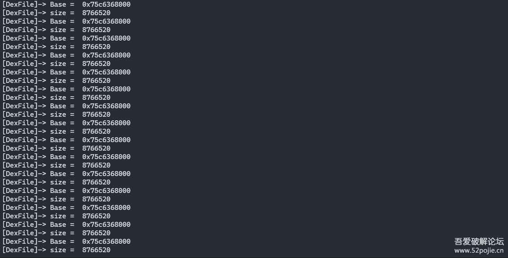

为了确保我们读取的是否正确，我们可以读取`base`的前8个字节来看一下`magic`：

``` 
console.log("[DexFile]-> magic = ", magic);
```

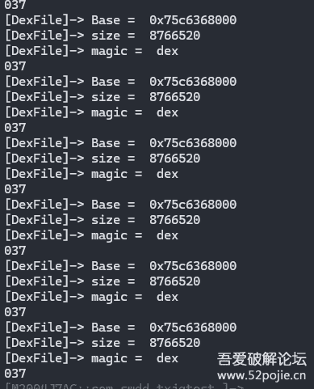

满足我们`DexFile`的格式，那么聪明的你肯定发现了，这同一个`Base`怎么调用这么多次啊，应为抽取壳并不是一次性填充好的，他是调用的时候动态回填`insns`的，所以会多次的操作一个`dex`文件。

并且在hook的逻辑中我们可以发现，`dpt-shell`并没有把已经装载好的method卸载，其实也很少会有厂商这样做，会导致过多的性能损失。

那么我们只要用一个`maps`创建映射，存入所有不同的`Dex`的`base`和`size`，在我们程序加载完了之后，我们遍历这个`maps`进行dump不就好了嘛？

具体实现如下：

``` 
const dexMap = new Map();

function analysisDex(Base) {

    var originalDefineClass = Base.add("0x4DB44");

    console.log("originalDefineClassAddr->", originalDefineClass)

    Interceptor.attach(originalDefineClass, {

        onEnter: function (args) {

            this.dex_file = this.context.x5;

            var base = ptr(this.dex_file).add(Process.pointerSize).readPointer();

            var size = ptr(this.dex_file).add(Process.pointerSize + Process.pointerSize).readUInt();

            console.log("[DexFile]-> Base = ", base);

            console.log("[DexFile]-> size = ", size);

            var magic = ptr(base).readCString();

            console.log("[DexFile]-> magic = ", magic);

            // 检查 base 和 size 是否已存在

            let isDuplicate = false;

            for (let [existingBase, existingSize] of dexMap.entries()) {

                if (existingBase.equals(base) && existingSize === size) {

                    isDuplicate = true;

                    break;

                }

            }

            if (isDuplicate) {

                console.log(`[WARN] DexFile with base ${base} and size ${size} already exists, skipping...`);

            } else {

                dexMap.set(base, size);

                console.log(`[INFO] New DexFile found: base=${base}, size=${size}`);

            }

        },

        onLeave: function (args) {

        }

    })

}

function printDexMap() {

    console.log("Current DexFile Map:");

    for (let [base, size] of dexMap.entries()) {

        console.log(`Base: ${base}, Size: ${size}`);

    }

}
```

当我们`frida`输出变得缓慢的时候，或者不再输出的时候我们调用一下`printDexMap()`:

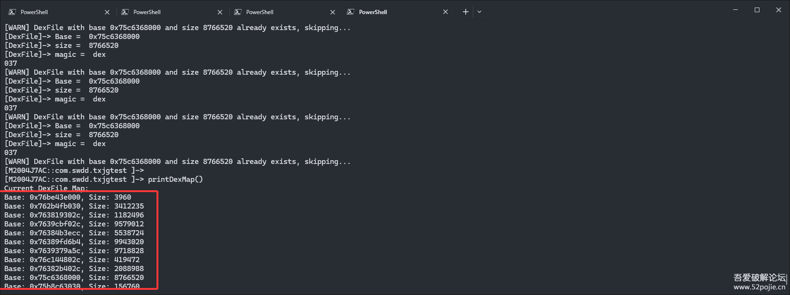

这样我们就获得了所有加载的`dex`的`base`与`size`，然后写一个遍历脚本进行dump就行了：

这里我已经写好了一个直接dump到私有目录的：

``` 
function get_self_process_name() {
    var openPtr = Module.getExportByName('libc.so', 'open');
    var open = new NativeFunction(openPtr, 'int', ['pointer', 'int']);
    var readPtr = Module.getExportByName("libc.so", "read");
    var read = new NativeFunction(readPtr, "int", ["int", "pointer", "int"]);
    var closePtr = Module.getExportByName('libc.so', 'close');
    var close = new NativeFunction(closePtr, 'int', ['int']);
    var path = Memory.allocUtf8String("/proc/self/cmdline");
    var fd = open(path, 0);

    if (fd != -1) {
        var buffer = Memory.alloc(0x1000);
        var result = read(fd, buffer, 0x1000);
        close(fd);
        result = ptr(buffer).readCString();
        return result
    }

    return "-1"
}

function Mkdir(path) {
    if (path.indexOf("com") == -1) {
        console.log("[Mkdir]-> Pass:", path);
        return 0;
    }
    var mkdirPtr = Module.getExportByName('libc.so', 'mkdir');
    var mkdir = new NativeFunction(mkdirPtr, 'int', ['pointer', 'int']);
    var opendirPtr = Module.getExportByName('libc.so', 'opendir');
    var opendir = new NativeFunction(opendirPtr, 'pointer', ['pointer']);
    var closedirPtr = Module.getExportByName('libc.so', 'closedir');
    var closedir = new NativeFunction(closedirPtr, 'int', ['pointer']);
    var cPath = Memory.allocUtf8String(path);
    var dir = opendir(cPath);

    if (dir != 0) {
        closedir(dir);
        return 0
    }

    mkdir(cPath, 0o755);
    chmod(path)
    console.log("[Mkdir]->", path);
}

function chmod(path) {
    var chmodPtr = Module.getExportByName('libc.so', 'chmod');
    var chmod = new NativeFunction(chmodPtr, 'int', ['pointer', 'int']);
    var cPath = Memory.allocUtf8String(path);
    chmod(cPath, 755)
}

function dumpDex() {

    dexMap.forEach((size, base) => {
        console.log(`Base: ${base}, Size: ${size}`);
        var magic = ptr(base).readCString();
        console.log("DesFileMagic->", magic);
        if (magic.indexOf("dex") == 0) {
            var process_name = get_self_process_name();
            if (process_name != "-1") {
                var dex_dir_path = "/data/data/" + process_name + "/files"
                Mkdir(dex_dir_path)
                dex_dir_path += "/dump_dex_" + process_name
                Mkdir(dex_dir_path)
                var dex_path = dex_dir_path + "/class" + (dex_count == 1 ? "" : dex_count) + ".dex"; console.log("[find dex]:", dex_path); var fd = new File(dex_path, "wb");
                if (fd && fd != null) {
                    dex_count++; var dex_buffer = ptr(base).readByteArray(size);
                    fd.write(dex_buffer); fd.flush();
                    fd.close(); console.log("[dump dex]:", dex_path)
                }
            }
        }
    });
}
```

等待程序加载好后我们直接调用`DumpDex`即可：

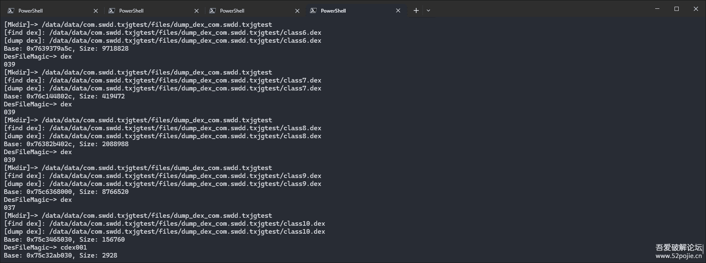

私有目录中即可找到这个file

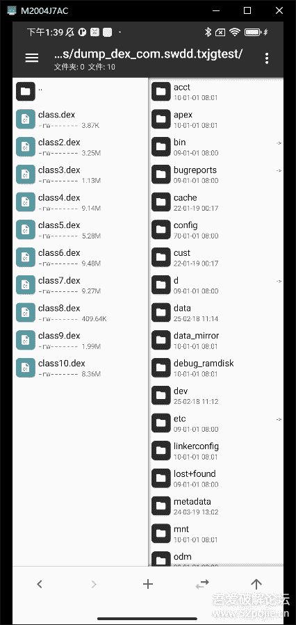

反编译即可发现被抽取的类都填充好了：

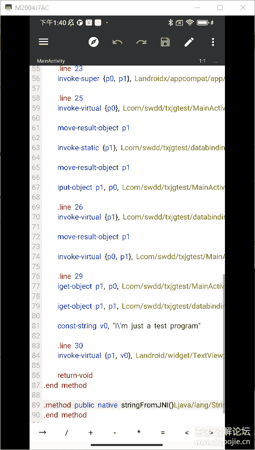

## 原理分析

这里主要分析一下程序如何处理被抽取的类填充回`Class`，对照源码进行分析。另外的步骤在上文的逆向过程说以及解释的差不多了

源码可以看到此处是`DobbyHook`

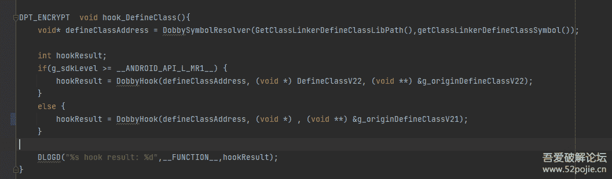

校验了SDK版本，不同SDK版本不同处理方式

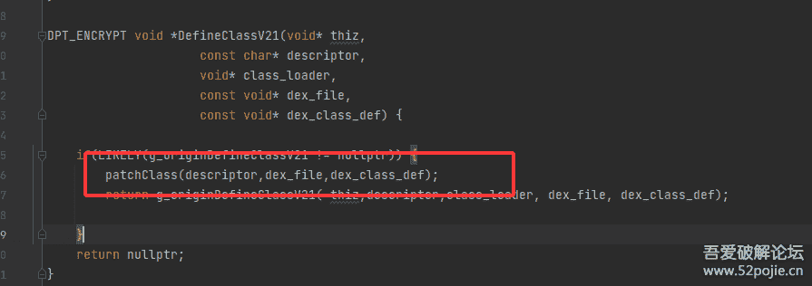

这里直接就走`patchClass`了，那么我们重点要分析的就是`patchClass`的逻辑了

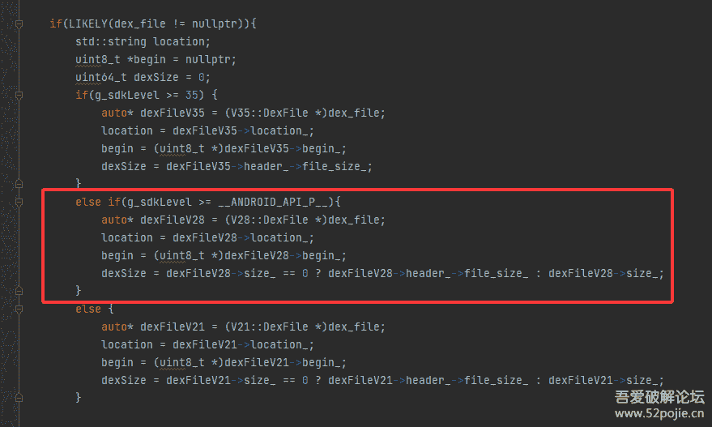

这里就是在根据不同的SDK版本来解析 `DexFile`

``` 
uint64_t static_fields_size = 0;

read += DexFileUtils::readUleb128(class_data, &static_fields_size);

uint64_t instance_fields_size = 0;

read += DexFileUtils::readUleb128(class_data + read, &instance_fields_size);

uint64_t direct_methods_size = 0;

read += DexFileUtils::readUleb128(class_data + read, &direct_methods_size);

uint64_t virtual_methods_size = 0;

read += DexFileUtils::readUleb128(class_data + read, &virtual_methods_size);
```

获取类中字段和方法的数量，为后续解析做准备


```
dex::ClassDataField staticFields[static_fields_size];
read += DexFileUtils::readFields(class_data + read, staticFields, static_fields_size);

dex::ClassDataField instanceFields[instance_fields_size];
read += DexFileUtils::readFields(class_data + read, instanceFields, instance_fields_size);

dex::ClassDataMethod directMethods[direct_methods_size];
read += DexFileUtils::readMethods(class_data + read, directMethods, direct_methods_size);

dex::ClassDataMethod virtualMethods[virtual_methods_size];
read += DexFileUtils::readMethods(class_data + read, virtualMethods, virtual_methods_size);
```

获取类中所有字段和方法的详细信息，为后续修补做准备


这里就将之前读取到的所有的方法都传入`patchMethod`中来修改。


然后就是`patchMethod`了，这里主要是利用了之前维护好的`dexMap`，修改对应内存段权限后在Map查找`CodeItem`，然后使用`memcopy`填入。

这样的流程就完成了类的动态回填。

## 总结

`dpt-shell`上有很多值得学习的技术和加固原理，一次非常充实的学习过程
