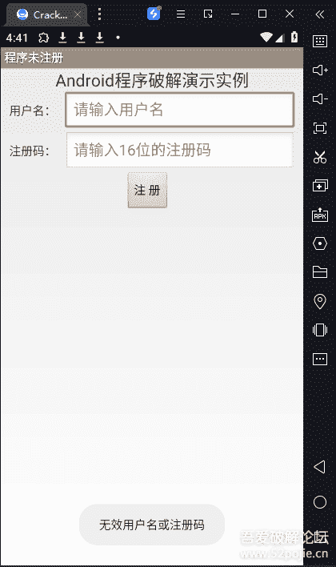
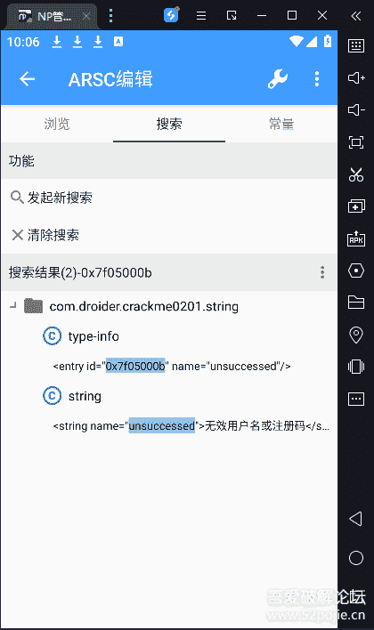
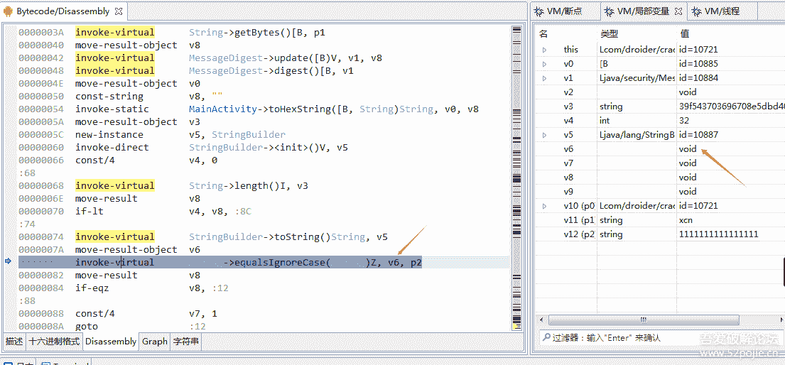
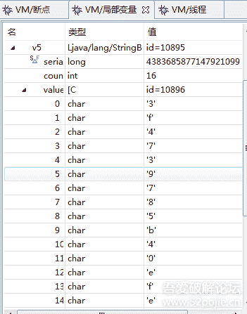

# [Android 分享] 学破解第215天，《动态调试&Log插桩》失败学习

- 原帖: https://www.52pojie.cn/forum.php?mod=viewthread&tid=2008097
- 抓取时间: 2026-11-01T16:06:29.988Z

前言：

  坛友们，年轻就是资本，和我一起逆天改命吧，我的学习过程全部记录及学习资源：[//www.52pojie.cn/thread-2006536-1-1.html](https://www.52pojie.cn/thread-2006536-1-1.html:https)

立帖为证！--------记录学习的点点滴滴

## 0x1 动态调试&Log插桩（假）

1. Log插桩指的是反编译APK文件时，在对应的smali文件里，添加相应的smali代码，将程序中的关键信息，以log日志的形式进行输出。

```
invoke-static {对应寄存器}, Lcom/mtools/LogUtils;->v(Ljava/lang/Object;)V
```

2. 算法助手获取获取日志时有延迟，需要退出重新启动才能看到日志。

3. 教程开始跟不上了，直接看这一关作业，点进来发现需要输入一个用户名和16位的注册码，直接点击注册后提示：无效用户名或注册码。



4. 用np管理器提取安装包，查看dex文件，搜索错误提示，发现搜索不到。

`onCreate()`：一个`Activity`启动后第一个被调用的函数，常用来在此方法中进行`Activity`的一些初始化操作。例如创建`View`，绑定数据，注册监听，加载参数等。

5. 使用`adb`命令，`adb shell`，`dumpsys activity top`，显示顶层活动窗口，可以看到是`com.droider.crackme0201/.MainActivity`。

```
Debug logs:

TASK com.droider.crackme0201 id=3 userId=0

  ACTIVITY com.droider.crackme0201/.MainActivity a1c65dc pid=2979

    Local Activity 2ee3f73 State:

      mResumed=true mStopped=false mFinished=false

      mChangingConfigurations=false

      mCurrentConfig={1.0 460mcc65535mnc [zh_CN] ldltr sw360dp w360dp h616dp 480

dpi nrml long port finger qwerty/v/v -nav/h winConfig={ mBounds=Rect(0, 0 - 1080

, 1920) mAppBounds=Rect(0, 0 - 1080, 1920) mWindowingMode=fullscreen mActivityTy

pe=standard} s.7}
```

6. 再去np管理器打开dex文件，搜索这个类`com.droider.crackme0201.MainActivity`（去掉前面的下划线搜），`onCreate`函数前面说过了，启动的时候调用，`setOnClickListener`函数注册了一个单击事件，单击注册按钮触发`onClick`函数，这个函数里面有两个case分支，一个执行`checkSNfalse`函数，一个执行`checkSN`函数，可以看到如果不执行第二个case，或者第二个case里面的if不满足都会执行2131034123这个show。

```
    public void onClick(View view) {
        switch (view.getId()) {
            case 2131230723:
                checkSNfalse(this.edit_userName.getText().toString().trim(), this.edit_sn.getText().toString().trim());
                return;
            case 2131230724:
                if (checkSN(this.edit_userName.getText().toString().trim(), this.edit_sn.getText().toString().trim())) {
                    Toast.makeText(this, 2131034124, 0).show();
                    this.btn_register.setEnabled(false);
                    setTitle(2131034122);
                    return;
                }
                Toast.makeText(this, 2131034123, 0).show();
                return;
            default:
                return;
        }
    }

    private boolean checkSN(String str, String str2) {
        if (str == null) {
            return false;
        }
        try {
            if (str.length() == 0 || str2 == null || str2.length() != 16) {
                return false;
            }
            MessageDigest instance = MessageDigest.getInstance("MD5");
            instance.reset();
            instance.update(str.getBytes());
            String toHexString = toHexString(instance.digest(), "");
            StringBuilder stringBuilder = new StringBuilder();
            for (int i = 0; i 
```

7. 前面学习过了show就是弹窗，我们打开arsc资源编辑搜索这个id，看到原来这个弹窗内容就是无效用户名或注册码，再看另外一个show的id：2131034124，搜索一下，弹窗内容是恭喜您！注册成功，到这里就很清楚了，关键在于`checkSN`函数。



```
  Crackme0201

  Settings

  Crackme0201

  Android程序破解演示实例

  用户名：

  注册码：

  注 册

  请输入用户名

  请输入16位的注册码

  程序未注册

  程序已注册

  无效用户名或注册码

  恭喜您！注册成功
```

8. `checkSN`函数可以看到传入了`userName`和`sn`，这是我们输入的，进来后执行了一个`if`三个长度判断，接着就是将`userName`进行MD5处理，再就是一个`for`循环，自增2，也就是取md5后字符串的奇数位，再通过注册码16位，可以猜测就是生成32位字符串，那么只要在动态调试中找到这个字符串就能得到正确的注册码。

9. 安卓里面很多都是java代码写的，所以我们有一个更快的办法，那就是去掉这些`if`判断，把两个函数单独拿出来，随便设置一个初始化字符串“xcn”作为用户名，跑一遍，flag就出来了。

```
public class Test {

        private static String toHexString(byte[] bArr, String str) {
            StringBuilder hexString = new StringBuilder();
            for (byte b : bArr) {
                String hex = Integer.toHexString(b & 255);
                if (hex.length() == 1) {
                    hexString.append('0');
                }
                hexString.append(hex).append(str);
            }
            return hexString.toString();
        }

        public static void main(String[] args) throws NoSuchAlgorithmException {
                String str= "xcn";//这个是用户名

                MessageDigest instance = MessageDigest.getInstance("MD5");
        instance.reset();
        instance.update(str.getBytes());
        String toHexString = toHexString(instance.digest(), "");
        StringBuilder stringBuilder = new StringBuilder();
        for (int i = 0; i 
```

10. 当然了，我们目标是练习动态插桩，前面的偏题了，接下来正文。

## 0x2 动态调试&Log插桩（真）

1. 打开jeb，找到关键代码，在`0000004A`这个地方打上断点，跑起来

```
0000004A  invoke-direct       MainActivity->checkSN(String, String)Z, p0, v0, v1

00000050  move-result         v0

00000052  if-nez              v0, :6C

:56

00000056  const               v0, 0x7F05000B        # string:unsuccessed "无效用户名或注册码"

0000005C  invoke-static       Toast->makeText(Context, I, I)Toast, p0, v0, v2

00000062  move-result-object  v0

00000064  invoke-virtual      Toast->show()V, v0

0000006A  goto                :10

:6C

0000006C  const               v0, 0x7F05000C        # string:successed "恭喜您！注册成功"
```

2. 输入xcn和16个1，点击注册按钮断了下来，进入函数内部，可以看到先是`v3`那里出现了我们前面的猜测的md5了，但是`v6`这里似乎看不到内容，返回值不应该是在`v6`里面吗？



3. 那就去看`v6`前面的`v5`，可以看到一串字节数组，这个就是我们前面的正确注册码了。



4. 使用np管理器提取安装包，打开dex文件，将`日志插装.dex`文件插入这个安装包，改名为`classes2.dex`，然后去代码中添加代码。

```
  invoke-virtual {v6, p2}, Ljava/lang/String;->equalsIgnoreCase(Ljava/lang/String;)Z

    invoke-static {v6}, Lcom/mtools/LogUtils;->v(Ljava/lang/Object;)V

    move-result v8
```

5. 重新安装后运行，程序崩溃了，太难了，才学了一点点就跟不上了前辈的节奏。┭┮﹏┭┮

## 0x3 参考文档

1. [《安卓逆向这档事》五、1000-7=？&动态调试&Log插桩](https://www.52pojie.cn/thread-1714727-1-1.html)
