# [Android CTF] 2025春节红包之Android中级题Writeup

- 原帖: https://www.52pojie.cn/forum.php?mod=viewthread&tid=2010207
- 抓取时间: 2026-11-01T16:06:16.078Z

战斗了几次，天命人伤害值1，虎先锋伤害值135，两者都是1000血量，根本没法打赢。

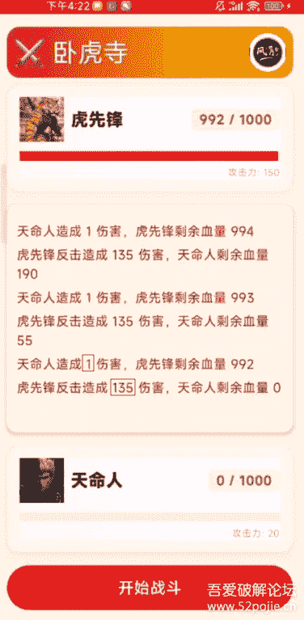

## 0x00 定位Check()方法

activity记录器定位到战斗页面是`com.zj.wuaipojie2025_game.ui.BattleActivity`

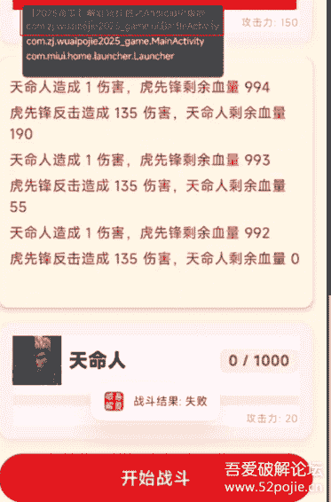

猜测点击“开始战斗”触发了战斗的代码逻辑，如果能够hook修改天命人的伤害点数，或许可以胜利？丢进Jadx分析，逛了一圈没找到Button相关的代码，还是想的太简单了。

点点点发现了输入秘钥的入口，随便输几个字母提示“秘钥错误，请重试”。搜索错误提示发现了`Check()`方法，功能是做秘钥验证的，如果返回true，风灵月影就激活了。


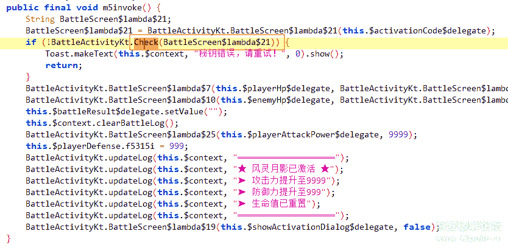

使用frida让`Check()`方法始终返回为true，代码如下：

```
function hookCheck(){
    let BattleActivityKt = Java.use("com.zj.wuaipojie2025_game.ui.BattleActivityKt");
    BattleActivityKt["Check"].implementation = function (str) {
        console.log(`BattleActivityKt.Check is called: str=${str}`);
        let result = this["Check"](str);
        console.log(`BattleActivityKt.Check result=${result}`);
        return true;
    };
}
```

虎先锋被秒了！等等，我的flag呢？？？这个思路有点问题，或许输入的秘钥可能就是flag。


## 0x01 JNI动态注册识别

自然而然想到去审计`Check()`方法，这是一个native方法。导入`libwuaipojie2025_game.so`到IDA，搜索“Check”，没有形如`Java_xxx_Check()`的方法，说明不是这个native方法不是静态注册的。

关于JNI静态、动态注册的知识忘记了，参考这篇帖子复习了一下：[安卓逆向基础知识之JNI开发与so层逆向基础](https://mp.weixin.qq.com/s/0fOkDntnzxCgtxeyeY8Uvg)。

动态注册的话找到`JNI_OnLoad()`方法，`(*(_QWORD *)v4[0] + 1720LL)`是通过 `JNIEnv`指针获取 `RegisterNatives`方法的地址，所以14~18行调用`RegisterNatives`方法对`Check()`方法进行了注册。

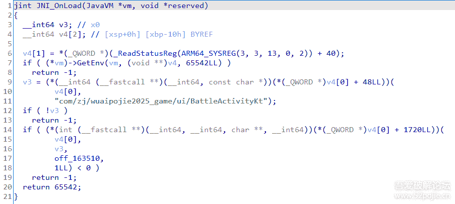

`off_163510`是注册的jni方法，类型为`JNINativeMethod`，参考jni.h源码([//github.com/openjdk/jdk/blob/3ebed78328bd64d2e18369d63d6ea323b87a7b24/src/java.base/share/native/include/jni.h#L1817](https://github.com/openjdk/jdk/blob/3ebed78328bd64d2e18369d63d6ea323b87a7b24/src/java.base/share/native/include/jni.h#L1817:https)) 如下：

```
//RegisterNatives方法原型
jint RegisterNatives(jclass clazz, const JNINativeMethod *methods, jint nMethods) {
    return functions->RegisterNatives(this,clazz,methods,nMethods);
}
//JNINativeMethod结构体定义
typedef struct {
    const char* name;        // 本地方法在Java中的名称
    const char* signature;   // 本地方法的签名，描述参数和返回类型
    void*       fnPtr;       // 指向本地方法实现的函数指针
} JNINativeMethod;
```

这里只关注第三个值`fnPtr`，因为它保存了注册方法在so里的函数地址。对应到IDA里就是`sub_E8C54`。

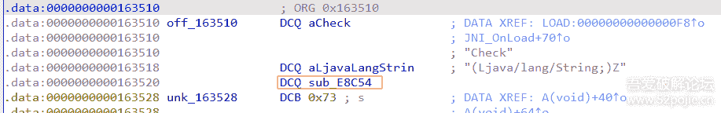

修改`sub_E8C54()`函数参数类型为`JNIEnv *a1, jclass a2, jstring a3`。大概的逻辑是：输入秘钥`a3`在`sub_E8C54()`内部处理后与真实秘钥比较，正确就返回true，天命人得到“风灵月影”，反之验证失败。

分析`a3`数据流的结果：`a3->v5->v6->v15`，函数指针`v15`指向了什么函数最终决定了`a3`经过什么样的处理

> 

辨析：函数指针是指向函数的指针变量，而指针函数是返回指针类型的函数。

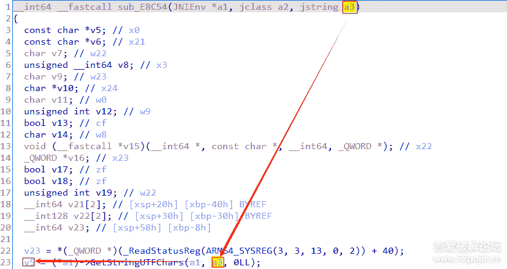

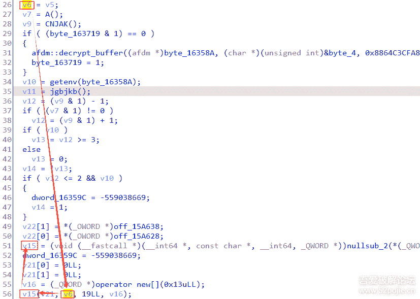

第51行代码的作用是给函数指针`v15`赋值，从而决定在56行执行的函数是哪个。第51行代码的执行结果十分关键，不过这行代码我不知道咋分析。

我个人的分析到这里就没能继续往下了，后面的工作参考了吾爱破解上的大佬的帖子：

[【2025春节】解题领红包之四 Android 中级题WriteUp - 吾爱破解 - 52pojie.cn](https://www.52pojie.cn/forum.php?mod=viewthread&amp;tid=2006138&amp;highlight=Android%2B%D6%D0%BC%B6%CC%E2)

## 0x02 动态调试分析秘钥

静态分析卡住了，可以上动态调试看一下结果。参考这两篇帖子：

[《安卓逆向这档事》十二、大佬帮我分析一下 - 吾爱破解 - 52pojie.cn](https://www.52pojie.cn/thread-1809646-1-1.html)

[[超级详细]实战分析一个Crackme的过程 - 吾爱破解 - 52pojie.cn](https://www.52pojie.cn/thread-1315444-1-7.html)

动态调试的准备工作：

- 
`adb push` IDA dbgsrv目录下载的`android server`到手机的`/data/local/tmp`目录。`arm64-v8a`选择`android_server64`
- 
修改`android_server64`权限为777，然后`XAppDebug` hook目标app

> 

或者使用`android:debuggable="true"`

- 
手机端以root权限运行`./android_server64`，`adb forward tcp:23946 tcp:23946`

手机端运行要调试的app。

`adb shell am start -n com.zj.wuaipojie2025_game/.MainActivity`

或者直接点击运行

动态调试步骤：

- IDA端

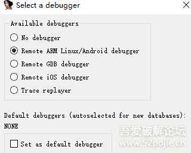

- Debugger -> Process Options

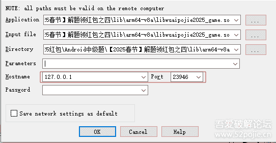

- 

Debugger->Attach Process

如果找不到目标app，请解锁手机，并切换到手机app，保持可见状态。

动态调试时找不到对应的so文件，两种解决办法：

- 把so文件拷贝到app安装目录下的lib文件夹，先用`pm path` 包名确定路径，然后拷贝到对应lib目录，拷贝了lib后，需要重新启动app。
- 使用`android:extractNativeLibs="true"`属性。

实际动态调试过程中，发现代码`v15(v21, v6, 19LL, v16);`始终会跳转到`ao`函数执行，正己大佬说这是个反调试，过了反调试才会走正确的`a`函数。

> 

正己大佬提示：

> 

`ao`是错误方法，这里加密的秘钥和正确的秘钥只差几个字节，导致异或出来的结果可以猜出来。另外前面的检测方法没过掉就走`ao`这个错误方法

帖子链接：[2025解题领红包 Android中级详细WP - 吾爱破解 - 52pojie.cn](https://www.52pojie.cn/forum.php?mod=viewthread&tid=2005819&highlight=2025%2BAndroid)

涉及到函数跳转赋值的关键的代码简化后如下：

```
  v10 = getenv(byte_7767FEA58A);
  v11 = jgbjkb();

  ...

  if ( v10 )
    v13 = v12 >= 3;
  else
    v13 = 0;
  v14 = !v13;

  ...

  v22[1] = *(_OWORD *)off_7767FE1638;
  v22[0] = *(_OWORD *)off_7767FE1628;

  v15 = (void (__fastcall *)(__int64 *, __int64, __int64, _QWORD *))nullsub_2(*(_QWORD *)(
(unsigned __int64)v22 & 0xFFFFFFFFFFFFFFF7LL | //第四步：v22 & 0xFFFFFFFFFFFFFFF7LL |8*(v11|14) ^ 0
(8LL * (((unsigned __int8)(v11 | v14) //第三步：8*(v11|14) ^ 0 
^ (((unsigned int)ao ^ (unsigned int)a) >> 24)) //第一步：(0x7764532F60^0x77645328A0)>>24 ==> 0
& 1))));//第二步：0&1 ==> 0
```

数组`v22`的内存布局如下：

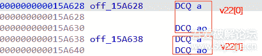

所以要让`v15`执行函数`a`的逻辑，需要第三步的结果为8，也就是`(v11|v14)`的值为1，最终第四步的结果为`v22`，这样`v15`就指向了`v22[0]`，然后`(_QWORD*)`进行8字节转换，`v15`也就指向了`a`函数。

分析到这里，我的思路是让`(v11|v14)`的值为1，数据流回溯一下就是需要控制下面两行代码

```
v10 = getenv(byte_7767FEA58A); //让v10等于0，这样v14就等于1
v11 = jgbjkb()//让v11等于0
//最终v11|v14 ==> 0|1  ==> 1
```

具体来说，就是在动态调试的时候修改函数的返回值，对应到寄存器`X0`。实际动态调试过程中，返回值并不可控，比如`v10 = getenv(byte_7767FEA58A);`在执行完成后`v10`为0，但是执行完给`v15`赋值的语句，`v14`的值又发生了变化，且执行完第a行，单步调试后可能会返回去执行第a-1行。加上我对ARM汇编也不是很熟悉，这种思路就暂时放弃了。

换种思路，直接去审计`a()`函数和`ao()`函数的实现逻辑，可结合deepseek分析代码。以下是`a()`函数的实现：

```
//v6是Check()方法的入参，v16是一个大小为19的QWORD数组
v15(v21, v6, 19LL, v16);
....
/*
a方法实现
a2是Check()方法的入参，a3=19，a4是一个大小为19的QWORD数组
*/
__int128 *__fastcall a(__int128 *result, __int64 a2, __int64 a3, __int64 a4)
{
  __int64 i; // x23
  char v8; // w9
  __int64 v9; // x25
  __int128 v10; // [xsp+0h] [xbp-20h] BYREF
  __int64 v11; // [xsp+18h] [xbp-8h]

  v11 = *(_QWORD *)(_ReadStatusReg(ARM64_SYSREG(3, 3, 13, 0, 2)) + 40);
  v10 = *result;
  if ( a3 )
  {
    for ( i = 0LL; i != a3; ++i )//循环19次
    {
      v9 = i & 0xF;
      if ( (i & 0xF) == 0 )//i=0或i=16时满足
        result = (__int128 *)sub_7767F70954(&v10);

      //下面两行代码等价于a4[i] = v10[v9]^a2[i]
      v8 = *(_BYTE *)((unsigned __int64)&v10 | v9) ^ *(_BYTE *)(a2 + i);//a2每个字节与(v10|v9)异或计算
      *(_BYTE *)(a4 + i) = v8;//异或计算结果赋值给a4数组

      /*
      v10是__int128类型，128位，占用16字节，在内存追中16字节对齐
      因为要保证16字节对齐，在内存中v10的地址是类似于0x1000、0x1010这种形式，即低4位为0
      而v9的取值范围为0~15
      所以下面代码的效果为修改以v10为起始地址的16个字节的值，等价于v10[v9] = v8
      */
      *(_BYTE *)((unsigned __int64)&v10 | v9) = v8;
    }
  }
  return result;
}
```

以下时`ao()`函数的实现。分析后发现，`ao()`方法与`a()`方法的作用都是通过异或运算更改`a4`指向内存的取值，区别是`v10`在每次循环中均会被更新。当`i=16`时，第二次调用`sub_7767F70954()`会导致`a()`函数的`v10`和`ao()`函数的`v8`取值不同，进而在最后三次异或运算中：`v10[0]^a2[16]`、`v10[1]^a2[17]`、`v10[2]^a2[18]`，`a()`函数和`ao()`函数的计算结果会不同。

```
__int128 *__fastcall ao(__int128 *result, __int64 a2, __int64 a3, __int64 a4)
{
  __int64 i; // x23
  __int128 v8; // [xsp+0h] [xbp-20h] BYREF
  __int64 v9; // [xsp+18h] [xbp-8h]
  v9 = *(_QWORD *)(_ReadStatusReg(ARM64_SYSREG(3, 3, 13, 0, 2)) + 40);
  v8 = *result;
  if ( a3 )
  {
    for ( i = 0LL; i != a3; ++i )
    {
      if ( (i & 0xF) == 0 )
          result = (__int128 *)sub_7767F70954(&v8);
      *(_BYTE *)(a4 + i) = *(_BYTE *)((unsigned __int64)&v8 | i & 0xF) ^ *(_BYTE *)(a2 + i);
      //a4[i] = v8[i&0xF] ^ a2[i]
     }
  }
  return result;
}
```

总结来说，`a()`函数的`v10`或`ao()`函数的`v8`是加密密钥，区别在于这两个密钥的索引16~18不同（索引从0开始计算）。

暂时没有办法执行`a()`方法，就用`ao()`方法凑合一下，密钥差别也不是很大。

当`i=0`时，`v8`取值如下：

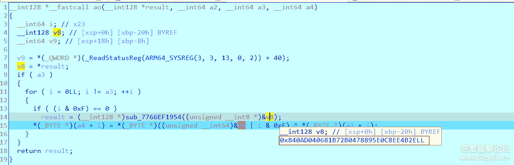

当`i=0x10`时，`v8`取值如下

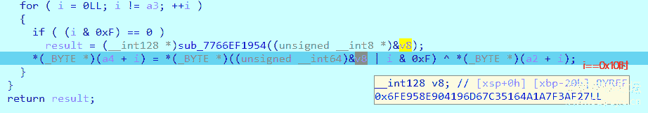

注意`libwuaipojie_2025.so`是`arm65 little endian`，遵循低字节低地址，所以密钥需要逆序，再拼接上`i=0x10`时的低三字节，得到`ao()`函数使用的加密密钥为`2E 4B EE C8 E0 95 88 47 B0 72 1B 68 40 D0 0A 84 27 AF F3`


结合异或运算的特点，`a^b=c`，已知任意`a`、`b`、`c`任意两个可以计算出第三个。现在有正确的加密密钥，如果有正确的加密结果就可以得到正确的输入秘钥，即正确的风灵月影秘钥。

回到`sub_E8C54()`函数，也就是`Check()`方法的native实现。基于返回true的前提，反推`v16`的前8字节为0x72ECF89BAF8F2748，9~16字节为0xB63AE26B0C720798，最后三字节为0xF75942。

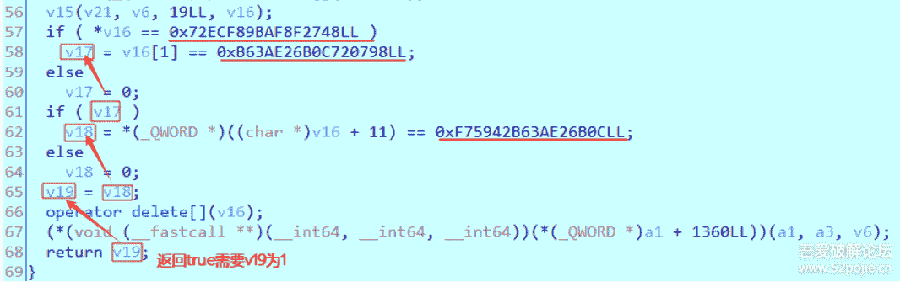

再根据小端存储调整一下顺序：`48 27 8F AF 9B F8 EC 72 98 07 72 0C 6B E2 3A B6 42 59 F7`

现在有了正确的加密密钥，也有了正确的加密结果，可以写代码计算出正确的输入秘钥了。

偷个懒，用大模型算一下hhh

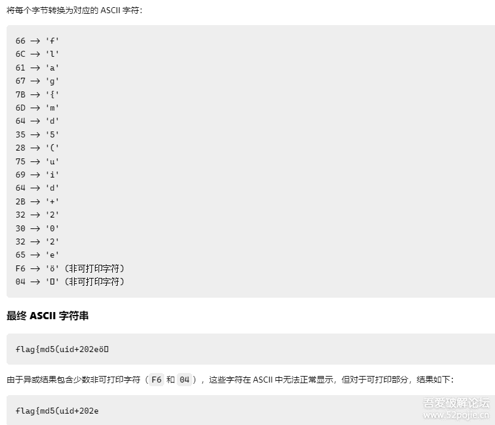

最后三字节是错的，由于是25年，最终的结果为`flag{md5(uid+2025)}`

但是把`flag{md5(uid+2025)}`作为秘钥输入到app还是会提示秘钥错误，因为ap没还是走的`ao()`函数的逻辑。

## 3> 0x03 计算最终flag值

计算最终flag值这步由于系统关闭了，就没没法验证了。看各位大佬的帖子说`flag{md5(uid+2025)}`并不是最终提交到系统的flag，还需要处理一下。

`uid`应该就是每个人吾爱破解账号的`uid`，和2025拼接做一下`md5`计算，这样每个人提交的flag都不一样，妙啊。

我的`uid`是2140960，计算后得到的结果为`flag{9ec9300a37560732409b878ecfbbcf96}`


## 3> 0x04 最后

看其他大佬的帖子还有用`frida`和`unicorn`完成的，打算后续也实操一下。

🙏感谢正己大佬辛苦出题，学到了很多知识，也感谢其他发帖的大佬提供的思路，欢迎大家评论区交流、互相学习。
