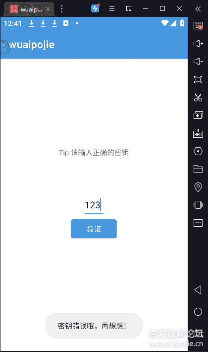
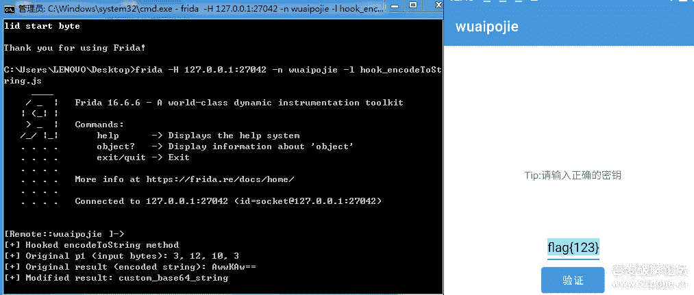
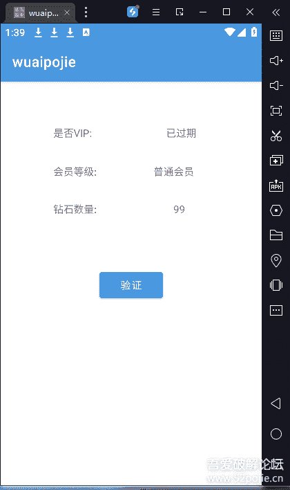

# [Android 分享] 学破解第216天，《Frida一把梭了》学习

- 原帖：https://www.52pojie.cn/forum.php?mod=viewthread&tid=2010779
- 抓取时间：2026-11-01T16:06:05.003Z

## 前言

坛友们，年轻就是资本，和我一起逆天改命吧，我的学习过程全部记录及学习资源：[//www.52pojie.cn/thread-2006536-1-1.html](https://www.52pojie.cn/thread-2006536-1-1.html:https)

立帖为证！--------记录学习的点点滴滴

## 0x1 是时候学习一下Frida一把梭了(上)

1. 到这里是因为动调插桩失败了，学一学这个打印功能，运行程序，输入123点验证，出现密码错误哦。



2. 先定位到错误提示这里，定位到关键跳上面的`check`函数。

1）、提取安装包

2）、打开dex文件，搜索字符串：密钥错误哦，再想想!

3）、定位到`onCreate`函数，向上翻

```
invoke-virtual {p0, p1}, Lcom/zj/wuaipojie/ui/ChallengeFourth;->check(Ljava/lang/String;)Z
    move-result p1
```

3. 再来分析一下`check`函数

1）、`str`这个是我输入的字符串，首先执行了一个`startsWith`和`endsWith`函数，百度一下可知判断字符串开头和结尾是否以指定的开头。

2、`substring`是截取`flag{`中间的一串的字符串。

3、然后用`bytes`进行base64再和我们`str`中间的那一串字符串比较。

4、得到`base64Utils.encodeToString(bytes)`就能知道`str`中间的那一部分了。

```java
public final boolean check(String str) {
    int i = 0;
    Object obj = null;
    if (!StringsKt.startsWith$default(str, "flag{", false, 2, null) || !StringsKt.endsWith$default(str, "}", false, 2, null)) {
        return false;
    }
    str = str.substring(5, str.length() - 1);
    Intrinsics.checkNotNullExpressionValue(str, "this as java.lang.String…ing(startIndex, endIndex)");
    String string = SPUtils.INSTANCE.getString((Context) this, "id", "");
    if (string != null) {
        obj = Integer.valueOf(string.length());
    }
    int i2 = 1000;
    Intrinsics.checkNotNull(obj);
    int intValue = obj.intValue();
    if (intValue >= 0) {
        while (true) {
            i2 -= 7;
            if (i == intValue) {
                break;
            }
            i++;
        }
    }
    string = Encode.encode(string + i2);
    Base64Utils base64Utils = Base64Utils.INSTANCE;
    byte[] bytes = string.getBytes(Charsets.UTF_8);
    Intrinsics.checkNotNullExpressionValue(bytes, "this as java.lang.String).getBytes(charset)");
    return Intrinsics.areEqual(str, base64Utils.encodeToString(bytes));
}
```

4. 进去`encodeToString`之后看看，我们要的就是`p1`的返回值。

```smali
method public final encodeToString([B)Ljava/lang/String;
    .registers 3
    const/4 v0, 0x2
    .line 11
    invoke-static {p1, v0}, Landroid/util/Base64;->encodeToString([BI)Ljava/lang/String;
    move-result-object p1
    return-object p1
.end method
```

5. 再来写`frida`脚本，我不会写代码怎么办，直接问ai要一个，类名换成实际的`com.zj.wuaipojie.util.Base64Utils`。

```javascript
// hook_encodeToString.js
// 定义要 hook 的类和方法
var target_class = "com.zj.wuaipojie.util.Base64Utils"; // 替换为实际的类名
var target_method = "encodeToString";        // 目标方法名

// 使用 Interceptor 来 hook 方法
Java.perform(function () {
    // 获取目标类
    var TargetClass = Java.use(target_class);

    // Hook encodeToString 方法
    TargetClass[target_method].overload('[B').implementation = function (p1) {
        console.log("\n[+] Hooked encodeToString method");

        // 调用原始方法并获取返回值
        var original_result = this[target_method](p1);
        console.log("[+] Original p1 (input bytes): " + Array.from(p1).join(', '));
        console.log("[+] Original result (encoded string): " + original_result);

        // 修改返回值（可选）
        var modified_result = "custom_base64_string"; // 修改为自定义的 Base64 字符串
        console.log("[+] Modified result: " + modified_result);

        // 返回修改后的值
        return modified_result;
    };
});
```

6. 有了脚本，怎么样让他跑起来呢？不懂问ai啦，`pip install frida-tools`安装`frida`。

1）、使用`adb`将 Frida Server 推送到模拟器

```bash
adb push frida64 /data/local/tmp/  # 推送 Frida Server
adb shell chmod 755 /data/local/tmp/frida64  # 赋予执行权限
```

2）、在模拟器中启动 Frida Server

```bash
adb shell
cd /data/local/tmp
su
./frida64 &
```

3）、连接到模拟器并加载脚本（这里`-U`一直不识别模拟器，出于无奈通过ip来连接了）

```bash
frida -H 127.0.0.1:27042 -n wuaipojie -l hook_encodeToString.js
```

- `-U`：连接到 USB 设备（模拟器被视为 USB 设备）。
- `-H`：通过指定ip和端口来连接。
- `-n com.example.app`：指定目标应用程序的包名。
- `-l hook.js`：加载 Frida 脚本。

4）、出了一点小问题，`frida`版本不一致，重新下载弄一下，[Frida Releases下载](https://github.com/frida/frida/releases)，在tag标签目录下找到`frida-server-16.6.6-android-x86_64.xz`下载。

5）、解决完之后一直提示`shell`不具有超级用户权限，找了一天才发现面具没给`shell`超级用户权限，难怪`frida-server`一直启动不了。

6）、这里转发一下端口，让win系统能连接到这个端口

```bash
adb forward tcp:27042 tcp:27042
```

7. 执行脚本，可以看成功hook到了返回值。



## 0x2 试试第八关

1. 运行可以看到是这样的。



2. 使用`jadx`搜索字符串定位到这里，可以看到调用了`checkVip`函数，双击跳转过去可以看到4个`native`关键字声明的函数，`so`文件名就是`52pojie`。

```java
public static final void m75onCreate$lambda0(TextView textView, TextView textView2, TextView textView3, View view) {
    if (SecurityUtil.checkVip()) {
        textView.setText("是VIP啦！");
    } else {
        textView.setText("已过期");
    }
    textView2.setText(SecurityUtil.vipLevel("普通"));
    textView3.setText(String.valueOf(SecurityUtil.diamondNum()));
}

public static native boolean check(String str);
public static native boolean checkVip();
public static native int diamondNum();
public static native String vipLevel(String str);

static {
    System.loadLibrary("52pojie");
}
```

3. 前面已经学过第一个参数就是`JNIEnv`，重新设置一下变量。

```c
jstring __fastcall Java_com_zj_wuaipojie_util_SecurityUtil_vipLevel(JNIEnv *a1, __int64 a2, void *a3)
{
  char *v5; // x21
  __int64 v6; // x0
  __int128 v7; // q0
  const char *v8; // x1
  jstring v9; // x19
  char v11[16]; // [xsp+8h] [xbp-58h] BYREF
  void *ptr; // [xsp+18h] [xbp-48h]
  __int128 v13; // [xsp+20h] [xbp-40h] BYREF
  void *v14; // [xsp+30h] [xbp-30h]
  __int64 v15; // [xsp+38h] [xbp-28h]

  v15 = *(_QWORD *)(_ReadStatusReg(ARM64_SYSREG(3, 3, 13, 0, 2)) + 40);
  v5 = (char *)(*a1)->GetStringUTFChars(a1, a3, 0LL);
  std::string::basic_string((int)v11, v5);
  v6 = std::string::append((int)v11, &unk_29285, 6u);
  v7 = *(_OWORD *)v6;
  v14 = *(void **)(v6 + 16);
  v13 = v7;
  *(_QWORD *)(v6 + 8) = 0LL;
  *(_QWORD *)(v6 + 16) = 0LL;
  *(_QWORD *)v6 = 0LL;
  if ( (v11[0] & 1) != 0 )
    operator delete(ptr);
  (*a1)->ReleaseStringUTFChars(a1, a3, v5);
  if ( (v13 & 1) != 0 )
    v8 = (const char *)v14;
  else
    v8 = (char *)&v13 + 1;
  v9 = (*a1)->NewStringUTF(a1, v8);
  if ( (v13 & 1) != 0 )
    operator delete(v14);
  return v9;
}
```

4. 继续练习`frida`，碰到这种看不懂代码的不要紧，打印一下参数和返回值看看

```javascript
// 加载 Frida 的 Interceptor 模块
Interceptor.attach(Module.findExportByName("lib52pojie.so", "Java_com_zj_wuaipojie_util_SecurityUtil_vipLevel"), {
    onEnter: function (args) {
        // 打印参数
        console.log("JNIEnv*: " + args[0]);
        console.log("jobject/jclass: " + args[1]);

        // 获取第三个参数（假设是 jstring）
        var jstringArg = args[2];
        var env = Java.vm.getEnv();
        var stringArg = env.getStringUtfChars(jstringArg, null);
        console.log("jstring arg: " + stringArg);
        env.releaseStringUtfChars(jstringArg, stringArg);
    },
    onLeave: function (retval) {
        // 打印返回值
        var env = Java.vm.getEnv();
        var stringRet = env.getStringUtfChars(retval, null);
        console.log("Return value: " + stringRet);
        env.releaseStringUtfChars(retval, stringRet);
    }
});
```

1）、打印参数和返回值，得到结果？？？看不懂啊，看来ai使用的姿势不对啊

```text
JNIEnv*: 0xf3319380
jobject/jclass: 0xffffaf7c
jstring arg: 0xf30c2558
Return value: 0xec5a3310
```

2）、去问一下AI你写的代码为什么返回的是地址不是字符串

`getStringUtfChars` 返回的是一个指向 UTF-8 编码字符串的指针（`NativePointer`），你需要使用 Frida 的`readUtf8String`方法将其转换为字符串。

3）、修改一下hook脚本


# Frida Hook 示例

## 初始脚本

```javascript
Interceptor.attach(Module.findExportByName("lib52pojie.so", "Java_com_zj_wuaipojie_util_SecurityUtil_vipLevel"), {
    onEnter: function (args) {
        // 获取 JNIEnv
        var env = Java.vm.getEnv();

        // 打印 JNIEnv*
        console.log("JNIEnv*: " + args[0]);

        // 检查 args[1] 是否为有效的 jobject/jclass
        if (args[1] && !args[1].isNull()) {
            // 将 jobject/jclass 转换为 Java 对象
            var jobject = env.newLocalRef(args[1]); // 创建本地引用
            var javaObject = Java.cast(jobject, Java.use("java.lang.Object"));

            // 打印对象的类名
            console.log("jobject/jclass class: " + javaObject.getClass().getName());
        } else {
            console.log("jobject/jclass is null or invalid");
        }

        // 检查 args[2] 是否为有效的 jstring
        if (args[2] && !args[2].isNull()) {
            var stringPtr = env.getStringUtfChars(args[2], null);
            var stringArg = stringPtr.readUtf8String();
            console.log("jstring arg: " + stringArg);
            env.releaseStringUtfChars(args[2], stringPtr);
        } else {
            console.log("args[2] is not a valid jstring");
        }
    },
    onLeave: function (retval) {
        // 检查返回值是否为有效的 jstring
        if (retval && !retval.isNull()) {
            var env = Java.vm.getEnv();
            var stringPtr = env.getStringUtfChars(retval, null);
            var stringRet = stringPtr.readUtf8String();
            console.log("Return value: " + stringRet);
            env.releaseStringUtfChars(retval, stringPtr);
        } else {
            console.log("Return value is not a valid jstring");
        }
    }
});
```

输出：

```text
JNIEnv*: 0xf3319380
jobject/jclass class: java.lang.Class
jstring arg: 普通
Return value: 普通会员
```

## 4）打印字符串的方法（备用）

这里正己大佬提供了两种打印字符串的方法，备用。

```javascript
onEnter: function(args){  //args传入参数
    // 方法一
    var jString = Java.cast(args[2], Java.use('java.lang.String'));
    console.log("参数:", jString.toString());

    // 方法二
    var JNIEnv = Java.vm.getEnv();
    var originalStrPtr = JNIEnv.getStringUtfChars(args[2], null).readCString();
    console.log("参数:", originalStrPtr);
}
```

## 5. 修改返回值

现在我们添加修改返回值的代码，再来执行一下。

```javascript
// 定义新的返回值
var newReturnValue = "菜鸟会员";

// 将新返回值转换为 jstring
var newJString = env.newStringUtf(newReturnValue);

// 修改返回值
retval.replace(newJString);

// 打印修改后的返回值
var stringPtr = env.getStringUtfChars(newJString, null);
var stringRet = stringPtr.readUtf8String();
console.log("Modified return value: " + stringRet);
```

输出：

```text
JNIEnv*: 0xf3319380
jobject/jclass class: java.lang.Class
jstring arg: 普通
Return value: 普通会员
Modified return value: 菜鸟会员
```

## 6. 学习小结

先学到这里吧，后面太复杂了渐渐看不懂了，感谢 deepseek，感谢正己大佬的教程，AI 真的强大，不需要自己写 hook 脚本了。

## 0x3 参考文档

1. [《安卓逆向这档事》十三、是时候学习一下Frida一把梭了(上)](https://www.52pojie.cn/thread-1823118-1-1.html)
2. [《安卓逆向这档事》十五、是时候学习一下Frida一把梭了(下)](https://www.52pojie.cn/thread-1840174-1-1.html)
