# [Android 原创] 某手游il2cpp逆向分析----libtprt保护

- 原帖: https://www.52pojie.cn/forum.php?mod=viewthread&tid=2010789
- 抓取时间: 2026-11-01T16:06:02.322Z

最近在玩个游戏，发现是由 `il2cpp` 进行打包的，就打算用 `il2cppdumper` 来 `dump` 看看游戏内容

开干

说干就干，提取游戏安装包，在 `lib/arm64-v8a` 路径提取出 `libil2cpp.so`，在 `assets/bin/Data/Managed/Metadata` 路径提取出 `global-metadata.dat`

直接打开 `il2cppdumper`，选择这两个文件，发现报错：

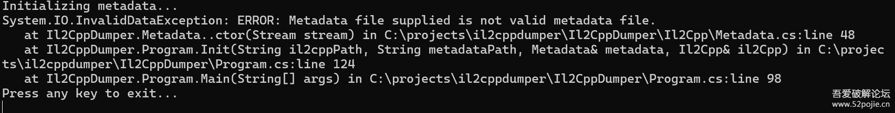

那应该是有加密的，用 `010Editor` 打开 `global-metadata.dat` 文件，发现熵值很高，很明显的加密了

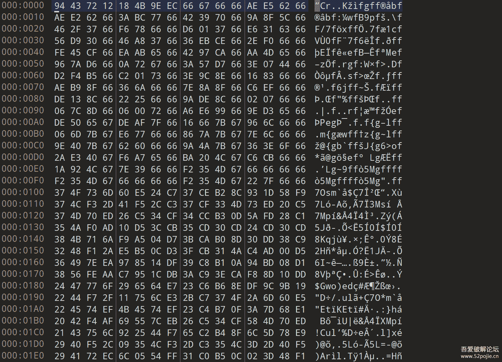

`ok` 了，既然安装包中的 `global-metadata.dat` 被加密了，那我直接去内存中 `dump` 到的，应该就没问题吧！

既然要从内存中获取到 `global-metadata.dat`，那肯定要根据 `libil2cpp.so` 中的逻辑来找出加载 `global-metadata.dat` 的地方，当然也可以通过在内存中搜寻魔数头的方式来找到文件头（ps:这个例子的魔数头也被抹除了，所以只能采取分析 `libil2cpp.so` 中的逻辑了＠_＠;）

事情果然没这么简单，当我用 `ida` 打开 `libil2cpp.so` 后，发现 `libil2cpp.so` 也被加固了，导出表被抹除完了

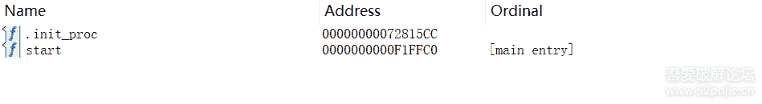

并且我看到依赖库中包含 `libtprt.so`

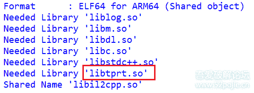

网上搜索得知，`libtprt.so` 是属于某讯的加固，好吧，看来还是有难度的，继续分析吧！

既然安装包中的 `libil2cpp.so` 也被加固了，那也只能去内存中拿了，写了一个 `frida` 脚本去获取 `libil2cpp.so`：

[JavaScript] 纯文本查看 复制代码

```
function dump_so() {
    Java.perform(function() {
        var currentApplication = Java.use("android.app.ActivityThread").currentApplication();
        var dir = currentApplication.getApplicationContext().getFilesDir().getPath();
        var libso = Process.getModuleByName("libil2cpp.so");
        var file_path = dir + "/" + libso.name + "_" + libso.base + "_" + ptr(libso.size) + ".so";
        var file_handle = new File(file_path, "wb");
        if (file_handle && file_handle != null) {
            Memory.protect(ptr(libso.base), libso.size, 'rwx');
            var libso_buffer = ptr(libso.base).readByteArray(libso.size);
            file_handle.write(libso_buffer);
            file_handle.flush();
            file_handle.close();
            console.log("[dump]:", file_path);
        }
    });
}

var isCalled = false;
function hookdlopen() {
    var dlopen = Module.findExportByName(null, "dlopen");
    Interceptor.attach(dlopen, {
        onEnter: function (args) {
            var path = args[0].readCString();
            if (path && path.indexOf('libil2cpp.so') !== -1) {
                this.path = path;
            }
        },
        onLeave: function (retval) {
            if (this.path && this.path.indexOf('libil2cpp.so') !== -1 && !isCalled) {
                dump_so();
                isCalled = true;
            }
        }
    });
}

hookdlopen();
```

`frida` 使用 `spawn` 模式选择脚本并打开游戏，然后根据打印出来的地址找到 `dump` 下来的 `so`，尝试将其使用 `ida` 打开，发现报错

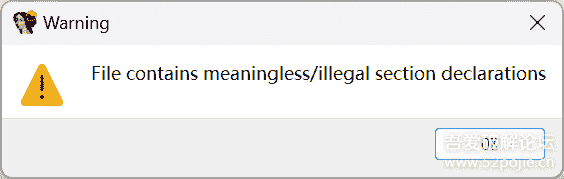

使用 `SoFixer` 工具进行修复，然后再次通过 `ida` 打开，发现导出表都正常了，终于迈出万里长征的第一步了！

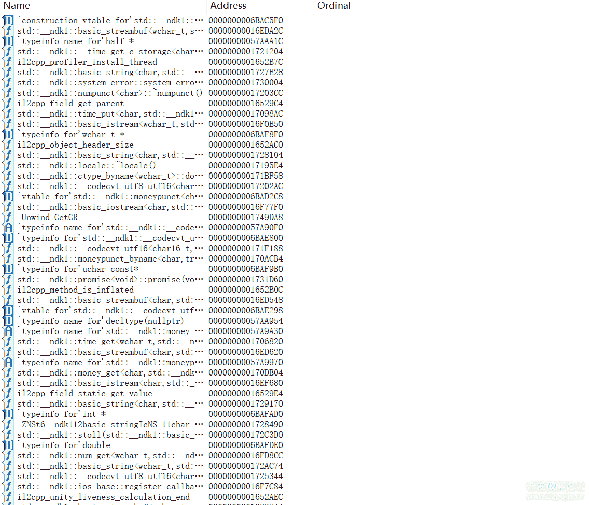

想要找到 `global-metadata.dat` 的内存地址，则需要通过将 `ida` 分析出的反汇编代码和 `unity` `il2cpp` 的源码进行对比来快速得到结果，通过分析源码发现，加载 `metadata` 会使用一个字符串 `global-metadata.dat`

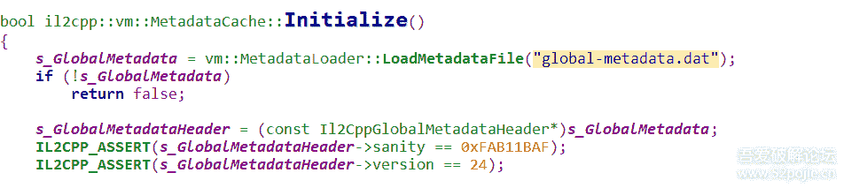

尝试在 `ida` 中搜索这个字符串


通过交叉引用获取到它的使用地址（图片中的变量名是我重命名后的，并不是原版）

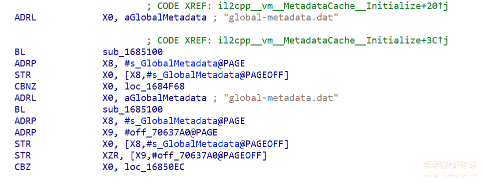

`F5` 进行反汇编分析（图片中的变量名是我重命名后的，并不是原版）

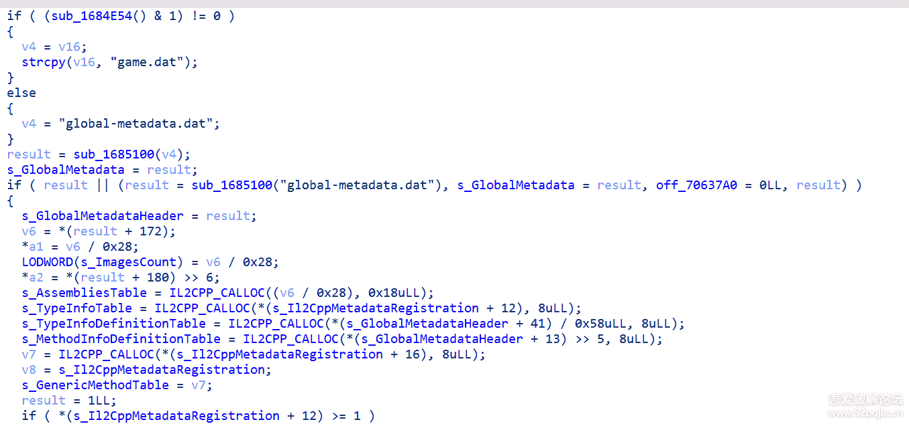

发现 `sub_1685100` 和源码中 `LoadMetadataFile` 的作用很相近，直接跟进去看看

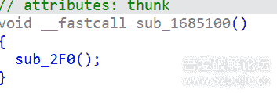

继续跟 `sub_2F0`

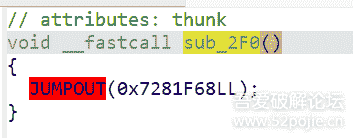

`F5` 处理有问题，没关系，继续跟下去吧

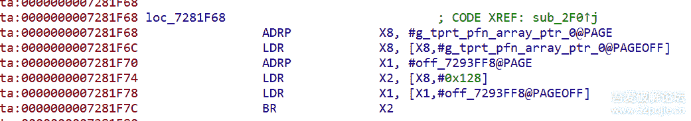

跟到最后发现原来是调用了 `libtprt` 里面的导出函数来进行的加载 `metadata`，这里面肯定会涉及到加密或者解密了，还是要跟进去看看

仔细观察汇编，知道最终跳转使用的是 `BR X2`，查看 `X2` 寄存器之前的赋值记录，只有一条 `LDR X2, [X8,#0x128]`，`X8` 寄存器又是直接赋值 `g_tprt_pfn_array_ptr_0` 这个导入函数的地址，所以最终需要分析的地址为：`libtprt.so` 中 `g_tprt_pfn_array_ptr_0` 导出函数的地址偏移 `0x128` 后的地址

从安装包中提取出 `libtprt.so`，使用 `ida` 打开进行分析

找到 `g_tprt_pfn_array_ptr_0` 导出函数

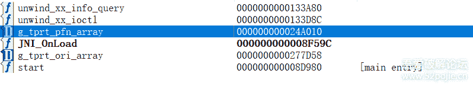

根据它的地址，偏移 `0x128` 后看看

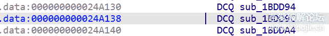

进去看看

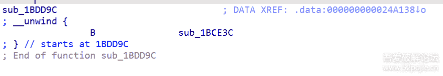

继续跟进去

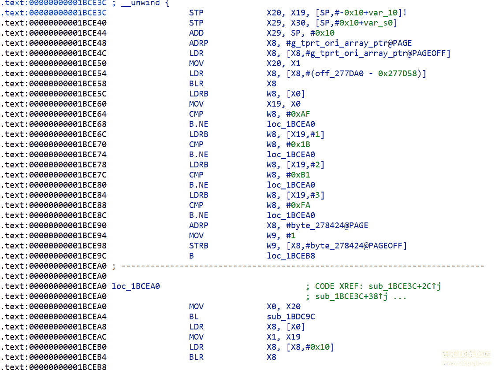

`F5` 看下伪 `c` 吧

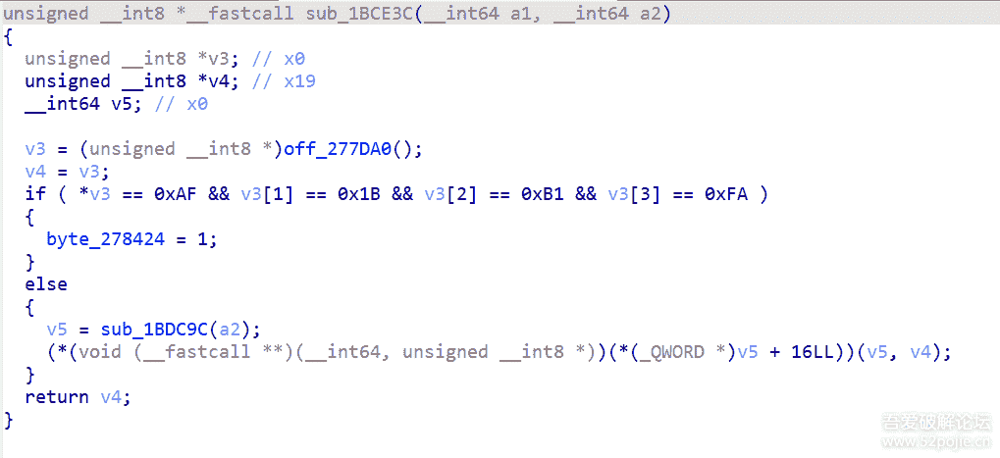

这个函数大致流程就是先调用偏移为 `0x277DA0` 处的函数指针，然后根据这个函数的返回值进行 `if` 分支，了解 `global-metadata.dat` 的朋友应该知道，正常的魔数头就是 `AF1BB1FA`，这说明 `0x277DA0` 处的函数应该就是加载 `metadata` 的函数，不然后面应该是不会判断这个魔数的，当然话不可以说的这么满，还是继续看后续代码吧，`else` 里面是两个函数调用，大致功能为先调用 `sub_1BDC9C` 来获取需要调用的函数，然后将函数指针传递给 `v5`，最后调用 `v5` 里存储的函数

函数大致流程分析的差不多了，先去看看 `0x277DA0` 处的函数指针吧

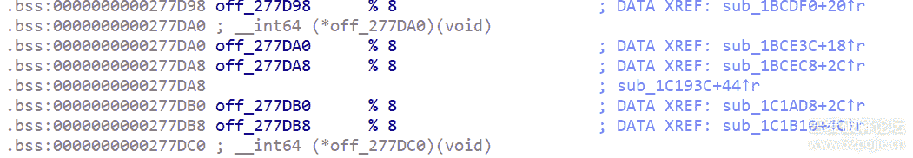

可以看到 `0x277DA0` 属于 `bss` 段，这是一个存储未初始化的全局和静态变量的段，查询交叉引用也没有其余调用，那么静态分析行不通，就只能通过动态分析了

写了一个 `frida` 脚本去获取 `0x277DA0` 处的函数指针，考虑到不知道它什么时候完成初始化，所以我们直接在调用 `sub_1BCE3C` 的时候才进行获取指针内容

[JavaScript] 纯文本查看 复制代码

```
function print_arg(){
    var libtprtaddr = Module.findBaseAddress("libtprt.so");
    console.log("libtprt基址: ",libtprtaddr);
    console.log("libil2cpp基址: ",Module.findBaseAddress("libil2cpp.so"));
    var function_addr = libtprtaddr.add(0x1BCE3C);
    Interceptor.attach(function_addr,{
        onEnter:function (args) {
            console.log("0x277DA0: ",Memory.readPointer(libtprtaddr.add(0x277DA0)));
        },
        onLeave:function (returnValue) {
        }
    })
}
var isCalled = false;
function hookdlopen() {
    var dlopen = Module.findExportByName(null, "dlopen");
    Interceptor.attach(dlopen, {
        onEnter: function (args) {
            var path = args[0].readCString();
            if (path && path.indexOf('libil2cpp.so') !== -1) {
                this.path = path;
            }
        },
        onLeave: function (retval) {
            if (this.path && this.path.indexOf('libil2cpp.so') !== -1 && !isCalled) {
                print_arg();
                isCalled = true;
            }
        }
    });
}
hookdlopen();
```

运行后查看打印情况

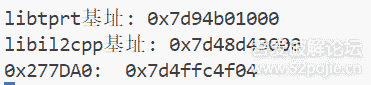

可以明显看到，`0x277DA0` 处的函数指针并不是 `libtprt` 内的函数，而是 `libil2cpp` 中的，将得到的地址减去 `libil2cpp` 的基址，得到 `0x7281F04`，去 `ida` 中查看

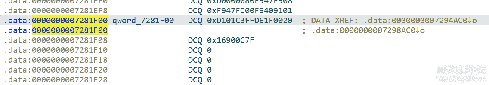

数据并没有解析出来，我们按 "`C`" 键来将其主动转化成汇编

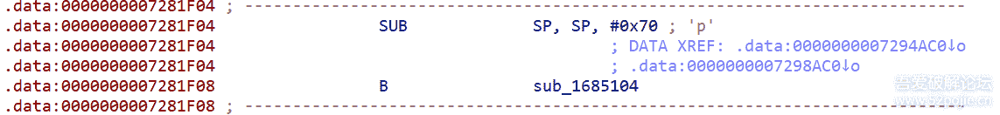

可以看到他跳转了一个函数，进去跟进去吧

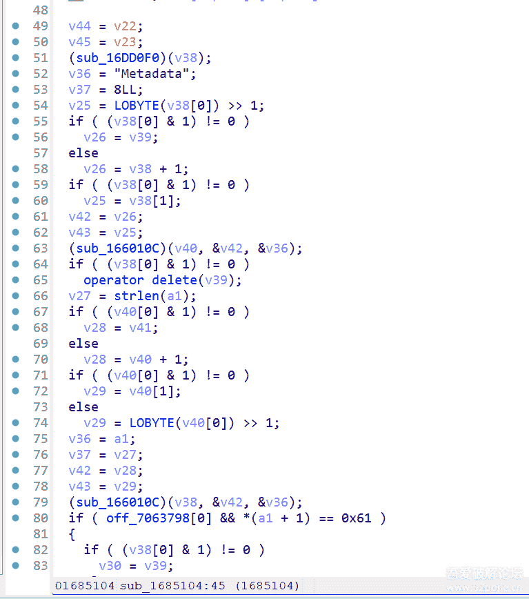

可以看到有一个明显的 `Metadata` 字符串，这和源码中的 `LoadMetadataFile` 函数很类似

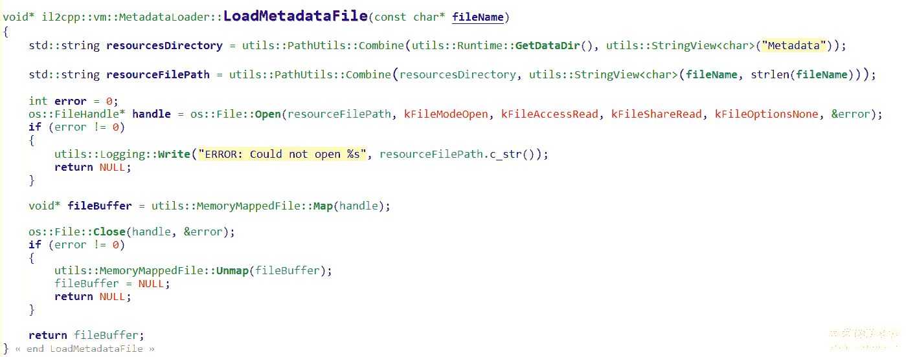

继续往下看，发现还有类似的字符串，如 "`ERROR: Could not open %s`"

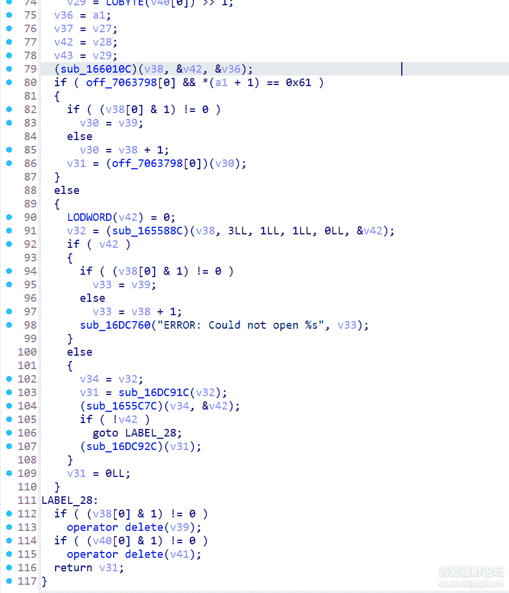

那看来函数应该是找对了，继续对照着看，发现 `sub_165588C` 和 `os::File::Open` 很类似，都是 `6` 个参数，而且 `v42` 也和 `error` 很像，那么 `v32` 就可以认为是源码中的 `handle` 了。继续对照源码，源码中只有两个地方调用了 `handle`，分别是 `utils::MemoryMappedFile::Map` 和 `os::File::Close`，而 `ida` 中的伪 `c` 代码也只有两处，分别是 `sub_16DC91C` 和 `sub_1655C7C`，故而直接推论，`sub_16DC91C` 就是 `utils::MemoryMappedFile::Map`，那么直接跟进去看看实现

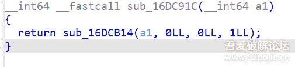

跟进去看看

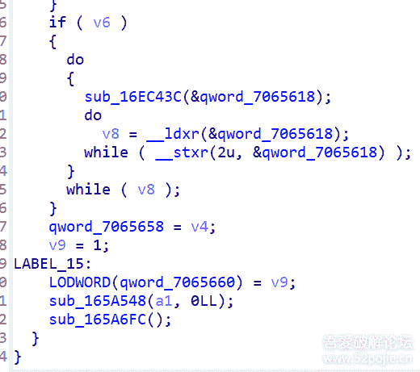

如图所示，整个 `sub_16DCB14` 只调用了三个函数，我们分别对着三个函数进行分析

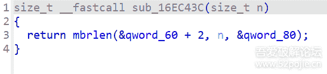

很明显，`sub_16EC43C` 只是一个计算长度的，直接跳过

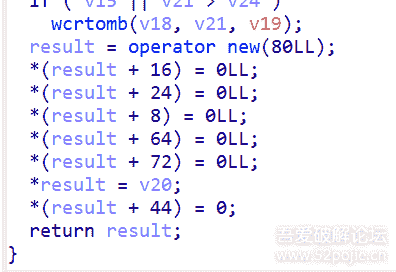

同样的，通过 `sub_165A548` 的返回值也能看出来并不是主要函数

那就只能是 `sub_165A6FC` 了，跟进去看看

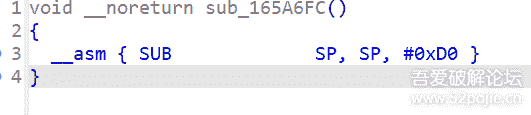

`F5` 分析的有问题，直接看汇编吧

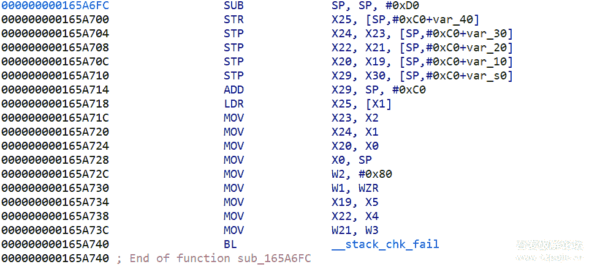

果然有问题，`BL` 指令调用完全后是会执行后续指令的，这是带 `LR` 寄存器的跳转，所以后续的那个函数也应该包含在 `sub_165A6FC` 函数里面，直接去看 `0x165A740+4`，也就是 `0x165A744` 处的函数实现

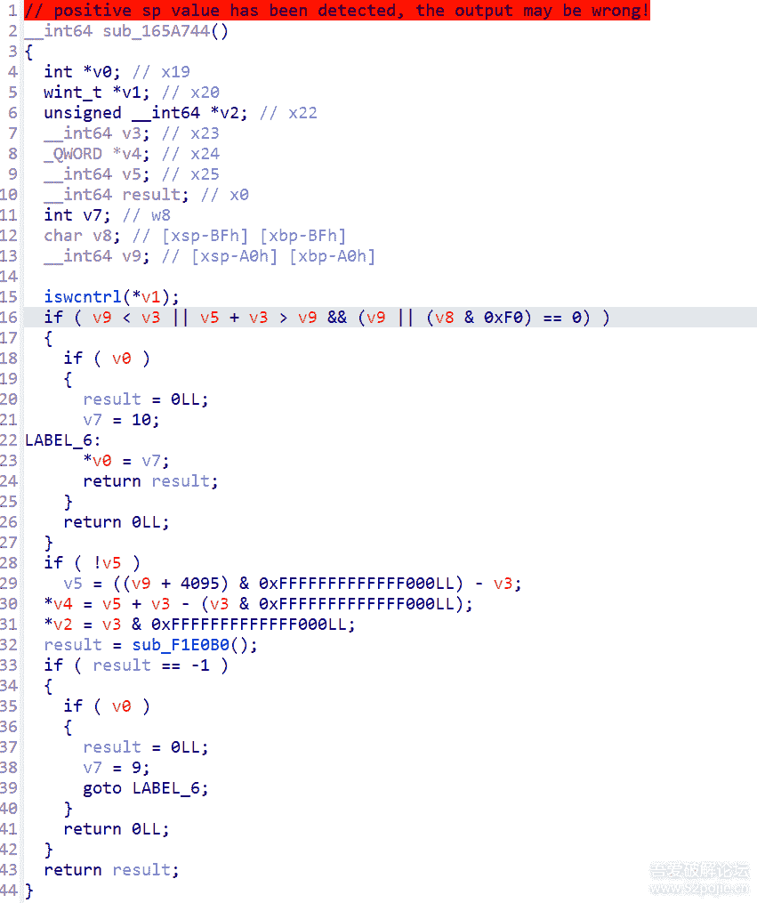

提示栈有问题，不用管，能分析出来就行，查看逻辑，发现返回的 `result` 只与 `sub_F1E0B0` 有关，那行，跟进去看看

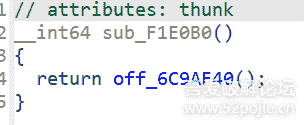

继续跟

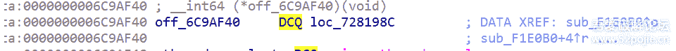

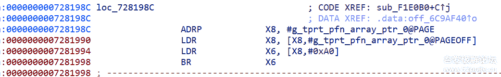


## 定位解密函数

又看到了熟悉的 `g_tprt_pfn_array_ptr_0`，继续去 `libtprt` 里面去找吧，不过这次的偏移量是 `0xA0`。

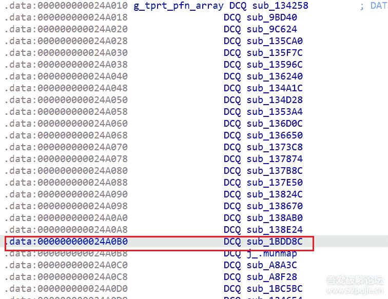

跟进去，是个 `B` 跳转，继续跟，看到了一个函数

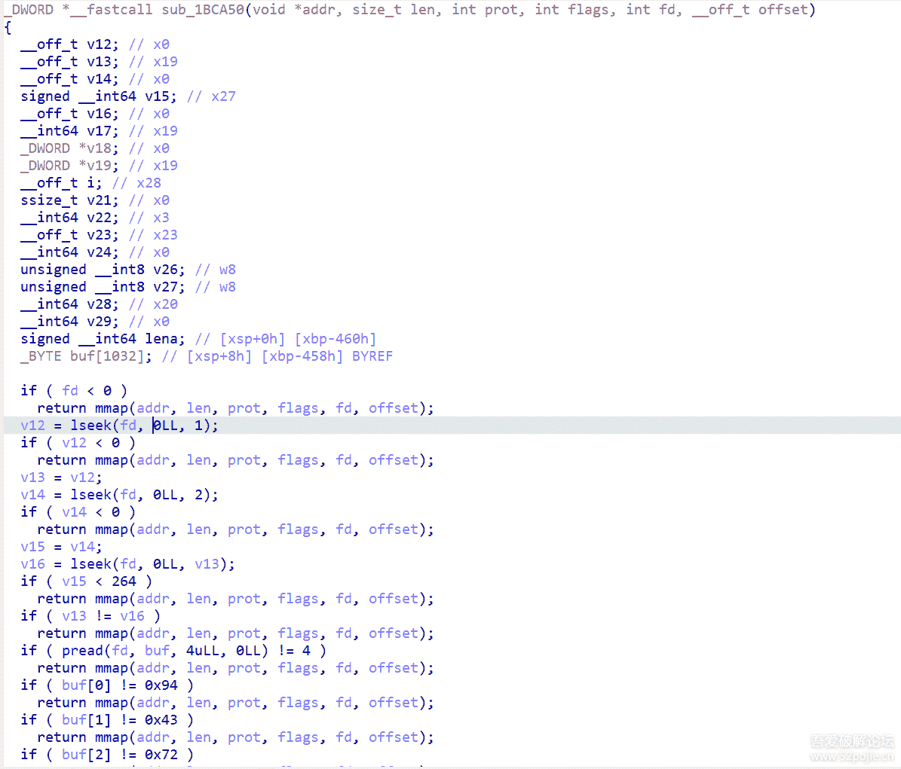

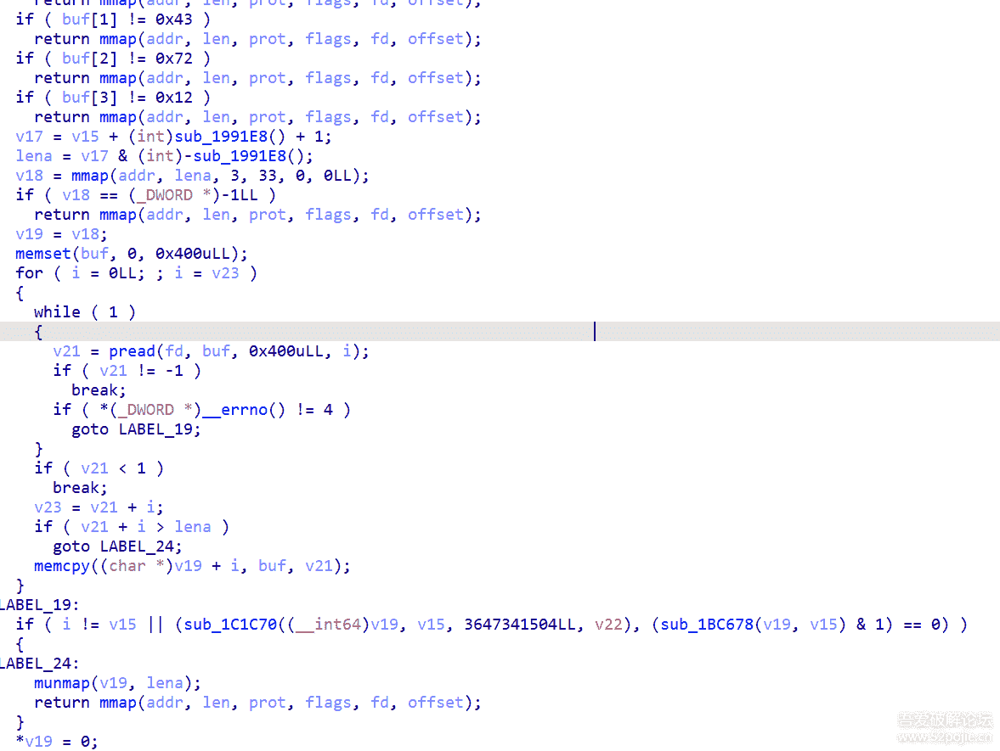

我们注意到函数内有几个判断值的 `if` 语句：

```c
  if ( buf[0] != 0x94 )

    return mmap(addr, len, prot, flags, fd, offset);

  if ( buf[1] != 0x43 )

    return mmap(addr, len, prot, flags, fd, offset);

  if ( buf[2] != 0x72 )

    return mmap(addr, len, prot, flags, fd, offset);

  if ( buf[3] != 0x12 )

    return mmap(addr, len, prot, flags, fd, offset);
```

这与我们开头看到的安装包内的 `global-metadata.dat` 的头一模一样，所以基本可以判定，这个就是解密的函数，我们直接 `hook` 这个函数的返回值看看：

```javascript
function print_arg(){
	var libtprtaddr = Module.findBaseAddress("libtprt.so");
    var libil2cppaddr = Module.findBaseAddress("libil2cpp.so");

	console.log("\n");
	console.log("libtprt基址:",libtprtaddr);
    console.log("libil2cpp基址:",libil2cppaddr);
	
	var function_addr = libtprtaddr.add(0x1BCA50);
    var hooked = false;
	Interceptor.attach(function_addr,{
		onEnter:function (args) {
            this.len = parseInt(this.context.x1);
		},
		onLeave:function (returnValue) {
            if(!hooked){
                hooked = true;
                var currentApplication = Java.use("android.app.ActivityThread").currentApplication();
                var dir = currentApplication.getApplicationContext().getFilesDir().getPath();
                var file_path = dir + "/global-metadata.dat";
                var file_handle = new File(file_path, "wb");
                if (file_handle && file_handle != null) {
                    var buffer = ptr(this.context.x0).readByteArray(this.len);
                    file_handle.write(buffer);
                    file_handle.flush();
                    file_handle.close();
                    console.log("[dump]:", file_path);
                }
            }
		}
	})
}

var isCalled = false;
function hookdlopen() {
    var dlopen = Module.findExportByName(null, "dlopen");
    Interceptor.attach(dlopen, {
        onEnter: function (args) {
            var path = args[0].readCString();
            if (path && path.indexOf('libil2cpp.so') !== -1) {
                this.path = path;
            }
        },
        onLeave: function (retval) {
            if (this.path && this.path.indexOf('libil2cpp.so') !== -1 && !isCalled) {
                print_arg();
                isCalled = true;
            }
        }
    });
}

hookdlopen();
```

这里需要注意，我是测试过这个函数是第一个加载 `global-metadata` 的，所以添加了个 `hooked` 变量去控制，如果不清楚是什么时候加载 `global-metadata` 的话，可以打印 `this.len` 看看，一般来说和安装包内的大小差不多，可能会有些许差距

看看内存 dump 出来的 `global-metadta` 吧

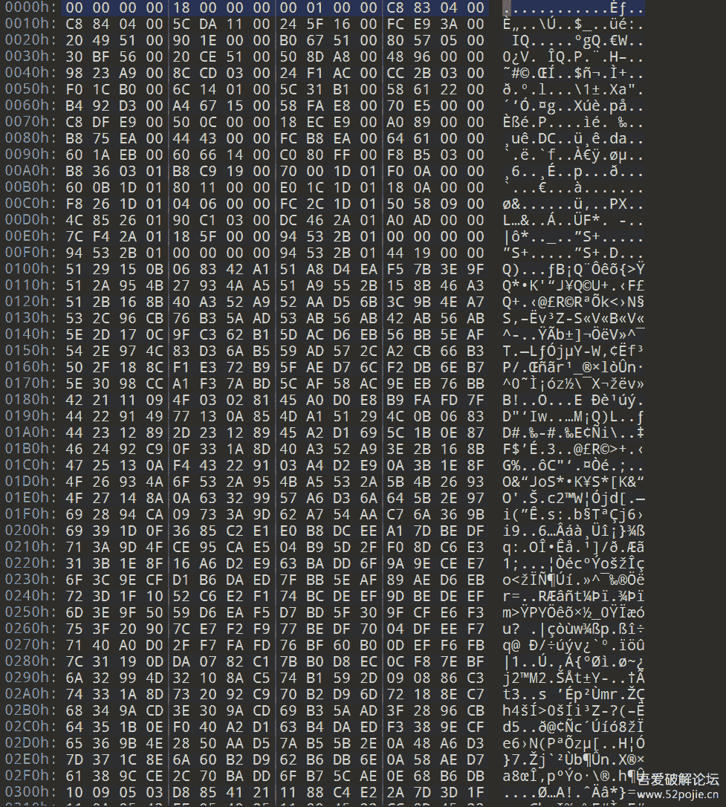

可以看到，文件头是被抹除了的，但是基本上的内容都还在，我们用 `UnityMetadata.bt` 模板跑一遍看看

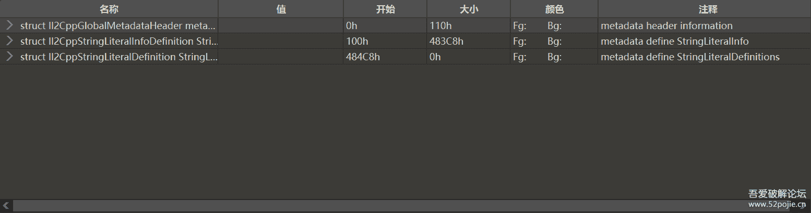

是报错了的，看来内存 dump 出来的还是有问题，然后我 `hook` 了最开始的 `sub_1684EF0` 函数，看看会不会在中途继续解密，结果是没有，最后返回的内容还是和之前 `hook` 的一样的

## 分析 `Il2CppGlobalMetadataHeader`

继续分析吧，我们看看 `Il2CppGlobalMetadataHeader` 是什么样子

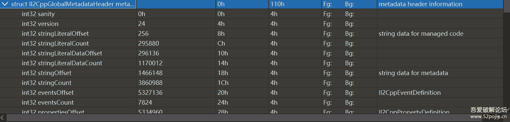

可以看到，除了文件头的四个魔数被抹除了之外，其余的信息是全的，那么问题出在哪里呢，通过 `Il2CppGlobalMetadataHeader` 的内容我们可以看到，`stringLiteralOffset` 的值为 `256`，即 `0x100`，那么表示文件内容是从 `0x100` 开始的，我们查看 `0x100` 处的内容，通过与正常的 `global-metadata.dat` 文件进行对比，可以确认这里肯定存在加密（因为正常的 `global-metadata.dat` `0x104` 处的值必须为 `0`）

那怎么办呢？我想到了查看源码，看看源码中有没有调用 `stringLiteralOffset` 的地方，通过源码来实现逆向分析。

找完整个源码，发现只有一处调用了 `stringLiteralOffset`

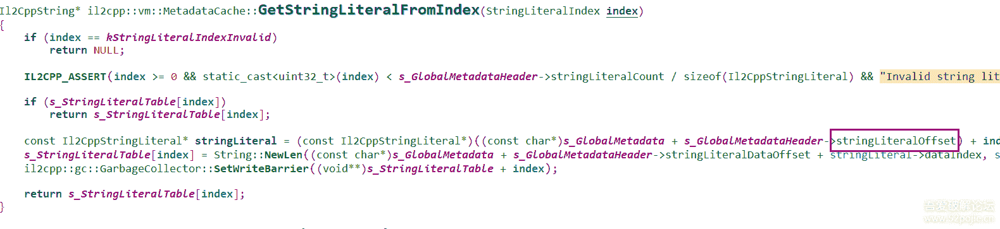

如何快速定位到这个地址呢？这个函数并没有什么字符串特征，所以并不好通过字符串实现快速定位

这里参考了这位大佬的分析思路，通过 `il2cpp::vm::String::NewLen` 来找到对应的函数

https://notion-blog-wine-gamma.vercel.app/article/genshin_analyze_1

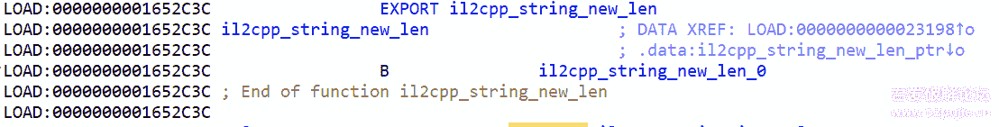

查一下他的交叉引用

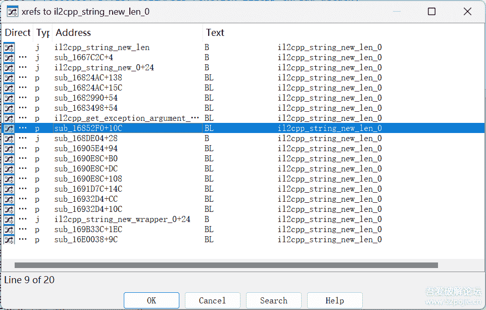

一个个对比，最终定位到 `sub_16852F0`

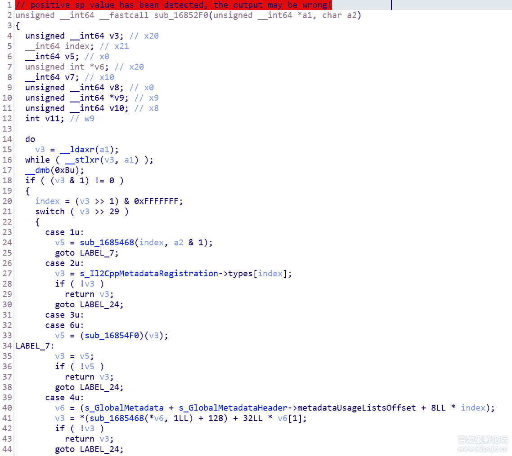

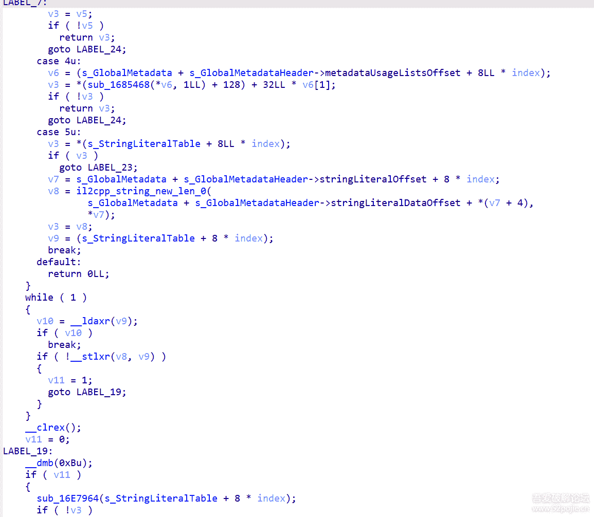

很好，它在调用 `stringLiteralOffset` 的时候肯定是进行了解密了的，所以我们直接 `hook` 这个情况下的 `GlobalMetadataHeader`。我尝试 `hook` 加载后的地址，遗憾的是，它并没有走这条路径，也就是说它自实现了一些解密和加载的函数，并没有选择调用原生函数，所以只能另寻出路了

## 使用 `pwatch` 监听内存访问

这个时候其实已经很难分析了，因为它魔改了的话，对比源码已经没太大效果了。

后面我突然想到，他如果进行解密的话，肯定会访问 `GlobalMetadataHeader` 的地址，为什么不用监听内存试试呢？说干就干，我首先尝试使用 `frida` 的 `MemoryAccessMonitor` 来进行监听内存，发现还是 `hook` 不到，因为 `MemoryAccessMonitor` 原理是使用 `mprotect` 来禁止读写执行，进而触发异常被 `frida` 监听到，但是 `mprotect` 只能针对一整页的内存（大小为 `0x1000`），数据量太大了，并不会有什么效果，所以又要换一种思路，想要单独监听一个内存地址，就只能使用调试器之类的软件了，例如 `GDB` 和 `LLDB`，因为我之前并没有使用过这两个调试器，所以选择了我比较熟悉的 `pwatch`，写了个 `frida` 脚本来配合 `pwatch`

```javascript
function stop(){

    var libtprtaddr = Module.findBaseAddress("libtprt.so");

    var libil2cppaddr = Module.findBaseAddress("libil2cpp.so");

	console.log("\n");

	console.log("libtprt基址:",libtprtaddr);

    console.log("libil2cpp基址:",libil2cppaddr);

	var function_addr = libil2cppaddr.add(0x1684F68);

	Interceptor.attach(function_addr,{

		onEnter:function (args) {

            console.log(`./arm_64 -t -b ${Process.getCurrentThreadId()} rw8 ${this.context.x0.add(0x100)}`)

			console.log("开始暂停");

			// 暂停当前线程 10 秒

            const startTime = Date.now();

            while (Date.now() - startTime 
```

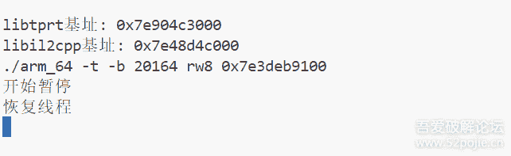

`pwatch` 打印为：

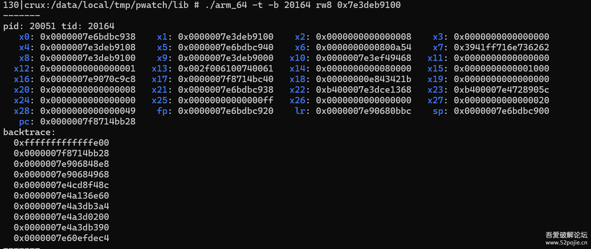

## 定位字符串解密函数

距离 `tprt` 和 `il2cpp` 最近的地址是 `0x7e906848e8`，减去 `libtprt` 的基址 `0x7e904c3000`，得到 `0x1C18E8`，直接去 `tprt` 里面看看

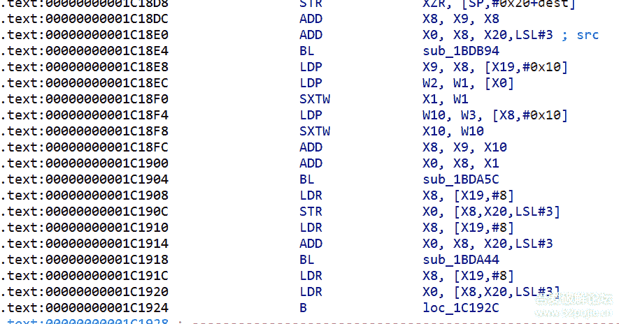

查看一下当前地址所在的函数 `sub_1C1884` 吧

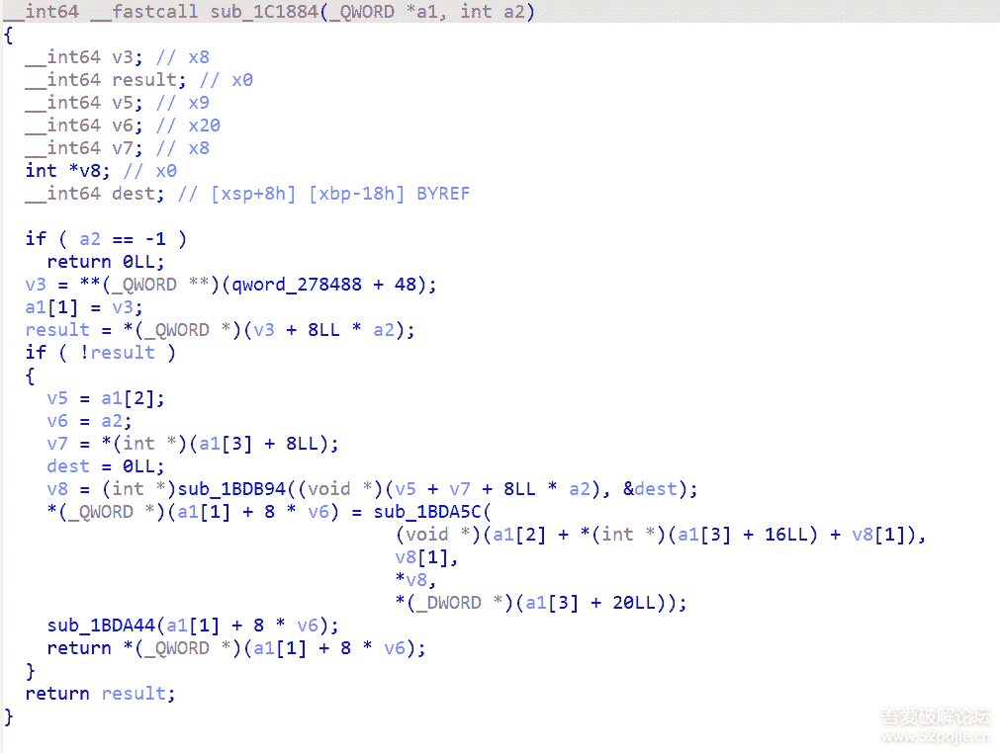

因为堆栈中显示的是 `lr` 寄存器，也就是调用的地址 + 4，所以可知读取 `stringLiteral` 的函数是 `sub_1BDB94`，这样其实看伪 C 已经能看出来很多东西了，因为 `v5 + v7 + 8LL * a2` 这个结构，很类似于 `((const char*)s_GlobalMetadata + s_GlobalMetadataHeader->stringLiteralOffset) + index`，进去 `sub_1BDB94` 里面看看

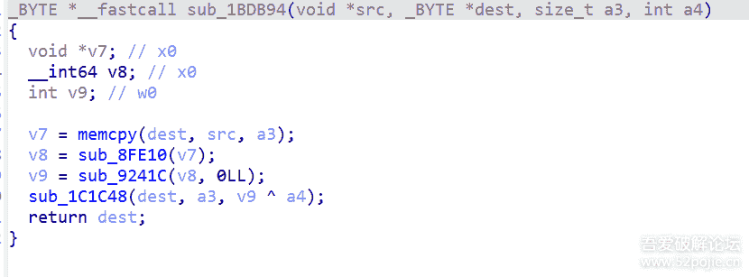

直接看跟返回值唯一有关的函数 `sub_1C1C48`


终于找到解密点了，查看该函数，容易分析出参数1是加密的内容，参数2是长度，参数3是加密值，打印一下看看


看来分析的没错，长度应该固定为 `8`，前面解释过了，加密值怎么获取的呢？往上层分析，在 `sub_1BDB94` 中可以看到，加密值为 `v9 ^ a4`，`v9 = sub_9241C(v8, 0LL)`，`a4` 则为 `sub_1BDB94` 的参数

先打印看看这两个是不是固定值，`hook` 后发现 `v9` 为固定值，`a4` 则为当前的偏移量，最后根据 `sub_1C1C20` 写一个相同的脚本就行了，解密出来后发现都恢复了


注意到 `sub_1C1884` 中，通过 `sub_1BDB94` 获取到 `v8` 后，在下面还进行了一处调用，通过对比源码，可以猜测下面的函数中包括 `stringLiteralData` 的解密函数，跟进去看了确实如此，同样写一个解密脚本进行还原即可


## 后记

这篇文章年前就准备写了，只是一直偷懒导致拖了许久。文章中写的都是我最开始尝试时用到的方法，其实还有很多地方可以进行优化，比如在定位解密函数时，是可以 `hook` `il2cpp_string_new_len` 这个导出函数通过打印堆栈来定位到的，当然，这个都是后话了，`hook` `il2cpp_string_new_len` 并不如我原文中写的方法具体代表性，因为它完全可以自实现这个函数，只不过并没有罢了。文章写到这里其实是并没有完结的，此时使用 `il2cppdumper` 还是会报错，`metadata` 里的数据并没有高熵了，那么有问题的地方应该就是 `il2cpp.so` 了，但是在写完这篇文章前，我已经没有在玩那个游戏了，耗费这个精力对我来说并不值得。如果评论区有知道的朋友，望不吝赐教
