# [Android 原创] NodeVideo修改思路

- 原帖: https://www.52pojie.cn/forum.php?mod=viewthread&tid=2012224
- 抓取时间: 2026-11-01T16:05:40.529Z

在翻遍许多条帖子，发现只是通过搜索的`isPro`去修改的，该篇通过搜索字符串确定修改位置(最后都是修改的`isPro`方法，只是多条思路)

## 工具

`Il2CppDumper`

`IDA Pro`

`VScode`(其他工具也可)

主要是前面两个工具

使用`Il2CppDumper`导出`dump.cs`文件和`stringliteral.json`

用`VScode`打开

在软件界面是以"Pro"为标识

在`stringliteral.json`里搜索`Pro`

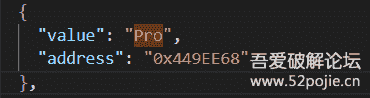

可以看到这个字符串地址是0x449EE68

打开`ida`导入`il2cpp.so`

直接跳转

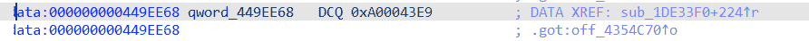

`sub_1FC6594`这个函数对应的符号是什么呢，去`dump.cs`查找（写完该帖子才想起来，`Il2CppDumper`有`ida`导入的脚本`undefined`）

可以看到是`GetExtraParam`方法传入了一个`key`，可以知道传入了一个`Pro`字符串然后返回了一个`String`(可能是传入一个`key`，通过传入的`key`去查找对应的值)

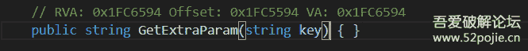

我们继续分析

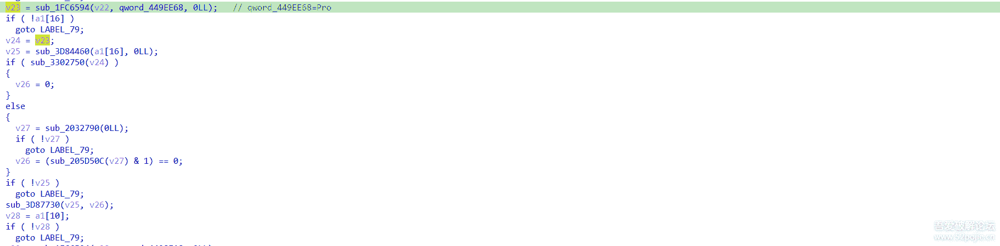

获取的值给了`v23`，后面`v23`又给了`v24`，然后有个方法传入了`v24`

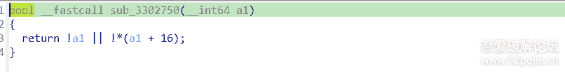

可以看到`ida`识别出来了返回值是`bool`，也就是`boolean`值

这个代码就是判断传入的值是不是空的

如果是空的`v26`=0，如果不是则执行`else`代码

这里很熟悉了，大家都是搞`smali`比较多看的`java`代码比较多，如果吧这段代码想象成`java`是什么样的

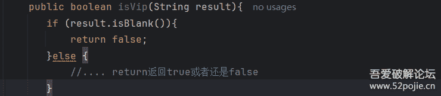

类似于这样的代码

那么我们现在主要是看`else`的代码了

`v26`是个关键

可以看到`v26`是一个判断返回的值，如果`sub_205D50C`返回的是1那么`v26`是1如果是0则返回一个0也就是（`true`/`false`）

我们直接去`dump.cs`去查找`205D50C`

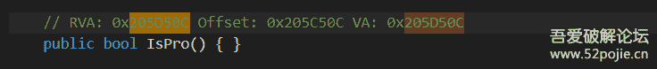

可以看到是`isPro`那么就可以确定，我们要修改的地方就是`sub_205D50C`

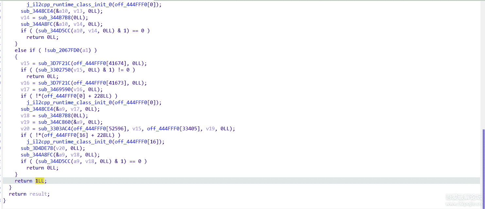

可以看到有个地方返回了1，我们直接跳转执行

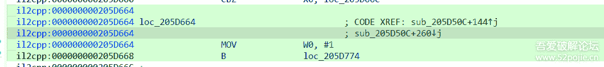

指令就是`B loc_205D664`

直接在函数开始执行的地方跳转

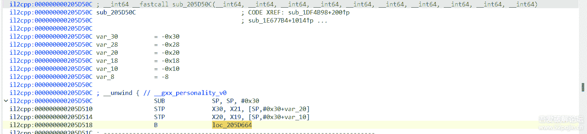

打开`app`查看是否成功

可以看到之前需要`Pro`的功能都可以用，并且可以导出视频

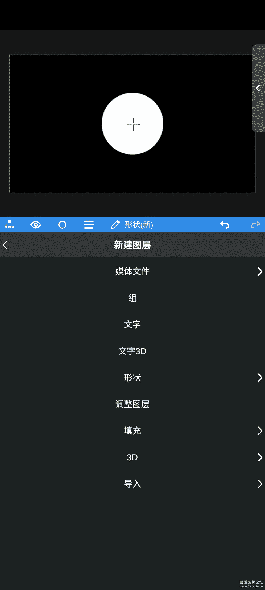
