# [Android 原创] 分析某库登录逻辑以及协议复现

- 原帖: https://www.52pojie.cn/forum.php?mod=viewthread&tid=2014961
- 抓取时间: 2026-11-01T16:05:28.749Z

工具准备：`Pixel XL` // 该软件不支持模拟器 雷电APP（[脱壳](https://www.52pojie.cn/forum-5-1.html)用，不会脱壳，哭） `frida`

本贴仅作技术交流，如有侵权请在联系我立即删帖

符合360加固的特征，用雷电脱个壳，扔`jadx`编译一下

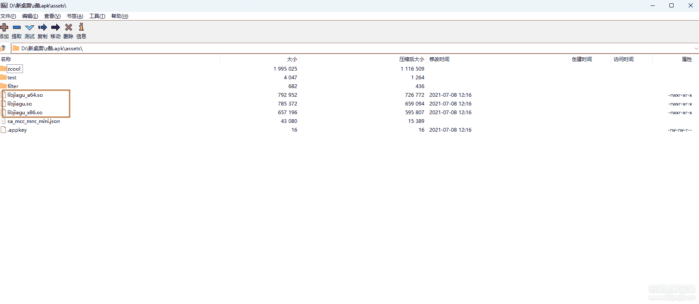

尝试一下抓包，抓到两个数据包

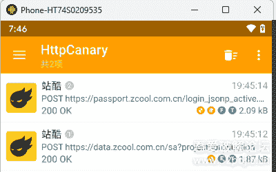

只有下面这一个数据包和登录有关

```
POST /login_jsonp_active.do HTTP/1.1
common: {"uniqueCode":"dd67d0c0-01e5-492d-8b3b-c35c5fa6ba48","appId":"com.zcool.community","channel":"zcool","mobileType":"android","versionCode":4638}
BaseInfo: {"uniqueCode":"dd67d0c0-01e5-492d-8b3b-c35c5fa6ba48","appId":"com.zcool.community","channel":"zcool","mobileType":"android","versionCode":4638}
Content-Type: application/x-www-form-urlencoded
Content-Length: 624
Host: passport.zcool.com.cn
Connection: Keep-Alive
Accept-Encoding: gzip
Cookie: HWWAFSESID=a3b2973ef5454da521; HWWAFSESTIME=1741081260467
User-Agent: okhttp/3.12.0

app=android&key=dTdlMmtGQjZIQk45NEN3dTIzamdVb2xYMVp5dDZnYmgrMGRlK2xjbkpwZjJpWGczb1FhYWxUVUx1%250AaVJ1d01ZeG5mZUpXZzUvT0M0WQpuYnF1NG0wdjZEd0NaSldPMkZGQ1loRmZ5NG1PM1dTMmhGd3d0%250AbVNhaG9vMVRBbitzQWRrZVBubWZxNGt6ajIyUHJpdEVxUGhHM0tKCmMzWmExU2FXWDJ0VjA0S0NE%250AL3owNmNOUEUrMjRwcExDR0VqSVViU2RyVDU2a0RmS0dqOFhKYmNyYjljM0lqbE9IWm5Rajl5UmM1%250AdnMKTDlFc2xLaVJNRU5rUVJ6RnVaN1k0OVBPTklkeVpsYUJwaG5UTlpkTy9DcmJDcmhvTjRZUUM2%250AcjZiSU4xcTdieHlIOTBxNjYyT0RCNwpNZVhzQVcwbjI3eEtUTHVDWmxhQnBoblROWmRPL0NyYkNy%250AaG9Od0dTRVo1aGxrNlAzMHpYOFFIaTJRZEhjM2JBQy9ESC9iQXBidko1CnUybDluN3FOYkFaT1ZO%250AajNaYnlHSjJrVmdBPT0KP2tleUlkPTE%253D%250A
```

看那么长的数据先从 `hashmap` 下手，`hook` `hashmap`，因为是登录逻辑，可以打印一下 `username` 或者 `password` 的字段堆栈

```
Java.perform(function() {

    function showStacks() {

        console.log(

            Java.use("android.util.Log")

               .getStackTraceString(

                    Java.use("java.lang.Throwable").$new()

                )

        );

    }

    var HashMap = Java.use('java.util.HashMap');

    HashMap.put.implementation = function(a, b) {

        // 打印username的堆栈信息
        if (a.equals("username")) {
            showStacks();
            console.log("hashMap.put :", a, b);
        }
        console.log("put: ", a, b);
        return this.put(a, b);
    }

}
```

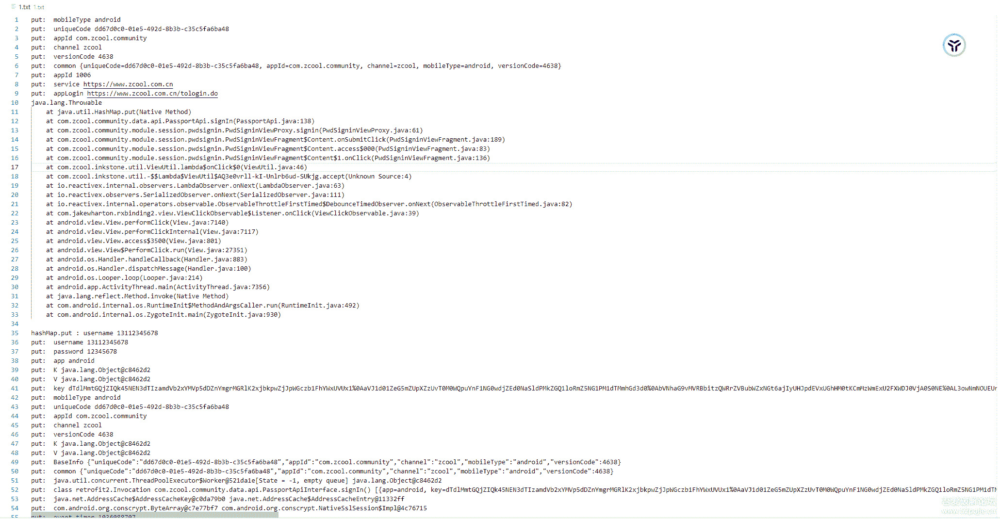

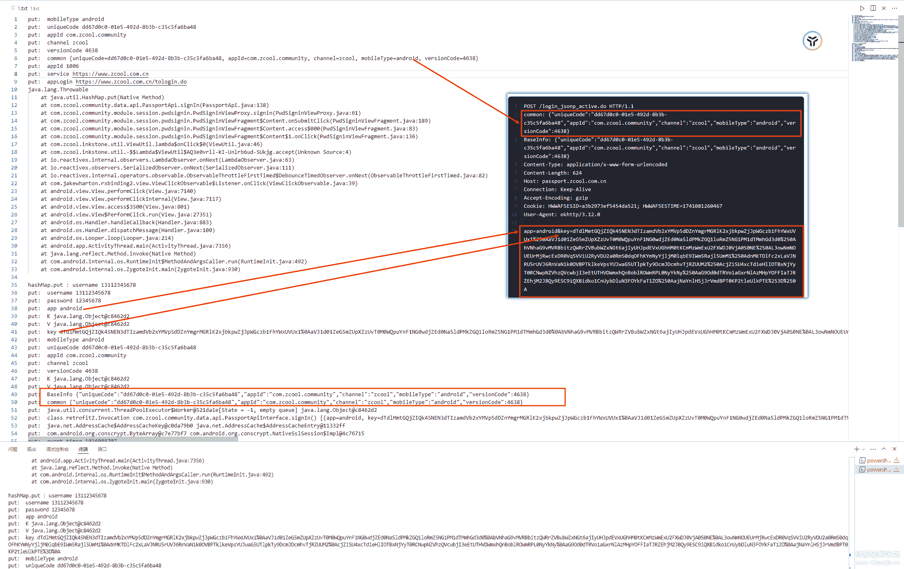

根据这个堆栈信息去寻找登录加密函数，把没用的东西去掉，看看这几个函数

```
java.lang.Throwable
	at com.zcool.community.data.api.PassportApi.signIn(PassportApi.java:138)
	at com.zcool.community.module.session.pwdsignin.PwdSigninViewProxy.signin(PwdSigninViewProxy.java:61)
	at com.zcool.community.module.session.pwdsignin.PwdSigninViewFragment$Content.onSubmitClick(PwdSigninViewFragment.java:189)
	at com.zcool.community.module.session.pwdsignin.PwdSigninViewFragment$Content.access$000(PwdSigninViewFragment.java:83)
	at com.zcool.community.module.session.pwdsignin.PwdSigninViewFragment$Content$1.onClick(PwdSigninViewFragment.java:136)
	at com.zcool.inkstone.util.ViewUtil.lambda$onClick$0(ViewUtil.java:46)
	at com.zcool.inkstone.util.-$$Lambda$ViewUtil$AQ3e0vrll-kI-Unlrb6ud-SUkjg.accept(Unknown Source:4)
```

搜一下 `login_jsonp` 这个地址先

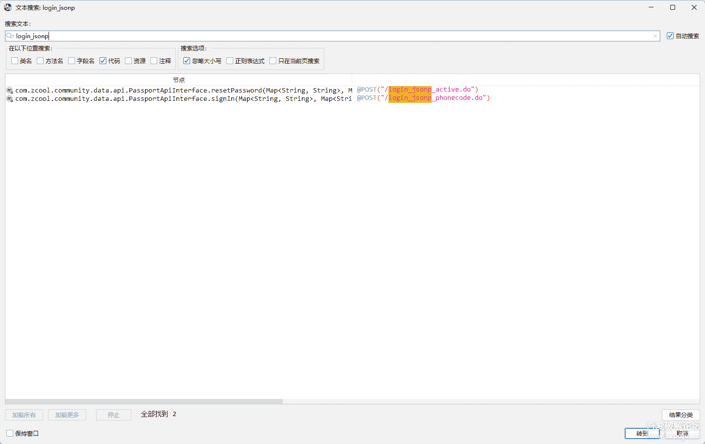

进去是个接口，定义了一个 `signIn` 方法

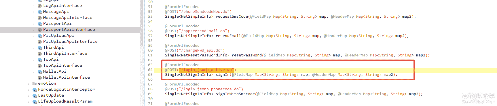

再去寻找一下刚刚堆栈的第一个方法，恰好也是 `sigin`，使用的就是上图接口

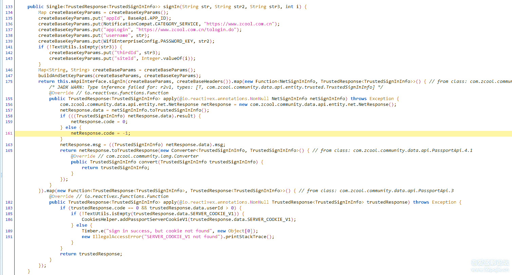

稍微分析了一下 `str` 是用户名 `str2` 是用户密码，这个 `str3` 是处理第三方登录的如qq，微信，测试用的账号密码登录，不管这个从 `str2` 跳出去找到 `PASSWORD_KEY = "password"`，石锤了是密码字段，可能为了防止搜明文搜出来吧

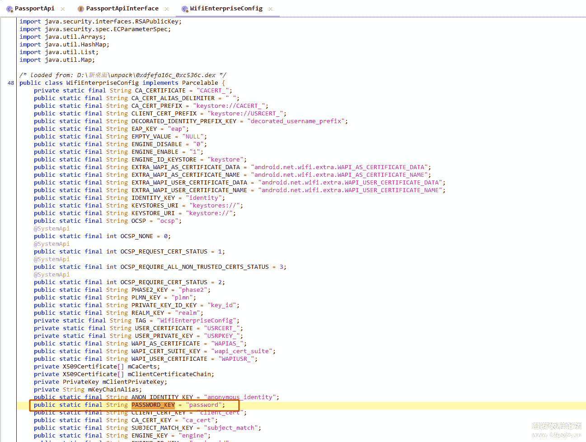

然后就是调用方法 `buildAndSetKeyParams` 进行数据加密，加密完成时候，发起网络请求

```
		Map createBaseParams = createBaseParams();
        buildAndSetKeyParams(createBaseParams, createBaseKeyParams);
        createBaseParams.put(NotificationCompat.CATEGORY_SERVICE, "https://www.zcool.com.cn");
        createBaseParams.put("appLogin", "https://www.zcool.com.cn/tologin.do");
        return this.mApiInterface.onKeyLoginWithToken(createBaseParams, createBaseHeaders()).map(new Function>() { // from class: com.zcool.community.data.api.PassportApi.2

            /* JADX WARN: Type inference failed for: r4v1, types: [T, com.zcool.community.data.api.entity.trusted.TrustedSignInInfo] */

            @Override // io.reactivex.functions.Function
            public TrustedResponse apply(@io.reactivex.annotations.NonNull NetSignInInfo netSignInInfo) throws Exception {

                com.zcool.community.data.api.entity.net.NetResponse netResponse = new com.zcool.community.data.api.entity.net.NetResponse();

                netResponse.data = netSignInInfo.toTrustedSignInInfo();

                if (((TrustedSignInInfo) netResponse.data).result) {
                    netResponse.code = 0;
                } else {
                    netResponse.code = -1;
                }

                Log.d("TAG", "response.code:" + netResponse.code);

                netResponse.msg = ((TrustedSignInInfo) netResponse.data).msg;

                return netResponse.toTrustedResponse(new Converter() { // from class: com.zcool.community.data.api.PassportApi.2.1

                    @Override // com.zcool.community.lang.Converter
                    public TrustedSignInInfo convert(TrustedSignInInfo trustedSignInInfo) {
                        return trustedSignInInfo;
                    }

                });

            }

        }).map(new Function, TrustedResponse>() { // from class: com.zcool.community.data.api.PassportApi.1

            @Override // io.reactivex.functions.Function
            public TrustedResponse apply(@io.reactivex.annotations.NonNull TrustedResponse trustedResponse) throws Exception {

                if (trustedResponse.code == 0 && trustedResponse.data.userId > 0) {

                    if (!TextUtils.isEmpty(trustedResponse.data.SERVER_COOKIE_V1)) {
                        CookiesHelper.addPassportServerCookieV1(trustedResponse.data.SERVER_COOKIE_V1);
                    } else {
                        Timber.e("sign in success, but cookie not found", new Object[0]);
                        new IllegalAccessError("SERVER_COOKIE_V1 not found").printStackTrace();
                    }

                }

                return trustedResponse;

            }

        });
```

进入 `buildAndSetKeyParams` 函数，这个是继承父类的方法，父类方法中只有一句

```
 map.put("key",EncryptManager.getInstance().encrypt(map2));
```

在进入找到 `EncryptManager.getInstance().encrypt(map2)` ，根据最下面的图 `EncryptManager.getInstance()` 等效于 `LazyInstance.access$100()`; 等效于 `LazyInstance.get()` 返回结果为  `private static final EncryptManager instance = new EncryptManager()` 这个名为 `instance` 的 `EncryptManager` 类

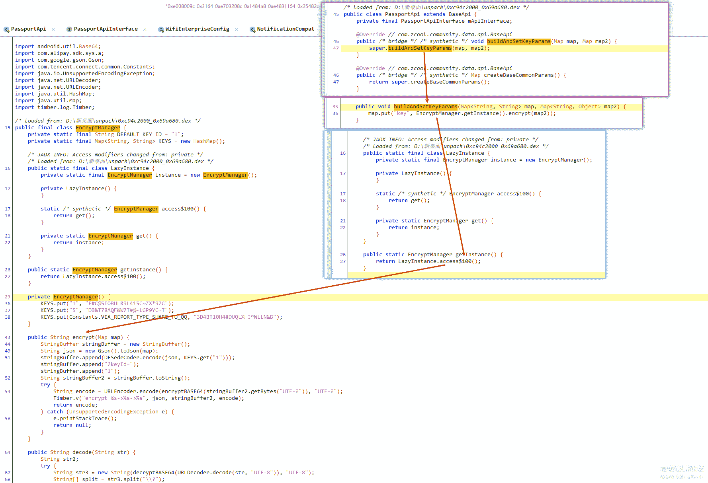

绕了一圈，创建了一个 `EncryptManager` 类 调用这个类的 `encrypt` 方法，传入 `map2`，`map` 是空的，`map2` 包含用户的各种信息。`hook` 一下这个方法，查看出入值，返回值和抓包的值是否有一致的部分

```
Java.perform(function () {

    function showStacks() {

        console.log(

            Java.use("android.util.Log")

                .getStackTraceString(

                    Java.use("java.lang.Throwable").$new()

                )

        );

    }

    var EncryptManager = Java.use("com.zcool.community.data.api.encrypt.EncryptManager");

    EncryptManager["encrypt"].implementation = function (map) {

        console.log(`EncryptManager.encrypt is called: map=${map}`);

        let result = this["encrypt"](map);

        console.log(`EncryptManager.encrypt result=${result}`);

        return result;

    };

});
```

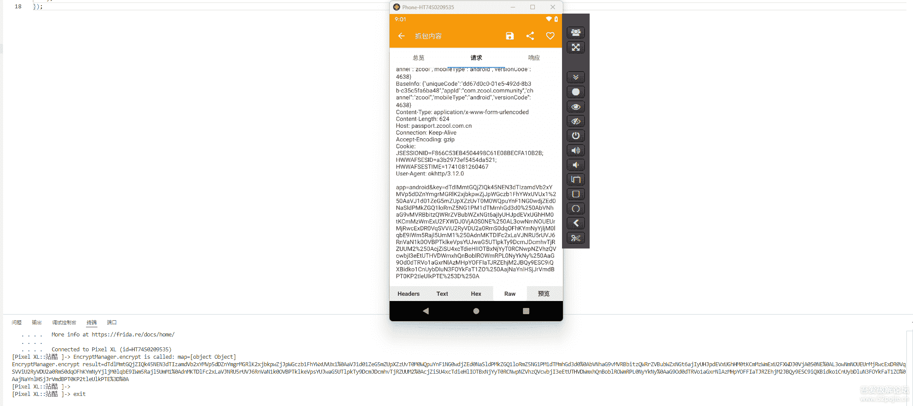


# 数据对比与解密分析

## 数据差异说明

处理一下着两份数据，不能说大差不差，只能说完全一样，只有间隔符不一样返回的数值的间隔符是 %0A ，抓包的是 %250A，而发包是要使用url编码，%25在url编码中就是%这些东西将密文分成了 76 字符一组。[Asm] 纯文本查看 复制代码

```
result=
dTdlMmtGQjZIQk45NEN3dTIzamdVb2xYMVp5dDZnYmgrMGRlK2xjbkpwZjJpWGczb1FhYWxUVUx1
%0A
aVJ1d01ZeG5mZUpXZzUvT0M0WQpuYnF1NG0wdjZEd0NaSldPMkZGQ1loRmZ5NG1PM1dTMmhGd3d0
%0A
bVNhaG9vMVRBbitzQWRrZVBubWZxNGt6ajIyUHJpdEVxUGhHM0tKCmMzWmExU2FXWDJ0VjA0S0NE
%0A
L3owNmNOUEUrMjRwcExDR0VqSVViU2RyVDU2a0RmS0dqOFhKYmNyYjljM0lqbE9IWm5Rajl5UmM1
%0A
dnMKTDlFc2xLaVJNRU5rUVJ6RnVaN1k0OVBPTklkeVpsYUJwaG5UTlpkTy9DcmJDcmhvTjRZUUM2
%0A
cjZiSU4xcTdieHlIOTBxNjYyT0RCNwpNZVhzQVcwbjI3eEtUTHVDWmxhQnBoblROWmRPL0NyYkNy
%0A
aG9Od0dTRVo1aGxrNlAzMHpYOFFIaTJRZEhjM2JBQy9ESC9iQXBidko1CnUybDluN3FOYkFaT1ZO
%0A
ajNaYnlHSjJrVmdBPT0KP2tleUlkPTE
%3D
%0A
```

```
app=android&key=
dTdlMmtGQjZIQk45NEN3dTIzamdVb2xYMVp5dDZnYmgrMGRlK2xjbkpwZjJpWGczb1FhYWxUVUx1
%250A
aVJ1d01ZeG5mZUpXZzUvT0M0WQpuYnF1NG0wdjZEd0NaSldPMkZGQ1loRmZ5NG1PM1dTMmhGd3d0
%250A
bVNhaG9vMVRBbitzQWRrZVBubWZxNGt6ajIyUHJpdEVxUGhHM0tKCmMzWmExU2FXWDJ0VjA0S0NE
%250A
L3owNmNOUEUrMjRwcExDR0VqSVViU2RyVDU2a0RmS0dqOFhKYmNyYjljM0lqbE9IWm5Rajl5UmM1
%250A
dnMKTDlFc2xLaVJNRU5rUVJ6RnVaN1k0OVBPTklkeVpsYUJwaG5UTlpkTy9DcmJDcmhvTjRZUUM2
%250A
cjZiSU4xcTdieHlIOTBxNjYyT0RCNwpNZVhzQVcwbjI3eEtUTHVDWmxhQnBoblROWmRPL0NyYkNy
%250A
aG9Od0dTRVo1aGxrNlAzMHpYOFFIaTJRZEhjM2JBQy9ESC9iQXBidko1CnUybDluN3FOYkFaT1ZO
%250A
ajNaYnlHSjJrVmdBPT0KP2tleUlkPTE
%253D
%250A
```

## 加密方法实现

`encrypt`就是一个关键方法了[Java] 纯文本查看 复制代码

```java
private EncryptManager() {

        KEYS.put("1", "F#C@5IOBULR9L415C~ZX*97C");

        KEYS.put("5", "DB&T78AQF&W7T#@~LGP9YC~T");

        KEYS.put(Constants.VIA_REPORT_TYPE_SHARE_TO_QQ, "3D4BT10H4#DUQLXHJ*WLLN&B");

    }

    public String encrypt(Map map) {

        StringBuffer stringBuffer = new StringBuffer();

        // json序列化，将map数据转换成json字符串

        String json = new Gson().toJson(map);

        // 使用DESede加密json

        // DESede又叫3DES，密钥24位，encrypt函数上方就是明文的密钥

        stringBuffer.append(DESedeCoder.encode(json, KEYS.get("1")));

        // 拼接keyID参数

        stringBuffer.append("?keyId=");

        stringBuffer.append("1");

        String stringBuffer2 = stringBuffer.toString();

        try {

            // URL编码

            // encryptBASE64(stringBuffer2.getBytes("UTF-8"))，将加密结果从byte类型转换成可传输的ASCII字符串

            String encode = URLEncoder.encode(encryptBASE64(stringBuffer2.getBytes("UTF-8")), "UTF-8");

            Timber.v("encrypt %s->%s->%s", json, stringBuffer2, encode);

            return encode;

        } catch (UnsupportedEncodingException e) {

            e.printStackTrace();

            return null;

        }

    }
```

## URL 解码后密文

既然进行了url编码，那打印出来的 %0A 就需要还原成换行符了，%3D 解码成 = 经过`3DES`加密之后的结果就是[Asm] 纯文本查看 复制代码

```
dTdlMmtGQjZIQk45NEN3dTIzamdVb2xYMVp5dDZnYmgrMGRlK2xjbkpwZjJpWGczb1FhYWxUVUx1
aVJ1d01ZeG5mZUpXZzUvT0M0WQpuYnF1NG0wdjZEd0NaSldPMkZGQ1loRmZ5NG1PM1dTMmhGd3d0
bVNhaG9vMVRBbitzQWRrZVBubWZxNGt6ajIyUHJpdEVxUGhHM0tKCmMzWmExU2FXWDJ0VjA0S0NE
L3owNmNOUEUrMjRwcExDR0VqSVViU2RyVDU2a0RmS0dqOFhKYmNyYjljM0lqbE9IWm5Rajl5UmM1
dnMKTDlFc2xLaVJNRU5rUVJ6RnVaN1k0OVBPTklkeVpsYUJwaG5UTlpkTy9DcmJDcmhvTjRZUUM2
cjZiSU4xcTdieHlIOTBxNjYyT0RCNwpNZVhzQVcwbjI3eEtUTHVDWmxhQnBoblROWmRPL0NyYkNy
aG9Od0dTRVo1aGxrNlAzMHpYOFFIaTJRZEhjM2JBQy9ESC9iQXBidko1CnUybDluN3FOYkFaT1ZO
ajNaYnlHSjJrVmdBPT0KP2tleUlkPTE=
```

`ECB`的填充模式，没有iv值，先将传入的字符串转换成`byte`的形式，再将传入的`keyID=1`作为密钥，看起来这个是一个标准的`DESede/ECB`加密

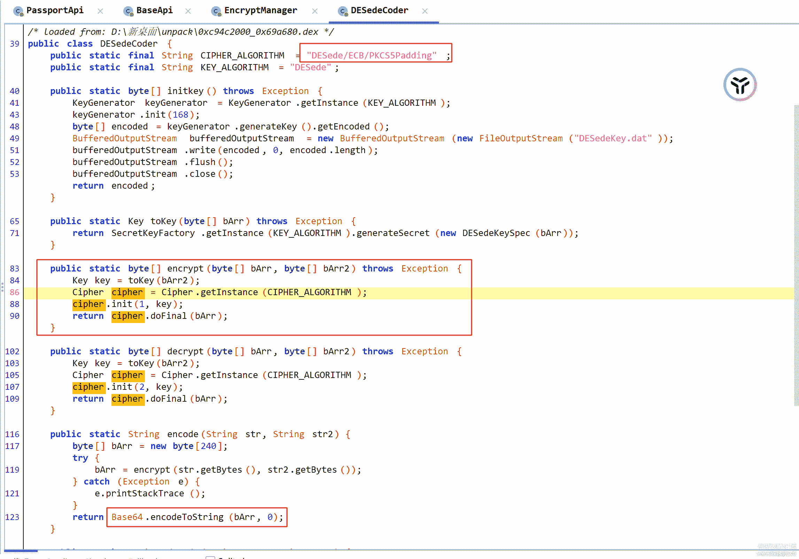

## 解密分析

将原数据base64解码，去除掉拼接的 `?keyId=1`， 得到密文，尝试`DESede`解码[Asm] 纯文本查看 复制代码

```
u7e2kFB6HBN94Cwu23jgUolX1Zyt6gbh+0de+lcnJpf2iXg3oQaalTULuiRuwMYxnfeJWg5/OC4Y

nbqu4m0v6DwCZJWO2FFCYhFfy4mO3WS2hFwwtmSahoo1TAn+sAdkePnmfq4kzj22PritEqPhG3KJ

c3Za1SaWX2tV04KCD/z06cNPE+24ppLCGEjIUbSdrT56kDfKGj8XJbcrb9c3IjlOHZnQj9yRc5vs

L9EslKiRMENkQRzFuZ7Y49PONIdyZlaBphnTNZdO/CrbCrhoN4YQC6r6bIN1q7bxyH90q662ODB7

MeXsAW0n27xKTLuCZlaBphnTNZdO/CrbCrhoNwGSEZ5hlk6P30zX8QHi2QdHc3bAC/DH/bApbvJ5

u2l9n7qNbAZOVNj3ZbyGJ2kVgA==

?keyId=1
```

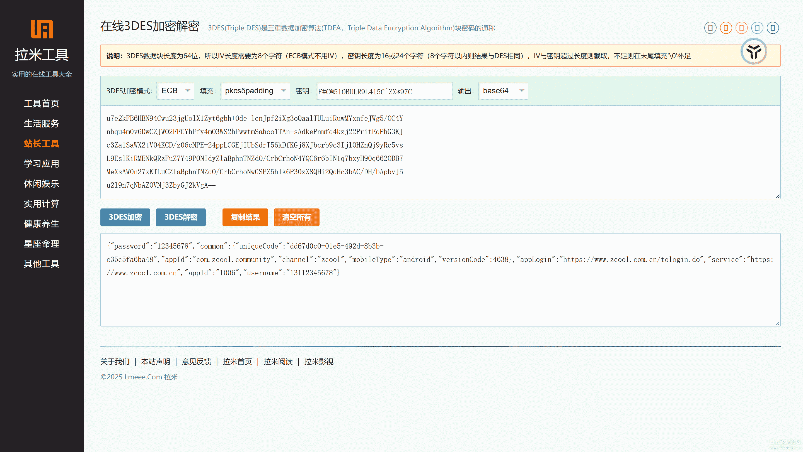

## 解密脚本

解密脚本[JavaScript] 纯文本查看 复制代码

```
const CryptoJS = require('crypto-js');
key = "F#C@5IOBULR9L415C~ZX*97C"
data = "u7e2kFB6HBN94Cwu23jgUolX1Zyt6gbh+0de+lcnJpf2iXg3oQaalTULuiRuwMYxnfeJWg5/OC4Ynbqu4m0v6DwCZJWO2FFCYhFfy4mO3WS2hFwwtmSahoo1TAn+sAdkePnmfq4kzj22PritEqPhG3KJc3Za1SaWX2tV04KCD/z06cNPE+24ppLCGEjIUbSdrT56kDfKGj8XJbcrb9c3IjlOHZnQj9yRc5vsL9EslKiRMENkQRzFuZ7Y49PONIdyZlaBphnTNZdO/CrbCrhoN4YQC6r6bIN1q7bxyH90q662ODB7MeXsAW0n27xKTLuCZlaBphnTNZdO/CrbCrhoNwGSEZ5hlk6P30zX8QHi2QdHc3bAC/DH/bApbvJ5u2l9n7qNbAZOVNj3ZbyGJ2kVgA=="

function decodeDESede(data, key) {

    var _key =  CryptoJS.enc.Utf8.parse(key);
    var decrypted = CryptoJS.TripleDES.decrypt(data, _key, {
        mode: CryptoJS.mode.ECB,
        padding: CryptoJS.pad.Pkcs7
    }).toString(CryptoJS.enc.Utf8);

    return decrypted;
}

console.log(decodeDESede(data, key))
```

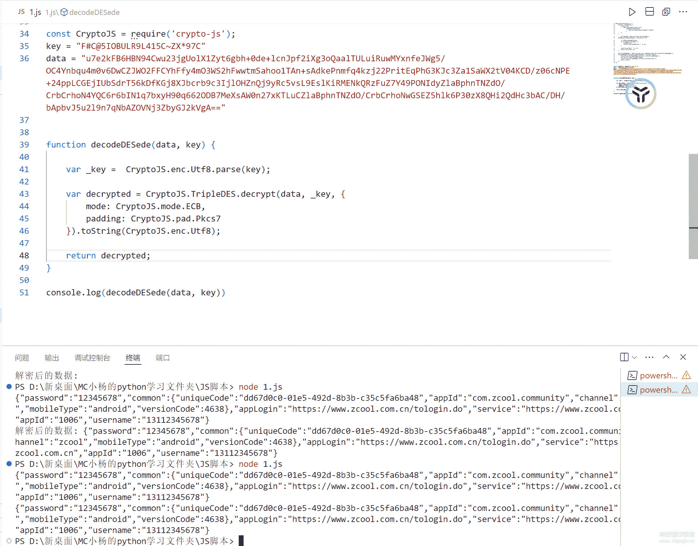

## 解密结果

解密后的数据[Asm] 纯文本查看 复制代码

```
解密后的数据: 

{"password":"12345678",

"common":{"uniqueCode":"dd67d0c0-01e5-492d-8b3b-c35c5fa6ba48","appId":"com.zcool.community","channel":"zcool","mobileType":"android","versionCode":4638},

"appLogin":"https://www.zcool.com.cn/tologin.do",

"service":"https://www.zcool.com.cn",

"appId":"1006",

"username":"13112345678"}
```

## 数据结构说明

再回头看`put`数据的方法，这里`put`了五项，但是`map`数值不是new的，说明 `common`字段以及提前构建好了[Java] 纯文本查看 复制代码


# 登录接口 `signIn` 方法分析

## `signIn` 方法实现

```java
public Single> signIn(String str, String str2, String str3, int i) {
        Map createBaseKeyParams = createBaseKeyParams();
        createBaseKeyParams.put("appId", BaseApi.APP_ID);
        createBaseKeyParams.put(NotificationCompat.CATEGORY_SERVICE, "https://www.zcool.com.cn");
        createBaseKeyParams.put("appLogin", "https://www.zcool.com.cn/tologin.do");
        createBaseKeyParams.put("username", str);
        createBaseKeyParams.put(WifiEnterpriseConfig.PASSWORD_KEY, str2);
        if (!TextUtils.isEmpty(str3)) {
            createBaseKeyParams.put("thirdId", str3);
            createBaseKeyParams.put("siteId", Integer.valueOf(i));
        }
        Map createBaseParams = createBaseParams();
        buildAndSetKeyParams(createBaseParams, createBaseKeyParams);
        return this.mApiInterface.signIn(createBaseParams, createBaseHeaders()).map(new Function>() { // from class: com.zcool.community.data.api.PassportApi.4
            /* JADX WARN: Type inference failed for: r2v1, types: [T, com.zcool.community.data.api.entity.trusted.TrustedSignInInfo] */
            @Override // io.reactivex.functions.Function
            public TrustedResponse apply(@io.reactivex.annotations.NonNull NetSignInInfo netSignInInfo) throws Exception {
                com.zcool.community.data.api.entity.net.NetResponse netResponse = new com.zcool.community.data.api.entity.net.NetResponse();
                netResponse.data = netSignInInfo.toTrustedSignInInfo();
                if (((TrustedSignInInfo) netResponse.data).result) {
                    netResponse.code = 0;
                } else {
                    netResponse.code = -1;
                }
                netResponse.msg = ((TrustedSignInInfo) netResponse.data).msg;
                return netResponse.toTrustedResponse(new Converter() { // from class: com.zcool.community.data.api.PassportApi.4.1
                    @Override // com.zcool.community.lang.Converter
                    public TrustedSignInInfo convert(TrustedSignInInfo trustedSignInInfo) {
                        return trustedSignInInfo;
                    }
                });
            }
        }).map(new Function, TrustedResponse>() { // from class: com.zcool.community.data.api.PassportApi.3
            @Override // io.reactivex.functions.Function
            public TrustedResponse apply(@io.reactivex.annotations.NonNull TrustedResponse trustedResponse) throws Exception {
                if (trustedResponse.code == 0 && trustedResponse.data.userId > 0) {
                    if (!TextUtils.isEmpty(trustedResponse.data.SERVER_COOKIE_V1)) {
                        CookiesHelper.addPassportServerCookieV1(trustedResponse.data.SERVER_COOKIE_V1);
                    } else {
                        Timber.e("sign in success, but cookie not found", new Object[0]);
                        new IllegalAccessError("SERVER_COOKIE_V1 not found").printStackTrace();
                    }
                }
                return trustedResponse;
            }
        });
    }
```

看 `common` 的构建，除了 `uniqueCode` 都是固定的，`uniqueCode` 跟自己手机有关，这个字段不用管了。

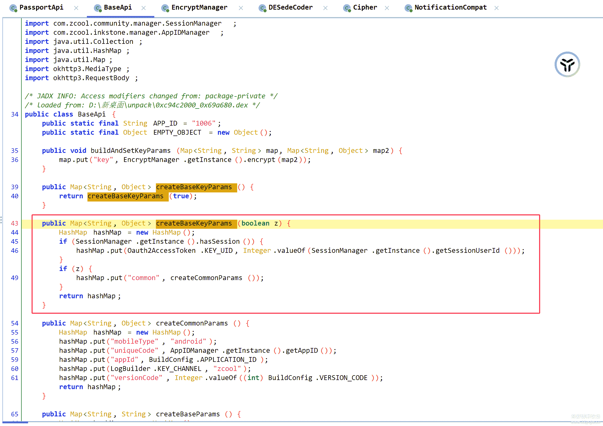

这样一来数据包传输的东西只有 `password` 和 `username` 是不固定的，其他的基本固定，可以直接拿数值构建，再来看请求头的构造。

## 请求头构造

```java
return this.mApiInterface.signIn(createBaseParams, createBaseHeaders()).map(new Function>() {

}

// createBaseParams 是加密后的参数，createBaseHeaders()函数用于构造请求头
```

先获取令牌，由于是首次登录不存在令牌，在请求头添加 `common` 和 `BaseInfo`，内容相同。

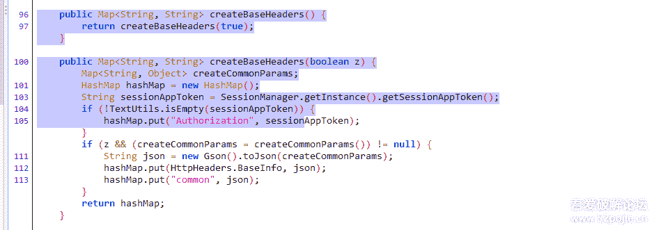

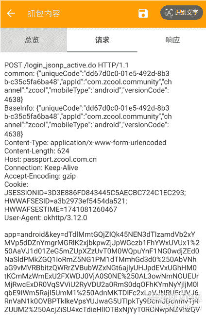

请求头的其他部分都是 `OkHttp` 默认添加的，也不存在时间戳等时间，开始简单仿造一个请求。请求返回的数据经过 `gzip` 压缩，之前的请求头上以及表示可以接收 `gzip` 压缩了，可以写个判断，这里直接使用了，没判断。

## 仿造请求示例

```javascript
const https = require('https');
const zlib = require('zlib');

// 请求URL
const url = 'https://passport.zcool.com.cn/login_jsonp_active.do';

// 请求头
const headers = {
    'Content-Type': 'application/x-www-form-urlencoded',
    'Host': 'passport.zcool.com.cn',
    'Connection': 'Keep-Alive',
    'Accept-Encoding': 'gzip',
    'Cookie': 'HWWAFSESID=a3b2973ef5454da521; HWWAFSESTIME=1741081260467',
    'User-Agent': 'okhttp/3.12.0',
    'common': {"uniqueCode":"dd67d0c0-01e5-492d-8b3b-c35c5fa6ba48","appId":"com.zcool.community","channel":"zcool","mobileType":"android","versionCode":4638},
    'BaseInfo': {"uniqueCode":"dd67d0c0-01e5-492d-8b3b-c35c5fa6ba48","appId":"com.zcool.community","channel":"zcool","mobileType":"android","versionCode":4638}
};

// 请求体
const body = `app=android&key=dTdlMmtGQjZIQk45NEN3dTIzamdVb2xYMVp5dDZnYmgrMGRlK2xjbkpwZjJpWGczb1FhYWxUVUx1%250AaVJ1d01ZeG5mZUpXZzUvT0M0WQpuYnF1NG0wdjZEd0NaSldPMkZGQ1loRmZ5NG1PM1dTMmhGd3d0%250AbVNhaG9vMVRBbitzQWRrZVBubWZxNGt6ajIyUHJpdEVxUGhHM0tKCmMzWmExU2FXWDJ0VjA0S0NE%250AL3owNmNOUEUrMjRwcExDR0VqSVViU2RyVDU2a0RmS0dqOFhKYmNyYjljM0lqbE9IWm5Rajl5UmM1%250AdnMKTDlFc2xLaVJNRU5rUVJ6RnVaN1k0OVBPTklkeVpsYUJwaG5UTlpkTy9DcmJDcmhvTjRZUUM2%250AcjZiSU4xcTdieHlIOTBxNjYyT0RCNwpNZVhzQVcwbjI3eEtUTHVDWmxhQnBoblROWmRPL0NyYkNy%250AaG9Od0dTRVo1aGxrNlAzMHpYOFFIaTJRZEhjM2JBQy9ESC9iQXBidko1CnUybDluN3FOYkFaT1ZO%250AajNaYnlHSjJrVmdBPT0KP2tleUlkPTE%253D%250A`;

// 构造请求选项
const options = {
    hostname: 'passport.zcool.com.cn',
    port: 443,
    path: '/login_jsonp_active.do',
    method: 'POST',
    headers: headers
};

// 发送POST请求
const req = https.request(options, (res) => {
    let responseData = '';

    const gunzip = zlib.createGunzip();
    res.pipe(gunzip);
    gunzip.on('data', (chunk) => {
        responseData += chunk;
    });

    gunzip.on('end', () => {
        console.log('响应数据:', responseData);
    });

    // res.setEncoding('utf8');

    // res.on('data', (chunk) => {
    //     responseData += chunk;
    // });

    // res.on('end', () => {
    //     console.log('响应数据:', responseData);
    // });
});

req.on('error', (error) => {
    console.error('请求错误:', error);
});

req.write(body);
req.end();
```

和手机上结果相同。

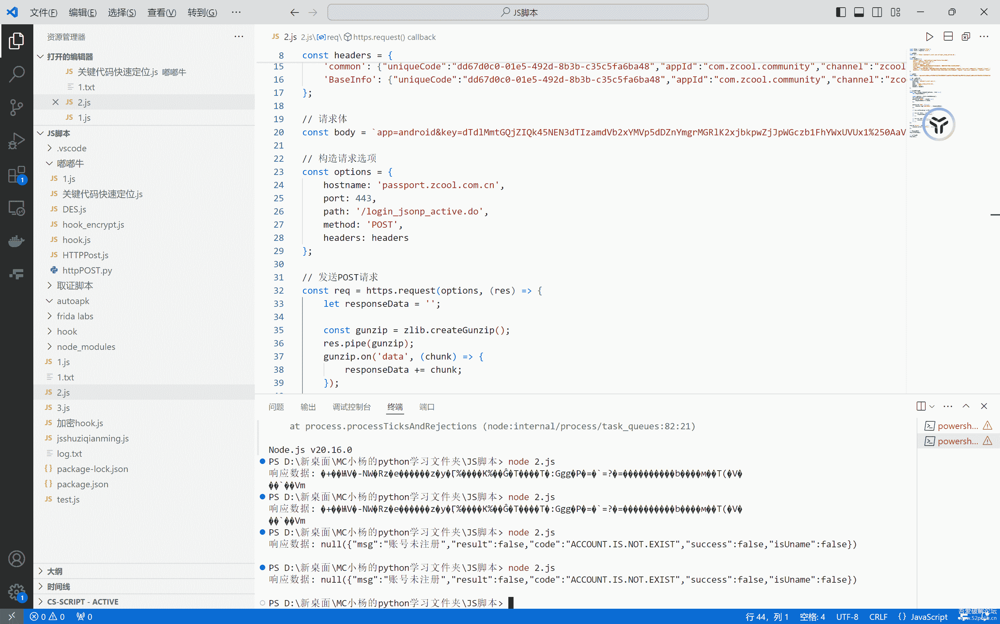

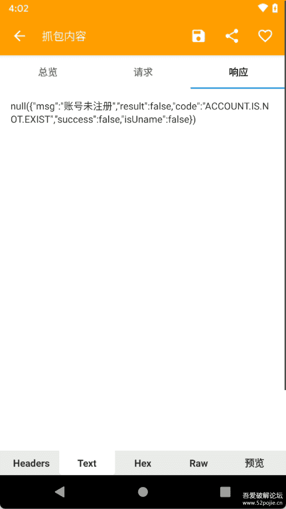

返回的数据是没有进行加密的，明文传输回来，就不需要写 `DESede` 解密方法了，写一个加密方法，完善这个请求。

## 加密方法与请求完善

```javascript
var http = require('https');

const zlib = require('zlib');

const CryptoJS = require('crypto-js');

let username = "13112345678"

let password = "12345678"

let date = `{"password": ${password},"common":{"uniqueCode":"dd67d0c0-01e5-492d-8b3b-c35c5fa6ba48","appId":"com.zcool.community","channel":"zcool","mobileType":"android","versionCode":4638},"appLogin":"https://www.zcool.com.cn/tologin.do","service":"https://www.zcool.com.cn","appId":"1006","username": ${username}}`

// DESede解密

function decodeDESede(data, key) {

    var _key =  CryptoJS.enc.Utf8.parse(key);

    var decrypted = CryptoJS.TripleDES.decrypt(data, _key, {

        mode: CryptoJS.mode.ECB,

        padding: CryptoJS.pad.Pkcs7

    }).toString(CryptoJS.enc.Utf8);

    return decrypted;

}

// DESede加密

function encodeDESede(data, key) {

    var _key =  CryptoJS.enc.Utf8.parse(key);

    var decrypted = CryptoJS.TripleDES.encrypt(data, _key, {

        mode: CryptoJS.mode.ECB,

        padding: CryptoJS.pad.Pkcs7

    }).toString();

    return decrypted;

}

// 按照安卓代码处理body，这里的加密结果没用换行符，测试了一下也没啥问题，理论上没用换行符也不要url编码了。

function handleBody(body) {

    var result = body + '\n' + '?keyId=1';

    result = encodeURIComponent(btoa(result));

    return `app=android&key=${result}`;

}

console.log(handleBody(encodeDESede(date, key)))

// 构造请求

function post(result) {

    const headers = {

        'Content-Type': 'application/x-www-form-urlencoded',

        'Host': 'passport.zcool.com.cn',

        'Connection': 'Keep-Alive',

        'Accept-Encoding': 'gzip',

        'User-Agent': 'okhttp/3.12.1',

        'common': {"uniqueCode":"dd67d0c0-01e5-492d-8b3b-c35c5fa6ba48","appId":"com.zcool.community","channel":"zcool","mobileType":"android","versionCode":4638},
```


## 请求代码

```
'BaseInfo': {"uniqueCode":"dd67d0c0-01e5-492d-8b3b-c35c5fa6ba48","appId":"com.zcool.community","channel":"zcool","mobileType":"android","versionCode":4638}

}

var options = {

    hostname: 'passport.zcool.com.cn',

    port: 443,

    path: '/login_jsonp_active.do',

    method: 'POST',

    headers: headers

}

var req = http.request(options, function (res) {

    // console.log('STATUS:'+ res.statusCode);

    // console.log('HEADERS:'+ JSON.stringify(res.headers));

    var body = '';

    const gunzip = zlib.createGunzip();

    res.pipe(gunzip);

    gunzip.on('data', function (chunk) {

        body += chunk;

    });

    gunzip.on('end', function () {

        console.log('响应数据：', body)

    });

});

req.on('error', function (e) {

    console.log('problem with request:'+ e.message);

})

req.write(result);

req.end();

}
```

`post(handleBody(encodeDESede(date, key)))`

这次没怎么hook（汗），hook代码

## Hook代码

```
// hook代码
Java.perform(function () {
    function showStacks() {
        console.log(
            Java.use("android.util.Log")
                .getStackTraceString(
                    Java.use("java.lang.Throwable").$new()
                )
        );
    }

    var HashMap = Java.use('java.util.HashMap');
    HashMap.put.implementation = function(a, b) {
    
        // 打印username的堆栈信息
        if (a.equals("username")) {
            showStacks();
            console.log("hashMap.put :", a, b);
        }
    
        console.log("put: ", a, b);
        return this.put(a, b);
    }

    var EncryptManager = Java.use("com.zcool.community.data.api.encrypt.EncryptManager");
    EncryptManager["encrypt"].implementation = function (map) {
        console.log(`EncryptManager.encrypt is called: map=${map}`);
        let result = this["encrypt"](map);
        console.log(`EncryptManager.encrypt result=${result}`);
        return result;
    };
});
```

这个软件的登录挺简单的，标准的`DESede`加密，以及方法和密钥在明文里，没有`so`层的逆向，请求也比较简单，没有时间戳部分。
