# [Android 原创] 記一次對某韓遊的反反調試

- 原帖: https://www.52pojie.cn/forum.php?mod=viewthread&tid=2016248
- 抓取时间: 2026-11-01T16:05:17.600Z

樣本：`Y29tLndlbWFkZS5uaWdodGNyb3dz`

## 前言

聊點題外話，最近在找工作，一家公司說要搞 NP，我果斷拒絕，還有一家公司給了一道面試題，內容是分析一款外掛（針對他們家遊戲的）和實現一個有效的外掛功能。當我興致勃勃下載好遊戲後，打開 apk 的 `lib` 目錄一看，發現 `libtprt.so`、`libtersafe2.so` 的特徵就知道 67 了。

眾所周知這是 tx 的 MTP，我自認水平有限是搞不定的了，但還是硬著頭皮分析了一下，主要想分析他的 CRC 檢測，找到了幾處 CRC 邏輯，但都不是主要的邏輯，直到最後看到疑似 vm 虛擬機的東西，感覺他的核心檢測邏輯可能是在 vm 裡？看之後有沒有機會再分析看看吧。

小小分析完 `libtprt.so` 後，道心破碎，於是打算找個簡單點的來玩玩，正好前段時間一位大佬分享了一個樣本，就決定是你的。這是個 UE5 遊戲，主要看看他的檢測邏輯。

## `frida` 閃退分析

`frida` 注入後過 1s 左右會直接閃退，打印加載的 so，看到只有一個 `libdxbase.so` 是 APP 本身的，顯然檢測邏輯在裡面。

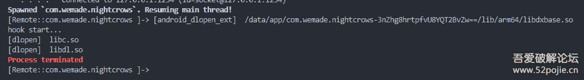

將 `libdxbase.so` 拉入 IDA，沒有報錯，即 so 大概率沒有加固。

然後習慣先看看 `init_array`，沒有太大發現，但看到 `decrypt1` 明顯是字符串解密函數，先記下來。

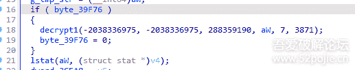

hook `RegisterNatives`，看到動態注冊了 4 個函數，遂一 hook 看看調用了哪個。

注：記 `d` 函數為 `reg_func_d`，其他如此類推。

```
[RegisterNatives] java_class: com.xshield.da name: d sig: (Ljava/lang/String;Ljava/lang/String;Ljava/lang/String;Ljava/lang/String;Ljava/lang/String;Ljava/lang/String;Ljava/lang/String;Ljava/lang/String;Ljava/lang/String;Ljava/lang/String;Ljava/lang/String;IIIIIIII)Ljava/lang/String; fnPtr: 0x7137359258  fnOffset: 0x7137359258 libdxbase.so!0x18258  callee: 0x713736543c libdxbase.so!JNI_OnLoad+0x15e0

[RegisterNatives] java_class: com.xshield.da name: o sig: (II)I fnPtr: 0x7137348228  fnOffset: 0x7137348228 libdxbase.so!0x7228  callee: 0x713736543c libdxbase.so!JNI_OnLoad+0x15e0

[RegisterNatives] java_class: com.xshield.da name: p sig: (II)Ljava/lang/String; fnPtr: 0x7137347e78  fnOffset: 0x7137347e78 libdxbase.so!0x6e78  callee: 0x713736543c libdxbase.so!JNI_OnLoad+0x15e0

[RegisterNatives] java_class: com.xshield.da name: q sig: (Landroid/content/Context;ILjava/lang/String;)Ljava/lang/String; fnPtr: 0x7137360d60  fnOffset: 0x7137360d60 libdxbase.so!0x1fd60  callee: 0x713736543c libdxbase.so!JNI_OnLoad+0x15e0
```

結果是調用了 `reg_func_d`，但只有 `Enter` 而沒有 `Leave`，因此檢測邏輯可能在 `reg_func_d` 中。

`reg_func_d` 的邏輯有差不多 2000 行，懶得靜態一點一點分析了，直接動調看看是在哪裡 crash 的。

### 虛假的 time diff

crash 的位置是在 `exit_func(0xFFFFFFFE)`，而在調用 `exit_func` 前進行了一些 time diff 的操作，並根據 time diff 來決定是否走到 `exit_func` 那部份的邏輯。

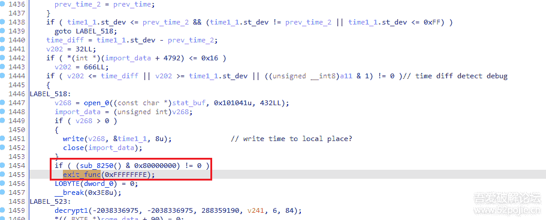

本以為上面只是個普通的 time diff 調試檢測，但 `frida` hook `exit_func` 並打印調用棧後發現是同一個地方，即 `frida` hook 時同樣會走到上述位置，然後調用 `exit_func` 閃退。

深入分析上圖那部份邏輯，發現一旦走到上圖那位置後，最終必然會走向 `exit_func`。（原因：`sub_8250` 返回固定值、time diff 永遠大於 `v202`。）

```
[exit_func] call in: 

7bb25dab70 is in libdxbase.so offset: 0x1ab70
7c1f940354 is in libart.so offset: 0x140354  
7c1f936470 is in libart.so offset: 0x136470
```

### 奇怪的 time diff

從上圖位置向上尋找「生路」，看到 `goto LABEL_215`，只要想辦法讓執行流進入任意一處 `goto LABEL_215` 的邏輯，就能避免走到上面那條「絕路」。

嘗試走紅框那裡的 `goto LABEL_215`，條件1是 `*(_DWORD *)(import_data + 9972)` 為 0，先嘗試滿足這條件。

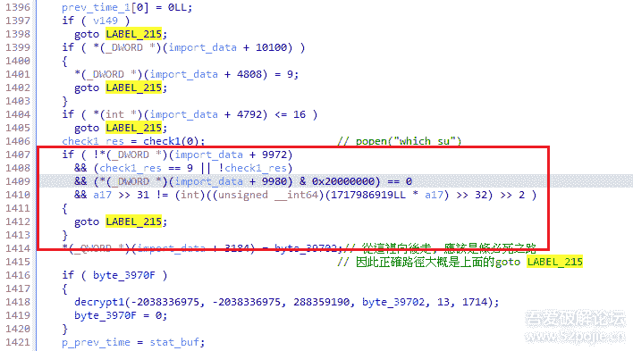

交叉引用找 `(_DWORD *)(import_data + 9972)` 賦值的地方，分析後可知 `v197` 是 time diff，但具體是什麼東西之間的 time diff，並不能從偽代碼裡直接看出。

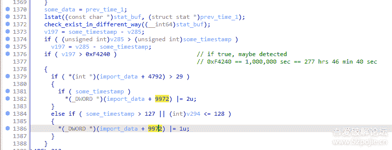

只能從匯編視圖看，上圖的 `some_timestamp` 是由 `lstat` 的 `buf(x1) + 0x68` 賦值。（`x0` 為 `/sbin`）

而且 `[buf + 0x68]` 的確是在調用 `lstat` 後才有值，但 `buf` 的結構為 `struct stat`，大小似乎小於 `0x68`，因此 `buf[0x68]` 正常來說並不屬於 `struct stat` 結構？猜測是內存對齊等原因導致的。

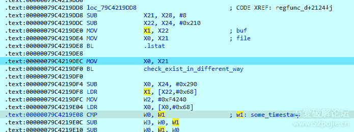

從內存分佈可以看出 `buf + 0x68` 的位置應該是 `struct stat` 最後一個屬性（`struct stat` 最後 3 個屬性都是時間），代表指定目錄“上次狀態的更改時間”。

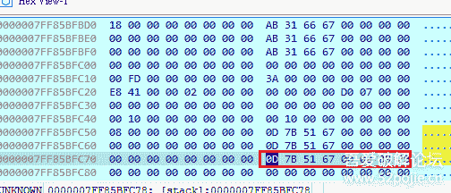

將 `0x67517B0D` 轉換下：


與 `/sbin` 的 `ls -l` 顯示的日期一致。

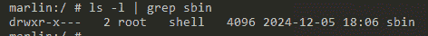

用同樣方式找到 time diff 的另一個值，是 `0x676631AB`。

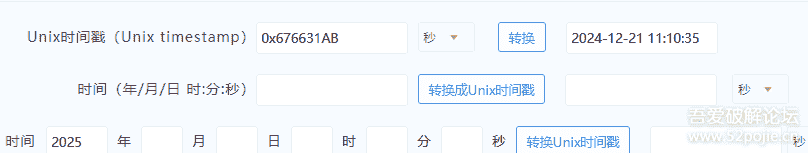

與 `/system/lib` 的 `ls -l` 顯示的日期一致。

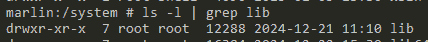

計算這兩個時間的 time diff 目的是什麼？

以下是普通 Magisk 環境的 xiaomi 手機，可以看到兩者的日期差很遠。

`sbin` 的日期比較近是因為其中有個 `shamiko` 文件，大概是啟用/關閉 `shamiko` 模塊時都會刷新其日期。

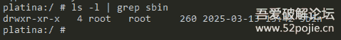

而 `/system/lib` 的日期是一個超舊的時間。

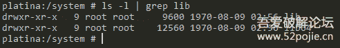

小結：這部份計算的 time diff 是 `/system/lib` 和 `/sbin` 之間的“上次狀態的更改時間” time diff，感覺這個 time diff 應該是在檢測 Magisk 之類的。

繼續向下看，判斷 time diff 是否大於 `0xF4240` sec，是則上述的條件1無法滿足。

`0xF4240` sec → 277 hrs 46 min 40 sec，正常手機環境下的 time diff 應該不會大於這個值。

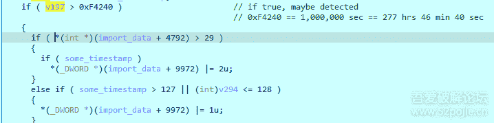

bypass 腳本：直接 hook `lstat`。

```
function hook_lstat() {
    let fake_time = Date.now();
    Interceptor.attach(Module.findExportByName(null, "lstat"), {
        onEnter: function(args) {
            this.name = args[0].readCString();
            this.statbuf = args[1];
        },
        onLeave: function(retval) {
            if (this.name == "/system/lib") {
                this.statbuf.add(0x68).writeU64(fake_time++);
                console.log("bypass lstat");
            }
            if (this.name == "/sbin") {
                this.statbuf.add(0x68).writeU64(fake_time++);
                console.log("bypass lstat");
            }
        }
    })
}
```

bypass 這處 time diff 檢測後，Magisk 環境的 xiaomi 手機依然會退出，大概是條件2 `check1_res == 9 || !check1_res` 沒有滿足。

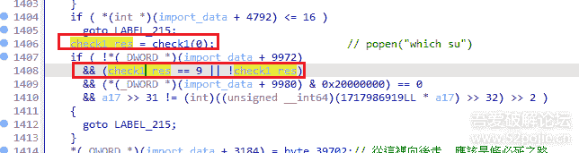

### `check1` 分析（root 檢測）

當 `check1` 返回 9 或 0 都能滿足條件2。接下來看看 `check1` 都檢測了什麼。

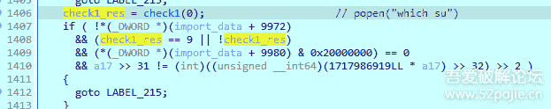

root 檢測1：`popen("which su")`

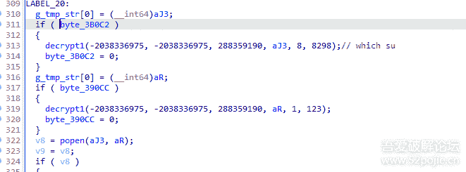

root 檢測2：獲取了一堆可能存在 `su` 的路徑，然後調用 `check_exist_in_different_way` 檢測指定路徑是否存在。

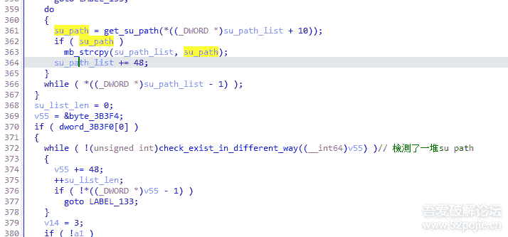

`check_exist_in_different_way` 內創建了 `pthread_func2_check_path_exist` 線程來處理。

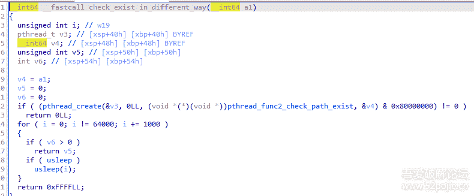

其中用了以下方法來檢測傳入路徑是否存在：`openat`、`syscall(__NR_openat)`、`scandir`、`lstat`、`stat`、`access`、`readlink`。

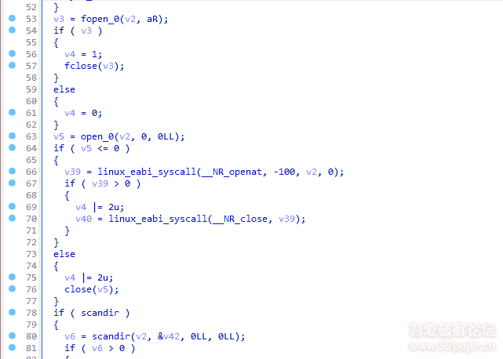

注：檢測的路徑大概有以下這些：

```
[decrypt1]  0x3a304 /system/bin/su
[decrypt1]  0x3a2f4 /system/xbin/su
[decrypt1]  0x3a313 /system/bin/.ext/.su
[decrypt1]  0x3a328 /system/xbin/.tmpsu
[decrypt1]  0x3a33c /vendor/bin/su
[decrypt1]  0x3a34b /sbin/su
[decrypt1]  0x3a354 /system/xbin/nosu
[decrypt1]  0x3a366 /system/bin/nosu
[decrypt1]  0x3a377 /system/xbin/su_bk
[decrypt1]  0x3a38a /system/bin/su_bk
[decrypt1]  0x3a39c /system/xbin/xsu
[decrypt1]  0x3a3ad /system/xbin/suu
[decrypt1]  0x3a3be /system/xbin/bstk/su
[decrypt1]  0x3a3d3 /system/RootTools/su
[decrypt1]  0x3a3e8 /data/data/bin/su
[decrypt1]  0x3a3fa /data/data/in/su
[decrypt1]  0x3a40b /data/data/n/bstk/su
[decrypt1]  0x3a420 /data/data/xbin/su
[decrypt1]  0x3a433 /res/su
[decrypt1]  0x3a43b /data/local/bin/su
[decrypt1]  0x3a44e /data/local/su
[decrypt1]  0x3a45d /data/local/xbin/su
[decrypt1]  0x3a471 /system/su
[decrypt1]  0x3a47c /data/su
[decrypt1]  0x3a485 /su/bin/su
[decrypt1]  0x3a490 /su/bin/sush
[decrypt1]  0x3a49d /system/bin/failsafe/su
[decrypt1]  0x3a4b5 /system/sbin/su
[decrypt1]  0x3a4c5 /system/sd/xbin/su
[decrypt1]  0x3a4d8 /system/xbin/noxsu
[decrypt1]  0x3a4eb /magisk/.core/bin/su
[decrypt1]  0x3a500 /sbin/.magisk
[decrypt1]  0x3a50e /sbin/.core
[decrypt1]  0x3b0c3 /system/usr/we-need-root/su
[decrypt1]  0x3b0df /cache/su
[decrypt1]  0x3b0e9 /dev/su
```

root 檢測3：判斷 `fingerprint` 中是否包含 `user-debug`、`eng/`、`Custom Phone`。

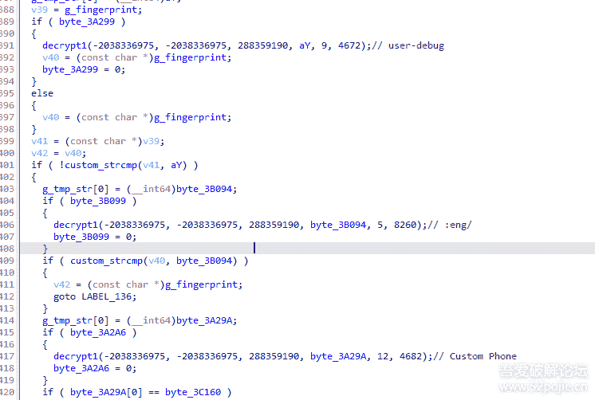

對應的 bypass 腳本：


```
function hook_popen() {
    Interceptor.attach(Module.findExportByName(null, "popen"), {
        onEnter: function(args) {
            if (args[0].readCString().indexOf(" su") != -1) {
                console.log("[popen] which su -> which xx");
                Memory.writeUtf8String(args[0], "which xx");
            }
        }
    })
}

// hook after dlopen libdxbase.so
function hook_pthread_func2() {
    Interceptor.attach(base.add(0x983C), {
        onEnter: function(args) {
            let check_path = args[0].readPointer().readCString();
            if (check_path.indexOf("/su") != -1) {
                Memory.writeUtf8String(args[0].readPointer(), check_path.replace("/su", "/XX"));

                // console.log(`[pthread_func2]: ${check_path} -> ${args[0].readPointer().readCString()}`);
            }
            if (check_path.indexOf("magisk") != -1) {
                Memory.writeUtf8String(args[0].readPointer(), check_path.replace("magisk", "3Ag1sk"));

                // console.log(`[pthread_func2]: ${check_path} -> ${args[0].readPointer().readCString()}`);
            }
            if (check_path.indexOf("/sbin") != -1) {
                Memory.writeUtf8String(args[0].readPointer(), check_path.replace("/sbin", "/ABCD"));

                // console.log(`[pthread_func2]: ${check_path} -> ${args[0].readPointer().readCString()}`);
            }
            // console.log("[pthread_func2] check: ", check_path);
            this.a0 = args[0];
        }
    })
}
```
上述地方都bypass後，frida終於不再閃退，但畫面上仍顯示ROOTED。

而`j.rjshqqeirnhhbc.mq`其實是Magisk隨機的包名，代表其實是Magisk被檢測到。

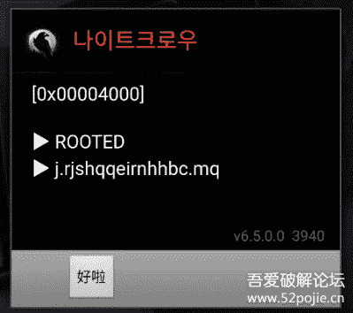

## Magisk檢測分析

在bypass frida閃退後，hook `decrypt1`保存一份相對完整的解密字符串，用以配合分析，記為`decrypt_str.log`。

```
function hook_decrypt1() {

    Interceptor.attach(base.add(0x5E84),{

        onEnter(args){

            this.a3 = args[3];

            this.len = args[4].toInt32();

            this.offset = this.a3.sub(base);

        },

        onLeave(retval){

            let dec_str = this.a3.readCString(this.len);

            console.log("[decrypt1] ", ptr(this.offset), dec_str);

        }

    })

}
```

## 回首Java層

再次hook那4個動態注冊的函數，會發現除了調用1次`reg_func_d`外，還不斷地在調用`reg_func_p`、`reg_func_q`，嘗試直接分析後2個函數，但沒有看出什麼。

改變思路，hook Java層的一些退出函數。

```
function printStack(){
    console.log(Java.use("android.util.Log").getStackTraceString(Java.use("java.lang.Exception").$new()))
}
function hook_leave_java() {
    Java.perform(() => {
        let System = Java.use("java.lang.System");

        System.exit.implementation = function() {
            console.log("exit....")
            printStack()
        }

        let Process = Java.use("android.os.Process");

        Process.killProcess.implementation = function() {
            console.log("killProcess....")
            printStack()
        }

    })

}
```
發現觸發了`System.exit`，調用棧如下，是由`com.xshield.x.run`類調用的。

```
exit....
java.lang.Exception
        at java.lang.System.exit(Native Method)
        at com.xshield.x.run(dd.java:186)
        at java.lang.Thread.run(Thread.java:919)
```
Java層有混淆，用jeb打開可以默認去除一些簡單混淆( 如字符串混淆 )，方便分析。

從`com.xshield.x.run`向上跟到`call_exit_thread_xref2`函數，看到"Scanrisk"字符串本以為是相關邏輯，但hook後發現`v2 == 0`，因此根本不會走任意一處"Scanrisk"。

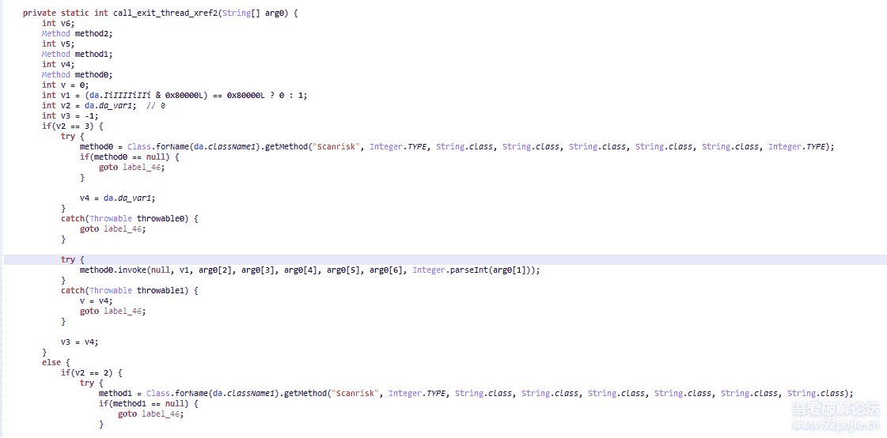

`call_exit_thread_xref2` → `u.call_exit_thread_xref1` → `exit`。

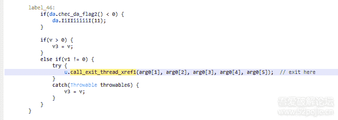

嘗試直接讓`call_exit_thread_xref2`函數固定返回1，不走原本的邏輯。

結果是畫面不再顯示那個檢測介面，但過一段時間後同樣會退出，調用的是native層的`exit_func`。

```
[exit_func] call in: 
7da42486a4 is in libdxbase.so offset: 0x86a4
7e96fb7894 is in libc.so offset: 0xe6894
7e96f55b70 is in libc.so offset: 0x84b70
```
由此猜測`call_exit_thread_xref2`只是構建那個檢測介面的邏輯，真正檢測的地方在另一處。

在`call_exit_thread_xref2`時機打印調用棧，繼續向上跟

```
java.lang.Exception
        at com.xshield.da.IIiIiiIIII(Native Method)
        at com.xshield.da.IIiiiIIiIi(da.java:49)
        at com.xshield.k.run(da.java:103)
        at android.os.Handler.handleCallback(Handler.java:883)
        at android.os.Handler.dispatchMessage(Handler.java:100)
        at android.os.Looper.loop(Looper.java:224)
        at android.app.ActivityThread.main(ActivityThread.java:7520)
        at java.lang.reflect.Method.invoke(Native Method)
        at com.android.internal.os.RuntimeInit$MethodAndArgsCaller.run(RuntimeInit.java:539)
        at com.android.internal.os.ZygoteInit.main(ZygoteInit.java:950)
```
`com.xshield.k.run`如下，被檢測時走的是else分支，嘗試讓它走if分支。

結果同樣是畫面不再顯示那個檢測介面，但過一段時間後同樣會退出。因此還是要從native層入手。

注：`da.detectInfo`是我手動修改的名字。

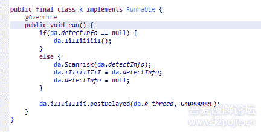

全局搜`detectInfo` ( 不要只按x找交叉引用，不太準 )，找到它是某次`reg_func_q`調用的返回值。

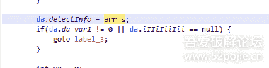

在其上方是一個while循環，根據特定的邏輯調用`da.q` ( 即`reg_func_q` )。

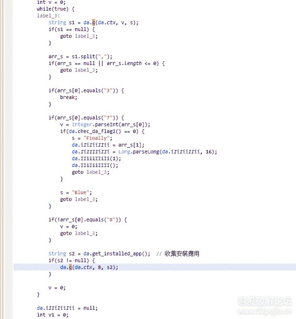

hook `da.q`，看到某次的`result`果然是`detectInfo`。

同樣可以見到某次`reg_func_q`的參數是一堆包名，其中就包含`j.rjshqqeirnhhbc.mq`。

因此可以猜測Magisk的檢測邏輯為：Java層收集安裝APP的包名、路徑等信息 → 調用`da.q(ctx, 8, installed_app_info)`進行檢查 → 發現`j.rjshqqeirnhhbc.mq`的某些特徵 → 判斷是Magisk。

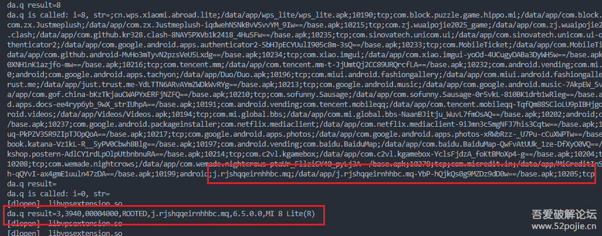

根據猜測，嘗試置空`da.q`參數中的`j.rjshqqeirnhhbc.mq`，讓它不檢測`j.rjshqqeirnhhbc.mq`。

結果是APP不再顯示那個檢測介面，也不會自動退出，成功bypass掉Magisk檢測。

```
function hook_reg_func_q() {
    let da = Java.use("com.xshield.da");
    da["q"].implementation = function (context, i, str) {
        // ;j.rjshqqeirnhhbc.mq;/data/app/j.rjshqqeirnhhbc.mq-YbP-hQjkQs0g9MZDz9dD0w==/base.apk;10205;tcp
        str = str.replace(";j.rjshqqeirnhhbc.mq;/data/app/j.rjshqqeirnhhbc.mq-YbP-hQjkQs0g9MZDz9dD0w==/base.apk;10205;tcp", "")
        console.log(`da.q is called: i=${i}, str=${str}`);
        let result = this["q"](context, i, str);
        console.log(`da.q result=${result}`);
        return result;
    };

}
```
由此確定了檢測邏輯的確是在`da.q(ctx, 8, installed_app_info)` ( 必須是`args[1]`為8的情況，才是進行上述檢測 )。

### native層：reg_func_q case 8分析

回到native層的`reg_func_q`分析檢測邏輯的具體實現，動調case 8的情況。

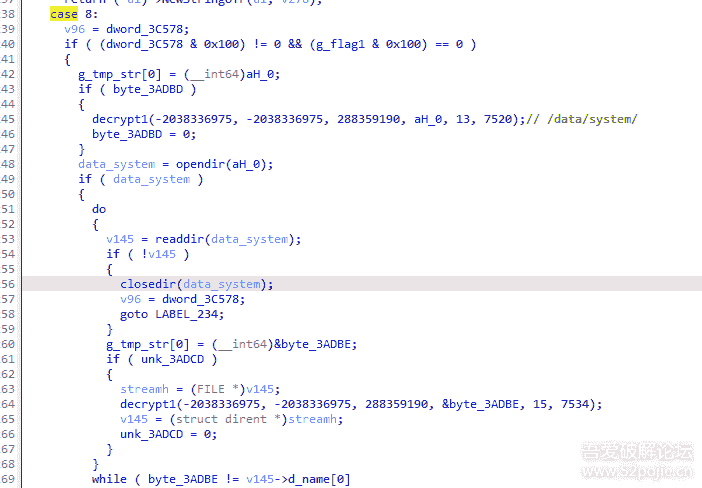

一開始先將傳入的`installed_app_info`寫入`cfdd35cd.dex`。

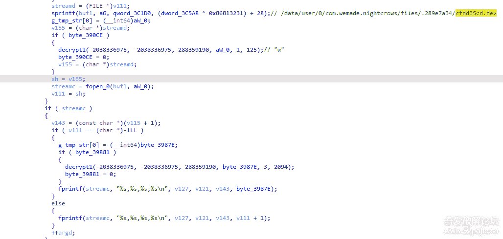

其中的內容如下：

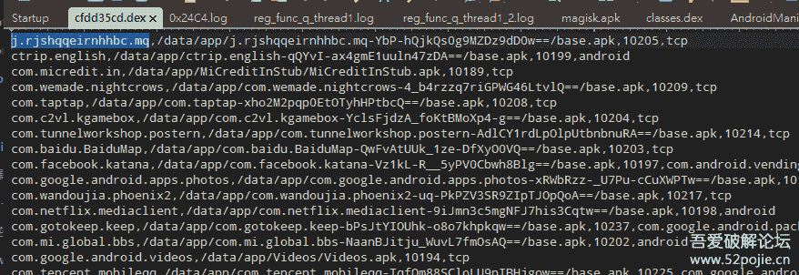

最後會創建`reg_func_q_pthread1`線程，裡面才是真正檢測的地方。

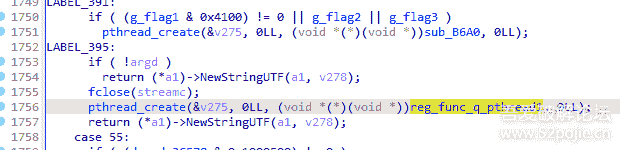

### reg_func_q_pthread1分析

不知什麼原因，動調時始終無法斷在`reg_func_q_pthread1`裡，因此只好通過hook和配合`decrypt_str.log`來進行分析( 主要依賴這兩者來確定執行流 )。

打開`XXX/base.apk` → `fd`反查( IO重定向檢測 ) → 解析.apk結構 → 獲取其`AndroidManifest.xml`。

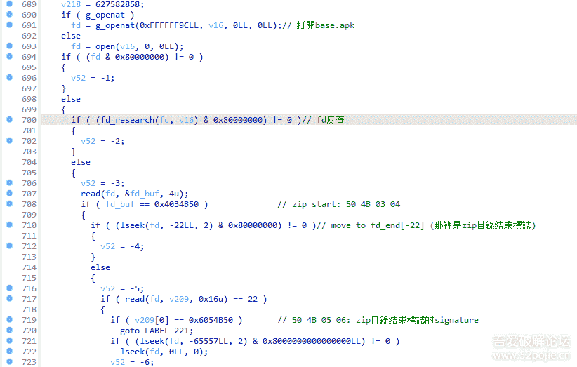

判斷`AndroidManifest.xml`中，是否包含以下權限：

- `UPDATE_PACKAGES_WITHOUT_USER_ACTION`
- `QUERY_ALL_PACKAGES`
- `FOREGROUND_SERVICE`
- `REQUEST_INSTALL_PACKAGES`
- `HIDE_OVERLAY_WINDOWS`

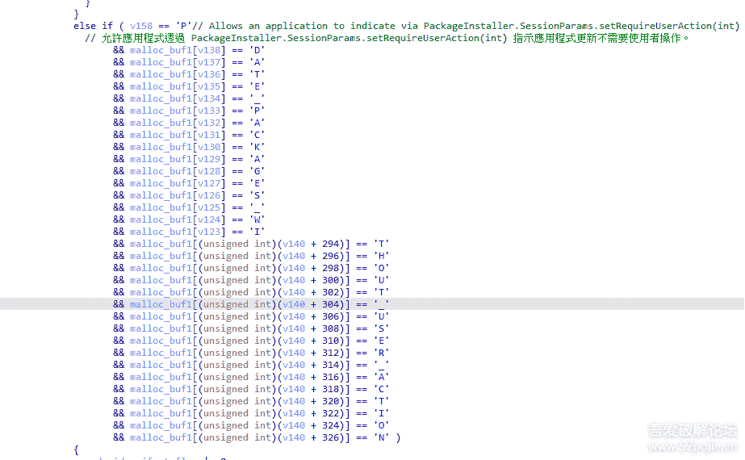

而原版的Magisk正好包含上述的所有權限。

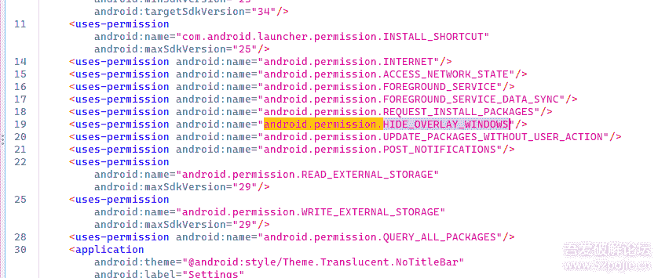

僅憑權限來判斷，不會出現誤殺的情況？答案是會的，我在搜索相關資料時就發現有一堆用戶因被誤殺而在某論壇訴苦的情況，不過那時是21年，現在都25年了這問題應該也改善了不少。

可以看到它加了一些白名單來防止誤殺那些具有上述權限的正常APP。

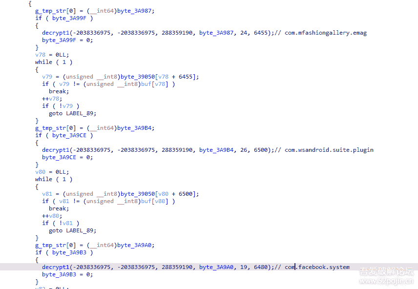

bypass腳本：hook `openat`，將`/data/app/j.rjshqqeirnhhbc.mq-YbP-hQjkQs0g9MZDz9dD0w==/base.apk`重定向為另一個正常apk。

注：這樣重向定不會被上述的`fd`反查檢測到，另一種`Interceptor.replace`才會。

```
function hook_openat() {

    Interceptor.attach(Module.findExportByName(null, "openat"), {

        onEnter: function(args) {

            let path = args[1].readCString();

            if (path.indexOf("/data/app/j.rjshqqeirnhhbc") != -1 && path.indexOf("base.apk") != -1) {

                Memory.writeUtf8String(args[1], "/data/local/tmp/base.apk");

                console.log("[openat] bypass: ", path, args[1].readCString());

            }

            // Thread.backtrace(this.context, Backtracer.FUZZY).map(addr_in_so);

        }

    })

}
```
上述腳本可以bypass Magisk檢測，但奇怪的是在`hook_openat`之後，即使下一次沒有`hook_openat`，依然不會再彈那個檢測介面，也不會退出。


連執行流也改變了，要重裝遊戲才會回復「正常」。感覺是該保護的一種BUG？不太確定。

## 3> Debuggable檢測分析

改`AOSP` / 修改`AndroidManifest.xml`，這兩種賦予`APP` `Debuggable`權限的方法，都會被檢測到。

上次分析`LIAPP`時也有類似的檢測，那次沒分析明白，這次再來看看。

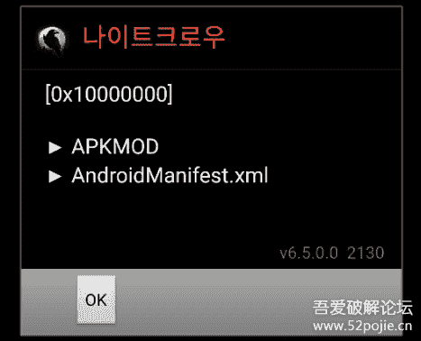

注：在分析過程中發現`0xB11C`類似檢測處理函數，記為`mb_detect_handler`。

`hook` `mb_detect_handler`，在參數包含`AndroidManifest.xml`時打印調用棧。

看到相關邏輯在`0xb5bc`。

```
[mb_detect_handler] 0x852 0x10000000 AndroidManifest.xml
LR: 0x7bb250b5bc
Function: 0xb5bc
moduleName: libdxbase.so

LR: 0x7ca37b6730
Function: _ZL15__pthread_startPv+0x28
moduleName: libc.so

LR: 0x7ca3757008
Function: __start_thread+0x44
moduleName: libc.so
```

記`0xb5bc`為`detected_APKMODE`，繼續向上跟，看到是由`g_APKMODE_flag1`和`g_APKMODE_flag2`決定是否創建`detected_APKMODE`線程的。

按`x`沒有看到`g_APKMODE_flag1`和`g_APKMODE_flag2`賦值的地方，嘗試使用`frida`的內存斷點，但沒什麼效果。

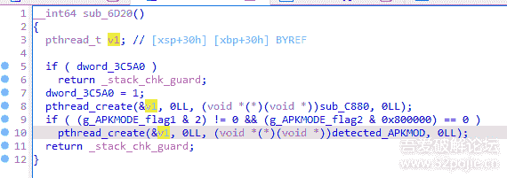

改用[這篇文章](https://bbs.kanxue.com/thread-278867.htm)自己實現的`frida`內存斷點，成功命中：

```
// 用法: readwritebreak(base.add(0x3D700), 4, 1)

命中 : 0x7bb253e700  pc pointer :  0x7bb2519f0c

{"name":"libdxbase.so","base":"0x7bb2501000","size":258048,"path":"/data/app/com.wemade.nightcrows-3nZhg8hrtpfvU8YQT2BvZw==/lib/arm64/libdxbase.so"}

pc - - >  libdxbase.so  ->  0x18f0c

readwritebreak exit
```

去`libdxbase.so`!`0x18f0c`看看( 這裡位於`reg_func_d` )。

似乎`import_data + 9984`就是`g_APKMODE_flag1` ( 動調後發現的確如此 )，值來源是`a19`。

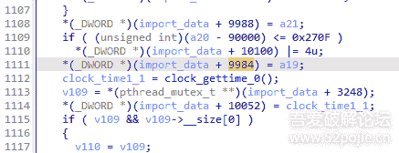

`hook` `reg_func_d`，在`enter`和`leave`時分別打印，的確是在`leave`時才有值，即`g_APKMODE_flag`都是在`reg_func_d`中賦值。

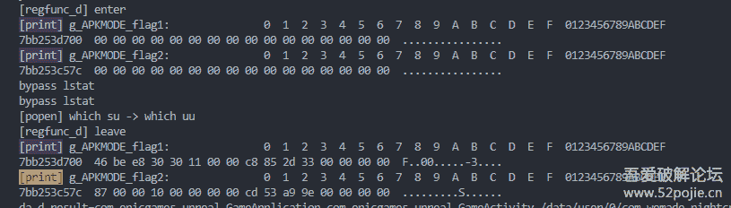

而`a19`其實就是`reg_func_d`的`args[18]` ( 倒數第3個參數 )。

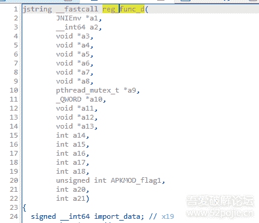

看Java層是怎樣傳值的，原來是`ApplicationInfo`的`flags`屬性。

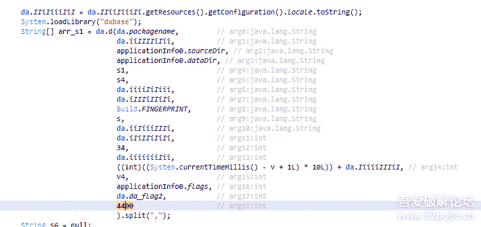

`hook` Java層的`reg_func_d`，去掉`FLAG_DEBUGGABLE`標誌。

結果是遊戲終於不再顯示`APKMOD`檢測介面，順利`bypass`它的`Debuggable`檢測。

```
function hook_reg_func_d() {
    let da = Java.use("com.xshield.da");
    da["d"].implementation = function (str, str2, str3, str4, str5, str6, str7, str8, str9, str10, str11, i9, i10, i11, i12, i13, i14, i15, i16) {
        const FLAG_DEBUGGABLE = 0x2;
        i14 &= (~FLAG_DEBUGGABLE);
        console.log(`da.d is called: str=${str}, str2=${str2}, str3=${str3}, str4=${str4}, str5=${str5}, str6=${str6}, str7=${str7}, str8=${str8}, str9=${str9}, str10=${str10}, str11=${str11}, i9=${i9}, i10=${i10}, i11=${i11}, i12=${i12}, i13=${i13}, i14=${i14}, i15=${i15}, i16=${i16}`);
        let result = this["d"](str, str2, str3, str4, str5, str6, str7, str8, str9, str10, str11, i9, i10, i11, i12, i13, i14, i15, i16);
        console.log(`da.d result=${result}`);
        return result;
    };
}
```

## 3> 完整bypass腳本

```
function hook_dlopen(soName) {

    Interceptor.attach(Module.findExportByName(null, "dlopen"),

        {

            onEnter: function (args) {

                var pathptr = args[0];

                if (pathptr !== undefined && pathptr != null) {

                    var path = ptr(pathptr).readCString();

                    // console.log("[dlopen] ", path);

                    if (path.indexOf(soName) >= 0) {

                        this.is_can_hook = true;

                    }

                }

            },

            onLeave: function (retval) {

                if (this.is_can_hook) {

                    console.log("hook start...");

                    hook_func(soName)

                }

            }

        }

    );

    Interceptor.attach(Module.findExportByName(null, "android_dlopen_ext"),

        {

            onEnter: function (args) {

                var pathptr = args[0];

                if (pathptr !== undefined && pathptr != null) {

                    var path = ptr(pathptr).readCString();

                    // console.log("[android_dlopen_ext] ", path);

                    if (path.indexOf(soName) >= 0) {

                        this.is_can_hook = true;

                    }

                }

            },

            onLeave: function (retval) {

                if (this.is_can_hook) {

                    console.log("hook start...");

                    hook_func(soName)

                }

            }

        }

    );

}

function hook_func(soName) {

    var base = Module.findBaseAddress(soName);

    function hook_pthread_func2() {

        Interceptor.attach(base.add(0x983C), {

            onEnter: function(args) {

                // bypass root check2

                let check_path = args[0].readPointer().readCString();

                if (check_path.indexOf("/su") != -1) {

                    Memory.writeUtf8String(args[0].readPointer(), check_path.replace("/su", "/XX"));

                }

                if (check_path.indexOf("magisk") != -1) {

                    Memory.writeUtf8String(args[0].readPointer(), check_path.replace("magisk", "3Ag1sk"));

                }

                if (check_path.indexOf("/sbin") != -1) {

                    Memory.writeUtf8String(args[0].readPointer(), check_path.replace("/sbin", "/ABCD"));

                }

            }

        })

    }

    function hook_openat() {

        Interceptor.attach(Module.findExportByName(null, "openat"), {

            onEnter: function(args) {

                let path = args[1].readCString();

                // bypass Magisk check

                if (path.indexOf("/data/app/j.rjshqqeirnhhbc") != -1 && path.indexOf("base.apk") != -1) {

                    Memory.writeUtf8String(args[1], "/data/local/tmp/base.apk");

                    console.log("[openat] bypass: ", path, args[1].readCString());

                }

            }

        })

    }

    hook_pthread_func2();

    hook_openat();

}

function hook_lstat() {

    let fake_time = Date.now();

    // bypass frida crash

    Interceptor.attach(Module.findExportByName(null, "lstat"), {

        onEnter: function(args) {

            this.name = args[0].readCString();

            this.statbuf = args[1];

        },

        onLeave: function(retval) {

            if (this.name == "/system/lib") {

                this.statbuf.add(0x68).writeU64(fake_time++);

                console.log("bypass lstat");

            }

            if (this.name == "/sbin") {

                this.statbuf.add(0x68).writeU64(fake_time++);

                console.log("bypass lstat");

            }

        }

    })

}

function hook_popen() {

    Interceptor.attach(Module.findExportByName(null, "popen"), {

        onEnter: function(args) {

            if (args[0].readCString().indexOf(" su") != -1) {

                // bypass root check1

                console.log("[popen] which su -> which xx");

                Memory.writeUtf8String(args[0], "which xx");

            }

        }

    })

}

function printStack(){

    console.log(Java.use("android.util.Log").getStackTraceString(Java.use("java.lang.Exception").$new()))

}

function hook_java() {

    Java.perform(() => {

        function hook_reg_func_d() {

            let da = Java.use("com.xshield.da");

            da["d"].implementation = function (str, str2, str3, str4, str5, str6, str7, str8, str9, str10, str11, i9, i10, i11, i12, i13, i14, i15, i16) {

                // bypasss debuggalbe

                const FLAG_DEBUGGABLE = 0x2;

                i14 &= (~FLAG_DEBUGGABLE);

                console.log(`da.d is called: str=${str}, str2=${str2}, str3=${str3}, str4=${str4}, str5=${str5}, str6=${str6}, str7=${str7}, str8=${str8}, str9=${str9}, str10=${str10}, str11=${str11}, i9=${i9}, i10=${i10}, i11=${i11}, i12=${i12}, i13=${i13}, i14=${i14}, i15=${i15}, i16=${i16}`);

                let result = this["d"](str, str2, str3, str4, str5, str6, str7, str8, str9, str10, str11, i9, i10, i11, i12, i13, i14, i15, i16);

                console.log(`da.d result=${result}`);

                return result;

            };

        }

        hook_reg_func_d();

    })

}

function main() {

    hook_dlopen("libdxbase.so");
```


```c
hook_lstat();

hook_popen();

hook_java();

}

setImmediate(main)
```

### 結語

總的來說這個保護與之前分析的LIAPP差不多，都不難，只是比較麻煩。

( 各位有好玩的遊戲樣本也可以分享給我，有空會看看的^^ )
