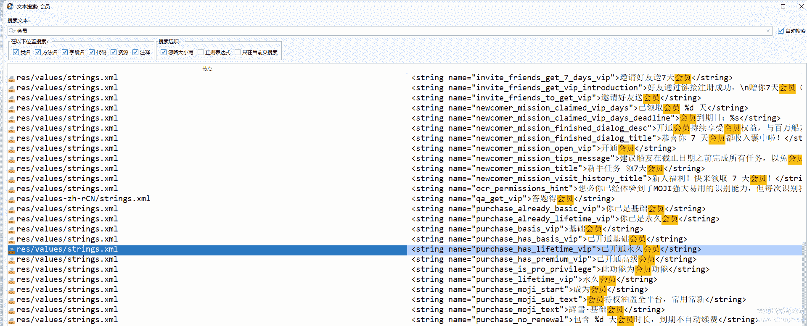
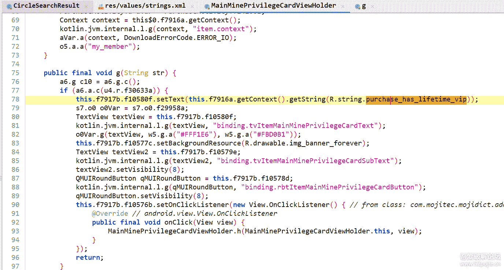
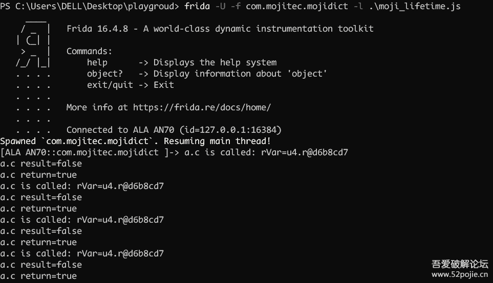
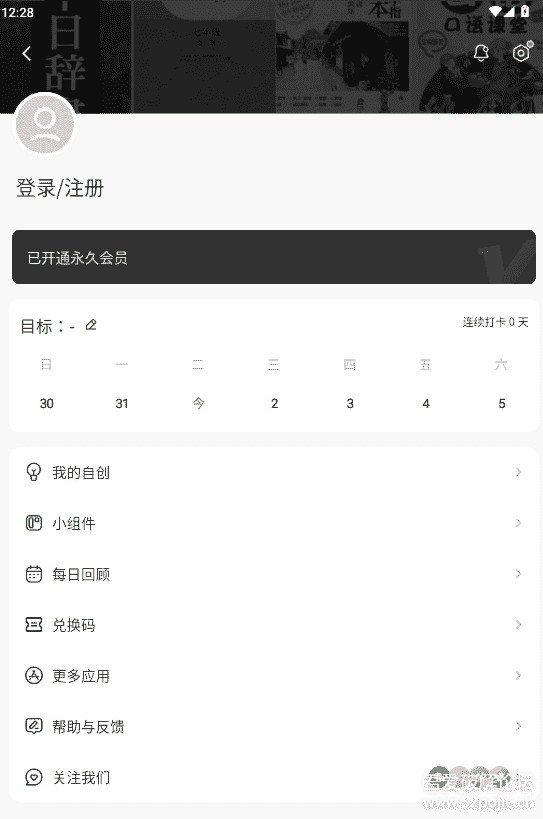
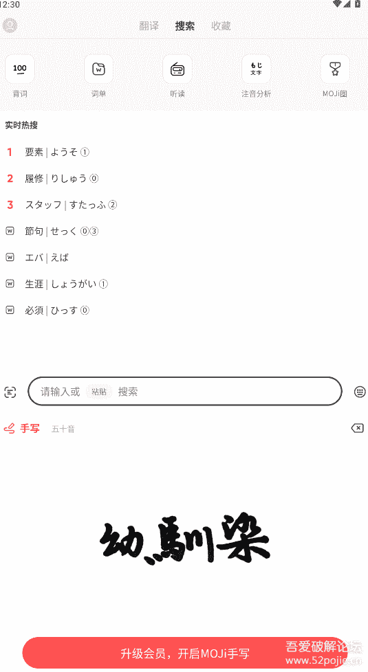
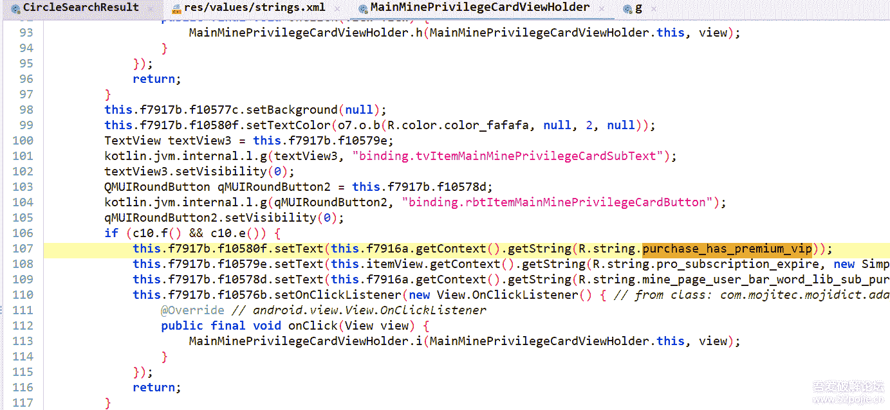
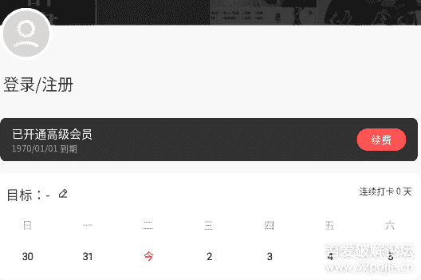
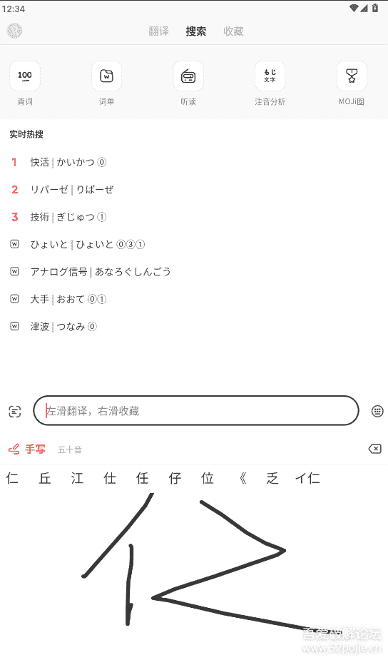

# [Android 分享] 使用frida完成【moji辞典V8.4.0】永久会员过程

- 原帖: https://www.52pojie.cn/forum.php?mod=viewthread&tid=2020600
- 抓取时间: 2026-11-01T15:53:41.150Z

从MuMu模拟器上下载v8.4.0的moji辞典没有防hook机制（有的话需要把这步加上），所以这里提供一个使用`frida`动态hook的思路
环境：MuMu模拟器12

## 第一步 会员搜索大法

把apk从模拟器中`pull`出来，然后拖到`jadx`中，搜索：会员

找到 “已开通永久会员”，这个字符串的变量名是 `purchase_has_lifetime_vip`

## 第二步 查看调用位置

全局搜索 `purchase_has_lifetime_vip`，定位类 `MainMinePrivilegeCardViewHolder`

简单分析逻辑后可以得知前面 `if` 语句中的条件决定了是否开通永久会员

## 第三步 写hook脚本

点进`a6.a.c`后复制为`frida`片段，写hook代码：
```
Java.perform(function () {
    let a = Java.use("a6.a");
    a["c"].implementation = function (rVar) {
        console.log(`a.c is called: rVar=${rVar}`);
        let result = this["c"](rVar);
        console.log(`a.c result=${result}`);
        console.log(`a.c return=true`);
        return true;
    };
});
```
接着加载hook脚本

实际效果

尝试下会员的手写功能

居然翻车了...
翻回去发现`MainMinePrivilegeCardViewHolder`类里还有个高级会员，死马当活马医了

写新的hook脚本
```
Java.perform(function () {

    let g = Java.use("a6.g");

    g["f"].implementation = function () {

        console.log(`g.f is called`);

        let result = this["f"]();

        console.log(`g.f result=${result}`);

        console.log(`g.f return=true`);

        return true;

    };

    g["e"].implementation = function () {

        console.log(`g.e is called`);

        let result = this["e"]();

        console.log(`g.e result=${result}`);

        console.log(`g.f return=true`);

        return true;

    };

});
```
再来一次

再试试手写

成了！收工
参考：https://www.52pojie.cn/thread-1967393-1-2.html
