# [Android 分享] 逆向入门 笔趣阁VIP

- 原帖: https://www.52pojie.cn/forum.php?mod=viewthread&tid=2020864
- 抓取时间: 2026-11-01T15:53:37.281Z

## 逆向入门 笔趣阁VIP

>大佬勿喷

APK去除校验工具：https://wwgj.lanzoum.com/idS752sf86yj 密码:52pj
笔趣阁：https://wwgj.lanzoum.com/i3Qir2sf88re 密码:52pj

首先我们去除签名校验

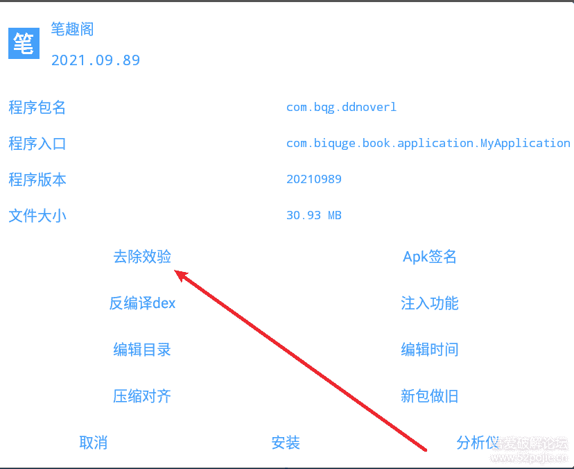
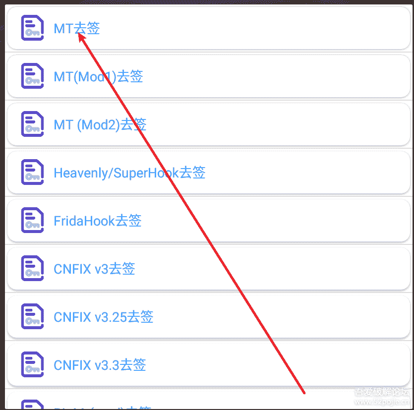

完成之后用dex++编辑器勾选所有`class`文件

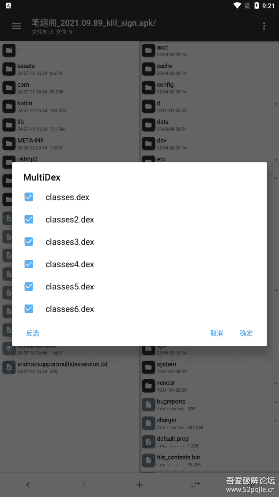

在常量里过滤会员

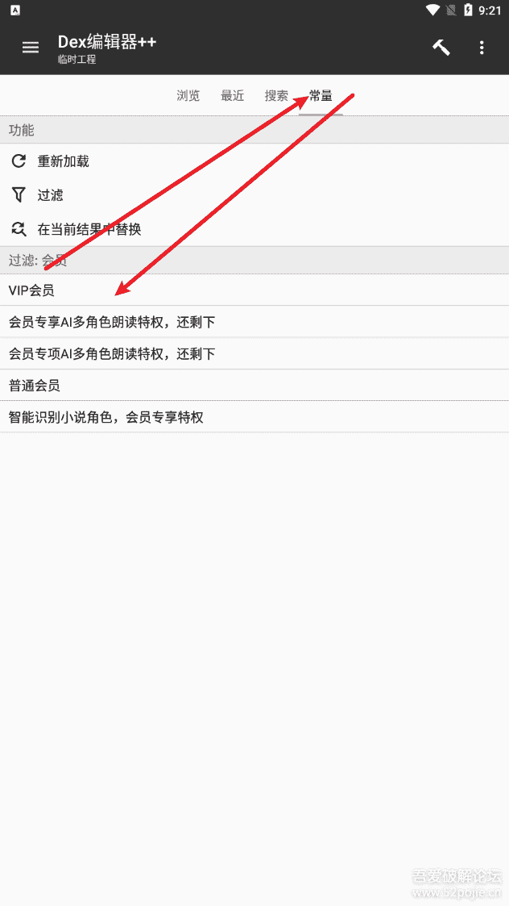

VIP会员点进去

导航到函数头

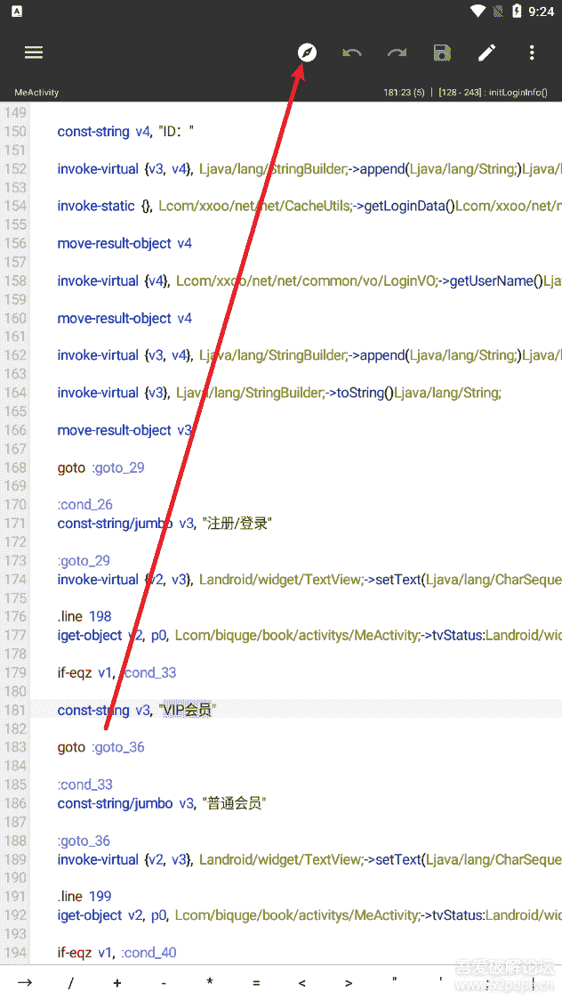
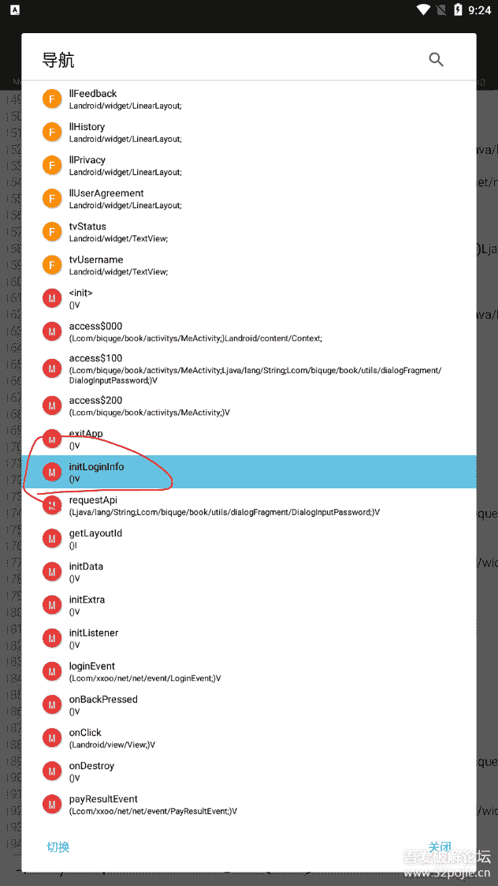

把`islogin`替换成`isvip`使其不能验证是否登录

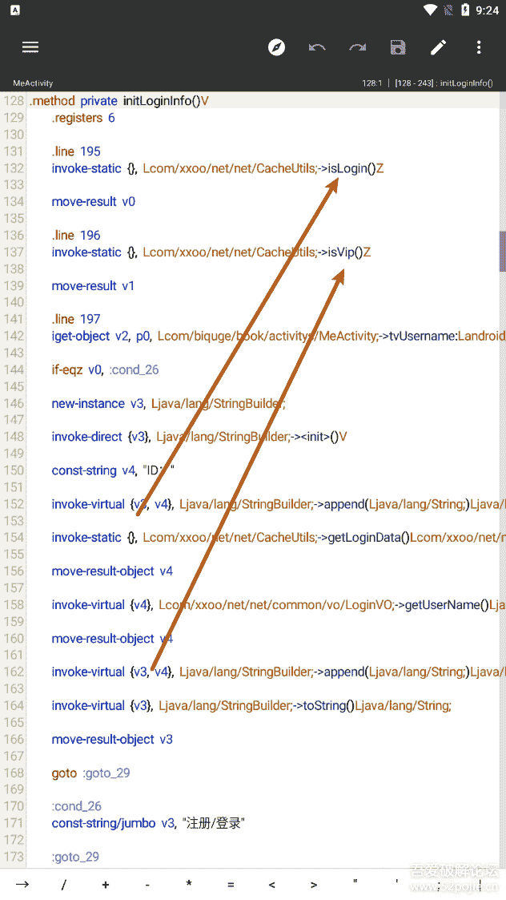

跳转至`isVip`函数

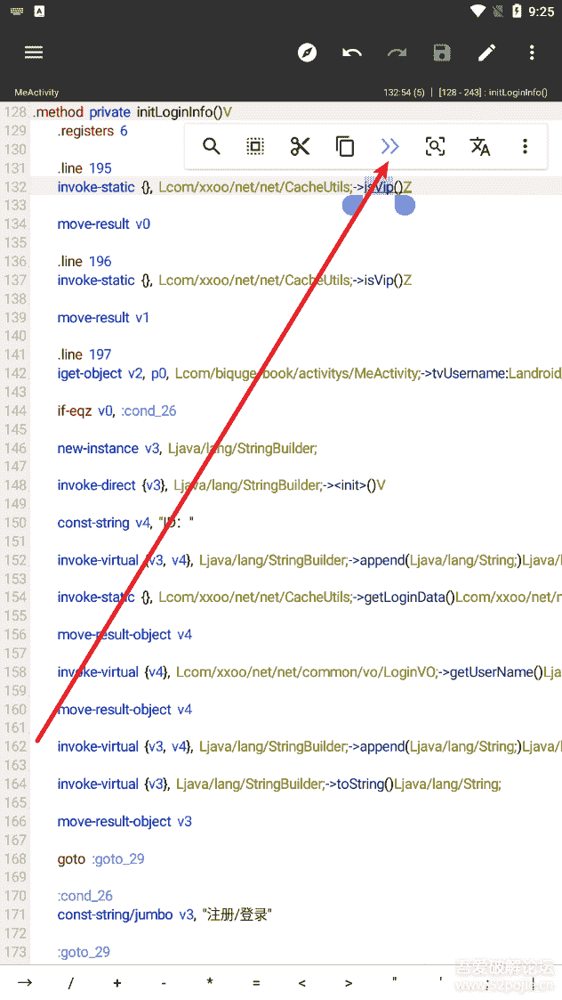

在`isVip`函数`return`前加smali语句 `const/4 v0,0x1`

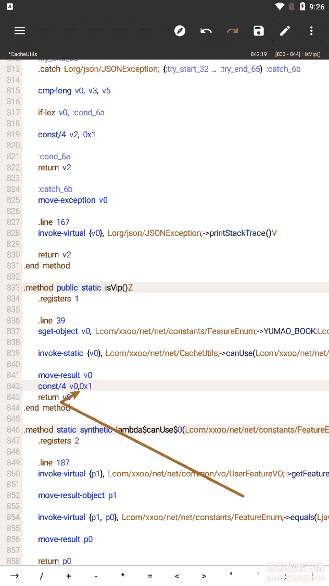

再次导航到`isLogin`函数头

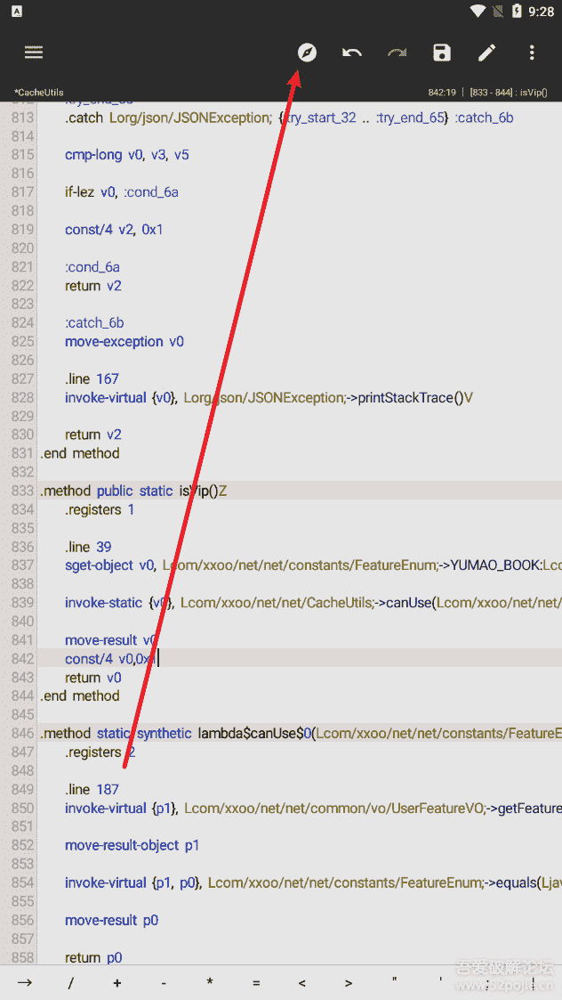
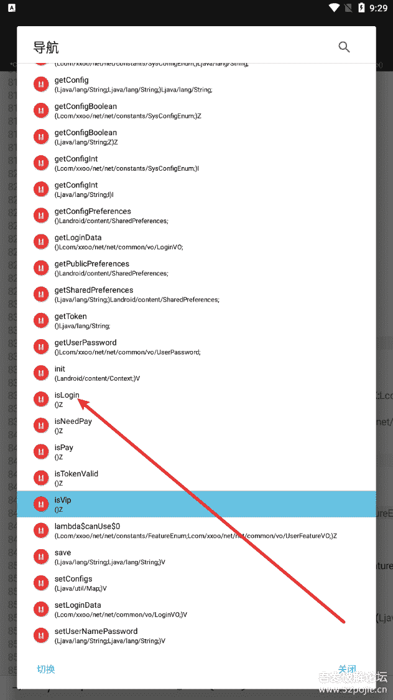

下滑到`isLogin`的`return`前面添加smali语句 `const/4 v0,0x1`

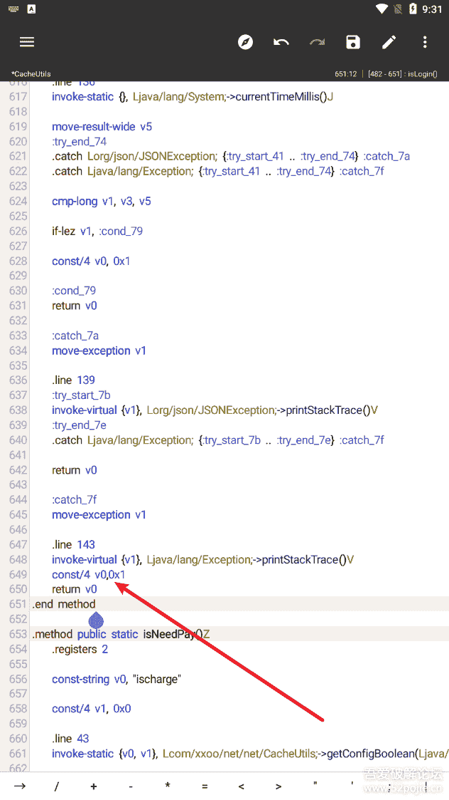

保存之前可以玩点花的

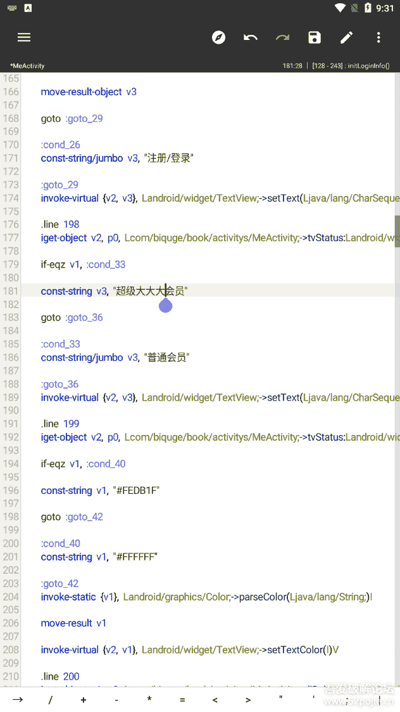

把VIP会员字符串改为别的自定义字符串，保存并自动签名

安装看看

成功
