# [Android CTF] 2025騰訊遊戲安全大賽(安卓決賽)

- 原帖: https://www.52pojie.cn/forum.php?mod=viewthread&tid=2023994
- 抓取時間: 2026-11-01T15:53:01.877Z

## 前言

上一年雖然止步於初賽，但之後找了時間復現了一下決賽，大概花了2、3周才復現完( 還是在有文章參考的情況下 )，內容很多，大致包括保護分析、vm分析、透視、自瞄實現。

今年的決賽比較不同，他給了2種外掛，考察的是外掛功能的分析和外掛檢測，如下圖。

我對外掛的實現與檢測都沒有太深入的研究，下文的檢測方式大多都是參考網上的文章現學現賣的，有寫錯的地方還請指正。

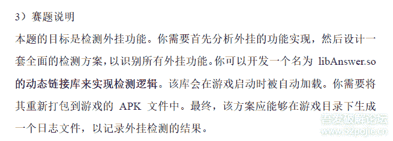

## 前置準備

三件套與初賽一樣：

- `GName`：`0xADF07C0`
- `GObject`：`0xAE34A98`
- `GWorld`：`0xAFAC398`

利用`GObject`來dump SDK，記為`SDKO.txt`。

```
./ue4dumper64 --sdku --newue+ --gname 0xADF07C0 --guobj 0xAE34A98 --package com.ACE2025.Game
```

## `ACEInject`分析

`ACEInject`這個`Zygisk`模塊會注入`libGame.so`，將其拉入IDA分析，發現沒有混淆。

在`.init_array`裡發現它調用`pthread_create`創建了一個線程，對應線程回調函數如下。

具體邏輯是先獲取`libUE4.so`的基址，在`sub_1618`中修改`libUE4_base + 0x6711AC4`的權限（`rwx`），然後將`*(libUE4_base + 0x6711AC4)`置為`0x52A85908`。

最後的`anti`是一些反調試邏輯。

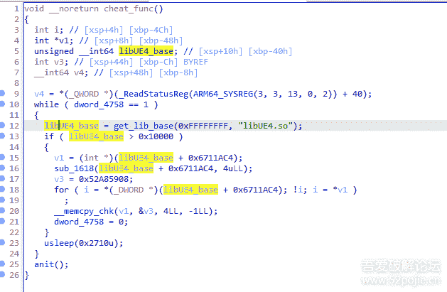

`libUE4.so`的`0x6711AC4`處是一條`mov`指令。

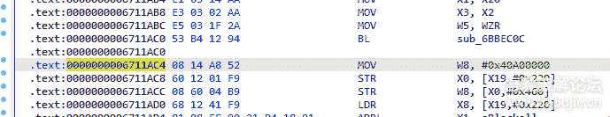

而`0x52A85908`對應的arm64匯編是`mov w8, #0x42c80000`。

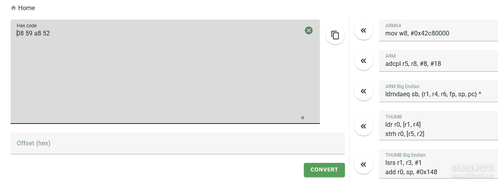

查看偽代碼，`w8`最終會賦給`*(v5 + 0x460)`，而`v5`大概率是個UE4的對象。

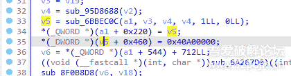

`hook`後發現`v5`可能是以下`uobj`

```
[UObjectName]  SphereComp

[UObjectName]  SphereComp    

[UObjectName]  ProjectileComp

[UObjectName]  ProjectileComp

[UObjectName]  SphereComp

[UObjectName]  SphereComp

[UObjectName]  ProjectileComp

[UObjectName]  ProjectileComp
```

在`SDKO.txt`裡搜`SphereComponent`，發現它`0x460`偏移處是`SphereRadius`屬性，看來`libGame.so`中的修改目標就是它。

```
Class: SphereComponent.ShapeComponent.PrimitiveComponent.SceneComponent.ActorComponent.Object
    float SphereRadius;//[Offset: 0x460, Size: 0x4]
```

### `ACEInject`外掛功能分析

### `ACEInject`反調試分析

`anti`函數如下，主要是一些`frida`、`hook`、調試檢測。

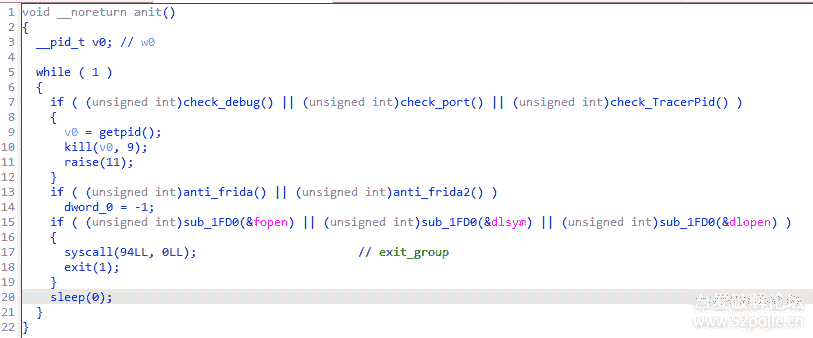

調試檢測1：`/proc/self/stat`

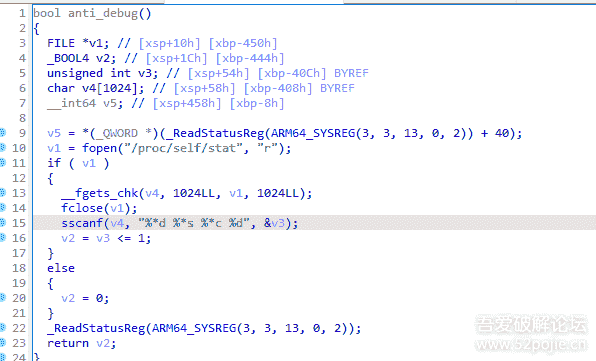

端口檢測：包括IDA、`frida`的默認端口。

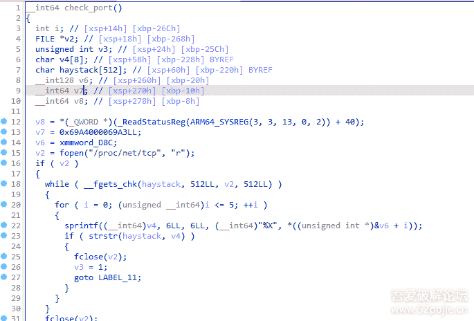

調試檢測2：`TracerPid`

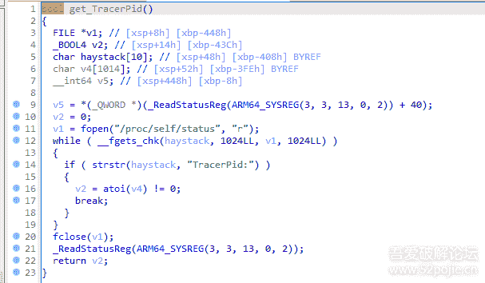

`frida`檢測：

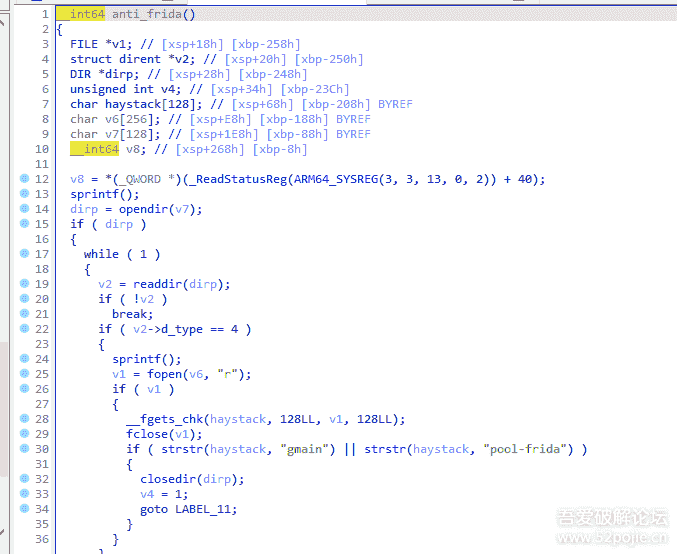

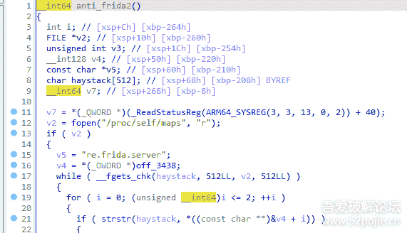

`hook`檢測（應該）：

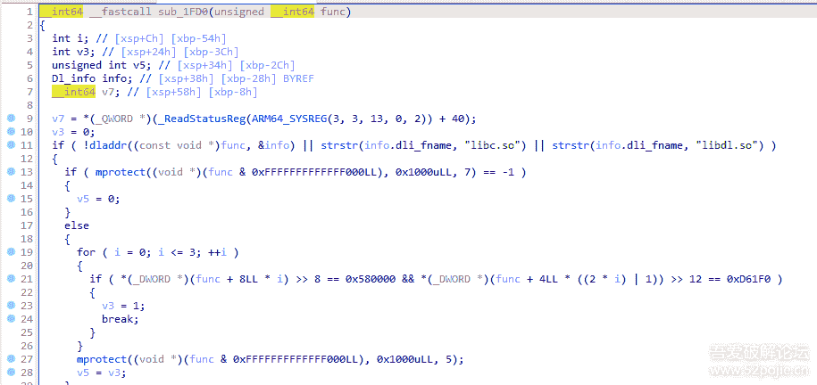

## `ACEInject`檢測方案

從上述分析可知，`libGame.so`會修改`libUE4.so`的`sub_6711A54`中某處的字節碼。

因此可以通過`crc32`來判斷`sub_6711A54`是否被修改，`sub_6711A54`原始的`crc32`是`0x49d5c836`。

```
uLong get_crc32(uint8_t* addr, size_t size) {

    return crc32(0, addr, size);

}

bool is_sub_6711A54_modify(uint64_t base) {

    // func offset: 0x6711A54

    // size: 0x224

    // orig sub_6711A54 crc32 = 0x49d5c836;

    uLong crc_val = get_crc32(reinterpret_cast(base + 0x6711A54), 0x224);

//    LOGD("crc_val: 0x%llx", crc_val);

    return crc_val != 0x49d5c836;

}
```

在線程中不斷調用`is_sub_6711A54_modify`來檢測是否被修改，當`libGame.so`注入後，成功檢測。

當然更通用的做法可能是對整個`.text`段進行`crc32`，或者對一些重要的函數分別進行`crc32`，這裡針對單一函數的做法只是作為一個演示。

注：不知為何我用`Xiaomi8 Lite`（`Magisk`環境）在測試時發現有時雖然`libGame.so`成功注入，但卻修改失敗？有時卻能修改成功，有點玄學。而在另一部非`Magisk`環境的手機手動注入`libGame.so`時卻能100%修改成功，有點神奇。

## `cheat`分析

`elf`可執行文件的起始執行函數是`start`，如下。

一開始以為`br x16`那裡會跳到具體邏輯，但嘗試用`frida` `stalker` `hook`那處地址時並沒有觸發。

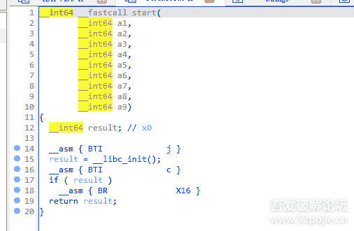

用`frida` `stalker`簡單trace後發現，`__libc_init`會跳到`0x241d90`。

```
0x241b04: bl #0x5f6bc47440
0x2b0440: adrp x16, #0x5f6bc4b000
0x2b0444: ldr x17, [x16, #0xfb0]
0x2b0448: add x16, x16, #0xfb0
0x2b044c: br x17
0x241d90: sub sp, sp, #0x70
```

注：後來用IDA9看才發現原來之前是因為沒有正確解析`__libc_init`的參數，導致看不到`sub_241d90`。

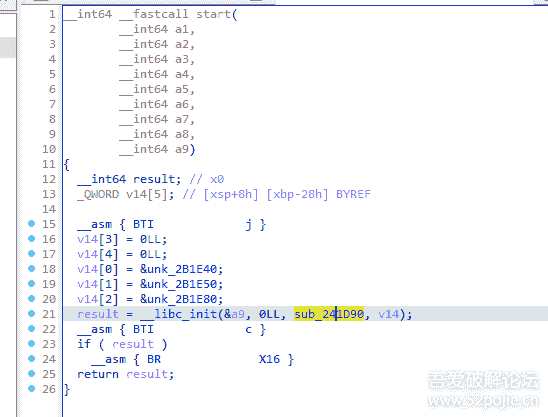

記`0x241d90`為`start_process`，這裡會通過`am start`來啟動APP，啟動成功後會調用`usleep`等待APP加載`so`，然後調用`sub_241BF0`實現外掛邏輯。

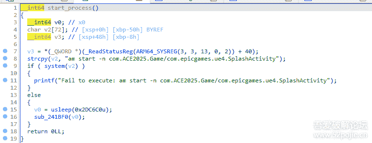

`sub_241BF0`如下，一開始先初始化了`ImGui`，然後循環調用`MainLoopStep`。

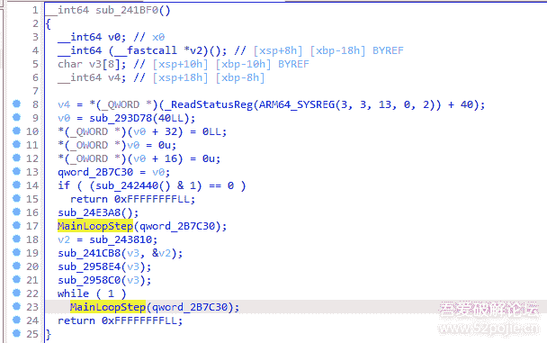

對比`ImGui`源碼，以此手動還原`MainLoopStep`中的一些符號。

可以看到點擊「初始化輔助」按鈕後，會調用`init_cheat`進行初始化，看看它的實現。

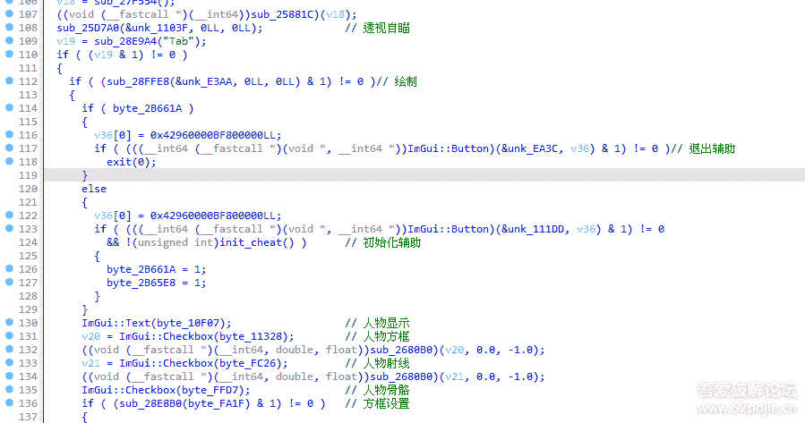

### 「初始化輔助」分析

`init_cheat`初始化流程大致如下。

從`/proc/pidof com.ACE2025.Game/maps`獲取`libUE4.so`的基址，保存到全局變量。

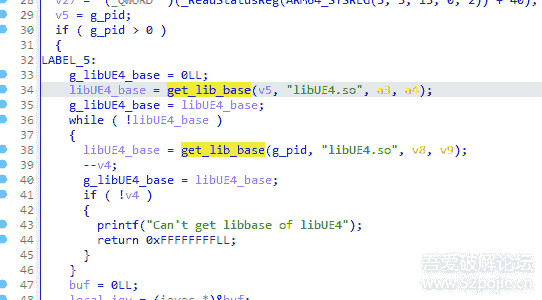

通過`process_vm_readv`系統調用來跨內存訪問訪問`libUE4.so`中的一些值，保存到全局變量。

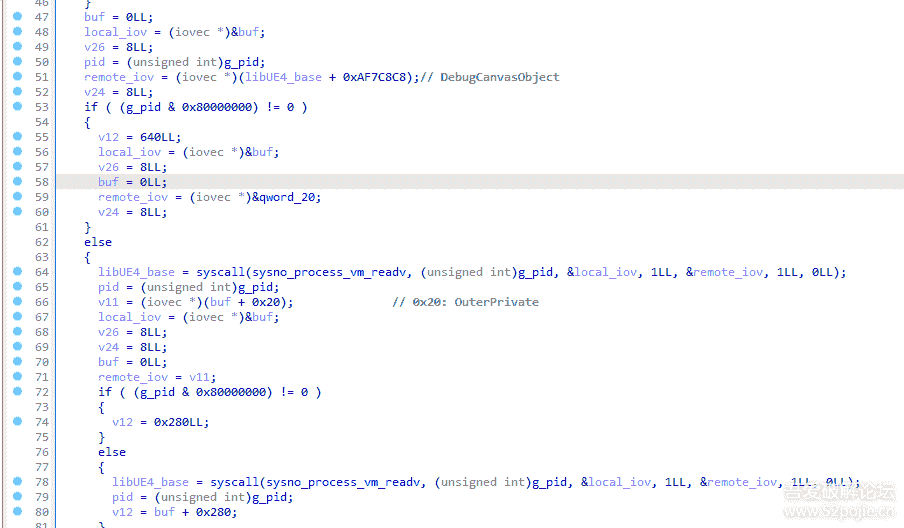

遍歷獲取`MyProjectCharacter`對象（暫時未知是基於`libUE4`的哪個全局變量來獲取的），然後保存其中的`PlayerCameraManager`屬性到全局變量。

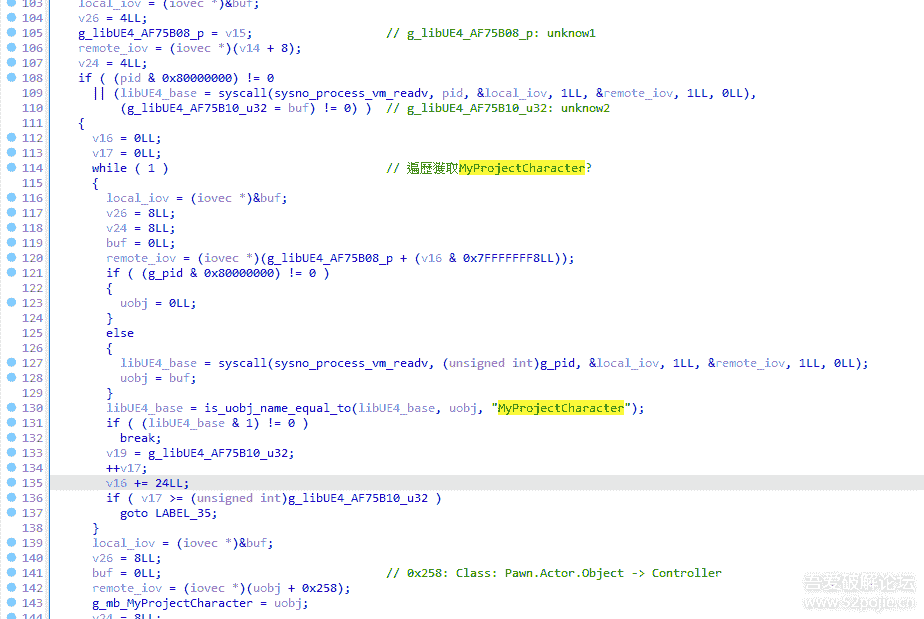

將上述遍歷過程用`frida`實現，如下：

```
function test_cheat_init() {

    let unknow1 = base.add(0xAF75B08).readPointer();

    let unknow2 = base.add(0xAF75B08).add(8).readU32();

    console.log("unknow1: ", hexdump(unknow1));

    console.log("FirstPersonCharacter_C: ", All_Objects["FirstPersonCharacter_C"]);

    for(let i = 0; i 
```

由此可以看出`0xAF75B08`指向的位置保存著Character對象數組，`0xAF75B08 + 8`指向的位置保存著數組大小。

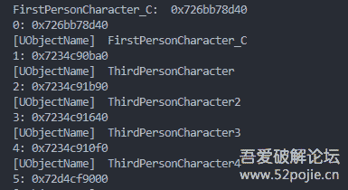

最後調用`get_ThirdPerson`遍歷獲取 & 保存`TP_ThirdPersonCharacter`對象( 同上 )，後面還進行了一些操作，但應該不太重要，先不看了。

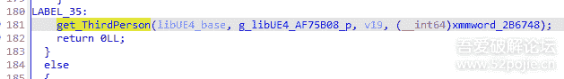

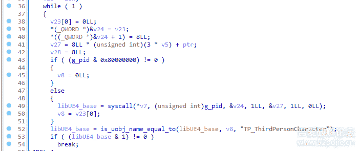

### 透視繪制分析

`init_cheat`初始化後，`inited`會置為`true`，然後會調用`process_cheat_options`處理勾選的外掛功能。

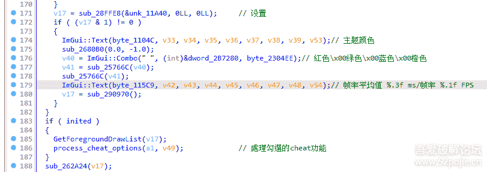

`process_cheat_options`是個巨大的函數，一開始會遍歷所有`TP_ThirdPersonCharacter`對象，收集它們的信息（同樣利用`process_vm_readv`系統調用），用來計算繪制的參數。

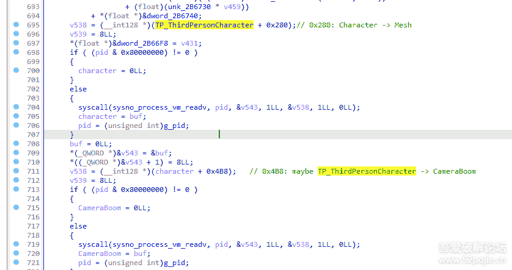

中間一大片類似如下結構的代碼，應該是在獲取 & 處理UE4角色的骨骼信息。

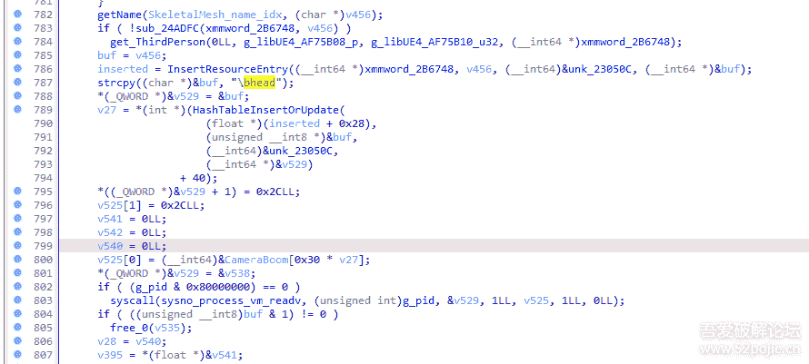

最後根據勾選的參數來繪制。

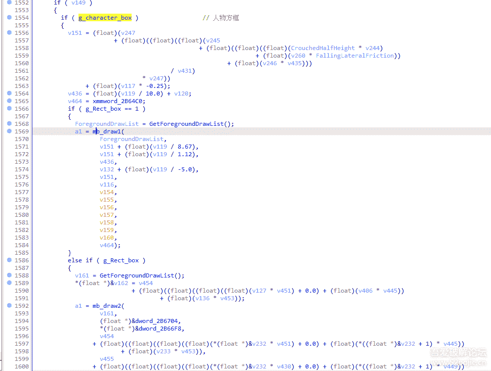

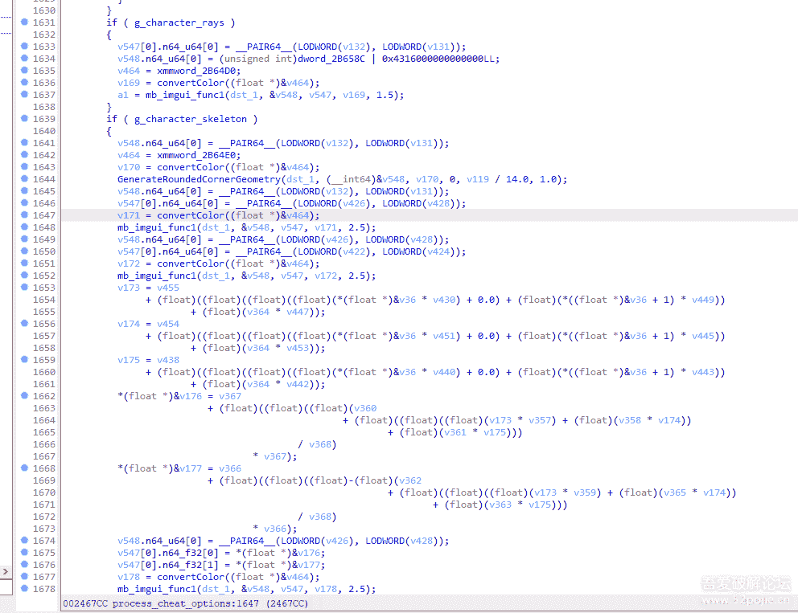

總的來說`process_cheat_options`是個巨大的透視框、自瞄框繪制函數。

### 自瞄分析

自瞄開關的`bool`值保存在`g_aimbot`。

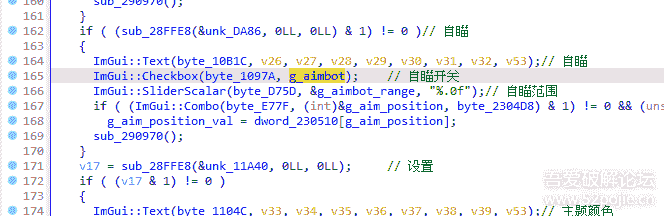

查看其交叉引用，有兩處，一開始以為所有外掛實現邏輯都在`process_cheat_options`，但分析了很久都沒有發現其中有實現自瞄的邏輯，基本上都是`ImGui`的繪制邏輯。

只好仔細分析另一處交叉引用，終於發現寫的操作，但它不是跨進程的寫，是如何實現自瞄的？

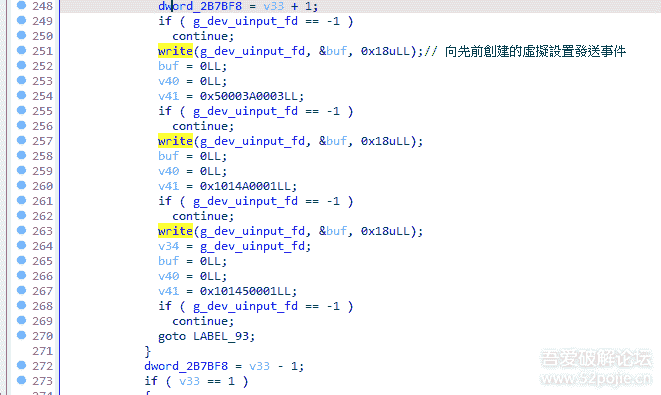

按x找到`g_dev_uinput_fd`的初始化邏輯，如下：

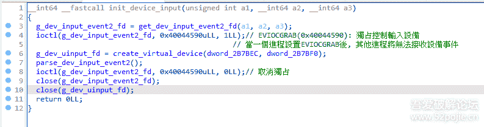

首先調用`get_dev_input_event2_fd`遍歷`/dev/input`目錄，獲取指定的`Input Event`（大概是觸控屏幕的事件），我的設備會返回`/dev/input/event2`。

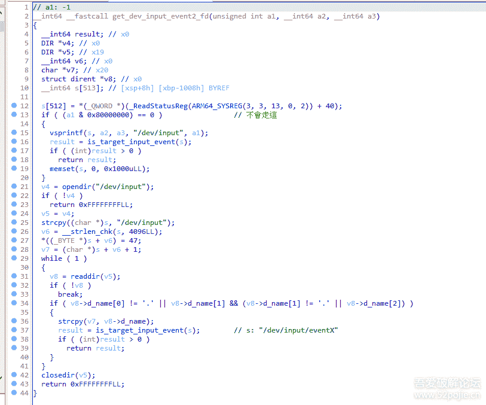

然後調用`create_virtual_device`創建 & 初始化一個虛擬設備。

查資料發現：「`uinput`是Linux用戶空間模擬輸入設備事件的機制，通過此機制，用戶空間程序可以向系統發送假的輸入事件。」

注：`uinput`是android內置的一個內核模塊，對其進行`open`、`read`、`write`、`ioctl`等操作會觸發對應的回調（這些回調定義在內核中）。

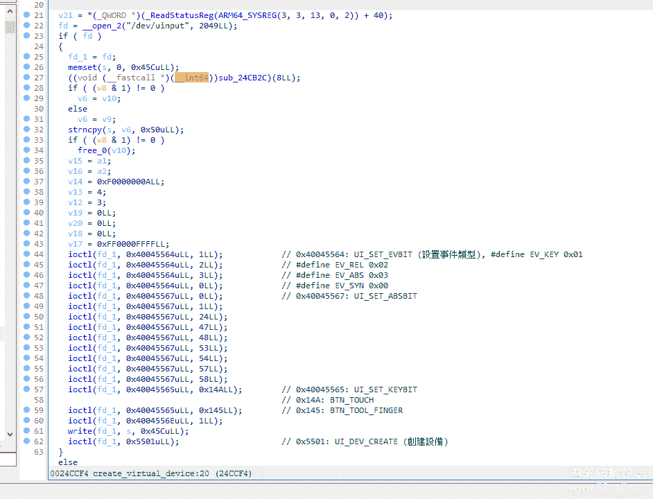

最後會調用`parse_dev_input_event2`，應該是在解析`/dev/input/event2`？猜測是上述創建的虛擬設備需要其中的一些數據？

又或者是攔截了`/dev/input/event2`，使其中的事件重定向到上述創建的虛擬設備？

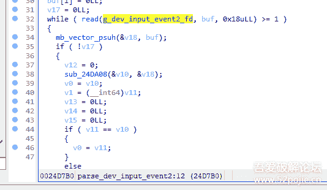

至此`g_dev_input_event2_fd`初始化成功，之後只要通過`write`對`g_dev_input_event2_fd`寫入數據（特定事件）即可實現屏幕控制。

回到之前一大堆對`g_dev_uinput_fd`進行`write`操作的地方，將該函數記為`ctrl_uinput_to_aimbot`，大概就是這裡實現的自瞄（當然前面還進行了一大堆的計算）。

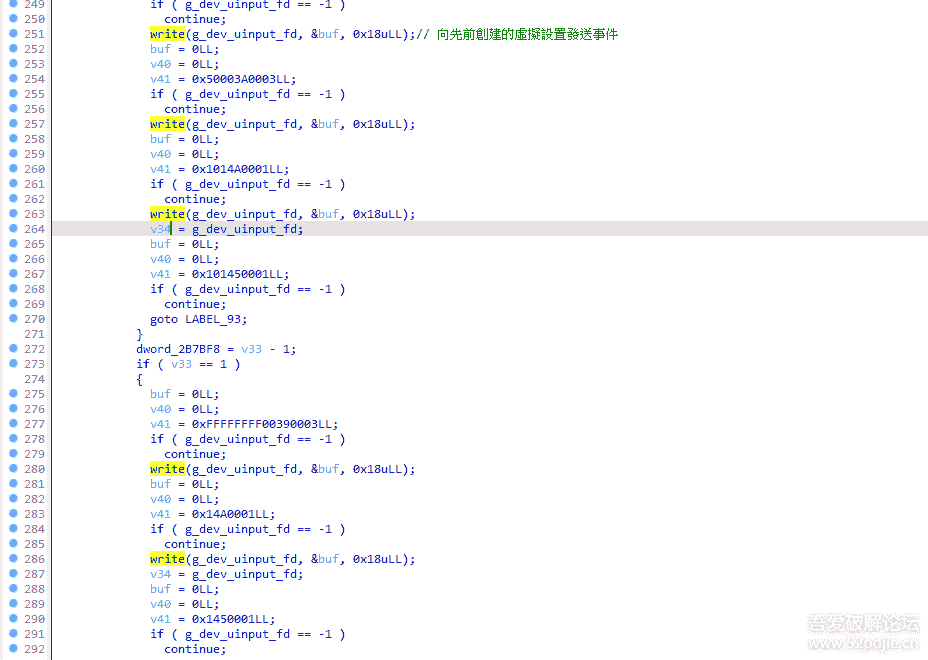

## `cheat`檢測方案

### 自瞄檢測思路

思路一：`/dev/kmsg`中有`cheat`創建虛擬設備的記錄。

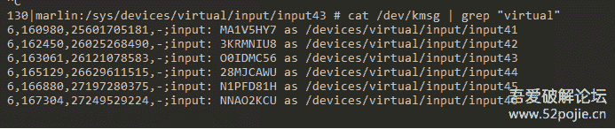

嘗試監控`/dev/kmsg`，但發現在`so`中沒有訪問`/dev/kmsg`的權限。


```
void* watch_dev_kmesg(void* arg) {
    char path[] = "/dev/kmsg";

    int fd = open(path, O_RDONLY);

    if (fd 
```

## 思路二：嘗試監測 `/sys/devices/virtual/input/` 目錄

cheat啟動前：

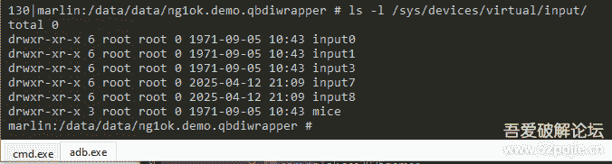

cheat啟動後：多了個`input47`（`47`是編號，不是固定的）

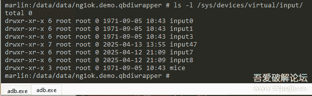

它的名字是隨機的。

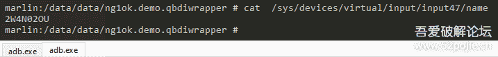

但APP的lib文件同樣沒有訪問`/sys/devices/virtual/input/`的權限。

偶然發現`lstat`能訪問`/sys/devices/virtual/input/`目錄以及其下的子目錄，觀察發現cheat創建的虛擬設備的`st.st_mtim`、`st.st_atim`、`st.st_ctim`這三者會相等，並且等於當前的時間。

因此檢測思路如下：

- 遍歷`/sys/devices/virtual/input/inputX`，`X`為`9 ~ 255`（觀察我手上僅有的兩部設備，推測`input0~input8`是系統自帶/保留的，新創建的`input`編號大概只能從`9`開始）。
- 根據上述條件來判斷是否cheat device（閾值設置為`0x10`）。

```
void* check_virtual_devices(void* arg) {

    char base_path[] = "/sys/devices/virtual/input";

    bool loged = false;

    while (!loged) {

        struct timespec now;

        clock_gettime(CLOCK_REALTIME, &now);

        for(int i = 9; i writeLine("[Cheat Device] %s is cheat device", buf);

                    loged = true;

                    break;

                }

            }

        }

        sleep(1);

    }

    pthread_exit(0);

}
```

## 4> 通用檢測思路

從上述「初始化輔助」分析可知，cheat會通過`libUE4.so + 0xAF75B08`來遍歷某個`Character`數組，記這數組為`arr`。

因此檢測的思路是將`arr`的所有元素複製到一片新的內存（記為`fake_memory`），在`fake_memory`最後插入一個`mmap`返回的地址（記為`never_access_address`），然後令`libUE4.so + 0xAF75B08`指向`fake_memory`，並將數組長度`+1`。

正常情況下`never_access_address`永遠不會被訪問，即不會存在於物理內存空間。而執行`init_cheat`時會訪問這個地址，導致物理內存出現這個地址。

而`mincore`函數能很方便地判斷一個地址是否存在於物理內存空間，具體檢測腳本如下：

```
bool is_memory_exist(uint64_t addr) {
    int pagesize = getpagesize();
    unsigned char vec = 0;

    uint64_t start = addr & (~(pagesize - 1));
    mincore((void*)start, pagesize, &vec);
    if (vec == 1) {
        LOGD("內存頁: 0x%llx 在物理內存空間", addr);
    }else{
        LOGD("內存頁: 0x%llx 不在物理內存空間", addr);
    }
    return vec == 1;
}

uint64_t insert_memory () {
    if (!libUE4_base)
        libUE4_base = ElfUtils::findBaseAddress("libUE4.so");

    uint32_t arr_len = *reinterpret_cast((libUE4_base + 0xAF75B08 + 8));
    if (!arr_len) {
        return -1;
    }

//    LOGD("arr_len: %d", arr_len);
    uint64_t arr_start = *reinterpret_cast((libUE4_base + 0xAF75B08));

    uint64_t fake_memory = reinterpret_cast(mmap(nullptr,getpagesize(), PROT_READ | PROT_WRITE | PROT_EXEC, MAP_ANONYMOUS | MAP_SHARED, 0, 0));

//    LOGD("fake_memory: 0x%llx", fake_memory);

    for(int i = 0; i (fake_memory + i * 24)) = *(reinterpret_cast(arr_start + i * 24));
        *(reinterpret_cast(fake_memory + i * 24 + 8)) = *(reinterpret_cast(arr_start + i * 24 + 8));
        *(reinterpret_cast(fake_memory + i * 24 + 16)) = *(reinterpret_cast(arr_start + i * 24 + 16));
    };

    // 在最後添加一個不可能被訪問的地址
    uint64_t never_access_address = reinterpret_cast(mmap(nullptr,getpagesize(), PROT_READ | PROT_WRITE | PROT_EXEC, MAP_ANONYMOUS | MAP_SHARED, 0, 0));
    *(reinterpret_cast(fake_memory + arr_len * 24)) = never_access_address;
    *(reinterpret_cast(fake_memory + arr_len * 24 + 8)) = never_access_address;
    *(reinterpret_cast(fake_memory + arr_len * 24 + 16)) = never_access_address;

    *reinterpret_cast((libUE4_base + 0xAF75B08)) = reinterpret_cast(fake_memory);

    // len + 1
    *reinterpret_cast((libUE4_base + 0xAF75B08 + 8)) = arr_len + 1;

    return never_access_address;
}

void* check_memory(void* arg) {
    if (!libUE4_base)
        libUE4_base = ElfUtils::findBaseAddress("libUE4.so");

    uint64_t never_access_address = -1;
    while (never_access_address == -1) {
        never_access_address = insert_memory();
        sleep(1);
    }

    while (true) {
        if (is_memory_exist(never_access_address)) {
            break;
        }
        sleep(1);
    }

    logManager->writeLine("[Mincore Detection] cheater access address: 0x%llx", never_access_address);

    pthread_exit(0);
}
```

點擊「初始化輔助」按鈕後，立即就被檢測到。

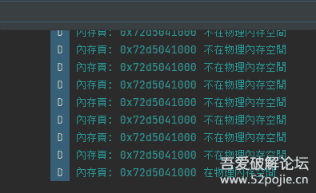

## 4> 其他檢測思路

回顧一下，cheat程序是通過`process_vm_readv`來跨進程讀取`libUE4.so`的數據，然後繪制方框、射線等。

### 思路一：異常捕獲

通過`mprotect`將`libUE4.so`的某片內存權限置為`0`，然後注冊信號回調捕獲異常。

```
void signal_callback(int sig, siginfo_t *info, void *ucontext) {

    ucontext_t* ctx = reinterpret_cast(ucontext);

    if (ctx->uc_mcontext.pc uc_mcontext.pc >= (libUE4_base + libUE4_size)) {

        LOGD("[signalCallback] sig: %lx  pc: %llx  offset: %llx  lr: %llx", sig, ctx->uc_mcontext.pc, (ctx->uc_mcontext.fault_address), ctx->uc_mcontext.regs[30]);

    }

    int pagesize = getpagesize();

    uint64_t addr = libUE4_base + 0xADF07C0;

    uint64_t start = addr & (~(pagesize - 1));

    mprotect(reinterpret_cast(start), pagesize * 2, PROT_READ | PROT_WRITE);

}

void init_signal() {

    struct sigaction act;

    sigset_t sigset;

    sigfillset(&sigset);

    act.sa_mask = sigset;

    act.sa_sigaction = signal_callback;

    act.sa_flags = SA_SIGINFO;      // 代表使用sa_sigaction與非sa_handler

    sigaction(SIGSEGV, &act, 0);

}

void* test(void* arg) {

    sleep(5);

    init_signal();

    if (!libUE4_base)

        libUE4_base = ElfUtils::findBaseAddress("libUE4.so");

    if (!libUE4_size)

        libUE4_size = ElfUtils::findModuleSize("libUE4.so");

    LOGD("base: 0x%llx  size: 0x%llx", libUE4_base, libUE4_size);

    int pagesize = getpagesize();

    uint64_t addr = libUE4_base + 0xADF07C0;

    uint64_t start = addr & (~(pagesize - 1));

    while (true) {

        mprotect(reinterpret_cast(start), pagesize * 2, PROT_NONE);

//        sleep(1);

//        usleep(100);

    }

}
```

結果會導致外掛功能失靈，且無法捕獲cheat的誇內存訪問。

### 思路二

由分析可知cheat初始化時會通過`/proc//maps`獲取`libUE4.so`的基址，因此嘗試利用`inotify`來監測`/proc//maps`，當訪問次數超過`n`次時代表非法訪問。

```
void* watch_proc_maps(void* arg) {
    char path[0x100] = {0};

    snprintf(path, NAME_MAX, "/proc/%d/maps", getpid());

    int fd = inotify_init();

    if (fd mask & IN_ACCESS)){
                    ++access_count;
                }

                i += sizeof(struct inotify_event) + event->len;
            }
        }

        // 超過n次訪問, 代表不正常
        // 只記錄一次
        if (access_count > n && !loged) {
            loged = true;
            logManager->writeLine("[Illegal Access] target: %s  count: 0x%lx", path, access_count);
        }

    }
    pthread_exit(0);
}
```

結果是啟動cheat並初始化後，能順利監測到其訪問`maps`的行為，缺點是沒有更詳細的上下文。

## 3> 結語

又一個周末獻給了騰訊，所幸也是有所收獲，願各位讀者也是如此。

由於時間和能力有限，很多東西都沒有仔細深入分析，只能一筆帶過，屬實無奈。

## 3> 參考

- [//pshocker.github.io/2022/05/14/Android内存读写断点-mprotect/](https://pshocker.github.io/2022/05/14/Android%E5%86%85%E5%AD%98%E8%AF%BB%E5%86%99%E6%96%AD%E7%82%B9-mprotect/:https)
- [//pshocker.github.io/2022/05/08/Android内存读写检测-inotify/](https://pshocker.github.io/2022/05/08/Android%E5%86%85%E5%AD%98%E8%AF%BB%E5%86%99%E6%A3%80%E6%B5%8B-inotify/:https)
- [//pshocker.github.io/2022/05/08/Android内存读写检测-mincore/](https://pshocker.github.io/2022/05/08/Android%E5%86%85%E5%AD%98%E8%AF%BB%E5%86%99%E6%A3%80%E6%B5%8B-mincore/:https)
- [//stackoverflow.com/questions/15623442/how-do-i-determine-the-files-corresponding-to-a-uinput-device](https://stackoverflow.com/questions/15623442/how-do-i-determine-the-files-corresponding-to-a-uinput-device:https)
- [//www.kernel.org/doc/Documentation/input/uinput.rst](https://www.kernel.org/doc/Documentation/input/uinput.rst:https)
