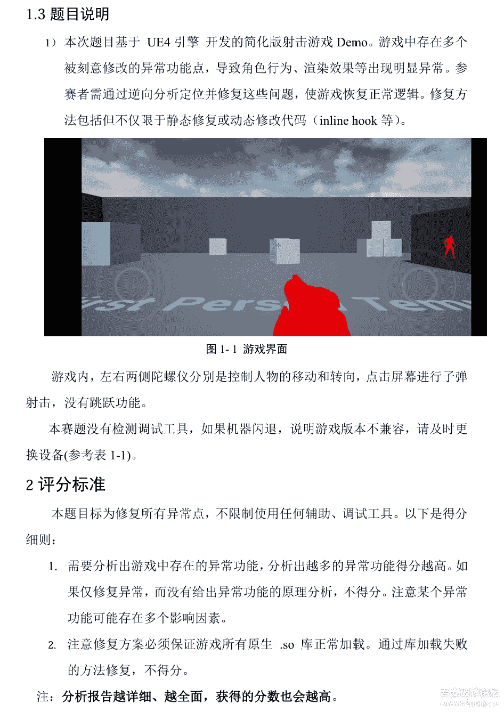

# [Android CTF] 2025腾讯游戏安全技术竞赛 安卓初赛

- 原帖: https://www.52pojie.cn/forum.php?mod=viewthread&tid=2024227
- 抓取时间: 2026-11-01T15:52:55.415Z

第一次参加，写得不怎么好，还请多多指教🙇‍♂️

### 题目



启动游戏后可以明显发现游戏存在加速、自瞄、透视等问题。

首先判断虚幻引擎版本，我们可以直接在`AndroidManifest.xml`中找到UE4.27


对所有so文件进行分析。首先利用偷懒的方法，将so文件通过Virustotal计算一下hash查看首次上传时间可以得知，除`libUE4.so`和`libGame.so`都曾经上传过，是标准库，可以不用看

参考文章https://www.cnblogs.com/revercc/p/17641855.html ，分别找到`libUE4.so`中三个核心参数的偏移

```
GWorld 0xAFAC398
GName 0xADF07C0
GUObject 0xAE34A98
```

然后使用[`UE4Dumper`](https://github.com/revercc/UE4Dumper)对SDK进行提取，再进一步分析

### 异常点1-3：无后座、加速以及加速度

对`libGame.so`进行分析，可以看到该文件对函数使用控制流平坦化混淆，利用IDA插件D-810默认配置即可有效去除进行分析。我们可以留意到有几个异或函数对字符串进行了加密，由于字符串不多这里手动恢复标注即可。

这个so通过`.init_array`调用函数，通过`pthread_create`创建新线程，在`0x1B9C`通过读取`/proc/self/maps`等方法获取`libUE4.so`的基址，然后下面通过基址+偏移计算得到UE4中关键参数的地址


在下面通过遍历Actors中的元素，找到所要的Actor后，通过偏移计算找到对应要修改的参数


#### 异常点1

根据偏移查找SDK可以得知是开枪时的后坐力，后续通过Frida修改为其他值也可以进一步验证


#### 异常点2、3

同理，根据偏移去查找对应的参数，可知是人物的速度和加速度


#### 修复

这里选择将这三个地方的`STR`赋值汇编`NOP`掉，阻止其修改，应用`patch`，使用MT管理器替换so将apk重新打包签名，即可修复


### 异常点4：自瞄

在游戏内开枪，可以发现在开枪时视角/枪口被强制面向其中一个`cube`。对SDK进行分析，通过Frida Hook进一步确认，发现`Controller.Actor.Object`内的`ControlRotation`决定视角/枪口，可以修改这个值来实现自瞄

```
class Rotator {

    constructor(Pitch, Yaw, Roll) {

        this.Pitch = Pitch;

        this.Yaw = Yaw;

        this.Roll = Roll;

    }

    toString() {

        return `(${this.Pitch}, ${this.Yaw}, ${this.Roll})`;

    }

}

function dumpRotator(rotatorAddr){

    const values = Memory.readByteArray(rotatorAddr, 3 * 4);

    const rot = new Rotator(

        new Float32Array(values, 0, 1)[0], 

        new Float32Array(values, 4, 1)[0], 

        new Float32Array(values, 8, 1)[0] 

    );

    console.log("dump rot", rot);

    return rot;

}

function getControlRotation(actorAddr){

    var data_addr = ptr(actorAddr).add(0x288);

    var rot = dumpRotator(data_addr);

    return rot;

}

function writeControlRotation(actorAddr, a, b, c){

    ptr(actorAddr).add(0x288).writeFloat(a);

    ptr(actorAddr).add(0x288+4).writeFloat(b);

    ptr(actorAddr).add(0x288+8).writeFloat(c);

}
```


因此可以对`Actor`列表里的`PlayerController`+`0x288`的位置下一个写硬件断点，在其被修改时栈回溯找到修改函数。


使用[`stackplz`](https://github.com/SeeFlowerX/stackplz)断点，可以发现正常移动视角时，堆栈情况如`hit_count:4`，而开枪时则`hit_count:3`的情况，对比两种情况，因为两种情况都要进入`#00`所在的函数，因此不好`patch`。通过`frida replace`置空`#01`所在函数，可以发现无法正常开枪，因此该函数与开枪有关系，在这之前也不能动。因此只能对`#01`所在的函数跳转`BLR`patch成`NOP`，阻止其修改`ControlRotation`，即可修复。


### 异常点5：子弹乱飞

在修复自瞄后开枪会发现，子弹并不朝着准星瞄准的方向发射，在查阅相关资料后，得知子弹发射时会通过`GunOffset`、`Location`和`Rotation`等参数计算出发射位置及方向。使用Frida对相关参数进行获取可发现`GunOffset`这一参数被设置为`(100, 0, 10)`，且通过硬件断点确定该参数在开枪时会被读取。将其修改为`(0, 0, 20)`后，子弹乱飞情况有所缓解，但未能彻底解决，测试在`Yaw`为90，270时（即人物侧对地面文字）影响较大，0，180，360时（即人物正对地面文字）影响较小。

```
function getGunOffset(actorAddr){
    var data_addr = ptr(actorAddr).add(0x500);
    dumpVector(data_addr);
}

function writeGunOffset(actorAddr, x, y, z){
    ptr(actorAddr).add(0x500).writeFloat(x);
    ptr(actorAddr).add(0x500+4).writeFloat(y);
    ptr(actorAddr).add(0x500+8).writeFloat(z);
}

writeGunOffset(actorAddrs["FirstPersonCharacter_C"], 0, 0, 20);
```


在射击函数中，也就是前面自瞄修复的下面，可以看到`0x670FBAC`的函数中有两个`rand`函数。将其`patch`成固定值后，此处我patch成`0x7fffff`(`0xffffff`/2)后运行发现小球能够以相对稳定的角度射出，说明此处随机数确实与前面小球左右横跳的情况有关


但仍未弄清楚此处计算结果与`ControlRotation`还会如何运算。在`0x8D2ED80`、`0x8D2E214`的函数里面，可见`ActorSpawning`的字符串以及对`UObject`列表等进行修改，此处应该生成了`Projectile`。本人猜想是需要在这附近对生成子弹的角度修改为`ControlRotation`，使小球恢复向玩家前方射出，参考UE官方示例代码https://dev.epicgames.com/documentation/zh-cn/unreal-engine/3---implementing-projectiles?application_version=4.27#%E5%AE%9E%E7%8E%B0%E5%8F%91%E5%B0%84%E5%87%BD%E6%95%B0


对应一下


刚好符合`SpawnActor`的构造，1个指针+4个参数，使用脚本`hook`一下第3个参数


上面是传入该函数的`Rotation`，下面是`PlayerController`的`Rotation`，可见刚好写反（此处调试时已把`rand` patch掉），把传参改回来就行

```
    var func_addr = moduleBase.add(0x8D2ED80)

    Interceptor.attach(func_addr, {

        onEnter: function (args) {

            dumpRotator(ptr(args[3]));

            var playerRotation = getControlRotation(actorAddrs["PlayerController"]);

            ptr(args[3]).writeFloat(playerRotation.Pitch);

            ptr(args[3]).add(4).writeFloat(playerRotation.Yaw);

        },

        onLeave: function (retval) {

        }

    });
```

此时子弹即可正常向前方射出，但是准心偏下，这个就需要慢慢调参解决

### 异常点6：透视

可以看到`FirstPersonCharacter_C`和`ThirdPersonCharacter`都被渲染成红色，可以猜测二者被应用同一修改

网上查找过相关资料，透视可通过渲染自定义深度实现，Frida测试过这里并没有开启该参数

```
function getRenderCustomDepth(actorAddr){
    var value = ptr(actorAddr).add(0x212).readU8();
    var bitValue = (value >> 3) & 1;
    return bitValue;
}

function getAllRenderCustomDepth(){
    const actors = getActorsAddr();
    for (const actorName in actors) {
        if (actors.hasOwnProperty(actorName)) {
            const actorAddr = actors[actorName];
            try {
                var value = getRenderCustomDepth(actorAddr);
                console.log(`RenderCustomDepth of ${actorName} at ${actorAddr}: ${value}`);
            } catch (e) {
                console.error(`Failed to get RenderCustomDepth of ${actorName} at ${actorAddr}: ${e}`);
            }
        }
    }
}
```

由于对UE4渲染这方面实在不熟悉，不清楚该功能如何实现。猜想可能是从源码上修改了`Character.Pawn.Actor.Object`的深度，使其渲染在其他Actor的顶层，同时使其渲染成红色。

### 相关Frida脚本

```
var moduleBase;

var GWorld;

var GWorld_Ptr_Offset = 0xAFAC398;

var GName;

var GName_Offset = 0xADF07C0;

var GObjects;

var GObjects_Offset = 0xAE34A98;

var actorAddrs

var offset_UObject_InternalIndex = 0xC;

var offset_UObject_ClassPrivate = 0x10;

var offset_UObject_FNameIndex = 0x18;

var offset_UObject_OuterPrivate = 0x20;

var GUObject = {

    getClass: function (obj) {

        return ptr(obj).add(offset_UObject_ClassPrivate).readPointer();

    },

    getNameId: function (obj) {

        try {

            return ptr(obj).add(offset_UObject_FNameIndex).readU32();

        }

        catch (e) {

            return 0;

        }

    },

    getName: function(obj) {

        if (this.isValid(obj)){

            return getFNameFromID(this.getNameId(obj));

        } else {

            return "None";

        }

    },

    getClassName: function(obj) {

        if (this.isValid(obj)) {

            var classPrivate = this.getClass(obj);

            return this.getName(classPrivate);

        } else {

            return "None";

        }

    },

    isValid: function(obj) {

        return (ptr(obj) > 0 && this.getNameId(obj) > 0 && this.getClass(obj) > 0);

    }

}

function getFNameFromID(index) {

    var FNameStride = 0x2

    var offset_GName_FNamePool = 0x30;

    var offset_FNamePool_Blocks = 0x10;

    var offset_FNameEntry_Info = 0;

    var FNameEntry_LenBit = 6;

    var offset_FNameEntry_String = 0x2;

    var Block = index >> 16;

    var Offset = index & 65535;

    var FNamePool = GName.add(offset_GName_FNamePool);

    var NamePoolChunk = FNamePool.add(offset_FNamePool_Blocks + Block * 8).readPointer();

    var FNameEntry = NamePoolChunk.add(FNameStride * Offset);

    try {

        if (offset_FNameEntry_Info !== 0) {

            var FNameEntryHeader = FNameEntry.add(offset_FNameEntry_Info).readU16();    

        } else {
```


```javascript
var FNameEntryHeader = FNameEntry.readU16();

}
} catch(e) {

return "";

}

var str_addr = FNameEntry.add(offset_FNameEntry_String);

var str_length = FNameEntryHeader >> FNameEntry_LenBit;

var wide = FNameEntryHeader & 1;

if (wide) return "widestr";

if (str_length > 0 && str_length > 3) & 1;

return bitValue;

}

function getAllRenderCustomDepth(){

const actors = getActorsAddr();

for (const actorName in actors) {

if (actors.hasOwnProperty(actorName)) {

const actorAddr = actors[actorName];

try {

var value = getRenderCustomDepth(actorAddr);

console.log(`RenderCustomDepth of ${actorName} at ${actorAddr}: ${value}`);

} catch (e) {

console.error(`Failed to get RenderCustomDepth of ${actorName} at ${actorAddr}: ${e}`);

}

}

}

}

function main(){

Java.perform(function(){

set("libUE4.so");

actorAddrs = getActorsAddr();

writeGunOffset(actorAddrs["FirstPersonCharacter_C"], 0, 0, 20);

});

var func_addr = moduleBase.add(0x8D2ED80)

Interceptor.attach(func_addr, {

onEnter: function (args) {

dumpRotator(ptr(args[3]));

var playerRotation = getControlRotation(actorAddrs["PlayerController"]);

ptr(args[3]).writeFloat(playerRotation.Pitch);

ptr(args[3]).add(4).writeFloat(playerRotation.Yaw);

},

onLeave: function (retval) {

}

});

}

setImmediate(main);
```
