# [Android 原创] 【安卓新手】雷电模拟器安装`magisk`和`Lsposed`

- 原帖: https://www.52pojie.cn/forum.php?mod=viewthread&tid=2024885
- 抓取时间: 2026-11-01T15:52:42.488Z

在雷电模拟器上安装`magisk`和`Lsposed`，难了好几天，今天成功了，分享一下操作过程。

## 一、雷电模拟器官网下载最新版模拟器

配置如下：
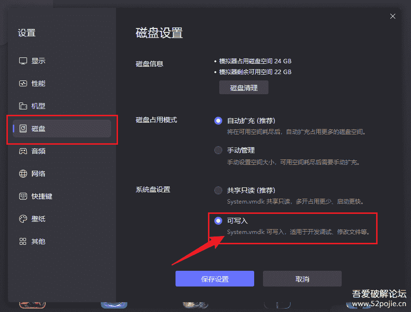
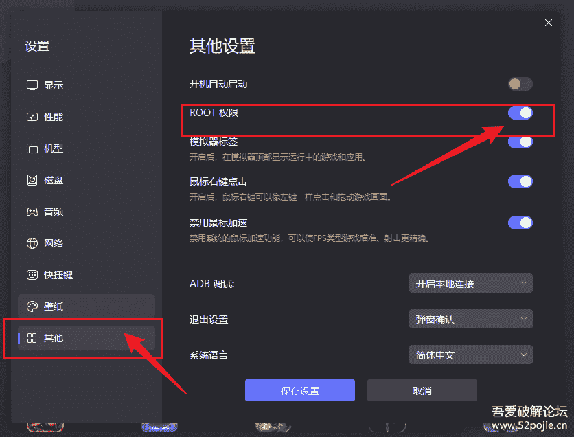

## 二、`magisk`版本使用`Kitsune`版本

`magisk`版本使用`Kitsune`版本，版本是`V27.2`，模拟器要使用`app-debugging.apk`（在附件），其他的是给真机用的。
拖入模拟器安装，
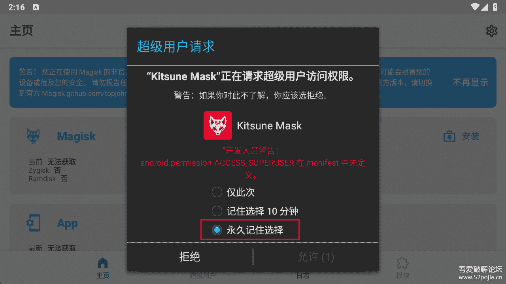

退出`magisk`，重新进
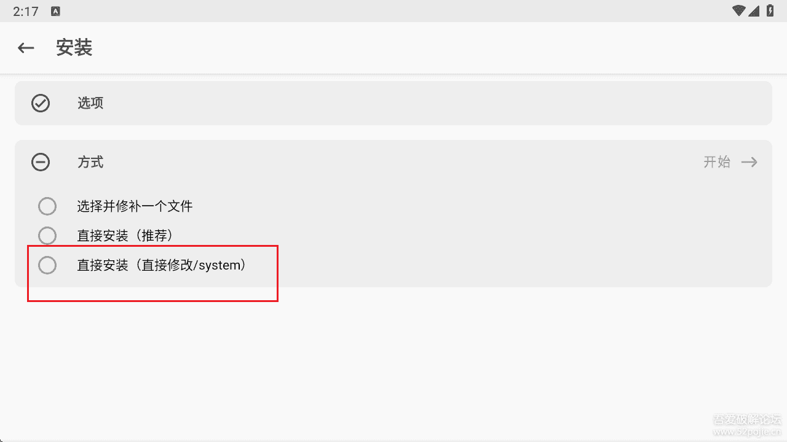
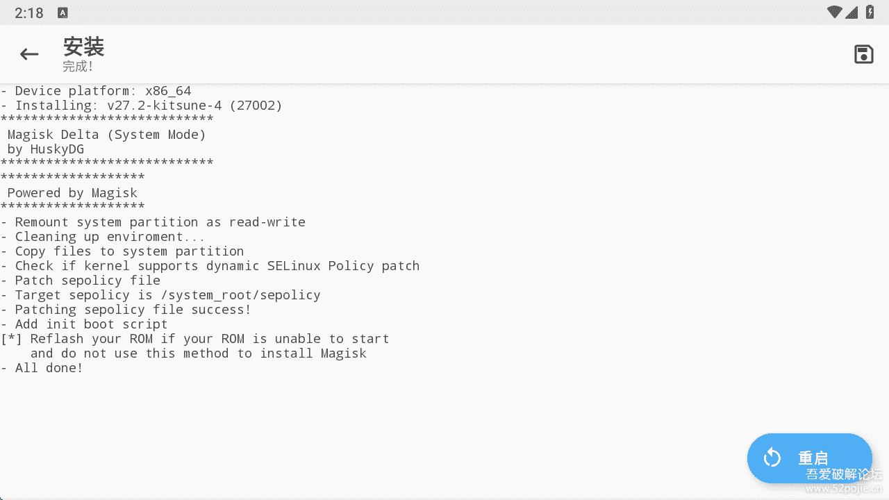

安装成功，重新启动模拟器。
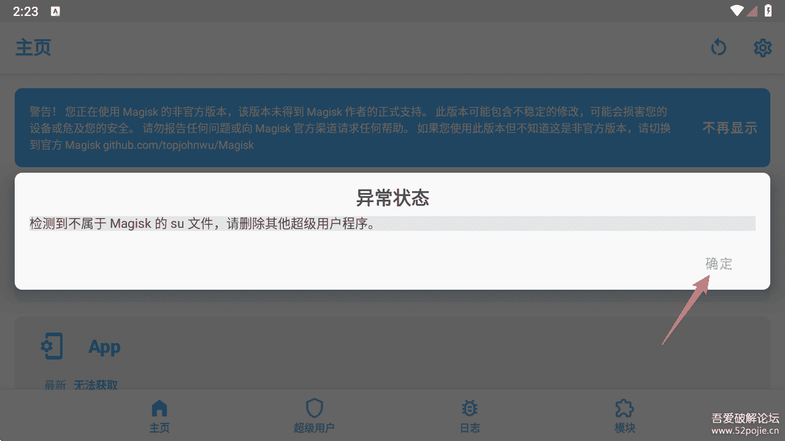

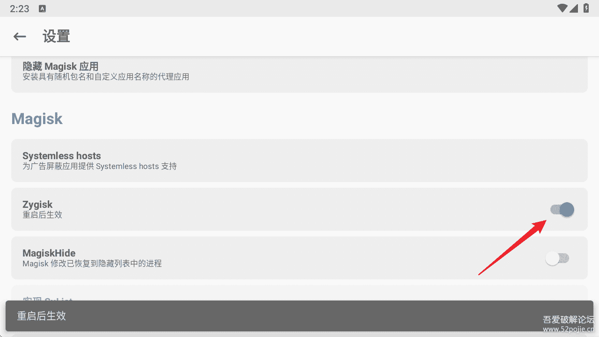

## 三、删除雷电模拟器`su`文件

重新启动模拟器，安装MT管理器，并注册登录，找到`system/xbin/su`，并删除
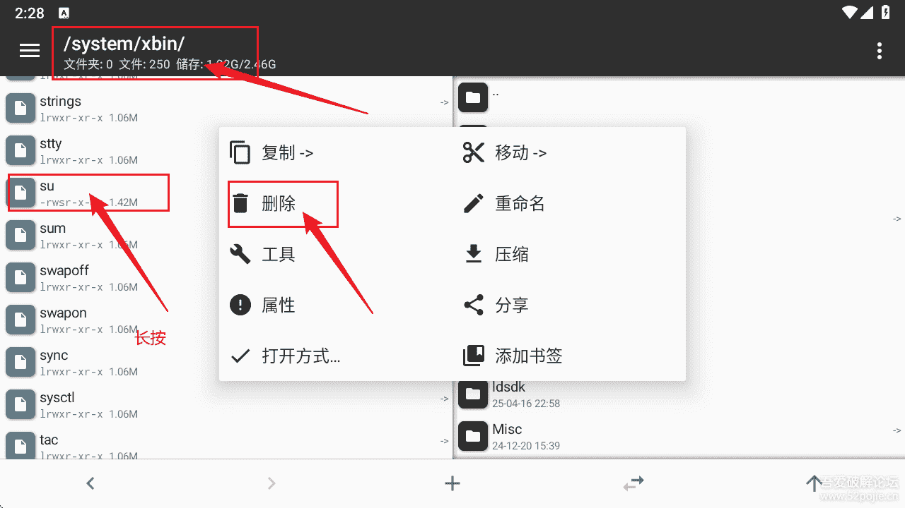

## 四、安装`Lsposed`

把`Lsposed.zip`拖入模拟器共享文件夹
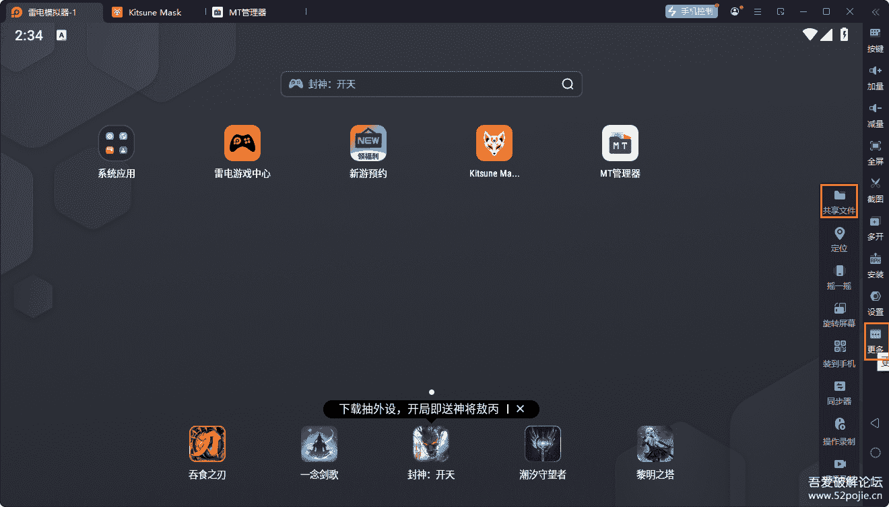

启动`magisk`
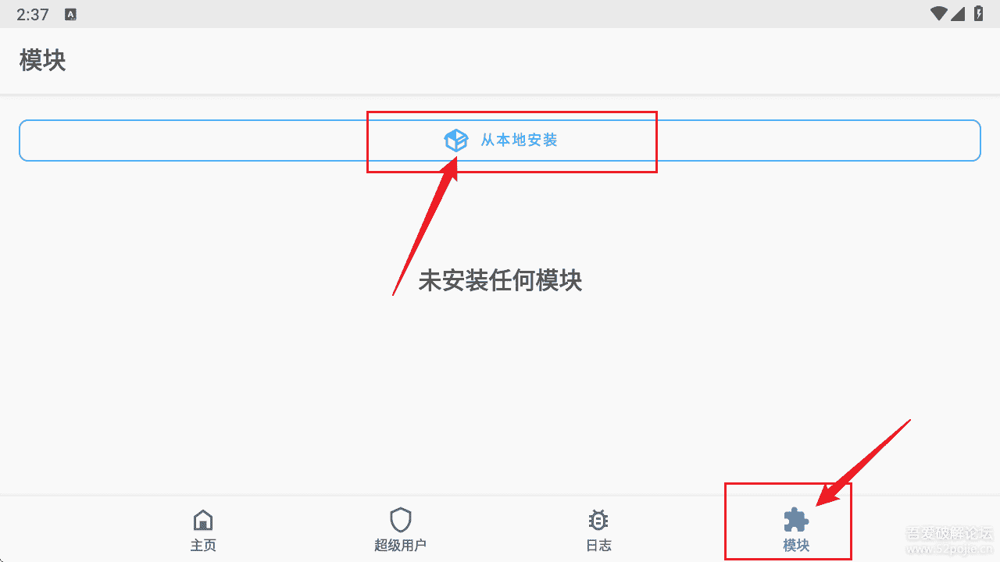
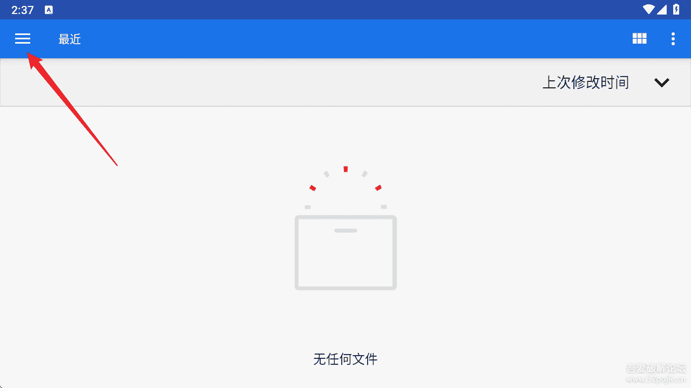
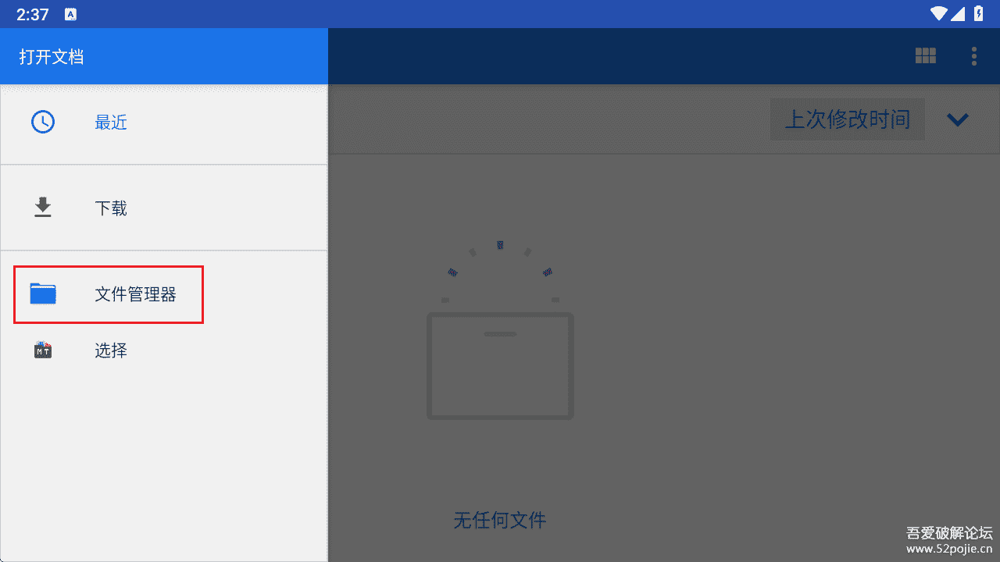
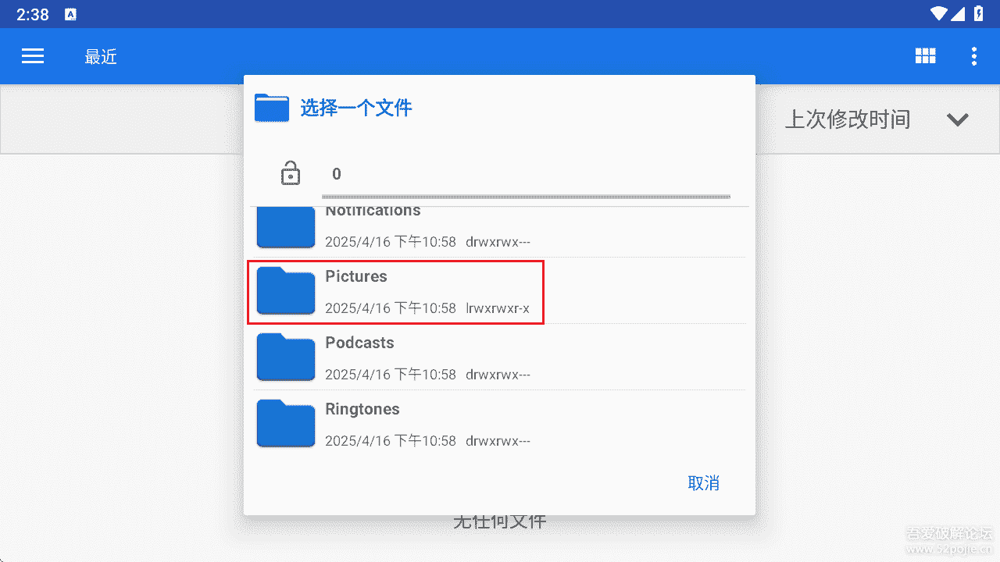
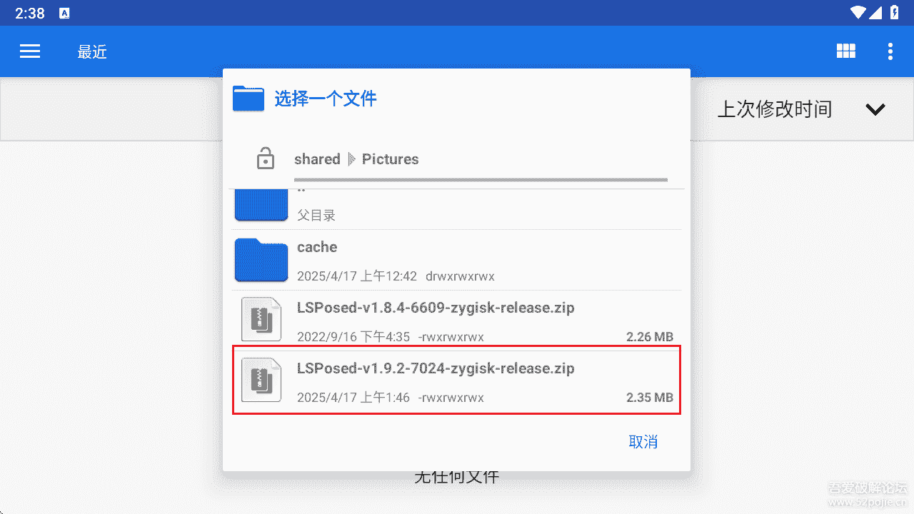
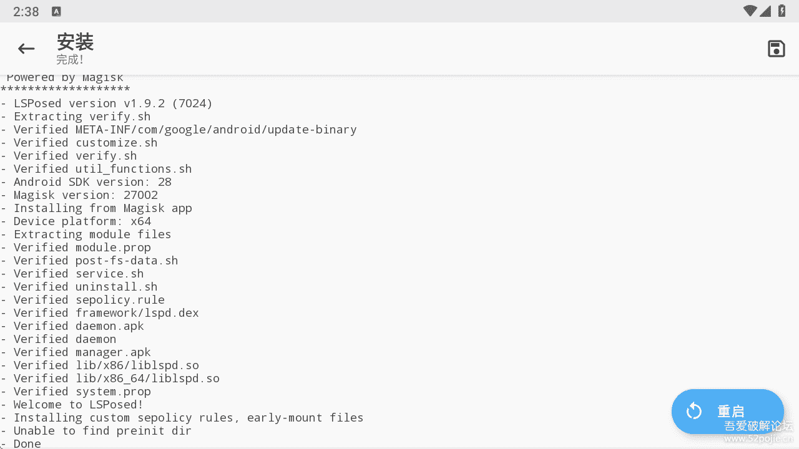

安装完毕

安装包如下
https://wwtc.lanzouq.com/iy2VI2tsrsid 密码52pj
