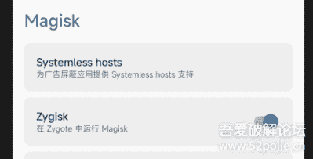
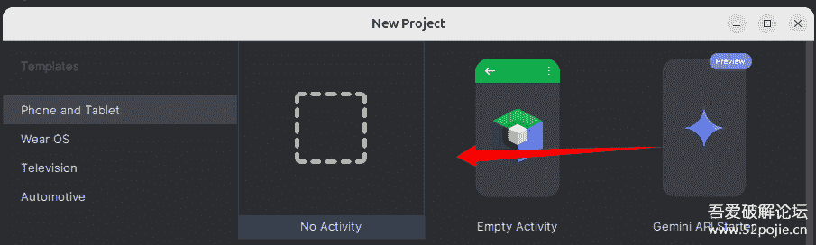
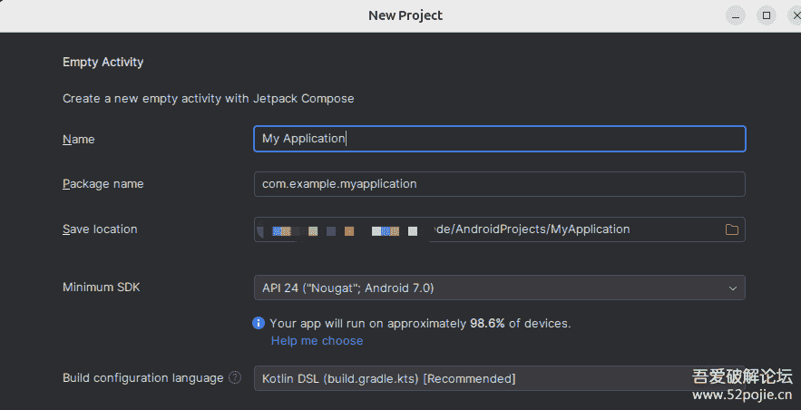
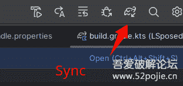
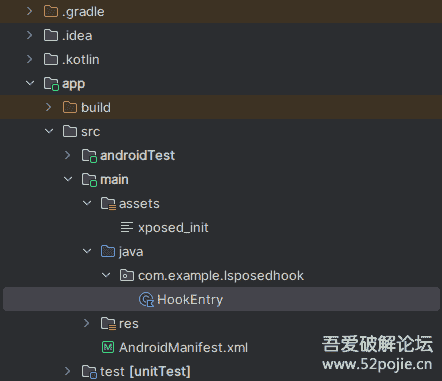
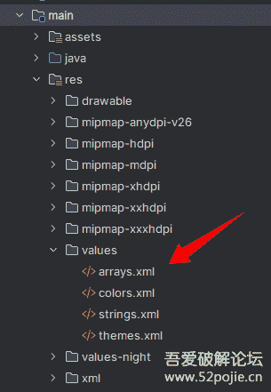
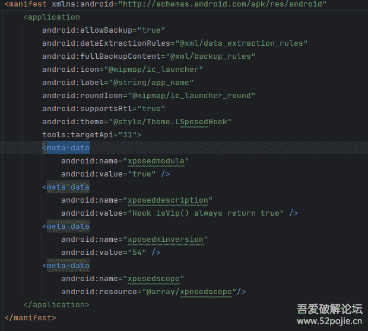
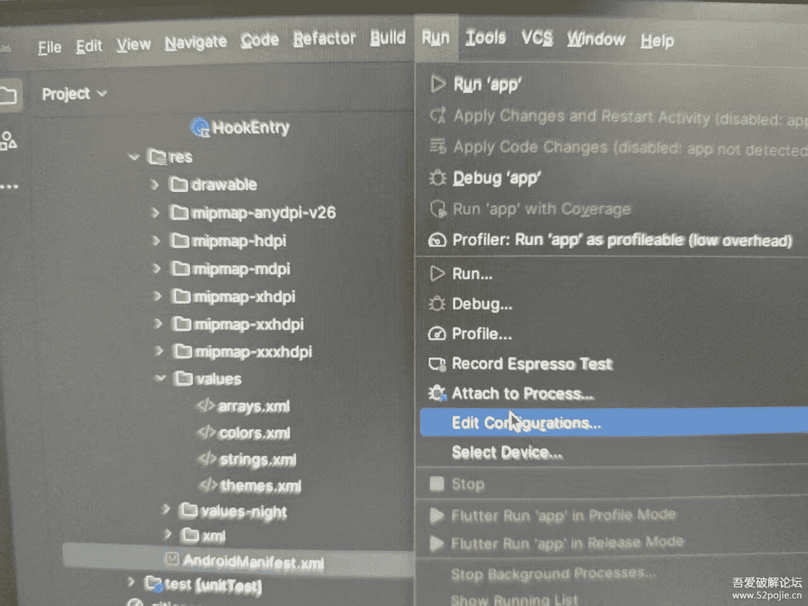
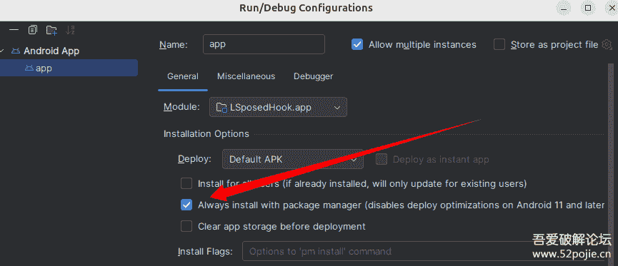
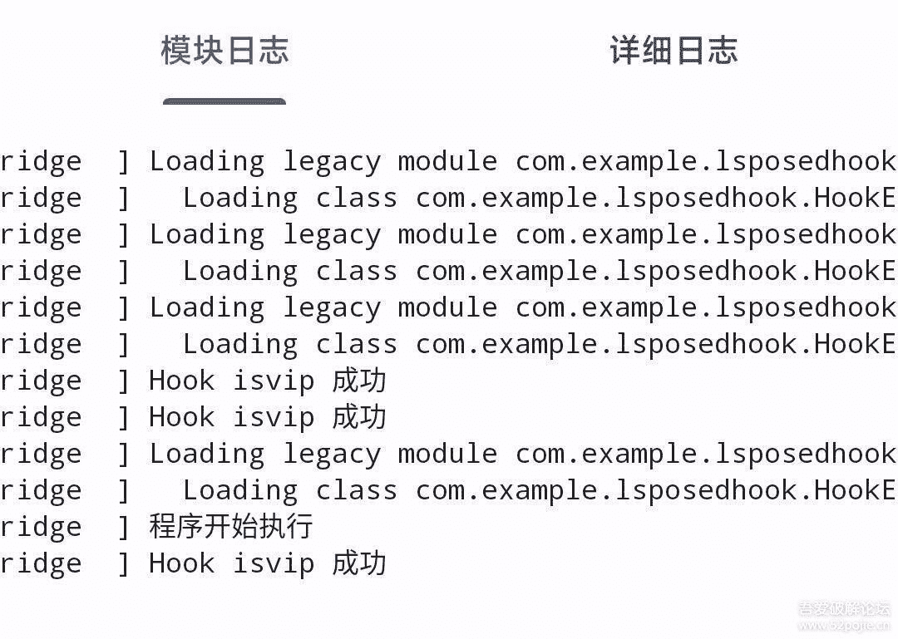

# [Android 原创] Android逆向学习（八）Xposed快速上手(上)

- 原帖：https://www.52pojie.cn/forum.php?mod=viewthread&tid=2029038
- 抓取时间：2026-11-01T15:52:04.289Z

这是吾爱破解正己大大教程中的Xposed快速上手内容的实践，然后我的系统还是ubuntu，这是作业的实现。

## 前言

xposed是一个用来hook的工具，简而言之，通过替换`/system/bin/app_process`程序控制`zygote`进程，这样的话，`app_process`在启动过程中会加载`XposedBridge.jar`这个jar包，从而完成对`Zygote`进程以及创建的Dalvik虚拟机的劫持。

看起来有点烧脑是不是，没关系，会用就行！

之前的博客中我们讲解了frida这个框架（个人比较喜欢用这个来分析），但是一个问题是frida框架需要通过电脑端进行控制，也就是我们需要在电脑端运行`python`程序，然后通过这个程序进行hook。

如果说我们想要长久的使用一个hook程序，也就是不使用电脑也能hook，frida是很难实现的，但是xposed可以实现，只需要编写好插件，xposed就能根据这个插件长久的执行hook操作，不需要再使用电脑连接。

不过xposed现在已经不再支持最新的系统，所以本章节在手机端主要用到的是Lsposed框架。

## 原理

首先讲解一下xposed原理，这就要涉及到android的基本的原理。

Dalvik 是 Android 系统最初使用的虚拟机，用于执行 Android 应用程序。它不是 Java 虚拟机（JVM），但可以运行将 Java 源码编译成 `.dex`（Dalvik Executable）格式的字节码文件。每个 Android 应用都在一个独立的 Dalvik 实例中运行。

> 注意：从 Android 5.0（Lollipop）开始，Dalvik 被新的 ART（Android Runtime）替代了，但原理上是类似的，都是“虚拟机”或“运行时环境”。

每个 Android 应用在运行时都会拥有一个独立的虚拟机实例（在 Dalvik 时代如此，后来的 ART 运行时也是一样的概念）。

更准确地说：

- 每个 App 运行在自己的进程中；
- 这个进程内有一个独立的虚拟机实例（Dalvik 或 ART）；
- 各个 App 之间的虚拟机互相隔离，互不影响。

所以说，相当于每个虚拟机中负责保存变量等信息，具体执行的时候，再放到CPU上

Xposed 的本质：修改 ART/Dalvik 的方法调用流程

1. Android 应用运行流程复习（简化版）：

- Java/Kotlin 代码编译成 `.dex`；
- 运行时被 ART（或老版本的 Dalvik）虚拟机加载；
- 虚拟机会调用类的方法；
- 方法的执行依赖虚拟机内部的“方法表”（method table）和类元信息。

2. Xposed 的关键做法：

> 在方法被调用前，修改其在虚拟机中的元数据指针，插入你自己的代码逻辑。

换句话说，就是把这个“指向原始函数”的指针，改为“指向你自己的 Hook 逻辑”。

## 环境准备

### 手机环境

首先在Magisk中开启Zygisk。



之后下载LSposed软件：[//github.com/LSPosed/LSPosed](https://github.com/LSPosed/LSPosed:https)

下载安装完成后重启手机

下载后桌面上可能不会出现图标，这时候在拨号键输入代码 `*#*#5776733#*#*` 就可以显示出LSposed控制面板，然后勾选强制显示就可以显示出桌面图标，方便进入：


到这里，LSposed就安装完成

### 电脑环境

首先使用Android Studio创建一个空 `Activity`



之后的配置默认就好，如果习惯用java可以用java，因为现在google强推kotlin以替换java语言，所以这次我用的直接就是kotlin



创建完成后，对目录结构进行配置，首先是下载xposed的包，可能有小伙伴要问，不是用的LSposed吗，为什么要用xposed。

原因是LSposed兼容了原来的xposed插件，也就是可以利用原来xposed包开发LSposed包。

下载包的话主要在以下几个文件内修改：

#### `settings.gradle.kts`

```kotlin
pluginManagement {
    repositories {
        google {
            content {
                includeGroupByRegex("com\\.android.*")
                includeGroupByRegex("com\\.google.*")
                includeGroupByRegex("androidx.*")
            }
        }
        mavenCentral()
        gradlePluginPortal()
        maven { url =  uri("https://maven.aliyun.com/repository/public/") } //添加这一行
    }
}
dependencyResolutionManagement {
    repositoriesMode.set(RepositoriesMode.FAIL_ON_PROJECT_REPOS)
    repositories {
        maven { url =  uri("https://maven.aliyun.com/repository/public/") } //添加这一行
        google()
        mavenCentral()
    }
}

rootProject.name = "LSposedHook"
include(":app")
```

#### 5> `build.gradle.kts`（`app` 目录下的那个）

```kotlin
dependencies {

    compileOnly("de.robv.android.xposed:api:82") //添加这一行

    implementation(libs.androidx.core.ktx)

    implementation(libs.androidx.appcompat)

    implementation(libs.material)

    testImplementation(libs.junit)

    androidTestImplementation(libs.androidx.junit)

    androidTestImplementation(libs.androidx.espresso.core)

}
```

之后 `Sync` 以下，就可以下载包了



下载完成之后，开始编写包，首先创建以下几个文件：

- `assets` 下的 `xposed_init`
- `HookEntry`
- 在 `src/main/res/values` 下面创建一个 `arrays.xml` 文件





创建完成这三项之后，在 `AndroidManifest.xml` 下加入这些 `meta-data`，如下图所示，加入到 `application` 的标签中，这样 LSposed 才能识别到这是一个 xposed 插件：



然后 `xposed_init` 中加入 kt 文件的包名，比如创建的 kt 文件叫 `HookEntry`，那么 `xposed_init` 中就写入一个这个（就是包名加上类名）：

```text
com.example.lsposedhook.HookEntry
```

这样 LSposed 就知道这个类里面有插件的代码。

之后在 `arrays.xml` 中加入以下内容：

```xml
    
        
        com.zj.wuaipojie
    
```

这可以表明该模块是用于这个应用的。

## 编写 LSposed 脚本

### 目标

通过 hook 完成挑战二

### 脚本编写

在 `HookEntry` 中写入：

```kotlin
package com.example.lsposedhook // 定义当前类的包名，和项目结构对应

// 引入 Xposed 框架提供的接口和工具类

import de.robv.android.xposed.IXposedHookLoadPackage // Xposed 的主接口，用于处理加载的包

import de.robv.android.xposed.callbacks.XC_LoadPackage // 包加载时的回调参数

import de.robv.android.xposed.XposedBridge // 提供日志输出等功能

import de.robv.android.xposed.XC_MethodReplacement // 用于替换目标方法的实现

import de.robv.android.xposed.XposedHelpers // 提供方法查找和 Hook 的辅助工具类

class HookEntry : IXposedHookLoadPackage { // 实现 Xposed 的主入口接口

    override fun handleLoadPackage(lpparam: XC_LoadPackage.LoadPackageParam) {

        // 判断当前加载的包是否是我们要 Hook 的目标 App

        if (lpparam.packageName != "com.zj.wuaipojie") return // 如果不是目标包则直接返回，不做处理

        XposedBridge.log("程序开始执行") // 打日志，说明模块开始执行 hook 操作

        try {

            // Hook 目标类中的 isvip 方法，并替换它的返回值为 true

            XposedHelpers.findAndHookMethod(

                "com.zj.wuaipojie.ui.ChallengeSecond", // 要 hook 的类的完整类名（含包名）

                lpparam.classLoader,                   // 类加载器，用于加载目标类

                "isvip",                               // 要 hook 的方法名

                XC_MethodReplacement.returnConstant(true) // 替换方法，始终返回 true

            )

            XposedBridge.log("Hook isvip 成功") // Hook 成功的日志

        } catch (e: Throwable) {

            // 捕获异常并打印日志，便于调试

            XposedBridge.log("Hook isvip 失败: ${e.message}")

        }

    }

}
```

安装这个模块的方式也很简单，直接点击运行就可以了

需要注意的是，要勾选上这个，不然更新脚本很麻烦。





### 运行结果

通过执行可以看到，最后 `isvip` 被成功 hook，而且在 LSposed 的应用中也能够看到输出的日志。



然后看到程序的结果也变了


