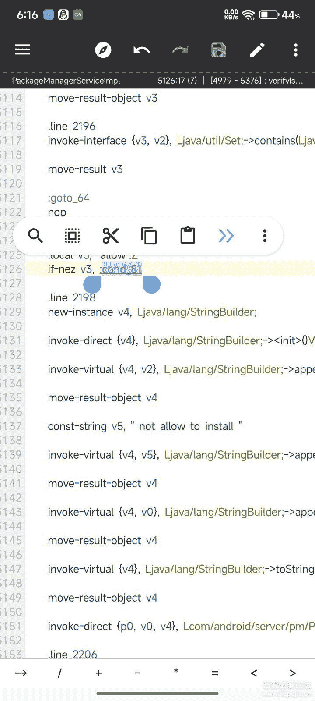
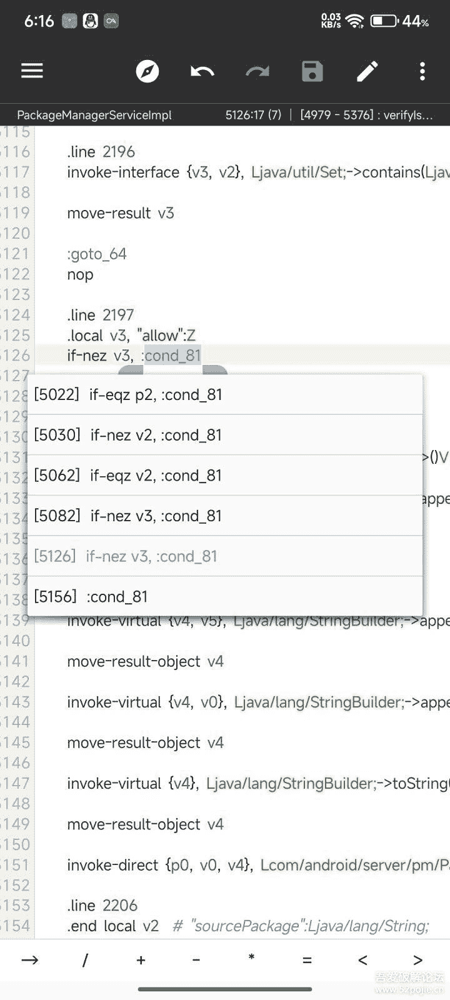
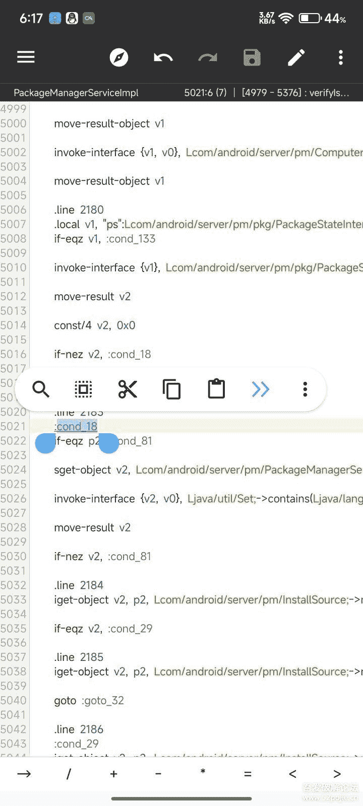
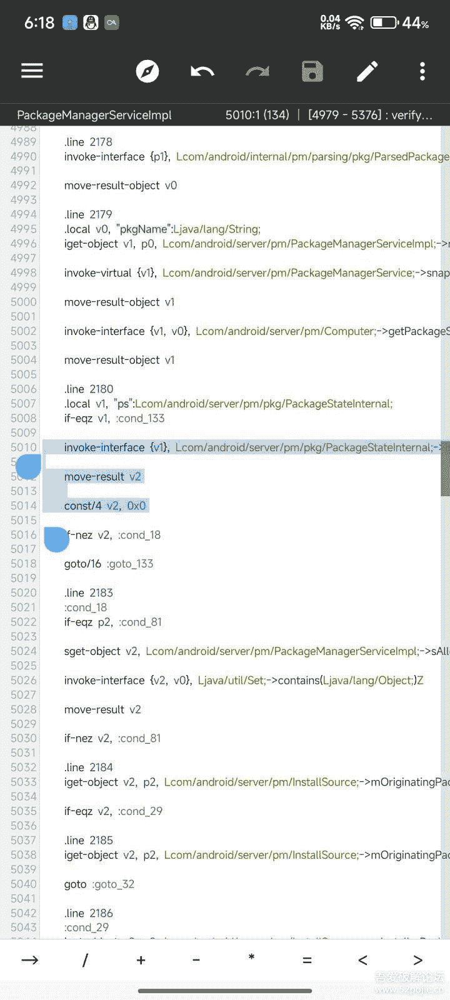
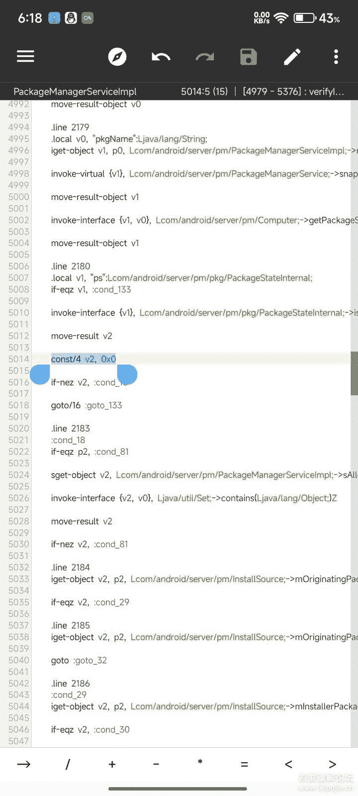

# [Android 分享] 去除HyperOS2对第三方应用安装系统应用的限制 论坛关于安卓系统的相关分析文章好少...

- 原帖: https://www.52pojie.cn/forum.php?mod=viewthread&tid=2029216
- 抓取时间: 2026-11-01T15:51:59.889Z

## 去除 澎湃OS HyperOS2对第三方应用安装系统应用的限制

`/system_ext/framework/miui-services.jar`

搜 `not allow to install` 然后跳转

点第一个

然后继续跳转

给 `v2` 赋值 0

论坛关于安卓系统的相关分析文章好少 为什么呐

仅有的分享 system super 相关的知识的也很少，
