# [Android 原创] Android逆向学习（十） IDA逆向编辑Android so文件

- 原帖: https://www.52pojie.cn/forum.php?mod=viewthread&tid=2031349
- 抓取时间: 2026-11-01T15:51:37.264Z

## Android逆向学习（十） IDA逆向编辑Android so文件

### 一、 写在前面

这是吾爱破解论坛正己大大的第10个教程

`native code`在我之前的博客中讲到过，所以这里就不讲了

简单来说，`native code`就是在`android`中使用`c++`或`c`语言进行开发

这样的话会给逆向带来一定的难度，所以本博客就是介绍如何解决这个问题

使用到的工具有：

`vscode`

`IDA pro 9.0`

### 二、 任务目标

打开挑战7，可以看到这次的任务是要打开这个大门，但是我们是不知道密钥的，所以可以明确我们的任务就是想办法获得这个密钥。

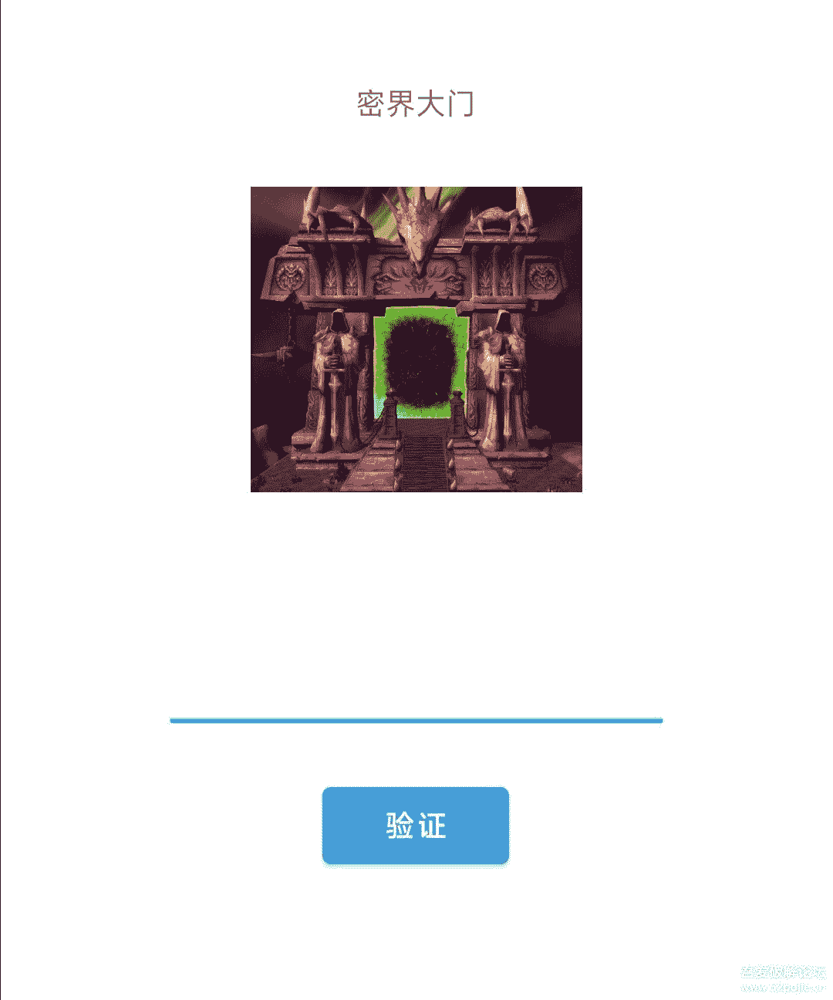

### 三、 实现方法

首先分析第七关的代码：

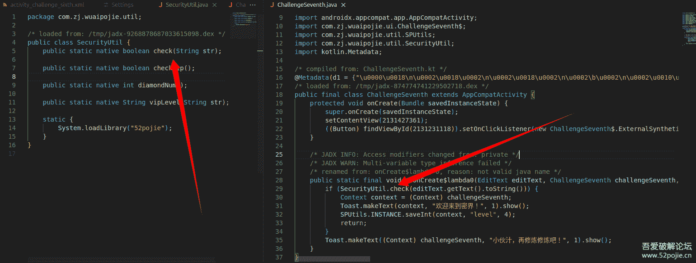

可以发现调用了`lib`中`so`文件，然后我测试用的手机是红米k30su，架构是`arm64`，所以就选择`arm64-v8a`文件夹下面的`so`文件

之后通过`ida`打开这个文件，查找名称为`check`的函数

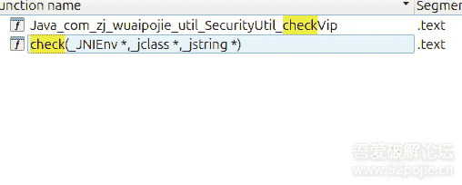

大概就可以判断出`check`是进行判断的函数，只要对这个进行修改就可以了：

然后观察代码的样子，（这是我做完题目后又回过头写博客的，所以跟原版有点不一样，就是`v7=strcmp(v6,v5) == 0`可能本来是1来着）

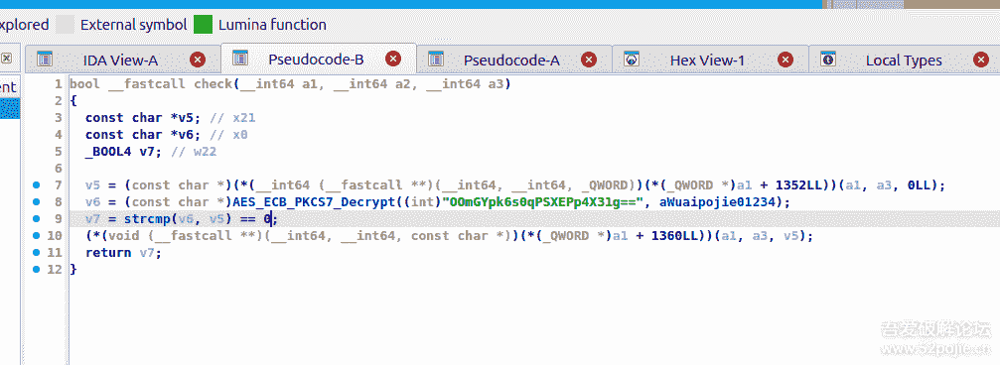

我的第一个想法就是修改`v7`的判断，但实际上这种修改是有点问题

`strcmp` 返回 1 并不等于“不相等”这么简单，它只是在字典顺序上 `str1 > str2` 的情况下才返回 1。

查看汇编代码会发现实际上是这样的：

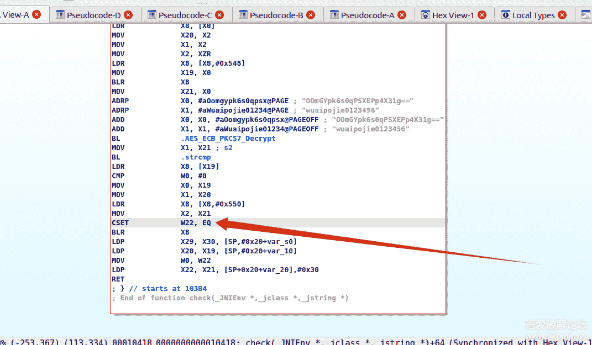

`W22`会保存最终的返回值，只要这个返回值永远是`true`就可以了，说干就干

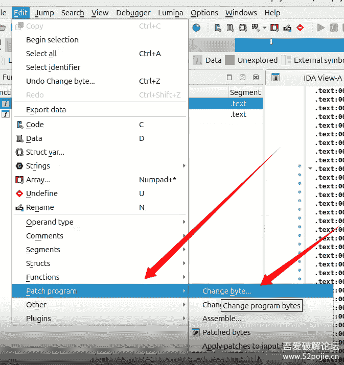

选中`CSET` 然后点击上图中的`Changebyte`

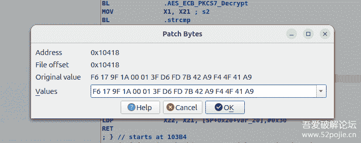

这就是16进制的字节码，然后复制到这个网站

[//armconverter.com/](https://armconverter.com/:https)

这个网站是字节码转汇编的网站

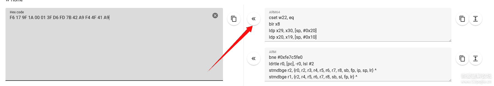

之后修改这个代码，将`cset w22, eq`转化成`mov w22, #1`，就可以永远返回为真，这时候有变出现`ARM64`的字节码，然后复制这个字节码，粘贴回去

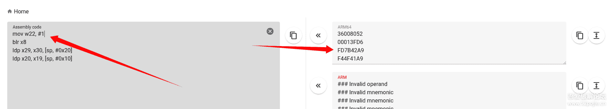

粘贴回去就会发现代码变了：

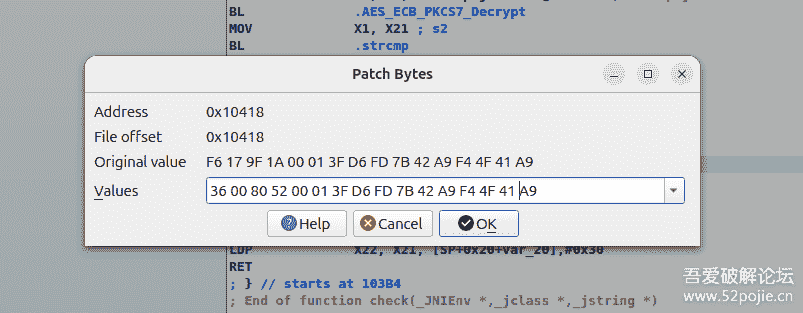

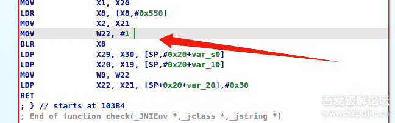

然后保存打包就可以了

保存就是`ctrl+s`

打包就是点击下面的`apply`

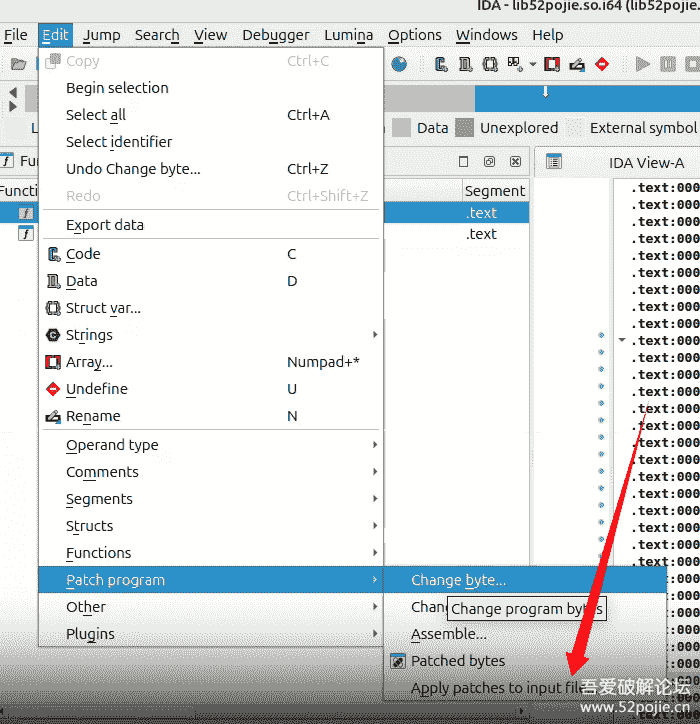

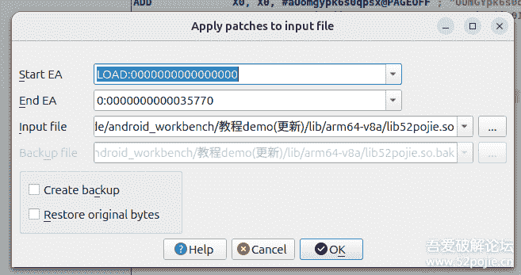

然后通过逆向的重打包功能就可以重新运行：

右键`apktool.yml`然后选择`APKLab：Rebuild and Install the APK`，就可以重新安装了

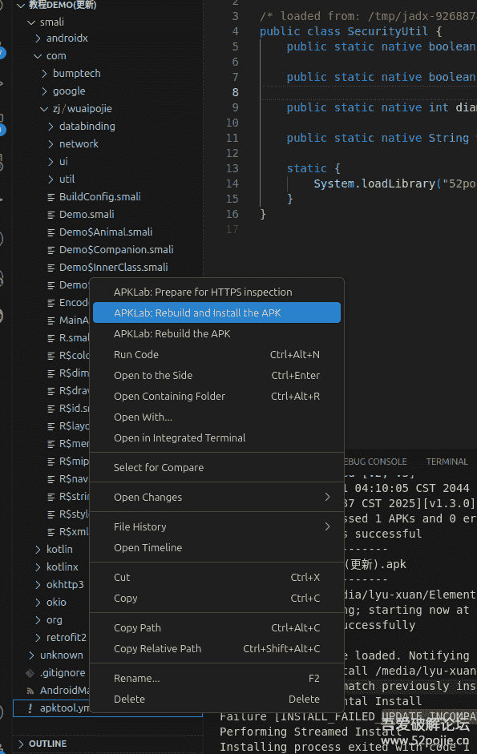

最后的效果就是这样，点击就可以显示进入密界了（为了好玩我把图片换成了虎哥一眼万年的图片）

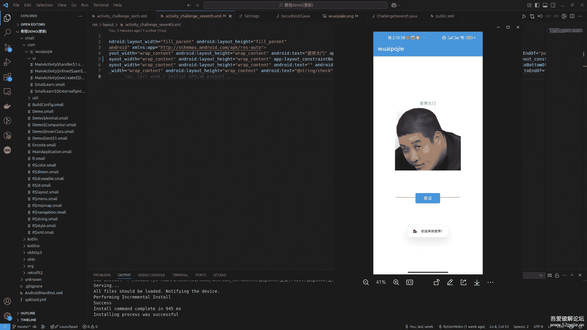

