# [Android 原创] 《某游快爆》APP `sign`值逆向

- 原帖: https://www.52pojie.cn/forum.php?mod=viewthread&tid=2031450
- 抓取时间: 2026-11-01T15:51:34.484Z

## 目录

- [目录](https://www.52pojie.cn/#%E7%9B%AE%E5%BD%95)
- [前言](https://www.52pojie.cn/#%E5%89%8D%E8%A8%80)
- [一、抓包](https://www.52pojie.cn/#%E4%B8%80%E6%8A%93%E5%8C%85)
- [二、jadx反编译apk](https://www.52pojie.cn/#%E4%BA%8Cjadx%E5%8F%8D%E7%BC%96%E8%AF%91apk)
- [三、idapro反编译libtokenso](https://www.52pojie.cn/#%E4%B8%89idapro%E5%8F%8D%E7%BC%96%E8%AF%91libtokenso)
- [四、还原token生成算法](https://www.52pojie.cn/#%E5%9B%9B%E8%BF%98%E5%8E%9Ftoken%E7%94%9F%E6%88%90%E7%AE%97%E6%B3%95)
- [五、结语](https://www.52pojie.cn/#%E4%BA%94%E7%BB%93%E8%AF%AD)

## 前言

本篇文章主要是为了介绍《某游快爆》APP `sign` 值的逆向分析过程，官方网站：`aHR0cHM6Ly93d3cuMzgzOS5jb20vYXBwLmh0bWw=`

最近刚入门Android逆向，看到自己日常使用的这个APP中有游戏时长统计功能（有正常的APP时长统计和本软件内部小游戏的时长统计），就想逆向一下练练手，废话不多说，直接开始~~~

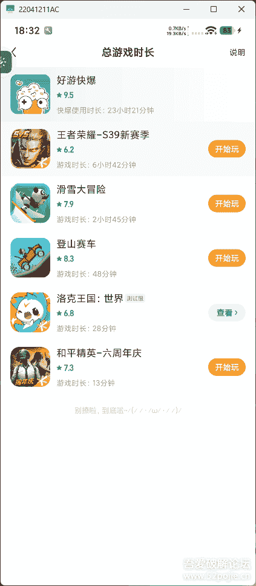

## 一、抓包

那么好，想必大家已经能够猜测到了，这个时长统计功能肯定是通过调用系统底层API获取最近使用时长来实现的，那么作为小白的我第一步是看看有没有这个相关的文档。

通过搜索相关文档，我们发现，APP需要一个权限：`PACKAGE_USAGE_STATS`（包_使用_状态）(神人翻译，忽略)

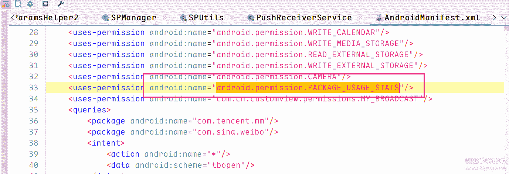

那么好，这个API用jio一猜就知道肯定是和包名挂钩的（参考：<https://blog.csdn.net/weixin_45951701/article/details/117486242>[//blog.csdn.net/weixin_45951701/article/details/117486242](https://blog.csdn.net/weixin_45951701/article/details/117486242:https)），所以上传到服务器端的时候肯定也是按照包名上传的，我们在抓包的时候只需要在众多包里面搜索我们一个游戏的包名即可。

我选择王者荣耀进行搜索吧，包名是：`com.tencent.tmgp.sgame`，然后直接一搜，果然！

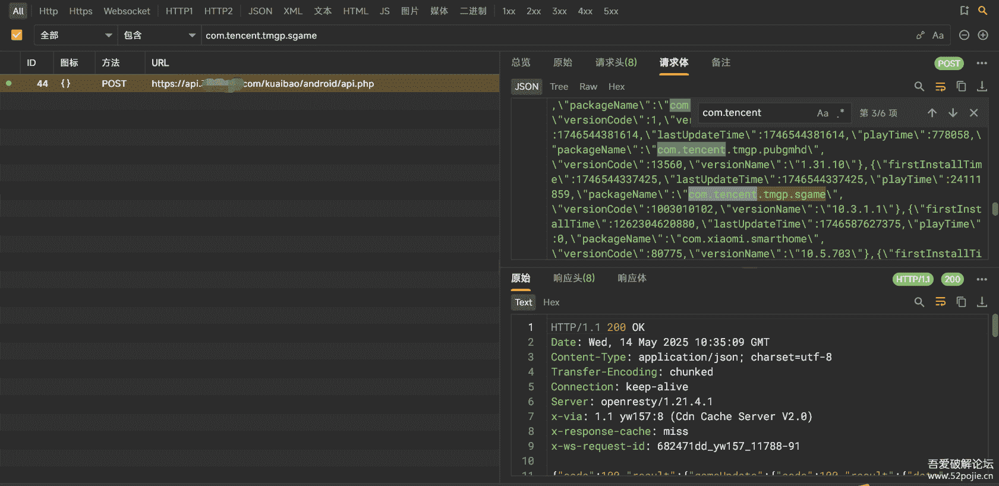

好了，已经知道这个API接口了，可以轻易发现，这里面有好多参数，其中长得最像签名`sign`值的就是这个`t`了：

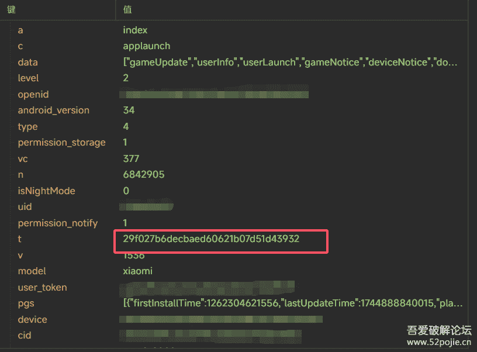

当当当当~~~主角登场！！那么好——jadx，启动！

## 二、jadx反编译apk

刚才看到一个参数`c`是`applaunch`，好多包的这个字段不一样，参数名而且都差不多，所以我们可以直接搜索这个字符串：

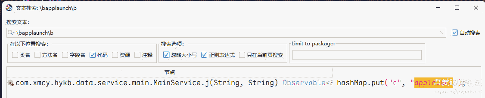

漂亮，gogogo~出发咯~（）

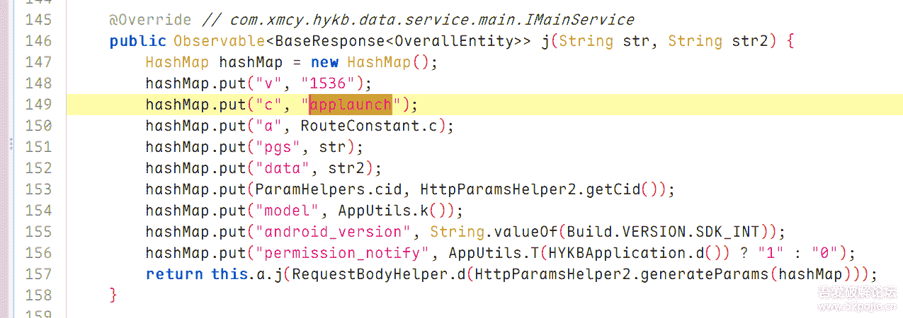

以上是我稍微给一些方法名重命名了一下，基本上都对上了，但是没看见`t`参数是哪儿来的，最后一个`return`倒是个可去之处（这里的`generateParams`也是我重命名好的，我发现这里确实是会生成基本的参数）

点开看看：

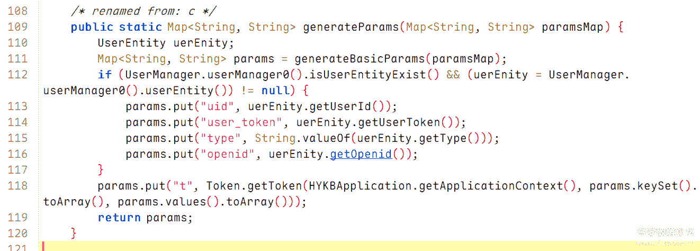

可以发现，这个`t`参数是`Token.getToken()`生成的。

这里重点来了，这个方法是将前面所有的参数的`key`和`value`分成了两个数组之中，然后传给这个方法，第一个上下文参数暂时不用管它。

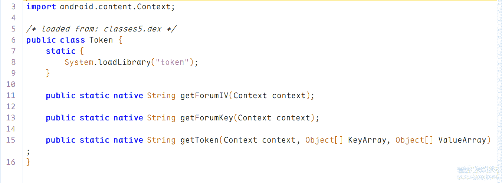

emmmm，好的，是`native`方法，废话不说，找到`libtoken.so`，IDA启动！

## 三、IDAPro反编译`libtoken.so`

打开之后，直接搜索`java`，都对上了都对上了~

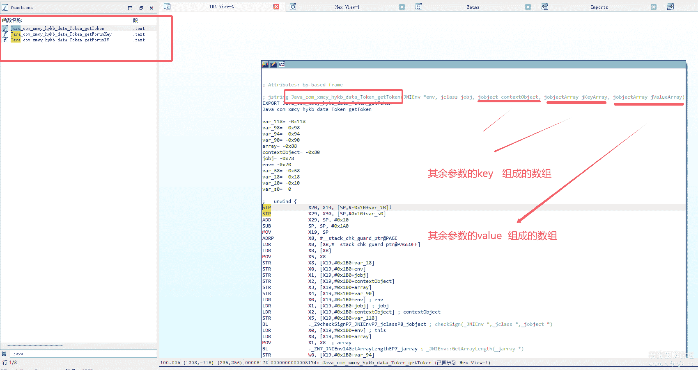

可以看到参数也是对上了，那么好，直接`F5`启动看伪C代码(写了点儿注释)：

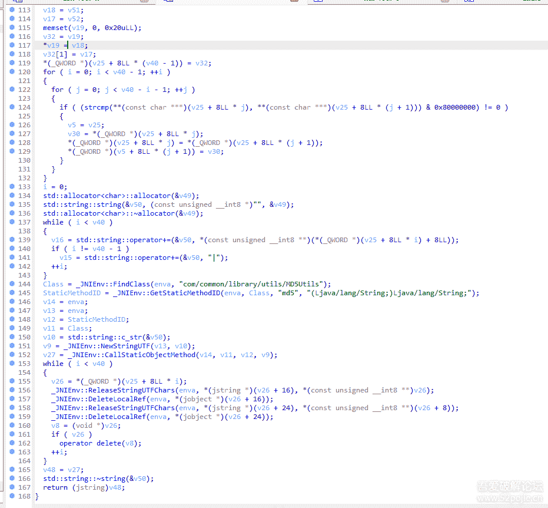

```
jstring __fastcall Java_com_xmcy_hykb_data_Token_getToken(
        JNIEnv *env,
        jclass jobj,
        jobject contextObject,
        _jarray *jKeyArray,
        _jarray *jValueArray)
{
  __int64 v5; // x9
  __int64 v7; // [xsp+0h] [xbp-1B0h] BYREF
  void *v8; // [xsp+8h] [xbp-1A8h]
  jstring v9; // [xsp+10h] [xbp-1A0h]
  const unsigned __int8 *v10; // [xsp+18h] [xbp-198h]
  jclass v11; // [xsp+20h] [xbp-190h]
  jmethodID v12; // [xsp+28h] [xbp-188h]
  _JNIEnv *v13; // [xsp+30h] [xbp-180h]
  _JNIEnv *v14; // [xsp+38h] [xbp-178h]
  std::string *v15; // [xsp+40h] [xbp-170h]
  std::string *v16; // [xsp+48h] [xbp-168h]
  _BYTE *v17; // [xsp+50h] [xbp-160h]
  _BYTE *v18; // [xsp+58h] [xbp-158h]
  _QWORD *v19; // [xsp+60h] [xbp-150h]
  unsigned __int8 *v20; // [xsp+68h] [xbp-148h]
  int *v21; // [xsp+70h] [xbp-140h]
  unsigned __int8 *v22; // [xsp+78h] [xbp-138h]
  int *v23; // [xsp+80h] [xbp-130h]
  void *v24; // [xsp+88h] [xbp-128h]
  __int64 v25; // [xsp+90h] [xbp-120h]
  __int64 v26; // [xsp+A0h] [xbp-110h]
  jobject v27; // [xsp+A8h] [xbp-108h]
  _jmethodID *StaticMethodID; // [xsp+B0h] [xbp-100h]
  jclass Class; // [xsp+B8h] [xbp-F8h]
  __int64 v30; // [xsp+C0h] [xbp-F0h]
  int j; // [xsp+CCh] [xbp-E4h]
  _QWORD *v32; // [xsp+D0h] [xbp-E0h]
  const unsigned __int8 *v33; // [xsp+D8h] [xbp-D8h]
  jstring v34; // [xsp+E0h] [xbp-D0h]
  const unsigned __int8 *StringUTFChars; // [xsp+E8h] [xbp-C8h]
  jstring ObjectArrayElement; // [xsp+F0h] [xbp-C0h]
  const unsigned __int8 **v37; // [xsp+F8h] [xbp-B8h]
  jsize i; // [xsp+104h] [xbp-ACh]
  __int64 *v39; // [xsp+108h] [xbp-A8h]
  jsize v40; // [xsp+114h] [xbp-9Ch]
  jsize v41; // [xsp+118h] [xbp-98h]
  jsize ArrayLength; // [xsp+11Ch] [xbp-94h]
  jarray v43; // [xsp+120h] [xbp-90h]
  jarray array; // [xsp+128h] [xbp-88h]
  jobject contextObjecta; // [xsp+130h] [xbp-80h]
  jclass jobja; // [xsp+138h] [xbp-78h]
  JNIEnv *enva; // [xsp+140h] [xbp-70h]
  jobject v48; // [xsp+148h] [xbp-68h]
  std::allocator v49; // [xsp+150h] [xbp-60h] BYREF
  std::string v50; // [xsp+158h] [xbp-58h] BYREF
  _BYTE v51[7]; // [xsp+160h] [xbp-50h] BYREF
  _BYTE v52[33]; // [xsp+167h] [xbp-49h] BYREF
  _DWORD v53[4]; // [xsp+188h] [xbp-28h] BYREF

  enva = env;
  jobja = jobj;
  contextObjecta = contextObject;
  array = jKeyArray;
  v43 = jValueArray;
  checkSign(env, jobj, contextObject); // 根据名字来看应该就是检查apk签名的，看看有没有被篡改，我们没改，不用管。
  ArrayLength = _JNIEnv::GetArrayLength(enva, array); // jKeyArray的长度，也就是其余参数的key组成的数组的长度（人话：其余参数的个数）
  v41 = _JNIEnv::GetArrayLength(enva, v43); // jValueArray的长度，和上面一样的
  if ( ArrayLength != v41 ) // 就是验证key和value数组的长度是不是一样，因为一会儿要进行排序
    return _JNIEnv::NewStringUTF(enva, (const unsigned __int8 *)"");
  v40 = ArrayLength + 1;  // key数组的长度+1
  v39 = &v7; 
  i = 0;
  v25 = (__int64)&v7 - ((8LL * (unsigned int)(ArrayLength + 1) + 15) & 0xFFFFFFFF0LL);
  while ( i =16j0?c=a>3h=2:?`g", sizeof(v52)); 
  decodeStr(v20, v21);  // 按照“2、9、5、6”的顺序解密 "a8276l17g=16j0?c=a>3h=2:?`g"
  v19 = operator new(0x20uLL);
  v18 = v51;
  v17 = v52;
  memset(v19, 0, 0x20uLL);
  v32 = v19;
  *v19 = v18;
  v32[1] = v17;
  *(_QWORD *)(v25 + 8LL * (v40 - 1)) = v32;
  for ( i = 0; i ::allocator(&v49);
  std::string::string(&v50, (const unsigned __int8 *)"", &v49);
  std::allocator::~allocator(&v49);
  while ( i 
```

## 四、还原token生成算法

整体上的反编译大致就是，它会将加密的一个key（"qlftg}"）和它对应的value（"a8276l17g=16j0?c=a>3h=2:?`g"）解密之后添加到刚才两个数组之中，然后按照key的大小排序（当然是ascii），然后用“|”拼接起来对应的value，然后MD5。所以目前就两件事：

①解出来新加的键值对

②复现排序算法，拼接好后进行MD5

关键在于`decodeStr`函数，我们得跳过去看看：

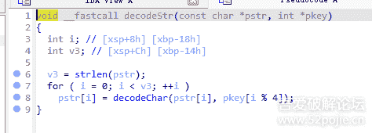

```
void __fastcall decodeStr(const char *pstr, int *pkey)
{
  int i; // [xsp+8h] [xbp-18h]
  int v3; // [xsp+Ch] [xbp-14h]

  v3 = strlen(pstr);
  for ( i = 0; i 
```

其中的`pkey`就是数组2、5、9、6的地址，`pstr`是`key`的数组/`value`的数组。

这个很简单就是便利执行`decodeChar`函数，我们过去瞅瞅：

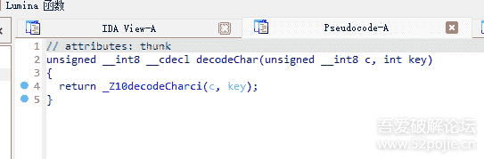

```
unsigned __int8 __cdecl decodeChar(unsigned __int8 c, int key)
{
  return c ^ key;
}
```

emmmm，太简单了，就是个相乘。

好了游戏结束，就是将所有的计算过程自己（AI （纠正） ）写一遍就行了，没什么难度。

但是我是让AI写的，稍微简化了一下：（其实还挺简单的）

```
import hashlib

def getToken(keys, values):
    secret_key = 'secret'  # "qlftg}"  的明文
    secret_value = 'c1714e41e5a907874c59a4d81a8486ea' # "a8276l17g=16j0?c=a>3h=2:?`g" 的明文

    keys_copy = keys.copy()
    values_copy = values.copy()

    keys_copy.append(secret_key)
    values_copy.append(secret_value)

    sorted_pairs = sorted(zip(keys_copy, values_copy), key=lambda x: x[0])

    # 反转拼接顺序
    reversed_concatenated = '|'.join([pair[1] for pair in sorted_pairs][::-1])

    # 使用反转拼接的结果计算MD5
    md5 = hashlib.md5()
    md5.update(reversed_concatenated.encode('utf-8'))
    digest = md5.digest()

    # 十六进制转换
    hex_str = ''.join(f"{b & 0xff:02x}" for b in digest)

    return hex_str
```

## 五、结语

第一次逆一个正儿八经的APP(bushi)，写教程也有不足之道，刚入门逆向，还请各位大佬发现不足之处能够不吝指导！！！[抱拳]
